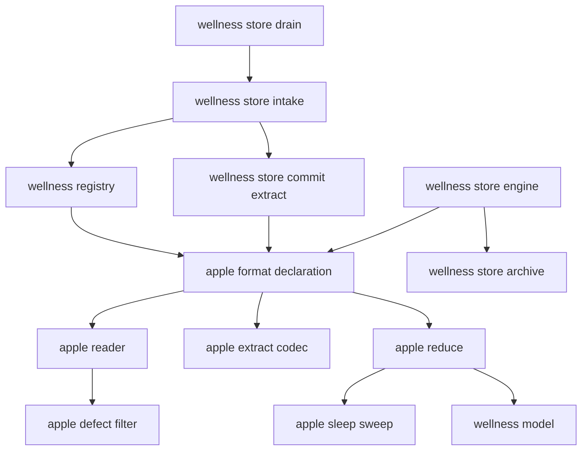
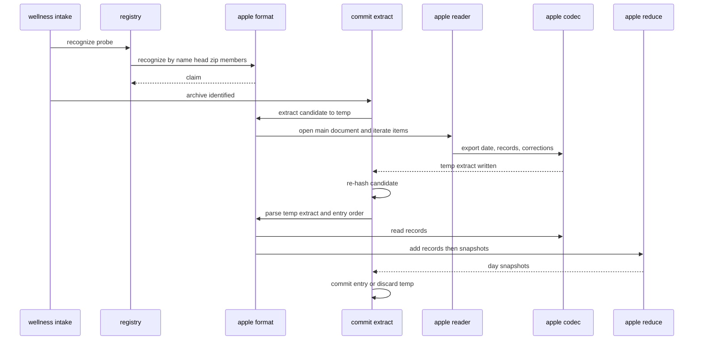
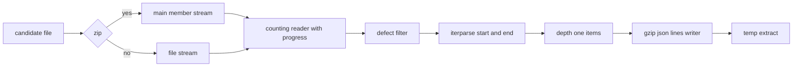
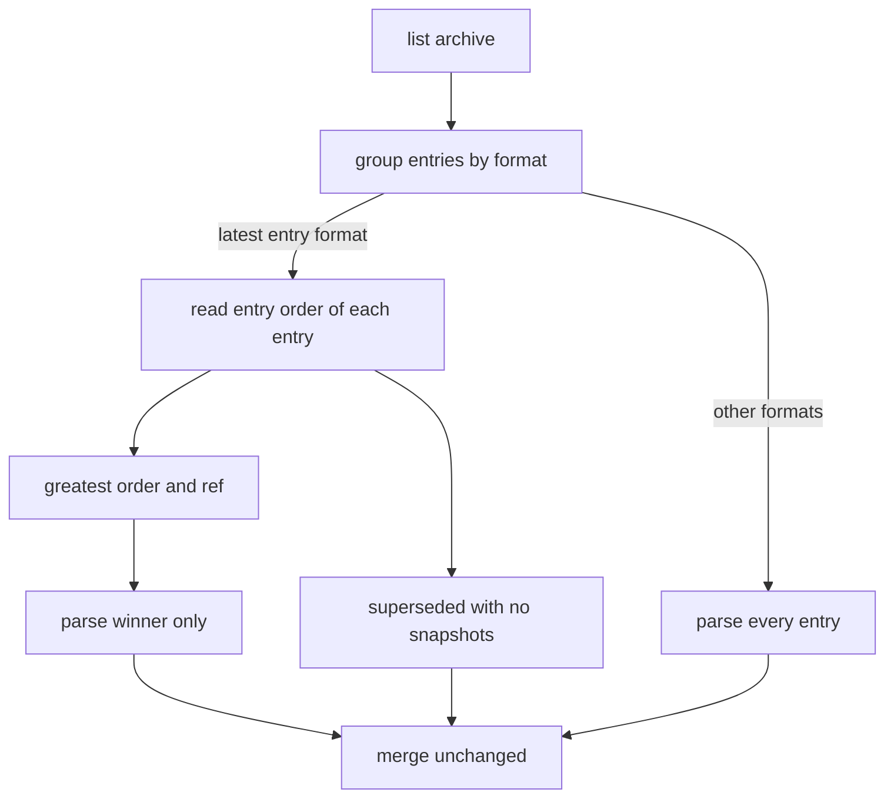

# Design Document — apple-health-import

## Overview

**Purpose**: apple-health-import lets fitdocs read the athlete's Apple Health
history from the export the Health app writes. An `export.zip` (or its bare
`export.xml`) dropped into the inbox is recognized through `wellness-store`'s
format registry, streamed once with bounded memory, and archived as a small,
deterministic, compressed canonical extract holding only the eight wellness
record types fitdocs reads. The extract is parsed into one value per day and
metric under stated per-type rules, with Apple's writing sources used to keep
the Apple Watch's, the iPhone's and other apps' values apart. A later export
supersedes an earlier one.

**Users**: the athlete (exports from the iPhone, drops the file, reads the
series), the athlete's agent (runs the drain), and the downstream specs
`hr-derivation`, `recovery` and `workout-wellness`, which read Apple's values
only through `fitdocs.wellness.read_series`.

**Impact**: `wellness-store`'s registry gains one source (`apple-health`,
kind HUB) and one format (`apple-health`, suffixes `.zip` and `.xml`). The
drain therefore treats `.zip` and `.xml` inbox files as wellness candidates.
`wellness-archive/apple-health/` holds extracts. One amendment to
`wellness-store`'s rebuild engine (A1) stops it parsing superseded entries.
No owned location, page type, frontmatter key or index table is added, so
`CONTRACT_VERSION`, `DOC_VERSION` and the index `SCHEMA_VERSION` do not move.

### Goals
- Import a multi-gigabyte Apple Health export with flat memory, a progress
  report and all-or-nothing semantics.
- Archive an extract that alone rebuilds Apple's contribution, so the export
  is never needed again and the archive stays small enough to push.
- One documented, order-independent rule per record type for the daily value
  and the writing source, with SDNN never spliced with rMSSD.

### Non-Goals
- Apple workouts and routes (HealthFit keeps delivering `.fit` files), heart
  rate, walking heart rate, wrist temperature, nutrition, clinical records,
  ECGs, audiograms, the iOS 26 Sleep Score.
- Apple's iOS/watchOS 27 rMSSD type (`hrv_rmssd_ms` from `apple-health` in a
  follow-on, never a continuation of SDNN).
- Third-party file exporters (Health Auto Export).
- Importing other apps' values written into Apple Health, except weight.
- Any baseline, chart or page.

## Boundary Commitments

### This Spec Owns
- The package `fitdocs.wellness.formats.apple`: the Apple Health source and
  format declaration, recognition of `export.zip`/`export.xml`, the byte-level
  defect filter, the streaming reader, the extract layout and its codec, the
  writer classification, the sleep sweep and every per-type daily rule.
- The extract layout `fitdocs.apple-health-extract` (version 1) and the
  promise that every later fitdocs reads every version written.
- The rules recorded by `RULES_VERSION` of the `apple-health` format.
- Amendment A1 to `wellness-store` (engine and archive: parse only the latest
  entry of a `LATEST_ENTRY` format), carried out by this spec's tasks.
- The Apple Health parts of `docs/wellness.md` and `docs/inbox.md`, and the
  CHANGELOG entries.

### Out of Boundary
- Recognition dispatch, hashing, settling, the commit protocol, quarantine,
  disposition, the merge, precedence, the series files, the reader, `check`
  and the index table (`wellness-store`). This spec implements the registry
  contract and never re-implements any of them.
- The day-boundary rule: this spec calls `wellness_day_of_sleep_end` and the
  local date of a recorded offset; it defines no boundary.
- The metric vocabulary and units: this spec emits 12 existing metrics and
  adds none.
- The CLI progress printer (`wellness-store` § CliWellness): this spec only
  calls `ExtractContext.progress`.
- Any interpretation of the values (`recovery`, `workout-wellness`,
  `hr-derivation`).

### Allowed Dependencies
- `fitdocs.wellness.formats.apple.*` imports only the standard library
  (`gzip`, `json`, `zipfile`, `xml.etree.ElementTree`, `datetime`, `math`,
  `bisect`, `re`, `io`, `contextlib`, `dataclasses`, `enum`, `pathlib`,
  `typing`) and `fitdocs.wellness.model`, `fitdocs.wellness.spec` and
  `fitdocs.wellness.probe` (the `CandidateProbe` type). It never imports
  `registry` or any module to its right in `wellness-store`'s one-way order,
  nor `sync`, `inbox`, `cli`, `index`, `layout` or anything with network or
  clock access.
- Inside the package the order is one-way: `records`, `defects`, `sleep`
  (leaves) → `reader`, `extract` → `reduce` → the package `__init__` (the
  format declaration). No module imports one to its right.
- `fitdocs.wellness.registry` imports the package (`from
  fitdocs.wellness.formats import apple`) and appends `apple.SOURCE` and
  `apple.FORMAT`.
- Amendment A1 touches only `fitdocs.wellness.archive` and
  `fitdocs.wellness.engine`, inside their existing dependencies.

### Revalidation Triggers
- Any change to the metrics an Apple record type feeds, the writing-source
  rules, a daily rule or a day rule (bump `RULES_VERSION`; `recovery`,
  `workout-wellness` and `hr-derivation` re-check their assumptions about
  Apple's values).
- Any change to the extract layout (bump `EXTRACT_VERSION`, keep reading the
  old one).
- The source id `apple-health`, its kind, or the origin token `apple`.
- Upstream: any change to `FormatSpec`, `ExtractContext`, `DaySnapshot`,
  `wellness_day_of_sleep_end`, `accept_value` or the merge's `LATEST_ENTRY`
  rule.

## Architecture

### Existing Architecture Analysis
- **`wellness-store` is specified, not yet on `main`** (design merged into
  this branch at `cd77157`). This design consumes its § Seams for downstream
  specs, which is normative; the summary below cites its sections.
- **Registry** (§ Registry): `FormatSpec(id, display_name, source, suffixes,
  archive_form, archived_suffix, rules_version, metrics, recognize, parse,
  supersession, extract, entry_order)`; `validate_registry` requires one
  source's formats to declare disjoint metrics, ids matching
  `[a-z0-9]+(-[a-z0-9]+)*`, `EXTRACT ⇒ extract`, `LATEST_ENTRY ⇒
  entry_order`. `recognize(probe)` asks every format declaring the probe's
  suffix; exactly one claim wins.
- **Probe** (§ Probe): `CandidateProbe.name`, `.suffix` (lowercased),
  `.size`, `.head` (first 64 KiB), `.zip_members()` (central directory only,
  or `None`).
- **Extract commit** (§ Archive, § Seams 3): `commit_extract` calls
  `format.extract(candidate, temp, ExtractContext(expected_sha256, size,
  progress))`, re-hashes the candidate (mismatch → `Changed` → deferred),
  parses the temp extract with `format.parse` and `entry_order` (error →
  `Invalid` → failure and quarantine), then commits
  `wellness-archive/<format>/<sha256 of the original><archived_suffix>`; the
  temp file `.incoming-*.tmp` is removed on any outcome but success.
- **Merge** (§ Merge): `LATEST_ENTRY` keeps the greatest `(order, ref)`; the
  others are recorded as superseded. `rebuild_series` (§ Engine) calls
  `parse_entry` on **every** entry first, which A1 changes.
- **Day rule** (§ Seams 4): `wellness_day_of_sleep_end(end)` is the date of
  `end + 6 h` in `end`'s own offset; a naive datetime raises `ValueError`.
- **Current code**: the drain reads FIT candidates whole
  (`sync.py:888-890`); `wellness-store` § DrainWellnessStep keeps that loop
  FIT-only and sends wellness candidates through the streaming probe, hash and
  commit, so an export never reaches the whole read. `inbox.settle`
  (`inbox.py:667-721`) uses `stat` only. `fitdocs.units.UNITS`
  (`units.py:41-61`) plus `wellness-store`'s two appended units cover every
  metric this spec emits.

### Architecture Pattern & Boundary Map



**Architecture Integration**:
- Selected pattern: a format plug-in subpackage behind `wellness-store`'s
  append-only registry (the intervals and Garmin precedent), split by concern
  into a pure byte filter, a streaming reader, a codec, a pure sleep sweep
  and a reducer.
- Domain boundaries: the framework owns where bytes go and when; this package
  owns what the bytes mean. The reader never writes; the codec never
  interprets; the reducer never reads XML.
- Existing patterns preserved: append-only registries, temp-then-commit,
  absent is `None` through `accept_value`, no clock and no machine timezone
  (enforced by `wellness-store`'s boundary guard, which this package joins).
- Steering compliance: no new runtime dependency; offline; deterministic;
  synthetic fixtures only.

### Technology Stack

| Layer | Choice / Version | Role in Feature | Notes |
|-------|------------------|-----------------|-------|
| Parsing | stdlib `zipfile`, `xml.etree.ElementTree.iterparse` | Stream the main export document | ZIP64 supported; root clearing |
| Storage | stdlib `gzip`, `json` | The extract | level 9, `mtime=0`, `filename=""` |
| Arithmetic | stdlib `math.fsum`, `bisect`, `datetime` | Order-independent means, night lookup, offsets | no `astimezone()` without an argument |
| Runtime | Python 3.11+, mypy --strict | — | no new dependency |

## File Structure Plan

### Directory Structure
```
src/fitdocs/wellness/formats/apple/
├── __init__.py   # The format declaration: SOURCE, FORMAT, METRICS, FORMAT_ID, ARCHIVED_SUFFIX,
│                 #   RULES_VERSION, recognize, extract, parse, entry_order (composes the modules below)
├── records.py    # AppleType, SleepState, RECORD_ATTRIBUTES, RawRecord, normalize_device (leaf)
├── defects.py    # DefectFilter, Corrections, CONTROL_BYTES, PROLOG_LIMIT, MAX_TAG_BYTES (leaf)
├── sleep.py      # Stage, Segment, NightTotals, night_totals, asleep_intervals (pure, leaf)
├── reader.py     # MAIN_DOCUMENT, main_member, looks_like_export_document, MainDocument,
│                 #   open_main_document, ExportDate, ExportItem, iter_items (streaming XML)
├── extract.py    # EXTRACT_FORMAT, EXTRACT_VERSION, ExtractHeader, export_date_utc, write_extract,
│                 #   read_header, read_records (the extract codec)
└── reduce.py     # Writer, writer_of, device_maker_model, TypePolicy, POLICIES, APPLE_ORIGIN,
                  #   DayReducer, reduce_records (writer rules and daily values)

tests/wellness/apple/
├── __init__.py
├── builders.py            # synthetic export.xml / export.zip builder (defect, ZIP64, localized-name options)
├── test_records.py        # RawRecord, normalize_device
├── test_defects.py        # the three rewrites, chunk boundaries, line breaks, counts
├── test_sleep.py          # sweep, overlap, priorities, asleep unions
├── test_reader.py         # recognition helpers, zip/xml opening, ZIP64, depth-1, ExportDate, errors,
│                          #   progress throttle, memory flatness
├── test_extract.py        # codec round trip, determinism, header, trailer, versions, corruption
├── test_reduce.py         # writer classes, per-type rules, units, validation, order and TZ independence
├── test_format.py         # FormatSpec, registration, recognize matrix, extract→parse through the contract
├── test_import.py         # through wellness-store's intake, commit, engine and drain: supersession,
│                          #   all-or-nothing, quarantine, changed-during-run, CLI progress, confinement
└── test_docs_apple.py     # docs table equals POLICIES; suffixes; how-to-export section
tests/wellness/test_engine_latest_entry.py   # Amendment A1
```

### Modified Files
- `src/fitdocs/wellness/registry.py` — append `apple.SOURCE` to `SOURCES`
  and `apple.FORMAT` to `FORMATS` (append-only; keep both sides on rebase).
- `src/fitdocs/wellness/archive.py` — A1: `read_entry_order(entry)`.
- `src/fitdocs/wellness/engine.py` — A1: `rebuild_series` parses only the
  latest entry of each `LATEST_ENTRY` format.
- `.kiro/specs/wellness-store/requirements.md` — A1 recorded as the next
  free amendment number (Req 17.3 extended).
- `tests/wellness/test_boundary.py` — rank-table rows and the literal module
  list gain the seven apple modules (order of § Allowed Dependencies).
- `wellness-store` pins that enumerate the registry: the
  `candidate_suffixes()` value (`{".json"}` → `{".json", ".xml",
  ".zip"}`), the `default_source_order()` value (→ `("garmin-export",
  "apple-health", "intervals-icu")`), and any count of `SOURCES`/`FORMATS`;
  each is re-pinned append-only.
- `docs/wellness.md` — the "Apple Health" section and Apple's per-metric
  definitions; `docs/inbox.md` — `.zip`/`.xml` as wellness candidates and
  the long import; `CHANGELOG.md` — Unreleased entries.

## System Flows

### Importing an export (the drain, through `wellness-store`)



Key decisions: the export is read exactly once (by the extractor); the
framework's re-hash and the parse of the temp extract happen before anything
is committed, so any failure discards the temp file and leaves the archive and
series untouched (4.1, 4.4). Recognition reads only the probe's bounded fields
(1.3).

### Inside the extractor



Every stage streams; the only buffers are the filter's prolog (≤ 1 MiB), a
carried partial `WorkoutStatistics` tag (≤ 64 KiB), the reader's chunk and the
current depth-1 element, which is cleared with the root after each use.

### Rebuild with Amendment A1



## Requirements Traceability

| Requirement | Summary | Components | Interfaces | Flows |
|-------------|---------|------------|------------|-------|
| 1.1, 1.5 | Zip recognized by exactly one main export document | Reader, AppleFormat | `main_member`, `recognize` | Import |
| 1.2 | Bare XML recognized by its opening | Reader, AppleFormat | `looks_like_export_document` | Import |
| 1.3 | Recognition reads only name, head, zip list | AppleFormat | `CandidateProbe` fields | Import |
| 1.4 | Non-exports unrecognized, left | AppleFormat, wellness-store Registry | `recognize` returns `False` | Import |
| 1.6 | `.zip`/`.xml` candidacy documented with the ignore setting | Docs | `docs/inbox.md`, CHANGELOG | — |
| 2.1 | Single streaming read, bounded memory | Reader, DefectFilter, ExtractCodec | `iter_items`, `write_extract` | Extractor |
| 2.2 | Larger than 4 GB, ZIP64 | Reader | `open_main_document` | Extractor |
| 2.3 | Never unpacked to disk | Reader | member streamed | Extractor |
| 2.4 | Progress at most once per percent | Reader | `ExtractContext.progress` | Extractor |
| 2.5 | Time and memory documented | Docs | `docs/wellness.md` | — |
| 2.6 | Same bytes already archived | wellness-store Intake | `archive_identified` | Import |
| 3.1, 3.2, 3.3 | Three defect rewrites | DefectFilter | `DefectFilter.read` | Extractor |
| 3.4 | Corrections counted, text change documented | DefectFilter, ExtractCodec, Docs | trailer `corrections` | Extractor |
| 3.5 | Other malformations fail naming the line | Reader | `WellnessFormatError` | Extractor |
| 3.6 | Export never modified | AppleFormat | read-only open | Extractor |
| 4.1 | Failure archives nothing, series unchanged | AppleFormat, wellness-store Archive | `Invalid` | Import |
| 4.2 | Quarantined like any wellness file | wellness-store DrainWellnessStep | quarantine record | Import |
| 4.3 | Changed during import deferred | wellness-store Archive | post-extract re-hash | Import |
| 4.4 | Interrupted import leaves nothing | wellness-store Archive | temp removal | Import |
| 5.1, 5.6 | Extract holds the eight types' records only, verbatim | Reader, ExtractCodec, Records | `RawRecord`, `normalize_device` | Extractor |
| 5.2 | Original sha, size, export date | ExtractCodec | `ExtractHeader` | Extractor |
| 5.3, 5.4 | Deterministic, no run data | ExtractCodec | gzip `mtime=0`, `filename=""`; sorted keys | Extractor |
| 5.5, 5.7 | Compressed, readable text, one record per line | ExtractCodec | JSON Lines in gzip | — |
| 5.8 | Rebuild from the extract alone | AppleFormat | `parse` | Rebuild |
| 5.9 | Every extract version stays readable | ExtractCodec | `READABLE_VERSIONS` | — |
| 5.10 | Original treated like any handled file | wellness-store DrainWellnessStep | disposition | Import |
| 6.1, 6.2, 6.3, 6.4 | Latest export date wins; ties by ref; superseded kept | AppleFormat, wellness-store Merge | `entry_order`, `Supersession.LATEST_ENTRY` | Rebuild |
| 6.5 | Superseded extracts read only for their order | EngineLatestOnly (A1) | `read_entry_order`, `rebuild_series` | Rebuild |
| 6.6 | Consequences documented | Docs | `docs/wellness.md` | — |
| 7.1, 7.6, 7.7 | Type-to-metric map; nothing else | Reduce | `POLICIES` | Parse |
| 7.2 | Source `apple-health` | AppleFormat | `SOURCE` | — |
| 7.3 | Origin `apple`, none for weight | Reduce | `APPLE_ORIGIN` | Parse |
| 7.4, 7.5 | Unit conversion, unknown unit fails | Reduce | `TypePolicy.units` | Parse |
| 7.8 | Unreadable record fails naming it | Reduce | `WellnessFormatError` | Parse |
| 8.1, 8.2, 8.3 | Writers allowed per type | Reduce | `TypePolicy.writers` | Parse |
| 8.4 | Writer class per writing source | Reduce | `writer_of`, `device_maker_model` | Parse |
| 8.5 | Never summed across sources | Reduce | daily rules | Parse |
| 8.6 | Independent of record order | Reduce, Sleep | order-free accumulators | Parse |
| 8.7 | Writer rules documented | Docs | `docs/wellness.md` | — |
| 9.1, 9.4 | Final estimate | Reduce | FINAL rule | Parse |
| 9.2, 9.3 | Mean of readings asleep; absent otherwise | Reduce, Sleep | ASLEEP_MEAN rule, `asleep_intervals` | Parse |
| 9.5 | Largest single-source steps total | Reduce | LARGEST_TOTAL rule | Parse |
| 9.6 | Latest weight, kg, 0.01 | Reduce | LATEST rule | Parse |
| 9.7 | Content-only tie-break | Reduce | ordering keys | Parse |
| 9.8 | Daily rules documented | Docs | `docs/wellness.md` | — |
| 10.1, 10.2, 10.3, 10.6 | Stage mapping, overlap once, priority, deprecated asleep | Sleep, Records | `night_totals`, `SleepState` | Parse |
| 10.4 | One device kind per night | Reduce | night selection | Parse |
| 10.5, 10.7 | Unstaged nights total only; zero total absent | Reduce | `NightTotals.staged` | Parse |
| 10.8 | Naps counted, documented | Reduce, Docs | wake-date rule | Parse |
| 11.1, 11.2 | Day rule only; sleep by wake date | Reduce | `wellness_day_of_sleep_end` | Parse |
| 11.3 | Readings by their night | Reduce, Sleep | `asleep_intervals` lookup | Parse |
| 11.4 | Day values by local start date | Reduce | START_DATE rule | Parse |
| 11.5 | Machine and timezone independent | Reduce | aware datetimes only | Parse |
| 12.1, 12.2 | No value without a qualifying record; `accept_value` | Reduce | `accept_value` | Parse |
| 13.1, 13.2, 13.3 | Wellness docs | Docs | `docs/wellness.md` | — |
| 13.4 | Release notes | Docs | `CHANGELOG.md` | — |
| 14.1, 14.2 | Offline, no dependency | all apple modules | `wellness-store` boundary guard | — |
| 14.3 | Writes confined | wellness-store Archive | commit protocol | Import |
| 14.4 | Synthetic fixtures only | Builders | `tests/wellness/apple/builders.py` | — |

## Components and Interfaces

### Summary

| Component | Domain/Layer | Intent | Req Coverage | Key Dependencies | Contracts |
|-----------|--------------|--------|--------------|------------------|-----------|
| Records | apple core | Record types, sleep states, the raw record | 5.1, 7.1, 10.6 | — | State |
| DefectFilter | apple I/O | Byte-level rewrites of the three defects | 3.1-3.4, 3.6 | spec (P0) | Service |
| Reader | apple I/O | Recognition helpers; stream the main document's items | 1.1-1.5, 2.1-2.4, 3.5, 5.1, 5.6 | Records, DefectFilter (P0) | Service |
| ExtractCodec | apple I/O | Write and read the extract | 3.4, 5.1-5.9 | Records, spec (P0) | Service, State |
| Sleep | apple core | Per-stage sweep and asleep unions | 10.1-10.3, 11.3 | — | Service |
| Reduce | apple core | Writer rules and daily values | 7, 8, 9, 10.4-10.8, 11, 12 | Records, Sleep, model (P0) | Service |
| AppleFormat | apple declaration | `SOURCE`, `FORMAT`, the four callables | 1, 3.6, 4.1, 5.8, 6.1-6.4, 7.2 | all of the above, probe (P0) | Service |
| Registration | wellness registry | Append the source and format | 1.1, 1.2, 7.2 | AppleFormat (P0) | State |
| EngineLatestOnly | wellness engine (A1) | Parse only the latest entry | 6.5 | archive, merge (P0) | Batch |
| Docs | docs | How to export; what is imported; release notes | 1.6, 2.5, 6.6, 8.7, 9.8, 10.8, 13 | — | — |
| Builders | tests | Synthetic exports | 14.4 | — | — |

### Apple Core

#### Records (`formats/apple/records.py`)

| Field | Detail |
|-------|--------|
| Intent | The eight record types, the sleep states and the raw record that travels from reader to codec to reducer |
| Requirements | 5.1, 7.1, 10.6 |

**Responsibilities & Constraints**
- `AppleType` lists exactly the eight identifiers read (the extract set).
- `RawRecord` holds Apple's attribute texts verbatim (after the defect
  rewrites) plus `MetadataEntry` pairs in document order; it never holds a
  parsed number or datetime.
- `normalize_device(text)` removes a leading `<<HKDevice: 0x<hex>>, ` and
  the matching trailing `>`; any other text is returned unchanged.

```python
class AppleType(StrEnum):
    RESTING_HEART_RATE = "HKQuantityTypeIdentifierRestingHeartRate"
    HRV_SDNN = "HKQuantityTypeIdentifierHeartRateVariabilitySDNN"
    RESPIRATORY_RATE = "HKQuantityTypeIdentifierRespiratoryRate"
    OXYGEN_SATURATION = "HKQuantityTypeIdentifierOxygenSaturation"
    VO2_MAX = "HKQuantityTypeIdentifierVO2Max"
    STEP_COUNT = "HKQuantityTypeIdentifierStepCount"
    BODY_MASS = "HKQuantityTypeIdentifierBodyMass"
    SLEEP_ANALYSIS = "HKCategoryTypeIdentifierSleepAnalysis"

class SleepState(StrEnum):
    IN_BED = "HKCategoryValueSleepAnalysisInBed"
    ASLEEP_UNSPECIFIED = "HKCategoryValueSleepAnalysisAsleepUnspecified"
    ASLEEP = "HKCategoryValueSleepAnalysisAsleep"          # deprecated; read as unspecified (10.6)
    AWAKE = "HKCategoryValueSleepAnalysisAwake"
    CORE = "HKCategoryValueSleepAnalysisAsleepCore"
    DEEP = "HKCategoryValueSleepAnalysisAsleepDeep"
    REM = "HKCategoryValueSleepAnalysisAsleepREM"

RECORD_ATTRIBUTES: Final = ("type", "sourceName", "sourceVersion", "device", "unit",
                            "creationDate", "startDate", "endDate", "value")

@dataclass(frozen=True)
class RawRecord:
    type: str
    source_name: str | None
    source_version: str | None
    device: str | None              # normalized
    unit: str | None
    creation_date: str | None
    start_date: str | None
    end_date: str | None
    value: str | None
    metadata: tuple[tuple[str, str], ...] = ()

def normalize_device(text: str) -> str: ...
```

#### Sleep (`formats/apple/sleep.py`)

| Field | Detail |
|-------|--------|
| Intent | Count one night's segments once per instant, under the most specific stage |
| Requirements | 10.1, 10.2, 10.3, 11.3 |

**Responsibilities & Constraints**
- Pure functions over integer UTC epoch seconds (from aware datetimes, so no
  timezone is consulted).
- `night_totals(segments)`: collect every segment boundary, sort, and for each
  elementary interval take the highest-priority stage among the segments
  covering it (`DEEP > REM > CORE > AWAKE > UNSPECIFIED`); sum seconds per
  stage. Overlap within a stage counts once (10.2); overlap across stages
  counts once under the most specific (10.3).
- `asleep_intervals(segments)`: the merged union of asleep stages (deep, REM,
  core, unspecified), sorted, half-open `[start, end)`.
- In-bed time never enters either function (the reducer drops it, 10.1).

```python
class Stage(IntEnum):
    UNSPECIFIED = 1
    AWAKE = 2
    CORE = 3
    REM = 4
    DEEP = 5

@dataclass(frozen=True)
class Segment:
    start: int      # UTC epoch seconds, inclusive
    end: int        # exclusive; end >= start
    stage: Stage

@dataclass(frozen=True)
class NightTotals:
    deep: int
    core: int
    rem: int
    awake: int
    unspecified: int
    @property
    def asleep(self) -> int: ...     # deep + core + rem + unspecified
    @property
    def staged(self) -> bool: ...    # deep + core + rem > 0

def night_totals(segments: Iterable[Segment]) -> NightTotals: ...
def asleep_intervals(segments: Iterable[Segment]) -> tuple[tuple[int, int], ...]: ...
```

#### Reduce (`formats/apple/reduce.py`)

| Field | Detail |
|-------|--------|
| Intent | Validate and convert records, classify writing sources, and compute one value per day and metric |
| Requirements | 7.1, 7.3-7.8, 8.1-8.6, 9.1-9.7, 10.4, 10.5, 10.7, 10.8, 11.1-11.5, 12.1, 12.2 |

**Responsibilities & Constraints**
- One streaming pass: `DayReducer.add(record)` validates the record,
  converts its value, records device evidence for its writing source and
  accumulates it per writing source; `snapshots()` classifies writing sources
  and applies the policies. Every accumulator is order-independent (max with
  complete keys, exact sums, set unions, sorted sweeps), so the output is a
  function of the multiset of records (8.6).
- **Writer classification** (8.4): `device_maker_model(device)` reads the
  `manufacturer:` and `model:` fields of a normalized device description;
  `writer_of(evidence)` returns `WATCH` when the writing source's evidence
  holds `("Apple Inc.", "Watch")`, else `PHONE` when it holds `("Apple
  Inc.", "iPhone")`, else `OTHER`. Every record of the writing source,
  including records without a device, takes that class.
- **Validation** (7.5, 7.8), raising `WellnessFormatError` with the record
  type, the problem and the record's `startDate` text: a missing
  `sourceName`, `startDate`, `endDate` or `value`; a time that is not
  `fromisoformat`-readable with a UTC offset; an end before the start; a
  quantity value that is not a finite number; a quantity record's unit outside
  the type's unit table; a sleep value outside `SleepState` (a sleep record's
  unit, if any, is ignored). A missing `creationDate` is
  allowed and sorts before any present one.
- **Policies** (`POLICIES`, the code form of the docs table; see Data
  Models): writers allowed, unit table, day rule and daily rule per type.
- **Day rules** (11): `WAKE_DATE` — a sleep segment's night is
  `wellness_day_of_sleep_end(end)`; `NIGHT_OF_READING` — a reading belongs
  to the night whose Apple Watch asleep interval contains its end instant
  (start inclusive, end exclusive; found by `bisect` over every night's
  `asleep_intervals`, which are disjoint in practice; the earliest night wins
  an overlap); `START_DATE` — `start.date()` in the start's own offset.
- **Daily rules** (9): `FINAL` — the maximum of `(end, creation, value)`;
  `ASLEEP_MEAN` — `round(math.fsum(values) / n, 1)`; `LARGEST_TOTAL` — the
  maximum of `(day total, writing source)` over allowed sources, each total an
  exact sum (integral counts summed as integers, any non-integral remainder
  with `math.fsum`); `LATEST` — the maximum of `(start, creation, kg value)`
  over every writing source, rounded to two decimals.
- **Sleep nights** (10.4, 10.5, 10.7, 10.8): for each night, the Apple
  Watch's segments when any of them is an asleep stage, else the iPhone's
  when any is, else none; `night_totals` over the chosen segments; values
  `sleep_s = asleep` when `asleep > 0`; when `staged`, also
  `sleep_deep_s = deep`, `sleep_light_s = core`, `sleep_rem_s = rem`,
  `sleep_awake_s = awake`. Any asleep segment ending in the night's window
  (a nap included) counts toward it.
- **Absent** (12): every value passes `accept_value`; a `None` is dropped; a
  day with no value yields no snapshot.
- **Origins** (7.3): `APPLE_ORIGIN = "apple"` for every emitted metric except
  `weight_kg`, which has none.
- **Snapshots**: one `DaySnapshot` per day with at least one value, sorted
  by day: `covers` = the format's 12 metrics, `revision = None`, `ordinal` =
  position.

**Contracts**: Service [x]

```python
class Writer(StrEnum):
    WATCH = "watch"
    PHONE = "iphone"
    OTHER = "other"

class DayRule(StrEnum):
    WAKE_DATE = "wake-date"
    NIGHT_OF_READING = "night-of-reading"
    START_DATE = "start-date"

class DailyRule(StrEnum):
    SLEEP_NIGHT = "sleep-night"
    ASLEEP_MEAN = "asleep-mean"
    FINAL = "final"
    LARGEST_TOTAL = "largest-total"
    LATEST = "latest"

@dataclass(frozen=True)
class TypePolicy:
    apple_type: AppleType
    metrics: tuple[Metric, ...]
    writers: frozenset[Writer]
    units: Mapping[str, float]          # unit text -> factor into the metric's unit; empty for sleep
    day_rule: DayRule
    daily_rule: DailyRule

POLICIES: Final[Mapping[AppleType, TypePolicy]]
APPLE_ORIGIN: Final[str] = "apple"

def device_maker_model(device: str) -> tuple[str, str] | None: ...
def writer_of(evidence: Collection[tuple[str, str]]) -> Writer: ...

class DayReducer:
    def add(self, record: RawRecord) -> None: ...          # raises WellnessFormatError
    def snapshots(self) -> tuple[DaySnapshot, ...]: ...

def reduce_records(records: Iterable[RawRecord]) -> tuple[DaySnapshot, ...]: ...
```

**Implementation Notes**
- Memory: the reducer keeps per writing source the best FINAL/LATEST sample
  per day, step totals per day, every sleep segment and every spot reading
  (end instant, value) of the three reading types — tens of MB for a decade.
- Risks: a third-party watch app naming the watch as its device is classified
  as the Apple Watch (documented; smoke-counted).

### Apple I/O

#### DefectFilter (`formats/apple/defects.py`)

| Field | Detail |
|-------|--------|
| Intent | A read-only byte stream that repairs the three known defects on the way to the parser |
| Requirements | 3.1, 3.2, 3.3, 3.4, 3.6 |

**Responsibilities & Constraints**
- Wraps an upstream binary stream; reads it in `CHUNK_BYTES` (1 MiB) pieces;
  never seeks and never writes.
- **Prolog** (3.1): buffers until the first `<HealthData` start tag (followed
  by whitespace, `>` or `/`); if `<!DOCTYPE` occurs before it, the bytes from
  `<!DOCTYPE` up to that tag are replaced by the line breaks they contained
  (`doctype_removed = 1`). No root start tag within `PROLOG_LIMIT` (1 MiB) →
  `WellnessFormatError("not an Apple Health export: no HealthData element in
  its first 1 MiB")`.
- **Control characters** (3.2): every byte in `CONTROL_BYTES` (0x00–0x08,
  0x0B, 0x0C, 0x0E–0x1F) is deleted anywhere in the stream, counted in
  `control_characters_removed`. UTF-8 continuation bytes are ≥ 0x80, so a
  deletion never splits a character; tab, line feed and carriage return are
  kept.
- **Repeated attribute** (3.3): inside a `<WorkoutStatistics` start tag
  (ended by the first `>` outside a quoted value), every attribute whose name
  already occurred in that tag is removed with its leading whitespace, keeping
  the first occurrence; each removal counts in
  `duplicate_attributes_removed`. A tag split across reads is carried whole
  into the next read (at most `MAX_TAG_BYTES`, 64 KiB, else
  `WellnessFormatError`); a partial `<WorkoutStatistics` name at the end of a
  read is carried too.
- Every rewrite keeps the line breaks it removes, so parser positions are the
  export's own lines (3.5).
- `read(size)` returns at least one byte until end of input, then `b""`; it
  may return more or fewer than `size`.

**Contracts**: Service [x]

```python
CONTROL_BYTES: Final[bytes]
PROLOG_LIMIT: Final[int] = 1_048_576
MAX_TAG_BYTES: Final[int] = 65_536
CHUNK_BYTES: Final[int] = 1_048_576

@dataclass(frozen=True)
class Corrections:
    doctype_removed: int
    control_characters_removed: int
    duplicate_attributes_removed: int

class DefectFilter:
    def __init__(self, upstream: BinaryIO, *, chunk_bytes: int = CHUNK_BYTES) -> None: ...
    def read(self, size: int = -1) -> bytes: ...           # raises WellnessFormatError
    @property
    def corrections(self) -> Corrections: ...
```

#### Reader (`formats/apple/reader.py`)

| Field | Detail |
|-------|--------|
| Intent | Decide recognition from bounded inputs; open the main export document as a stream; yield its export date, wanted records and corrections |
| Requirements | 1.1, 1.2, 1.3, 1.5, 2.1, 2.2, 2.3, 2.4, 3.5, 5.1, 5.6 |

**Responsibilities & Constraints**
- `main_member(names)` (1.1, 1.5): the candidates are
  `apple_health_export/export.xml` when listed, and every `<stem>.xml` at
  most one directory deep whose companion `<stem>_cda.xml` is listed (so a
  translated name is recognized and `__MACOSX/…` copies, two deep, are not);
  exactly one candidate → it, otherwise `None`.
- `looks_like_export_document(head)` (1.2): `head` contains `<!DOCTYPE
  HealthData` or a `<HealthData` start tag. The clinical-document file
  (`ClinicalDocument` root) and other XML do not match.
- `open_main_document(candidate)` (2.2, 2.3): opens the candidate read-only;
  a zip (`zipfile.is_zipfile`) yields its `main_member` as a decompressing
  member stream with `size = ZipInfo.file_size` (ZIP64 handled by
  `zipfile`); otherwise the file itself with its byte size. Closed with
  `with` on every outcome (no `iterparse.close`, which 3.11 lacks). A missing
  member, `zipfile.BadZipFile` (including a CRC mismatch at the member's
  end), `NotImplementedError` (unsupported compression) and `RuntimeError`
  (encryption) → `WellnessFormatError`; `OSError` propagates.
- `iter_items(document, progress)`: wraps the stream in a counting reader
  (progress, below) and a `DefectFilter`; runs `iterparse(events=("start",
  "end"))`; captures the root from the first `start` event (its tag must be
  `HealthData`, else `WellnessFormatError`); tracks depth; on the `end` of a
  depth-1 element: `ExportDate` → yield `ExportDate(value)` (a second one, or
  none before the first wanted record, → `WellnessFormatError`); `Record`
  whose `type` is in `AppleType` → yield its `RawRecord` (attributes of
  `RECORD_ATTRIBUTES`, device normalized, `MetadataEntry` children; every
  other child, including the HRV instantaneous-BPM list, dropped); then
  `root.clear()`. Nested records (inside `Correlation`) and every other
  element (`Me`, `Workout`, `ActivitySummary`, `ClinicalRecord`, …) are never
  yielded (5.6). After the document ends: yield the filter's `Corrections`.
  `ParseError` → `WellnessFormatError("the export could not be read at line
  L, column C: <expat message>")` (3.5).
- **Progress** (2.4): the counting reader counts bytes of the main document
  (uncompressed for a zip) and calls `progress(read, size)` only when
  `read * 100 // size` exceeds the last reported percent: at most 101 calls,
  none when `progress` is `None` or `size` is 0.

**Contracts**: Service [x]

```python
MAIN_DOCUMENT: Final[str] = "apple_health_export/export.xml"
CDA_SUFFIX: Final[str] = "_cda.xml"

def main_member(names: Iterable[str]) -> str | None: ...
def looks_like_export_document(head: bytes) -> bool: ...

@dataclass(frozen=True)
class MainDocument:
    stream: BinaryIO
    size: int

@contextmanager
def open_main_document(candidate: Path) -> Iterator[MainDocument]: ...

@dataclass(frozen=True)
class ExportDate:
    text: str            # verbatim, e.g. "2024-02-06 14:30:00 -0800"

ExportItem = ExportDate | RawRecord | Corrections

def iter_items(document: MainDocument, *,
               progress: Callable[[int, int], None] | None) -> Iterator[ExportItem]: ...
```

#### ExtractCodec (`formats/apple/extract.py`)

| Field | Detail |
|-------|--------|
| Intent | Serialize the item stream as the extract, and read it back with validation |
| Requirements | 3.4, 5.1, 5.2, 5.3, 5.4, 5.5, 5.7, 5.9 |

**Responsibilities & Constraints**
- `write_extract` wraps the sink in `gzip.GzipFile(fileobj=sink, mode="wb",
  compresslevel=9, mtime=0, filename="")` (without `filename=""` the temp
  file's name would enter the header, `gzip.py:176`); writes UTF-8 lines of
  `json.dumps(obj, sort_keys=True, separators=(",", ":"),
  ensure_ascii=False)`: the header when the `ExportDate` item arrives, one
  line per `RawRecord` (Apple's attribute names, absent attributes omitted,
  `metadata` omitted when empty), and the trailer when `Corrections` arrives;
  closes the gzip stream, never the sink. A record or the corrections
  arriving before the export date (an export with no `ExportDate`) →
  `WellnessFormatError`.
- `export_date_utc(text)`: `fromisoformat`, offset required, converted with
  `astimezone(timezone.utc)` to `YYYY-MM-DDTHH:MM:SSZ` (fixed width, so
  lexicographic order is time order).
- `read_header(stream)` reads the first line only (for `entry_order`).
- `read_records(stream)` validates the header (`format`, `version` in
  `READABLE_VERSIONS`; a greater version → "written by a newer fitdocs
  (extract version N)"), every record line (an object with a `type` listed in
  the header's `record_types`, only known keys, string values, `metadata` a
  list of string pairs), and the trailer (last line, `records` equal to the
  count read); then yields the records. A gzip error (`gzip.BadGzipFile`,
  `EOFError`, `zlib.error`), a JSON or UTF-8 decode error, or a missing
  trailer → `WellnessFormatError`; `OSError` propagates.
- Determinism (5.3, 5.4): content depends only on the original's bytes (its
  sha and size come from the `ExtractContext`) and `EXTRACT_VERSION`; the
  compressed bytes are fixed for one zlib build.

**Contracts**: Service [x] / State [x]

```python
EXTRACT_FORMAT: Final[str] = "fitdocs.apple-health-extract"
EXTRACT_VERSION: Final[int] = 1
READABLE_VERSIONS: Final[frozenset[int]] = frozenset({1})

@dataclass(frozen=True)
class ExtractHeader:
    version: int
    original_sha256: str
    original_size: int
    export_date: str           # verbatim
    export_date_utc: str       # YYYY-MM-DDTHH:MM:SSZ
    record_types: tuple[str, ...]

def export_date_utc(text: str) -> str: ...
def write_extract(sink: BinaryIO, items: Iterable[ExportItem], *,
                  original_sha256: str, original_size: int) -> None: ...
def read_header(stream: BinaryIO) -> ExtractHeader: ...
def read_records(stream: BinaryIO) -> Iterator[RawRecord]: ...
```

### Apple Declaration and Registration

#### AppleFormat (`formats/apple/__init__.py`)

| Field | Detail |
|-------|--------|
| Intent | Declare the source and format and compose the four callables the registry calls |
| Requirements | 1.1-1.5, 3.6, 4.1, 5.8, 6.1-6.4, 7.2 |

```python
FORMAT_ID: Final[str] = "apple-health"
ARCHIVED_SUFFIX: Final[str] = ".jsonl.gz"
RULES_VERSION: Final[int] = 1
METRICS: Final[frozenset[Metric]]        # the 12 metrics of POLICIES

SOURCE: Final[SourceSpec] = SourceSpec("apple-health", "Apple Health", SourceKind.HUB)
FORMAT: Final[FormatSpec]                # id FORMAT_ID, display "Apple Health export",
                                         # suffixes {".zip", ".xml"}, EXTRACT, ARCHIVED_SUFFIX,
                                         # RULES_VERSION, METRICS, LATEST_ENTRY

def recognize(probe: CandidateProbe) -> bool: ...
def extract(candidate: Path, sink: BinaryIO, context: ExtractContext) -> None: ...
def parse(stream: BinaryIO) -> Iterator[DaySnapshot]: ...
def entry_order(stream: BinaryIO) -> str: ...
```
- `recognize`: `.zip` → `probe.zip_members()` is not `None` and
  `main_member` finds one; `.xml` → `looks_like_export_document(probe.head)`;
  any other suffix → `False`. Reads nothing else (1.3).
- `extract`: `with open_main_document(candidate) as document:
  write_extract(sink, iter_items(document, progress=context.progress),
  original_sha256=context.expected_sha256, original_size=context.size)`.
  The candidate is opened read-only (3.6).
- `parse`: `read_records` into a `DayReducer`, then yield its snapshots.
- `entry_order`: `read_header(stream).export_date_utc` (6.1, 6.2). Equal
  dates (the same export as zip and as XML) fall back to the framework's
  `ref` tie-break (6.3).

#### Registration (`wellness/registry.py`)
- Appends `apple.SOURCE` and `apple.FORMAT`; `validate_registry()` passes;
  `candidate_suffixes()` becomes `{".json", ".xml", ".zip"}`;
  `default_source_order()` becomes `("garmin-export", "apple-health",
  "intervals-icu")` (7.2).

### Upstream Amendment

#### EngineLatestOnly — Amendment A1 to `wellness-store` (`wellness/archive.py`, `wellness/engine.py`)

| Field | Detail |
|-------|--------|
| Intent | Read only the order of a superseded entry; parse only the winner |
| Requirements | 6.5 |

**Contracts**: Batch [x]
- `archive.read_entry_order(entry) -> str | None`: opens the entry and
  returns `entry.format.entry_order(stream)` (or `None` when the format
  declares none); `OSError` and `WellnessFormatError` propagate exactly like
  `parse_entry`'s.
- `engine.rebuild_series`: for each format with `Supersession.LATEST_ENTRY`,
  read every entry's order, pick the greatest `(order, ref)`, `parse_entry`
  it alone, and pass each other entry to `merge` as `ParsedEntry(entry_ref,
  format_id, source_id, LATEST_ENTRY, order, snapshots=())`; entries of other
  formats are parsed as before. `merge`, the manifest, `SeriesReport` and
  `check` are unchanged (the merge selects the same winner from the same
  orders).
- Error semantics: an unreadable order → `DEFERRED`, an invalid one →
  `FAILED`, as today; a superseded entry whose records are invalid no longer
  fails a rebuild, since it is not parsed.
- Record: `wellness-store` requirements.md gains "Amendment N (date): parse
  only the latest entry, landed by apple-health-import", extending Req 17.3
  with "and shall read from an entry that a later entry supersedes only what
  its order needs".

### Documentation

#### Docs (`docs/wellness.md`, `docs/inbox.md`, `CHANGELOG.md`)
- `docs/wellness.md` § "Apple Health": exporting from the Health app on an
  iPhone (profile picture → Export All Health Data → Export; move
  `export.zip` into the inbox), the type table (code form `POLICIES`: Apple
  type, metrics, writers, daily rule, day rule), why each rule, the writer
  classification and its known misclassification, the extract
  (`wellness-archive/apple-health/<sha256>.jsonl.gz`, what it holds and never
  holds, `gzip -dc` to read it), the corrections (a removed control character
  changes the text it was in), supersession (the latest export date wins
  entirely, superseded extracts stay, every export is taken to be the same
  athlete's), import time (about 10–20 s per GB of `export.xml` on a recent
  computer, plus about one second per GB for each of the framework's two
  hashes) and memory (flat, under 100 MiB), what happens to the original
  (left or moved by the disposition, never needed again; moving it out of an
  iCloud inbox avoids a re-hash on every drain), naps, absent HRV for nights
  without the watch, and what is not imported. Apple's definition of each of
  its 12 metrics is added wherever the page states per-source definitions.
- `docs/inbox.md`: `.zip` and `.xml` join the wellness candidate suffixes; a
  `.zip` or `.xml` that is not an Apple Health export is reported
  unrecognized and is silenced with an `[inbox] ignore` pattern; an export
  import takes minutes and prints progress on a terminal.
- `CHANGELOG.md` Unreleased — Added: the Apple Health import (what it reads,
  the extract, supersession); Changed (inbox interface): `.zip` and `.xml`
  inbox files are wellness candidates, with the `[inbox] ignore` action.
  Links are absolute `https://` URLs (`tests/test_changelog.py`).

## Data Models

### The Type Policies (`POLICIES`, documented as a table)

| Apple type | Metric(s) | Writers | Units → factor | Day rule | Daily rule |
|------------|-----------|---------|----------------|----------|------------|
| `HKCategoryTypeIdentifierSleepAnalysis` | `sleep_s`, `sleep_deep_s`, `sleep_light_s`, `sleep_rem_s`, `sleep_awake_s` | Apple Watch, else iPhone (per night) | — | wake date of each segment's end | sweep: total asleep; stages only for a staged night |
| `HKQuantityTypeIdentifierHeartRateVariabilitySDNN` | `hrv_sdnn_ms` | Apple Watch | `ms` → 1 | night of the reading | mean of readings asleep, 0.1 |
| `HKQuantityTypeIdentifierRespiratoryRate` | `respiration_brpm` | Apple Watch | `count/min` → 1 | night of the reading | mean of readings asleep, 0.1 |
| `HKQuantityTypeIdentifierOxygenSaturation` | `spo2_pct` | Apple Watch | `%` → 100 | night of the reading | mean of readings asleep, 0.1 |
| `HKQuantityTypeIdentifierRestingHeartRate` | `resting_hr_bpm` | Apple Watch | `count/min` → 1 | local start date | final: latest end, then latest creation |
| `HKQuantityTypeIdentifierVO2Max` | `vo2max_ml_per_kg_min` | Apple Watch | `mL/min·kg`, `mL/kg·min`, `mL/(kg·min)`, `mL/kg/min`, `ml/(kg*min)` → 1 | local start date | final |
| `HKQuantityTypeIdentifierStepCount` | `steps` | Apple Watch, iPhone | `count` → 1 | local start date | largest single-source day total |
| `HKQuantityTypeIdentifierBodyMass` | `weight_kg` | every writer | `kg` → 1, `lb` → 0.45359237, `g` → 0.001, `st` → 6.35029318 | local start date | latest: latest start, then latest creation; 0.01 kg |

Sleep states: core → light, deep → deep, REM → REM, awake → awake,
unspecified and deprecated asleep → total only, in bed → nothing. Origin
`apple` on every metric but `weight_kg`. Identifiers and units marked
**[verify]** in research.md are confirmed by the maintainer-only smoke task.

### The Extract (`wellness-archive/apple-health/<sha256 of the original>.jsonl.gz`)

Gzip (level 9, mtime 0, no file name) of UTF-8 JSON Lines, keys sorted,
compact separators. Illustrative synthetic content (wrapped here; one line
each in the file):

```
{"export_date":"2024-02-06 14:30:00 -0800","export_date_utc":"2024-02-06T22:30:00Z",
 "format":"fitdocs.apple-health-extract","original_sha256":"<64 hex>","original_size":123456789,
 "record_types":["HKCategoryTypeIdentifierSleepAnalysis", "...7 more, sorted"],"version":1}
{"creationDate":"2024-01-10 07:02:11 -0800","device":"name:Apple Watch, manufacturer:Apple Inc., model:Watch, hardware:Watch6,1, software:10.2",
 "endDate":"2024-01-10 06:58:00 -0800","sourceName":"Example Apple Watch","sourceVersion":"10.2",
 "startDate":"2024-01-10 06:41:30 -0800","type":"HKCategoryTypeIdentifierSleepAnalysis",
 "value":"HKCategoryValueSleepAnalysisAsleepCore"}
{"end":{"corrections":{"control_characters_removed":0,"doctype_removed":1,"duplicate_attributes_removed":0},"records":1}}
```

- Line 1: header. Lines 2…n+1: records in document order. Last line: trailer.
- The extract never contains `Me`, `Workout`, `Correlation`, `ActivitySummary`,
  `ClinicalRecord`, `Audiogram`, `VisionPrescription`, HRV instantaneous-BPM
  lists, or a record of another type.
- A new layout bumps `EXTRACT_VERSION`; `READABLE_VERSIONS` only grows.

## Error Handling

### Error Strategy

| Condition | Where | Outcome (through `wellness-store`) | Exit |
|-----------|-------|------------------------------------|------|
| Not an export (`recognize` false) | registry | unrecognized, left in place | 0 |
| Zip with several candidate documents | `main_member` | unrecognized | 0 |
| Candidate unreadable (`OSError`) | extract | deferred, retried | 0 |
| Candidate changed during import | framework re-hash | deferred | 0 |
| Malformed XML beyond the three defects | reader | failed + quarantined, reason names line and column | 1 |
| Root not `HealthData`; no prolog root within 1 MiB; no or repeated `ExportDate` | reader, filter | failed + quarantined | 1 |
| Bad zip, CRC mismatch, unsupported compression, encryption | reader | failed + quarantined | 1 |
| Unknown unit, unreadable value or time, end before start, unknown sleep state | reduce (during the framework's parse of the temp extract) | failed + quarantined, reason names type, problem and start time | 1 |
| Interrupt (Ctrl-C) during the import | framework commit protocol | temp extract removed, nothing archived, the interrupt propagates as for any drain | as today |
| Extract unreadable at rebuild (evicted) | engine | series `DEFERRED` | 0 |
| Extract invalid at rebuild (corrupted, newer version) | engine | series `FAILED` | 1 |

### Monitoring
Every failure reason reaches the drain report's wellness failures and the
quarantine record; the extract's trailer records the corrections made.

## Testing Strategy

Every new assertion names the production mutation it dies on
(`change-protocol.md` § Fixture Discrimination). Fixtures come from
`tests/wellness/apple/builders.py`: synthetic `export.xml` bytes (DTD,
`ExportDate`, a `Me` with an invented date of birth, records of read and
unread types from invented writers "Example Apple Watch", "Example iPhone",
"Example Sleep App", "Example Scale"; a `Workout` with `WorkoutStatistics`; a
`Correlation` with a nested record) and zip packaging (deflate, ZIP64 forced,
a translated main-document name with its `_cda` companion, a `__MACOSX` copy).

### Unit Tests
- **DefectFilter**: each defect alone and together, with a 7-byte
  `chunk_bytes` so the DOCTYPE, a control byte and a `WorkoutStatistics` tag
  straddle reads; output byte-identical on a clean input; line count preserved;
  counts exact; a `startDate` repeated in a `Record` (not
  `WorkoutStatistics`) left alone (the parser then fails); no root within the
  limit raises. Mutations: delete C0 without counting; keep the last
  occurrence instead of the first; drop the newline preservation; skip the
  carry.
- **Sleep**: overlapping same-stage segments counted once; a deep segment
  inside a core segment counted as deep; awake vs unspecified priority;
  pairwise-distinct durations per stage; `asleep_intervals` excludes awake.
  Mutations: sum durations without the sweep; swap REM and core priorities.
- **Reduce**: writer classification with a deviceless resting-HR writer
  inheriting `WATCH`; an `OTHER` writer's SDNN (larger value) excluded; iPhone
  vs watch steps where the iPhone total is larger; a sleep app's longer night
  excluded; weight from a scale app; final resting HR where end order and
  value order disagree and a later-created duplicate wins; HRV readings inside
  vs just outside the asleep interval (end-exclusive) and a reading taken
  awake at 23:00 inside the night window but outside sleep; a staged night vs
  an unstaged one; zero-total night absent; resting HR 0 absent; lb, g and st
  conversions; SpO2 0.97 → 97; unknown unit, unknown sleep state, naive time,
  end before start each raising with the type and start time; the same
  records shuffled give identical snapshots; days in `+09:00` and `−08:00`
  offsets (a sleep ending 17:59 vs 18:00). Mutations: classify per record
  instead of per writer; accept `OTHER` for SDNN; sum steps across writers;
  `min` for final; drop `accept_value`; `astimezone()` without an argument.
- **Reader**: `main_member` matrix (English, translated with companion,
  ambiguous, `__MACOSX` only, Garmin-like zip); `looks_like_export_document`
  on the export and on a `ClinicalDocument`; nested `Correlation` record not
  yielded; `Me` never yielded; `ExportDate` after a record raises; wrong root
  raises; a parse error names its line; ZIP64-forced member read; CRC
  corruption raises; progress called ≤ 101 times, strictly increasing
  percent, ending at 100. Mutations: drop the depth check; drop
  `root.clear()`; report progress on every read.
- **ExtractCodec**: round trip; two writes byte-identical; gzip header bytes
  (`mtime` 0, no FNAME); keys sorted; no temp-file name in the bytes; trailer
  count mismatch, truncated gzip, missing trailer, newer version, unknown key
  each raise. Mutations: omit `filename=""`; drop the trailer check.

### Integration Tests
- **Format**: `validate_registry()` passes with Apple registered;
  `candidate_suffixes()` and `default_source_order()` exact; `recognize`
  through real `CandidateProbe`s for the zip, the bare XML, a Garmin export
  zip, an `export_cda.xml`, a random XML (only the first two claimed); the
  probe's counting opener shows recognition read nothing beyond the head and
  central directory.
- **Import** (through `wellness-store`'s intake and engine): a zip export
  drained → entry `wellness-archive/apple-health/<sha of the zip>.jsonl.gz`,
  header sha and size equal the zip's; series values for `apple-health` with
  origin `apple`; the same export as XML → one contributing, one superseded;
  a later export → the earlier superseded and its values gone where the later
  differs; an older export drained later → still superseded; a defective
  export imports with counts in the trailer; a malformed export and an export
  with an unknown unit → failure, no entry, no temp file, series bytes and
  mtimes untouched, quarantined, reported quarantined on the next drain; the
  candidate modified inside the extractor → deferred; a `KeyboardInterrupt`
  raised from the progress callback mid-import propagates and leaves no entry
  and no temp file (4.4); the original left in the inbox (leave) or moved
  (move); a CLI drain on a terminal prints percentage
  lines (test-forced tty) and none otherwise.
- **A1**: three entries of a test `LATEST_ENTRY` format → `parse` called once
  (counting wrapper); a superseded entry with a valid header and a corrupt
  body → `REBUILT`; an unreadable superseded header → `DEFERRED`. Mutation:
  parse every entry.

### E2E Tests
- `fitdocs sync` (drain) on an inbox with a synthetic `export.zip`: exit 0,
  the wellness rows show it archived; `fitdocs check` clean; `fitdocs regen`
  reports no series change; `fitdocs query` returns `wellness_daily` rows with
  source `apple-health`.

### Performance and Determinism
- Memory flatness: `tracemalloc` peak while extracting a synthetic export of
  N records and of 4N records (mostly unread heart-rate records) differs by
  less than 50 % (mutation: drop `root.clear()`, the 4N peak grows about
  fourfold).
- The extractor reads the candidate only through bounded reads (a counting
  wrapper sees no unsized `read()`).
- The extract and the snapshots are identical when built in child processes
  under `TZ=Pacific/Auckland` and `TZ=America/Los_Angeles`.
- Import time is not asserted in CI; the maintainer-only smoke task measures
  it on a real export.

## Security Considerations
- The extract holds the athlete's personal data in their data root only;
  the `Me` profile (date of birth, sex, blood type) is never extracted.
- Archive paths come from the registered format id and the hex sha only;
  nothing from the export reaches a path (`wellness-store` § Security).
- The zip is read member-by-name through `zipfile`; no member is extracted to
  disk, so path traversal in member names cannot write anywhere.
- XML: expat in the stdlib does not fetch external entities; the DOCTYPE is
  removed before parsing in any case.

## Performance & Scalability
- Import: one decompress-and-parse pass at about 10 s per GB of XML
  (viability), plus the framework's hash before and re-hash after (about 1 s
  per GB each); memory flat (viability: ~33 MiB RSS for the parse; the filter
  adds ≤ 2 MiB).
- Rebuild: one pass over the latest extract (JSON decode per record; seconds
  to tens of seconds for a decade), memory proportional to sleep segments and
  spot readings (tens of MB); superseded extracts cost one header read each
  (A1).
- Extract size: the eight types only; steps dominate. Expected a few MB to a
  few tens of MB compressed for a decade; the smoke task records it.

## Upstream Amendments to `wellness-store`
- **A1 — parse only the latest entry** (engine, archive, Req 17.3): see
  [EngineLatestOnly](#enginelatestonly--amendment-a1-to-wellness-store-wellnessarchivepy-wellnessenginepy).
  The amendment number is the next free one at landing.

## Decisions Taken Without Asking
Taken in auto-approve mode, consistent with the roadmap's "Decisions taken
at discovery" and the brief; each is revisable at review.
1. One format `apple-health` for `.zip` and `.xml` (disjoint-metrics rule,
   one supersession chain); archived suffix `.jsonl.gz`.
2. The extract is gzip JSON Lines with a header and a trailer; Apple's
   attribute names and verbatim texts; the device's memory address dropped;
   `MetadataEntry` pairs kept; HRV instantaneous-BPM lists dropped.
3. The extract keeps exactly the eight read types, top-level records only;
   wrist temperature and rMSSD are not kept for later (a later fitdocs asks for
   one new export, which always holds the whole history).
4. Zip recognition: the English main-document path, or a `<stem>.xml` with a
   `<stem>_cda.xml` companion at most one directory deep; exactly one.
5. Writer classes per writing source from device evidence (Apple Watch,
   iPhone, other); deviceless records inherit their writer's class.
6. Resting HR, HRV, respiration, SpO2 and VO2max from the Apple Watch only;
   steps and sleep from the Apple Watch or the iPhone; weight from every
   writer. Other apps' values reach fitdocs through their own sources.
7. HRV, respiration and SpO2: mean of the Apple Watch's readings taken asleep
   in the night, rounded to 0.1; absent without Apple Watch sleep.
8. Resting HR and VO2max: the final estimate of the local day (latest end,
   then latest creation, then value).
9. Steps: the largest single-source day total among the Apple Watch and the
   iPhone, never summed.
10. Weight: the latest measurement of the day (start, creation, value) in kg,
    rounded to 0.01; units kg, lb, g, st.
11. Sleep: one device kind per night (watch, else iPhone); sweep priority
    deep > REM > core > awake > unspecified; in-bed ignored; stage metrics only
    for a staged night; naps count toward their wellness day.
12. Day rules: sleep segments by the wake date of their end; readings by the
    night containing them; day values by the local date of their start.
13. Origin `apple` on every value but weight (none).
14. Defect rewrites: DOCTYPE through the root start tag replaced by its line
    breaks; C0 bytes deleted; a repeated `WorkoutStatistics` attribute removed
    keeping the first; corrections counted in the trailer.
15. Strict validation: an unknown unit, unreadable value or time, end before
    start, or unknown sleep state fails the whole import (named, quarantined,
    retried with `--retry-quarantined` after a fix). VO2max accepts five
    spellings of its one unit because the export's spelling is unverified.
16. Progress is the share of the main document's (uncompressed) bytes, at most
    once per whole percent.
17. `covers` is all 12 metrics and `revision` is `None` on every snapshot.
18. Amendment A1 instead of parsing every superseded extract on each rebuild.
19. No owned location, page or key: `CONTRACT_VERSION`, `DOC_VERSION` and
    `SCHEMA_VERSION` unchanged; no packaged-skill change (the drain's report
    channels are unchanged).

## Settled Seams for Downstream Specs
- **Source** `apple-health` (kind HUB, default rank between `garmin-export`
  and `intervals-icu`); **origin** `apple` (none on `weight_kg`).
- **Metrics emitted**: `resting_hr_bpm`, `hrv_sdnn_ms`, `respiration_brpm`,
  `spo2_pct`, `vo2max_ml_per_kg_min`, `steps`, `weight_kg`, `sleep_s`,
  `sleep_deep_s`, `sleep_light_s`, `sleep_rem_s`, `sleep_awake_s`.
- **Definitions consumers rely on**: Apple resting HR is Apple's final daily
  sedentary estimate on the local day; Apple HRV is the overnight (asleep)
  mean of SDNN readings on the wake date; sleep is the night ending on the
  wake date; absent days are absent, never zero.
- **Format** `fitdocs.wellness.formats.apple.FORMAT` (id `apple-health`,
  archived at `wellness-archive/apple-health/<sha256>.jsonl.gz`), read only
  through `fitdocs.wellness.read_series`.
