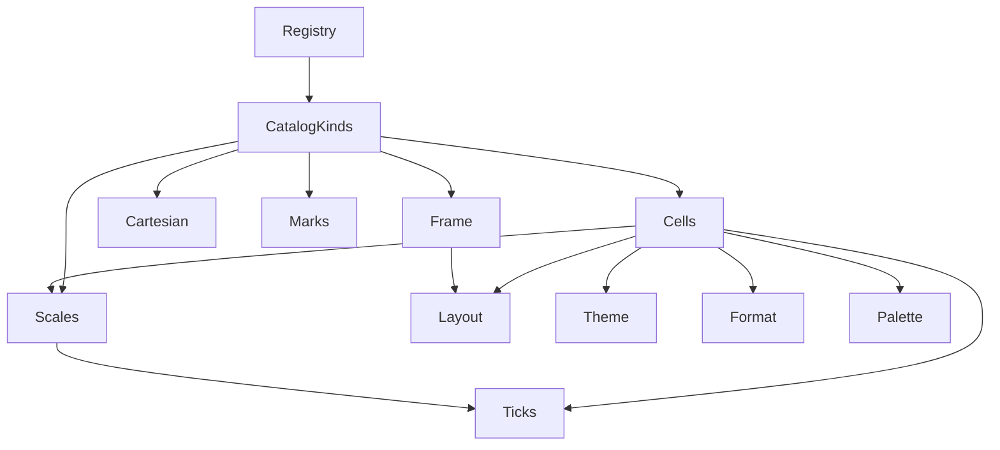
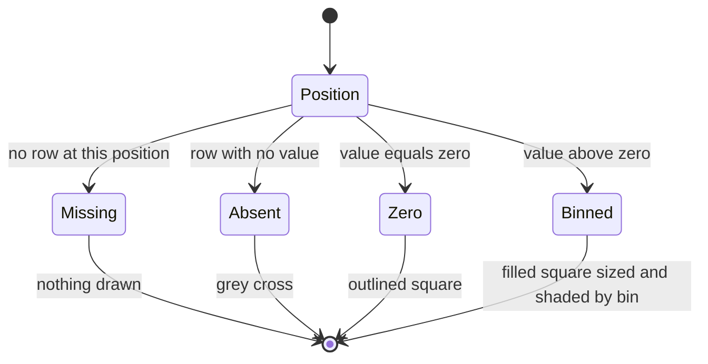

# Design Document: chart-catalog

## Overview

**Purpose**: the chart catalog appends eight chart kinds to `chart-kit`'s
declared registry: `calendar-heatmap`, `heatmap`, `dual-axis`, `band`,
`box`, `mean-max`, `small-multiples` and `stacked-100`. Each is a thin
module over chart-kit's shared layer, validated, bounded, themed and
rendered through chart-kit's one pipeline, so a dashboard chart can name it
exactly as it names `line`.

**Users**: the `dashboards` pass and command (which render whatever is
registered and list it from `describe_kinds()`), and through them the
athlete and the athlete's LLM assistant, who pick a kind and bind query
columns to its channels.

**Impact**: adds eight kind modules and one shared module (`kit/cells.py`)
under `fitdocs.render.charts.kit`; appends four problem codes, a five-colour
sequential ramp, and (only if the landed chart-kit lacks a public
equivalent) two small shared helpers; re-pins chart-kit's three named full
pins; adds one CHANGELOG line. No core kind, core golden, existing renderer
or existing behaviour changes.

### Goals
- Eight kinds whose names, channels, options and bounds `dashboards` can
  rely on, listed by `describe_kinds()` after the eight core kinds.
- Absent is never zero: in the grid kinds a missing row, an absent value, a
  zero and a positive value differ in shape, in both themes and without
  colour.
- Every catalog chart meets chart-kit's theme rule (every ink at least 3:1
  on the four reference backgrounds as drawn) and its determinism, purity,
  accessibility and size rules.
- Every golden is shown able to fail by a named production mutation; the
  shared-layer mutations chart-kit ran before these kinds existed are
  replayed over them.

### Non-Goals
- A diverging (signed) colour scale; a signed `calendar-heatmap` is refused
  (follow-on, research.md).
- Pie, donut and map kinds; interactive output.
- Computing quantiles, best efforts or any other aggregate from rows.
- Moving the hero, calendar, zone-strip or map renderers onto the kit; a
  mean-max section in workout documents.
- Dashboard pages, directives, SQL, snapshots, refresh, `fitdocs dashboard`
  and its skill (`dashboards`).

## Boundary Commitments

### This Spec Owns
- **The eight kind modules** under `kit/kinds/` and their `KIND`
  declarations: channels, options, mark bounds, descriptions, validation,
  checks and drawing.
- **`kit/cells.py`**: the binned value scale, the grid cell marks and the
  grid scale legend shared by the two grid kinds.
- **Appended shared values**: four `ProblemCode` members, the
  `SEQUENTIAL_RAMP`/`SEQUENTIAL_COLORS` palette entries, and the
  conditional helpers A1 (`format.format_durations`), A2
  (`frame.not_drawn_note`) and A3 (`format.duration_axis_title`).
- **The registry entries** for the eight kinds, appended after `table`.
- **Re-pins of chart-kit's named full pins**: the kit module tuple and layer
  rank matrix in `tests/render/charts/kit/test_boundary.py`, and the colour
  whitelist in `tests/render/charts/kit/test_theme_coverage.py`.
- **Tests** for all of the above: per-kind unit tests and goldens under the
  chart-kit naming convention, the cells and ramp tests, catalog budgets,
  the catalog contract pins, and the sequential replay of chart-kit's
  shared-layer golden-class mutations over catalog goldens.
- **One CHANGELOG line**, and the conditional second-lander update of the
  kinds listing and counts `dashboards` owns (task 4.1).

### Out of Boundary
- Everything chart-kit owns: the data contract, request, problem shape,
  `KindSpec` and registry machinery, validation stages, scales, ticks, unit
  formatting, theme, layout, frame, marks, cartesian helpers, the core
  kinds, and every existing signature and behaviour of those modules.
- Everything `dashboards` owns: pages, directives, SQL execution,
  `$today`, snapshots, refresh, `fitdocs dashboard` (including its `kinds`
  form), the `fitdocs-dashboards` skill and `docs/dashboards.md`. The
  catalog touches `dashboards`' files only in task 4.1, and only when
  `dashboards` landed first.
- The analytics index, its schema and its unit suffixes.
- The four existing renderers and their goldens.

### Allowed Dependencies
- Standard library only (Python ≥ 3.11).
- chart-kit's kit modules by their published names: `kit.data`,
  `kit.problems`, `kit.schema`, `kit.format`, `kit.ticks`, `kit.theme`,
  `kit.layout`, `kit.scales`, `kit.frame`, `kit.marks`, `kit.cartesian`, and
  (for tests only) `kit.api.render_spec` and the facade.
- The shared chart primitives chart-kit already allows:
  `fitdocs.render.charts.svg` (`el`, `text`, `fmt_num`), `.series`
  (`gap_segments`), `.palette` (the appended `SEQUENTIAL_RAMP`, and
  `CATEGORICAL_RAMP` through `theme.series_style`); `fitdocs.units`.
- Layer direction (§ Architecture): a kind imports only lower ranks, never
  another kind, `registry` or `api`. `cells` imports only ranks below it.
- **Stated limit** (inherited from chart-kit): the import rule is static, on
  the catalog's own import statements; importing any `render.charts`
  submodule loads `fitdocs.render` at runtime.

### Existing Spec Updates Carried by This Spec
None to another spec's documents. The catalog appends to chart-kit's
**source and test files** exactly as chart-kit's tasks.md § Cross-spec shared
files permits (append-only values, and the three named re-pin points). It
never edits chart-kit's spec files. If `dashboards` landed first, task 4.1
re-pins `dashboards`' kinds listing and kind counts (Requirement 13.1).

### Revalidation Triggers
Any of these changes requires `dashboards` (and any later consumer) to
re-check:
- a catalog kind's name, channel name, accepted value kinds, option name,
  default, range or choices, or its order in the registry;
- a catalog mark bound or secondary limit;
- the value or meaning of `negative_value`, `value_order`, `shared_unit` or
  `channel_unit`;
- the grid value-class rules (bins excluding their lower edge, zero as its
  own class, the absent cross, missing rows drawn as nothing) or the
  `SEQUENTIAL_RAMP` colours;
- the `stacked-100` zero-total rule or the `dual-axis` same-unit refusal.

## Published Seams for `dashboards`

The compact contract `dashboards` consumes, final at this design. Full
contracts are in § Components and Interfaces.

**Registry order after this spec** (`kind_names()`): `line`, `area`, `bar`,
`hbar`, `scatter`, `histogram`, `stat`, `table`, `calendar-heatmap`,
`heatmap`, `dual-axis`, `band`, `box`, `mean-max`, `small-multiples`,
`stacked-100`. Sixteen kinds; every catalog kind outputs SVG.

| Kind | Channels (required*) | Own options (default) | Bound (over: refuse) | Max series | Default height |
|---|---|---|---|---|---|
| `calendar-heatmap` | `date`* date; `value`* number·duration | — | 54 week columns | — | auto |
| `heatmap` | `x`* category·date·boolean·number; `y`* category·date·boolean·number; `value`* number·duration | — | 1500 cells, 60 x values, 40 y values | — | auto |
| `dual-axis` | `x`* number·duration·date·datetime; `y`* number·duration; `y2`* number·duration | `y_zero` boolean (false); `y2_zero` boolean (false) | 2000 rows | — | 320 |
| `band` | `x`* number·duration·date·datetime; `low`* number·duration; `high`* number·duration; `mid` number·duration | `y_zero` boolean (false) | 1000 rows | — | 320 |
| `box` | `x`* category·date·boolean; `low`*, `q1`*, `median`*, `q3`*, `high`* number·duration | `y_zero` boolean (false) | 60 rows | — | 320 |
| `mean-max` | `x`* number·duration; `y`* number·duration; `color` category·boolean | `y_zero` boolean (false) | 1000 rows | 8 | 320 |
| `small-multiples` | `x`* number·duration·date·datetime; `y`* number·duration; `facet`* category·boolean·date | `y_axes` shared\|independent (shared); `columns` integer 1–6 (none: auto) | 12 panels, 2000 rows | — | auto |
| `stacked-100` | `x`* category·date·boolean; `y`* number·duration; `color`* category·boolean | — | 400 rows | 8 | 320 |

Every SVG kind also takes chart-kit's `width` (320–1600, default 720) and
`height` (160–1200) through `svg_options`. "auto" means the kind sizes its
height from its rows unless the request sets `height`.

**Appended problem codes** (after chart-kit's 23, in this order):
`negative_value`, `value_order`, `shared_unit`, `channel_unit`.

**Encodings `docs/dashboards.md` and the skill may describe**:
- Grid kinds: a filled square sized and shaded by bin for a positive value;
  an outlined square for zero; a grey cross for an absent value; nothing for
  a missing row. Bins exclude their lower edge, so zero is its own class.
  Signed values are refused.
- `dual-axis`: `y` solid on the left axis, `y2` dashed on the right axis,
  the legend naming each side; refuses one column or one unit on both.
- `mean-max`: `x` is a duration or a number in seconds (`duration_s`);
  landmark ticks 5 s, 1 min, 5 min, 20 min, 1 h first.
- `box`: quartiles come from the query (`quantile_cont(x, 0.25) AS
  q1_…`); the kit computes none.
- `stacked-100`: absent parts are refused (use `COALESCE(…, 0)`); a bar whose
  parts are all zero shows a zero stub and a note, never a split.

**Agent guidance travels in the registry listing, not the skill.** Three
notes an agent needs (prefer `small-multiples` or one `line` with a colour
column over `dual-axis` unless the two quantities are a deliberate pair; a
grid of a signed value such as `form` is refused; a day or position with no
row draws nothing, so a query that wants rest days shown as zero returns a
zero row) are part of the kinds' own descriptions (§ CalendarHeatmap,
§ Heatmap, § DualAxis). They reach `fitdocs dashboard kinds` and the docs
kinds block live through `describe_kinds()`; `dashboards`' skill names only
core kinds and carries none of them. Each phrase is pinned by its kind's
tests (tasks 2.1–2.3).

## Architecture

### Existing Architecture Analysis
- chart-kit (approved at `560f909`, implemented before this spec) is a
  layered subpackage `fitdocs.render.charts.kit`: contract modules, a shared
  drawing layer, kind modules, a declared registry, a facade. Kinds receive a
  validated `BoundChart` and return SVG text.
- Appending is the designed extension path: a kind module plus a registry
  entry; append-only tuples are pinned by prefix; three full pins are named
  re-pin points.
- chart-kit's cross-cutting tests find a registered kind's `CASES` and
  goldens through the module name `test_<name with - as _>.py`.

### Architecture Pattern & Boundary Map

**Selected pattern**: named kinds over a shared layer (maintainer decision,
2026-10-11), unchanged. The two grid kinds share one new shared module,
`cells`.



**Dependency direction** (chart-kit's order with one new rank; a module
imports only from ranks to its left):

`units` → `data` → `problems` → `schema` → `format` → `ticks` → `theme` →
`layout` → `scales` → **`cells`** → `frame` → `marks` → `cartesian` →
`validate` → `kinds/*` → `registry` → `api` → `__init__`

- `cells` may import `data`, `problems`, `schema`, `format`, `ticks`,
  `theme`, `layout`, `scales` and the primitives `svg` and `palette`. It
  ranks directly after `scales`, below `frame`, `marks`, `cartesian` and
  `validate`, so the rank matrix rejects any import of those or of a kind
  (positive control: `from . import marks` in `cells.py` reds it).
- The eight catalog kind modules share chart-kit's kind rank: they never
  import one another, `registry` or `api`.
- `test_boundary.py`'s rank matrix enforces this (task 1.1 re-pins it).

**Steering compliance**: pure functions; absent is `None`; stdlib only;
hand-generated SVG; `mypy --strict`; Fixture Discrimination for every new
assertion.

### Technology Stack

| Layer | Choice / Version | Role in Feature | Notes |
|---|---|---|---|
| Runtime | Python ≥ 3.11 stdlib (`dataclasses`, `math`, `enum`, `datetime`, `typing`) | All catalog code | No new dependency |
| Output | SVG through chart-kit's frame and the `svg` primitives | Chart files | One `<style>` per chart (chart-kit's) |
| Tests | pytest; chart-kit's `_helpers.py` and `goldens.py` | Goldens, mutations, pins | Covered by the existing `tests/render/charts/kit` mypy entry |

## File Structure Plan

### Directory Structure
```
src/fitdocs/render/charts/kit/
├── cells.py                       # NEW: binned value scale, grid cell marks, grid scale legend
└── kinds/
    ├── calendar_heatmap.py        # NEW: KIND calendar-heatmap
    ├── heatmap.py                 # NEW: KIND heatmap
    ├── dual_axis.py               # NEW: KIND dual-axis
    ├── band.py                    # NEW: KIND band
    ├── box.py                     # NEW: KIND box
    ├── mean_max.py                # NEW: KIND mean-max
    ├── small_multiples.py         # NEW: KIND small-multiples
    └── stacked_100.py             # NEW: KIND stacked-100

tests/render/charts/kit/
├── test_catalog_contract.py       # NEW: appended codes, catalog registry order and listing, coverage counts
├── test_sequential_ramp.py        # NEW: ramp contrast, monotonicity, CVD distances (independent arithmetic)
├── test_cells.py                  # NEW: binning, classification, cell marks, grid legend
├── test_shared_appends.py         # NEW (only if A1, A2 or A3 is appended)
├── test_calendar_heatmap.py       # NEW: unit tests, CASES, main() writer   (chart-kit convention)
├── test_heatmap.py  test_dual_axis.py  test_band.py  test_box.py           # NEW, same shape
├── test_mean_max.py  test_small_multiples.py  test_stacked_100.py          # NEW, same shape
├── test_catalog_budgets.py        # NEW: typical-chart budgets and the at-bound ceiling for catalog kinds
└── golden/<kind>/<case>.svg       # NEW: one directory per catalog kind
```

### Modified Files
- `src/fitdocs/render/charts/kit/problems.py` — append four `ProblemCode`
  members after chart-kit's 23: `negative_value`, `value_order`,
  `shared_unit`, `channel_unit`.
- `src/fitdocs/render/charts/kit/registry.py` — import the eight catalog
  `KIND`s and append them to `KINDS` after `table.KIND`, in Requirement
  1.1's order. `CORE_KIND_NAMES` unchanged.
- `src/fitdocs/render/charts/palette.py` — append `SEQUENTIAL_COLORS`
  (`name -> (hex, oklch source)`) and `SEQUENTIAL_RAMP` (5 hex, light end
  first). Existing constants untouched.
- `src/fitdocs/render/charts/kit/format.py` — **only if** the landed module
  has no public one-form duration labeller: append `format_durations` (A1);
  **only if** it has no public way to title a duration axis in a given form:
  append `duration_axis_title` (A3).
- `src/fitdocs/render/charts/kit/frame.py` — **only if** the landed module
  has no public `Not drawn:` note builder: append `not_drawn_note` (A2).
- `tests/render/charts/test_palette.py` — `_all_documented()` also walks
  `SEQUENTIAL_COLORS`; one test pins the five sources in order. Existing
  assertions kept.
- `tests/render/charts/kit/test_boundary.py` — re-pin point: the module
  tuple gains `cells` and the eight kind modules; the rank matrix gains
  `cells` between `scales` and `frame` and the eight kinds at the kind
  rank.
- `tests/render/charts/kit/test_theme_coverage.py` — re-pin point: the
  colour whitelist adds `SEQUENTIAL_RAMP`.
- `CHANGELOG.md` — one `[Unreleased]` → `### Added` line that opens with
  the kind names, never with `` - `fitdocs dashboard` `` (`dashboards`' task
  8.2 pins exactly one bullet with that opening).
- **Conditional (task 4.1, only when `dashboards` is on `main`)**: the kinds
  block in `docs/dashboards.md`, regenerated by `dashboards`' own writer, and
  every kind-count pin `dashboards`' tasks.md names.

No `pyproject.toml` change: chart-kit's `tests/render/charts/kit` directory
entry already covers every new test module.

## System Flows

Every catalog kind runs through chart-kit's one pipeline
(`render_spec`: request validation → data checks → the kind's `check` →
`draw`); nothing new happens before `draw`. The flow the catalog adds is the
grid cell classification inside `draw`:



Negative values never reach `draw`: the kind's `check` refuses them
(`negative_value`). Duplicate positions are refused too, so each position is
in exactly one state.

## Requirements Traceability

| Req | Summary | Components | Notes |
|---|---|---|---|
| 1.1 | Eight kinds appended in order | RegistryEntries | Prefix pin of 16 names |
| 1.2 | Full declaration per kind | all kind modules | `KindSpec` per § Published Seams |
| 1.3 | Same pipeline | all kinds (via chart-kit `render_spec`) | No catalog-specific path |
| 1.4 | Core unchanged | RegistryEntries, all appends | Core goldens are the gate |
| 1.5 | Names and codes stable | all kinds, ProblemCodes | Contract pins |
| 1.6 | No pie, donut, map, interactive | (no such kind) | Prefix pin `kind_names()[:16]`; no `pie`, `donut` or `map` registered |
| 2.1 | One theme | all kinds, Cells, SequentialRamp | `ink()`, `series_style`, ramp; coverage walk |
| 2.2 | Colour never alone | Cells, DualAxis, Band, MeanMax, SmallMultiples, Stacked100 | Area, dash, swatch shape, titles, order+gap |
| 2.3 | Absent never zero | all kinds, Cells | Gaps, crosses, notes, refusals |
| 2.4 | No rows → no-data | all kinds | `frame.no_data` |
| 2.5 | No drawable value → no-data | all kinds | `frame.no_data` second line |
| 2.6 | Unplaceable rows stated | NotDrawnNote, all kinds | A2 wording |
| 2.7 | Absent category/colour/facet last | Heatmap, Box, MeanMax, SmallMultiples, Stacked100 | `category_order`, `series_groups` |
| 2.8 | Bound stated, at-bound draws | all kinds | `MarkBound` |
| 2.9 | Over bound refused | all kinds | `over_bound` |
| 2.10 | Accessibility metadata | all kinds | `frame.document`, `frame.describe` |
| 2.11 | Determinism | all kinds | chart-kit `test_determinism.py` covers registered kinds |
| 2.12 | Purity, stdlib, imports | all modules | `test_boundary.py` re-pin |
| 2.13 | No aggregates | all kinds | Stacked100's share is the one division |
| 3.1 | Value classes | Cells | `BinnedScale.classify` |
| 3.2 | Round edges | Cells | `linear_ticks(0, max, 6, …)` |
| 3.3 | Area and colour | Cells | `cell_marks` |
| 3.4 | Zero outline, absent cross | Cells | `cell_marks` |
| 3.5 | Missing row draws nothing | Cells, CalendarHeatmap, Heatmap | Only rows become cells |
| 3.6 | Scale legend | Cells | `legend_entries`, `legend` |
| 3.7 | Negative refused | Cells, CalendarHeatmap, Heatmap | `negative_problem` |
| 3.8 | No positive value | Cells | Zero bins |
| 3.9 | Sequential ramp | SequentialRamp | Stated minima |
| 4.1–4.6 | Calendar heatmap | CalendarHeatmap, Cells | |
| 5.1–5.6 | Heatmap | Heatmap, Cells | |
| 6.1–6.7 | Dual-axis | DualAxis | `shared_unit` |
| 7.1–7.7 | Band | Band | `value_order`, `unit_mismatch` |
| 8.1–8.7 | Box | Box | `value_order`, `unit_mismatch` |
| 9.1–9.7 | Mean-max | MeanMax, DurationLabels | `channel_unit`, landmark ticks |
| 10.1–10.7 | Small multiples | SmallMultiples | Panels |
| 11.1–11.7 | Stacked-100 | Stacked100 | Zero totals |
| 12.1 | Goldens per kind | kind test modules | § Testing Strategy case lists |
| 12.2 | Both themes, coverage | `test_theme_coverage.py` re-pin | Whitelist + ramp |
| 12.3 | Byte-exact, shown able to fail | kind tests, task 3.2 | Named mutations |
| 12.4 | Budgets and ceiling | `test_catalog_budgets.py` | |
| 12.5 | Independent ramp arithmetic | `test_sequential_ramp.py` | |
| 12.6 | Guards cover catalog | `test_boundary.py` re-pin, chart-kit determinism | |
| 12.7 | Core and renderer goldens unchanged | existing golden tests | Diff evidence in task 4.2 |
| 13.1 | Second lander updates listing | task 4.1 | `dashboards`' writer |
| 13.2 | First lander touches nothing of dashboards | task 4.1 | No-op path |
| 13.3 | Release note | CHANGELOG | |

## Components and Interfaces

| Component | Layer | Intent | Req Coverage | Key Dependencies | Contracts |
|---|---|---|---|---|---|
| ProblemCodes (`problems.py` append) | Contract | Four new stable codes | 1.5, 3.7, 6.4, 7.3, 8.3, 9.2 | chart-kit `ProblemCode` (P0) | State |
| SequentialRamp (`palette.py` append) | Primitive | Five in-band ramp colours with oklch sources | 2.1, 3.9 | palette convention (P0) | State |
| DurationLabels A1 (`format.py` append, conditional) | Shared | One-form duration labels | 3.6, 9.3 | `format_duration` (P0) | Service |
| NotDrawnNote A2 (`frame.py` append, conditional) | Shared | The `Not drawn:` line | 2.6 | chart-kit wording (P0) | Service |
| DurationTitle A3 (`format.py` append, conditional) | Shared | A duration axis title in a stated form | 3.6, 9.3 | `axis_title` (P0) | Service |
| Cells (`cells.py`) | Shared | Binned scale, cell marks, grid legend | 2.1–2.3, 3.1–3.8 | ticks, format, theme, layout, palette (P0) | Service |
| CalendarHeatmap | Kind | One cell per day in week columns | 4.x, 3.x | Cells, scales, frame (P0) | Service |
| Heatmap | Kind | Value over two band axes | 5.x, 3.x | Cells, scales, frame (P0) | Service |
| DualAxis | Kind | Two series, two y axes | 6.x | scales, frame, marks (P0) | Service |
| Band | Kind | Low–high band with centre line | 7.x | marks, scales, frame (P0) | Service |
| Box | Kind | Box-and-whisker from given quartiles | 8.x | scales, frame (P0) | Service |
| MeanMax | Kind | Best-effort curves on a log duration axis | 9.x | scales, marks, cartesian, A1, A3 (P0) | Service |
| SmallMultiples | Kind | Panels of mini lines | 10.x | layout, scales, marks, frame (P0) | Service |
| Stacked100 | Kind | Composition bars summing to 100% | 11.x | cartesian, scales, marks, frame (P0) | Service |
| RegistryEntries (`registry.py` append) | Registry | Eight entries after `table` | 1.1, 1.4 | kinds (P0) | State |

### Appended shared values

#### ProblemCodes — `kit/problems.py` (append)

```python
class ProblemCode(StrEnum):
    ...                                  # chart-kit's 23 values, unchanged
    NEGATIVE_VALUE = "negative_value"    # a value channel that starts at zero holds a negative value
    VALUE_ORDER = "value_order"          # ordered values out of order (band low > high; box quantiles)
    SHARED_UNIT = "shared_unit"          # dual-axis value channels on one column or one unit
    CHANNEL_UNIT = "channel_unit"        # a channel needs a unit family its column lacks (mean-max seconds)
```

- Stage placement: `shared_unit` and `channel_unit` are request-level (a
  kind's `validate`, columns only, so `dashboards`' check form reports
  them); `negative_value` and `value_order` are shape-level (a kind's
  `check`), emitted after chart-kit's stage-3 codes in the order
  `over_bound`, `too_many_series`, `duplicate_position`, `log_domain`,
  `stack_absent`, `stack_negative`, `stack_incomplete`, `negative_value`,
  `value_order`.
- Data-level codes name the first offending row and the number of offending
  rows, once per channel and code (chart-kit 4.3).
- Pinned by a membership-and-relative-order test, not a slice, so a later
  append elsewhere cannot red it; chart-kit's prefix pin of the first 23
  stays green.

#### SequentialRamp — `palette.py` (append)

```python
SEQUENTIAL_1: Final = "#9193a0"  # oklch(0.665 0.02 280)
SEQUENTIAL_2: Final = "#8387af"  # oklch(0.635 0.06 280)
SEQUENTIAL_3: Final = "#767abd"  # oklch(0.605 0.1 280)
SEQUENTIAL_4: Final = "#6a6cc9"  # oklch(0.575 0.14 280)
SEQUENTIAL_5: Final = "#605cd5"  # oklch(0.545 0.18 280)
SEQUENTIAL_RAMP: Final[tuple[str, ...]] = (SEQUENTIAL_1, ..., SEQUENTIAL_5)   # light/grey end first
SEQUENTIAL_COLORS: Final[dict[str, tuple[str, str]]]   # "s1".."s5" -> (hex, oklch source)
```

Stated minima (Requirement 3.9), pinned by `test_sequential_ramp.py` with
its own WCAG and Machado-2009 arithmetic: every colour ≥ 3:1 on `#ffffff`,
`#1e1e1e`, `#0d1117` and `#1e2129`; OKLab lightness strictly decreasing and
OKLCH chroma strictly increasing along the ramp; adjacent OKLab distance
≥ 0.045 under normal vision, protanopia and deuteranopia, ≥ 0.03 under
tritanopia (measured 0.049, 0.049, 0.052, 0.037; research.md).

#### DurationLabels (A1) — `kit/format.py` (append, conditional)

```python
def format_durations(values: Sequence[float]) -> tuple[str, ...]: ...
```
- Formats every value in one form: `h:mm:ss` when any value's rounded
  magnitude is ≥ 3600 (amended 2026-10-12: task 1.3; so 3599.6 s reads
  `1:00:00`, as `format_duration` does), else `m:ss`; each value rounded half-to-even to whole seconds exactly as
  `format_duration`; a leading `-` for negatives. For any sequence whose
  values all lie below 3600 s (or all at or above it) the result equals
  `format_duration` applied to each value.
- **Condition**: appended only when the landed `format.py` exposes no public
  function with this behaviour. If one exists, the catalog calls it, and
  task 1.1 records its name in Implementation Notes.
- Users: `cells` (legend edges of duration values), `mean-max` (tick
  labels).

#### NotDrawnNote (A2) — `kit/frame.py` (append, conditional)

```python
def not_drawn_note(counts: Sequence[tuple[str, int]]) -> str | None: ...
```
- `None` when every count is zero; otherwise exactly chart-kit's wording
  over the non-zero counts in the given order: `Not drawn: 1 row without
  y.`, `Not drawn: 3 rows without x, 2 rows without y.`
- **Condition**: as A1; if the landed `frame.py` exposes a public builder of
  this line, the catalog calls it instead.
- Users: every catalog kind that can leave a row or value undrawn. The
  catalog's counting rule (§ Kinds, common rules) produces `counts`.

#### DurationTitle (A3) — `kit/format.py` (append, conditional)

```python
def duration_axis_title(column: Column, *, hours: bool) -> str: ...
```
- chart-kit's `axis_title(column)` picks `(h:mm:ss)` or `(m:ss)` "per the
  axis's label form" but takes no form argument; the catalog labels two
  duration scales outside `numeric_scale` (the grid legend's edges and
  mean-max's landmark ticks), so it must state the form itself.
- Returns `display_label(column)` followed by ` (h:mm:ss)` when `hours`, else
  ` (m:ss)`, for a DURATION column or a NUMBER column whose unit's family is
  DURATION; any other column → `axis_title(column)` unchanged.
- **Condition**: the same exact-vector rule as A1 and A2 (task 1.1): if the
  landed kit exposes a public function producing exactly these titles for a
  stated form, the catalog calls it; otherwise this is appended.
- Users: `cells` (the legend's lead entry for a duration value, in the form
  the edge labels use) and `mean-max` (its x axis title, in the form its
  tick labels use). Axes built by `numeric_scale` are titled exactly as the
  core kinds title them (task 1.1 records how).

### Shared catalog layer

#### Cells — `kit/cells.py`

| Field | Detail |
|---|---|
| Intent | The binned value scale, cell marks and scale legend of the grid kinds |
| Requirements | 2.1, 2.2, 2.3, 3.1, 3.2, 3.3, 3.4, 3.5, 3.6, 3.7, 3.8 |

**Responsibilities & Constraints**
- Classifies values, never positions: the kind owns its grid geometry and
  hands `cells` one `Rect` per cell.
- Draws one SVG element per value class, never one per cell.
- Imports only lower ranks (§ Architecture).

**Contracts**: Service [x]

```python
MAX_BINS: Final = 5
CELL_GAP: Final = 1.0          # px inset on each side of a cell's pitch box
MIN_MARK: Final = 2.0          # smallest drawn square side, px
ABSENT_LABEL: Final = "no value"

@dataclass(frozen=True)
class BinnedScale:
    column: Column                     # the value column
    edges: tuple[float, ...]           # (0.0, e1, …, en); n = len(edges) - 1, 0 <= n <= MAX_BINS
    labels: tuple[str, ...]            # formatted e1 … en (one form for durations)
    zero_label: str                    # the formatted zero ("0", "0:00", "0%")
    @property
    def bins(self) -> int: ...
    def classify(self, value: float | None) -> int | None: ...   # None absent, 0 zero, 1..n bin
    def color(self, bin_index: int) -> str: ...                  # SEQUENTIAL_RAMP[MAX_BINS - n + bin_index - 1]
    def fraction(self, bin_index: int) -> float: ...             # sqrt(bin_index / n)

def binned_scale(values: Sequence[float | None], column: Column) -> BinnedScale: ...
def negative_problem(bound: BoundChart, channel: str) -> tuple[ChartProblem, ...]: ...
def cell_marks(cells: Sequence[tuple[Rect, int | None]], scale: BinnedScale) -> list[str]: ...
def legend_entries(scale: BinnedScale, *, has_zero: bool, has_absent: bool) -> tuple[LegendEntry, ...]: ...
def legend(plan: FramePlan, scale: BinnedScale, entries: Sequence[LegendEntry]) -> str: ...
```

- `binned_scale`: present values only. No value above zero → `edges ==
  (0.0,)`, `bins == 0`. Otherwise `ticks.linear_ticks(0.0, max_positive,
  MAX_BINS + 1, duration=d, integer=w)` and `edges` = its ticks, where `d`
  is true for a DURATION column or a unit of family DURATION or PACE, and
  `w` is true when every present value is a whole number. Labels: numbers by
  `format.format_number_tick(edge, step, unit)` with `step = e1`; durations by
  A1 over the edges; pace by `format.format_pace`.
- `classify`: `None` → `None`; `0` → `0`; else the smallest `i` with
  `value <= edges[i]` (bins exclude their lower edge); a present value above
  `edges[-1]` lands in bin `n` (amended 2026-10-12: task 1.4 — `linear_ticks`
  tolerance and rounding can leave the last edge a hair below the maximum it
  was built from, e.g. `0.1 + 0.2`). Negative values never reach it (the
  kinds refuse them first); a negative value, or a positive one on a scale
  with no bins, raises `ValueError`.
- `color`: the top `n` ramp entries, so the largest bin is always
  `SEQUENTIAL_5`; `fraction`: area proportional to the bin index.
- `negative_problem` (`negative_value`): message `"<column> has a negative
  value at row <r>; <kind> shades values from zero up."`, fix `"Use a line
  or bar chart for signed values, or select a value that cannot be
  negative."`; first row and count of rows.
- `cell_marks`, back to front, each element omitted when it has no cells:
  - one `<path fill="<bin colour>">` per bin in ascending bin order, with
    one closed subpath per cell: a square (or, for a non-square cell, a
    rectangle) centred in the cell's inner box (the cell inset by
    `CELL_GAP`), each side `max(MIN_MARK, inner side × fraction)`;
  - one `<path fill="none" stroke="<SEQUENTIAL_RAMP[0]>"
    stroke-width="1">` holding an outlined square per zero cell (the inner
    box inset by 0.5 px);
  - one `<path>` with `ink(STROKE)`, `fill="none"`, `stroke-width="1"`
    holding two diagonal strokes per absent cell across the middle half of
    its inner box.
  Cells keep the order given within each element; coordinates through
  `fmt_num`.
- `legend_entries`: a lead entry whose label is the value column's
  `axis_title`, or A3's title in the edge labels' form for a duration value
  (no swatch), then the zero entry (`zero_label`) when
  `has_zero`, then one entry per bin labelled `"≤ " + labels[i]`, then the
  absent entry (`ABSENT_LABEL`) when `has_absent`. `LegendEntry.style`
  carries the swatch colour; `swatch` is `"block"` (placement only).
- `legend`: draws, at the positions `layout.plan_frame` planned for these
  entries, a `<g class="ck-legend">` whose swatches are 10 px cells drawn by
  the same geometry as `cell_marks` for that class and whose labels are
  `<text>` with `ink(TEXT)`; the lead entry draws its label with no swatch.

**Implementation Notes**
- Integration: the grid kinds pass `legend_entries(...)` to
  `layout.plan_frame(..., legend=...)` so the legend rows are planned like
  any legend, and call `cells.legend` instead of `frame.legend`.
- Validation: `test_cells.py` (task 1.4).
- Risks: an all-zero grid has no bins; its legend shows the lead and zero
  entries only (3.8).

### Kinds

**Common rules** (every catalog kind):
- Module `kit/kinds/<name with - as _>.py` exporting `KIND: Final[KindSpec]`
  and private `_validate`, `_check`, `_draw`; options through
  `schema.svg_options(..., height=…)`.
- `_draw`: no rows → `frame.no_data(bound, height=h)`; rows but no drawable
  value → the same (the second line appears). `h` is the kind's default
  height, or 160 px for an auto-height kind (chart-kit's hbar precedent),
  or the request's `height` when set.
- **Grid kinds**: an absent value is a drawable mark (a cross), so
  Requirement 2.5's no-data state applies to a grid kind only when no row
  can be placed at all: in `calendar-heatmap`, when every row's date is
  absent; in `heatmap`, never, because an absent x or y forms a `—` band.
  A grid whose values are all absent draws crosses and a legend with its
  lead and absent entries.
- Otherwise: plan the frame with `layout.plan_frame`, build scales, draw
  gridlines (where the kind has a numeric value axis), marks, axes, legend,
  title text and notes, and wrap with `frame.document` including
  `frame.describe(...)`.
- **Undrawn counting**: rows whose positioning channel(s) are absent are
  counted under that channel; among the remaining rows each value channel
  counts its own absent values (a row absent on two value channels counts
  under both). Counts go to A2 in channel spec order. Kinds whose absent
  value leaves a visible mark (grid crosses) do not count it.
- Text through `ink(TEXT)`, axes and gridlines through `frame`; series
  colours through `theme.series_style`; ramp colours through `cells`. No
  kind writes another colour literal.
- Problems in `_check` follow the stage-3 order above.

#### CalendarHeatmap — `kinds/calendar_heatmap.py`

| Field | Detail |
|---|---|
| Intent | One cell per day in Monday-start week columns |
| Requirements | 4.1, 4.2, 4.3, 4.4, 4.5, 4.6, 3.1–3.8, 2.4–2.6 |

- Description: "One cell per day in Monday-start week columns, sized and
  shaded by a value of zero or more (negative values are refused); a day
  with no row draws nothing, so return a zero row to show a rest day".
- Bound: `MarkBound(54, "weeks", REFUSE, "At most 54 Monday-start week
  columns: any 366 consecutive days fit.")`. `CAL_MAX_CELL: Final = 20.0`.
- `_check`: week columns > 54 → `over_bound` (kind-local: message
  `"calendar-heatmap draws at most 54 weeks; these dates span <w>."`, fix
  `"Limit the rows to at most 54 weeks of dates, for example the last 365
  days."`); `duplicate_position` on `("date",)`; `cells.negative_problem`
  on `value`.
- Draw:
  - first Monday `m0` = the Monday on or before the earliest present date;
    last Sunday = the Sunday on or after the latest; `W` week columns;
  - `plan_frame(..., legend=cells.legend_entries(...),
    y_label_width=text_width("Mon"), has_x_title=True, has_y_title=False,
    notes=…)`; pitch `p = min(plot.width / W, CAL_MAX_CELL)`, and with an
    explicit `height` also `≤ plot.height / 7` so the rows stay above the date
    axis; the grid is `W × p` wide from `plot.left` and `7 × p` tall; auto
    height is `max(160, ceil(frame + 7 × p))`, the frame size read from a probe
    plan (a fixed second planning pass); the date labels' left overhang is
    measured to the pad and the right overhang past the grid's right end, and
    the plan is re-made with the larger reserve until no label reaches past it
    (bounded passes) (amended 2026-10-12: task 2.1);
  - day `d` sits in column `(d − m0).days // 7`, row `d.weekday()`
    (Monday 0); cells per row in the given row order;
  - date axis: `numeric_scale((m0, last Sunday + 1 day) as day numbers,
    date column, plot.left, plot.left + W × p, scale=TIME,
    include_zero=False, nice=False, horizontal=True)` drawn by
    `frame.axis(..., Side.BOTTOM, title=axis_title(date column))`;
  - weekday labels `Mon`, `Wed`, `Fri`, `Sun` drawn by the kind (four
    `<text>` with `ink(TEXT)`, end-anchored, inside a `<g class="ck-axis">`)
    at the centres of rows 0, 2, 4, 6;
  - no gridlines; rows with an absent date counted under `date` (A2).
- Degenerate inputs: one present date → one column at pitch
  `min(plot.width, 20)`; equal values → all cells in the top bin, edges
  enclosing the value; no value above zero → outlines and crosses only.

#### Heatmap — `kinds/heatmap.py`

| Field | Detail |
|---|---|
| Intent | A value over two band axes |
| Requirements | 5.1–5.6, 3.1–3.8, 2.7 |

- Description: "A grid of cells over two category, date, boolean or number
  axes, sized and shaded by a value of zero or more (negative values are
  refused); a position with no row draws nothing".
- Bound: `MarkBound(1500, "cells", REFUSE, "At most 1500 cells, 60 x values
  and 40 y values.")`. `HEAT_X_LIMIT = 60`, `HEAT_Y_LIMIT = 40`,
  `HEAT_MIN_ROW = 16.0`, `HEAT_MAX_ROW = 32.0`.
- `_check`: `cartesian.bound_problem(bound, len(rows))`; distinct x > 60 or
  distinct y > 40 → `over_bound` (kind-local, `channel` set, fix `"Filter
  or group the <channel> column to at most <limit> values."`);
  `duplicate_position` on `("x", "y")`; `cells.negative_problem` on `value`.
- Band order: `cartesian.category_order` for category, date and boolean
  columns; for number columns the distinct present values ascending; an
  absent x or y value is a last band labelled `—`.
- Draw:
  - x bands: `scales.band_scale(labels, plot.left, plot.right,
    font_px=FONT_TEXT)` (chart-kit's width-based labelling);
  - y bands: a `BandScale` built directly (top to bottom) whose `labelled`
    is every row when the row pitch ≥ `FONT_TEXT + 2`, else every k-th row
    from the first with the smallest k for which `k × pitch ≥ FONT_TEXT + 2`;
    y labels fitted to 40% of the width (`fit_text`);
  - auto height: row pitch `clamp(plot.width / nx, 16, 32)`, height planned
    so `plot.height == ny × pitch` (clamped to 160–1200); with `height`
    set, rows share the plot height;
  - axes through `frame.axis` (x `BOTTOM`, y `LEFT`) with `axis_title` of x
    and y; legend through `cells`; no gridlines; no undrawn notes (absent
    x/y form a `—` band, absent values are crosses).

#### DualAxis — `kinds/dual_axis.py`

| Field | Detail |
|---|---|
| Intent | Two series over one x, each on its own y axis |
| Requirements | 6.1–6.7, 2.2, 2.6 |

- Description: "Two series over one x, each on its own y axis with its own
  unit; unless the two are a deliberate pair, prefer small-multiples or one
  line with a colour column".
- `_validate`: `y` and `y2` bound to the same column, or carrying the same
  axis unit → `shared_unit` (channel `y2`; message `"y and y2 both show
  <unit>; one unit belongs on one axis."`; fix `"Draw both columns on one
  axis with the line kind and a colour column, or bind y2 to a column in
  another unit."`). The axis unit of a column is its unit token, except that
  a DURATION column and a column whose unit's family is DURATION share the
  axis unit "duration". Two unitless number columns pass.
- `_check`: `bound_problem` (2000 rows); `duplicate_position` on `("x",)`.
- Draw:
  - x: `numeric_scale(..., scale=TIME or LINEAR, nice=False,
    horizontal=True)` over present x;
  - y (left): `numeric_scale(y values, ..., include_zero=y_zero, nice=True,
    horizontal=False)`; y2 (right): the same with `y2_zero`;
  - `plan_frame(..., right_label_width=<widest y2 tick label> + TICK_GAP +
    TICK_LEN, has_y_title=True)`;
  - gridlines: `frame.grid(left scale, …)` only;
  - axes: `frame.axis(x, BOTTOM)`, `frame.axis(y, LEFT,
    title=axis_title(y), title_room=share)`, `frame.axis(y2, RIGHT,
    title=axis_title(y2), title_room=share)` with `share = (plot.right -
    plot.left - PAD) / 2`, so the two titles on the shared y-title row stay
    `PAD` apart (amended 2026-10-12: upstream chart-kit fix 431a5a7, queue
    `2026-10-12-chart-kit-dual-axis-title-overlap`);
  - series: each through `marks.line_series` over rows sorted by x, `y` in
    `series_style(0)` (solid), `y2` in `series_style(1)` (dashed);
  - legend: `LegendEntry("<display_label(y)> (left axis)", series_style(0),
    "line")`, `LegendEntry("<display_label(y2)> (right axis)",
    series_style(1), "line")` through `frame.legend`;
  - undrawn counts: `x`, then `y`, `y2` (common rule).

#### Band — `kinds/band.py`

| Field | Detail |
|---|---|
| Intent | A low–high band with an optional centre line |
| Requirements | 7.1–7.7, 2.6 |

- Description: "A band from low to high over a numeric or time x, with an
  optional centre line".
- `_validate`: `low`, `high` and (if bound) `mid` must share value kind
  (`channel_kind` on the later channel, `accepted` = columns of the first's
  kind) and unit (`unit_mismatch`, naming the columns and units).
- `_check`: `bound_problem` (1000 rows); `duplicate_position` on `("x",)`;
  `value_order` where a present low exceeds its present high (message
  `"Row <r> has low <low> above high <high>."`, fix `"Swap the low and high
  bindings, or correct the query so that low is at most high."`). When rounding makes the two written values equal, both are written to 10 significant digits (a duration in seconds with ` s`) so the message still shows the difference (amended 2026-10-12: tasks 2.4, 2.5).
- Draw, rows sorted by x:
  - y: `numeric_scale` over the present values of drawn marks — low and high
    of rows that place a band position, and every drawn mid; a lone low or
    high (no band position) does not stretch the axis (amended 2026-10-12:
    task 2.4) — `include_zero=y_zero`,
    `nice=True`; x as `dual-axis`;
  - the band: split where low or high is absent (`series.gap_segments` on
    the paired edges); each run of ≥ 2 points is one `<path>` whose data is
    `marks.band_path(xs, lows, highs)`, `fill` = `series_style(0).color`,
    `fill-opacity="0.2"` (decorative), `stroke` = the same colour,
    `stroke-width="1"` (the outline carries the information); a run of one
    point is a vertical line from low to high, `stroke-width="1.8"`, round
    caps;
  - the centre line: `marks.line_series` over (x, mid) in
    `series_style(0)` (breaks and dots by chart-kit's rule);
  - legend: `"<display_label(low)> to <display_label(high)>"` with a
    `block` swatch, and, when `mid` is bound, `display_label(mid)` with a
    `line` swatch;
  - y axis title: `axis_title(mid)` when bound, else `axis_title(low)`;
  - undrawn counts: `x`, then `low`, `high`, `mid`.

#### Box — `kinds/box.py`

| Field | Detail |
|---|---|
| Intent | One box-and-whisker per category from precomputed values |
| Requirements | 8.1–8.7, 2.6, 2.7 |

- Description: "One box-and-whisker per category from given quartiles".
- `_validate`: the five value columns share value kind (`channel_kind`) and
  unit (`unit_mismatch`).
- `_check`: `bound_problem` (60 rows); `duplicate_position` on `("x",)`;
  `value_order` on the first adjacent pair of present values out of order
  in `low, q1, median, q3, high` (message `"Row <r> has <a> <va> above <b>
  <vb>."`, fix `"Bind each channel to its own column, or correct the query
  so that low ≤ q1 ≤ median ≤ q3 ≤ high."`). When rounding makes the two written values equal, both are written to 10 significant digits (a duration in seconds with ` s`) so the message still shows the difference (amended 2026-10-12: tasks 2.4, 2.5).
- Draw:
  - x: `band_scale` over `category_order(bound, "x")`; y: `numeric_scale`
    over the present values of the rows that draw a box (amended 2026-10-12:
    task 2.5 — a boxless row's whisker values would stretch the axis to
    nothing drawn), `include_zero=y_zero`, `nice=True`;
  - per row with q1, median and q3 present: box width `min(0.6 × band, 40)`;
    a `<rect>` from q1 to q3 with `fill` = `series_style(0).color`,
    `fill-opacity="0.2"`, `stroke` the same colour, `stroke-width="1"`; a
    median line `stroke-width="2.5"`; for each present whisker end a
    vertical line from the box edge to it and a cap of half the box width,
    `stroke-width="1"`; a row missing q1, median or q3 draws nothing at its
    labelled band;
  - notes: A2 over `q1`, `median`, `q3`, then a whisker line `No whisker:
    1 row without low, 2 rows without high.` (same plural rule) when a drawn
    box lacks a whisker end (amended 2026-10-12: task 2.5 — a boxless row
    is already counted by A2); an absent x is drawn as the `—` band, so box
    counts no row under x;
  - y axis title: `axis_title(median)`.

#### MeanMax — `kinds/mean_max.py`

| Field | Detail |
|---|---|
| Intent | Best-effort curves on a log duration axis |
| Requirements | 9.1–9.7, 2.2, 2.7 |

- Description: "Best-effort curves over a log duration axis, one per
  period".
- `_validate`: `x` bound to a NUMBER column whose unit is not `s` →
  `channel_unit` (channel `x`; `accepted` = the DURATION columns and the
  NUMBER columns with unit `s`, in column order; fix `"Bind x to a duration
  column, or to seconds such as duration_s."`).
- `_check`: `bound_problem` (1000 rows); `series_problem`;
  `duplicate_position` on `("color", "x")` (or `("x",)` without colour);
  `cartesian.log_problem(bound, "x")` for durations ≤ 0.
- Draw:
  - groups: `cartesian.series_groups(bound)` (one per period, first
    appearance, absent last as `—`);
  - x: the domain of `numeric_scale(x values, x column, ..., scale=LOG,
    include_zero=False, nice=True, horizontal=True)`; ticks replaced by the
    landmark selection: candidates are the members of
    `ticks.LOG_DURATION_TICKS` inside the domain, taken in the priority
    `LANDMARK_PRIORITY = (60, 3600, 300, 1200, 5, 1, 15, 30, 120, 600, 1800,
    7200, 10800, 21600, 43200, 86400, 2, 10)`; a candidate is accepted when
    its estimated label width does not overlap any accepted label plus
    10 px; accepted ticks sorted ascending; labels from A1 over the
    accepted values in the long form when the domain's upper end is ≥ 3600
    s, and the x axis title from A3 in that same form. The scale is rebuilt
    with `dataclasses.replace(scale, ticks=…)`;
  - y: `numeric_scale(..., LINEAR, include_zero=y_zero, nice=True)`; pace
    not inverted (chart-kit rule);
  - one `marks.line_series` per group over its rows sorted by x, in its
    `SeriesGroup.style` (colour and dash); legend with `line` swatches when
    `color` is bound;
  - undrawn counts: `x`, then `y`.

#### SmallMultiples — `kinds/small_multiples.py`

| Field | Detail |
|---|---|
| Intent | A grid of mini line charts, one per facet value |
| Requirements | 10.1–10.7, 2.2, 2.6, 2.7 |

- Description: "A grid of small line charts, one per facet value".
- Bound: `MarkBound(12, "panels", REFUSE, "At most 12 panels and 2000
  rows.")`; `SM_ROW_LIMIT = 2000`, `PANEL_HEIGHT = 140.0`,
  `PANEL_MIN_WIDTH = 180.0`.
- Options: `y_axes` choice `shared|independent` (shared); `columns`
  integer 1–6 (default none).
- `_check`: panels > 12 → `over_bound` (kind-local, channel `facet`, fix
  `"Filter the facet column to at most 12 values."`); rows > 2000 →
  `over_bound` (kind-local, fix as chart-kit's row wording);
  `duplicate_position` on `("facet", "x")`.
- Draw:
  - panels: `cartesian.category_order(bound, "facet")` (first appearance,
    dates ascending, `—` last); `c` = `columns` or
    `min(n, max(1, min(6, floor(plot.width / PANEL_MIN_WIDTH))))`; `r =
    ceil(n / c)`; panel `i` at column `i % c`, row `i // c`;
  - outer frame: `plan_frame(..., legend=(), has_x_title=True,
    has_y_title=True, notes=…)` with the x and y axis titles; auto height
    plans `plot.height == r × PANEL_HEIGHT`;
  - every panel has identical geometry: a panel-local
    `plan_frame(panel_w, panel_h, legend=(), y_label_width=<widest y tick
    label over all panels>, x_label_overhang=…, has_x_title=False,
    has_y_title=False, notes=0)`; each panel is a `<g
    transform="translate(<x>,<y>)">` group holding its title text (the
    facet label, fitted), gridlines, line, and axes;
  - scales: one x scale (`nice=False`) for all panels; one y scale over all
    present y when `shared`, else one per panel;
  - labels: y tick labels on first-column panels when shared, on every panel
    when independent; x tick labels on a panel with no panel below it; axes
    are drawn with `title=""` (the outer frame carries the axis titles);
  - line: `marks.line_series` in `series_style(0)` for every panel;
  - a panel with no drawable (x, y) draws its axes, its title and a centred
    `No values` text (`ink(TEXT)`);
  - undrawn counts: `x`, then `y`.

#### Stacked100 — `kinds/stacked_100.py`

| Field | Detail |
|---|---|
| Intent | Composition bars summing to 100% |
| Requirements | 11.1–11.7, 2.2, 2.7, 2.13 |

- Description: "Bars that split each category or date into shares of 100%".
- `_check`: `bound_problem` (400 rows); `series_problem`;
  `duplicate_position` on `("x", "color")`; `cartesian.stack_problems(bound,
  x="x", y="y", complete=False)` (`stack_absent` — whose chart-kit fix names
  supplying the missing values or unstacking — and `stack_negative`).
- Draw:
  - x: `band_scale` over `category_order(bound, "x")`; groups:
    `series_groups(bound)`; y: `numeric_scale` over the two values 0 and 100
    of a synthetic `Column("share", NUMBER, unit="pct", label="share")`,
    `include_zero=True`, `nice=True`, giving ticks `0%` … `100%`;
  - per x: total = sum of its present parts; parts in legend order bottom to
    top, each `marks.bar` of height `share × plot height`, 80% of the band,
    at most 48 px wide, coloured by its group; adjacent segments separated
    by a 1 px gap (each internal boundary leaves 0.5 px on either side);
  - total zero → `marks.zero_stub(x, zero_px, width, theme.STROKE.base)`
    (the stroke ink's base colour, no literal) and a note `Zero total, no shares drawn: <n>
    bar(s).` (`1 bar`, `2 bars`);
  - a missing (x, part) row draws no segment;
  - legend: `block` swatches in legend order (= stacking order, chart-kit's
    bar rule).

#### RegistryEntries — `kit/registry.py` (append)

```python
from .kinds import (..., calendar_heatmap, heatmap, dual_axis, band, box,
                    mean_max, small_multiples, stacked_100)
KINDS: Final[tuple[KindSpec, ...]] = (
    line.KIND, area.KIND, bar.KIND, hbar.KIND, scatter.KIND, histogram.KIND, stat.KIND, table.KIND,
    calendar_heatmap.KIND, heatmap.KIND, dual_axis.KIND, band.KIND, box.KIND,
    mean_max.KIND, small_multiples.KIND, stacked_100.KIND,
)
```
`CORE_KIND_NAMES` is unchanged; `CATALOG_KIND_NAMES` lives in the catalog's
test module, not in `src/`.

## Data Models

### Domain Model
- The catalog adds no data type to chart-kit's contract. `BinnedScale` is a
  derived, immutable view of one value column (edges, labels), built inside
  `draw` and never returned to a caller.
- Invariants established before `draw`: no duplicate position; no negative
  grid value; ordered band and box values; bounds respected.

### Data Contracts & Integration
- `describe_kinds()` gains eight `KindListing`s in registration order, same
  shape as the core ones; `dashboards`' kinds listing reads it.
- Output text is chart-kit's: one-line SVG, no trailing newline.

## Error Handling

### Error Strategy
Problems stay values; refusal is chart-kit's `ChartError` from
`render_spec`. The catalog never recovers by guessing: no clamped negative,
no swapped low/high, no reordered quantiles, no fabricated share.

### Error Categories and Responses
- **Request** (stage 1, columns only): `shared_unit`, `channel_unit`,
  `channel_kind`, `unit_mismatch` from the catalog kinds' `validate`; plus
  chart-kit's generic request problems.
- **Shape** (stage 3): `over_bound` (rows, cells, weeks, panels, distinct
  x/y), `too_many_series`, `duplicate_position`, `log_domain`,
  `stack_absent`, `stack_negative`, `negative_value`, `value_order`, in that
  order.
- Programming errors (a bin index outside `1..n`, a panel index past the
  grid) are `AssertionError`/`ValueError` from the catalog's invariants and
  unreachable from valid input.

### Monitoring
None; `dashboards` reports problems per chart.

## Testing Strategy

Every new assertion owes a named production mutation (`change-protocol.md`
§ Fixture Discrimination), run through `uv run pytest`. Fixtures
discriminate: categories in non-alphabetical first-appearance order; rows not
pre-sorted by x or date; pairwise-distinct values where a mapping is
asserted; offending rows at indices other than 0; each end state shown false
beforehand.

### Unit tests
- **Appended codes and registry** (`test_catalog_contract.py`): the four
  codes are members with their values and in relative order; after
  registration `kind_names()[:16]` equals the core names plus the catalog
  names; `describe_kinds()` for `calendar-heatmap` and `dual-axis` equals a
  literal field by field; no `pie`, `donut` or `map` is registered (no
  total kind count is pinned); chart-kit's three cross-cutting tests are
  shown visiting the catalog kinds by mutation. Mutations: reorder two appended codes; register `heatmap` before
  `calendar-heatmap`; drop a catalog option from a listing.
- **Ramp** (`test_sequential_ramp.py`): its own WCAG and Machado
  implementation; every stated minimum; the five sources convert to the
  shipped hex (`test_palette.py` machinery). Mutations: swap ramp entries 2
  and 4 (monotonicity reds); replace entry 1 with `oklch(0.7 0.02 280)`
  (contrast on white reds); replace entry 3 with a near-duplicate of entry 2
  (distance reds).
- **Cells** (`test_cells.py`): edges for max 41 → `0, 10, …, 50`, max 3
  with whole values → `0, 1, 2, 3`, max 2.5 → non-integer steps, durations
  on the duration ladder; `classify` at an edge (in the lower bin), just
  above it (the next), zero (class 0), `None`; `color` takes the top `n`
  entries; `fraction` = √(i/n); `cell_marks` emits one path per non-empty
  class in the stated order with the stated geometry, a cross for absent and
  an outline for zero; `legend_entries` order and labels; legend swatch
  geometry equals `cell_marks` for a 10 px cell; `negative_problem` names
  row 2 and count 2. Mutations: classify with `<` instead of `<=` (the
  on-edge value moves bin); delete the `value == 0` branch in `classify`
  (zero falls in bin 1); drop the zero outline element; draw absent cells as zero outlines; use the
  bottom `n` ramp entries; make `fraction` linear; drop `integer` from the
  `linear_ticks` call.
- **Each kind** (`test_<kind>.py`, through `_helpers.render_case`): each
  refusal alone (at bound renders, bound + 1 refuses, for every limit);
  ordering rules; absent/zero/missing distinctions; degenerate inputs; the
  kind's specific rules (§ Kinds). Mutations are kind-local (tasks.md).

### Golden tests (each kind's `CASES`, chart-kit's harness)
- `calendar-heatmap`: `typical` (about six months of daily load with zeros,
  absent values, missing days, rows out of date order), `empty`,
  `all_absent` (dates present, every value absent: crosses and a legend of
  lead and absent entries), `absent_dates` (every date absent: the no-data
  state's second line), `single` (one day), `constant` (every value equal and
  on a round edge), `all_zero`, `durations` (edges below and above one
  hour), `long_labels`, `at_bound` (54 weeks).
- `heatmap`: `typical` (zone numbers × week dates in seconds with a zero, an
  absent value and a missing cell), `empty`, `all_absent` (positions
  present, every value absent: crosses), `single`,
  `categories` (weekday × hour as categories, first appearance not
  alphabetical), `absent_axis` (an absent y value → `—` row), `long_labels`,
  `at_bound` (60 × 25 cells).
- `dual-axis`: `typical` (dates, pace and heart rate, an absent value in
  each series), `empty`, `all_absent`, `single`, `negative`, `zero` (both
  zero options), `long_labels`, `at_bound`.
- `band`: `typical` (weekly p10/median/p90 with an absent low), `empty`,
  `all_absent`, `single` (one row with low = mid = high, so both axes are
  degenerate), `negative`, `no_mid`, `isolated` (a band point
  between gaps), `long_labels`, `at_bound`.
- `box`: `typical` (blocks with one absent median and one absent whisker
  end), `empty`, `all_absent`, `single`, `negative`, `zero_whisker` (low ==
  q1), `long_labels`, `at_bound`.
- `mean-max`: `typical` (two periods, power at mean_max's durations from 1 s
  to 1 h, one absent power value), `empty`, `all_absent`, `single`, `negative`, `pace` (seconds per
  kilometre), `long_labels`, `at_bound`.
- `small-multiples`: `typical` (four facets, shared y, an absent y),
  `empty`, `all_absent`, `single`, `negative`, `independent`,
  `empty_panel`, `long_labels`, `at_bound` (12 panels).
- `stacked-100`: `typical` (weeks × zones with an absent colour value),
  `empty`, `single`, `zero_total`, `missing_part`, `long_labels`,
  `at_bound`. No `all_absent` golden: absent parts are refused
  (Requirement 11.2), which a unit test pins.
- One golden per case serves both themes; chart-kit's theme coverage walk
  checks every catalog golden once registered (task 3.1).

### Cross-cutting tests
- **Shared-class replay** (task 3.2, sequential): chart-kit's six
  shared-layer golden-class mutations (no-data wording, no-data second line,
  ellipsis, degenerate pad, value-axis clamp at zero, `bound_problem`
  comparison) plus the `cells` mutations that reach both grid kinds, each
  run once over the catalog goldens with the red list recorded; a catalog
  golden class a mutation does not reach carries a kind-local mutation in
  its kind's task.
- **Theme coverage and determinism**: chart-kit's
  `test_theme_coverage.py` (whitelist re-pinned with `SEQUENTIAL_RAMP`) and
  `test_determinism.py` cover the catalog kinds by the naming convention.
- **Budgets** (`test_catalog_budgets.py`, initial values, lowered never
  raised, measured at implementation): `calendar-heatmap` 365 days ≤ 16,000
  bytes; `heatmap` 52 × 5 ≤ 14,000; `dual-axis` 2 × 365 points ≤ 16,000;
  `band` 52 weeks with mid ≤ 8,000; `box` 12 boxes ≤ 6,000; `mean-max` 3 ×
  28 ≤ 8,000; `small-multiples` 6 × 52 ≤ 18,000; `stacked-100` 52 × 5 ≤
  22,000; every catalog `at_bound` golden ≤ 80,000 (chart-kit's ceiling).
  (amended 2026-10-12: task 3.3 measured; by controller ruling, as chart-kit's
  hbar, the three exceeded budgets were raised to measured + 25% —
  `calendar-heatmap` 20,200 (16,150), `box` 13,300 (10,605), `stacked-100`
  28,600 (22,823) — and two lowered: `band` 6,700, `small-multiples` 12,700;
  `test_catalog_budgets.py` is the source of truth.)
  Mutation: draw one `<rect>` per grid cell instead of one path per class.
- **Boundary** (`test_boundary.py` re-pin): the module tuple and rank
  matrix (§ Architecture); positive control: `from . import marks` added to
  `cells.py` reds the rank check; `from .heatmap import KIND` in another
  kind reds it.
- **Preservation**: core kind goldens, the four renderers' goldens and
  `tests/render/charts/test_palette.py`'s existing assertions run unmodified.

## Security Considerations
Caller strings (titles, labels, categories, facet values) reach the SVG only
through chart-kit's `clean_text`, `svg.text` and `svg.el` escaping, exactly
as in the core kinds. Panel transforms carry only numbers through `fmt_num`.

## Performance & Scalability
Linear in rows: one pass to classify, one sort per series. Every kind
refuses above its bound before drawing; output stays under chart-kit's
80,000-byte at-bound ceiling (grid kinds emit one path per value class, not
one element per cell).

## Migration Strategy
None. No data, index or document changes; the release-note line describes
eight new kinds.
