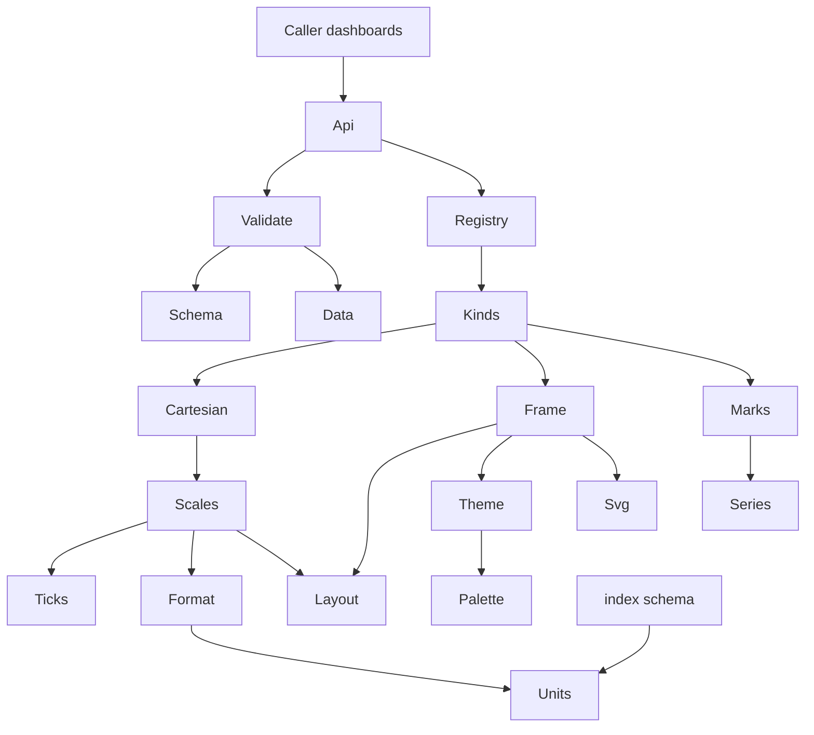
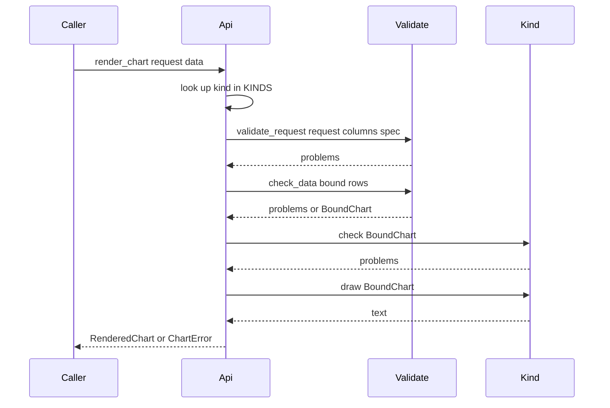

# Design Document: chart-kit

## Overview

**Purpose**: the chart kit turns one table of typed values plus a short,
named encoding into a byte-deterministic SVG image or a markdown fragment. It
is the drawing layer of Phase 11: `dashboards` renders every chart through it,
and `chart-catalog` adds eight more kinds to it.

**Users**: the `dashboards` pass and command (callers that build chart data
from query results and write the output), the `chart-catalog` spec (which
appends kinds and shared-layer extensions), and, through them, the athlete and
the athlete's LLM assistant, who choose a kind and bind columns to channels.

**Impact**: adds a new subpackage `fitdocs.render.charts.kit` and a new leaf
module `fitdocs.units`. `fitdocs.index.schema.UNIT_SUFFIXES` becomes a
projection of `fitdocs.units.UNITS` with an identical value. `palette.py`
gains a categorical palette; `svg.py`'s docstring records one relaxation. The
four existing renderers and every existing golden are untouched.

### Goals
- One typed data contract and one request shape that `dashboards` and
  `chart-catalog` build on without negotiation.
- Validation an agent can act on: every problem names the chart, the channel,
  column or option, what is wrong and what would fix it.
- One theme mechanism that stays at or above 3:1 whatever a viewer does with
  the embedded media queries, and reaches 4.5:1 for text where they are
  honoured.
- Absent data is visibly absent, never drawn as zero; zero is visibly zero.
- Eight core kinds within stated mark bounds and byte budgets, pinned by
  goldens that are shown able to fail.

### Non-Goals
- Reading SQL, the index, files or the network; deciding where output goes.
- Unit conversion of any kind (pace from speed is the query's job).
- Interactivity, JavaScript, maps, pie and donut charts.
- Restyling the hero, calendar, zone-strip or map charts (an unscheduled
  follow-on).
- An inverted pace axis, per-chart colour choice, custom fonts, rotated labels.

## Boundary Commitments

### This Spec Owns
- **`fitdocs.units`**: the single unit vocabulary (token, index phrase,
  symbol, formatting family, decimals) and the column-name → unit lookup.
- **The data contract**: `ValueKind`, `Value`, `Column`, `ChartData` and the
  per-kind acceptance of Python values.
- **The request and problem contract**: `ChartRequest`, `OptionValue` and its
  canonical text forms, `ProblemCode`, `ChartProblem`, `ChartError`.
- **The kind schema and registry**: `KindSpec`, `ChannelSpec`, `OptionSpec`,
  `MarkBound`, `BoundRequest`, `BoundChart`, the declared `KINDS` tuple and
  `describe_kinds()`.
- **The shared layer**: unit-aware formatting, nice ticks, scales, layout,
  the theme (inks, style element, categorical palette, dash patterns, marker
  shapes), axes, legend, notes, the no-data state, accessibility metadata.
- **The eight core kinds**: `line`, `area`, `bar`, `hbar`, `scatter`,
  `histogram`, `stat`, `table`.
- **Tests** for all of the above: unit tests with named mutations, byte
  goldens, theme arithmetic, size budgets, determinism, boundary guards.

### Out of Boundary
- How a query result becomes `ChartData` (type-name mapping, `Decimal` or
  `time` handling at the source, row caps): `dashboards`.
- Directives, pages, captions, regions, asset paths, snapshots, refresh, the
  `fitdocs dashboard` command and its kinds listing text, the skill and
  `docs/dashboards.md`: `dashboards`.
- The extended kinds and any sequential/diverging colour scale: `chart-catalog`.
- The analytics index's schema, its column names and descriptions, and any new
  unit suffix (a schema decision; see the cadence note).
- The four existing renderers, `sections.py`, `render/format.py`.

### Existing Spec Updates Carried by This Spec
- **analytics-index** (carried by `chart-kit`, value-preserving):
  - `src/fitdocs/index/schema.py`: `UNIT_SUFFIXES` becomes the projection
    `tuple((u.suffix, u.phrase) for u in fitdocs.units.UNITS)`; its value,
    order, `Final` type and `SCHEMA_VERSION` are unchanged, and its pins
    (`tests/index/test_schema.py:181-205`, `tests/query/test_schemaview.py`,
    `tests/index/derived/test_registration.py`) stay green unedited;
  - `.kiro/specs/analytics-index/design.md`: a dated note beside its
    unit-suffix table naming `fitdocs.units.UNITS` as the table's single
    source;
  - `.kiro/steering/structure.md`: the `index` bullet's import list gains
    `units`, so its first sentence reads "`index` (the analytics index)
    imports `model`, `metrics`, `compose`, `ingest`, `contract`, `docio`,
    `docmerge`, `layout`, `athlete`, `settings`, `version`, `units` and the
    load payload readers; only `cli` and `query` import it; only
    `index.store` imports `duckdb`."; and a new paragraph describes `units`
    and the kit;
  - `tests/connectors/test_network_statements.py:680-685`: the exact-phrase
    pin of that `index` bullet is re-pinned to the new wording in the same
    change (controller ruling), so the bullet stays accurate and pinned.
  The roadmap's Existing Spec Updates entry for this is the controller's.

### Allowed Dependencies
- Standard library only (Python ≥ 3.11).
- `fitdocs.render.charts.svg` (`el`, `text`, `fmt_num`), `fitdocs.render.charts.series`
  (`gap_segments`), `fitdocs.render.charts.palette` (the appended categorical
  palette), `fitdocs.units`.
- Nothing else in `fitdocs`. In particular never `fitdocs.index`, `query`,
  `dashboards`, `model` or `ingest`.
- `fitdocs.units` imports only the standard library.
- **Stated limit**: the rule is static (on the kit's own `import` statements).
  Importing any `fitdocs.render.charts` submodule executes
  `fitdocs/render/__init__.py`, which loads `fitdocs.model` and `yaml`
  (research.md, "Runtime import closure"). No test or reviewer shall read
  "stdlib only" as a runtime import-closure claim.

### Revalidation Triggers
Any of these changes requires `dashboards` and `chart-catalog` to re-check:
- a field, type or meaning of `Column`, `ValueKind`, `Value`, `ChartData`,
  `ChartRequest`, `OptionValue` or the canonical option text forms;
- a `ProblemCode` value or meaning, or a `ChartProblem` field or its
  `as_dict()` key order;
- a field of `KindSpec`, `ChannelSpec`, `OptionSpec`, `MarkBound`,
  `BoundRequest`, `BoundChart`, or the shape of `describe_kinds()`;
- a row, token, symbol, family or order in `fitdocs.units.UNITS`;
- the inks, the style element text, the categorical palette, dash patterns or
  marker shapes;
- the absent-data rules, default sizes, mark bounds or layout constants (all
  of which move core goldens);
- the signature or behaviour of `kit.format.escape_markdown` or
  `kit.format.clean_text` (imported directly by `dashboards`);
- the kind test-module convention: `tests/render/charts/kit/test_<name with -
  as _>.py` exposing `CASES` of `Case(name, request, data)` from
  `tests/render/charts/kit/_helpers.py`, goldens in `golden/<name>/`
  (`dashboards`' and `chart-catalog`'s tests iterate it);
- the markdown text the `stat` and `table` kinds produce (embedded in
  `dashboards`' page goldens).

## Settled Seams for Wave 2

The compact contract `dashboards` and `chart-catalog` build on. Every name
below is final; full contracts are in Components and Interfaces.

**Modules** (all under `src/fitdocs/`):
`units.py` · `render/charts/kit/{__init__,data,problems,schema,validate,format,ticks,scales,theme,layout,frame,marks,cartesian,registry,api}.py` ·
`render/charts/kit/kinds/{line,area,bar,hbar,scatter,histogram,stat,table}.py`.

**Facade** (`fitdocs.render.charts.kit`). Its `__all__` is exactly these 17
names, in this order, re-exported from `data`, `schema`, `problems`, `api`
and `registry`:

`ValueKind`, `Value`, `Column`, `ChartData`, `ChartRequest`, `OptionValue`,
`Output`, `ProblemCode`, `ChartProblem`, `ProblemDict`, `ChartError`,
`RenderedChart`, `validate_chart`, `render_chart`, `describe_kinds`,
`kind_names`, `KindListing`.

Nothing else is re-exported (not `render_spec`, not the format helpers).
Beyond the facade, two public-module imports are permitted to callers:
`fitdocs.render.charts.kit.format.escape_markdown` and
`fitdocs.render.charts.kit.format.clean_text` (for text a caller writes beside
a chart); kind modules and `chart-catalog` import any kit module.
```python
validate_chart(request: ChartRequest, columns: Sequence[Column]) -> tuple[ChartProblem, ...]
render_chart(request: ChartRequest, data: ChartData) -> RenderedChart   # raises ChartError
describe_kinds() -> tuple[KindListing, ...]                             # JSON-ready, registration order
kind_names() -> tuple[str, ...]
RenderedChart(kind: str, output: Output, text: str)                     # text: no trailing newline
# kit.api.render_spec(spec, request, data) -> RenderedChart: the same pipeline for one KindSpec (kind tests)
```

**Data contract** (`kit.data`):
```python
class ValueKind(StrEnum): NUMBER="number"; DATE="date"; DATETIME="datetime"; DURATION="duration"; CATEGORY="category"; BOOLEAN="boolean"
Value = int | float | Decimal | str | bool | date | datetime | timedelta | None
Column(name: str, kind: ValueKind, unit: str | None = None, label: str | None = None)
ChartData(columns: tuple[Column, ...], rows: tuple[tuple[Value, ...], ...])
```
Accepted values: NUMBER = `int` (not `bool`), finite `float`, finite `Decimal`;
DATE = `date` (not `datetime`); DATETIME = naive `datetime`; DURATION =
`timedelta`; CATEGORY = `str`; BOOLEAN = `bool`; `None` anywhere = absent.
NaN/±inf are refused (`non_finite`), never made absent. `time`, lists, dicts,
bytes and UUIDs have no kind: the caller must not build a column of them.

**Request** (`kit.schema`):
```python
OptionValue = bool | int | float | str
ChartRequest(ref: str, kind: str, title: str,
             channels: Mapping[str, str] = field(default_factory=dict),
             options: Mapping[str, OptionValue] = field(default_factory=dict))
```
Option canonical text forms (accepted beside typed values, so a strict-YAML
caller passes strings through): boolean `true`|`false`; integer `-?[0-9]+`;
number `-?[0-9]+(\.[0-9]+)?`; choice = one declared choice exactly.

**Problems** (`kit.problems`):
```python
ChartProblem(ref, kind: str | None, code: ProblemCode, message: str, fix: str,
             channel: str | None = None, column: str | None = None, option: str | None = None,
             row: int | None = None, rows: int | None = None, accepted: tuple[str, ...] = ())
ChartProblem.as_dict() -> ProblemDict   # keys in exactly the field order above
class ChartError(ValueError): problems: tuple[ChartProblem, ...]
```
`ProblemCode` (append-only): `unknown_kind`, `empty_title`, `duplicate_column`,
`unknown_channel`, `missing_channel`, `unknown_column`, `channel_kind`,
`unknown_unit`, `unit_kind`, `unit_mismatch`, `unknown_option`, `option_value`,
`option_conflict`, `row_width`, `value_type`, `non_finite`, `over_bound`,
`too_many_series`, `duplicate_position`, `log_domain`, `stack_absent`,
`stack_negative`, `stack_incomplete`. `row` is 0-based.

**Kind schema and registration** (`kit.schema`, `kit.registry`):
```python
class Output(StrEnum): SVG="svg"; MARKDOWN="markdown"
class OptionType(StrEnum): BOOLEAN="boolean"; INTEGER="integer"; NUMBER="number"; CHOICE="choice"
class OverBound(StrEnum): REFUSE="refuse"; REDUCE="reduce"
ChannelSpec(name, accepts: tuple[ValueKind, ...], required: bool, description: str)
OptionSpec(name, type: OptionType, description, default: OptionValue | None,
           choices: tuple[str, ...] = (), minimum: float | None = None, maximum: float | None = None)
MarkBound(limit: int, counts: str, over: OverBound, rule: str)
KindSpec(name, description, output: Output, channels, options, bound: MarkBound,
         max_series: int | None, draw: Callable[[BoundChart], str],
         validate: Callable[[BoundRequest], tuple[ChartProblem, ...]] = no_problems,
         check: Callable[[BoundChart], tuple[ChartProblem, ...]] = no_problems,
         uses_all_columns: bool = False)
svg_options(*own: OptionSpec, height: int | None) -> tuple[OptionSpec, ...]  # own options + width/height
KINDS: Final[tuple[KindSpec, ...]] = (LINE, AREA, BAR, HBAR, SCATTER, HISTOGRAM, STAT, TABLE)  # append only
```
To add a kind: a module `kit/kinds/<name>.py` exporting `KIND: Final[KindSpec]`,
imported and **appended** to `KINDS` in `kit/registry.py`. Kind names match
`[a-z][a-z0-9]*(-[a-z0-9]+)*`; channel and option names match
`[a-z][a-z0-9]*(_[a-z0-9]+)*`; option names never equal channel names.
`KindListing` is a `TypedDict`: `name, description, output, channels[{name,
required, accepts[], description}], options[{name, type, default, choices[],
minimum, maximum, description}], bound{limit, counts, over, rule}, max_series`.

**Unit table** (`fitdocs.units`, the only copy):
```python
class UnitFamily(StrEnum): QUANTITY="quantity"; DURATION="duration"; PACE="pace"; PERCENT="percent"; CLOCK="clock"
Unit(token: str, phrase: str, symbol: str, family: UnitFamily, decimals: int, spaced: bool = True)  # .suffix == "_" + token
UNITS: Final[tuple[Unit, ...]]          # 19 rows, today's UNIT_SUFFIXES order (longest suffix first)
unit_for_column(name: str) -> Unit | None   # first (most specific) suffix match
unit_named(token: str) -> Unit | None
```
Imported by `fitdocs.index.schema` (`UNIT_SUFFIXES = tuple((u.suffix, u.phrase) for u in UNITS)`,
value unchanged) and by the kit. `dashboards` calls `unit_for_column` and puts
`unit.token` on the `Column`.

**Theme** (`kit.theme`; one mechanism for every kind):
- transparent background (no backdrop element, no root fill);
- inks as presentation attributes: `#7f7f7f` (≥3.96:1 on all four reference
  backgrounds); each ink-bearing element also carries a role class;
- one `<style>` per SVG: `@media (prefers-color-scheme:light){.ck-t{fill:#707070}.ck-s{stroke:#707070}}@media (prefers-color-scheme:dark){.ck-t{fill:#8e8e8e}.ck-s{stroke:#8e8e8e}}`;
  `#707070` is 4.95:1 on white, `#8e8e8e` ≥4.91:1 on every dark, and each is
  still ≥3.25:1 on all four backgrounds (mismatch-safe);
- roles: `TEXT` (`ck-t`, fill) and `STROKE` (`ck-s`, stroke) are
  `CORE_ROLES`; `INK_ROLES` is every role, core first, append-only, and is read
  only by tests (contrast arithmetic). API `ink(role) -> dict[str, str]`,
  `style_element(extra: tuple[InkRole, ...] = ()) -> str`, which emits the
  `CORE_ROLES` rules then each `extra` role's and **never iterates
  `INK_ROLES`**: an appended role's rule appears only in a chart that passes it,
  so appending a role changes no existing output;
- series: `series_style(i) -> SeriesStyle(color, dash, shape)` over the
  8-colour `palette.CATEGORICAL_RAMP`; `MAX_SERIES = 8`;
  `shape_path(shape, centres, color) -> str` is the one marker geometry, used by
  `marks.points` and by the legend's shape swatch alike.

**Determinism**: same request + data → same bytes; no clock, ids, randomness,
environment or I/O; categories in first-appearance order (dates ascending);
every coordinate through `fmt_num`; output independent of mapping order in the
request. SVG text is one line with no trailing newline (as existing chart
assets); markdown fragments use `\n` between lines and no trailing newline.

**Mark bounds**: `line` 2000 rows, `area` 1000 rows, `bar` 200 rows, `hbar` 50
rows, `scatter` 2000 rows (refuse); `histogram` 100 bins (reduce: any number
of values is binned; refuse if a binning yields more than 100 bins); `stat` 1
row, `table` 100 rows and 12 columns (refuse). Colour channels: at most 8
series.

**Scales and ticks** (`kit.scales`, `kit.ticks`):
```python
numeric_scale(values, column, start_px, end_px, *, scale: ScaleType, include_zero: bool,
              nice: bool, horizontal: bool, integer: bool = False) -> NumericScale
linear_ticks(lo, hi, max_count, *, duration: bool, integer: bool = False) -> tuple[float, float, tuple[float, ...]]
band_scale(labels, start_px, end_px, *, font_px) -> BandScale
```
`integer=True` restricts steps to whole numbers (≥1 on the 1-2-5 ladder) and
pads a degenerate domain by 1: count axes (histogram; chart-catalog's counts).

**Registry reads and test conventions**: `kind_named`, `kind_names` and
`describe_kinds` read `KINDS` at call time (no import-time index). The test
module of kind `<name>` is `tests/render/charts/kit/test_<name with - as _>.py`;
it exposes `CASES: tuple[Case, ...]` (`Case` from
`tests/render/charts/kit/_helpers.py`) and a `main()` writer, and its goldens
live in `tests/render/charts/kit/golden/<name>/`. The cross-cutting tests
(registry round trip, theme coverage, determinism) find every registered
kind's cases through this convention, so an appended kind is covered without
editing them. Pins on append-only tuples (`KINDS`, `ProblemCode`,
`INK_ROLES`, `CATEGORICAL_*`) are ordered **prefix** pins of the core values;
the full pins that remain (the kit module list and layer ranks in
`test_boundary.py`, the colour whitelist in `test_theme_coverage.py`) are
explicit re-pin points for an appending spec.

**Extension rules for `chart-catalog`**: append a kind module and its
registry entry; append, never alter, shared-layer functions, roles, problem
codes and palette entries; any new shared module lives in `kit/`; core goldens
must stay byte-identical (they are the regression gate); its kinds' goldens go
under `tests/render/charts/kit/golden/<kind>/`. Shared hooks it is expected to
use: a second `scales.numeric_scale` drawn with `frame.axis(..., Side.RIGHT, ...)`
(dual axes),
`marks.band_path` (bands; it returns the `d` attribute value, not an
element), drawing into a `layout.Rect` (small multiples),
`ticks` duration ladder on log axes (mean-max), `cartesian.series_groups` and
stack helpers (stacked-100).

**Notes `dashboards` must carry** (in its adapter and in the
`fitdocs-dashboards` skill):
- **Cadence trap (maintainer-visible).** Running `*_cadence_rpm` holds strides
  per minute (one foot, the FIT convention); the kit labels it `rpm`, as the
  suffix names it, and never reinterprets it. Steps per minute is double. A
  query that doubles it (`cadence_rpm * 2 AS steps_per_min`) loses the unit
  suffix, so the axis shows the label alone; the skill must say so and must not
  call FIT cadence "steps".
- **Pace from speed** is the query's job: `1000.0 / NULLIF(speed_mps, 0) AS
  pace_s_per_km`. The kit formats `s_per_km` as `m:ss` on a `min/km` axis and
  converts nothing; a non-finite result is refused, not hidden.
- **Aliases keep their suffix** (`AS distance_km`) or lose their unit.
- **A missing row is not an absent value.** To show a gap, produce a row with
  a NULL value; to stack weeks with no rides, produce a zero (`COALESCE`).
- `Decimal` values may be passed as-is; `time`, lists, structs, bytes and UUIDs
  must be refused by the adapter (no value kind); TIMESTAMPTZ cannot reach it.
- Pass option strings through unchanged; call `validate_chart` for the check
  form with columns only.

## Architecture

### Existing Architecture Analysis
- `render/charts` holds four page-shaped renderers over three shared
  primitives. Each renderer owns its margins, ticks and inks; none is generic.
  Their outputs are pinned by goldens under `tests/render/charts/golden/`,
  `tests/render/golden_docs/` and `tests/history/golden/`.
- `render/charts/__init__.py:3-5` already states the rule this kit extends:
  chart modules take plain values only.
- Declared registries are module-level `Final` tuples pinned by ordered
  equality (`agentskill.PACKAGED_SKILLS`, `index.registry`).
- Unit suffixes live in `index/schema.py:77-97`; `query/schemaview.py:86-90`
  reads them.

### Architecture Pattern & Boundary Map

**Selected pattern**: named kinds over a shared layer (maintainer decision,
2026-10-11). Each kind is a thin module declaring its schema and mapping its
bound columns onto shared scales, axes, legend and marks.



**Dependency direction** (a module imports only from layers to its left;
violations are errors):

`units` → `data` → `problems` → `schema` → `format` → `ticks` → `theme` →
`layout` → `scales` → `frame` → `marks` → `cartesian` → `validate` →
`kinds/*` → `registry` → `api` → `__init__`

The order is enforced by a rank matrix in `test_boundary.py` (precedent:
`tests/query/test_boundary.py` `_QUERY_DIRECTION`): every kit import must
point at a strictly lower rank; the kind modules and `kinds/__init__` share
one rank and may not import each other.

`format`, `theme`, `frame` and `marks` may also import the shared primitives
`svg`, `series` and `palette`. `validate` imports `schema`, `data`, `problems`
and `units` (not `registry`); `api` passes it the looked-up `KindSpec`. A kind
module never imports another kind module or `registry`.

**Steering compliance**: pure functions, no I/O (`render/__init__` docstring);
absent is `None` (CLAUDE.md); stdlib only, no matplotlib (`tech.md`);
hand-generated SVG behind image links; `mypy --strict`.

### Technology Stack

| Layer | Choice / Version | Role in Feature | Notes |
|---|---|---|---|
| Runtime | Python ≥ 3.11 stdlib (`dataclasses`, `enum.StrEnum`, `decimal`, `datetime`, `math`, `re`, `typing`) | All kit code | No new dependency |
| Output | SVG 1.1/2 subset + one `<style>`; CommonMark/GFM tables | Chart files and fragments | Rendered via `` and markdown viewers |
| Tests | pytest, existing root `conftest.py` | Goldens, mutations, guards | New test dirs registered in `[tool.mypy].files` |

## File Structure Plan

### Directory Structure
```
src/fitdocs/
├── units.py                       # The one unit vocabulary: UNITS, unit_for_column, unit_named
└── render/charts/kit/
    ├── __init__.py                # Public facade: re-exports only
    ├── data.py                    # ValueKind, Value, Column, ChartData, value acceptance, to_number
    ├── problems.py                # ProblemCode, ChartProblem, ProblemDict, ChartError, problem ordering
    ├── schema.py                  # Output, OptionType, OptionValue, ChannelSpec, OptionSpec, MarkBound,
    │                              #   KindSpec, ChartRequest, BoundRequest, BoundChart, svg_options
    ├── validate.py                # Request validation (columns only), option parsing, data checks, binding
    ├── format.py                  # Labels, value and tick formatting by unit family, text cleaning, md escape
    ├── ticks.py                   # Nice steps and ladders: decimal, duration, log, calendar, clock
    ├── scales.py                  # NumericScale (linear/log/time), BandScale, domain rules, Side
    ├── theme.py                   # InkRole, TEXT, STROKE, inks, style element, SeriesStyle, dashes, shapes
    ├── layout.py                  # Fonts, width estimate, fit_text, Rect, frame planning, legend rows
    ├── frame.py                   # SVG root, title/desc/style, title text, axes, grid, legend, notes, no-data
    ├── marks.py                   # Polylines with dots, area/band paths, bars, point shapes, trend line
    ├── cartesian.py               # Series grouping, numeric extraction, undrawn counts, shared x/y checks
    ├── registry.py                # KINDS (declared, append-only), kind_named, kind_names, describe_kinds
    ├── api.py                     # validate_chart, render_chart, RenderedChart
    └── kinds/
        ├── __init__.py            # Package marker (no imports)
        ├── line.py                # KIND: line
        ├── area.py                # KIND: area
        ├── bar.py                 # KIND: bar
        ├── hbar.py                # KIND: hbar
        ├── scatter.py             # KIND: scatter
        ├── histogram.py           # KIND: histogram
        ├── stat.py                # KIND: stat (markdown)
        └── table.py               # KIND: table (markdown)

tests/
├── test_units.py                  # Vocabulary rows, projection equality, lookup, units-module guard
└── render/charts/kit/
    ├── __init__.py
    ├── _helpers.py                # Column/ChartData/ChartRequest builders, Case, render_case (render_spec)
    ├── goldens.py                 # golden_path, assert_golden (bytes), write_golden (main() only)
    ├── test_goldens_harness.py    # Comparator tamper test; missing golden fails and is not created
    ├── test_data.py  test_problems.py  test_schema.py  test_validate.py
    ├── test_format.py  test_ticks.py  test_scales.py  test_theme.py
    ├── test_layout.py  test_frame.py  test_marks.py  test_cartesian.py
    ├── test_registry.py  test_api.py
    ├── test_line.py  test_area.py  test_bar.py  test_hbar.py       # each: unit tests, CASES,
    ├── test_scatter.py  test_histogram.py  test_stat.py  test_table.py  #   goldens, main() writer
    ├── test_theme_coverage.py     # Walks every SVG golden: style, role classes, colour whitelist, no ids
    ├── test_size_budget.py        # Typical-chart budgets and the at-bound ceiling
    ├── test_determinism.py        # Cross-process: hash seed and TZ varied, identical digests
    ├── test_boundary.py           # Static import and clock guards with positive controls
    └── golden/<kind>/<case>.svg|.md
```

### Modified Files
- `src/fitdocs/index/schema.py` — `UNIT_SUFFIXES` becomes
  `tuple((unit.suffix, unit.phrase) for unit in UNITS)` imported from
  `fitdocs.units`; value, order, `SCHEMA_VERSION` and every other line
  unchanged.
- `src/fitdocs/render/charts/palette.py` — appends `CATEGORICAL_COLORS`
  (`name -> (hex, oklch source)`) and `CATEGORICAL_RAMP` (8 hex, in order).
  Existing constants untouched.
- `src/fitdocs/render/charts/svg.py` — docstring only: the documented element
  subset gains `title`, `desc` and `style`, with the relaxation that a
  chart-kit SVG carries exactly one `<style>` element (the theme's media
  queries); code unchanged.
- `tests/render/charts/test_palette.py` — `_all_documented()` also walks
  `CATEGORICAL_COLORS`; one test pins the eight sources in order.
- `pyproject.toml` — `[tool.mypy].files` gains `tests/test_units.py` and
  `tests/render/charts/kit`.
- `.kiro/steering/structure.md` — one paragraph: `units` (the unit
  vocabulary) imports only the standard library and is a leaf module any
  layer may import (today `index.schema` and the kit do); the kit imports
  only the standard library, `units` and `render.charts.{svg,series,palette}`.
  The existing `index` bullet's import list gains `units` (its
  `index.derived` sentence stays inside that bullet, which
  `tests/index/derived/test_published.py:28-33` parses).
- `tests/connectors/test_network_statements.py` — the exact-phrase pin of the
  `index` bullet (`:680-685`) re-pinned to the wording with `units`.
- `.kiro/specs/analytics-index/design.md` — a dated note beside its unit-suffix
  table: the table's single source is now `fitdocs.units.UNITS`; values
  unchanged.

## System Flows

### Validate and render



Key decisions:
- Each stage runs only if every earlier stage reported nothing; each stage
  reports *all* of its own problems. `validate_chart` runs the first stage
  alone.
- No-data is not a problem: a chart with zero rows, or with no drawable
  value, passes every stage and draws the no-data state.

### Validation stages and problem order

| Stage | Inputs | Problems, in this order |
|---|---|---|
| 1. Request | request, columns | `unknown_kind` (stops channel/option checks); `empty_title`; `duplicate_column` (in first-occurrence order); then per declared channel in spec order: `missing_channel` / `unknown_column` / `channel_kind` / `unknown_unit` / `unit_kind`; for a `uses_all_columns` kind, unit problems per column in column order; `unknown_channel` (sorted by name); per declared option in spec order: `option_value`; `unknown_option` (sorted); then the kind's `validate` (only if nothing above) |
| 2. Data | bound request, rows | `row_width` (first row; stops stage); per bound column in channel order (or column order): `value_type`, then `non_finite` |
| 3. Kind | bound chart | the kind's `check`, in the order `over_bound`, `too_many_series`, `duplicate_position`, `log_domain`, `stack_absent`, `stack_negative`, `stack_incomplete` |

A data problem names the first offending row (`row`) and the count (`rows`)
once per column and code.

## Requirements Traceability

| Req | Summary | Components | Notes |
|---|---|---|---|
| 1.1 | Typed columns and rows | DataContract | `Column`, `ChartData`, `ValueKind` |
| 1.2 | Absent stays absent | DataContract, Cartesian, Formatter, Marks | No substitution anywhere; `ABSENT` |
| 1.3 | Value-kind mismatch refused | Validator | `value_type`, `non_finite`; first row + count |
| 1.4 | Duplicate names, row width | Validator | `duplicate_column`, `row_width` |
| 1.5 | Unknown or inapplicable unit | Validator, UnitVocabulary | `unknown_unit`, `unit_kind` |
| 1.6 | Default display label | Formatter | `display_label` |
| 2.1 | One vocabulary | UnitVocabulary | `fitdocs.units.UNITS`; index projects it |
| 2.2 | Index suffixes unchanged | UnitVocabulary | Projection equality; existing pins untouched |
| 2.3 | Column-name lookup | UnitVocabulary | `unit_for_column` |
| 2.4 | Formats per unit | Formatter | Family formatters |
| 2.5 | Label as suffix names it | UnitVocabulary, Formatter | `rpm`; no sport logic |
| 2.6 | No unit conversion | Formatter | No conversion path exists |
| 2.7 | Axis titles and headers | Formatter, Frame, TableKind | `axis_title` |
| 2.8 | Locale-free | Formatter, Ticks | No `locale`, `strftime`, `%n` |
| 3.1 | Request shape | KindSchema | `ChartRequest` |
| 3.2 | Validate without rows | Api, Validator | `validate_chart` |
| 3.3 | Unknown kind | Validator | `accepted` = registered names |
| 3.4 | Missing required channel | Validator | `accepted` = fitting columns |
| 3.5 | Unknown column | Validator | `accepted` = fitting columns |
| 3.6 | Wrong column kind | Validator | `channel_kind` |
| 3.7 | Undeclared channel or option | Validator | `unknown_channel`, `unknown_option` |
| 3.8 | Bad option value or combination | Validator, kinds' `validate` | `option_value`, `option_conflict` |
| 3.9 | Empty title | Validator | `empty_title` |
| 3.10 | Defaults applied | Validator | `BoundRequest.options` |
| 3.11 | Never infer | Validator, Api | Only declared bindings are read |
| 4.1 | Problem fields | Problems | `ChartProblem` |
| 4.2 | All request problems, fixed order | Validator | Stage table |
| 4.3 | One data problem per column and code | Validator | `row`, `rows` |
| 4.4 | No partial output | Api | `ChartError` |
| 4.5 | Stable codes | Problems | Append-only `ProblemCode`, pinned |
| 5.1 | Kind declaration | KindSchema | `KindSpec` and parts |
| 5.2 | Core kinds in order | Registry | `KINDS` prefix pin |
| 5.3 | Append-only, declared | Registry | No module discovery |
| 5.4 | Name rules | Registry | Invariant tests |
| 5.5 | Machine-readable description | Registry | `describe_kinds` |
| 5.6 | Appended kinds under the same rules | Api, Registry | One generic path |
| 6.1 | Scales | Scales | `NumericScale`, `BandScale` |
| 6.2 | Nice ticks, enclosing domain | Ticks, Scales | Ladders |
| 6.3 | No overlapping labels | Scales, Layout | Fit loop |
| 6.4 | Degenerate domains | Scales | Padding rules |
| 6.5 | Zero in magnitude axes | Scales, bar/hbar/area/histogram | `include_zero` |
| 6.6 | Log domain refused | Cartesian, line/scatter | `log_domain` |
| 6.7 | Category and date order | Cartesian, Scales | First appearance; dates ascending |
| 7.1 | Title, axes, grid, axis titles | Frame | |
| 7.2 | Legend | Frame, Theme | Swatch reproduces the carrier |
| 7.3 | Space reserved from width estimate | Layout | `CHAR_EM` |
| 7.4 | Ellipsis rule | Layout | `fit_text` |
| 7.5 | Default size, limits | KindSchema, Layout | `svg_options` |
| 8.1 | Transparent | Frame | No backdrop |
| 8.2 | Base inks ≥3:1 | Theme | `#7f7f7f`, palette |
| 8.3 | Style raises text to 4.5:1 | Theme, Frame | `style_element` |
| 8.4 | Mismatch-safe | Theme | Rule inks ≥3:1 everywhere |
| 8.5 | One mechanism | Theme, Frame, kinds | `ink()` only; coverage test |
| 8.6 | No `light-dark()` etc. | Theme | Coverage test |
| 8.7 | Palette | Palette, Theme | `CATEGORICAL_RAMP` |
| 8.8 | Colour never alone | Theme, Marks, Frame | Dashes, shapes, order |
| 9.1 | Line breaks, isolated dots | Marks, line, area | `gap_segments` |
| 9.2 | Absent bar vs zero stub | bar, Marks | 2 px stub |
| 9.3 | Undrawn rows stated | Cartesian, Frame | Note + description |
| 9.4 | Absent category as `—`, last | Cartesian | |
| 9.5 | Stacked refusals | area, bar | `stack_*` |
| 9.6 | No rows | Frame, Api | No-data state |
| 9.7 | No drawable values | Frame, Cartesian | No-data state, second line |
| 9.8 | Em dash in markdown | Formatter | `ABSENT = "—"` |
| 10.1 | Role, title, desc | Frame | `describe` |
| 10.2 | Text as text | Frame | `<text>` only |
| 10.3 | No-data description | Frame | |
| 11.1 | Bound declared, at-bound draws | KindSchema, kinds | `MarkBound` |
| 11.2 | Refuse or reduce | kinds, Problems | `over_bound` |
| 11.3 | Series limit | Cartesian, Theme | `MAX_SERIES` |
| 11.4 | Typical budgets | Tests | `test_size_budget.py` |
| 11.5 | At-bound ceiling | Tests | 80,000 bytes |
| 12.1 | line channels and order | LineKind | |
| 12.2 | Duplicate x refused | Cartesian, line, area | `duplicate_position` |
| 12.3 | line log and zero options | LineKind, Scales | |
| 12.4 | area fill | AreaKind, Marks | |
| 12.5 | area stacking | AreaKind, Cartesian | |
| 13.1 | bar channels, grouped/stacked | BarKind | |
| 13.2 | Negative bars; stacked negative refused | BarKind | |
| 13.3 | Duplicate (x, colour) refused | BarKind, Cartesian | |
| 13.4 | hbar ranking | HbarKind | |
| 13.5 | hbar value labels | HbarKind, Formatter | |
| 14.1 | scatter | ScatterKind, Marks | Shapes |
| 14.2 | Trend line | ScatterKind, Marks | Least squares |
| 14.3 | Trend with log refused | ScatterKind | `option_conflict` |
| 14.4 | Histogram binning | HistogramKind, Ticks | Stated rule |
| 14.5 | Bin conflicts and overflow | HistogramKind | |
| 15.1 | stat value | StatKind, Formatter | |
| 15.2 | stat comparison | StatKind | `delta` option |
| 15.3 | stat >1 row refused | StatKind | `over_bound` |
| 15.4 | stat absent | StatKind | Em dash |
| 15.5 | table | TableKind, Formatter | |
| 15.6 | table bound, no rows | TableKind | |
| 16.1 | Byte determinism | all; Tests | `test_determinism.py` |
| 16.2 | Mapping order irrelevant | Validator | Spec order iteration |
| 16.3 | No clock, ids, env, I/O | all; Tests | `test_boundary.py`, coverage test |
| 16.4 | Stdlib only, forbidden imports | all; Tests | Static guard |
| 17.1 | Renderers byte-identical | (no edits); existing goldens | |
| 17.2 | Primitives unchanged; relaxation documented | `svg.py` docstring | |
| 17.3 | No runtime dependency | `pyproject.toml` deps unchanged | |
| 18.1 | SVG goldens per case | Tests | Each kind test module's `CASES` |
| 18.2 | Markdown goldens | Tests | `test_stat.py`, `test_table.py` `CASES` |
| 18.3 | Byte-exact, shown able to fail | Tests | `goldens.py` tamper test, named mutations |
| 18.4 | Independent contrast and distance | Tests | `test_theme.py` reimplements |
| 18.5 | Boundary guards with controls | Tests | `test_boundary.py`, `test_units.py` |

## Components and Interfaces

| Component | Layer | Intent | Req Coverage | Key Dependencies | Contracts |
|---|---|---|---|---|---|
| UnitVocabulary (`units.py`) | Leaf | The one unit table and lookup | 1.5, 2.1–2.3, 2.5 | stdlib (P0) | Service |
| DataContract (`data.py`) | Contract | Typed columns, values, numeric view | 1.1–1.3 | units (P1) | Service, State |
| Problems (`problems.py`) | Contract | Structured problems and refusal | 4.1, 4.4, 4.5 | — | Service |
| KindSchema (`schema.py`) | Contract | Request, kind declaration, bound inputs | 3.1, 5.1, 7.5, 11.1 | data, problems (P0) | Service |
| Formatter (`format.py`) | Shared | Labels and value/tick text | 1.6, 2.4–2.8, 9.8, 13.5 | units, data (P0) | Service |
| Ticks (`ticks.py`) | Shared | Nice steps and ladders | 6.2 | — | Service |
| Scales (`scales.py`) | Shared | Domains, positions, ticks | 6.1–6.5, 6.7 | ticks, format (P0) | Service |
| Theme (`theme.py`) | Shared | Inks, style, series styles, marker geometry | 8.1–8.8 | palette, svg (P0) | Service |
| Layout (`layout.py`) | Shared | Text width, truncation, frame plan | 6.3, 7.3–7.5 | theme (P1) | Service |
| Frame (`frame.py`) | Shared | Root, metadata, axes, legend, notes, no-data | 7.1, 7.2, 8.1, 8.3, 9.3, 9.6, 9.7, 10.1–10.3 | svg, layout, theme, scales (P0) | Service |
| Marks (`marks.py`) | Shared | Mark geometry to SVG | 8.8, 9.1, 9.2 | svg, series, theme (P0) | Service |
| Cartesian (`cartesian.py`) | Shared | Series, extraction, shared checks | 6.6, 6.7, 9.3, 9.4, 11.3, 12.2, 13.3 | data, schema, theme (P0) | Service |
| Validator (`validate.py`) | Core | Stages 1–2 and binding | 1.3–1.5, 3.2–3.11, 4.2, 4.3, 16.2 | schema, data, problems, units (P0) | Service |
| Kinds (`kinds/*.py`) | Kinds | Eight core kinds | 9.x, 12–15 | shared layer (P0) | Service |
| Registry (`registry.py`) | Registry | Declared kinds and listing | 5.2–5.5 | kinds (P0) | Service, State |
| Api (`api.py`) | Facade | The two entry points | 3.2, 4.4, 5.6, 9.6 | validate, registry (P0) | Service |

### Leaf

#### UnitVocabulary — `src/fitdocs/units.py`

| Field | Detail |
|---|---|
| Intent | The single table of unit tokens, their index phrases and how each is shown |
| Requirements | 1.5, 2.1, 2.2, 2.3, 2.5 |

**Responsibilities & Constraints**
- Holds all 19 units in exactly today's `UNIT_SUFFIXES` order (longest suffix
  first, so first match is most specific).
- Imports only the standard library; a leaf module any layer may import
  (today `index.schema` and the kit do; `dashboards` will).
- Owned by this spec; adding or changing a row is a schema-visible change
  (the analytics index's pins fail), never a chart-only change.

**Contracts**: Service [x]

```python
class UnitFamily(StrEnum):
    QUANTITY = "quantity"   # number then symbol
    DURATION = "duration"   # seconds shown as h:mm:ss / m:ss
    PACE = "pace"           # seconds per km shown as m:ss
    PERCENT = "percent"     # number then "%"
    CLOCK = "clock"         # marks a date or date-time column's time basis

@dataclass(frozen=True)
class Unit:
    token: str       # suffix without "_"
    phrase: str      # the index's unit phrase (descriptions must contain it)
    symbol: str      # axis-title and value symbol
    family: UnitFamily
    decimals: int    # value-label decimals for QUANTITY and PERCENT floats
    spaced: bool = True   # "12 km" vs "45°"

    @property
    def suffix(self) -> str: ...   # "_" + token

UNITS: Final[tuple[Unit, ...]]
def unit_for_column(name: str) -> Unit | None: ...   # first unit whose suffix ends `name`
def unit_named(token: str) -> Unit | None: ...
```

The table (order is load-bearing):

| token | phrase | symbol | family | decimals | spaced |
|---|---|---|---|---|---|
| `s_per_km` | seconds per kilometre | `min/km` | PACE | 0 | — |
| `local` | local | `local time` | CLOCK | 0 | — |
| `kn_m` | kilonewtons per metre | `kN/m` | QUANTITY | 1 | yes |
| `kcal` | kilocalories | `kcal` | QUANTITY | 0 | yes |
| `mps` | metres per second | `m/s` | QUANTITY | 2 | yes |
| `bpm` | beats per minute | `bpm` | QUANTITY | 0 | yes |
| `rpm` | revolutions per minute | `rpm` | QUANTITY | 0 | yes |
| `deg` | degrees | `°` | QUANTITY | 1 | no |
| `pct` | percent | `%` | PERCENT | 1 | no |
| `utc` | UTC | `UTC` | CLOCK | 0 | — |
| `mm` | millimetres | `mm` | QUANTITY | 0 | yes |
| `ms` | milliseconds | `ms` | QUANTITY | 0 | yes |
| `bw` | body weights | `BW` | QUANTITY | 2 | yes |
| `kg` | kilograms | `kg` | QUANTITY | 1 | yes |
| `km` | kilometres | `km` | QUANTITY | 1 | yes |
| `m` | metres | `m` | QUANTITY | 0 | yes |
| `s` | seconds | `h:mm:ss` | DURATION | 0 | — |
| `w` | watts | `W` | QUANTITY | 0 | yes |
| `c` | degrees Celsius | `°C` | QUANTITY | 1 | yes |

**Implementation Notes**
- Integration: `index/schema.py` replaces its literal with the projection;
  `tests/index/test_schema.py:181-205` (equality, count 19, length order)
  stays green unedited, which is the evidence the value did not change.
- Validation: `tests/test_units.py` pins every row; the projection equality
  is asserted against a literal copy of today's `UNIT_SUFFIXES` (the one
  deliberate literal, in a test).
- Risks: the `rpm` row is the cadence trap (Settled Seams); it is labelled as
  named on purpose.

### Contract layer

#### DataContract — `kit/data.py`

| Field | Detail |
|---|---|
| Intent | The typed data contract and its numeric view |
| Requirements | 1.1, 1.2, 1.3 |

**Contracts**: Service [x] / State [x]

```python
class ValueKind(StrEnum): ...            # as in Settled Seams
Value: TypeAlias = int | float | Decimal | str | bool | date | datetime | timedelta | None

@dataclass(frozen=True)
class Column:
    name: str
    kind: ValueKind
    unit: str | None = None
    label: str | None = None

@dataclass(frozen=True)
class ChartData:
    columns: tuple[Column, ...]
    rows: tuple[tuple[Value, ...], ...]

def accepts(kind: ValueKind, value: object) -> bool: ...   # absent always accepted
def is_finite_number(value: object) -> bool: ...
def to_number(value: Value, kind: ValueKind) -> float | None: ...
```

- `accepts`: NUMBER → `type(v) is int or isinstance(v, float | Decimal)` and
  never `bool`; DATE → `type(v) is date`; DATETIME → `isinstance(v, datetime)
  and v.tzinfo is None`; DURATION → `timedelta`; CATEGORY → `str`; BOOLEAN →
  `bool`. Non-finite numbers are accepted by `accepts` and refused separately
  (`non_finite`) so the problem is specific.
- `to_number`: NUMBER → `float(v)`; DURATION → `v.total_seconds()`; DATE →
  `v.toordinal()` (days); DATETIME → `toordinal()*86400 + seconds of day`
  (naive, timezone-free); CATEGORY/BOOLEAN → not numeric (callers never ask);
  absent → `None`.

#### Problems — `kit/problems.py`

| Field | Detail |
|---|---|
| Intent | Structured problems and the refusal exception |
| Requirements | 4.1, 4.4, 4.5 |

```python
class ProblemCode(StrEnum): ...          # the 23 values in Settled Seams, in that order

@dataclass(frozen=True)
class ChartProblem: ...                  # fields as in Settled Seams

class ProblemDict(TypedDict):
    ref: str; kind: str | None; code: str; message: str; fix: str
    channel: str | None; column: str | None; option: str | None
    row: int | None; rows: int | None; accepted: list[str]

class ChartError(ValueError):
    problems: tuple[ChartProblem, ...]   # non-empty; str(err) = messages joined by "\n"
```

- `message` and `fix` are one sentence each, ending with a full stop, naming
  the chart by `ref` only through the field (not repeated in the text).
- Codes are append-only; the test pins the ordered prefix of the 23 core
  values (`tuple(ProblemCode)[:23]`), so an appended code keeps it green.

#### KindSchema — `kit/schema.py`

| Field | Detail |
|---|---|
| Intent | The request, the kind declaration and the bound inputs a kind receives |
| Requirements | 3.1, 5.1, 7.5, 11.1 |

```python
@dataclass(frozen=True)
class ChartRequest: ...                  # as in Settled Seams

@dataclass(frozen=True)
class BoundRequest:
    request: ChartRequest
    spec: KindSpec
    columns: Mapping[str, Column]                   # bound channel -> column, spec order
    all_columns: tuple[Column, ...]
    options: Mapping[str, OptionValue | None]       # every declared option, typed, defaults applied
    def column(self, channel: str) -> Column | None: ...
    def flag(self, option: str) -> bool: ...
    def integer(self, option: str) -> int | None: ...
    def number(self, option: str) -> float | None: ...
    def choice(self, option: str) -> str: ...
    def problem(self, code: ProblemCode, message: str, fix: str, *, channel: str | None = None,
                column: str | None = None, option: str | None = None, row: int | None = None,
                rows: int | None = None, accepted: tuple[str, ...] = ()) -> ChartProblem: ...

@dataclass(frozen=True)
class BoundChart(BoundRequest):
    rows: tuple[tuple[Value, ...], ...]
    def values(self, channel: str) -> tuple[Value, ...]: ...    # the bound column's values, row order
    @property
    def width(self) -> int: ...          # SVG kinds: option or default
    @property
    def height(self) -> int | None: ...  # None = the kind computes it

def no_problems(_: object) -> tuple[ChartProblem, ...]: ...
def svg_options(*own: OptionSpec, height: int | None) -> tuple[OptionSpec, ...]: ...
```

- `svg_options` returns `own` followed by `width` (INTEGER, 320–1600, default
  720) and `height` (INTEGER, 160–1200, default `height`; `None` means the
  kind sizes itself). Every SVG kind declares its options through it; no
  markdown kind does.
- `KindSpec` fields are listed in Settled Seams; it is frozen and holds
  callables, so it is never compared by value — the registry compares names.

### Shared layer

#### Formatter — `kit/format.py`

| Field | Detail |
|---|---|
| Intent | Every string the kit shows: labels, values, ticks; text safety |
| Requirements | 1.6, 2.4, 2.5, 2.6, 2.7, 2.8, 9.8, 13.5 |

```python
ABSENT: Final = "—"                 # em dash
ELLIPSIS: Final = "…"
def display_label(column: Column) -> str: ...
def axis_title(column: Column, *, clock_date: date | None = None, hours: bool = True) -> str: ...  # (amended 2026-10-12: tasks 2.2, 4.1)
def format_value(value: Value, column: Column, *, with_unit: bool) -> str: ...
def format_number_tick(value: float, step: float, unit: Unit | None) -> str: ...
def format_duration(seconds: float, *, hours: bool | None = None) -> str: ...  # (amended 2026-10-12: task 5.8)
def format_pace(seconds_per_km: float) -> str: ...
def format_delta(delta: float, column: Column) -> str: ...
def clean_text(text: str) -> str: ...
def escape_markdown(text: str) -> str: ...
```

Rules (all locale-free: no `locale`, no `strftime`, no `n` format; Python
`format` with explicit precision only):
- `display_label`: `label` if given; else the name with the unit suffix
  removed when `unit` names a token whose suffix the name ends with, and `_`
  replaced by a space (`avg_speed_mps` → `avg speed`).
- `axis_title`: `display_label` plus ` (<symbol>)` when the column has a unit;
  CLOCK units give `(UTC)` / `(local time)`; DURATION columns (and `s` units)
  give `(h:mm:ss)` or `(m:ss)` per the axis's label form; `clock_date`
  appends `, YYYY-MM-DD` inside the parentheses for a clock-ladder axis whose
  ticks fall on one date. (Amended 2026-10-12: tasks 2.2, 4.1: the `hours`
  keyword chooses the duration form: `True` (the default) writes `(h:mm:ss)`,
  `False` writes `(m:ss)`; Scales passes the axis's label form. The landed
  `axis_title(column, hours=...)` meets chart-catalog's A3 duration-title
  vectors, so A3 needs no separate append.)
- `format_value`: absent → `ABSENT`. NUMBER: `int` → no decimals; `float` or
  `Decimal` → the unit's `decimals` for QUANTITY/PERCENT, at most 2 decimals
  with trailing zeros trimmed when unitless; `-0` normalised; no digit
  grouping; `with_unit` appends `" "+symbol` (or `symbol` unspaced; `%`
  always unspaced). DURATION family or DURATION kind → `format_duration`.
  PACE → `format_pace`, plus `" /km"` when `with_unit`. DATE →
  `YYYY-MM-DD`. DATETIME → `YYYY-MM-DD HH:MM` (seconds truncated), plus
  `" UTC"` when `with_unit` and the unit is `utc`. BOOLEAN → `true`/`false`.
  CATEGORY → `clean_text(value)`.
- `format_duration`: round half-to-even to whole seconds; `m:ss` when the
  magnitude is under 3600 s, else `h:mm:ss` (hours unbounded); a leading `-`
  for negatives. Callers labelling an axis use one form for every tick
  (h:mm:ss if any tick reaches 3600 s). (Amended 2026-10-12: task 5.8:
  `hours=None` is this per-value form, unchanged; `hours=True` forces
  `h:mm:ss`; `hours=False` forces `m:ss` with unbounded minutes, so 5400 s is
  `90:00`. The table decides one form per duration-family column; see Kinds.)
- `format_pace`: `m:ss`, minutes unbounded.
- `format_number_tick`: decimals = `max(0, -floor(log10(step)))` for steps on
  the 1-2-5 ladder; PERCENT appends `%`.
- `format_delta`: an explicit sign: `+` above zero, `-` below, `±` for exactly
  zero; the value's own format and unit; a PERCENT unit's absolute delta is in
  percentage points (`+1.2 pp`).
- `clean_text`: replaces characters XML 1.0 forbids (C0 controls except tab,
  LF, CR; U+FFFE; U+FFFF; lone surrogates) with U+FFFD and collapses CR/LF/tab
  to a space. Applied to every caller-supplied string before it enters SVG or
  markdown.
- `escape_markdown`: backslash-escapes `` \ ` * _ [ ] < > | & ~ # $ `` in a
  caller-supplied string (titles, labels, category cells); never applied to
  formatted numbers.
- No function converts a value between units (2.6).

#### Ticks — `kit/ticks.py`

| Field | Detail |
|---|---|
| Intent | Pure tick arithmetic; no labels, no pixels |
| Requirements | 6.2 |

```python
DECIMAL_MANTISSAS: Final = (1.0, 2.0, 5.0)
DURATION_STEPS: Final[tuple[float, ...]] = (1, 2, 5, 10, 15, 30, 60, 120, 300, 600, 900, 1800,
                                            3600, 7200, 10800, 21600, 43200, 86400)
LOG_DURATION_TICKS: Final[tuple[float, ...]] = (1, 2, 5, 10, 15, 30, 60, 120, 300, 600, 1200, 1800,
                                                3600, 7200, 10800, 21600, 43200, 86400)
CLOCK_STEPS: Final[tuple[int, ...]] = (60, 300, 900, 1800, 3600, 7200, 10800, 21600, 43200)

class CalendarStep(StrEnum): DAY="day"; TWO_DAYS="2day"; WEEK="week"; MONTH="month"; QUARTER="quarter"; HALF="half"; YEAR="year"; YEARS_2="2year"; YEARS_5="5year"; YEARS_10="10year"

def nice_step(raw: float, *, duration: bool) -> float: ...       # smallest ladder step >= raw
def linear_ticks(lo: float, hi: float, max_count: int, *, duration: bool,
                 integer: bool = False) -> tuple[float, float, tuple[float, ...]]: ...
def log_ticks(lo: float, hi: float, max_count: int, *, duration: bool) -> tuple[float, float, tuple[float, ...]]: ...
def calendar_ticks(first: date, last: date, max_count: int) -> tuple[CalendarStep, tuple[date, ...]]: ...
def clock_ticks(lo_s: float, hi_s: float, max_count: int) -> tuple[int, tuple[float, ...]]: ...
```

- Decimal ladder: 1, 2, 5 × 10^k. Duration ladder (seconds, and pace): the
  steps above, then 1, 2, 5 × 10^k days; never below 1 s.
- `linear_ticks` returns the niced domain (outermost ticks enclosing `[lo,
  hi]`) and the ticks, using the smallest ladder step giving at most
  `max_count` ticks; with `integer=True` no step below 1 is chosen.
- `log_ticks`: plain numbers → decades in the domain; when fewer than three
  decades, also 2× and 5× each decade. Durations → the `LOG_DURATION_TICKS`
  (and further decimal days) inside the domain, thinned to `max_count` by
  keeping every k-th. Domain: from the largest tick ≤ min to the smallest
  tick ≥ max.
- `calendar_ticks`: the smallest step in DAY, 2 days, WEEK (Mondays), MONTH
  (1st), QUARTER (Jan/Apr/Jul/Oct 1st), HALF (Jan/Jul 1st), YEAR (Jan 1st),
  2/5/10 years (Jan 1st of multiples) with at most `max_count` ticks inside
  `[first, last]`. (Amended 2026-10-12: task 2.3 controller ruling: never
  empty or a lone tick when some step holds two or more ticks. With
  `allowed = max(max_count, 2)`: take the finest step with 2..`allowed`
  ticks; else thin the coarsest overflowing step, keeping every k-th tick
  from the first; else (every step holds fewer than 2 ticks) keep the finest
  step. So `max_count=1` may yield 2 ticks, and "at most `max_count`" is
  refined to "at most `max(max_count, 2)`".)
- `clock_ticks` (date-times spanning under two days): the smallest
  `CLOCK_STEPS` step with at most `max_count` ticks, aligned to multiples of
  the step since midnight. (Amended 2026-10-12: task 2.3: the same
  never-empty rule as `calendar_ticks`, with `allowed = max(max_count, 2)`
  over `CLOCK_STEPS`.)
- Preconditions (amended 2026-10-12: tasks 2.3, 4.1): `linear_ticks` returns 3
  ticks for `max_count=2` on a range with `lo < 0 < hi` (two ticks cannot
  enclose it), so a caller measures the ticks it gets back, not `max_count`.
  Degenerate input (`lo >= hi` or non-finite for `linear_ticks`/`log_ticks`,
  `first > last` or `lo_s > hi_s` for the calendar/clock ladders) raises
  `ValueError`; Scales widens a degenerate domain first. The preconditions
  include: `linear_ticks` needs `lo < hi`, finite input and `max_count >= 2`;
  `log_ticks` needs `0 < lo < hi` (so `lo <= 0` raises) and `max_count >= 2`;
  `clock_ticks` needs finite input and `max_count >= 1`; `calendar_ticks`
  needs `max_count >= 1`.

#### Scales — `kit/scales.py`

| Field | Detail |
|---|---|
| Intent | Domains, value → pixel mapping, ticks with labels |
| Requirements | 6.1, 6.2, 6.3, 6.4, 6.5, 6.7 |

```python
class ScaleType(StrEnum): LINEAR="linear"; LOG="log"; TIME="time"
class Side(StrEnum): LEFT="left"; RIGHT="right"; BOTTOM="bottom"

@dataclass(frozen=True)
class Tick:
    value: float     # in the scale's numeric domain
    label: str

@dataclass(frozen=True)
class NumericScale:
    type: ScaleType
    lo: float; hi: float                 # final domain
    start_px: float; end_px: float       # range (end < start for vertical axes)
    ticks: tuple[Tick, ...]
    column: Column
    clock_date: date | None = None       # (amended 2026-10-12: task 4.1) the date a same-day date-time axis puts in its title
    hours: bool = True                   # (amended 2026-10-12: task 4.1) duration label form: True h:mm:ss, False m:ss
    def position(self, value: float) -> float: ...

@dataclass(frozen=True)
class BandScale:
    categories: tuple[str, ...]          # formatted labels in band order
    start_px: float; end_px: float
    labelled: tuple[int, ...]            # indices whose label is drawn (thinning)
    def band(self, index: int) -> tuple[float, float]: ...   # [left, right) px
    def centre(self, index: int) -> float: ...

def numeric_scale(values: Sequence[float], column: Column, start_px: float, end_px: float, *,
                  scale: ScaleType, include_zero: bool, nice: bool, horizontal: bool,
                  integer: bool = False) -> NumericScale: ...
def band_scale(labels: Sequence[str], start_px: float, end_px: float, *, font_px: float) -> BandScale: ...
```

Rules:
- Scale choice: DATE/DATETIME columns → TIME (days or seconds); NUMBER and
  DURATION → LINEAR, or LOG when requested (NUMBER/DURATION only).
- Domain from the present values only. `include_zero` extends the domain to
  contain 0 before any other rule.
- **Degenerate domains** (all values equal, including one point), after
  `include_zero`: LINEAR → pad by `nice_step(|v|/10)` on each side, or by 1
  unit when `v == 0`; with `include_zero` and every value 0 → `[0, 1]`. LOG →
  `[v/10, v*10]`, then decade rounding. DATE → ±1 day. DATETIME → ±3600 s.
  No-value axes never reach a scale (the no-data state is drawn instead).
- `integer=True` (count axes) passes `integer` to `linear_ticks` and makes
  the degenerate pad 1 (`[0, 1]` for all-zero counts with `include_zero`).
- `nice=True` (value axes: y of line/area/bar/scatter/histogram; x of
  hbar/scatter/histogram) extends the domain to enclosing ticks. `nice=False`
  (x of line/area) keeps the exact data extent and places ticks inside it.
- Tick count: vertical axes `max_count = clamp(floor(length/36), 2, 8)`;
  horizontal axes start from `floor(length/48)` and decrease until every
  adjacent pair of estimated label widths plus 10 px fits the tick spacing,
  stopping at 2.
- Labels: DATE ticks by calendar step (`YYYY-MM-DD` for day/week steps,
  `YYYY-MM` for month/quarter/half, `YYYY` for years). DATETIME spanning two
  days or more → calendar ticks at midnight, same labels; under two days →
  clock ticks labelled `HH:MM` (with the date moved to the axis title) or
  `MM-DD HH:MM` when the ticks cross midnight. Durations and paces by
  `format_duration`/`format_pace` (one form per axis). Numbers by
  `format_number_tick`.
- Pace axes are not inverted.
- (Amended 2026-10-12: task 4.1 controller rulings.) The label-fit rule for
  horizontal axes is: adjacent label centres are at least `(w1 + w2)/2 + 10`
  px apart, measured on the ticks actually returned. Time axes keep their
  exact extent (they ignore `nice` and `include_zero`); LOG ignores
  `include_zero`. Date-time clock ticks are computed relative to midnight of
  `lo`'s day and filtered to `[lo, hi]`. `NumericScale.clock_date` and
  `.hours` carry what `axis_title` needs; `frame` passes both. `band_scale`
  thins by band size, which suits horizontal bands; hbar must not thin its
  row labels by the 26 px row height.
- `band_scale`: equal bands in the given order; `labelled` is every band when
  the widest label fits the band width minus 4 px; otherwise every k-th band
  (smallest k that fits), counting from band 0.

#### Theme — `kit/theme.py`

| Field | Detail |
|---|---|
| Intent | The one light/dark mechanism and the series styles |
| Requirements | 8.1–8.8 |

```python
@dataclass(frozen=True)
class InkRole:
    css_class: str                   # "ck-t"
    prop: Literal["fill", "stroke"]
    base: str                        # presentation-attribute ink
    light: str                       # prefers-color-scheme: light
    dark: str                        # prefers-color-scheme: dark
    text: bool                       # carries text: the 4.5:1 rule applies

TEXT: Final = InkRole("ck-t", "fill", "#7f7f7f", "#707070", "#8e8e8e", True)
STROKE: Final = InkRole("ck-s", "stroke", "#7f7f7f", "#707070", "#8e8e8e", False)
CORE_ROLES: Final[tuple[InkRole, ...]] = (TEXT, STROKE)
INK_ROLES: Final[tuple[InkRole, ...]] = (*CORE_ROLES,)          # append-only; read by tests only
REFERENCE_BACKGROUNDS: Final = ("#ffffff", "#1e1e1e", "#0d1117", "#1e2129")
GRID_OPACITY: Final = "0.25"

def ink(role: InkRole) -> dict[str, str]: ...          # {"class": ..., prop: base}, in that order
def style_element(extra: tuple[InkRole, ...] = ()) -> str: ...

@dataclass(frozen=True)
class SeriesStyle:
    color: str
    dash: str | None                 # stroke-dasharray, None = solid
    shape: Shape

class Shape(StrEnum): CIRCLE="circle"; SQUARE="square"; TRIANGLE_UP="triangle-up"; DIAMOND="diamond"; TRIANGLE_DOWN="triangle-down"; TRIANGLE_RIGHT="triangle-right"; TRIANGLE_LEFT="triangle-left"; PLUS="plus"

DASHES: Final[tuple[str | None, ...]] = (None, "6 3", "2 2", "8 3 2 3", "12 4", "1 3", "6 2 2 2", "10 3 4 3")
SHAPES: Final[tuple[Shape, ...]] = tuple(Shape)
MAX_SERIES: Final = 8
def series_style(index: int) -> SeriesStyle: ...       # index < MAX_SERIES
def shape_path(shape: Shape, centres: Sequence[tuple[float, float]], color: str) -> str: ...
```

- `style_element(extra)` emits `@media (prefers-color-scheme:light){…}` with
  the light rule of each `CORE_ROLES` role then each `extra` role, then the
  same for dark. It never iterates `INK_ROLES`, so appending a role changes no
  existing output. With no `extra` the string is exactly the one in Settled
  Seams.
- `shape_path` is the one marker geometry: a single `<path>` holding one
  subpath per centre. CIRCLE and SQUARE are zero-length subpaths (`M x yh0`)
  stroked at width 7 with round or square caps; the four triangles and the
  diamond are filled relative subpaths inscribed in a 7 px square; PLUS is
  stroked `h7`/`v7` subpaths at width 2. `marks.points` and the legend's shape
  swatch both call it, which is why it sits in `theme` (below both `frame`
  and `marks`).
- Colours: series `i` takes `palette.CATEGORICAL_RAMP[i]`, `DASHES[i]` and
  `SHAPES[i]`. No kind writes a colour literal; every text element takes
  `ink(TEXT)`, every axis, tick and gridline `ink(STROKE)` (gridlines add
  `stroke-opacity="0.25"`, decorative).
- Never emitted: `light-dark(`, `currentColor`, `<image`, `<script`, `id=`,
  `<foreignObject`, a root or full-canvas fill.

The categorical palette (appended to `palette.py`; provenance and arithmetic
in research.md):

| # | name | oklch source | sRGB |
|---|---|---|---|
| 1 | `blue` | `oklch(0.6 0.14 250)` | `#3284d0` |
| 2 | `orange` | `oklch(0.66 0.18 45)` | `#e86518` |
| 3 | `magenta` | `oklch(0.56 0.14 345)` | `#ac4e87` |
| 4 | `green` | `oklch(0.64 0.1 135)` | `#719a5b` |
| 5 | `red` | `oklch(0.56 0.16 30)` | `#c04637` |
| 6 | `pink` | `oklch(0.66 0.1 355)` | `#c27895` |
| 7 | `teal` | `oklch(0.54 0.12 160)` | `#098356` |
| 8 | `violet` | `oklch(0.56 0.18 285)` | `#6e5dd8` |

Stated minima (Requirement 8.7): every colour ≥3:1 on all four reference
backgrounds; every pair's OKLab distance ≥0.10 under normal vision and ≥0.06
under Machado-2009 full-severity protanopia, deuteranopia and tritanopia.

#### Layout — `kit/layout.py`

| Field | Detail |
|---|---|
| Intent | Text measurement, truncation and the plot rectangle |
| Requirements | 6.3, 7.3, 7.4, 7.5 |

```python
CHAR_EM: Final = 0.64                         # hero.py: 7.0 px at 11 px
FONT_TITLE: Final = 13; FONT_TEXT: Final = 11; FONT_NO_DATA: Final = 13
PAD: Final = 8.0; TICK_LEN: Final = 5.0; TICK_GAP: Final = 3.0
LEGEND_ROW: Final = 18.0; LEGEND_SWATCH: Final = 20.0; LEGEND_GAP: Final = 4.0; LEGEND_ITEM_GAP: Final = 14.0
NOTE_ROW: Final = 15.0

@dataclass(frozen=True)
class Rect:
    left: float; top: float; width: float; height: float
    @property
    def right(self) -> float: ...
    @property
    def bottom(self) -> float: ...

@dataclass(frozen=True)
class LegendEntry:
    label: str; style: SeriesStyle; swatch: Literal["line", "shape", "block"]

@dataclass(frozen=True)
class FramePlan:
    width: int; height: int
    title_y: float
    legend_rows: tuple[tuple[tuple[LegendEntry, float], ...], ...]   # rows of (entry, x)
    legend_top: float
    plot: Rect
    y_title_y: float | None   # (amended 2026-10-12: task 3.2) None when there is no such title
    x_labels_y: float
    x_title_y: float | None   # (amended 2026-10-12: task 3.2)
    notes_y: tuple[float, ...]

def text_width(text: str, font_px: float) -> float: ...       # len(text) * font_px * CHAR_EM
def fit_text(text: str, max_px: float, font_px: float) -> str: ...
def plan_frame(width: int, height: int, *, legend: Sequence[LegendEntry], y_label_width: float,
               x_label_overhang: float, has_x_title: bool, has_y_title: bool, notes: int,
               right_label_width: float = 0.0) -> FramePlan: ...
```

- `fit_text`: unchanged if it fits; else the longest prefix `p` with
  `text_width(p + "…") <= max_px`, plus `…`; at minimum one character plus `…`.
- Vertical stack: `PAD`; title (baseline `PAD + FONT_TITLE`); legend rows
  (entries left to right, wrapping when the next entry would pass
  `width − PAD`; each label fitted to 30% of the width); y-axis title row (11
  px, at the plot's top-left, horizontal); plot; x tick labels
  (`TICK_LEN + TICK_GAP + FONT_TEXT` below the plot); x-axis title (16 px
  lower); one `NOTE_ROW` per note; `PAD`.
- Horizontal: left = `PAD + y_label_width + TICK_GAP + TICK_LEN`; right =
  `max(16, x_label_overhang + 4) + right_label_width` (the latter for a right
  axis or hbar value labels).
- (Amended 2026-10-12: task 3.2, Req 7.3.) The title-to-legend and the
  y-title-to-plot gaps are each `PAD`. With a legend and no y title the plot
  top abuts the last legend row, so Frame keeps the top y tick label clear of
  it. `y_title_y` and `x_title_y` are `None` when the chart has no such
  title, and Frame handles `None`.
- Layout runs a fixed two passes: y ticks from the plot height, then left
  margin, then x ticks on the provisional width, then the right margin from
  the widest x label, then x ticks once more on the final width.

#### Frame — `kit/frame.py`

| Field | Detail |
|---|---|
| Intent | Every non-mark element of an SVG chart, and the no-data state |
| Requirements | 7.1, 7.2, 8.1, 8.3, 9.3, 9.6, 9.7, 10.1, 10.2, 10.3 |

```python
def document(width: int, height: int, *, title: str, description: str, body: Sequence[str],
             extra_roles: tuple[InkRole, ...] = ()) -> str: ...
def title_text(plan: FramePlan, title: str) -> str: ...
def grid(scale: NumericScale, plot: Rect, *, horizontal_lines: bool) -> str: ...
def axis(scale: NumericScale | BandScale, plot: Rect, side: Side, *, title: str | None = None, plan: FramePlan) -> str: ...  # (amended 2026-10-12: task 4.2)
def not_drawn_note(counts: Sequence[tuple[str, int]]) -> str | None: ...   # (amended 2026-10-12: task 4.2) public; chart-catalog A2 contract
def no_trend_note(series: Sequence[str]) -> str: ...                       # (amended 2026-10-12: task 4.2)
def legend(plan: FramePlan) -> str: ...
def notes(plan: FramePlan, lines: Sequence[str]) -> str: ...
def no_data(bound: BoundChart, *, height: int) -> str: ...
def describe(kind: str, title: str, channels: Sequence[tuple[str, Column | str]], *, rows: int,  # str: drawn axis title (amended 2026-10-12: step X)
             series: int | None, undrawn: Sequence[tuple[str, int]],
             ranges: Sequence[tuple[str, str, str]]) -> str: ...
```

- `document` root: `<svg xmlns width height viewBox role="img" font-family="sans-serif">`
  (attributes in that order), then `<title>`, `<desc>`, `style_element(extra)`,
  then `body`. No ids, no background element.
- Draw order inside `body` (back to front): gridlines, marks, axes, legend,
  title text, notes, each in its own group: `<g class="ck-grid">`,
  `<g class="ck-marks">`, `<g class="ck-axis">` (one per axis),
  `<g class="ck-legend">`, the title `<text>`, `<g class="ck-notes">`.
  Every element with a stroke inside `ck-grid` and `ck-axis` carries `ck-s`;
  every `<text>` anywhere carries `ck-t`.
- Axis: a baseline, tick marks and tick labels in `ink(STROKE)`/`ink(TEXT)`;
  the axis title from `axis_title`. Bottom labels centred on ticks; left labels
  end-anchored; right labels start-anchored. (Amended 2026-10-12: task 4.2:
  `title=None` derives `axis_title(column, clock_date, hours)` for a
  `NumericScale`; a string is used as given after `clean_text`; `""` draws no title; a
  `BandScale` needs a string. Every axis title and every bottom band label is
  fitted to the room at its own anchor and stays inside `[PAD, width − PAD]`;
  bottom band labels are cleaned (`clean_text`) and fitted to
  `min(k·band − 4, edge clamp)`.)
- Legend swatches: `line` (a 20 px line sample with the series dash), `shape`
  (`theme.shape_path` at the swatch centre; `frame` never imports `marks`),
  `block` (a 10×10 square; bars and stacked areas).
- Notes (bottom-left, one per line, fitted to width), exact wording:
  `Not drawn: 1 row without y.` / `Not drawn: 3 rows without x, 2 rows without y.`
  and `No trend line for Bike, Swim: fewer than 2 distinct x values.`
  (Amended 2026-10-12: task 4.2: `not_drawn_note(counts) -> str | None` and
  `no_trend_note(series) -> str` are public; `not_drawn_note` follows
  chart-catalog A2 exactly: zero counts skipped, given order, `None` when all
  counts are zero; `n = 1` is singular, `1 row`.)
- `describe` wording, one paragraph:
  `"<Kind> chart: <title>. <channel>: <axis title>; … <n> rows[, <k> series]. [Not drawn: …. ]<axis> from <min> to <max>; …"`,
  where min/max are the present data's extremes formatted with units.
  (Amended 2026-10-12: tasks 5.1-5.6, step X: `channels` entries are
  `(name, Column | str)`, a string being the drawn axis title (`clean_text`'d);
  each range is named by the drawn axis title
  `axis_title(col, clock_date=scale.clock_date, hours=scale.hours)`; the
  bounds are the drawn values' extremes; duration-family bounds (DURATION kind
  or a duration-family unit such as `s`) are formatted
  `format_duration(v, hours=scale.hours)`; pinned per kind and unit family by
  `test_describe_ranges.py`. A count of one reads `1 row`/`the 1 row`.) No-data:
  `"<Kind> chart: <title>. No data: no rows."` or `"… No data: none of the <n> rows has a value to draw."`
- `no_data`: the chart's width and the given height (the kind's default; hbar
  its minimum, 160); title text; centred `No data` (13 px) and, when
  `bound.rows` is non-empty, a second line `None of the <n> rows has a value to
  draw.`; description as above.

#### Marks — `kit/marks.py`

| Field | Detail |
|---|---|
| Intent | Mark geometry as SVG elements, one element per series where possible |
| Requirements | 8.8, 9.1, 9.2 |

```python
def line_series(points: Sequence[tuple[float, float | None]], style: SeriesStyle) -> list[str]: ...
def area_series(points: Sequence[tuple[float, float | None]], baseline_px: float, style: SeriesStyle,
                *, opacity: str | None) -> list[str]: ...
def band_path(xs: Sequence[float], lower: Sequence[float], upper: Sequence[float]) -> str: ...  # `d` value only
def bar(x: float, y: float, width: float, height: float, color: str) -> str: ...
def zero_stub(x: float, zero_px: float, width: float, color: str) -> str: ...
def points(xy: Sequence[tuple[float, float]], style: SeriesStyle) -> str: ...
def trend(x0: float, y0: float, x1: float, y1: float, color: str) -> str: ...
```

- `line_series`: `gap_segments` on pixel points; each segment of ≥2 points
  is one `<polyline fill="none" stroke-width="1.8">` with the series dash;
  each segment of exactly one point is a dot (`<path d="M x yh0"
  stroke-width="5" stroke-linecap="round">` in the series colour).
- `area_series`: per segment, a filled `<path>` down to `baseline_px`
  (`fill-opacity` = `opacity` when given) under an outline polyline as above.
  `band_path(xs, lower, upper)` returns the `d` attribute **value** (a
  string `M… Z`: the upper edge forward, then the lower edge backward,
  closed), not a `<path>` element; the caller wraps it with its own fill
  attributes (used by stacked areas; exposed for `chart-catalog`'s `band`).
- `bar`: one `<rect>`; negative values are drawn below the zero line.
  (Amended 2026-10-12: task 3.3 controller ruling: signed convention. `y` is
  the zero-line pixel and `height` is signed (positive = upward); `x` is
  likewise the zero line of a horizontal bar and `width` is signed (negative
  extends left of `x`), so hbar calls `bar` with `x` = the zero-line pixel and
  a signed width. Emitted width and height are non-negative.)
  `zero_stub`: a 2 px tall `<rect>` centred on the zero line.
- `points`: one `<path>` per series, exactly `theme.shape_path(style.shape,
  centres, style.color)`; marks holds no shape geometry of its own.
- `trend`: a `<line>` in the series colour, `stroke-width="1.2"`,
  `stroke-dasharray="5 3"`.
- All coordinates through `fmt_num`.

#### Cartesian — `kit/cartesian.py`

| Field | Detail |
|---|---|
| Intent | What every x/y kind shares: series, numbers, counts and shared checks |
| Requirements | 6.6, 6.7, 9.3, 9.4, 11.3, 12.2, 13.3 |

```python
@dataclass(frozen=True)
class SeriesGroup:
    label: str                      # formatted colour value, or ABSENT
    rows: tuple[int, ...]           # row indices in row order
    style: SeriesStyle

def series_groups(bound: BoundChart, channel: str = "color") -> tuple[SeriesGroup, ...]: ...
def category_order(bound: BoundChart, channel: str) -> tuple[str, ...]: ...   # first appearance; dates ascending; ABSENT last
def numbers(bound: BoundChart, channel: str) -> tuple[float | None, ...]: ...
def undrawn(bound: BoundChart, channels: Sequence[str]) -> tuple[tuple[str, int], ...]: ...
def bound_problem(bound: BoundChart, count: int) -> tuple[ChartProblem, ...]: ...
def series_problem(bound: BoundChart) -> tuple[ChartProblem, ...]: ...
def duplicate_problem(bound: BoundChart, keys: Sequence[str], *, skip_absent: Sequence[str] = ()) -> tuple[ChartProblem, ...]: ...  # (amended 2026-10-12: task 3.4)
def log_problem(bound: BoundChart, channel: str) -> tuple[ChartProblem, ...]: ...
def stack_problems(bound: BoundChart, *, x: str, y: str, complete: bool) -> tuple[ChartProblem, ...]: ...
```

- `series_groups`: without a bound colour channel, one group labelled with
  the y column's display label. With one, a group per distinct value in first
  appearance order (booleans as `true`/`false`), absent values in a final
  group labelled `—`.
- `undrawn`: per channel, the number of rows that leave no mark because their
  value on that channel is absent; a row absent on several channels is counted
  once, under the first in the order given; channels with zero are omitted.
  Kinds whose absent values leave a visible trace (an `hbar` `—` label) do not
  count them.
- `bound_problem` (`over_bound`): message `"<kind> draws at most <limit>
  <counts>; this data has <count>."`; fix `"Aggregate the rows (for example by
  day or week) or limit them to at most <limit>."`.
- `series_problem` (`too_many_series`): more than `MAX_SERIES` groups.
- `duplicate_problem` (`duplicate_position`): two rows share the key tuple
  (for example series and x); names the first duplicate row and the values.
  (Amended 2026-10-12: task 3.4 controller ruling: rows absent on any bound
  channel named in `skip_absent` are exempt; key channels that are not bound
  are skipped, so an unbound colour is one series. The fix wording is built
  from `keys`: "bind a column to <keys joined by 'or'> that separates them".
  Line and area pass `skip_absent=("x",)`, hbar `("y",)`, bar nothing: an
  absent x is bar's `—` category.)
- `log_problem` (`log_domain`): a present value ≤ 0 on a log axis.
- `stack_problems`: `stack_absent` (an absent y), `stack_negative` (a
  negative y), and when `complete`, `stack_incomplete` (an x of the union
  without a row for some series), naming the series and x. (Amended
  2026-10-12: task 3.4: `stack_problems` never builds styles, so it is safe
  before `series_problem` refuses more than 8 series; `series_groups`, used
  only by drawing, raises beyond 8.)

### Core

#### Validator — `kit/validate.py`

| Field | Detail |
|---|---|
| Intent | Stages 1 and 2, option parsing, binding |
| Requirements | 1.3, 1.4, 1.5, 3.2–3.11, 4.2, 4.3, 16.2 |

```python
def validate_request(request: ChartRequest, columns: Sequence[Column],
                     spec: KindSpec | None, registered: Sequence[str]) -> tuple[ChartProblem, ...]: ...
def bind_request(request: ChartRequest, columns: Sequence[Column], spec: KindSpec) -> BoundRequest: ...
def check_data(bound: BoundRequest, rows: Sequence[Sequence[Value]]) -> tuple[ChartProblem, ...]: ...
def bind_chart(bound: BoundRequest, rows: Sequence[Sequence[Value]]) -> BoundChart: ...
def parse_option(spec: OptionSpec, raw: OptionValue) -> OptionValue | None: ...   # None = invalid
```

- Iterates declared channels and options in spec order and unknown names in
  sorted order, never the request's mapping order (16.2).
- `accepted` lists: for channel problems, the names of columns whose kind the
  channel accepts (column order); for `unknown_kind`, registered names; for
  options, the declared names or the choices.
- Unit checks: a token not in `UNITS` → `unknown_unit`; CLOCK units apply to
  DATE/DATETIME columns, DURATION/PACE/QUANTITY/PERCENT to NUMBER columns; any
  unit on a DURATION, CATEGORY or BOOLEAN column → `unit_kind`, with a fix
  naming the alias rename.
- `parse_option`: typed value of the right type, or its canonical text form;
  INTEGER/NUMBER bounds inclusive; NUMBER finite; CHOICE exact.

#### Kinds — `kit/kinds/*.py`

(Amended 2026-10-12: tasks 4.2, 5.1-5.6 cross-kind controller rulings. Every
text stays inside `[PAD, width − 4]`. Kinds with a numeric x axis (line, area,
scatter, histogram) and hbar's bottom value axis reserve the first x tick
label's left overhang (widening the left margin) and the last one's right
overhang, measured on a provisional plot. Bar's band x axis instead relies on
`frame.axis`'s band-label clamp (`x_label_overhang=0`). The every-text-inside-
the-canvas test over `CASES` exists for line, area, bar, hbar and histogram;
scatter pins it with `test_wide_end_tick_labels_stay_inside_the_canvas` plus
the theme-coverage walk over every golden. Kinds call `frame.axis`, `frame.describe`, `frame.not_drawn_note` and
`frame.no_trend_note` as amended in § Frame. Describe ranges are named by the
drawn axis title; duration-family bounds use
`format_duration(v, hours=scale.hours)`; ranges are the drawn values'
extremes.)

Each module exports `KIND: Final[KindSpec]` and private `_validate`, `_check`,
`_draw`. Common to every SVG kind: when there are no rows, or no row has a
drawable value, `_draw` returns `frame.no_data(...)`; otherwise it plans the
frame, builds scales, draws gridlines, marks, axes, legend (when a colour
channel is bound), title text and notes, and wraps them with
`frame.document` including the description.

| Kind | Output | Channels (required*) | Own options (default) | Bound | Max series | Default height |
|---|---|---|---|---|---|---|
| `line` | svg | `x`* number·duration·date·datetime; `y`* number·duration; `color` category·boolean | `x_scale` linear\|log (linear); `y_scale` linear\|log (linear); `y_zero` boolean (false) | 2000 rows, refuse | 8 | 320 |
| `area` | svg | as `line` | `stack` boolean (false) | 1000 rows, refuse | 8 | 320 |
| `bar` | svg | `x`* category·date·boolean; `y`* number·duration; `color` category·boolean | `stack` boolean (false) | 200 rows, refuse | 8 | 320 |
| `hbar` | svg | `y`* category·date·boolean; `x`* number·duration | `sort` value\|rows (value) | 50 rows, refuse | — | auto (26 px per bar + frame, min 160) |
| `scatter` | svg | `x`* number·duration·date·datetime; `y`* number·duration; `color` category·boolean | `x_scale`, `y_scale` linear\|log (linear); `trend` boolean (false) | 2000 rows, refuse | 8 | 360 |
| `histogram` | svg | `x`* number·duration | `bins` integer 1–100 (none); `bin_width` number >0 (none) | 100 bins, reduce | — | 280 |
| `stat` | markdown | `value`* any kind; `compare` number·duration | `delta` absolute\|percent\|both (absolute) | 1 row, refuse | — | — |
| `table` | markdown | none (`uses_all_columns`) | none | 100 rows and 12 columns, refuse | — | — |

Kind descriptions (one line each, as listed): `line` "Lines over a numeric or
time x, one per colour value"; `area` "Filled areas over a numeric or time x,
optionally stacked"; `bar` "Vertical bars per category or date, grouped or
stacked by colour"; `hbar` "Horizontal bars, one per row, ranked by value";
`scatter` "One point per row, with optional colour and least-squares trend";
`histogram` "Counts of one numeric column in equal-width bins"; `stat` "One
headline value with its unit and an optional change"; `table` "The rows as a
markdown table with unit-aware cells".

Per-kind rules beyond the table:
- **line** — `_validate`: a log scale on a DATE/DATETIME column →
  `option_conflict`. `_check`: bound, series, `duplicate_position` on
  (series, x), `log_domain`. Draw: x LINEAR/LOG/TIME with `nice=False`; y with
  `nice=True`, `include_zero=y_zero`; each series sorted by x, split at absent
  y (dots for isolated points); rows without x or y counted in the note.
- **area** — `_check`: bound, series, `duplicate_position`; when `stack`:
  `stack_absent`, `stack_negative`, `stack_incomplete`. Draw: y always
  includes zero. Unstacked: each series filled to zero at `fill-opacity
  0.2` under its dashed outline, breaking at absent y. Stacked: series in
  legend order bottom to top as opaque bands over the union of x, each topped
  by its outline.
- **bar** — `_check`: bound, series, `duplicate_position` on (x, colour);
  when `stack`: `stack_absent`, `stack_negative`. Draw: x band scale (category
  first appearance; dates ascending; absent `—` last); y includes zero.
  Grouped: within each band, series left to right in legend order, 80% of the
  band, each bar at most 48 px wide; an absent y draws nothing and is counted
  in a note (`Not drawn: … without y.`); a zero y draws `zero_stub`.
  Stacked: segments bottom to top in legend order; a missing (x, series) row
  draws no segment.
- **hbar** — `_check`: bound, `duplicate_position` on y. Draw: one row per
  bar, 16 px bars on 26 px rows; order by value descending, ties in row
  order, absent values last (`sort: value`), or row order (`sort: rows`);
  under either order, rows whose y is absent follow all others, labelled `—`; the left
  margin fits the widest label up to 40% of the width; x includes zero;
  negatives extend left of zero; a value label after each bar end
  (`format_value(..., with_unit=False)`), `—` for absent, a zero stub for zero.
  (Amended 2026-10-12: tasks 3.3, 5.4: the labels sit in a `<g class="ck-values">`
  group drawn after the marks; a negative bar's, zero's and absent value's
  label sits at the zero line + 4 px, a positive bar's 4 px after its end;
  bars call `marks.bar` with the zero-line pixel and a signed width; row
  labels are not thinned.)
- **scatter** — `_validate`: `trend` with any log scale, or log on a time
  column → `option_conflict`. `_check`: bound, series, `log_domain`. Draw:
  both axes `nice=True`; one `points` path per series; absent x or y rows
  counted in the note; with `trend`, per series with ≥2 distinct x, the
  least-squares line over its drawn points (x as days or seconds for time
  columns) drawn from its min to max x, clipped to the plot; other series
  named in a note.
- **histogram** — `_validate`: `bins` and `bin_width` both set →
  `option_conflict`. `_check`: the binning yields more than 100 bins →
  `over_bound`. Binning: `n` = present values; default `k = clamp(ceil(log2
  n) + 1, 1, 50)` (Sturges), width `w = nice_step((max − min)/k)` on the
  decimal ladder (duration ladder for duration columns), first edge
  `floor(min/w)*w`; `bins` → `w = (max − min)/bins`, first edge `min`;
  `bin_width` → `w` as given, first edge `floor(min/w)*w`. Every bin is
  `[a, a+w)` except the last, which includes its upper edge. All values equal
  → one bin of width `nice_step(|v|/10)` (1 when `v == 0`) starting at
  `floor(v/w)*w`. y is the count, includes zero, ticks through
  `numeric_scale(..., integer=True)`; absent
  values counted in the note; x labelled in the column's unit. (Amended
  2026-10-12: task 5.6: `_validate` reports `option_conflict` (both `bins` and
  `bin_width`) and `option_value` (`bin_width` ≤ 0) together. The x
  scale is built over the first and last bin edges with `nice=True`, so it
  spans the enclosing nice ticks, and each bar is drawn between its two
  edges; edges are rounded to 15 significant digits. The describe ranges are
  the x column's value extremes (named by the drawn x title) and `Count`,
  `min..max` of the bin counts.)
- **stat** — `_validate`: `compare` bound and (value kind not NUMBER/DURATION
  or compare kind differs) → `channel_kind`; units differ → `unit_mismatch`.
  `_check`: more than one row → `over_bound`. Output: `**<title>:** <value>`
  with `format_value(with_unit=True)` and `escape_markdown(title)`; with
  `compare`: ` (<delta> vs <compare>)` where `<delta>` is the absolute delta,
  the percentage change (`(value − compare)/|compare|`, one decimal, `—` when
  compare is 0), or both as `+3.1 km, +8.6%`. No row: `**<title>:** — (no
  data)`; absent value: `—` in its place; absent compare: `(— vs —)`.
- **table** — `_validate`: more than 12 columns → `over_bound`. `_check`:
  more than 100 rows → `over_bound`. Output: a header row of
  `escape_markdown(clean_text(axis_title(column, hours=h)))`
  (amended 2026-10-12: task 5.8 controller ruling: the header goes through
  `clean_text` first, and `h` is the column's one duration form, below), a
  delimiter row with `---:` for NUMBER/DURATION columns and `---` otherwise, then one row per data row of
  `format_value(with_unit=False)` (category text escaped; `|` as `\|`; line
  breaks as spaces). No rows: header and delimiter, a blank line, then
  `No data`. (Amended 2026-10-12: task 5.8: each duration-family column
  decides its form once: `h` = true when any present value's rounded
  magnitude is ≥ 3600 s (no present value gives `(m:ss)`), and that same `h`
  is used for the header `axis_title(c, hours=h)` and every cell
  `format_duration(v, hours=h)`, so header and cells always agree. This
  changes the `table` markdown text, a Revalidation Trigger: `dashboards`' page
  goldens embed it.)

#### Registry — `kit/registry.py`

| Field | Detail |
|---|---|
| Intent | The declared, append-only list of kinds and its description |
| Requirements | 5.2, 5.3, 5.4, 5.5 |

```python
KINDS: Final[tuple[KindSpec, ...]] = (line.KIND, area.KIND, bar.KIND, hbar.KIND,
                                       scatter.KIND, histogram.KIND, stat.KIND, table.KIND)
CORE_KIND_NAMES: Final = ("line", "area", "bar", "hbar", "scatter", "histogram", "stat", "table")
def kind_named(name: str) -> KindSpec | None: ...
def kind_names() -> tuple[str, ...]: ...
def describe_kinds() -> tuple[KindListing, ...]: ...
```

- Declared, not scanned (like `PACKAGED_SKILLS`). `chart-catalog` appends its
  imports and entries after `table.KIND`.
- `kind_named`, `kind_names` and `describe_kinds` read the module attribute
  `KINDS` at call time and build no import-time index, so a test that
  monkeypatches `KINDS` sees its stub kinds.
- Invariants pinned by tests: `kind_names()[:8] == CORE_KIND_NAMES` (a prefix
  pin, so an appended kind changes nothing here); names
  unique and matching the kind grammar; per kind, channel and option names
  unique, grammatical and disjoint; every default satisfies its own option
  spec; SVG kinds' options end with `width`, `height`; markdown kinds have
  neither; `max_series` ≤ `MAX_SERIES`.
- `describe_kinds()` builds `KindListing`s in registration order with lists
  (not tuples) and plain strings, so `json.dumps` accepts it unchanged.

#### Api — `kit/api.py`

| Field | Detail |
|---|---|
| Intent | The two entry points |
| Requirements | 3.2, 4.4, 5.6, 9.6 |

```python
@dataclass(frozen=True)
class RenderedChart:
    kind: str
    output: Output
    text: str

def validate_chart(request: ChartRequest, columns: Sequence[Column]) -> tuple[ChartProblem, ...]: ...
def render_chart(request: ChartRequest, data: ChartData) -> RenderedChart: ...
def render_spec(spec: KindSpec, request: ChartRequest, data: ChartData) -> RenderedChart: ...
```

- `render_chart` looks the kind up in `KINDS` (an unknown name is stage 1's
  `unknown_kind`) and then calls `render_spec`, which runs the three stages
  (System Flows); on any problem it raises `ChartError` with all problems of
  the failing stage and returns nothing else. Every kind, core or appended,
  goes through this one path.
- (Amended 2026-10-12: task 3.1 controller ruling: `render_spec` takes
  `RenderedChart.kind` from `spec.name`; a mismatch with `request.kind` is not
  checked. `render_chart` on an unknown kind raises `ChartError` carrying all
  of stage 1: `unknown_kind`, `empty_title`, `duplicate_column`. The nested
  listing TypedDicts of `describe_kinds()` are `ChannelListing`,
  `OptionListing` and `BoundListing`, not re-exported.)
- `render_spec` is public so that a kind's own tests (core and
  `chart-catalog`) exercise the full pipeline for a `KindSpec` before, and
  independently of, its registry entry. It is not re-exported from the
  facade.

## Data Models

### Domain Model
- **ChartData** is an immutable table: ordered `Column`s and row tuples.
  Invariants enforced by stage 1–2: unique column names; every row as wide as
  the columns; every present value of a used column accepted by its kind and
  finite.
- **ChartRequest** is immutable input; **BoundRequest**/**BoundChart** are
  derived, validated views that kinds read. A kind never sees an invalid
  binding.
- **KindSpec** is declared configuration; the registry is an ordered,
  append-only tuple of them.

### Data Contracts & Integration
- `ChartProblem.as_dict()` and `describe_kinds()` are the two JSON-ready
  shapes a caller may print; both have fixed key order.
- Output text: SVG (UTF-8, one line, no XML declaration, no trailing newline)
  or markdown (lines joined with `\n`, no trailing newline).

## Error Handling

### Error Strategy
- Problems are values; refusal is one exception type carrying all problems
  of the failing stage. Nothing is logged or printed by the kit.
- The kit never recovers by guessing: no fallback kind, no dropped rows, no
  coerced values beyond the declared canonical option text forms.
- Programming errors (a kind drawing an index past `MAX_SERIES`, a scale given
  no values) are `AssertionError`/`ValueError` from the kit's own invariants
  and indicate a bug; the stages make them unreachable from valid input.

### Error Categories and Responses
- **Request errors** (stage 1): wrong kind, channel, column, unit, option →
  fix the directive; `accepted` lists the alternatives.
- **Data errors** (stage 2): wrong value types, non-finite numbers, ragged rows
  → fix the query or the adapter.
- **Shape errors** (stage 3): over bound, too many series, duplicates, log
  domain, stacking → aggregate, filter, unstack or change scale, as each fix
  says.

### Monitoring
None in the kit; `dashboards` reports problems per chart.

## Testing Strategy

Every assertion below owes a named production mutation (change-protocol §
Fixture Discrimination); task notes name them. Mutations are run through
`uv run pytest` (the root `conftest.py` makes bytecode stale-proof).

### Unit tests
- **Units**: the 19 rows and their order; the projection equals today's
  literal `UNIT_SUFFIXES`; `unit_for_column` prefers `_s_per_km` over `_km`
  and `_kn_m` over `_m`, and returns `None` for `distance`; `rpm` symbol is
  `rpm`. Mutation examples: swap two rows; drop the first-match `break`;
  change the `rpm` symbol.
- **Data/validate**: one test per problem code with a fixture that violates
  only that rule (`True` in a number column; a `datetime` in a date column; an
  aware `datetime`; `nan`, `inf` and `Decimal("NaN")`; ragged row); first row
  and count asserted with offenders at rows 2 and 5 (not 0); ordering test with
  a request whose mapping order differs from spec order; canonical text forms
  and their near misses (`True`, `yes`, `1.0` for an integer, `" 20"`).
- **Format/ticks/scales**: tick ladders at boundaries (span exactly one step;
  a span crossing midnight; a span of exactly two days; one decade on a log
  axis); every degenerate domain rule; `fit_text` at, below and above the
  limit; duration form switch at 3599/3600 s; `-0` normalisation; no
  `strftime`/`locale` in the source.
- **Theme**: contrast of every ink and palette colour against every reference
  background computed by an independent WCAG implementation in the test; the
  pairwise OKLab distances under the three Machado matrices computed in the
  test; `style_element()` equals its literal; the eight oklch sources convert
  to the shipped hex (the existing `test_palette.py` machinery).
- **Kinds**: per kind, the request-level and data-level refusals, the
  at-bound accept and bound+1 refuse, the absent/zero distinctions, ordering
  (hbar ties in row order; dates ascending; absent last), stacking rules,
  trend geometry against a hand-computed least-squares fit, histogram edges
  for each binning rule with values on bin edges.

### Golden tests (each kind's `test_<kind>.py`, `goldens.py`)
- Each SVG kind: `typical` (with an absent value, so the gap or note
  appears), `empty`, `all_absent`, `single`, `negative`, `long_labels`,
  `at_bound`; plus variants `line_log`, `line_dates_gap`, `area_stacked`,
  `bar_stacked`, `bar_dates`, `hbar_rows`, `scatter_trend`,
  `histogram_bins`, `histogram_bin_width`.
- `stat`: `value`, `compare_absolute`, `compare_percent`, `compare_both`,
  `absent_value`, `absent_compare`, `no_rows`, `special_chars`. `table`:
  `typical` (every value kind, units, absent cells), `no_rows`,
  `special_chars`, `at_bound`.
- Each kind's test module exposes `CASES` (a tuple of `Case(name, request,
  data)`), compares one golden per case and carries a `main()` writer.
  Comparison is bytes (`rendered.encode("utf-8") == path.read_bytes()`); a
  missing golden fails (never auto-created). Regeneration is
  `uv run python -m tests.render.charts.kit.test_<kind>` (the repo's
  per-module `main()` convention). A tamper test flips one byte of a copy and
  shows `assert_golden` fails.
- Each golden is shown able to fail by a named mutation of kit code recorded
  in the task notes (for example: bridge gaps by dropping the `gap_segments`
  call; drop the zero stub; sort categories alphabetically; swap two
  palette entries).

### Cross-cutting tests
- **Theme coverage** over every SVG golden of every registered SVG kind (the
  expected file count is the sum of those kinds' `CASES`, found by the test
  module convention): exactly one `<style>` equal to `style_element()`; every `<text>` carries `class="ck-t"`; every stroked element inside
  `ck-axis` and `ck-grid` groups carries `class="ck-s"`; every colour literal is one of the
  inks or `CATEGORICAL_RAMP`; no `id=`, `light-dark(`, `currentColor`,
  `<image`, `<script`; first children are `<title>` then `<desc>`; root has
  `role="img"`. Mutation: give one kind a literal `#333333`.
- **Size budgets** (Requirement 11.4; bytes of `text.encode()`): line 3×365
  dated points with one gap ≤ 24,000; area stacked 3×52 ≤ 14,000; bar 52
  dated bars ≤ 12,000; bar stacked 52×3 ≤ 22,000; hbar 20 bars ≤ 13,400
  (amended 2026-10-12: task 6.3 controller ruling: raised from the initial
  8,000; measured 10,689 (fixture variations 9,310–10,689), dominated by per-row y tick and label
  elements);
  scatter 500 points in 3 series with trend ≤ 18,000; histogram of 1,000
  values ≤ 8,000; no-data state ≤ 3,000; table 20×5 ≤ 3,000; stat ≤ 200.
  Ceiling (11.5): every `at_bound` golden ≤ 80,000. These are the **initial**
  budgets: they are measured at implementation and lowered, never raised, when
  the measured size leaves more than 40% headroom, and from then on
  `tests/render/charts/kit/test_size_budget.py` is the source of truth for the
  numbers. (Amended 2026-10-12: task 6.3: the budgets as landed in that file: line
  24,000; area stacked 14,000; bar 9,424 (lowered from 12,000, measured 7,539
  plus 25%); bar stacked 22,000; hbar 13,400 (raised by controller ruling, see
  above, the one exception to "never raised"); scatter 18,000; histogram 5,774
  (lowered from 8,000, measured 4,619 plus 25%); no-data state 739 (lowered
  from 3,000, measured 591); table 20×5 1,390 (lowered from 3,000, measured
  1,112); stat 62 (lowered from 200, measured 49); at-bound ceiling 80,000
  unchanged, largest golden 42,902. The SVG golden count is 52.) Mutation: emit one `<circle>` per point.
- **Determinism**: render every case twice in-process (equal), and in two
  subprocesses with `PYTHONHASHSEED` 0/1, `TZ` `UTC`/`Pacific/Auckland` and
  `LC_ALL` `C`/`C.UTF-8` (equal SHA-256 per case). The child environment is
  `{**os.environ, …}` (keeping the root conftest's
  `PYTHONDONTWRITEBYTECODE=1`) with the repository root as working directory.
- **Boundary** (`test_boundary.py`, `test_units.py`): the kit's module list
  equals `rglob` both ways with a positive control; the layer rank matrix of
  § Architecture (kit imports point strictly down; kinds share a rank); every import is stdlib
  (`sys.stdlib_module_names`) or in the allow-list (`fitdocs.render.charts.svg`,
  `.series`, `.palette`, `fitdocs.render.charts.kit.*`, `fitdocs.units`);
  forbidden roots `fitdocs.index`, `fitdocs.query`, `fitdocs.dashboards`,
  `fitdocs.model`, `fitdocs.ingest` by dotted descent; clock spellings and
  names as in `tests/compose/test_boundary.py`; also `random`, `uuid`,
  `secrets`, `locale`, `os.environ`, `getenv`, `open`; synthetic positive and
  negative controls for each rule; `fitdocs.units` imports only stdlib.
- **Preservation**: the existing chart and document goldens run unmodified
  (no task edits them); `test_palette.py`'s existing assertions are kept.

## Security Considerations
- Caller strings (titles, labels, categories) are untrusted: XML-escaped by
  `svg.text`/`el`, stripped of XML-invalid characters by `clean_text`, and
  backslash-escaped in markdown so a value cannot inject HTML, a wikilink-like
  bracket, an Obsidian tag or a fitdocs region marker.
- The SVG carries no script, no external reference, no `foreignObject` and no
  `<image>`; GitHub's sanitiser keeps `<style>` and media queries (viability).

## Performance & Scalability
- Work is linear in rows (histogram binning, series grouping); every kind but
  `histogram` refuses before drawing more than its bound.
- Output sizes are bounded by Requirement 11 and tested.

## Migration Strategy
- `index.schema.UNIT_SUFFIXES` keeps its exact value; no index rebuild, no
  `SCHEMA_VERSION` change, no document change.
- No CHANGELOG entry: nothing user-runnable reaches the kit until `dashboards`
  lands, and its entry describes charts.
