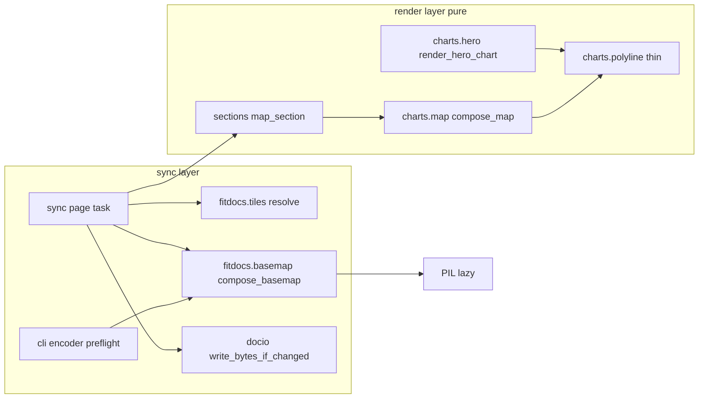
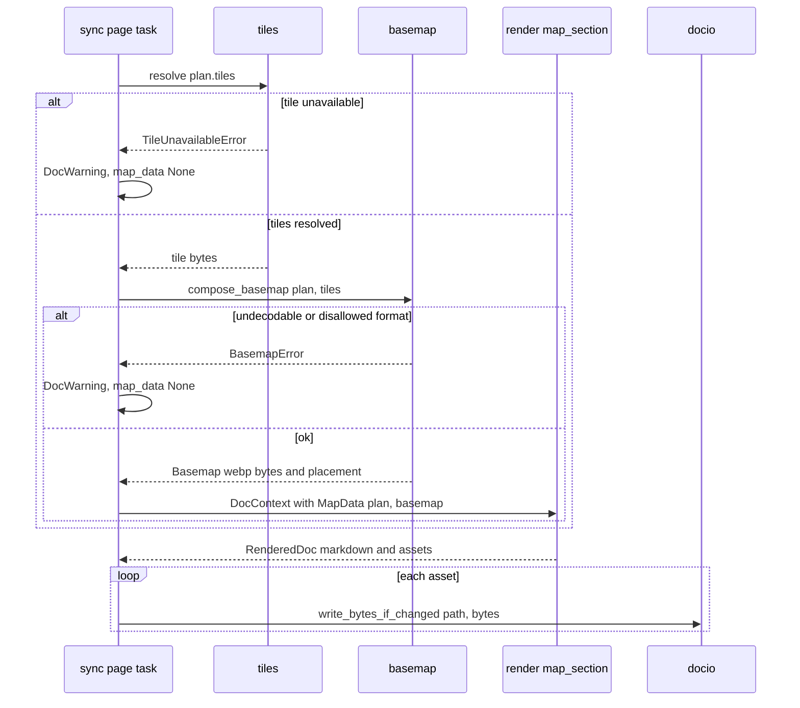

# Design Document: compact-chart-assets

## Overview

**Purpose**: Workout chart assets become about five times smaller and stop
churning sync history, and nothing the athlete sees changes. The hero and
running-dynamics charts and the map's route are drawn at output resolution.
Each map carries one viewport-cropped WebP basemap instead of a dozen whole
PNG tiles. Workout chart assets are written only when their bytes change,
and are replaced atomically.

**Users**: Athletes with long archives who sync their data root (Obsidian
Sync, iCloud, Dropbox, git) and view pages in Obsidian, iA Writer, GitHub or
Safari. The agent maintaining their wiki, which reads the ownership contract.

**Impact**:
- `MapData` changes shape: it carries a composed `Basemap` instead of raw
  tiles.
- `compose_map` embeds one raster.
- A new module `fitdocs.basemap` is the only importer of Pillow, which is a
  new core dependency.
- `sync._write_assets` goes through a new `docio.write_bytes_if_changed`.
- `CONTRACT_VERSION` advances `"16"` → `"17"`. `DOC_VERSION` is unchanged.

### Goals
- Charts on the maintainer's archive drop from about 1,218 MB to about
  250 MB, with links, names and look unchanged.
- No asset is rewritten when its bytes are unchanged, and no reader ever
  sees a partial asset.
- The hero/dynamics charts and maps stay byte-deterministic, and the map
  keeps working offline and self-contained.

### Non-Goals
- A route-only map setting; basemap quality or scale settings; per-year
  asset folders.
- Thinning chart-kit kinds, zones or calendar charts.
- Write-if-changed for markdown pages, or migrating the eight private
  atomic-write copies onto the new helper. The latter remains
  `.kiro/queue/2026-09-15-atomic-write-helper-copied-per-engine.md`.
- Tile fetch/cache/provider changes; zoom or framing changes; orphaned-asset
  cleanup.
- Editing the fitdocs.ai website guide copy (see Integration & Migration
  Notes).

## Boundary Commitments

### This Spec Owns
- **The line simplifier**: `fitdocs.render.charts.polyline`, a pure,
  stdlib-only module, and its use by the hero renderer, which covers the
  dynamics chart too, and by the map route.
- **One-decimal coordinate formatting** for thinned lines, through a
  `places` parameter on `svg.fmt_num`. The default stays 2.
- **Basemap composition and encoding**: `fitdocs.basemap`, the only module
  that imports `PIL`. It also owns:
  - the tile-format allow list;
  - the canvas density rule;
  - the encode constants (WebP, quality 75, method 4);
  - the encoder-availability check.
- **The basemap value type** `Basemap` in `fitdocs.render.charts.map`, and
  its embedding as one `<image>`.
- **`MapData`'s new shape**: a `basemap` field replaces `tiles`.
- **Undecodable tiles** as a cause of map omission, with a `DocWarning`.
- **The encoder preflight** in the CLI paths that render workout pages.
- **`docio.write_bytes_if_changed`** and its use by `sync._write_assets`.
- **Byte budgets** for hero, dynamics and map assets.
- **The `CONTRACT_VERSION` bump**, the ownership-contract wording, and the
  docs, CHANGELOG and spec amendments listed in the File Structure Plan.

### Out of Boundary
- **`fitdocs.tiles`**: fetching, the cache, settings and provider. Its only
  change is a stale docstring sentence.
- **`MapPlan` construction** (`plan_map`): zoom, framing, projection and
  route segmentation are unchanged.
- **Chart-kit modules and every kit golden**, and `zones.py` and
  `calendar.py`. `fmt_num`'s default behaviour is frozen.
- **Page markdown**, `DOC_VERSION`, document writes (`_write_document`),
  stale-asset removal and the write order in `_write_outputs`.
- **Other engines' private atomic writers.**
- **Website content under `website/content/`.** It is Josh's copy and
  deploys on push.

### Allowed Dependencies
- `render.charts.polyline` → stdlib only (`math`). The chart kit does not
  import it. Adding it to the kit allow list is follow-on work.
- `render.charts.hero` → `polyline`, `svg`, `series`, `palette`, as today
  plus `polyline`.
- `render.charts.map` → stdlib `base64`/`math`, plus `polyline`, `svg`,
  `series`, `palette`. It never imports `PIL` or `fitdocs.basemap`, and
  stays pure.
- `fitdocs.basemap` → `PIL` (imported lazily inside functions; a
  type-only import under `if TYPE_CHECKING:` is allowed),
  `render.charts.map` (`MapPlan`, `TileRef`, `Basemap`) and stdlib. It does
  no file I/O and has no clock. The viewport size comes from `plan.width`
  and `plan.height`.
- `sync` → `basemap`, `docio`, as today plus `basemap`.
- `cli` → `basemap` (preflight only).
- `docio` → stdlib (`os`, `tempfile`) and its existing imports.

### Revalidation Triggers
- `MapData`/`Basemap` field changes. Consumers: `sync._page_task`,
  `sections.map_section`, and the tests listed under Testing Strategy.
- A Pillow version change in `uv.lock`. Regenerate and re-verify the
  basemap encode golden and every map golden, and add a CHANGELOG note if
  bytes moved.
- A change to `fmt_num`'s signature or default.
- A change to `polyline.THIN_TOLERANCE`, `THIN_WINDOW` or the coordinate
  precision. Requirements 1.1 and 2.1 must be re-proved, and the budgets
  re-measured.
- `CONTRACT_VERSION` movement by a concurrent lander. The second lander
  rebases to main + 1.

## Architecture

### Existing Architecture Analysis
- **Map pipeline today**:
  - `sync._page_task` resolves tiles with `tiles.resolve(plan.tiles)`
    (sync.py:2276-2297). On `TileUnavailableError` it appends a `DocWarning`
    and leaves `map_data=None`; otherwise it builds `MapData(plan, tiles,
    attribution)`.
  - `sections.map_section` calls `compose_map(plan, tiles, tint=…,
    attribution=…)` (sections.py:471-499).
  - `_render_tiles` emits one 256×256 `data:image/png` `<image>` per tile at
    fractional offsets (map.py:292-317).
- **Rendering is sequential and in-process.** There is no pool. The render
  layer is pure and has no warning channel: `RenderedDoc` carries markdown
  and assets only. Warnings exist only in sync.
- **Hero today**:
  - `_render_series` emits a `<polyline>` per gap segment.
  - `_render_backdrop` emits a closed `<path>` per segment.
  - Coordinates go through `_coord` → `fmt_num` (2 decimals).
  - Dynamics calls `render_hero_chart` with `backdrop=None`
    (dynamics.py:172-213).
  - `scripts/make_hero_chart.py` renders the website's hero chart, which
    `tests/sitebuild/test_hero_chart.py:97` pins byte-for-byte.
- **Asset writes**: `_write_assets` (sync.py:2570-2575) calls
  `write_text` unconditionally. Its name is a fault-injection step in
  `tests/test_identity_e2e.py:904-949` and must be kept.

### Architecture Pattern & Boundary Map



**Architecture Integration**:
- **Selected pattern**: compose at tile resolution. The basemap is built in
  sync, where tile failures already become warnings. The render layer
  receives a finished `Basemap` value and stays pure and Pillow-free.
- **Boundaries**:
  - Geometry (`polyline`) is pure and shared.
  - Raster work (`basemap`) is the only Pillow importer and does no I/O.
  - Persistence (`docio`) owns the write semantics.
- **Existing patterns preserved**:
  - The `DocWarning` path for map omission.
  - The CLI preflight-then-run shape (`_tile_store`, `_inbox_preflight`).
  - The `_config_error` exit-2 routing.
  - Goldens regenerated by module `main()`.
  - The duckdb-style single-importer AST guard.
- **New components rationale**: each new module answers one requirement
  group. `polyline` covers Req 1–2, `basemap` covers 3–4, and
  `write_bytes_if_changed` covers 6.
- **Steering compliance**:
  - The render layer stays pure (`render/__init__.py`: "the sync engine
    owns all writes").
  - The dependency footprint grows by exactly one package, justified by this
    spec under `tech.md`'s "unless a spec proves we need it" rule.
  - Absent data is still `None`: no basemap means no Map section, never a
    blank map.

### Technology Stack

| Layer | Choice / Version | Role in Feature | Notes |
|-------|------------------|-----------------|-------|
| Runtime | Python ≥3.11 | unchanged | |
| Image library | Pillow `>=13.0.0`, no upper bound | decode tiles (PNG/JPEG/WebP only), composite, encode WebP q75 | New core dependency. MIT-CMU. Floor = CVE-2026-59199, CVE-2026-96643 and the APNG bomb fix. Lazy-imported in `fitdocs.basemap` only. |
| Output | SVG with one `data:image/webp;base64` `<image>` | the map asset | WebKit needs iOS 14 / macOS 11. Chromium-based viewers (Obsidian) handle it. |

## File Structure Plan

### New Files
```
src/fitdocs/
├── basemap.py                      # The only PIL importer. Defines:
│                                   #   compose_basemap, compose_canvas, encode_canvas,
│                                   #   require_encoder, encoder_available;
│                                   #   TILE_FORMATS, BASEMAP_* constants;
│                                   #   BasemapError, BasemapEncoderError
└── render/charts/
    └── polyline.py                 # thin() windowed RDP + 1-decimal rounding; points_attr()
tests/
├── support/tiles.py                # Synthetic tile factory: solid and map-like tiles
│                                   #   (PNG/JPEG/WebP, any size); the undecodable fakes
├── render/charts/test_polyline.py  # tolerance property, endpoints, linear-time bound, determinism
├── test_basemap.py                 # allow list, density, exact placement, overhang,
│                                   #   transparency, encode determinism + golden hash,
│                                   #   encoder check, PIL confinement AST guard
├── test_chart_asset_budgets.py     # hero/dynamics 1 h and 6 h budgets; map budget on map-like tiles
└── test_asset_writes.py            # unchanged → untouched (mtime); changed → atomic;
                                    #   interrupted → old content; symlink replaced not followed
```

### Modified Files
- `src/fitdocs/render/charts/svg.py`: `fmt_num(value, places=2)`. The
  default output is unchanged for every existing caller.
- `src/fitdocs/render/charts/hero.py`:
  - `_render_series` and `_render_backdrop` thin each gap segment through
    `polyline.thin` and format points with `polyline.points_attr`;
  - the backdrop's baseline closure uses the thinned first and last x;
  - axes, ticks and legend are unchanged.
- `src/fitdocs/render/charts/map.py`:
  - new frozen `Basemap` value type;
  - `_render_tiles` is replaced by `_render_basemap(basemap)`, emitting one
    `<image>`;
  - `_render_route` thins each segment once and reuses the points for the
    underlay and foreground;
  - `compose_map(plan, basemap, *, tint, attribution)`;
  - the module docstring purity statement is updated: still stdlib-only,
    now embedding a given raster.
- `src/fitdocs/render/__init__.py`: `MapData.basemap: Basemap` replaces
  `tiles`, and `Basemap` joins `__all__`.
- `src/fitdocs/render/sections.py`: `map_section` passes
  `map_data.basemap`.
- `src/fitdocs/sync.py`:
  - `_page_task` calls `basemap.compose_basemap` after
    `tiles.resolve(...)`; a `BasemapError` becomes a `DocWarning` and
    `map_data=None`;
  - `_write_assets` writes each asset through
    `docio.write_bytes_if_changed` and keeps its name.
- `src/fitdocs/docio.py`: `write_bytes_if_changed(path, data) -> bool`.
- `src/fitdocs/cli.py`: `_basemap_preflight()`, called in:
  - `sync_command`, after `_tile_store`;
  - `_run_drain_passes`, before `_inbox_preflight`;
  - `regen_command`, before `rebuild_series`;
  - the `pull --sync` preflight block.

  Each call routes `BasemapEncoderError` to `_config_error` (exit 2).
- `src/fitdocs/tiles.py`: the docstring at 332-334 changes to say "cached
  verbatim; decoded and validated when a map is composed".
- `src/fitdocs/contract.py`: `CONTRACT_VERSION = "17"` plus an
  append-only history paragraph.
- `pyproject.toml` and `uv.lock`: add `pillow>=13.0.0`.
- Dependency-set pins, each gaining `pillow>=13.0.0`:
  - `tests/test_determinism.py` (671-714);
  - `tests/test_packaging.py` (503-514; the docstring at 1036 changes from
    "six" to "seven");
  - `tests/test_preserved_guarantees.py:100`;
  - `tests/sitebuild/test_repo_wiring.py:71`;
  - `tests/index/derived/test_preserved.py:232-239`.
- Contract pins:
  - `tests/test_retimed_rename_docs.py:33-56`;
  - `tests/index/test_contract_docs.py:144`;
  - `tests/index/derived/test_preserved.py:246`;
  - the eight declaration goldens, regenerated with
    `python -m tests.test_declaration_goldens`.
- Map and hero tests, updated:
  - `tests/render/charts/test_map.py`, `test_map_golden.py` (and its
    `main()`) and `test_hero.py`. `test_hero.py` gains a `main()`
    regenerator, and the assertion at 242-244 changes from "count equals
    samples" to the tolerance property.
  - `tests/render/test_golden_docs.py`, `test_views.py`,
    `test_map_contract.py` and `test_map_section.py`.
  - `tests/test_determinism.py:317-386`, `tests/test_route_maps_e2e.py`
    and `tests/test_sync.py:353,1176`. Where a test needs a rendered map, it
    uses decodable tiles from `tests/support/tiles.py`. Where it tests an
    unavailable map, it keeps the undecodable fake, now asserting the Req
    4.1 warning.
- `scripts/make_hero_chart.py` (unchanged code) is re-run to regenerate
  `website/assets/hero-chart.svg`.
- Docs:
  - `README.md` "Route maps";
  - `docs/configuration.md` `[tiles]` "Tile cache";
  - `docs/install.md`: a Pillow paragraph beside the DuckDB one;
  - `docs/compatibility.md`: a new "Map images" section;
  - `docs/ownership-contract.md`: the version head, the what-changed
    paragraph, and "What Regeneration Replaces and Preserves";
  - `docs/reference/fitdocs-ai-reference.md` §3: the static adaptation
    note;
  - `CHANGELOG.md` `[Unreleased]`.
- Steering: `.kiro/steering/tech.md` (Key Libraries: Pillow) and
  `.kiro/steering/structure.md` ("only `basemap` imports `PIL`").
- Spec amendments:
  - `.kiro/specs/route-maps/requirements.md`: Amendment 2. Req 4.1 is
    amended in place; undecodable tiles are added to Req 4.3's causes; the
    basemap form is stated.
  - `.kiro/specs/route-maps/design.md`: a dated amendment note reversing
    "stdlib-only (zero new dependencies)" and "embedded verbatim".
  - `.kiro/specs/workout-docs/requirements.md`: Amendment 7, covering
    Req 7.4's adaptation and asset write semantics.
  - `.kiro/specs/workout-docs/design.md`: the SvgBuilder "fixed 2-decimal"
    statement is scoped.
  - `.kiro/specs/wiki-contract/requirements.md`: Amendment 13, the asset
    write guarantee and the version bump.
  - `.kiro/specs/docs-site/requirements.md` (Req 8.1),
    `.kiro/specs/distribution/requirements.md` and
    `.kiro/specs/plugin-api/requirements.md`: one amendment each, stating
    that the runtime-dependency baseline gains `pillow>=13.0.0`. This
    follows the precedent of `analytics-index`, which amended all three when
    it added `duckdb`. These land with the dependency (task 1.1), because
    the tests that pin those baselines move in the same change.

  Amendment numbers are the next free number at landing.

## System Flows



- The encoder preflight runs in the CLI before this flow. A missing WebP
  encoder ends the command with exit 2 before any write (4.4), so
  `compose_basemap` never meets it mid-run. If it does anyway, it raises
  `BasemapEncoderError`, which is not a `BasemapError`. The page then fails
  as a per-file failure rather than silently omitting its map.
- A map is omitted only for a tile that is unavailable (existing) or
  undecodable (new). Both produce a `DocWarning`, and neither changes the
  exit code (4.3).

## Requirements Traceability

| Requirement | Summary | Components | Interfaces | Flows |
|-------------|---------|------------|------------|-------|
| 1.1 | line within 0.5 units | polyline, hero | `thin` | — |
| 1.2 | segment endpoints kept | polyline, hero | `thin` | — |
| 1.3 | gaps never bridged | hero (per-segment thinning) | `gap_segments` → `thin` | — |
| 1.4 | everything else unchanged | hero, svg | `fmt_num(places=2)` default | — |
| 1.5 | hero/dynamics budgets | budgets test | — | — |
| 1.6 | linear work | polyline | `thin` (windowed) | — |
| 2.1 | route within 0.5 units | polyline, map | `thin` | — |
| 2.2 | route endpoints and markers | map `_render_route`, `_render_markers` | `thin` | — |
| 2.3 | segments never joined | map (per-segment) | — | — |
| 2.4 | route look and framing unchanged | map, plan_map untouched | — | — |
| 2.5 | linear work for the route | polyline | `thin` | — |
| 3.1 | one image covering the viewport, ≤1 px overhang | basemap, map | `compose_canvas`, `_render_basemap` | page task |
| 3.2 | same imagery and position | basemap | `compose_canvas` placement | page task |
| 3.3 | density = max tile density, ≥1 | basemap | `_canvas_density` | — |
| 3.4 | fixed format and quality | basemap | `BASEMAP_*` constants | — |
| 3.5 | self-contained | map | data URI | — |
| 3.6 | vector overlay above raster | map | `compose_map` order | — |
| 3.7 | viewer floor | basemap (WebP), docs | — | — |
| 3.8 | map budget | budgets test | — | — |
| 4.1 | undecodable tile → omit + warn | basemap, sync | `BasemapError` → `DocWarning` | page task |
| 4.2 | format allow list | basemap | `TILE_FORMATS`, `Image.open(formats=…)` | — |
| 4.3 | never failed; other omissions unchanged | sync | existing `DocWarning` path | page task |
| 4.4 | encoder missing → fail before writes | basemap, cli | `require_encoder`, `_basemap_preflight` | CLI preflight |
| 5.1 | byte-identical per environment | polyline, basemap, map | constants, no clock | — |
| 5.2 | identical on macOS/Linux, arm64/x86-64 | basemap encode golden hash, goldens | — | CI (Linux) vs dev (macOS) |
| 5.3 | line charts independent of image library | hero (no PIL) | — | — |
| 5.4 | no clock, no network | polyline, basemap | — | — |
| 6.1 | unchanged → untouched | docio, sync | `write_bytes_if_changed` | page task |
| 6.2 | changed → atomic | docio | `write_bytes_if_changed` | page task |
| 6.3 | every workout chart asset | sync `_write_assets` | — | — |
| 6.4 | ownership and stale removal unchanged | sync (untouched) | — | — |
| 7.1 | names, locations, links unchanged | layout (untouched) | — | — |
| 7.2 | markdown and DOC_VERSION unchanged | contract (DOC untouched) | — | — |
| 7.3 | regen converts archive | sync regen | — | — |
| 7.4 | other charts byte-identical | kit, zones, calendar untouched | `fmt_num` default | — |
| 7.5 | no new setting | — | — | — |
| 8.1 | required dependency | pyproject | — | — |
| 8.2 | CVE floor | pyproject `pillow>=13.0.0` | — | — |
| 8.3 | no upper bound | pyproject | — | — |
| 8.4 | install docs | docs/install.md | — | — |
| 8.5 | compatibility docs | docs/compatibility.md | — | — |
| 9.1 | contract wording | docs/ownership-contract.md | — | — |
| 9.2 | contract version +1 | contract.py | `CONTRACT_VERSION` | — |
| 9.3 | route-map docs | README, docs/configuration.md | — | — |
| 9.4 | reference §3 + Req 7.4 | fitdocs-ai-reference.md, workout-docs amendment | — | — |
| 9.5 | release notes | CHANGELOG | — | — |
| 9.6 | spec amendments | route-maps, workout-docs, wiki-contract; docs-site, distribution, plugin-api (dependency baseline) | — | — |
| 10.1 | no personal data | tests/support/tiles.py (synthetic) | — | — |
| 10.2 | tile size, format, undecodable coverage | test_basemap, support/tiles | — | — |
| 10.3 | aggregate-only measurement | optional maintainer task | — | — |

## Components and Interfaces

| Component | Domain/Layer | Intent | Req Coverage | Key Dependencies | Contracts |
|-----------|--------------|--------|--------------|------------------|-----------|
| polyline | render.charts (pure) | Thin a polyline to output resolution and format it | 1.1–1.3, 1.6, 2.1–2.3, 2.5, 5.1, 5.4 | stdlib (P0) | Service |
| hero (modified) | render.charts | Draw thinned series and backdrop | 1.1–1.4, 5.3 | polyline (P0) | — |
| map (modified) | render.charts | Embed one basemap; draw thinned route | 2.1–2.4, 3.1, 3.5, 3.6 | polyline (P0) | Service, State |
| basemap | sync-level, pure compute | Decode, composite, crop and encode the basemap; encoder check | 3.1–3.4, 3.7, 4.1, 4.2, 4.4, 5.1, 5.2 | Pillow (P0), map types (P0) | Service |
| sync page task (modified) | sync | Turn basemap failures into warnings; write assets if changed | 4.1, 4.3, 6.1–6.4, 7.3 | basemap (P0), docio (P0) | — |
| docio.write_bytes_if_changed | io | Compare-then-atomic-replace | 6.1–6.3 | stdlib (P0) | Service |
| cli preflight | cli | Fail before writes when WebP encoding is missing | 4.4 | basemap (P0) | — |

### render.charts

#### polyline

| Field | Detail |
|-------|--------|
| Intent | Reduce a polyline in output units to the vertices its image can show, within a stated tolerance, in linear time |
| Requirements | 1.1, 1.2, 1.3, 1.6, 2.1, 2.2, 2.3, 2.5, 5.1, 5.4 |

**Responsibilities & Constraints**
- Pure, deterministic and stdlib-only. It does no I/O, reads no clock and
  uses no randomness.
- It works on one gap-free run at a time. Callers split at gaps exactly as
  today (`gap_segments` for hero, `plan.segments` for the map), so a gap can
  never be bridged (1.3, 2.3).
- It makes no assumption that x is monotone: hero `x` is not sorted, and a
  route is 2-D.

**Contracts**: Service [x]

```python
Point = tuple[float, float]

THIN_TOLERANCE: Final[float] = 0.3   # output units; RDP epsilon
THIN_WINDOW: Final[int] = 512        # max points per RDP window (shared endpoints)
COORD_PLACES: Final[int] = 1         # decimal places of emitted coordinates

def thin(points: Sequence[Point]) -> tuple[Point, ...]:
    """Windowed Ramer-Douglas-Peucker at THIN_TOLERANCE, then rounding to COORD_PLACES
    and removal of consecutive duplicates created by rounding."""

def points_attr(points: Sequence[Point]) -> str:
    """'x,y x,y …' with fmt_num(v, places=COORD_PLACES)."""
```
- **Preconditions**: the coordinates are finite floats in output units.
- **Postconditions**:
  1. The output's first and last points are the input's first and last
     points, rounded.
  2. Every input point lies within `THIN_TOLERANCE + √2·0.5·10^-COORD_PLACES`
     (≈ 0.371 < 0.5) of the output polyline.
  3. A run of 0, 1 or 2 points is returned rounded, with duplicates
     removed. A run of length 1 stays length 1; `map._render_route` keeps
     its existing doubling of a single-point segment.
  4. The output length is at most the input length.
- **Algorithm (normative)**:
  - Partition the run into windows `[0..K]`, `[K..2K]`, …, with K =
    `THIN_WINDOW` and adjacent windows sharing their boundary index.
  - Run iterative, stack-based RDP in each window, using perpendicular
    distance to the window's chord segment. When the chord has zero length,
    use the Euclidean distance to its endpoint.
  - Concatenate the windows without duplicating the shared boundaries.
  - Round each coordinate with `round(v, COORD_PLACES)`, then drop any
    point equal to its predecessor.
  - Work is O(n·K) = O(n) for fixed K (1.6, 2.5).

**Implementation Notes**
- Validation: see Testing Strategy, the polyline property tests.
- Risks: banker's rounding of `.x5` ties is deterministic in CPython on
  every platform. `fmt_num` re-rounds idempotently.

#### hero (modified)

- `_render_series`: for each gap segment, map to output points, apply
  `thin`, and emit `<polyline points="{points_attr(...)}">`. Segments of one
  point keep today's handling.
- `_render_backdrop`:
  - Thin the top outline per segment.
  - The path is `M p0 L p1 … L pn L (pn.x, baseline) L (p0.x, baseline) Z`,
    with p0 and pn the thinned, rounded endpoints.
  - `baseline` and axis geometry keep 2-decimal `fmt_num`.
- Axes, ticks, the legend, smoothing (`boxcar_smooth`), band normalization,
  colours and series precedence are untouched (1.4).
- No Pillow import, so 5.3 holds by construction.

#### map (modified)

**Contracts**: Service [x] / State [x]

```python
@dataclass(frozen=True)
class Basemap:
    mime: str          # "image/webp"
    data: bytes        # encoded raster
    x: float           # placement in output units; in (-1/d, 0]
    y: float
    width: float       # canvas_px_w / d
    height: float      # canvas_px_h / d

def compose_map(plan: MapPlan, basemap: Basemap, *, tint: str, attribution: str) -> str
```
- `_render_basemap(basemap)` emits exactly one
  `<image x y width height href="data:{mime};base64,…"/>`. The numbers use
  `fmt_num` at 4 places, so that a placement of `-k/d` round-trips within
  0.0001 units. This is a local call with an explicit `places`; the default
  is unchanged.
- The element order is unchanged: basemap, route, markers, attribution
  (3.6).
- `_render_route` calls `thin(segment)` once per segment, and both polylines
  reuse it. The widths, opacities and tint are unchanged (2.4). Markers stay
  at `plan.segments[0][0]` and `plan.segments[-1][-1]`, the unthinned
  projected points (2.2).
- The purity statement becomes: "standard-library `math` and `base64` plus
  `series`, `svg`, `palette`, `polyline`; embeds a raster it is given; no
  I/O, no clock, no randomness; never imports `fitdocs.tiles` or
  `fitdocs.basemap`."

`MapData` (render/__init__.py) becomes `MapData(plan: MapPlan, basemap:
Basemap, attribution: str)`.

### fitdocs.basemap

| Field | Detail |
|-------|--------|
| Intent | Turn a map plan and its resolved tile bytes into one encoded, viewport-cropped raster with its placement, or a typed failure |
| Requirements | 3.1, 3.2, 3.3, 3.4, 3.7, 4.1, 4.2, 4.4, 5.1, 5.2, 5.4 |

**Responsibilities & Constraints**
- It is the only module in `src/` that imports `PIL`, always inside
  functions. The one exception is a type-only import under
  `if TYPE_CHECKING:`. An AST guard test enforces both rules.
- It does no file I/O, no network, and reads no clock.

**Dependencies**
- External: Pillow ≥13.0.0. Uses `Image.open(..., formats=TILE_FORMATS)`,
  `Image.new`, `paste`, `resize(Resampling.LANCZOS)`, `alpha_composite`,
  `save(format="WEBP", quality=75, method=4)` and
  `features.check("webp")` (P0).
- Inbound: `sync._page_task` (compose) and `cli._basemap_preflight`
  (encoder check) (P0).
- Outbound: `render.charts.map` types (P0).

**Contracts**: Service [x]

```python
TILE_FORMATS: Final[tuple[str, ...]] = ("PNG", "JPEG", "WEBP")
BASEMAP_FORMAT: Final[str] = "WEBP"
BASEMAP_MIME: Final[str] = "image/webp"
BASEMAP_QUALITY: Final[int] = 75
BASEMAP_METHOD: Final[int] = 4
TILE_UNITS: Final[int] = 256            # output units one tile covers

class BasemapError(Exception):
    """A tile could not be used: not PNG/JPEG/WebP, or not decodable. Message names
    the tile as z/x/y and the cause."""

class BasemapEncoderError(Exception):
    """The installed image library cannot encode BASEMAP_FORMAT (installation fault)."""

def encoder_available() -> bool
def require_encoder() -> None                       # raises BasemapEncoderError

@dataclass(frozen=True)
class Canvas:
    image: "PIL.Image.Image"   # RGB
    density: float             # pixels per output unit, >= 1
    x: float                   # placement in output units
    y: float

def compose_canvas(plan: MapPlan, tiles: Sequence[tuple[TileRef, bytes]]) -> Canvas  # raises BasemapError
def encode_canvas(canvas: Canvas) -> Basemap                                          # raises BasemapEncoderError
def compose_basemap(plan: MapPlan, tiles: Sequence[tuple[TileRef, bytes]]) -> Basemap
```
- **Density**: `d = max(1.0, max(tile.width / TILE_UNITS for each decoded
  tile))` (3.3). A tile whose pixel size is not `TILE_UNITS·d` is resized to
  `round(TILE_UNITS·d)` square with LANCZOS. This covers 4 px test tiles and
  mixed densities.
- **Placement** (3.1, 3.2):
  - Tile `t` sits at output position `(t.x·256 − plan.origin_x,
    t.y·256 − plan.origin_y)`, the formula in `_render_tiles` today.
  - Canvas pixel column `c` stands for world unit `c/d`. The viewport spans
    world units `[origin_x, origin_x + plan.width)`. The canvas therefore
    covers pixel columns
    `[floor(origin_x·d), ceil((origin_x + plan.width)·d))`, and likewise for
    rows with `plan.height`.
  - Each tile is pasted at the integer pixel `t.x·256·d − floor(origin_x·d)`.
    This is exact because `256·d` is an integer: `256·d = max(256, tile
    pixel width)`, and tile widths are whole numbers. No snapping step
    exists or is needed.
  - The placement is `x = (floor(origin_x·d) − origin_x·d)/d ∈ (−1/d, 0]`,
    likewise `y`, and `width = canvas_px_w/d`.
  - The canvas overhangs the viewport by less than one pixel per edge.
- **Composition**:
  - Every decoded tile is converted to RGBA and alpha-composited onto an
    opaque white canvas, which is then converted to RGB.
  - Tiles from rows clamped out of range by `plan_map` are never present;
    uncovered pixels stay white.
- **Encode**: `save(buf, "WEBP", quality=75, method=4)` from a fresh
  `Image.new` canvas, so no metadata is carried (3.4, 5.1).
  `encode_canvas` calls `require_encoder()` first.
- **Errors**:
  - Any exception from `Image.open`/`load` for a tile, including
    `UnidentifiedImageError` and `OSError`, is re-raised as `BasemapError`
    naming `z/x/y` and the cause class (4.1, 4.2). The image is opened with
    `formats=TILE_FORMATS`, so other decoders are never consulted.
  - `DecompressionBombError` is a `BasemapError` too.

**Implementation Notes**
- Integration: `sync._page_task` passes `resolved_tiles` in `plan.tiles`
  order (the `MapData.tiles` order today).
- Validation: the exact-placement test uses lossless `compose_canvas`
  output. The encode test pins a SHA-256 of `encode_canvas` on a fixed
  synthetic canvas; it runs on macOS (dev) and Linux (CI), which is 5.2's
  evidence.
- Risks: a future libwebp changes bytes. The goldens are tied to the
  `uv.lock` Pillow (Revalidation Triggers).

### sync and io

#### docio.write_bytes_if_changed

**Contracts**: Service [x]

```python
def write_bytes_if_changed(path: Path, data: bytes) -> bool:
    """True if written. Leaves an identical regular file untouched (content and mtime).
    Otherwise writes a temp file in path.parent (name '.{path.name}.<random>.tmp'),
    flushes and fsyncs it, then os.replace()s it onto path; the temp file is unlinked
    on any failure. A symlink at path is replaced, never read or written through."""
```
- **Preconditions**: `path.parent` exists. The caller creates it, as
  `_write_assets` does today.
- **Postconditions**:
  - `path` holds either the previous complete bytes or `data` (6.2).
  - No temp file remains after a normal return or a raised exception.
- **Invariant**: comparison is by bytes read from a regular, non-symlink
  file. A read error counts as "differs".

#### sync._page_task and _write_assets (modified)

- After `resolved_tiles = tiles.resolve(plan.tiles)`, call
  `basemap.compose_basemap(plan, resolved_tiles)`.
  - On `BasemapError`, append
    `DocWarning(doc=doc_ref, detail=_reason(exc))` unless `quiet`, and leave
    `map_data=None` (4.1, 4.3).
  - `BasemapEncoderError` is not caught here. It propagates like any other
    unexpected render error and becomes that page's per-file failure (exit
    1), never a silent omission. The CLI preflight makes this unreachable in
    practice.
- `_write_assets` keeps its name and loop, and calls
  `docio.write_bytes_if_changed(asset_path,
  asset.content.encode("utf-8"))` (6.1–6.3). Stale-asset removal and the
  `_write_outputs` order are unchanged (6.4).

#### cli._basemap_preflight

- Calls `basemap.require_encoder()`. On `BasemapEncoderError` it calls
  `_config_error(...)`, giving exit 2 with this message:

  > fitdocs cannot draw maps: the installed Pillow has no WebP encoder.
  > Reinstall it from an official wheel (`uv tool install --reinstall
  > fitdocs`), or build Pillow with libwebp.
- Placement, so that it runs before the first write of each command:
  - `sync_command`, after `_tile_store` (cli.py:868);
  - `_run_drain_passes`, before `_inbox_preflight` (cli.py:957);
  - `regen_command`, before `rebuild_series` (cli.py:1076);
  - the `pull --sync` preflight block (cli.py:1589-1603).

## Error Handling

### Error Strategy
- **A tile not cached or not fetchable** (existing): `TileUnavailableError`
  → `DocWarning`, map omitted, exit code unchanged.
- **A tile not in the allow list or not decodable** (new): `BasemapError` →
  `DocWarning` naming the document and `z/x/y` with the cause, map omitted,
  exit code unchanged (4.1, 4.3).
- **No WebP encoder** (new): `BasemapEncoderError` → CLI exit 2 before any
  write (4.4). It is never downgraded to a warning, because omitting maps
  on `regen` would strip them archive-wide.
- **An asset write failure**: the `OSError` from
  `write_bytes_if_changed` reaches the existing per-file failure handling
  in `_page_task`, with the temp file removed and the old asset intact.

### Monitoring
Warnings appear in the run report exactly like today's tile warnings. No new
report lines.

## Testing Strategy

### Unit tests
- **polyline**:
  - A property test over seeded synthetic runs checks that every input
    point is within 0.5 units of the output polyline (1.1, 2.1). The runs
    cover a smooth sine, a noisy HR-like walk, step changes, spikes, a
    closed loop, a back-and-forth route and a non-monotone x.
  - The first and last points are kept (1.2, 2.2).
  - Lengths 0, 1 and 2 are handled.
  - Duplicates produced by rounding are removed.
  - The output is identical across two calls (5.1).
- **polyline linear bound** (1.6, 2.5): a 100,000-point convex arc, RDP's
  quadratic worst case, completes under a generous ceiling. Separately, an
  instrumented distance counter asserts at most `n·THIN_WINDOW`
  evaluations.
- **svg**: `fmt_num(v)` is byte-identical to today on the existing
  `test_svg` corpus. `fmt_num(v, places=1)` and `places=4` round
  correctly.
- **basemap**:
  - PNG, JPEG and WebP tiles decode (4.2). TIFF, GIF, EPS-signature, random
    bytes and the PNG-signature-only fake raise `BasemapError`, with
    `z/x/y` in the message (4.1, 10.2).
  - Density is 1 for 256 px tiles, 2 for 512 px, 1 for 4 px fixtures, and
    the maximum for mixed sizes (3.3).
  - Exact placement: lossless `compose_canvas` pixels equal a reference
    mosaic cropped at the fractional offset, for positive, negative and
    zero fractional origins (3.2).
  - The canvas covers the viewport, with an overhang under one pixel (3.1).
  - Transparent tiles are composited on white.
  - `encode_canvas` is byte-identical twice, and its SHA-256 matches the
    pinned golden (5.1, 5.2).
  - With `features.check` monkeypatched to False, `require_encoder` raises
    `BasemapEncoderError`.
  - An AST guard confines `PIL` imports to `fitdocs.basemap`, inside
    functions only. It is modeled on
    `tests/index/test_boundary.py:436-446`.
- **docio**:
  - Identical bytes leave content and `st_mtime_ns` unchanged (6.1).
  - Different bytes replace the file.
  - If `os.replace` raises, the old content is intact and no `.tmp`
    remains (6.2).
  - A symlink at `path` is replaced and its target untouched.

### Integration tests
- **The map asset**: `compose_map` with a fixed `Basemap` emits exactly one
  `<image>` with a `data:image/webp` href, before the route, markers and
  attribution (3.1, 3.5, 3.6). The map goldens are regenerated through
  `test_map_golden.main()` and stay Pillow-independent, because they use a
  fixed fake `Basemap`.
- **Hero goldens**: regenerated through a new `test_hero.main()`. The
  revised `test_hero.py:242-244` asserts the tolerance property against the
  full-resolution points. Axis, tick and legend elements are unchanged
  against the pre-feature goldens, compared with points stripped (1.4).
- **Sync with an undecodable tile**: the page is written without a Map
  section, the run report carries a `DocWarning` naming the document and
  the cause, and the exit code is 0 (4.1, 4.3).
- **The CLI preflight**: with the encoder unavailable, `sync`, `sync`
  (drain), `regen` and `pull --sync` exit 2 with the remedy message. No
  page, asset, inbox directory, declaration or series is written (4.4).
- **Regen twice**: the second run leaves every workout asset's
  `st_mtime_ns` unchanged (6.1, 6.3). After a changed input, only the
  affected assets move.
- **Other charts unchanged**: the zones, calendar and every chart-kit
  golden pass without regeneration (7.4).

### E2E tests
- **`tests/test_route_maps_e2e.py` and `tests/test_determinism.py`**: with
  synthetic decodable tiles, two independent runs produce byte-identical
  map, hero and dynamics assets, and the map holds one WebP image (5.1,
  3.1).
- **`tests/render/test_golden_docs.py`**: the golden documents' markdown is
  byte-unchanged (7.1, 7.2). Only the `-hero`, `-dynamics` and `-map` SVG
  assets are regenerated.

### Budgets (1.5, 3.8)
- `tests/test_chart_asset_budgets.py` builds:
  - hero and dynamics charts from deterministic synthetic 1 h and 6 h
    activities at 1 Hz (smooth terrain plus bounded noise);
  - a map over procedurally drawn map-like 256 px tiles (fills, roads,
    label-like glyph blocks) from `tests/support/tiles.py`.
- Each budget is the size measured at landing, rounded up, with headroom
  between 10% and 40%: the chart-kit Req 11.4 convention, under which a
  budget whose headroom exceeds 40% is lowered.
- The test also asserts a ≥75% reduction for the 1 h hero against the
  full-resolution rendering, recorded as a constant measured once before
  the hero change lands.

### Manual (maintainer-only, optional)
- **3.7 viewer floor.** A generated map is opened in Obsidian desktop, iA
  Writer, Safari and a GitHub ``. Discovery already verified Chrome,
  WKWebView, QuickLook and librsvg, so this check re-confirms the shipped
  bytes.
- **10.3 archive measurement.** `fitdocs regen` runs on a copy of the
  maintainer's archive, and before/after totals per chart kind are recorded
  in the implementation notes as aggregates only. The target is ≤300 MB of
  charts.

### Performance
- The polyline linear bound (above).
- `compose_basemap` on 15 map-like 512 px tiles completes under a generous
  ceiling. This is a smoke test against regressions, not a benchmark.

## Security Considerations
- **Tile bytes come from a third-party server.**
  - Decoding is restricted to PNG, JPEG and WebP through `formats=`, so
    TIFF, PSD, EPS (Ghostscript) and the other decoders are never reached.
  - The Pillow floor 13.0.0 carries the fixes for the paste/crop OOB write
    (CVE-2026-59199), quadratic PNG eXIf (CVE-2026-96643) and the APNG bomb
    bypass.
  - `DecompressionBombError` is a `BasemapError`.
- **No new network path and no new file read.** Tiles still come only from
  `fitdocs.tiles`.

## Performance & Scalability
- Thinning cuts each line from about 5 points per pixel to about 1 point per
  4–10 pixels, which reduces both bytes and the viewer's path-rasterization
  work.
- About 20 ms of WebP encode per map, plus about 3 ms of composite, is
  offset by no longer base64-encoding about 360 KB of PNG per map.
- `write_bytes_if_changed` reads each existing asset once per write. That
  is about 250 MB after migration, instead of rewriting 1.2 GB.

## Integration & Migration Notes
- **The migration is one `fitdocs regen`.** Names and links don't change,
  and the stale-asset rules are unchanged. The first regen rewrites every
  map, hero and dynamics asset; later regens write nothing that is
  unchanged.
- **`website/assets/hero-chart.svg`** is regenerated by
  `scripts/make_hero_chart.py`. The docs workflow redeploys the site on
  push to `main` with a visually identical chart.
- **Website guide copy is out of scope.** If
  `website/content/guides/workout-pages.md` "## Map" or
  `privacy-and-network.md` describes embedded tiles, record a queue item
  at landing rather than editing Josh's copy.
- **`CONTRACT_VERSION` is main + 1 at landing.** If a peer lands a bump
  first, rebase to their value + 1, and move the declaration goldens and
  the literal pins together.

## Open Questions / Risks
- **Real-tile budget realism.** The synthetic map-like tiles approximate
  OSM imagery. The optional maintainer-only measurement (10.3) on the real
  archive is the ground truth (target ≤300 MB of charts). Only aggregates
  are recorded.
- **Windows** byte-identity was not verified (5.2 is scoped to
  macOS/Linux).
