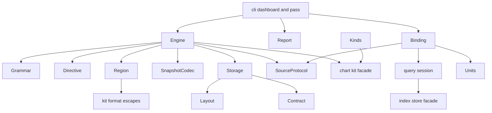
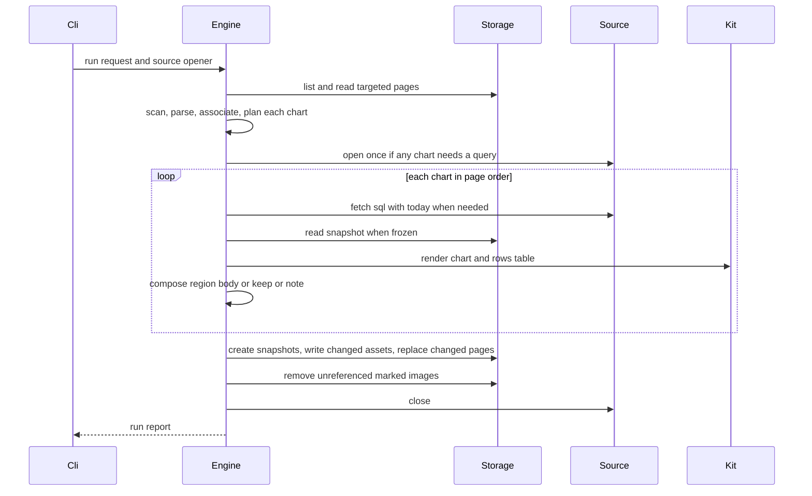
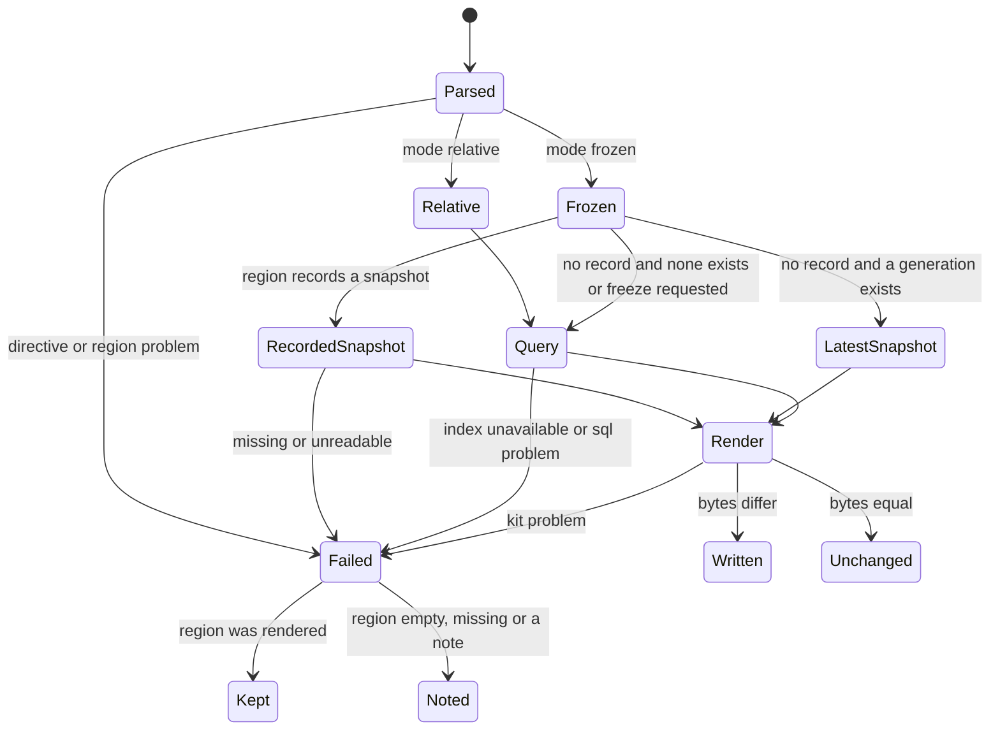

# Design Document: dashboards

## Overview

**Purpose**: dashboards turns the analytics index into charts on wiki pages
the athlete owns. A page under `dashboards/` holds the athlete's prose and
hidden chart directives; fitdocs owns one region below each directive and the
chart files in `dashboards/assets/`. Relative charts re-run their SQL after
every successful index refresh and on demand; frozen charts are drawn from
immutable snapshots and never re-queried.

**Users**: the athlete and the athlete's LLM assistant, who write pages and
directives and iterate on them with `fitdocs dashboard check`; the writing
commands (`sync`, drain, `pull --sync`, `regen`, `load`), which run the
dashboard pass after their index refresh.

**Impact**: adds the package `fitdocs.dashboards`, one CLI command
(`dashboard`, 13 → 14), a fourth packaged skill, `docs/dashboards.md`, a new
owned location and declared directory (`CONTRACT_VERSION` main+1), and the
first named exception to "the index is never read back into a document". It
amends four shipped specs (§ Existing Spec Updates). It changes no workout,
history or block document, no index schema and no chart-kit code.

### Goals
- A page grammar (directive, region, fences) that is pure, total and
  testable on strings, and that refuses every viability trap by name.
- Exactly one SQL surface: the analytics query sandbox, with `$today` the
  only parameter and typed result columns.
- Frozen charts that can never change silently: immutable snapshots, never
  deleted, never re-queried, found again after a page rename.
- Per-chart failure isolation, atomic writes, and no churn: a run with
  nothing new writes nothing.
- An agent surface (problems, JSON report, kinds listing, skill, docs) good
  enough to iterate in a loop without reading source.

### Non-Goals
- How a chart looks, which kinds exist, encoding validation (`chart-kit`,
  `chart-catalog`).
- Charts in workout, history or block documents; a dashboards index page.
- Writing prose, calling a language model, write SQL, saved views, a daemon.
- Fixing the store facade's user-interrupt wrapping (open queue item
  `2026-10-08-store-facade-user-interrupt-unwrapped`); dashboards uses the
  query layer's existing workaround through the new session.
- Registering `dashboards/` in pkm's `wiki-schema.md` (roadmap Direct
  Implementation Candidate, pkm repository).

## Boundary Commitments

### This Spec Owns
- **`fitdocs.dashboards`**: page recognition, the directive and region
  grammar, directive validation, region composition and in-place rewrite,
  asset and snapshot naming, the snapshot format and lifecycle, stale-image
  removal, the column type map and value adapter, the run engine, the
  problem codes and the report.
- **The `fitdocs dashboard` command** and the **dashboard pass** wiring in
  `cli.py` (`_run_dashboard_pass`, the call sites after the index pass).
- **The `dashboards/` declaration text** (`declaration.py` branch and its
  golden) and the `dashboards/` and `dashboards/assets/` entries in
  `layout.OWNED_PATHS` / `DECLARED_DIRS`.
- **The agent surface**: `src/fitdocs/skills/fitdocs-dashboards/SKILL.md`,
  `docs/dashboards.md` (including its live-pinned kinds block), the pointer
  in `fitdocs-analytics`.
- **The amendments** listed under Existing Spec Updates, executed as tasks.
- **Tests** under `tests/dashboards/` and the named edits to existing tests.

### Out of Boundary
- Chart rendering, the registry, `ChartProblem` codes, the unit table
  (`chart-kit`); the extended kinds (`chart-catalog`).
- The index schema, producers, refresh logic and location rules
  (`analytics-index`), beyond the facade parameter path and the post-pass
  return value this spec amends.
- Statement screening rules and the sandbox configuration (`analytics-query`),
  beyond the parameter path, column types and the session this spec amends.
- Declarations of other directories, the generated-document banner, workout
  document regions (`wiki-contract`, `workout-docs`).
- The store facade's interrupt mapping (queue item above), the shared
  atomic-write helper (queue item `2026-09-15-atomic-write-helper-copied-per-engine`).

### Allowed Dependencies
- Standard library; `yaml` (PyYAML, already a dependency) in `directive` only.
- `fitdocs.render.charts.kit` facade (`validate_chart`, `render_chart`,
  `describe_kinds`, `kind_names`, `ChartRequest`, `ChartData`, `Column`,
  `ValueKind`, `ChartProblem`, `ProblemCode`, `ChartError`, `RenderedChart`);
  `RenderedChart.output` is compared by its string value (`"svg"`), and a kind
  listing is read as a `Mapping[str, object]`, so neither `Output` nor
  `KindListing` needs to be a facade export; `fitdocs.render.charts.kit.format` for `escape_markdown` and
  `clean_text` only, in `region` only (research.md, gap G1).
- `fitdocs.units` (`unit_for_column`), in `binding` only.
- `fitdocs.query.command` (`open_session`, `QuerySession`,
  `SessionUnavailable`, `QueryEnvironment`, `OutcomeKind`, `DEFAULT_TIMEOUT_S`),
  `fitdocs.query.statement` (exceptions, `RESTRICTION_TEXT`),
  `fitdocs.query.format` (`ResultSet`) — in `binding` only.
- `fitdocs.layout` (`DASHBOARDS_DIR`, `ASSETS_SUBDIR`) and `fitdocs.contract`
  (`GENERATED_PREFIX`, `is_generated`), in `storage` and `engine`.
- Never: `duckdb`, `fitdocs.index`, any other `fitdocs.render` module,
  `sync`, `history`, `plans`, `load`, `model`, `ingest`, `connectors`,
  `tiles`, `plugins`, `cli`, a network module, a clock.
- Only `fitdocs.cli` imports `fitdocs.dashboards`.

### Revalidation Triggers
- A change to the directive keys, the marker or reference-line grammar, the
  region body layout or the caption format (pages written by an earlier
  version would be rewritten; existing goldens move).
- A change to the snapshot file format or naming (snapshots are permanent;
  a new format must keep reading version 1).
- A change to the problem code values or the JSON report keys (agents parse
  them).
- A change to chart-kit's facade names, `describe_kinds()` shape, the
  `table` kind, `escape_markdown`/`clean_text`, or the unit table.
- A change to the query session contract or the facade parameter path.
- A new kind in the registry (the docs kinds block regenerates; nothing else).

## Existing Spec Updates Carried by This Spec

Each is a task in `tasks.md`, executed at implementation time; the amendment
number is the next free one in the target spec at `560f909` (re-check at
implementation and take the next free number if another spec took it first).

- **analytics-index — Amendment 1 (a named-parameter read, the post-pass
  outcome, the named exception)**:
  - `index/store.py`: two **new** facade methods, nothing existing changed
    (controller ruling, Step 3.5 round 1):
    - `IndexConnection.execute_named(sql, params: Mapping[str, object]) -> IndexResult`
      runs `connection.execute(sql, dict(params))` — or `connection.execute(sql)`
      when the mapping is empty, so nothing is bound that the SQL does not
      use — and the result reads `description` and streams
      `fetchmany`/`fetchall` from that cursor;
    - `IndexConnection.statement_parameters(sql) -> tuple[frozenset[str], ...]`
      from `extract_statements(...)[i].named_parameters`.
  - **Unchanged, by design**: `IndexConnection.execute(sql, params: Sequence[object] = ())`,
    its `.sql(sql, params=params)` routing, every caller (the index writer at
    `store.py:400`, `:426`, `:486`, `:500`, `:513`, `:523-524` and
    `query/freshness.py:119`) and every test that monkeypatches it
    (`tests/index/test_store.py:1172-1179`, `:1510-1517`, `:1541-1546`,
    `tests/query/test_store_facade.py:264`). Positional `execute` with params
    still materialises its whole result before `fetchmany` caps it (the
    viability hazard); no present caller reads a large positional result, and
    moving positional reads to a streaming path is **out of this amendment's
    scope** (the controller queues the residual).
  - `cli._run_index_pass` returns `IndexReport | None` (None when it caught an
    exception); pin moves in `tests/index/test_cli_post_pass.py:533-543` and
    the `returned is None` assertion.
  - Req 5.6 and every copy of "never read back into a document" gain the
    dashboards exception: `tech.md:12-17`, `docs/ownership-contract.md:10-11`
    (rewritten as the version-10 head) and `:191-193`, the `contract.py:400`
    docstring stays as history; pins move in
    `tests/connectors/test_network_statements.py:640-644`,
    `tests/index/test_contract_docs.py:56`,
    `tests/identity/test_contract_docs.py:183`.
  - `.kiro/specs/analytics-index/requirements.md` gains `## Amendment 1`;
    `spec.json` an `amendments` entry.
- **analytics-query — Amendment 1 (parameters, column types, the session)**:
  - `query/format.py`: `ResultSet.column_types: tuple[str, ...] = ()`.
  - `query/statement.py`: `execute_statement` and `run_statement` take
    `params: Mapping[str, object] | None = None` — `None` keeps today's
    `conn.execute(sql)` call byte-for-byte; a mapping (even an empty one)
    goes through `conn.execute_named(sql, params)` — and fill
    `column_types`; `statement_parameters(conn, sql) -> frozenset[str]`.
  - `query/command.py`: `open_session`, `QuerySession`, `SessionUnavailable`;
    `run_query` reuses the open-and-check helper, its behaviour unchanged.
  - `tests/query/test_boundary.py`: `_QUERY_IMPORTERS` gains
    `fitdocs.dashboards.binding`; query's forbidden targets gain
    `fitdocs.dashboards`.
  - `requirements.md:85-88` (saved queries; charting query results) marked
    superseded by Phase 11 `dashboards`; `## Amendment 1`; `spec.json` entry.
  - `src/fitdocs/skills/fitdocs-analytics/SKILL.md` "Further reading" gains
    the pointer to `fitdocs-dashboards` (no heading change, so
    `_ANALYTICS_HEADINGS` holds).
- **wiki-contract — Amendment 5 (the dashboards location and the inverse
  ownership shape)**: `layout.DASHBOARDS_DIR`, `OWNED_PATHS` +
  `dashboards/`, `dashboards/assets/`; `DECLARED_DIRS` + `dashboards/`;
  `declaration.py` dashboards branch and golden; `CONTRACT_VERSION` main+1
  (`"10"` at `560f909`) with its history docstring; `docs/ownership-contract.md`
  (version, head, owned paths, "five owned directories", a new section, the
  regions and overwrite sections); `requirements.md` `## Amendment 5`,
  `design.md` dated paragraph, `spec.json` entry.
- **connectors — Amendment 3 (`dashboard` makes no connector request)**:
  Req 14.1 lists `dashboard`; `tech.md`'s list gains `dashboard` before
  `check` (both existing tail pins stay green) and a new pin covers it;
  `tests/connectors/test_e2e.py:321-332` gains `("dashboard", ["check"])`;
  `requirements.md` `## Amendment 3`, `spec.json` entry.

## Settled Seams for the Parallel Sibling (`chart-catalog`)

- dashboards renders every chart through `render_chart` and lists kinds from
  `describe_kinds()` / `kind_names()` at call time; it holds **no kind list
  and no kind count** anywhere, in code or tests.
- **The kinds block** in `docs/dashboards.md` sits between
  `<!-- dashboard-kinds:start -->` and `<!-- dashboard-kinds:end -->`, equals
  `fitdocs.dashboards.kinds.kinds_markdown(describe_kinds())`, and is pinned by
  `tests/dashboards/test_docs_dashboards.py`; regenerate with
  `uv run python -m tests.dashboards.test_docs_dashboards`.
- **Second-lander rule** (roadmap): whichever of `dashboards` and
  `chart-catalog` lands second regenerates the kinds block and re-pins any
  registered-kind count. dashboards pins no count; the only artifact is the
  block. The skill names only core kinds in examples and points at
  `fitdocs dashboard kinds`. Task 7.3 carries the conditional.
- Shared append-only surfaces kept on rebase: `pyproject.toml
  [tool.mypy].files`, `CHANGELOG.md` Unreleased, `.kiro/steering/structure.md`.

## Architecture

### Existing Architecture Analysis
- Region editing inside a page fitdocs does not wholly own exists in
  `load/docedit.py` (replace only between markers). dashboards inverts the
  workout-document shape: an athlete page with fitdocs regions.
- History and plans engines each keep a private atomic writer and a
  foreign-occupant check (symlink, unreadable, not `is_generated`); the SVG
  chart files of `fitdocs history` are marked with `<!-- fitdocs:generated -->`.
- The query layer opens one sandboxed connection per `fitdocs query` and has
  no parameter path; the index post-pass returns nothing.

### Architecture Pattern & Boundary Map

**Selected pattern**: a pure core (grammar, directive, snapshot codec,
region composer, kinds listing) behind a thin I/O shell (storage, binding),
orchestrated by one engine and invoked only by the CLI.



**Dependency direction** (a module imports only modules to its left; the
rank matrix is enforced in `tests/dashboards/test_boundary.py`, precedent
`tests/query/test_boundary.py` `_QUERY_DIRECTION`):

`problems` → `grammar` → `directive` → `snapshot` → `region` → `source` →
`storage` → `kinds` → `engine` → `report` → `binding`

`binding` is last so `engine` cannot import it: the engine receives a source
opener from the CLI. `binding` imports only `problems` and `source` from the
package.

### Technology Stack

| Layer | Choice / Version | Role in Feature | Notes |
|---|---|---|---|
| Runtime | Python ≥ 3.11 stdlib | All dashboards code | No new dependency |
| YAML | PyYAML ≥ 6.0 (existing) | Directive body | Resolver-free loader; event walk |
| Database | duckdb ≥ 1.2,<2 (existing), via `fitdocs.query` only | Chart SQL | `execute_named`: `execute` + `fetchmany` |
| Charts | chart-kit facade (this phase) | Drawing | No local drawing code |
| CLI | typer, rich (existing) | `fitdocs dashboard` | One root command |

## File Structure Plan

### Directory Structure
```
src/fitdocs/dashboards/
├── __init__.py      # Docstring only: "Dashboard pages; imported only by the CLI."
├── problems.py      # DashboardCode, Source, Severity, Problem, from_chart_problem, ProblemDict
├── grammar.py       # Slug grammar, markers, reference line, fence-aware scan_page -> PageScan
├── directive.py     # Strict YAML: parse_directive(body, open_line, page) -> Directive | problems
├── snapshot.py      # Snapshot codec (encode/decode, format v1) and snapshot path naming
├── region.py        # Region body composition, body classification, splice into page text
├── source.py        # ChartSource protocol, Fetched, SourceUnavailable, SourceOpener
├── storage.py       # Filesystem: page read/replace, asset write, snapshot create, stale removal
├── kinds.py         # kinds_text / kinds_markdown from describe_kinds()
├── engine.py        # Discovery, targets, planning, rendering, writes, cleanup -> RunReport
├── report.py        # Text and JSON rendering of RunReport; failed()
└── binding.py       # Query-backed ChartSource: screening policy, $today, type map, values
src/fitdocs/skills/fitdocs-dashboards/SKILL.md   # Fourth packaged skill
docs/dashboards.md                               # User and agent documentation + kinds block

tests/dashboards/
├── __init__.py
├── _helpers.py            # Page text builders, FakeSource, typed rows, data-root factory
├── conftest.py            # indexed_dashboard_root: a real index built like tests/query's
├── test_problems.py  test_grammar.py  test_directive.py  test_snapshot.py
├── test_region.py    test_storage.py  test_kinds.py      test_report.py
├── test_binding.py        # Type map (both vocabularies), screening, real fetch, row cap, timeout
├── test_engine.py         # Fake source: lifecycle, isolation, idempotence, cleanup, targets
├── test_cli_dashboard.py  # Forms, targets, exit codes, JSON, kinds without a data root
├── test_pass.py           # Chained pass per entry point; outcome gating; exit invariance
├── test_interrupt.py      # Real-process SIGINT during refresh
├── test_determinism.py    # Cross-process TZ / LC_ALL / PYTHONHASHSEED byte equality
├── test_e2e.py            # Real index: sync -> charts; regen; index --rebuild; no index
├── test_boundary.py       # Imports, rank matrix, clock, network, only-cli importer
├── test_docs_dashboards.py  # Kinds block live pin + regenerate main; docs phrases; bash commands
└── golden/<case>.md       # Whole-page region goldens (markdown only)
tests/declaration_golden/dashboards.AGENTS.md
```

### Modified Files
- `src/fitdocs/layout.py` — `DASHBOARDS_DIR = "dashboards"`; `OWNED_PATHS`
  appends `dashboards/`, `dashboards/assets/`; `DECLARED_DIRS` appends
  `dashboards/`; docstrings.
- `src/fitdocs/declaration.py` — dashboards fragments and branch.
- `src/fitdocs/contract.py` — `CONTRACT_VERSION` main+1 and history entry.
- `src/fitdocs/index/store.py` — two new methods, `execute_named` and
  `statement_parameters`; nothing existing changes.
- `src/fitdocs/query/{format,statement,command}.py` — Amendment 1.
- `src/fitdocs/cli.py` — `dashboard` command; `_query_environment()` shared
  with `query`; `_run_index_pass` return value; `_run_dashboard_pass` at five
  call sites (sync, drain, regen, load; `pull --sync` through drain);
  docstring "Fourteen" and a command-list bullet.
- `src/fitdocs/agentskill.py` — `DASHBOARDS_SKILL_NAME`, `PACKAGED_SKILLS` +1.
- `src/fitdocs/skills/fitdocs-analytics/SKILL.md` — pointer (Further reading).
- `release/artifact-policy.toml` — the new SKILL.md in `wheel_required`.
- `docs/ownership-contract.md`, `docs/index.md`, `.kiro/steering/tech.md`,
  `.kiro/steering/structure.md`, `CHANGELOG.md`, `pyproject.toml`
  (`[tool.mypy].files` + `tests/dashboards`).
- `.kiro/specs/{analytics-index,analytics-query,wiki-contract,connectors}/{requirements.md,spec.json}`
  (and wiki-contract `design.md`) — amendment records.
- Tests whose pins move (named per task): `tests/index/test_cli_post_pass.py`,
  `tests/index/test_contract_docs.py`, `tests/index/derived/test_preserved.py`,
  `tests/identity/test_contract_docs.py`, `tests/connectors/test_network_statements.py`,
  `tests/connectors/test_e2e.py`, `tests/query/test_boundary.py`,
  `tests/query/test_cli_query.py`, `tests/test_cli_skill.py`,
  `tests/index/test_cli_index.py`, `tests/test_layout.py`,
  `tests/test_declaration*.py`, `tests/test_confinement.py`,
  `tests/test_skill_locator.py`, `tests/test_agent_skill.py`,
  `tests/test_release_artifacts.py`, `tests/test_docs_guarantees.py`,
  `tests/index/test_store.py`, `tests/query/test_store_facade.py`.

## System Flows

### One run (pass, refresh, freeze or check)



Key decisions:
- Pages are planned before the source opens, so a configuration error
  (`IndexLocationError`) surfaces before any write and the connection is
  opened only if some targeted chart needs a query (7.8).
- `check` stops before the write and cleanup steps; it never creates a
  snapshot.
- Writes per page are ordered snapshot → asset → page: an interrupted run
  leaves at worst a new snapshot or image whose page still links the old
  state, which the next run reconciles (10.4 fallback, 6.6).

### Chart decision



A frozen chart reaching `Query` encodes the result as a snapshot, decodes it
and renders the decoded rows, so the stored and drawn rows are the same
values (10.9); the snapshot is written only when that render succeeds (10.1).

## Requirements Traceability

| Req | Summary | Components | Notes |
|---|---|---|---|
| 1.1 | Owned location listed | LayoutAmendment, ContractDoc | `OWNED_PATHS` + contract bullets |
| 1.2 | `dashboards/AGENTS.md` | Declaration | Refreshed by sync/drain/regen/history/plan |
| 1.3 | Page rule | Grammar (`PAGE_NAME_RE`), Engine discovery | Non-recursive |
| 1.4 | Bad page name reported | Engine discovery, Problems | `page_name` |
| 1.5 | No frontmatter key | Engine, Region | Recognition by name; `type: dashboard` documented |
| 1.6 | No banner or provenance | Region, Storage | Guard test: no `GENERATED_PREFIX` line written |
| 1.7 | Other scans ignore pages | (existing scans) | E2E preservation test |
| 2.1 | Only regions change | Region splice, Storage | Byte-equality outside regions |
| 2.2 | Region bytes owned | Region | Full body replacement |
| 2.3 | Assets and snapshots owned | Storage | Mark and format check |
| 2.4 | Contract category | ContractDoc | New section |
| 3.1 | Directive form | Grammar | Exact opener and closer lines |
| 3.2 | Blank lines allowed | Grammar | |
| 3.3 | Terminators refused | Grammar | `directive_terminator` |
| 3.4 | Unclosed directive | Grammar | `directive_unclosed` |
| 3.5 | Malformed opener | Grammar | `opener_malformed`, `marker_malformed` |
| 3.6 | Fences ignored | Grammar | Fence state machine |
| 4.1 | Text exactly as written | Directive | Resolver-free loader |
| 4.2 | Parse, shape, duplicates, tags, anchors | Directive | `yaml_syntax`, `yaml_shape`, `duplicate_key` |
| 4.3 | Required and accepted keys | Directive | `missing_key`, `unknown_key` |
| 4.4 | Chart id rule | Directive, Grammar | `id_grammar` |
| 4.5 | Duplicate ids | Engine planning | `duplicate_id` on both |
| 4.6 | Mode values | Directive | `mode_value` |
| 4.7 | Literal block SQL | Directive | `sql_style` on node style |
| 4.8 | Passed to kit unchanged | Engine, Problems | Kit problems carried |
| 4.9 | Field shapes | Directive | `field_value` |
| 4.10 | Never infer | Directive, Engine | Only declared keys read |
| 5.1 | Markers and placement | Grammar, Region | Blank lines only between |
| 5.2 | Insert missing region | Region splice | After closing line |
| 5.3 | Replace only between markers | Region splice | |
| 5.4 | Image link or markdown | Region compose | Alt = escaped title |
| 5.5 | Caption | Region compose | Snapshot date · window · through/no rows |
| 5.6 | Rows table | Engine, Region | Kit `table` kind |
| 5.7 | Misplaced, unclosed, contents | Grammar, Engine | `region_misplaced`, `region_mismatch`, `region_unclosed`, `region_contents` |
| 5.8 | Orphaned region | Engine | `region_orphaned` notice |
| 6.1 | Asset path | Storage, Region | `assets/<page>/<id>.svg` |
| 6.2 | No computed names | Storage | Page name + id only |
| 6.3 | Mark; never touch unmarked | Storage | `<!-- fitdocs:generated -->` prefix |
| 6.4 | Stale removal by global scan | Storage, Engine | All markdown under `dashboards/` |
| 6.5 | Snapshots never deleted | Storage | Removal matches `*.svg` only |
| 6.6 | Unchanged image not rewritten | Storage | Byte compare |
| 7.1 | Sandbox only | Binding, QuerySession | |
| 7.2 | One SELECT | Binding, QuerySession | `sql_refused` |
| 7.3 | Bind `$today` only when used | Binding | `statement_parameters` |
| 7.4 | Other parameters refused | Binding | `sql_parameter` |
| 7.5 | From the parsed statement | Binding, IndexFacade | `named_parameters` |
| 7.6 | Time limit | Binding, QuerySession | `DEFAULT_TIMEOUT_S`; `sql_timeout` |
| 7.7 | Row cap 10,000 | Binding | `max_rows=ROW_CAP`; `row_cap` |
| 7.8 | One connection per run | Engine, Binding | Lazy single open |
| 7.9 | Failure message and hint | Binding | `sql_failed` with `failure_hint` |
| 7.10 | Interrupt | Binding, QuerySession, Storage | Interrupt before close; atomic writes |
| 8.1 | Value kinds, both vocabularies | Binding | `TYPE_KINDS` table |
| 8.2 | Unsupported types | Binding | `column_type` |
| 8.3 | Unit tokens | Binding | `unit_for_column` |
| 8.4 | Values unchanged, NULL absent | Binding | |
| 8.5 | No conversion | Binding | |
| 8.6 | Value mismatch | Binding | `value_kind` |
| 9.1 | Relative queries | Engine | |
| 9.2 | Write only on change | Storage, Engine | |
| 9.3 | No run date in bytes | Region, Engine | Caption from rows only |
| 9.4 | Empty result | Region, Kit | `no rows` caption |
| 10.1 | First freeze | Engine, SnapshotCodec, Storage | Encode, decode, render, create |
| 10.2 | No re-query | Engine | Source never opened for it |
| 10.3 | Region records snapshot | Region | Reference line |
| 10.4 | Lookup order | Engine, Storage | Record, then highest generation |
| 10.5 | Recorded snapshot missing | Engine | `snapshot_missing`, `snapshot_unreadable` |
| 10.6 | SQL changed notice | Engine, Directive | `sql_changed` (notice) |
| 10.7 | Restyle from rows | Engine | |
| 10.8 | Never modified or deleted | Storage | No-replace create; removal excludes |
| 10.9 | Exact round trip | SnapshotCodec | Codec tests over every kind |
| 11.1 | Freeze on request | Engine | New generation; repoint |
| 11.2 | Freeze of relative refused | Engine | `freeze_relative` |
| 11.3 | Failed freeze changes nothing | Engine | |
| 11.4 | Freeze without index | Engine | `index_unavailable` |
| 12.1 | Continue past failures | Engine | Per-chart try |
| 12.2 | Rendered chart kept | Engine, Region | `classify_body` RENDERED |
| 12.3 | Never-rendered note | Region | `*Not rendered: …*` |
| 12.4 | Report every failure | Report | |
| 12.5 | Page problems isolated | Engine, Storage | |
| 13.1 | Pass after successful refresh | CliPass | Outcome ∈ {REFRESHED, UNCHANGED, BUILT} |
| 13.2 | Otherwise nothing changes | CliPass | One line when pages exist |
| 13.3 | Never builds the index | CliPass, Binding | Session opens read-only only |
| 13.4 | Never fails the command | CliPass | Catch `Exception`, no exit effect |
| 13.5 | Other commands do not run it | CliPass | Five call sites only |
| 13.6 | Output rules | Report | Silent when nothing to say |
| 13.7 | Interrupt as index pass | CliPass | `KeyboardInterrupt` not caught |
| 14.1 | One command, four forms | CliCommand | |
| 14.2 | check | Engine (CHECK) | No writes |
| 14.3 | refresh | Engine (REFRESH) | |
| 14.4 | freeze | Engine (FREEZE) | |
| 14.5 | kinds | Kinds, CliCommand | No data root needed |
| 14.6 | Targets | Engine `resolve_targets` | Exit 2 with listing |
| 14.7 | No index: partial check | Engine | `index_unavailable` per chart |
| 14.8 | Exit codes | CliCommand, Report | 0 / 1 / 2 / 130 |
| 14.9 | JSON output | Report | One document |
| 14.10 | No network | Boundary guard, ConnectorsAmendment | |
| 15.1 | Problem fields | Problems | |
| 15.2 | Kit problems unchanged | Problems | `source: chart` |
| 15.3 | Stable dashboards codes | Problems | Prefix pin |
| 15.4 | JSON report content | Report | |
| 15.5 | Deterministic order | Engine, Report | |
| 15.6 | Notices apart | Problems, Report | Severity |
| 16.1 | Atomic; snapshots no-replace | Storage | temp + replace; temp + link |
| 16.2 | Symlinks and foreign occupants | Storage | `location_foreign`, `page_unreadable`, `asset_foreign` |
| 16.3 | Changed during run | Storage | Re-read before replace |
| 16.4 | Not UTF-8 | Storage | `page_encoding` |
| 16.5 | Line endings, BOM | Grammar, Region | |
| 16.6 | Write confinement | Storage; confinement entries | |
| 17.1 | Second run writes nothing | Engine, Storage | |
| 17.2 | Byte determinism | all | `test_determinism.py` |
| 17.3 | Processing order | Engine | |
| 18.1 | Fourth skill | AgentSkill | |
| 18.2 | Directive, modes, ownership, loop | Skill, Docs | |
| 18.3 | Windows, suffixes, pace | Skill, Docs | |
| 18.4 | Traps, Live Preview | Skill, Docs | |
| 18.5 | Cadence strides | Skill | |
| 18.6 | Points at kinds | Skill | |
| 18.7 | Kinds block pinned | Docs, Kinds | Live pin |
| 18.8 | Analytics pointer, docs index | AnalyticsSkill, DocsIndex | |
| 19.1 | Named exception | IndexAmendment | |
| 19.2 | Contract version and text | ContractDoc, Contract | |
| 19.3 | No-network list | ConnectorsAmendment | |
| 19.4 | structure.md | Steering | |
| 19.5 | CHANGELOG | Records | |
| 19.6 | Amendment records | Records | Four specs |
| 20.1 | Registry only | Engine, Kinds | No kind list |
| 20.2 | Query only, no clock, no network, no dep | Binding, Boundary guard | |
| 20.3 | Only the CLI | Boundary guard | |
| 20.4 | Guards with controls | Boundary guard | |

## Components and Interfaces

| Component | Layer | Intent | Req Coverage | Key Dependencies | Contracts |
|---|---|---|---|---|---|
| Problems (`problems.py`) | Core | Codes and the problem record | 4.8, 15.1–15.3, 15.6 | kit facade (P1) | Service |
| Grammar (`grammar.py`) | Core | Fence-aware page scan | 1.3, 3.1–3.6, 5.1, 5.7, 16.5 | problems (P0) | Service |
| Directive (`directive.py`) | Core | Strict directive parsing | 4.1–4.4, 4.6, 4.7, 4.9, 4.10 | yaml, problems (P0) | Service |
| SnapshotCodec (`snapshot.py`) | Core | Snapshot format and naming | 10.1, 10.9 | kit facade (P0) | Service, State |
| Region (`region.py`) | Core | Region body and splice | 1.6, 2.1, 2.2, 5.2–5.6, 9.3, 9.4, 10.3, 12.3 | kit facade, kit format (P0) | Service |
| Source (`source.py`) | Core | Data-source protocol | 7.8 | kit facade (P0) | Service |
| Storage (`storage.py`) | Shell | Files: read, write, create, remove | 2.3, 6.1–6.6, 10.8, 16.1–16.4, 16.6 | layout, contract (P0) | Service |
| Kinds (`kinds.py`) | Core | Kinds listing | 14.5, 18.7, 20.1 | kit facade (P0) | Service |
| Engine (`engine.py`) | Orchestration | Runs | 4.5, 5.7, 5.8, 7.8, 9.1, 9.2, 10.x, 11.x, 12.x, 14.2–14.7, 15.5, 17.x | all core, storage, source (P0) | Service |
| Report (`report.py`) | Presentation | Text and JSON | 12.4, 13.6, 14.8, 14.9, 15.4–15.6 | engine (P0) | Service |
| Binding (`binding.py`) | Shell | Query-backed source | 7.1–7.10, 8.1–8.6, 13.3 | query session, units (P0) | Service |
| QuerySession (query Amendment 1) | Upstream amend | Multi-statement sandbox session | 7.1, 7.2, 7.5, 7.6, 7.8, 7.10 | index facade (P0) | Service |
| IndexFacade (index Amendment 1) | Upstream amend | Params path, parameter screening | 7.3, 7.5 | duckdb (P0) | Service |
| CliCommand / CliPass (`cli.py`) | Entry | Command and chained pass | 13.x, 14.1, 14.8 | engine, report, binding (P0) | Service |
| Declaration / Layout / Contract | Upstream amend | Location, AGENTS.md, version | 1.1, 1.2, 19.2 | — | State |
| Skill, Docs, Records | Agent surface | Teaching and records | 18.x, 19.x | kinds (P1) | — |

### Core

#### Problems — `problems.py`

| Field | Detail |
|---|---|
| Intent | One problem record for both sources; stable dashboards codes |
| Requirements | 4.8, 15.1, 15.2, 15.3, 15.6 |

```python
class Source(StrEnum):
    CHART = "chart"           # raised by the chart kit
    DASHBOARD = "dashboard"   # raised by this feature

class Severity(StrEnum):
    PROBLEM = "problem"
    NOTICE = "notice"

class DashboardCode(StrEnum):   # append-only; values are the JSON codes
    LOCATION_FOREIGN = "location_foreign"; PAGE_NAME = "page_name"; PAGE_UNREADABLE = "page_unreadable"
    PAGE_ENCODING = "page_encoding"; PAGE_CHANGED = "page_changed"
    OPENER_MALFORMED = "opener_malformed"; MARKER_MALFORMED = "marker_malformed"
    DIRECTIVE_UNCLOSED = "directive_unclosed"; DIRECTIVE_TERMINATOR = "directive_terminator"
    YAML_SYNTAX = "yaml_syntax"; YAML_SHAPE = "yaml_shape"; DUPLICATE_KEY = "duplicate_key"
    MISSING_KEY = "missing_key"; UNKNOWN_KEY = "unknown_key"; FIELD_VALUE = "field_value"
    ID_GRAMMAR = "id_grammar"; DUPLICATE_ID = "duplicate_id"; MODE_VALUE = "mode_value"; SQL_STYLE = "sql_style"
    REGION_MISPLACED = "region_misplaced"; REGION_MISMATCH = "region_mismatch"
    REGION_UNCLOSED = "region_unclosed"; REGION_CONTENTS = "region_contents"; REGION_ORPHANED = "region_orphaned"
    INDEX_UNAVAILABLE = "index_unavailable"; SQL_REFUSED = "sql_refused"; SQL_PARAMETER = "sql_parameter"
    SQL_FAILED = "sql_failed"; SQL_TIMEOUT = "sql_timeout"; ROW_CAP = "row_cap"
    COLUMN_TYPE = "column_type"; VALUE_KIND = "value_kind"
    SNAPSHOT_MISSING = "snapshot_missing"; SNAPSHOT_UNREADABLE = "snapshot_unreadable"
    SQL_CHANGED = "sql_changed"; FREEZE_RELATIVE = "freeze_relative"
    ASSET_FOREIGN = "asset_foreign"; WRITE_FAILED = "write_failed"

NOTICE_CODES: Final[frozenset[DashboardCode]] = frozenset({DashboardCode.SQL_CHANGED, DashboardCode.REGION_ORPHANED})

@dataclass(frozen=True)
class Problem:
    source: Source
    code: str                      # a DashboardCode value or a kit ProblemCode value
    page: str | None               # page name, or the file name for page_name
    chart: str | None
    line: int | None               # 1-based page line
    message: str                   # one sentence, ends with "."
    fix: str                       # one sentence, ends with "."
    kind: str | None = None
    channel: str | None = None
    column: str | None = None
    option: str | None = None
    row: int | None = None
    rows: int | None = None
    accepted: tuple[str, ...] = ()
    @property
    def severity(self) -> Severity: ...    # NOTICE iff source is DASHBOARD and code in NOTICE_CODES
    def as_dict(self) -> ProblemDict: ...  # keys exactly in field order above, accepted as a list

def dashboard_problem(code: DashboardCode, message: str, fix: str, *, page: str | None,
                      chart: str | None = None, line: int | None = None, **fields: object) -> Problem: ...
def from_chart_problem(problem: ChartProblem, *, page: str, chart: str, line: int,
                       option: str | None = None) -> Problem: ...
```
- `from_chart_problem` copies `code.value`, `message`, `fix`, `kind`,
  `channel`, `column`, `option` (or the override, used for the rows table:
  `option="show_rows"`), `row`, `rows`, `accepted` unchanged (15.2).
- Codes are pinned by an ordered prefix test, so appending is free and
  editing or reordering reds (15.3).

#### Grammar — `grammar.py`

| Field | Detail |
|---|---|
| Intent | Total, fence-aware scan of a page's lines into directives and regions |
| Requirements | 1.3, 3.1–3.6, 5.1, 5.7, 16.5 |

```python
SLUG: Final = r"[a-z0-9]+(?:-[a-z0-9]+)*"
PAGE_NAME_RE: Final[re.Pattern[str]]       # fullmatch SLUG
CHART_ID_RE: Final[re.Pattern[str]]        # fullmatch SLUG, length <= 64 checked separately
OPENER: Final = "<!-- fitdocs:chart"
CLOSER: Final = "-->"
def begin_marker(chart_id: str) -> str: ...   # "<!-- fitdocs:begin:chart:<id> -->"
def end_marker(chart_id: str) -> str: ...     # "<!-- fitdocs:end:chart:<id> -->"
REFERENCE_RE: Final[re.Pattern[str]]          # "<!-- fitdocs:snapshot (assets/<slug>/<slug>.snapshot-<n>.json) -->"

@dataclass(frozen=True)
class Line:
    number: int        # 1-based
    text: str          # without its ending
    ending: str        # "\n", "\r\n", or "" for a final line without one

@dataclass(frozen=True)
class DirectiveBlock:
    open_line: int; close_line: int | None
    body: str                       # body lines joined with "\n"
    terminator_line: int | None     # first body line containing "-->" or "--!>"

@dataclass(frozen=True)
class RegionBlock:
    chart_id: str; begin_line: int; end_line: int | None
    body: tuple[Line, ...]          # lines strictly between the markers
    intruder_line: int | None       # first column-0 "<!-- fitdocs:" line inside that is not the end marker or a reference line

@dataclass(frozen=True)
class PageScan:
    lines: tuple[Line, ...]
    directives: tuple[DirectiveBlock, ...]
    regions: tuple[RegionBlock, ...]
    problems: tuple[Problem, ...]   # opener_malformed, marker_malformed (page-level, with line)

def split_lines(text: str) -> tuple[Line, ...]: ...
def scan_page(text: str, *, page: str) -> PageScan: ...
def following_region(scan: PageScan, directive: DirectiveBlock) -> RegionBlock | None: ...
```
Rules:
- **States**: NORMAL, FENCE, DIRECTIVE, REGION. A fence opens on a NORMAL line
  of 0–3 spaces then 3+ backticks (info string without a backtick) or 3+
  tildes, and closes on a line of 0–3 spaces, the same character repeated at
  least as many times, then only spaces or tabs; an unclosed fence runs to
  the end of the page. Nothing inside a fence is recognised (3.6).
- **Directive**: a NORMAL line whose text equals `OPENER` enters DIRECTIVE;
  the next line whose text equals `CLOSER` closes it. Body lines containing
  `-->` or `--!>` set `terminator_line` (3.3); no closer → `close_line =
  None` and the rest of the page is scanned as NORMAL from the line after the
  opener (3.4). Fences are not tracked inside a directive.
- **Region**: a NORMAL line equal to `begin_marker(id)` (id matching `SLUG`)
  enters REGION; it ends at the first later column-0 line starting
  `<!-- fitdocs:` that is not a reference line: if that line is
  `end_marker(id)` the region is closed; otherwise `end_line = None` and the
  scan resumes in NORMAL at that line (5.7).
- **Near misses** (NORMAL lines only): a line containing `<!-- fitdocs:chart`
  that is not exactly `OPENER` → `opener_malformed`; a line containing
  `fitdocs:begin:chart:` or `fitdocs:end:chart:` that is not an exact marker
  with a valid id, or an end marker with no open region → `marker_malformed`
  (3.5).
- `following_region`: after the directive's closing line, skip lines whose
  text is empty or whitespace; return the region whose `begin_line` is the
  next line, else None (5.1).
- `split_lines` keeps each line's ending, so joining `text + ending` over all
  lines reproduces the input byte for byte, including a leading U+FEFF
  (16.5).

#### Directive — `directive.py`

| Field | Detail |
|---|---|
| Intent | Read a directive body exactly as written and validate its shape |
| Requirements | 4.1–4.4, 4.6, 4.7, 4.9, 4.10 |

```python
class Mode(StrEnum):
    RELATIVE = "relative"
    FROZEN = "frozen"

REQUIRED_KEYS: Final = ("id", "kind", "mode", "title", "sql")
OPTIONAL_KEYS: Final = ("channels", "options", "window", "show_rows")
MAX_ID_LENGTH: Final = 64

@dataclass(frozen=True)
class Directive:
    chart_id: str; kind: str; mode: Mode; title: str; sql: str
    channels: Mapping[str, str]; options: Mapping[str, str]
    window: str | None; show_rows: bool
    line: int                       # the opener's page line
    @property
    def sql_sha256(self) -> str: ...   # sha256 of sql.encode("utf-8"), hex

def parse_directive(body: str, *, open_line: int, page: str) -> Directive | tuple[Problem, ...]: ...
# takes the block's body text and opener line, not grammar types: directive imports only problems and yaml
```
- **Loader**: a `yaml.SafeLoader` subclass with `yaml_implicit_resolvers = {}`;
  every plain scalar is `str` (4.1). The body is first walked with
  `yaml.parse` and any `AliasEvent` or event carrying an anchor is
  `yaml_shape`; then composed; any scalar or collection tag other than the
  default `str`/`map` → `yaml_shape`; a mapping with a repeated key →
  `duplicate_key`; a `yaml.YAMLError` → `yaml_syntax` with the page line
  `open_line + 1 + mark.line` (4.2).
- **Keys** checked in `REQUIRED_KEYS` order then unknown keys sorted:
  `missing_key` / `unknown_key` with `accepted` = all keys (4.3).
- `id` fullmatches `SLUG` and is at most 64 characters, else `id_grammar`
  (4.4). `mode` ∈ `Mode`, else `mode_value` with `accepted` (4.6). The `sql`
  node's style must be `'|'` (any chomping), else `sql_style` (4.7).
- `channels` and `options`: mappings whose keys and values are single-line
  `str` scalars; `title` and `window`: single-line `str` (no `\n`); `title`
  may be empty (the kit reports `empty_title`); `show_rows` ∈ {`true`,
  `false`}; else `field_value` naming the key (4.9).
- `kind` is passed through unvalidated; the kit reports `unknown_kind` with
  the registered kinds (4.8). The parser reads no other key and never
  defaults a channel or option (4.10).
- All problems of one directive are returned together, in key order.

#### SnapshotCodec — `snapshot.py`

| Field | Detail |
|---|---|
| Intent | The permanent snapshot format and the snapshot file names |
| Requirements | 10.1, 10.9 |

```python
SNAPSHOT_FORMAT: Final = "fitdocs-dashboard-snapshot"
SNAPSHOT_VERSION: Final = 1
SNAPSHOT_NAME_RE: Final[re.Pattern[str]]    # "<id>.snapshot-<n>.json", n >= 1, no leading zero

@dataclass(frozen=True)
class Snapshot:
    page: str; chart: str; generation: int
    today: date; sql: str; sql_sha256: str
    data: ChartData                     # columns: name + ValueKind (unit None); rows

def snapshot_rel_path(page: str, chart: str, generation: int) -> str: ...  # "assets/<page>/<chart>.snapshot-<n>.json"
def encode(snapshot: Snapshot) -> bytes: ...
def decode(raw: bytes) -> Snapshot: ...      # raises SnapshotFormatError(detail)
class SnapshotFormatError(ValueError): ...
```
- **Encoding** (one JSON object, keys in this order, compact separators,
  `ensure_ascii=False`, `allow_nan=False`, one trailing `\n`):
  `format`, `version`, `page`, `chart`, `generation`, `today`
  (`YYYY-MM-DD`), `sql_sha256`, `sql`, `columns` (`[{"name", "kind"}]`),
  `rows` (arrays).
- **Values by column kind**: NUMBER — `int` as a JSON integer, `float` as a
  JSON number (Python `repr`, exact round trip), `Decimal` as a JSON string
  (`format(v, "f")`); DATE — `"YYYY-MM-DD"`; DATETIME — naive ISO
  `"YYYY-MM-DDTHH:MM:SS[.ffffff]"`; DURATION — a JSON integer of
  microseconds; CATEGORY — string; BOOLEAN — `true`/`false`; absent — `null`.
- **Decoding** is strict: unknown or missing keys, another `format`, a
  `version` other than 1, a kind outside `ValueKind`, a row of the wrong
  width, or a value of the wrong JSON type for its kind →
  `SnapshotFormatError`. A string in a NUMBER column decodes to `Decimal`.
- **Units** are not stored: columns decode with `unit=None`; the engine
  re-derives units from names exactly as for fresh rows, so units are applied
  identically on both paths (10.9).

#### Region — `region.py`

| Field | Detail |
|---|---|
| Intent | Compose a region body; classify an existing body; splice into the page |
| Requirements | 1.6, 2.1, 2.2, 5.2–5.6, 9.3, 9.4, 10.3, 12.3 |

```python
class BodyState(StrEnum):
    EMPTY = "empty"          # no non-blank line
    NOTE = "note"            # exactly one non-blank line, matching NOTE_RE
    RENDERED = "rendered"    # anything else

@dataclass(frozen=True)
class ChartBody:
    lines: tuple[str, ...]   # without endings

def chart_body(*, page: str, chart_id: str, title: str, rendered: RenderedChart,
               caption: str | None, rows_table: RenderedChart | None,
               snapshot_path: str | None) -> ChartBody: ...
def caption(data: ChartData, *, window: str | None, snapshot_date: date | None) -> str | None: ...
def note_body(message: str) -> ChartBody: ...
def classify_body(body: Sequence[Line]) -> BodyState: ...
def recorded_snapshot(body: Sequence[Line]) -> str | None: ...   # the reference path, if any
@dataclass(frozen=True)
class RegionEdit:
    chart_id: str
    body: ChartBody
    replace: RegionBlock | None      # None: insert after the directive's closing line
    after_line: int                  # the directive's closing line (insertion point)
def apply_edits(lines: Sequence[Line], edits: Sequence[RegionEdit]) -> str: ...
```
- **Body layout** (lines; parts separated by one blank line; a blank line
  before the end marker):
  1. reference line `<!-- fitdocs:snapshot <path> -->` (frozen only, 10.3);
  2. SVG: ``; markdown kinds: the kit's
     lines (5.4);
  3. the caption line, if any;
  4. the rows table lines, if `show_rows` (5.6);
  5. a blank line.
- `alt` and the window text are `escape_markdown(clean_text(s))` from
  `kit.format` (gap G1).
- `caption`: parts joined by ` · ` and wrapped in `*…*`: `Snapshot
  <YYYY-MM-DD>` (frozen), the escaped `window`, then `through <YYYY-MM-DD>`
  — the latest present value over every DATE/DATETIME column (date part) —
  or `no rows` when the data has no rows; `None` when no part applies (5.5,
  9.4). No other date ever enters a body (9.3).
- `note_body`: one line `*Not rendered: <escaped message>*`, then a blank
  line (12.3); `NOTE_RE` = `^\*Not rendered: .*\*$`.
- `apply_edits`: replaces exactly the lines strictly between each edited
  region's markers (5.3) or inserts begin marker, body, end marker after
  `after_line` (5.2); every other line keeps its text and ending (2.1).
  Inserted and replaced lines take the ending of the directive's closing
  line, or `\n` if that line has none (in which case `\n` is added to it)
  (16.5). It never emits a line starting with `GENERATED_PREFIX` (1.6).

#### Source — `source.py`

| Field | Detail |
|---|---|
| Intent | The engine's view of "rows for this SQL", independent of the query layer |
| Requirements | 7.8 |

```python
@dataclass(frozen=True)
class Fetched:
    data: ChartData                   # columns typed, units applied
@dataclass(frozen=True)
class SourceUnavailable:
    state: str                        # "not_built" | "needs_rebuild" | "busy" | "unverified"
    message: str                      # one sentence, e.g. "the index is not built"
    fix: str                          # e.g. "Run `fitdocs index` to build it."
class ChartSource(Protocol):
    def fetch(self, sql: str, *, today: date, page: str, chart: str, line: int) -> Fetched | tuple[Problem, ...]: ...
    def close(self) -> None: ...
SourceOpener = Callable[[], ChartSource | SourceUnavailable]
```

#### Kinds — `kinds.py`

| Field | Detail |
|---|---|
| Intent | The kinds listing, text and markdown, from the registry |
| Requirements | 14.5, 18.7, 20.1 |

```python
def kinds_text(listings: Sequence[Mapping[str, object]]) -> str: ...      # describe_kinds() entries
def kinds_markdown(listings: Sequence[Mapping[str, object]]) -> str: ...
```
- Both iterate the given listings (from `describe_kinds()`, called by the
  caller at run time) in registration order and hold no kind name.
- Text: per kind a line `<name> (<output>) — <description>`, then indented
  `channels:` (`name*` for required, accepted kinds joined by `|`),
  `options:` (`name type default=… choices|range`) and `bound:` (`limit
  counts, over — rule`).
- Markdown: per kind an H3 `` ### `<name>` ``, the description and output,
  a channels table (Channel | Required | Accepts | Description), an options
  table (Option | Type | Default | Values | Description) when the kind has
  options, and a `Bound:` line. Cells pass through a local escaper of `|`
  and newlines (descriptions are kit-authored text). No line starts with
  `<!-- fitdocs:`.

### Shell

#### Storage — `storage.py`

| Field | Detail |
|---|---|
| Intent | Every filesystem read and write of the feature |
| Requirements | 2.3, 6.1–6.6, 10.8, 16.1–16.4, 16.6 |

```python
ASSET_MARK: Final = f"{GENERATED_PREFIX} -->"      # prefixed to every image written
def asset_rel_path(page: str, chart: str) -> str: ...  # "assets/<page>/<chart>.svg"

@dataclass(frozen=True)
class PageFile:
    name: str; path: Path; raw: bytes; text: str
class Refusal(Enum): SYMLINK; NOT_REGULAR; UNREADABLE; NOT_UTF8

def dashboards_root(data_root: Path) -> Path: ...                 # data_root / DASHBOARDS_DIR
def location_refusal(data_root: Path) -> str | None: ...          # dashboards/ or assets/ symlink or not a dir
def list_markdown(data_root: Path) -> tuple[str, ...]: ...        # names of *.md directly in dashboards/, sorted
def read_page(data_root: Path, name: str) -> PageFile | Refusal: ...
def replace_page(page: PageFile, text: str) -> Literal["written", "changed"]: ...   # raises OSError
def write_asset(data_root: Path, page: str, chart: str, svg: str) -> Literal["written", "unchanged", "foreign"]: ...
def create_snapshot(data_root: Path, page: str, chart: str, encode_for: Callable[[int], bytes]) -> str: ...
def read_snapshot(data_root: Path, rel_path: str) -> bytes | None: ...   # None: missing, symlink, unreadable
def latest_snapshot(data_root: Path, page: str, chart: str) -> str | None: ...
def remove_stale_images(data_root: Path) -> tuple[str, ...] | None: ...  # removed paths; None: skipped
```
- **Atomic writes** (16.1): temp file `.dashboards-*.tmp` in the target's
  directory, `os.replace`; temp removed on any `BaseException`. Snapshots:
  temp file then `os.link(temp, final)` — fails if `final` exists — then
  temp removed; `create_snapshot` picks `n = 1 + max existing generation` in
  `assets/<page>/` and retries with `n + 1` on `FileExistsError`; it never
  replaces a file (10.8).
- **Refusals** (16.2): `dashboards/`, `dashboards/assets/` or
  `assets/<page>/` being a symlink or a non-directory → `location_refusal` /
  `foreign`; a page that is a symlink or not a regular file → refusal, never
  followed; an existing image that is a symlink or lacks `ASSET_MARK`
  (`contract.is_generated` on its text) → `"foreign"`, never overwritten.
- `read_page` decodes UTF-8 strictly → `NOT_UTF8` (16.4).
- `replace_page` re-reads the file's bytes and returns `"changed"` without
  writing if they differ from `page.raw` (16.3).
- `write_asset` prefixes `ASSET_MARK`, compares bytes and writes only when
  different (6.6, 9.2); creates `assets/<page>/` (and `assets/`) on demand.
- `latest_snapshot` lists `assets/<page>/` for `SNAPSHOT_NAME_RE` matches of
  `chart` and returns the highest generation's relative path (10.4).
- `remove_stale_images` (6.4, 6.5): collects the text of every regular
  `*.md` file under `dashboards/` outside `assets/` (recursively); if any
  cannot be read as UTF-8, returns `None` and removes nothing; otherwise
  removes each regular file `assets/<slug>/<slug>.svg` that carries the mark
  and whose path relative to `dashboards/` occurs in none of those texts,
  then `rmdir`s an emptied `assets/<slug>/`. It never matches
  `*.snapshot-*.json` or any non-`.svg` file.
- Writes go only below `dashboards/` (16.6); `storage` is the only module
  that touches the filesystem.

#### Binding — `binding.py`

| Field | Detail |
|---|---|
| Intent | The query-backed `ChartSource`; the only importer of `fitdocs.query` |
| Requirements | 7.1–7.10, 8.1–8.6, 13.3 |

```python
ROW_CAP: Final = 10_000
TODAY: Final = "today"
TYPE_KINDS: Final[Mapping[str, ValueKind]]   # see table
def column_kind(type_name: str) -> ValueKind | None: ...
def source_opener(data_root: Path, env: QueryEnvironment) -> SourceOpener: ...

class QueryChartSource:                        # implements ChartSource
    def __init__(self, session: QuerySession) -> None: ...
    def fetch(self, sql: str, *, today: date, page: str, chart: str, line: int) -> Fetched | tuple[Problem, ...]: ...
    def close(self) -> None: ...               # session.close(): interrupt, then close
```
- **Screening** (7.2, 7.4, 7.5): `session.screen(sql)` → one statement's
  `kind` and `parameters` (query raises `StatementRefused` for zero or
  several statements, `StatementFailed` for a parse error). `kind !=
  "SELECT"` → `sql_refused`. Any parameter other than `today` → `sql_parameter`
  naming it; an all-digit name is reported as a positional parameter.
- **Binding** (7.3): `params = {"today": today}` iff `"today"` is among the
  parameters, else `{}`.
- **Execution** (7.6, 7.7, 7.9): `session.run(sql, params=params,
  max_rows=ROW_CAP, timeout_s=DEFAULT_TIMEOUT_S)`; `ResultSet.truncated` →
  `row_cap`; `StatementRefused` → `sql_refused` with `RESTRICTION_TEXT`;
  `StatementFailed(message, hint)` → `sql_failed`, fix = hint or "Fix the SQL
  and run `fitdocs dashboard check` again."; `StatementTimedOut` →
  `sql_timeout`. `KeyboardInterrupt` propagates (7.10).
- **Types** (8.1, 8.2): `column_kind` strips a parenthesised suffix
  (`DECIMAL(18,3)` → `DECIMAL`) and looks the name up case-sensitively:

  | Value kind | duckdb ≥1.3 / relation spellings | duckdb 1.2 `description` spellings |
  |---|---|---|
  | NUMBER | TINYINT SMALLINT INTEGER BIGINT HUGEINT UTINYINT USMALLINT UINTEGER UBIGINT UHUGEINT FLOAT DOUBLE DECIMAL | NUMBER |
  | DATE | DATE | Date |
  | DATETIME | TIMESTAMP TIMESTAMP_S TIMESTAMP_MS TIMESTAMP_NS | DATETIME |
  | DURATION | INTERVAL | TIMEDELTA |
  | CATEGORY | VARCHAR ENUM | STRING |
  | BOOLEAN | BOOLEAN | bool |

  Any other name (TIME, `TIMESTAMP WITH TIME ZONE`, `…[]`, STRUCT, MAP,
  BLOB, UUID, `Time`, `list`, `dict`, `BINARY`, `UUID`, JSON, …) →
  `column_type` naming the column and type with the fix "Cast it in SQL (for
  example `CAST(x AS TIMESTAMP)`) or leave it out of the SELECT.", one
  problem per such column. Where the database cannot convert a value while
  fetching (a `TIMESTAMP WITH TIME ZONE` value without `pytz`, which fitdocs
  does not install), the fetch fails first and the chart gets `sql_failed`
  carrying the query layer's hint to cast to TIMESTAMP; either way the chart
  is refused with a cast fix. UUID is refused by its type name only: no
  dashboards module imports `uuid` or binds a name `uuid`
  (`tests/test_contract_consumers.py:597-624` forbids both outside
  `contract.py`).
- **Values** (8.4, 8.6): every present value must fit its kind (`int` not
  `bool`, `float`, `Decimal` for NUMBER; `date` not `datetime` for DATE;
  naive `datetime` for DATETIME; `timedelta`; `str`; `bool`), else
  `value_kind` with the first 0-based row and the count per column; `None`
  passes as absent. Values are never converted (8.5).
- **Units** (8.3): `Column(name, kind, unit=u.token if (u := unit_for_column(name)) else None)`.
- `source_opener` returns a callable that calls `open_session(data_root, env)`
  once and maps `SessionUnavailable(kind, …)` to `SourceUnavailable` with the
  messages `fitdocs query` prints (not built → "Run `fitdocs index` to build
  it."; needs rebuild → "Run `fitdocs index` to rebuild it."; busy → "Run
  the command again once the other fitdocs command finishes."; unverified →
  "This is a fitdocs defect; please report it."). `IndexLocationError`
  propagates (a configuration error). It never builds the index (13.3).

### Orchestration

#### Engine — `engine.py`

| Field | Detail |
|---|---|
| Intent | One run: discover, plan, render, write, clean, report |
| Requirements | 1.3, 1.4, 4.5, 5.7, 5.8, 7.8, 9.1, 9.2, 10.1–10.7, 11.1–11.4, 12.1–12.5, 14.2–14.7, 15.5, 17.1–17.3 |

```python
class Action(StrEnum):
    CHECK = "check"; REFRESH = "refresh"; FREEZE = "freeze"

class Outcome(StrEnum):
    RENDERED = "rendered"    # bytes written (region, asset or snapshot)
    UNCHANGED = "unchanged"  # rendered; nothing differed
    CHECKED = "checked"      # check form, no problem
    FAILED = "failed"        # one or more problems

@dataclass(frozen=True)
class Target:
    page: str
    chart: str | None
class TargetError(ValueError): ...   # message lists the available names

@dataclass(frozen=True)
class RunRequest:
    action: Action
    data_root: Path
    targets: tuple[Target, ...]      # empty: every page
    today: date

@dataclass(frozen=True)
class ChartResult:
    chart: str | None; line: int; kind: str | None; mode: str | None
    outcome: Outcome; snapshot: str | None
    problems: tuple[Problem, ...]; notices: tuple[Problem, ...]
@dataclass(frozen=True)
class PageResult:
    page: str; written: bool
    problems: tuple[Problem, ...]; notices: tuple[Problem, ...]
    charts: tuple[ChartResult, ...]
@dataclass(frozen=True)
class RunReport:
    action: Action
    index: str                       # "ready" | "not_needed" | SourceUnavailable.state
    index_problem: Problem | None
    location_problems: tuple[Problem, ...]   # location_foreign, page_name
    pages: tuple[PageResult, ...]
    removed: tuple[str, ...]
    @property
    def failed(self) -> bool: ...    # any problem anywhere (notices excluded)

def has_dashboards(data_root: Path) -> bool: ...
def resolve_targets(data_root: Path, raw: Sequence[str]) -> tuple[Target, ...]: ...
def run_dashboards(request: RunRequest, open_source: SourceOpener) -> RunReport: ...
```
Behaviour:
- **Discovery** (1.3, 1.4, 17.3): `location_refusal` → one
  `location_foreign` problem and no pages. Markdown names directly in
  `dashboards/` other than `AGENTS.md`: page names (sorted) become pages; the
  rest are `page_name` problems. `has_dashboards` is true when
  `dashboards/` is a symlink or holds at least one page or misnamed `.md`.
- **Targets** (14.6): `page` or `page:chart`; an unknown page →
  `TargetError` listing page names; an unknown chart id (among the page's
  parseable directives) → `TargetError` listing that page's chart ids.
  Duplicate targets collapse. With a chart target, only that chart is
  fetched, rendered, written and reported; the page's other charts and
  regions are left as they are (page-level problems are still reported).
- **Planning** per page: `read_page` refusals → page problems
  (`page_unreadable`, `page_encoding`) (12.5); `scan_page`;
  `parse_directive` per block; ids shared by two parsed directives →
  `duplicate_id` on each (4.5); per directive: unclosed/terminator problems;
  `following_region` with another id → `region_mismatch`; a region with this
  id elsewhere → `region_misplaced`; the following region unclosed or with
  an intruder → `region_unclosed` / `region_contents` (5.7); regions not
  directly below any directive → `region_orphaned` notice (5.8). A chart
  with any planning problem is FAILED and its region is never touched.
- **Data**: relative → fetch (9.1). Frozen (10.4): the following region's
  `recorded_snapshot` → `read_snapshot` + `decode` (missing →
  `snapshot_missing`, decode error → `snapshot_unreadable`; both FAILED,
  region kept; 10.5); else `latest_snapshot` → decode; else fetch and
  freeze. `Action.FREEZE` on a targeted frozen chart always fetches (11.1);
  on a relative chart → `freeze_relative` (11.2). A snapshot's `sql_sha256`
  differing from the directive's → `sql_changed` notice (10.6).
- **Source** (7.8): opened once, after every targeted page has been
  planned and before any chart is rendered or anything written, and only if
  some planned chart needs a fetch (a configuration error therefore ends the
  run before any write); `SourceUnavailable` → `index_unavailable` on every
  chart that needed a fetch (11.4, 14.7), and `RunReport.index` is its state;
  closed in `finally`.
- **Render**: `ChartRequest(ref=f"{page}:{id}", kind, title, channels,
  options)` with the data; `ChartError` → kit problems via
  `from_chart_problem`; with `show_rows`, a second request of kind `table`
  (no channels or options) whose problems carry `option="show_rows"`.
- **First freeze** (10.1): build `Snapshot(today=request.today, …)`,
  `encode`, `decode`, render the decoded data; on success the snapshot is
  created (not in CHECK) and the region records it; on failure nothing is
  created.
- **Bodies**: success → `chart_body`; failure → keep when
  `classify_body` is RENDERED (12.2), else `note_body(first problem's
  message)` (12.3). A body equal to the existing one produces no edit.
- **Writes** (not CHECK), per page in order: snapshots, then assets
  (`foreign` → `asset_foreign`, chart FAILED, its region edit dropped), then
  one `replace_page` with all edits (`changed` → `page_changed` and every
  edited chart on the page FAILED). An `OSError` creating a snapshot or
  writing an asset fails that chart (`write_failed`, its region edit
  dropped); one replacing the page fails its edited charts. Nothing is written
  for a page whose edits and assets are all unchanged (17.1).
- **Cleanup**: after every page, for REFRESH and FREEZE (and the pass,
  which is a REFRESH), `remove_stale_images` (6.4).
- Pages in name order, charts in line order, problems in line order with
  kit problems in kit order (15.5, 17.3). The engine reads no clock;
  `today` is in the request.

#### Report — `report.py`

| Field | Detail |
|---|---|
| Intent | Text and JSON forms of a `RunReport` |
| Requirements | 12.4, 13.6, 14.8, 14.9, 15.4–15.6 |

```python
def render_json(report: RunReport) -> str: ...
def render_text(report: RunReport, *, chained: bool) -> str: ...   # "" when nothing to say (chained)
```
- **JSON** (one document, keys in this order): `action`, `index`
  (`{"state", "problem"}`), `location_problems`, `pages` (`[{"page",
  "written", "problems", "notices", "charts": [{"id", "line", "kind",
  "mode", "outcome", "snapshot", "problems", "notices"}]}]`), `removed`,
  `summary` (`{"charts", "rendered", "unchanged", "failed"}`). Problems use
  `Problem.as_dict()` (15.4).
- **Text**: for each chart with an outcome other than UNCHANGED/CHECKED or
  with a problem or notice: `<page>:<line> <id> <outcome>`, then each
  problem as `  <code>: <message> <fix>` and each notice as `  notice
  <code>: <message> <fix>`; page and location problems likewise; then one
  summary line `Dashboards: <n> rendered, <n> unchanged, <n> failed[, <k>
  images removed].` Chained form prefixes nothing else and returns `""` when
  no chart was rendered or failed and nothing is reported (13.6).

### Entry points

#### CliCommand and CliPass — `cli.py`

| Field | Detail |
|---|---|
| Intent | `fitdocs dashboard` and the pass after the index refresh |
| Requirements | 13.1–13.7, 14.1, 14.5, 14.6, 14.8, 14.9 |

```python
class _DashboardForm(StrEnum): CHECK="check"; REFRESH="refresh"; FREEZE="freeze"; KINDS="kinds"
class _DashboardFormat(StrEnum): TEXT="text"; JSON="json"

@app.command("dashboard")
def dashboard_command(form: _DashboardForm, targets: list[str] | None, output_format: _DashboardFormat, out: Path | None) -> None: ...
def _query_environment() -> QueryEnvironment: ...     # shared with query_command
def _run_index_pass(data_root: Path, *, handoff: HandoffCollector | None) -> IndexReport | None: ...
def _run_dashboard_pass(data_root: Path, index_report: IndexReport | None) -> None: ...
```
- `kinds`: no data-root resolution; targets → exit 2; text from
  `kinds_text(describe_kinds())`, JSON `json.dumps(describe_kinds())`.
- `check`/`refresh`/`freeze`: `_resolved_data_root(out)`;
  `resolve_targets` (`TargetError` → exit 2); `freeze` without targets →
  exit 2; `run_dashboards(…, source_opener(data_root, _query_environment()))`
  with `today=_today()`; `IndexLocationError` → exit 2; output on stdout;
  exit 1 iff `report.failed`, else 0; `KeyboardInterrupt` → stderr
  `Dashboard run interrupted.`, exit 130 (14.8).
- `_run_index_pass` returns the report, or `None` after printing its
  existing failure line (analytics-index Amendment 1).
- `_run_dashboard_pass` (13.1–13.7): if not `has_dashboards` → return
  silently; if the report is `None` or its outcome is not one of
  {REFRESHED, UNCHANGED, BUILT} → print `Dashboards: not refreshed; <reason>.`
  and return; else run `Action.REFRESH` over every page and print
  `render_text(..., chained=True)` if non-empty. `Exception` → `Dashboards:
  not refreshed; <Type>: <message>.`; `KeyboardInterrupt` is not caught.
  Called right after `_run_index_pass` in sync SOURCE, `_run_drain_passes`
  (drain and `pull --sync`), regen and load; never elsewhere. Returns
  `None`; exit codes are computed before it, as for the index pass.
- Docstring: "Fourteen commands are registered", and the command-list bullet
  `* ``fitdocs dashboard {check|refresh|freeze|kinds} [TARGET...] [--format text|json] [--out PATH]```
  appended after the `query` bullet and before "Two further commands".

#### Upstream amendments

**IndexFacade (analytics-index Amendment 1)** — `index/store.py`, two new
methods beside the unchanged `execute(sql, params: Sequence[object] = ())`:
```python
def execute_named(self, sql: str, params: Mapping[str, object]) -> IndexResult: ...
def statement_parameters(self, sql: str) -> tuple[frozenset[str], ...]: ...
```
- `execute_named`: `self._connection.execute(sql, dict(params))` when
  `params` is non-empty, `self._connection.execute(sql)` when it is empty
  (binds nothing); the result comes from a new classmethod
  `IndexResult.from_cursor(cursor, errors)`: `columns` from `description`
  (`str(name)`, `str(type)`), `fetchmany`/`fetchall` streamed from the
  cursor, errors wrapped exactly as the relation form wraps them
  (`IndexStatementError`, `IndexInterrupted`). The positional constructor
  `IndexResult(relation, errors)` is unchanged
  (`tests/query/test_store_facade.py:119` builds it). The statement runs on the
  facade's own connection, so `interrupt()` stops it.
- `execute` is untouched: the index writer and `freshness.athlete_drift` keep
  their positional `$1` calls through `.sql(params=)`; its materialisation
  hazard for a future large positional read is recorded in the amendment as
  out of scope.
- `statement_parameters`: `extract_statements` errors wrap as
  `IndexStatementError`; one `frozenset(statement.named_parameters)` per
  statement.

**QuerySession (analytics-query Amendment 1)** — `query/{format,statement,command}.py`:
```python
@dataclass(frozen=True)
class ResultSet: columns; rows; truncated; max_rows; column_types: tuple[str, ...] = ()
def statement_parameters(conn: IndexConnection, sql: str) -> frozenset[str]: ...   # one statement assumed
def execute_statement(conn, sql, *, max_rows, timeout_s, timer=threading.Timer,
                      params: Mapping[str, object] | None = None) -> ResultSet: ...  # None: conn.execute(sql)
def run_statement(conn, sql, *, max_rows, timeout_s, timer=threading.Timer,
                  params: Mapping[str, object] | None = None) -> ResultSet: ...      # mapping: conn.execute_named

@dataclass(frozen=True)
class ScreenedStatement:
    kind: str                       # "SELECT", "EXPLAIN", …
    parameters: frozenset[str]
@dataclass(frozen=True)
class SessionUnavailable:
    kind: OutcomeKind               # NOT_BUILT | NEEDS_REBUILD | BUSY | UNVERIFIED
    message: str | None
    holder_pid: int | None
class QuerySession:
    def screen(self, sql: str) -> ScreenedStatement: ...    # StatementRefused / StatementFailed
    def run(self, sql: str, *, params: Mapping[str, object], max_rows: int, timeout_s: float) -> ResultSet: ...
    def close(self) -> None: ...                            # interrupt_quietly, then close; idempotent
    def __enter__(self) -> QuerySession: ...; def __exit__(self, *exc: object) -> None: ...
def open_session(data_root: Path, env: QueryEnvironment) -> QuerySession | SessionUnavailable: ...
```
- `open_session` performs `run_query`'s sequence (location, stale spill,
  missing file, `open_sandboxed` and its exceptions, bookkeeping and schema
  version) through one private helper that `run_query` also uses; every
  existing query test passes unedited.
- `QuerySession.run` always passes a mapping (possibly empty), so every
  dashboards statement takes the streaming `execute_named` path and reports
  `description` type names; `fitdocs query` keeps the relation path.
- `QuerySession.run` raises only `StatementRefused`, `StatementFailed`
  (including parse failures, converted from `IndexStatementError`),
  `StatementTimedOut` and `KeyboardInterrupt`; on any `BaseException` it
  calls `interrupt_quietly` first (the existing workaround for the open
  queue item).

#### Declaration — `declaration.py` (wiki-contract Amendment 5)

New fragments and an `elif directory == "dashboards/"` branch; heading
`AGENTS.md -- Dashboards`. Body (each sentence carries a CLAIM ANCHOR
comment in source):
1. "The pages in `dashboards/` belong to the athlete; fitdocs writes only the
   chart regions inside them and the files in `dashboards/assets/`."
2. "A page declares each chart in a hidden `<!-- fitdocs:chart … -->`
   directive written by the athlete or their assistant; directly below it,
   fitdocs maintains a region between `<!-- fitdocs:begin:chart:<id> -->` and
   `<!-- fitdocs:end:chart:<id> -->` and rewrites only the bytes between those
   markers, after each successful index refresh and when `fitdocs dashboard
   refresh` runs. Edit the prose, frontmatter and directives freely; do not
   edit inside a chart region."
3. "Frozen charts are drawn from snapshot files in `dashboards/assets/`,
   which fitdocs never modifies or deletes; the chart images there are
   rewritten as needed."
4. "Check a page with `fitdocs dashboard check`; the packaged
   `fitdocs-dashboards` skill (`fitdocs skill fitdocs-dashboards`) explains
   the directive."
Ownership block: `Owner: the athlete (pages); fitdocs (chart regions and
dashboards/assets/).` followed by the standard contract version and URL
lines.

#### Skill and Docs

- `src/fitdocs/skills/fitdocs-dashboards/SKILL.md` (frontmatter like
  `fitdocs-analytics`: name, description, license MIT, compatibility,
  version). Headings (pinned as a profile in `tests/test_agent_skill.py`):
  "When this applies", "Write a chart directive", "Relative and frozen
  charts", "Windows with $today", "Columns, units and pace", "Running
  cadence", "The check loop", "Traps", "Ownership", "Further reading". It
  points at `fitdocs dashboard kinds` and copies no channel or option list
  (18.2–18.6).
- `docs/dashboards.md`: H2s "Before you start", "A dashboard page", "The
  chart directive", "Chart regions and assets", "Relative and frozen
  charts", "Writing the SQL", "Checking a page", "The fitdocs dashboard
  command", "Chart kinds" (holding the live block), "Who owns what",
  "Version control". Every `fitdocs …` in a bash block is a registered
  command and option (as `tests/query/test_docs_analytics.py:268-305`).
  Examples of directives sit inside fenced blocks (they are not live, 3.6).

## Data Models

### Domain Model
- **Page** (athlete-owned): lines; directives; regions. Invariant enforced
  by the engine: fitdocs changes only region bodies and inserts missing
  regions.
- **Chart** = directive (athlete) + region (fitdocs) + asset (fitdocs,
  re-derivable) + snapshots (fitdocs, permanent; frozen only).
- **Snapshot** (immutable value): the rows of one query at one date, with
  the SQL and its digest; identified by `(page, chart, generation)` of the
  page under which it was first taken; referenced by path.

### Logical Data Model (files under the data root)
```
dashboards/
├── AGENTS.md                               # generated declaration
├── <page>.md                               # athlete page
└── assets/
    └── <page>/
        ├── <chart>.svg                     # marked image; re-derivable; removable when unreferenced
        └── <chart>.snapshot-<n>.json       # snapshot generation n; never modified or deleted
```

### Data Contracts & Integration
- **Problem dict** (`Problem.as_dict()`): `source, code, page, chart, line,
  message, fix, kind, channel, column, option, row, rows, accepted`.
- **Run report JSON** and **snapshot JSON**: as specified under Report and
  SnapshotCodec. Both are versioned by this design's Revalidation Triggers.
- **Kinds JSON**: `describe_kinds()` unchanged (chart-kit's shape).

## Error Handling

### Error Strategy
- Every expected failure is a `Problem` value attached to a chart, a page or
  the location; the run continues (12.1). Only configuration errors (target,
  data root, index location) end the explicit command (exit 2), and only
  before any write.
- Unexpected exceptions inside one chart's render or write are not caught
  per chart (they indicate defects); the pass catches them at the top and
  reports one line (13.4); the command lets them surface.
- `KeyboardInterrupt` is never caught below the CLI; the session interrupts
  before closing (7.10).

### Error Categories and Responses
- **Directive/region** problems → fix the page; nothing written for that chart.
- **SQL/data** problems → fix the query (`sql_*`, `row_cap`, `column_type`,
  `value_kind`) or the encoding (kit codes).
- **Index** state → run `fitdocs index`; relative charts kept.
- **Snapshot** problems → restore the file or `fitdocs dashboard freeze`.
- **Write** problems → the page changed or an occupant is foreign; rerun or
  remove the occupant.

### Monitoring
The pass prints to stdout like the index pass; the command's report is the
monitoring surface.

## Testing Strategy

Every assertion owes a named production mutation it dies on
(`change-protocol.md` § Fixture Discrimination), run through `uv run pytest`.
Temp directories come from `tmp_path` only (Linux CI has no TMPDIR);
HOME-purity assertions name fitdocs paths only. No test runs the CLI in a
subprocess while relying on `src/__pycache__` being absent (conftest sets
`PYTHONDONTWRITEBYTECODE=1` for children).

### Unit tests (pure core)
- **Grammar**: opener/closer exactness (`<!-- fitdocs:chart -->`, a trailing
  space, four-space indent → `opener_malformed`); blank lines in a body;
  `-->` and `--!>` mid-body; unclosed directive; backtick and tilde fences,
  longer closing fences, a 4-space "fence" that is not one, an unclosed
  fence swallowing a later directive; region intruder; reference lines
  allowed; CRLF and BOM round trip (`"".join(text+ending) == input`).
  Mutations: drop the fence state; accept `startswith(OPENER)`; drop the
  terminator check; treat `--!>` as harmless; strip endings.
- **Directive**: `mode: no`, `id: 2026-10-11`, `id: 012` stay strings;
  duplicate key; `!!int`; anchor and alias; `sql: >`, `sql: |-`, plain `sql:`;
  missing/unknown keys with `accepted`; 64/65-character ids; multi-line
  `title`; `show_rows: yes`. Mutations: use `yaml.safe_load`; skip the style
  check; drop the alias walk; accept `yes`.
- **Snapshot**: round trip per value kind including `Decimal("1.50")`,
  `-0.0`, `1e-7`, naive datetimes with microseconds, negative durations,
  absent values; strict decode refusals one per rule; the rendered bytes from
  a decoded snapshot equal those from the original data for every core
  kind's typical case (10.9). Mutations: encode `Decimal` as float; drop
  microseconds; accept `version: 2`.
- **Region**: body layouts per kind class (SVG, markdown, frozen with
  reference, rows table, no caption); caption parts and order; `through`
  from the latest of several date columns (not the first); `no rows`;
  escaping of `]`, `*`, `_` in title and window (pins gap G1); note body;
  `classify_body`; `apply_edits` insert and replace with CRLF, no trailing
  newline, multiple edits, bytes outside regions identical. Mutations:
  `max` → `min` on dates; drop escaping; insert before the directive.
- **Kinds**: listing over a monkeypatched `KINDS` of two stub kinds (proves
  no kind list is held; the registry reads `KINDS` at call time); markdown
  escapes `|`.
- **Problems**: prefix pin of `DashboardCode`; `as_dict` key order;
  `from_chart_problem` field copy with distinct values in every field;
  severity of notice codes.

### Shell and engine tests
- **Storage**: atomic replace leaves no temp file; changed-during-run
  refusal; symlinked `dashboards/`, `assets/`, page dir, page and asset;
  unmarked image never overwritten or removed; snapshot no-replace with a
  pre-existing generation; `latest_snapshot` picks 10 over 9 (numeric, not
  lexical); stale removal: referenced by another page (kept), referenced
  only from a nested non-page `.md` (kept), unreadable page (nothing
  removed), snapshot files never removed. Mutations: `os.replace` for
  snapshots; drop the global scan (scan one page); lexical max.
- **Binding**: `column_kind` over every spelling of both vocabularies and
  every refused type; parameter policy (`$today` used/unused/in a literal,
  `$min`, `?`, `$1`) against a real sandboxed session; `$today - 84` binds
  and filters; row cap at 10,000/10,001; timeout with an injected timer;
  `value_kind` with offenders at rows 2 and 5; units on aliases. Mutations:
  always bind `today`; classify by error text; `max_rows=ROW_CAP+1`; drop
  the parenthesis strip. The floor version (duckdb 1.2.0) runs this module
  where the implementer's environment provides it (analytics-query
  precedent).
- **Engine** (fake `ChartSource`): relative render and idempotent second run
  (no write: mtimes and bytes); frozen first freeze, re-render without the
  source (the fake raises if opened), restyle from rows, `sql_changed`
  notice, recorded snapshot missing → kept, region dropped → latest
  generation adopted, rename → recorded path still used, freeze → new
  generation and only its own region repointed while a copied page keeps
  the old one; failure isolation across charts and pages; never-rendered
  note vs rendered kept; duplicate ids; misplaced/mismatched/orphaned
  regions; targets; CHECK writes nothing; the source opens at most once and
  not at all for snapshot-only pages. Mutations named per case in the tasks.
- **Report**: JSON key order and summary; text omits unchanged charts;
  chained text empty when nothing happened; `failed` ignores notices.

### Integration and cross-cutting
- **CLI** (`test_cli_dashboard.py`): forms and exit codes 0/1/2; `kinds`
  without a data root and its JSON equal to `describe_kinds()`; unknown
  target listings; `freeze` without targets; JSON report parses.
- **Pass** (`test_pass.py`): per entry point (sync SOURCE, drain, `pull
  --sync`, regen, load) the pass runs after a successful refresh and not
  after NOT_BUILT/BUSY/NEEDS_REBUILD/FAILED/raised (one line, nothing
  written); exit codes unchanged when the pass raises; `history`, `plan`,
  `check`, `query`, `index` never run it; silence with no pages.
- **Interrupt** (`test_interrupt.py`): a real `fitdocs dashboard refresh`
  child on a slow statement receives SIGINT; exits 130 within a bound;
  page bytes unchanged (harness precedent `tests/query/test_interrupt.py`).
- **Determinism**: two child processes with `TZ` UTC/Pacific/Auckland,
  `LC_ALL` C/C.UTF-8 and `PYTHONHASHSEED` 0/1 render the same pages from a
  fake source; page, asset and snapshot bytes equal.
- **E2E** (real index): sync renders a relative chart; a second sync writes
  nothing; `regen` and `index --rebuild` leave snapshots byte-identical; a
  frozen chart renders after the index directory is deleted; a dashboard
  page with `type: workout` frontmatter is untouched by sync, history and
  plan except its regions (1.7).
- **Page goldens** (`tests/dashboards/golden/*.md`): whole pages after a
  refresh (relative SVG, frozen with reference, markdown kind, rows table,
  note). Assets are compared with the kit's live render, never a stored
  copy, so chart-kit and chart-catalog goldens stay theirs. A golden fails
  under: caption order swapped; reference line dropped; blank line before
  the end marker removed.
- **Boundary** (`test_boundary.py`): module list equals `rglob` both ways
  with a positive control; rank matrix; allowed imports per module (yaml
  only in `directive`, `fitdocs.query` only in `binding`, `kit.format` only
  in `region`, `units` only in `binding`); forbidden roots by dotted descent;
  clock spellings (as `tests/compose/test_boundary.py`); network modules;
  only `fitdocs.cli` imports `fitdocs.dashboards`; each rule with a synthetic
  violating control.
- **Confinement**: `WRITING_ENTRY_POINTS` gains `dashboard` (refresh with a
  first freeze), `dashboard-freeze` and `sync-with-dashboards`, each with a
  non-vacuous predicate (a region, an image and a snapshot written).
- **Docs**: the kinds block equals `kinds_markdown(describe_kinds())`; H2
  list; phrase pins for 18.2–18.4; bash commands registered.

## Security Considerations
- Agent SQL runs only in the locked read-only sandbox; no parameter but
  `$today`; no string interpolation of any value into SQL.
- Athlete strings written into the page (title, window, problem messages)
  are escaped for markdown and stripped of control characters; nothing
  written can open an HTML comment or a fitdocs marker (escaped `<`).
- Snapshot and reference paths are matched by a fixed grammar under
  `assets/<slug>/`; no path from a page can reach outside `dashboards/`.
- Symlinks are never followed for writes or reads of pages, assets and
  snapshots.

## Performance & Scalability
- Charts run sequentially on one connection; each statement is bounded by
  the 30 s query limit and 10,000 rows; snapshot size is bounded by the cap.
- Pages are read once per run; the stale-image scan reads every markdown
  file under `dashboards/` once.
- No work at all when `dashboards/` holds no page.

## Migration Strategy
- Existing data roots gain an empty `dashboards/` with `AGENTS.md` on the
  next sync/regen/history/plan (CONTRACT_VERSION main+1; CHANGELOG names
  the action). No document, index or schema migration.
- `[plans] path = "dashboards"` becomes a refused setting (owned top-level
  name, `plans/settings.py:163`); named in the CHANGELOG entry.
