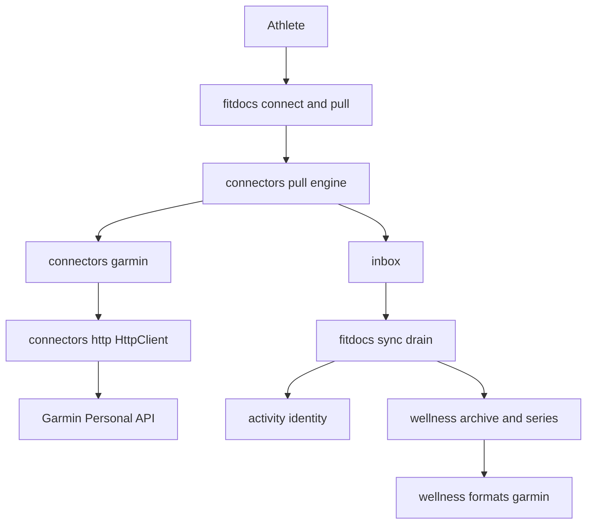
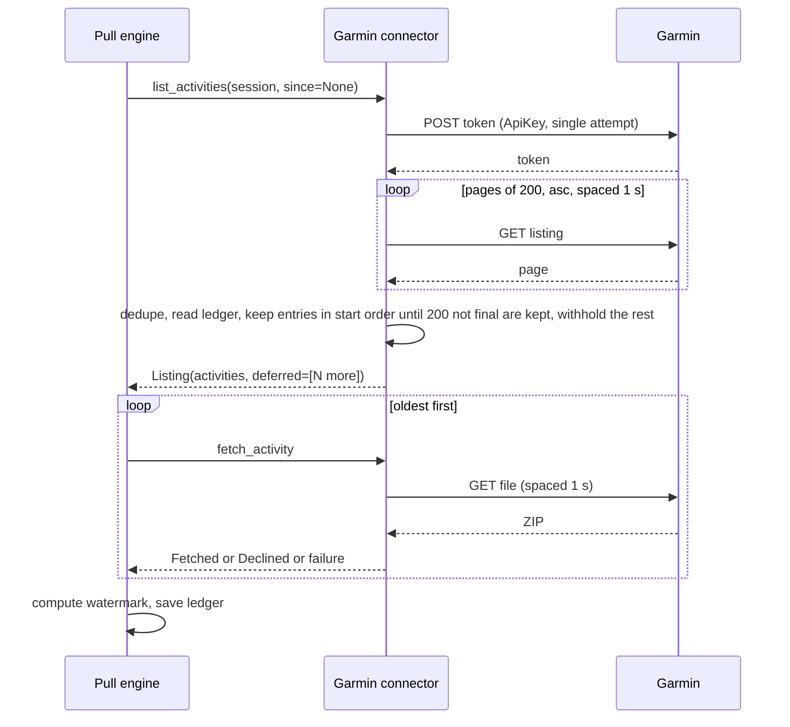
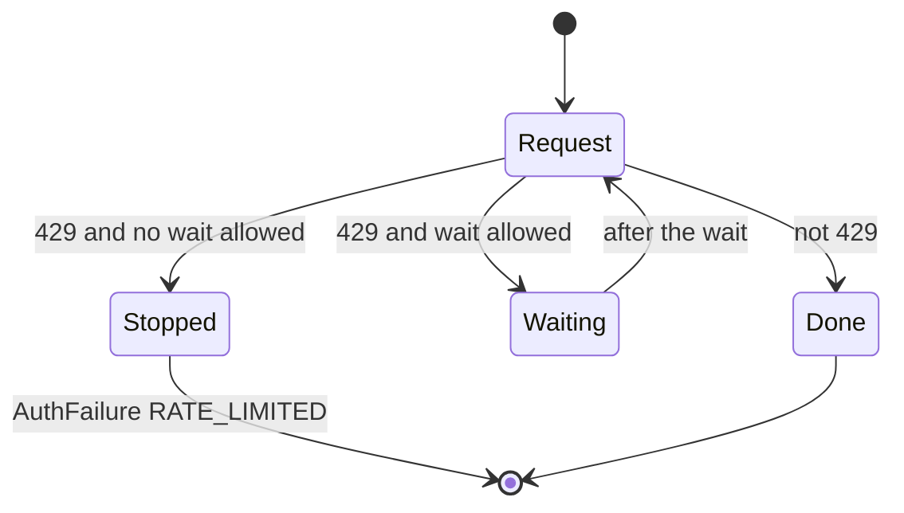

# Design Document: garmin-connector

## Overview

**Purpose**: a built-in connector that pulls an athlete's activities and daily wellness straight from Garmin's Connect Personal API, using a key the athlete created.

**Users**: athletes who record on Garmin and keep their training in fitdocs. It replaces the intervals.icu route, whose Garmin data is ending, and the manual data export.

**Impact**: adds one connector and one wellness format and source. Adds one opt-in transport option. Every other behavior is unchanged.

### Goals
- `fitdocs connect garmin` once, then `fitdocs pull` delivers originals byte for byte, full history included.
- The key goes nowhere but Garmin's token call.
- Requests are paced and a limit over a fixed period gets time to clear, so an athlete does not risk their access.
- Garmin's daily wellness joins the series without moving the export's existing canonical values.

### Non-Goals
- Women's health, courses, training, golf, writing to Garmin, GPX or TCX reading, the `.cn` server, VO2max (Requirements, Boundary Context).
- Any relay or hosted path for a key.
- A connector-level identity or base-selection rule.
- Progress output during a pull.

## Boundary Commitments

### This Spec Owns
- `fitdocs.connectors.garmin`: the declaration, the key check, the listing, the per-pull limit, pacing and rate-limit waits, ZIP handling, failure wording, wellness listing and packaging.
- The `garmin-personal` source and format: the delivery envelope, recognition, and the mapping from Garmin's fields to metrics.
- The opt-in `retry_rate_limits` transport option.
- The docs for this connector, and corrections to statements it makes false.
- The move of `NeutralScan` to its own test file.

### Out of Boundary
- The pull engine, ledger, delivery, credentials, report channels and `fitdocs connect`, which this consumes unchanged.
- Series merge rules and value ranges (`wellness-store`).
- Identity, base precedence, re-basing and renames (`activity-identity`, `channel-merge`).
- Attribution rendering (`workout-docs`), which already reads file content and value origins.
- The connector plugin slot (`plugin-api`).
- Detecting blocked Garmin data in the `intervals` connector, which is untouched.
- The website guide, which changes at the release cut because a push to `main` deploys the site.
- Removing Garmin from the private hosted repository (the maintainer's change).

### Allowed Dependencies
- `connectors/garmin.py` may import `connectors.protocol`, `connectors.errors`, `connectors.http`, `connectors.ledger`, `connectors.secrets`, `connectors.delivery`, and the standard library. It may not import `fitdocs.wellness`, so the format strings are repeated, as `intervals.py` does.
- `wellness/formats/garmin.py` may import what it imports today.
- No new third-party dependency.

### Revalidation Triggers
- A change to `ConnectorSession`, `Listing`, `WellnessListing`, `AuthFailure` handling or `_compute_watermark`.
- A change to `wellness/merge.py`'s revision rule or `default_source_order`.
- A change to `original:garmin` precedence.
- A change in Garmin's terms, the Personal API spec, or a live-check finding marked TBC below.

## Architecture

### Existing Architecture Analysis
- `intervals` is the closest pattern: a personal key, activities and wellness, on `HttpClient`.
- One `HttpClient` and one `ConnectorSession` serve activities and wellness in an instance's pull, so per-pull state can be keyed on the client.
- The framework sorts a listing oldest first, filters final entries, walks the watermark, delivers, and saves the ledger at instance end.
- Boundary guards pin module lists and imports (`tests/connectors/test_boundary.py`), the clock rule, and host confinement (`NeutralScan`).

### Architecture Pattern & Boundary Map



**Dependency direction** (imports point left only): standard library → `connectors.secrets`, `errors` → `http` → `protocol`, `ledger`, `delivery` → `connectors.garmin` → `connectors.__init__` (registration).

`connectors` never imports `wellness`. They share only the format strings, repeated by value.

### Technology Stack

| Layer | Choice / Version | Role in Feature | Notes |
|---|---|---|---|
| Runtime | Python ≥3.11 | Connector and format | Existing floor |
| Transport | `fitdocs.connectors.http` over `urllib` | All requests | One opt-in option added |
| Archive | `zipfile`, standard library | Reading the download | In memory, never extracted to disk |
| Service | Garmin Connect Personal API, `https://personal.connectapi.garmin.com` | Token, listing, files, wellness | Public OpenAPI 3.0.1 |

No new dependency. Garmin's own client is not used (`research.md`).

## File Structure Plan

### New Files
```
src/fitdocs/connectors/garmin.py        # GarminConnector: declaration, token, listing, pacing, fetch, wellness
tests/connectors/test_garmin.py         # declaration, verify, pacing, rate-limit waits, listing, per-pull limit
tests/connectors/test_garmin_fetch.py   # ZIP handling and download failure mapping
tests/connectors/test_garmin_wellness.py # wellness windows, day merge, packaging, wellness failures
tests/connectors/test_garmin_pull.py    # end to end through the real pull engine, inbox and drain
tests/connectors/test_neutral_scan.py   # NeutralScan, moved unchanged from test_docs.py, then garmin's entry added
tests/wellness/test_garmin_personal.py  # the delivery format: recognition, metric mapping, absence, merge
```

### Modified Files
- `src/fitdocs/connectors/http.py`: `HttpRequest.retry_rate_limits`, the check in `_send_data`, and the keyword on `HttpClient.get`.
- `src/fitdocs/connectors/__init__.py`: register `GarminConnector` after `StravaConnector`; not added to `__all__`.
- `src/fitdocs/wellness/formats/garmin.py`: `PERSONAL_SOURCE`, `PERSONAL_FORMAT`, the reader; `_sleep` takes the respiration field name.
- `src/fitdocs/wellness/registry.py`: add the source and format.
- `tests/connectors/test_boundary.py`: the module list and import pins.
- `tests/connectors/test_intervals.py`, `tests/connectors/test_relay.py`, `tests/connectors/test_strava_publish.py`: the registry order literal.
- `tests/connectors/test_http.py`: the new option.
- `tests/wellness/test_registered_formats.py`, `tests/wellness/test_engine.py`, `tests/test_cli_derive.py`, `tests/hr_benchmarks/test_engine.py`: source and format literals.
- `tests/wellness/builders_garmin.py`: delivery builders.
- `tests/connectors/test_docs.py`, `tests/wellness/apple/test_docs_apple.py`, and any other documentation-binding test the doc edits turn red: the affected test functions are deleted, never updated (14.4). `NeutralScan` moves out first.
- `docs/connectors.md`: a `## Garmin` section; the preamble; "What leaves your machine"; the terms-first policy.
- `docs/wellness.md`, `docs/configuration.md`: the source, the format, the order, the settings.
- `README.md`: the connector list (closes `2026-11-02-readme-connector-count-stale`).
- `CHANGELOG.md`: an `[Unreleased]` entry.
- `.kiro/steering/tech.md`: the `fitdocs pull` sentence.
- `.kiro/specs/connectors/requirements.md`, `.kiro/specs/wellness-store/requirements.md`: amendment records, taking the next free numbers at landing.
- `.kiro/steering/roadmap.md`: Phase 15 status.
- `.kiro/queue/`: a release-time item for `website/content/guides/connectors.md`, `website/content/guides/wellness.md` and `website/content/reference/configuration.md`, and a follow-up for pull progress output.

## System Flows

### First pull, activities



The remainder is never older than the watermark this pull computes (at most it ties with it, which the connector's `>=` filter still lists), and a newer watermark already standing does not move, so its window is unchanged; either way the next plain pull's `since` (watermark less `lookback_days`) lists it. A `--since` older than an existing watermark does not self-resume, so the deferral's reason says to repeat the same `--since`.

### A rate-limited request



A wait is allowed when fewer than 4 repeats of this request have happened, any stated wait is at most 300 s, and the pull's total waits stay within 900 s. The wait is the stated one, else 30, 60, 120, then 240 s.

## Requirements Traceability

| Requirement | Summary | Components | Flows / Contracts |
|---|---|---|---|
| 1.1, 1.7 | Declaration, nothing from settings | GarminConnector | `credential_fields`, `capabilities`, `API_BASE` constant |
| 1.2, 1.3 | One verification, no scopes or expiry | GarminConnector.verify, `_mint` | `Granted(scopes=None)` |
| 1.4, 1.5, 1.6 | Refused, limited, unavailable, not a token | `_mint` | Error table |
| 2.1, 2.2, 2.3 | No settings, unknown keys ignored, fixed limits | `parse_settings`, constants | Returns `None` |
| 3.1, 3.2, 3.3, 3.4 | Window, whole history, once each, multisport once | `list_activities` | First pull flow |
| 3.5, 3.6, 3.7 | Fields or absent, malformed, nothing else kept | `_remote_activity` | `RemoteActivity` |
| 4.1, 4.7, 4.8, 4.9 | Spacing and waits | `_get`, `_PullState` | Rate-limited flow |
| 4.2, 4.3, 4.4, 4.5, 4.6 | Limit, deferral, success, resume, `--since` | `list_activities` | `ListingDeferral` |
| 5.1, 5.2, 5.3, 5.4, 5.5, 5.6, 5.7 | Download and members | `fetch_activity`, `_read_archive` | Archive table |
| 6.1, 6.2, 6.3, 6.4, 6.5, 6.6, 6.7, 6.8 | Failures | `_raise_for_listing`, `fetch_activity` | Error table |
| 7.1, 7.2, 7.3 | Key and token handling | `_mint`, `_PullState`, `session.secret` | Secret headers, redactor |
| 7.4, 7.5 | Fitdocs transport, one host, read only | `API_BASE`, `_get`, NeutralScan | Path constants |
| 8.1, 8.2, 8.3 | Ledger | `_remote_activity`; framework ledger | `remote_id` |
| 9.1, 9.2, 9.3, 9.4 | Wellness window | `list_wellness`; framework gating | Window constants |
| 9.5, 9.6, 9.7, 9.8, 9.9 | Day merge and packaging | `list_wellness`, `package_wellness` | Delivery envelope |
| 10.1, 10.2, 10.3, 10.4, 10.5, 10.6, 10.7 | Reading values | `PERSONAL_FORMAT`, `_personal_values` | Metric mapping |
| 10.8, 10.9, 10.10, 10.11, 10.12 | Order, later wins, attribution, refusal, rebuild | `PERSONAL_SOURCE`, revision; existing series engine | Merge rule |
| 11.1, 11.2 | Whether wellness runs | Framework, `AuthFailure` vs `ConnectorError` | Error table |
| 11.3, 11.4, 11.5, 11.6 | Wellness failures | `_wellness_get` | Error table |
| 12.1, 12.2, 12.3, 12.4, 12.5, 12.6, 12.7, 12.8, 12.9 | Docs | `docs/connectors.md`, `docs/wellness.md`, `docs/configuration.md`, `README.md`, `CHANGELOG.md` | Doc plan below |
| 13.1, 13.2, 13.3, 13.4, 13.5 | Live check | Maintainer; `research.md` | TBC list |
| 14.1, 14.2 | Provenance | All | `research.md`, reviewer brief |
| 14.3, 14.4 | Offline tests, no doc tests | Test files | Testing Strategy |
| 14.5, 14.6 | Surface and versions | `connectors/__init__.py` | `__all__` unchanged |
| 14.7 | Records | Amendments, steering | Modified Files |

## Components and Interfaces

| Component | Layer | Intent | Req Coverage | Key Dependencies | Contracts |
|---|---|---|---|---|---|
| GarminConnector | Connector | Declaration and operations | 1-9, 11 | HttpClient (P0), ledger (P1) | Service |
| `_PullState` | Connector | Token, spacing, wait budget, failure count for one pull | 4, 6, 7 | None | State |
| `_get` | Connector | Every paced GET, with rate-limit waits | 4, 6.3 | HttpClient (P0) | Service |
| `retry_rate_limits` | Transport | Opt out of 429 retries only | 4.7 | None | Service |
| `PERSONAL_FORMAT` | Wellness | Recognize and read a delivery | 10 | `accept_value` (P0) | Batch |

### Transport

#### `retry_rate_limits`

**Responsibilities & Constraints**
- `HttpRequest.retry_rate_limits: bool = True`, and `HttpClient.get(..., retry_rate_limits: bool = True)`.
- When false, `_send_data` returns a 429 immediately. 5xx and `TransportError` retries are unchanged.
- Every existing caller keeps today's behavior.

### Connector

#### GarminConnector

**Responsibilities & Constraints**
- `connector_id = "garmin"`, `display_name = "Garmin"`, `auth_style = AuthStyle.API_KEY`.
- `capabilities = {PULL_ACTIVITIES, PULL_WELLNESS}`.
- `credential_fields = (CredentialField("api_key", "Personal API key", secret=True),)`, so the framework's `FITDOCS_CONNECTOR_<INSTANCE>_API_KEY` override applies.
- `parse_settings` returns `None` and ignores every key.
- Constants, all fixed: `REQUEST_SPACING_S = 1.0`, `RATE_LIMIT_WAITS_S = (30.0, 60.0, 120.0, 240.0)`, `MAX_STATED_WAIT_S = 300.0`, `MAX_WAITS_PER_PULL_S = 900.0`, `LISTING_PAGE = 200`, `ACTIVITIES_PER_PULL = 200`, `LISTING_EARLIEST = 1990-01-01`, `DAILY_WINDOW_DAYS = 365`, `SLEEP_WINDOW_DAYS = 31`, `HRV_WINDOW_DAYS = 28`, `WEIGHT_WINDOW_DAYS = 365`, `CONSECUTIVE_FAILURE_STOP = 5`, `MAX_FILE_BYTES = MAX_RESPONSE_BYTES`.
- HRV's 28 days: Garmin states no limit for this route and third parties report 28, so this errs short.

##### Service routes

Every route is on `API_BASE = https://personal.connectapi.garmin.com`. Dates are `YYYY-MM-DD`. Data routes send `Authorization: Bearer <token>` and `Accept: application/json`, except the file route. These come from Garmin's public OpenAPI spec and client; the token, listing, file, daily, sleep and weight routes were also measured. HRV's success body is from the spec only.

| Route | Request | Parameters | Success body | Date field |
|---|---|---|---|---|
| Token | `POST /personalapitoken-service/personal-api/personal-api-key/token` | Empty body; `Authorization: ApiKey <key>`, `Accept: */*` | The token as bare text | None |
| Listing | `GET /activitylist-service/activities/search/activities` | `start`, `limit`, `sortOrder=asc`, `startDate`, `endDate` | A JSON list | `startTimeGMT` |
| File | `GET /download-service/files/activity/{activityId}` | `Accept: application/zip, application/x-zip-compressed, application/octet-stream` | ZIP bytes | None |
| Daily | `GET /usersummary-service/v2/dailysummaries` | `startDate`, `endDate` | `{"data": [...]}` | `calendarDate` |
| Sleep | `GET /sleep-service/sleep/dailySleepSummariesByDate` | `startDate`, `endDate` | A JSON list | `calendarDate` |
| HRV | `GET /hrv-service/hrv/daily/{fromDate}/{toDate}` | Dates in the path | `{"hrvSummaries": [...]}`, or 204 for no data | `calendarDate` |
| Weight | `GET /weight-service/weight/range/{startDate}/{endDate}` | `includeAll=true` | `{"dailyWeightSummaries": [...]}` | `summaryDate` |

##### Service Interface
```python
class GarminConnector:
    def parse_settings(self, table: Mapping[str, object], context: SettingsContext) -> None: ...
    def verify(self, session: ConnectorSession, values: Mapping[str, Secret]) -> Granted: ...
    def list_activities(self, session: ConnectorSession, since: datetime | None) -> Listing: ...
    def fetch_activity(self, session: ConnectorSession, activity: RemoteActivity) -> FetchResult: ...
    def list_wellness(self, session: ConnectorSession, oldest: date | None) -> WellnessListing: ...
    def package_wellness(self, session: ConnectorSession, days: tuple[WellnessDay, ...]) -> WellnessPackage: ...
```

**Token (`_mint`)**
- Takes the client and the key as arguments, because connect sessions refuse `credentials`.
- `POST` with an empty body, `Accept: */*`, `secret_headers={"Authorization": session.secret(f"ApiKey {key}")}`, `single_attempt=True`.
- A 200 whose body matches three dot-separated base64url segments, at most 16 KiB, is the token. It is registered with `session.secret` in both bare and `Bearer` form before any use, and is never decoded.
- `verify` mints and discards. A pull mints on first need and caches the bearer in `_PullState`.
- A pull makes one token request at most. If it fails, with a `ConnectorError`, an `AuthFailure`, or a transport failure (converted to a `ConnectorError`), `_PullState` keeps that failure, and a later request raises the same object again with no second request (7.2, 11.2).

**Pacing and waits (`_get`)**
- Before each request, including the token: `session.sleep(REQUEST_SPACING_S)` unless it is the pull's first.
- Calls `session.http.get(..., retry_rate_limits=False)`.
- On 429, reads the stated wait through `auth_failure_from(response).retry_after_s` and applies the rule in "A rate-limited request". Waits go through `session.sleep`, never the clock, and add to `_PullState.waited_s`.
- When no wait is allowed, raises `AuthFailure(RATE_LIMITED, PULL_RATE_LIMITED_MESSAGE, retry_after)`. `verify` keeps its own `RATE_LIMITED_MESSAGE`.

**Listing (`list_activities`)**
- `sortOrder=asc`, `limit=200`, `start` advancing, until a short page. New arrivals land at the end, so `asc` is the stable order.
- Always both date filters, because that is the measured form of an oldest-first listing, and a refusal is then an error rather than silently lost history. `startDate` is one day before `since`'s UTC date, because Garmin filters on local start time, or `LISTING_EARLIEST` with no `since`. `endDate` is the day after the pull's UTC date. With `since`, each entry is then filtered by its UTC start.
- `excludeChildren` stays at Garmin's default.
- Entries are deduped by id.
- A full page that adds no id not already listed ends the pull with a named `ConnectorError` that never quotes the entries, so a service that ignores `start` is not paged forever. A page that adds at least one new id continues; a short page of only repeats ends normally.
- `load_ledger(session.data_root, session.instance, connector_id="garmin")`, then walk the deduped listing in start order and keep entries until `ACTIVITIES_PER_PULL` not-final entries are kept; stop at the first not-final entry that would be the next one, and withhold everything from there on, finals included. Finals before the cut are listed and not counted; the deferral counts only the not-final among the withheld, and nothing is deferred when none is withheld, so trailing finals after the last kept not-final stay listed. Withholding the finals too keeps the engine's watermark, which it computes over the listing, from jumping past the remainder and stranding it. A `LedgerError` becomes a `ConnectorError`.
- `Listing(activities, deferred=(ListingDeferral(session.instance, reason),))` when any remain. The reason gives the count and says the next `fitdocs pull` continues, and that a pull started with `--since` continues only with the same `--since`.
- **Accepted edge:** the connector reads the ledger on disk, while the engine's sweep result stays in memory until the instance ends. An entry whose pending delivery was just lost therefore looks final to the connector. Before the cut the engine fetches it again, so one pull can occasionally exceed 200 (4.2); past the cut it is withheld and fetched by a later pull, and the deferral's count is short by that entry for this pull. Fixing it needs an engine change, which is out of boundary, and the effects are only a slightly longer pull or a slightly low count.

**`_remote_activity`**
- `remote_id = str(activityId)` for a positive non-bool int; otherwise a `ConnectorError` naming the entry's position.
- `start`: `startTimeGMT` matching `YYYY-MM-DD HH:MM:SS`, read as UTC; else `None`.
- `sport`: `activityType.typeKey` when text; `duration_s`: `elapsedDuration` when a finite number; otherwise `None`.
- `revision=None`, `suggested_name=None`, `original_available=True`. Nothing else is kept.

**Fetch (`fetch_activity`, `_read_archive`)**
- `GET` with `Accept: application/zip, application/x-zip-compressed, application/octet-stream`.
- A `TransportError` adds to the consecutive count and re-raises. The fifth raises `ConnectorError(UNAVAILABLE_STOP_MESSAGE)`.

| Archive | Outcome |
|---|---|
| Not readable as a ZIP (`BadZipFile`, `zlib.error`, `EOFError`, `RuntimeError`, which covers `NotImplementedError`, `OSError`, `ValueError`, `lzma.LZMAError`) | `GarminDownloadError`: failed, retried next pull |
| Exactly one FIT member, with or without others | `Fetched(bytes)` |
| Several FIT members | `Declined` naming the count |
| No FIT member, GPX or TCX present | `Declined` naming the format |
| No FIT member otherwise, including an empty archive | `Declined`, "holds no FIT file" |
| A FIT member over `MAX_FILE_BYTES` | `GarminDownloadError` |

Members are classified from their first bytes: `is_fit` for FIT, and a local `_document_format` for GPX and TCX, copied from `intervals.py`. Reading is `archive.open(info).read(limit + 1)`. `extract` is never called, and a member's name is never read for any decision.

##### State Management
```python
@dataclass
class _PullState:
    bearer: Secret | None = None
    mint_error: ConnectorError | AuthFailure | None = None
    used: bool = False
    waited_s: float = 0.0
    consecutive_failures: int = 0
```
Held in `WeakKeyDictionary[HttpClient, _PullState]` on the connector. It is keyed by the session's client, so after a successful mint it goes with the pull's client. A failed mint's kept error retains the client through its traceback frames until the process ends, which is harmless in a one-shot pull. Nothing in it is ever written to disk.

**Wellness (`list_wellness`, `package_wellness`)**
- `first = oldest`; when `None`, the oldest activity's date (one listing request with `limit=1` and both date filters), or one year before the pull when there is none.
- `newest = today_utc + 1 day`. One pull covers everything from `first`, with no per-pull limit, so a `--since` older than the recorded coverage fills the gap and any `lookback_days` keeps progressing.
- Requests inclusive windows of daily (365), sleep (31), HRV (28) and weight (365) over `[first, newest]`. A year is about 27 requests, so 12 years is about 330, or 6 to 8 minutes.
- A 204 means no records. Each record's date comes from `calendarDate` or `summaryDate`, and must be a valid `YYYY-MM-DD`.
- Merges per date into `{"daily": ..., "sleep": ..., "hrv": ..., "weight": ...}`, each verbatim, sections with no record absent. A later record for the same date and section wins.
- `revision` is `sha256:` over the merged record's canonical JSON. `package_wellness` makes no request. It stamps `fetched_at` from `session.now()` and returns `WellnessPackage(data, ".json", "garmin-personal", frozenset({"garmin"}))`.

### Wellness

#### `PERSONAL_FORMAT`, in `wellness/formats/garmin.py`

**Responsibilities & Constraints**
- `PERSONAL_SOURCE = SourceSpec("garmin-personal", "Garmin Personal API", SourceKind.DEVICE)`.
- `FormatSpec("garmin-personal", ...)`: `ArchiveForm.ORIGINAL`, `.json`, `Supersession.NONE`, rules version 1.
- Recognized when the JSON is an object with the delivery's `format` and `version`. A list is never claimed, so the export recognizers stay exclusive.
- `covers` on every day is the format's full metric set, because a delivered day is always complete.
- Origins are `garmin` for every value, so attribution needs no change.
- A newer delivery version is not recognized and reads as the generic refusal. `intake.py`'s newer-version message stays intervals-only; this is a small known difference.

## Data Models

### Data Contracts & Integration

**Delivery envelope**
```json
{
  "format": "fitdocs.garmin-personal-wellness",
  "version": 1,
  "days": [
    {
      "date": "YYYY-MM-DD",
      "fetched_at": "YYYY-MM-DDTHH:MM:SS.ffffffZ",
      "daily": {},
      "sleep": {},
      "hrv": {},
      "weight": {}
    }
  ]
}
```
Sections are Garmin's records, verbatim, and any may be absent. Days are sorted by date with none repeated, serialized canonically. `fetched_at` is the snapshot revision, so the later delivery of a day wins, and a metric it lacks retracts.

**Metric mapping**

| Metric | Field | Note |
|---|---|---|
| `RESTING_HR_BPM`, `MIN_HR_BPM`, `MAX_HR_BPM` | `daily.heartRate.restingValue`, `.minValue`, `.maxValue` | |
| `STEPS` | `daily.movement.steps.value` | |
| `STRESS_LEVEL` | `daily.stress.avgLevel` | Negative sentinels fall outside the accepted range |
| `BODY_BATTERY_HIGHEST`, `BODY_BATTERY_LOWEST` | `daily.bodyBattery.maxValue`, `.minValue` | |
| `SPO2_PCT` | `daily.pulseOx.avgValue` | The export also takes the daily figure |
| `RESPIRATION_BRPM` | `sleep.averageRespirationValue` | The export also takes the sleep figure |
| `SLEEP_S` and stages | `sleep.deepSleepSeconds`, `lightSleepSeconds`, `remSleepSeconds`, `awakeSleepSeconds` | Through the existing `_sleep`, summing stages |
| `WEIGHT_KG` | `weight.latestWeight.weight` / 1000 | Grams |
| `HRV_RMSSD_MS` | `hrv.lastNightAvg` | FIT SDK wording (`research.md`); inference from names |

Not read: VO2max, `hydration`, and everything else in the records. They stay in the archive.

**Absence**: a section that is not an object, or a value that is not a finite number within the metric's accepted range, leaves that metric absent. Only an envelope that is not the documented form raises `WellnessFormatError`.

## Error Handling

### Error Strategy
Activities raise `AuthFailure` where wellness must not run, because the engine suppresses it on that type alone. They raise `ConnectorError` where wellness still runs, and any other exception where only one activity failed. No response body from Garmin ever enters a message.

### Error Categories and Responses

| Request | Answer | Raised | Effect |
|---|---|---|---|
| Token at connect | 401, 403 | `AuthFailure(REJECTED)` wrong, expired or deleted, create a new key | Connect fails |
| Token at connect | 429 | `AuthFailure(RATE_LIMITED, retry)` | Connect fails, no retry |
| Token at connect | 5xx, other, not a token | `AuthFailure(UNAVAILABLE)` naming the status, or "not understood" | Connect fails |
| Token in a pull | 401, 403 | `AuthFailure(REJECTED)` | Instance ends, no wellness |
| Token in a pull | 429 | `AuthFailure(RATE_LIMITED)` | Instance ends, no wellness |
| Token in a pull | 5xx, other, not a token, transport failure | `ConnectorError`, kept in `_PullState` | Activities end, wellness raises the same error with no second request |
| Listing or file | 401 | `AuthFailure(REJECTED)` | Instance ends, no wellness |
| Listing or file | 403 | `AuthFailure(REJECTED)`, refused wording. `BLOCKED`'s next step says report a bug, so it is not used | Instance ends, no wellness |
| Listing or file | 429 past the waits | `AuthFailure(RATE_LIMITED)` | Instance ends, no wellness |
| Listing | Transport failure | `ConnectorError(UNAVAILABLE)` naming that Garmin could not be reached | Activities end, wellness runs |
| Listing | 5xx past the transport | `ConnectorError(UNAVAILABLE)` | Activities end, wellness runs |
| Listing | Other, malformed | `ConnectorError` naming the status or problem | Activities end, wellness runs |
| File | 404 | `Declined`, no file | Skipped, recorded |
| File | 5xx past the retries | `GarminDownloadError`, or `ConnectorError` on the fifth in a row | One failed, or activities end |
| File | Transport failure past the retries | The `TransportError` again, or `ConnectorError` on the fifth in a row | One failed, or activities end |
| File | Other | `GarminDownloadError` naming the status | One failed |
| Wellness | 401 | `AuthFailure(REJECTED)` | Wellness ends |
| Wellness | 403 | `AuthFailure(REJECTED)`, refused wording naming `wellness = false` | Wellness ends |
| Wellness | 429 past the waits | `AuthFailure(RATE_LIMITED)` | Wellness ends |
| Wellness | 5xx, other, malformed | `ConnectorError` | Wellness ends, mark unchanged |

Because a wellness listing is all-or-nothing, a failure delivers no day from that pull and leaves the wellness mark where it was (11.6).

## Testing Strategy

All tests run offline with `FakeTransport` and synthesized FIT and ZIP bytes (14.3). None reads a doc, changelog or spec (14.4).

### Unit Tests
- **Transport:** `retry_rate_limits=False` returns a 429 after one attempt, still retries a 503, and the default is unchanged.
- **Token:** one request at verify whatever the answer; each status maps per the table; a non-token 200 is not quoted; the key and token never appear in any report, exception or ledger.
- **Pacing:** the injected `sleep` records 1.0 between distinct requests and none before the first.
- **Waits:** 30, 60, 120, 240 in order; a stated wait is honored; a stated wait over 300 stops; the 900 budget stops across requests; success resets the schedule; `Retry-After: 1` repeating still stops after 4 repeats.
- **Listing:** `asc` paging ends at a short page; a repeated id is listed once; UTC filter around a `--since` near midnight; the per-pull limit counts only non-final; the deferral names the remainder; a malformed entry names its position.
- **Archive:** each row of the archive table, including a non-FIT member beside one FIT, a member named like `../x.fit`, a CRC failure, and a member over the size limit.
- **Failures:** five in a row stops and a success resets the count; a transport failure counts.
- **Wellness:** windows respect each limit; a 204 is no records; a date merges across sections; a section change changes the revision; a repeated listing is byte-stable in revision; the oldest-activity start and the one-year fallback; a multi-year range covered by one listing.
- **Format:** every row of the metric mapping; absence for each bad form; the `hydration` decoy stays unread; recognition does not collide with any export recognizer; a later `fetched_at` replaces and retracts.

### Integration Tests
- **Engine with connector:** `pull` end to end with a scripted Garmin. Two pulls fetch nothing new; a capped first pull resumes on a second plain pull and reaches the end; a `--since` backfill behind a watermark needs the same `--since`.
- **Activity-failure gating:** a rate limit suppresses wellness, and a listing 5xx does not.
- **Series:** a delivery through the drain into the series; the export stays canonical on overlap with both source values kept; `inputs_digest` rebuilds once with no value lost.

### E2E
- `pull --sync` from a scripted Garmin to a workout page, with the FIT bytes unchanged in the archive and the Garmin attribution present.
- An inbox delivery claimed by exactly one wellness format.

### Guards
- `tests/connectors/test_boundary.py` includes `garmin`. The raw-substring clock scan means no attribute spelled `..._time.timestamp()` or `datetime.timedelta`-like text in the module (`.kiro/queue/2026-11-01-connectors-clock-scan-substring-false-positive.md`).
- `NeutralScan` moves unchanged and is green on the moved file. It then gains entries for `personal.connectapi.garmin.com` (the connector and its test files), and for the Garmin hosts the docs link to (location key `docs/connectors.md#Garmin` only: keys are exact and case-sensitive, and name the heading).

## Security Considerations
- The key and the token are registered with the redactor before first use, and sent only as `secret_headers`, which the transport never forwards to a redirect target.
- No URL carries a credential.
- ZIP handling is memory-only and bounded, and a member's name is never used.
- A response body is never echoed, so a hostile body cannot reach a report.
- The Garmin Terms make the key personal. There is deliberately no code path to a relay.

## Performance & Scalability
- 200 activities take about 4 minutes. Whole activity history is about 5 pulls on an account of about 900 files.
- Wellness has no per-pull limit: 12 years is about 330 requests, 6 to 8 minutes, in the first pull that enables it.
- A wiki already holding the same bytes still pays the downloads once, because a listing carries no hash.
- The ZIP is held in memory, bounded by the transport's 64 MiB.

## Migration Strategy
- **Upgrade:** registering the source changes `inputs_digest`, so a data root with wellness rebuilds its series once on its next run, with no action needed (Apple is the precedent).
- **Rollback:** deliveries already archived under `wellness-archive/garmin-personal/` are unread by an older version. Nothing else changes.
- **Real wikis:** the first `sync` after a full pull re-bases under existing rules. The docs state this, and `[identity] precedence` keeps an existing base.

## Documentation Plan
- `docs/connectors.md`, new `## Garmin` section: creating a key (link to Garmin's page), `[connectors.garmin]`, `fitdocs connect`, the environment override, `wellness = true`; expiry and renewal; the terms, quoted, with the non-affiliation line; pacing, the per-pull limit, resuming and `--since`; the first-`sync` effect and its controls; what it does not do; the `sources` hint for intervals users.
- `docs/connectors.md`, existing: the preamble's list, "What leaves your machine" gains one sentence, and the terms-first policy names both third-party connectors and the new address.
- `docs/wellness.md`: the format, the source, the metric list, the order (`garmin-export`, `garmin-personal`, `apple-health`, `intervals-icu`), and the accepted source ids.
- `docs/configuration.md`, `README.md`, `CHANGELOG.md` (settings schema additive; Action: none unless the athlete wants the connector).
- The website's three pages that state these facts change at the release cut, because a push to `main` deploys them (queued).

## To Be Confirmed by the Live Check
- **TBC-1:** a whole-record revision is stable for sleep and weight, not only daily summaries. If not, exclude the volatile fields.
- **TBC-2:** 1 s spacing holds over 200 downloads and a full wellness catch-up, and which wait clears a limit if one is met. If a limit keeps stopping the catch-up, per-pull slicing comes back.
- **TBC-3:** the status for a deleted key. A wrong key is 401; 401 and 403 both map to the same message, so either is safe.
- **TBC-4:** not checkable on the maintainer's account: multisport parents, manual activities, a real HRV record. Each fails safe: a named skip, a named skip, and an absent value.
