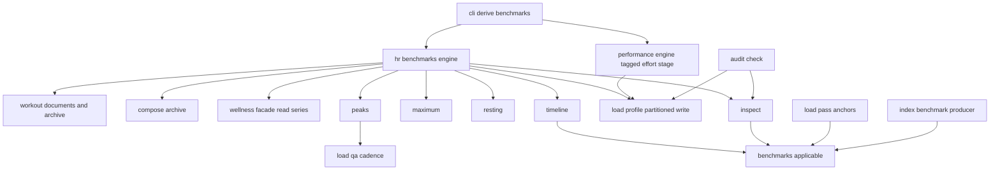
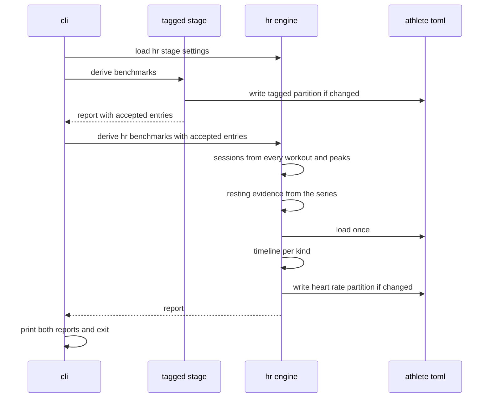
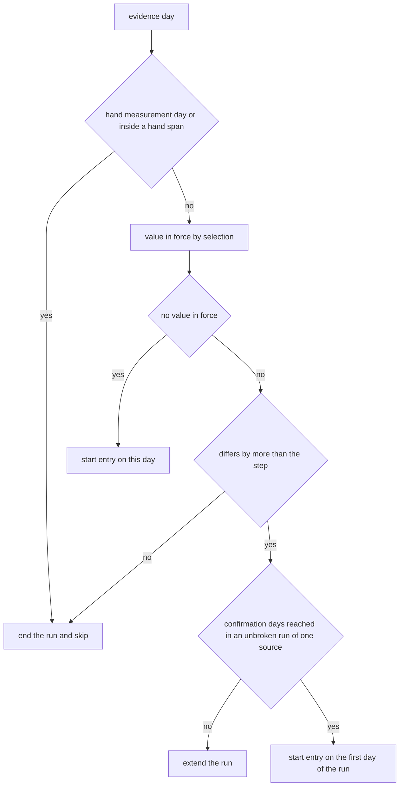

# Design Document — hr-derivation

## Overview

**Purpose**: hr-derivation keeps an athlete's resting and maximum heart rate
current without the athlete maintaining them. `fitdocs derive-benchmarks`
gains a second stage, the heart-rate stage, that works out dated
`resting_hr_bpm` entries from the wellness series and dated `max_hr_bpm`
entries from workout heart rate, and writes them into the benchmark timeline
in `athlete.toml` as derived entries with method, evidence and citation. The
training-load pass then picks them up by date like any other entry.

**Users**: the athlete (runs the command, reads the report, answers a
takeover), the athlete's agent (runs `fitdocs check`, relays takeovers and
inconsistencies), and the load pass (consumes the entries unchanged).

**Impact**: benchmark selection gains one rule (a derived entry never applies
inside a hand-recorded entry's back-reach span); the derived write becomes
partitioned by kind so the two stages never erase each other; a provenance
record may name a series; the heart-rate channel reports which dated resting
and maximum entries it used; `fitdocs check` reads `athlete.toml` and gains
three findings. No owned path, document format, index schema or
configuration key changes.

### Goals
- Derived resting and maximum heart rate as sparse, dated, reproducible
  entries, under the maintainer's "evidence must disagree" rule.
- Every takeover of a hand-recorded value announced in the report, in the
  timeline and in `check`.
- The tagged-effort stage and the heart-rate stage never erase each other.

### Non-Goals
- Threshold heart rate, threshold power or threshold pace derivation
  (performance-benchmarks); HRV-derived thresholds; age-formula maxima.
- Rescoring computed documents automatically (the athlete runs
  `fitdocs load --recompute`).
- The undated top-level `max_hr_bpm` / `resting_hr_bpm` keys, zones and the
  page's own TRIMP figure.
- A sensor-type preference (the activity model does not record the sensor
  type, `model.py:249-258`).
- A cache of per-session peaks (follow-up; see Performance).

## Boundary Commitments

### This Spec Owns
- The `fitdocs.hr_benchmarks` package: the heart-rate stage engine, the
  per-session sustained peak, the maximum-heart-rate evidence window, the
  resting-heart-rate evidence (per-source baseline and source choice), the
  hand-aware step-and-confirmation timeline, the structural takeover and
  inconsistency inspection, the method vocabulary and the source records of
  every constant.
- The heart-rate stage's place in `fitdocs derive-benchmarks`: settings
  preflight, ordering after the tagged-effort stage, report, exit status.
- Three `check` findings: `hr_benchmark_takeover`,
  `hr_benchmarks_inconsistent`, `athlete_profile_unreadable`.
- These amendments, carried out by this spec's implementation:
  - **athlete-benchmarks** (Amendment N, expected 3): the selection rule for
    hand back-reach spans (all kinds); the optional `series` provenance key.
  - **performance-benchmarks** (Amendment N, expected 3): Req 10.4 lifted to
    the tagged-effort stage only; Req 1.3, 10.5 and 10.7 scoped to that
    stage; the partitioned derived write and change test;
    `DeriveReport.accepted`.
  - **load-channels** (Amendment N, expected 1): the heart-rate channel
    reports the measurement dates of the resting and maximum entries it used.
- Documentation: README, `docs/configuration.md`,
  `docs/ownership-contract.md`, `docs/plugins.md`, the workouts skill,
  CHANGELOG, and the `structure.md` dependency bullet for the new package.

### Out of Boundary
- The wellness series, its precedence, its day boundary and its reader
  (`wellness-store`); this spec reads them through the `fitdocs.wellness`
  facade only and requires no change there.
- Descriptive baselines and normal ranges (`recovery`). `fitdocs.hr_benchmarks`
  exposes no general-purpose baseline function; its resting level is private
  to the stage (see [Not recovery's baseline](#not-recoverys-baseline)).
- The threshold calculator, channel arithmetic, channel selection and
  prompts (threshold-load Req 11.6 holds: the estimate is made outside the
  calculator).
- The analytics index: its benchmark tables pick up the new entries through
  the existing producer (`index/derived/benchmarks.py:199-239`) with no
  schema change.
- Document rendering and `DOC_VERSION`; owned paths and `CONTRACT_VERSION`;
  `ATHLETE_SCHEMA_VERSION`; the index `SCHEMA_VERSION`.

### Allowed Dependencies
- Pure modules of `fitdocs.hr_benchmarks` (`types`, `sources`, `peaks`,
  `maximum`, `resting`, `timeline`, `inspect`) import only the standard
  library, `fitdocs.benchmarks`, `fitdocs.citation`, `fitdocs.model`
  (`Samples`, `Modality`, `Sport`), `fitdocs.load.qa.types` (`FlagSettings`,
  in `types` and `peaks`), `fitdocs.load.qa.cadence` (`peaks` only), and
  each other in the order
  `types` → `sources` → `peaks`, `maximum`, `resting` → `timeline` →
  `inspect`. No clock, no I/O, no network.
- `fitdocs.hr_benchmarks.engine` additionally imports `fitdocs` (`parse_fit`,
  `FitDecodeError`), `fitdocs.compose.archive`, `fitdocs.contract`,
  `fitdocs.docio`, `fitdocs.layout`, `fitdocs.load.profile`,
  `fitdocs.load.settings`, `fitdocs.settings` and the `fitdocs.wellness`
  facade (never a `fitdocs.wellness.*` submodule).
- `fitdocs.hr_benchmarks` never imports `fitdocs.index`, `fitdocs.query`,
  `duckdb`, `fitdocs.performance`, `fitdocs.render`, `fitdocs.sync` or
  `fitdocs.cli`.
- Importers: `fitdocs.cli` (the engine and report types) and `fitdocs.audit`
  (`fitdocs.hr_benchmarks.inspect` only). `fitdocs.load.*`,
  `fitdocs.performance`, `fitdocs.wellness` and `fitdocs.index` never import
  it.
- Direction: `cli → hr_benchmarks.engine → {compose, load.profile, wellness,
  hr_benchmarks pure} → benchmarks → model`; `audit → hr_benchmarks.inspect`.

### Revalidation Triggers
- The selection rule in `BenchmarkSet.applicable` (load pass, index
  periods, plugins, recovery if it plots in-force values).
- The `series` provenance key or the derived-provenance field set.
- The `kinds` partition of `with_derived_benchmarks` (every derivation pass).
- The method vocabulary `HrMethod` or any constant in
  `hr_benchmarks/sources.py` (moves derived values and every later HR load).
- `fitdocs.wellness` reader API, metric names or `effective_order`
  (upstream change that requires re-checking this stage).
- The cadence-lock check's `detect` / `span_statistics` contract.
- The `check` finding names (agents and the workouts skill read them).

## Architecture

### Existing Architecture Analysis
- **Selection** is date-only: `BenchmarkSet.applicable`
  (`benchmarks.py:189-243`) returns the latest entry measured on or before
  the date (tier 1), else the earliest-measured entry whose `applies_from`
  reaches back (tier 2). Its two callers are `AthleteProfile.benchmark`
  (`load/profile.py:148-169`, which the load anchors use,
  `load/threshold/anchors.py:142-157`) and `in_force_periods`
  (`index/derived/benchmarks.py:136-196`), verified by grep.
- **Provenance**: `BenchmarkSource` (`benchmarks.py:98-121`) requires
  `method`, `document`, `inputs`, `citation` for a derived origin
  (`benchmarks.py:473-484`); the serializer emits `kind, method, document,
  inputs, citation` (`benchmarks.py:679-689`); the store overlays exactly
  those five keys on rewrite (`load/profile.py:800-843`).
- **The derived write** `AthleteProfile.with_derived_benchmarks`
  (`load/profile.py:342-445`) replaces every derived entry; its only
  production caller is the tagged-effort stage (`performance/engine.py:445`,
  verified by grep). That stage's change test compares against every derived
  entry on file (`performance/engine.py:438-446`).
- **The tagged-effort stage** (`performance/engine.py:300-455`) discovers
  `workouts/*.md` in sorted order, resolves the last `sources` ref
  (`:272-297`), composes the listed files (`compose/archive.py:20-43`),
  loads the profile once after the loop (`:415`) and writes once.
- **The command** `derive-benchmarks` (`cli.py:1590-1617`) maps
  `ProfileError`/`SettingsError` to exit 2 and prints `_report_derive`
  (`cli.py:2402-2499`).
- **`check`** (`audit.py:542-622`) reads documents, declarations and the hold
  record; it never loads the athlete profile today
  (`cli.py:956-958`); findings are `FindingKind` members
  (`audit.py:106-154`) and any finding exits 1 (`cli.py:975`).
- **Heart-rate channel** consistency rule and reported inputs:
  `load/channels/heart_rate.py:209-223`, `:261-282`.
- **Cadence lock**: `detect` (`load/qa/cadence.py:251-348`) and
  `span_statistics` (`:141-212`), thresholds from `[load.flags]`
  (`LoadSettings.flags`, `load/settings.py:102`).

### Architecture Pattern & Boundary Map



**Architecture Integration**:
- Selected pattern: a pure core (`peaks`, `maximum`, `resting`, `timeline`,
  `inspect`) wrapped by one impure engine, the shape the tagged-effort stage
  already uses (`performance/derive.py` pure, `performance/engine.py` the
  only I/O).
- Boundaries: evidence is computed without the profile; the profile is read
  once, after all evidence exists, and written once per stage; selection
  stays in `fitdocs.benchmarks`, so the load pass, the index and the stage
  share one rule.
- Existing patterns preserved: sorted discovery and the same archive
  resolution and composition rule as the load pass; atomic `save_profile`
  with re-parse; change-only writes; single settings readers; citation
  records with honest verification status; guard tests for purity,
  reachability and single writer.
- Steering compliance: absent is `None`/no entry; no network; no clock; no
  index reads; no new dependency; Python 3.11, `mypy --strict`.

### Technology Stack

| Layer | Choice / Version | Role in Feature | Notes |
|-------|------------------|-----------------|-------|
| CLI | typer + rich (existing) | stage ordering, report, progress on stderr | no new command |
| Domain | Python 3.11 stdlib (`statistics.median`, `math.floor`) | peaks, windows, medians, timeline | no new dependency |
| Storage | `athlete.toml` via `tomllib`/`tomli_w` (existing, `load/profile.py`) | derived entries | one atomic write per stage |
| Upstream data | `fitdocs.wellness` facade (wellness-store) | daily resting HR per source | read-only |

## File Structure Plan

### Directory Structure
```
src/fitdocs/hr_benchmarks/
├── __init__.py   # Facade: derive_hr_benchmarks, load_hr_stage_settings, report and settings types
├── types.py      # HR_KINDS, HrMethod, Evidence, SessionPeak, NoEvidenceReason, KindRule,
│                 #   Takeover, Violation, Inconsistency, SkippedDocument, HrFailure,
│                 #   KindOutcome, HrStageSettings, HrStageReport (values only)
├── sources.py    # FitdocsChoice records, CitedConstants, corroborators, BLOCKED_CITATIONS,
│                 #   CONSTANT_SOURCES, the two KindRules (no arithmetic)
├── peaks.py      # session_peak: sample rejection, cadence-lock exclusion, 30-s sustained peak
├── maximum.py    # max_evidence: 365-day window, median of the three highest, evidence days
├── resting.py    # resting_evidence: per-source 28-day median, source choice by precedence
├── timeline.py   # derive_timeline: hand-aware step and confirmation walk, provenance, notes
├── inspect.py    # takeovers, current_takeovers, inconsistencies (read-only, over a BenchmarkSet)
└── engine.py     # the only I/O: discovery, archive and series reads, profile load, partitioned write

tests/hr_benchmarks/
├── builders.py            # synthetic samples, sessions, series values, profiles (invented values)
├── test_types.py          # vocabulary and partition disjointness
├── test_sources.py        # constant records, blocked set, no bare literals
├── test_peaks.py
├── test_maximum.py
├── test_resting.py
├── test_timeline.py
├── test_inspect.py
├── test_engine.py         # integration over a tmp data root with synthetic FIT and series files
├── test_purity.py         # imports, clock, I/O, network of the pure modules
└── test_boundary.py       # reachability, single writer, no index/query/duckdb, facade-only wellness
```

### Modified Files
- `src/fitdocs/benchmarks.py` — `BenchmarkSource.series` (trailing, default
  `None`); parser validates it (non-empty string when present); serializer
  emits it after `document`; `BenchmarkSet.applicable` gains the hand
  back-reach rule.
- `src/fitdocs/load/profile.py` — `with_derived_benchmarks(entries, *, kinds)`
  with `kinds` required and partition-scoped retention, collision and
  group-removal; `_SOURCE_RECOGNIZED_KEYS` gains `series` after `document`.
- `src/fitdocs/performance/types.py` — `TAGGED_EFFORT_KINDS` (the three kinds
  the stage derives).
- `src/fitdocs/performance/engine.py` — `_ROUTED_KINDS` becomes
  `TAGGED_EFFORT_KINDS`; change test and write restricted to that partition;
  `DeriveReport.accepted` (trailing, default `()`).
- `src/fitdocs/load/channels/heart_rate.py` — two reported inputs
  `resting_hr_measured_on`, `max_hr_measured_on`.
- `src/fitdocs/audit.py` — three `FindingKind` members and
  `_benchmark_findings(data_root)`.
- `src/fitdocs/cli.py` — `derive_benchmarks_command` preflight, HR stage,
  `_report_hr_stage`, progress printer; `check_command` docstring.
- `pyproject.toml` — `[tool.mypy].files` gains the new package and tests
  (append only).
- Tests extended: `tests/test_benchmarks.py`, `tests/load/test_profile.py`,
  `tests/performance/test_engine.py`, `tests/test_cli_derive.py`
  (`test_mixed_run_derives_declines_fails_and_never_opens_the_untagged_archive`
  re-scoped to the tagged-effort stage), `tests/load/channels/test_heart_rate.py`
  (queue item 2026-08-25), `tests/test_audit.py`, `tests/test_cli_check.py`,
  `tests/load/test_settings.py` (licensed callers + `hr_benchmarks/engine.py`),
  `tests/test_contract_consumers.py` (register the engine),
  `tests/test_confinement.py` (`derive-benchmarks-heart-rate` entry point),
  `tests/test_public_api.py` (the facade),
  `tests/performance/test_reachability.py` or the new boundary test
  (calculator and channels never import `hr_benchmarks`).
- Docs: `README.md` (Benchmarks), `docs/configuration.md` (athlete profile,
  a "Derived heart-rate benchmarks" subsection), `docs/ownership-contract.md`
  (`derive-benchmarks` operation, `athlete.toml` paragraph),
  `docs/plugins.md` (selection sentence),
  `src/fitdocs/skills/fitdocs-workouts/SKILL.md` (reading the new
  findings), `CHANGELOG.md`, `.kiro/steering/structure.md` (dependency
  bullet).
- Spec amendment records: `.kiro/specs/athlete-benchmarks/requirements.md`,
  `.kiro/specs/performance-benchmarks/requirements.md` and `design.md`,
  `.kiro/specs/load-channels/requirements.md` (appended amendment sections;
  numbers re-derived at landing).

## System Flows

### The command



- Settings (`[wellness]`, `[load]`) are validated before the tagged-effort
  stage runs, so a configuration fault writes nothing (1.11). A malformed
  profile is caught by the tagged-effort stage before its write
  (`performance/engine.py:415`).
- The accepted tagged entries are passed so the heart-rate stage evaluates
  inconsistencies against the timeline both stages leave, in preview mode
  too (1.4, 9.3).

### One evidence day in the timeline walk



- Maximum heart rate uses a confirmation of one day, so a disagreeing day
  starts an entry at once. Resting heart rate uses 14 consecutive calendar
  days; a missing day, an agreeing day or a change of source ends the run.
- When the value in force on the start day is hand-recorded, the entry is a
  takeover and its note says so.

## Requirements Traceability

| Requirement | Summary | Components | Interfaces | Flows |
|-------------|---------|------------|------------|-------|
| 1.1, 1.5, 1.11 | Stage order, exit, preflight | DeriveCommand | `derive_benchmarks_command` | The command |
| 1.2 | Only the two HR kinds | HrTypes, HrStageEngine | `HR_KINDS` | — |
| 1.3 | Stage report | HrStageEngine, DeriveCommand | `HrStageReport`, `_report_hr_stage` | — |
| 1.4 | Preview | HrStageEngine | `derive_hr_benchmarks(dry_run, other_derived)` | The command |
| 1.6 | Only this command derives | Guards | single-writer test | — |
| 1.7 | No prompt, no network | HrStageEngine, Guards | purity test | — |
| 1.8 | No new configuration | HrStageEngine | `load_hr_stage_settings` | — |
| 1.9 | No index, no wellness archive | Guards | boundary test | — |
| 1.10 | Writes only the profile | HrStageEngine, Guards | confinement entry point | — |
| 2.1, 2.3 | Series only, per source | RestingEvidence, HrStageEngine | `resting_evidence` | — |
| 2.2, 2.6 | 28-day median, half up | RestingEvidence, HrSources | `RESTING_*` constants | — |
| 2.4, 2.5 | Source choice per day | RestingEvidence | `resting_evidence(order=)` | — |
| 2.7 | Source change | Timeline, RestingEvidence | `Evidence.key`, `series` | Walk |
| 2.8 | No values, no entry | Timeline | `derive_timeline` | Walk |
| 2.9 | Unreadable series | HrStageEngine | `HrFailure`, kept partition | — |
| 3.1, 3.5, 3.9 | Every document, composition, skips | HrStageEngine | `NoEvidenceReason` | — |
| 3.2, 3.3, 3.4 | Rejection, cadence lock, 30-s peak | SessionPeaks | `session_peak` | — |
| 3.6, 3.7 | 365-day median of three, evidence days | MaxEvidence | `max_evidence` | — |
| 3.8 | No summary max, no formula | SessionPeaks, MaxEvidence, Guards | — | — |
| 3.10 | Unreadable archive | HrStageEngine | `HrFailure`, kept partition | — |
| 4.1 | Steps | HrSources | `RESTING_RULE`, `MAX_RULE` | — |
| 4.2, 4.3, 4.4 | Start rules | Timeline | `derive_timeline` | Walk |
| 4.5 | No applies-from | Timeline | — | — |
| 4.6 | Whole timeline replaced | HrStageEngine, ProfileDerivedWrite | `with_derived_benchmarks(kinds=)` | — |
| 4.7, 4.8 | Determinism, no clock | all pure modules, Guards | — | — |
| 4.9 | Idempotent | HrStageEngine | change test | — |
| 4.10 | Absent, no default | Timeline, MaxEvidence, RestingEvidence | — | Walk |
| 5.1 | Never touch hand entries | Timeline, ProfileDerivedWrite | backstop `ValueError` | Walk |
| 5.2, 5.3, 5.4 | Evidence must disagree; spans | Timeline | `derive_timeline` | Walk |
| 5.5, 5.6 | Selection rule | BenchmarkSelection | `BenchmarkSet.applicable` | — |
| 5.7 | New hand value | Timeline, HrStageEngine | recompute per run | Walk |
| 5.8 | No switch, no floor, no expiry | HrSources, Guards | — | — |
| 6.1 | Report takeovers | HrStageEngine, DeriveCommand | `HrStageReport.takeovers` | — |
| 6.2 | Note on the entry | Timeline | `Benchmark.note` | Walk |
| 6.3, 6.4 | `check` listing | Inspect, AuditHeartRate | `current_takeovers` | — |
| 6.5 | Answer by hand | BenchmarkSelection, Timeline | — | Walk |
| 7.1, 7.2, 7.3 | Provenance fields | Timeline, MaxEvidence, RestingEvidence | `Evidence` | — |
| 7.4, 7.5 | `series` key, compatibility | BenchmarkProvenance | `BenchmarkSource.series` | — |
| 7.6, 7.7 | Citation discipline | HrSources | `CONSTANT_SOURCES`, `BLOCKED_CITATIONS` | — |
| 8.1, 8.6 | Tagged stage partition | TaggedEffortStage | `TAGGED_EFFORT_KINDS` | — |
| 8.2 | HR stage partition | HrStageEngine | `HR_KINDS` | — |
| 8.3 | One write per stage | TaggedEffortStage, HrStageEngine | change tests | The command |
| 8.4, 8.5 | Preservation, refused write | ProfileDerivedWrite | `save_profile` (existing re-parse) | — |
| 9.1, 9.2 | Inconsistency periods | Inspect, AuditHeartRate | `inconsistencies` | — |
| 9.3 | Reported by the stage | HrStageEngine | `HrStageReport.inconsistencies` | — |
| 9.4, 9.5 | Unreadable profile, read-only | AuditHeartRate | `_benchmark_findings` | — |
| 9.6 | Never clamp | Timeline | — | — |
| 10.1, 10.5 | Calculator unchanged | Guards | reachability test | — |
| 10.2 | Dated inputs | HeartRateChannelInputs | `inputs_used` | — |
| 10.3 | Impulse and reference pinned | HeartRateChannelInputs (tests) | — | — |
| 10.4 | Recompute hint | HrStageEngine, DeriveCommand | `HrStageReport.changed` | — |
| 10.6 | No flat keys | HrStageEngine, Guards | — | — |
| 10.7 | Index tables | BenchmarkSelection (existing producer) | `in_force_periods` | — |
| 11.1 | README and configuration guide | Docs | — | — |
| 11.2 | Ownership contract operation | Docs | — | — |
| 11.3 | Takeover announcement and check listing documented | Docs | — | — |
| 11.4 | Workouts skill | Docs | — | — |
| 11.5 | Release notes | Docs | — | — |
| 11.6 | Synthetic values only | Docs, Guards | — | — |

## Components and Interfaces

| Component | Domain/Layer | Intent | Req Coverage | Key Dependencies | Contracts |
|-----------|--------------|--------|--------------|------------------|-----------|
| HrTypes | hr_benchmarks (pure) | Vocabulary and value types | 1.2, 1.3 | benchmarks (P0) | State |
| HrSources | hr_benchmarks (pure) | Every constant and its record | 2.2, 2.6, 4.1, 5.8, 7.6, 7.7 | citation (P0) | State |
| SessionPeaks | hr_benchmarks (pure) | One session's sustained peak | 3.2-3.5, 3.8 | qa.cadence (P0), model (P0) | Service |
| MaxEvidence | hr_benchmarks (pure) | Windowed maximum evidence | 3.6, 3.7, 7.2 | HrSources (P0) | Service |
| RestingEvidence | hr_benchmarks (pure) | Per-source baseline and source choice | 2.1-2.7, 7.3 | HrSources (P0) | Service |
| Timeline | hr_benchmarks (pure) | Hand-aware step and confirmation walk | 2.7, 2.8, 4.2-4.5, 4.10, 5.1-5.4, 5.7, 6.2, 7.1, 9.6 | benchmarks selection (P0) | Service |
| Inspect | hr_benchmarks (pure) | Structural takeovers and inconsistencies | 6.3, 6.4, 9.1, 9.2 | benchmarks selection (P0) | Service |
| HrStageEngine | hr_benchmarks (I/O) | The stage | 1.2-1.4, 1.7-1.10, 2.9, 3.1, 3.9, 3.10, 4.6, 4.9, 8.2, 8.3, 9.3, 10.4, 10.6 | compose, wellness, profile (P0) | Batch |
| BenchmarkSelection | benchmarks (amendment) | Hand back-reach beats derived | 5.5, 5.6, 6.5, 10.7 | — | Service |
| BenchmarkProvenance | benchmarks/profile (amendment) | `series` key | 7.4, 7.5 | — | State |
| ProfileDerivedWrite | load.profile (amendment) | Partitioned derived write | 4.6, 5.1, 8.1-8.5 | — | Service |
| TaggedEffortStage | performance (amendment) | Partition, change test, accepted | 8.1, 8.3, 8.6 | ProfileDerivedWrite (P0) | Batch |
| HeartRateChannelInputs | load.channels (amendment) | Dated inputs | 10.2, 10.3 | — | Service |
| AuditHeartRate | audit | Three findings | 6.3, 6.4, 9.1, 9.2, 9.4, 9.5 | Inspect (P0), profile (P0) | Service |
| DeriveCommand | cli | Preflight, stages, report, exit | 1.1, 1.3-1.5, 1.11, 6.1, 10.4 | HrStageEngine (P0) | Service |
| Guards | tests | Purity, boundary, single writer, confinement | 1.6, 1.7, 1.9, 1.10, 3.8, 4.8, 5.8, 10.1, 10.5, 10.6 | — | — |
| Docs | docs/skill/changelog/steering | User-facing text | 11.1, 11.2, 11.3, 11.4, 11.5, 11.6 | — | — |

### hr_benchmarks (pure)

#### HrTypes (`types.py`)

| Field | Detail |
|-------|--------|
| Intent | The closed vocabularies and the immutable values the stage speaks in |
| Requirements | 1.2, 1.3 |

```python
HR_KINDS: Final[frozenset[BenchmarkKind]] = frozenset(
    {BenchmarkKind.RESTING_HR_BPM, BenchmarkKind.MAX_HR_BPM})

class HrMethod(StrEnum):
    RESTING_HR_SERIES_MEDIAN = "resting_hr_series_median"
    MAX_HR_SUSTAINED_PEAK = "max_hr_sustained_peak"

@dataclass(frozen=True)
class SessionPeak:
    day: date
    document: str            # data-root-relative page path
    peak_bpm: float          # 30-second sustained peak, unrounded

class NoEvidenceReason(StrEnum):
    UNDATED = "undated"
    ARCHIVE_MISSING = "archive_missing"
    ARCHIVE_UNDECODABLE = "archive_undecodable"
    NO_HEART_RATE = "no_heart_rate"
    CADENCE_LOCKED = "cadence_locked"
    NO_SUSTAINED_STRETCH = "no_sustained_stretch"

@dataclass(frozen=True)
class Evidence:
    day: date
    value: int               # whole bpm, already rounded
    key: str                 # resting: the source id; maximum: "workouts"
    document: str            # page (maximum) or series year file (resting)
    series: str | None       # "<source>:<metric>" for resting, None for maximum
    inputs: str              # provenance inputs text for an entry started on this day
    summary: str             # one-line evidence description for announcements

@dataclass(frozen=True)
class KindRule:
    kind: BenchmarkKind
    method: HrMethod
    citation_key: str        # key of the governing FitdocsChoice record
    step_bpm: int
    confirm_days: int        # 1 = no confirmation

@dataclass(frozen=True)
class Takeover:
    kind: BenchmarkKind
    derived: Benchmark
    superseded: Benchmark    # the hand-recorded entry in force the day before

class Violation(StrEnum):
    MAX_NOT_ABOVE_REST = "max_not_above_rest"
    THRESHOLD_OUTSIDE_RESERVE = "threshold_outside_reserve"

@dataclass(frozen=True)
class Inconsistency:
    violation: Violation
    starts_on: date
    ends_before: date | None
    discipline: Sport | None           # the threshold's discipline, else None
    max_hr: Benchmark
    resting_hr: Benchmark
    lthr: Benchmark | None

@dataclass(frozen=True)
class SkippedDocument:
    document: str
    reason: NoEvidenceReason           # ARCHIVE_MISSING or ARCHIVE_UNDECODABLE
    detail: str

@dataclass(frozen=True)
class HrFailure:
    kind: BenchmarkKind                # the kind whose partition was kept
    subject: str                       # data-root-relative path
    reason: str

@dataclass(frozen=True)
class KindOutcome:
    kind: BenchmarkKind
    entries: tuple[Benchmark, ...]     # derived entries of the kind after the run
    added: tuple[Benchmark, ...]
    removed: tuple[Benchmark, ...]
    kept_on_failure: bool

@dataclass(frozen=True)
class HrStageSettings:
    resting_order: tuple[str, ...]     # effective_order(settings, RESTING_HR_BPM)
    flags: FlagSettings                # LoadSettings.flags

@dataclass(frozen=True)
class HrStageReport:
    considered: int
    with_evidence: int
    no_evidence: tuple[tuple[NoEvidenceReason, int], ...]   # every reason, declared order
    skipped: tuple[SkippedDocument, ...]
    resting_sources: tuple[str, ...]
    kinds: tuple[KindOutcome, ...]                           # resting, then maximum
    takeovers: tuple[Takeover, ...]                          # not held before this run
    inconsistencies: tuple[Inconsistency, ...]
    failures: tuple[HrFailure, ...]
    written: bool
    changed: bool                                            # the HR partition changed
```

- `HR_KINDS` and `performance.types.TAGGED_EFFORT_KINDS` are disjoint; a test
  asserts it.

#### HrSources (`sources.py`)

| Field | Detail |
|-------|--------|
| Intent | Bind every constant to one governing record; hold no arithmetic |
| Requirements | 2.2, 2.6, 4.1, 5.8, 7.6, 7.7 |

Constants (each a `CitedConstant` governed by a `FitdocsChoice`; the
`measurement` field records the aggregate measurement this spec took, with
no maintainer value):

| Constant | Value | Governing record | Measurement / justification |
|----------|-------|------------------|-----------------------------|
| `RESTING_WINDOW_DAYS` | 28 | `resting_hr_baseline_choice` | Garmin daily series, 937 values: within-window IQR 8.69 bpm; the 28-day median moves 0.32 bpm/day |
| `RESTING_MIN_VALUES` | 14 | `resting_hr_baseline_choice` | half the window; below it the median of a sparse window swings |
| `RESTING_STEP_BPM` | 3 | `resting_hr_timeline_choice` | 20 entries over 937 values with the confirmation below; reserve fraction moves under 1 % per 3 bpm |
| `RESTING_CONFIRM_DAYS` | 14 | `resting_hr_timeline_choice` | step 3 without confirmation gave 45 entries, with 14 days 20 |
| `MAX_PLAUSIBLE_LOW_BPM` | 30 | `max_hr_sample_rejection_choice` | below any exercising heart rate |
| `MAX_PLAUSIBLE_HIGH_BPM` | 230 | `max_hr_sample_rejection_choice` | above recorded human maxima |
| `MAX_RATE_BPM_PER_S` | 10 | `max_hr_sample_rejection_choice` | 1,675 samples rejected across 2,475 sessions with heart rate |
| `MAX_GAP_S` | 10 | `max_hr_sustained_peak_choice` | a stretch spans recorded samples, not a dropout |
| `MAX_PEAK_WINDOW_S` | 30 | `max_hr_sustained_peak_choice` | 2,371 sessions with a peak; single-sample max exceeds it by 2.54 bpm mean, >10 bpm in 2.5 % |
| `MAX_WINDOW_DAYS` | 365 | `max_hr_recency_choice` | lets the value fall with age; 730 days changed the count by one |
| `MAX_TOP_SESSIONS` | 3 | `max_hr_recency_choice` | median of three: one artefact session cannot set the value |
| `MAX_STEP_BPM` | 2 | `max_hr_timeline_choice` | 19 entries over 2017-2026 without a hand entry, 4 with the maintainer's |
| `ROUNDING_HALF_OFFSET` | 0.5 | `hr_rounding_choice` | halfway values round up |

- `RESTING_RULE` and `MAX_RULE` (`KindRule`) are assembled from these.
- Corroborators (`Corroboration` tuples on the relevant constants) are added
  by task 2.2 only for works the implementing session reads or can attest
  honestly; candidates: the two works the brief names (Ausland, Kelemen &
  Seiler 2026 on age-formula error; a 2002 field-versus-laboratory peak
  heart-rate study recommending a median of several maximal efforts), and
  standard references on heart-rate reserve, resting-heart-rate day-to-day
  variability and the decline of maximum with age. A work not read is
  recorded `SECONDARY_ATTESTATION` and named in `BLOCKED_CITATIONS`, or not
  recorded at all; no work is presented as governing a constant.
- `CONSTANT_SOURCES` lists every constant; a guard asserts the arithmetic
  modules carry no bare numeric literal for any of them (the
  `performance/sources.py` convention).
- No configuration key exists for any constant (5.8, 7.7).

#### SessionPeaks (`peaks.py`)

| Field | Detail |
|-------|--------|
| Intent | One session's 30-second sustained peak from its own recorded samples |
| Requirements | 3.2, 3.3, 3.4, 3.5, 3.8 |

```python
def session_peak(
    samples: Samples, *, modality: Modality, flags: FlagSettings
) -> float | NoEvidenceReason: ...
```
- **Order of rules** (normative):
  1. No heart-rate value at all → `NO_HEART_RATE`.
  2. `cadence.detect(samples, modality=modality, settings=flags)` is
     `LOCKED` → `CADENCE_LOCKED`.
  3. Locked spans: when `modality is Modality.RUN`, every span of
     `cadence.span_statistics(samples, window_s=flags.cadence_lock_window_s,
     settings=flags)` with `locked` excludes the samples with
     `start_s <= t < start_s + duration_s`.
  4. Walk the remaining samples in order, keeping a sample only when its
     time is strictly after the previous kept sample's, its value lies in
     `[MAX_PLAUSIBLE_LOW_BPM, MAX_PLAUSIBLE_HIGH_BPM]`, and
     `|hr - prev| / (t - prev_t) <= MAX_RATE_BPM_PER_S` against the previous
     kept sample (the first kept sample needs only the range test).
  5. Split the kept samples into stretches at every gap greater than
     `MAX_GAP_S`.
  6. Within a stretch, heart rate is held from each sample to the next (the
     earlier sample's value over each interval, the convention of
     `metrics/stress.py:115-176`). The sustained peak is the greatest mean
     of that step function over any window of `MAX_PEAK_WINDOW_S` seconds
     lying inside one stretch; it is attained at a window starting or ending
     at a sample time, so both families are evaluated with two pointers in
     linear time.
  7. No stretch of at least `MAX_PEAK_WINDOW_S` → `NO_SUSTAINED_STRETCH`.
- Reads only `samples` (never `SessionSummary.max_heart_rate_bpm`, the
  wellness series, an age or a default) (3.8).

#### MaxEvidence (`maximum.py`)

| Field | Detail |
|-------|--------|
| Intent | Maximum-heart-rate evidence over the 365-day window |
| Requirements | 3.6, 3.7, 7.2 |

```python
def max_evidence(sessions: Sequence[SessionPeak]) -> tuple[Evidence, ...]: ...
```
- Evidence days: every `session.day` and every `session.day +
  MAX_WINDOW_DAYS` days (the day it leaves the window), sorted, unique.
- On day `d`, the window holds the sessions with
  `d - (MAX_WINDOW_DAYS - 1) <= day <= d`; with fewer than
  `MAX_TOP_SESSIONS` there is no evidence that day.
- Rank by `(-peak_bpm, day, document)`; the evidence value is the second of
  the three highest (their median) rounded half up; `document` is that
  session's page; `inputs` reads
  `"median of the three highest 30-second sustained peaks (p1, p2, p3 bpm,
  one decimal) among N sessions dated <first> to <d>"`; `key` is
  `"workouts"`; `series` is `None`; `summary` reads
  `"workout heart rate, 365 days ending <d>"`.

#### RestingEvidence (`resting.py`)

| Field | Detail |
|-------|--------|
| Intent | Resting-heart-rate evidence: one baseline per source, one source per day |
| Requirements | 2.1, 2.2, 2.3, 2.4, 2.5, 2.6, 2.7, 7.3 |

```python
def resting_evidence(
    values: Mapping[str, Mapping[date, float]],   # source id -> day -> value
    *,
    order: Sequence[str],                         # resting-HR precedence
    series_metric: str,                           # "resting_hr_bpm"
    document_for_year: Callable[[int], str],      # "wellness/<YYYY>.csv"
) -> tuple[Evidence, ...]: ...
```
- Ranking: `order`, then any source present in `values` but absent from
  `order`, by id (deterministic; normally empty).
- For each calendar day from the earliest to the latest day with any value:
  each source's baseline is the median of its own values on the
  `RESTING_WINDOW_DAYS` days ending that day, formed only with at least
  `RESTING_MIN_VALUES` values; the day's evidence comes from the first
  ranked source whose baseline is formed, rounded half up; no formed
  baseline → no evidence that day. Values of different sources are never
  combined or adjusted.
- `series` is `"<source>:<series_metric>"`; `document` is the year file of
  the day; `inputs` reads `"median of N daily values from <source> on the
  28 days ending <d>"`; `summary` reads `"<source> resting heart rate,
  28-day median"`.
- Exposes nothing else: no general baseline function is exported from
  `fitdocs.hr_benchmarks`.

#### Timeline (`timeline.py`)

| Field | Detail |
|-------|--------|
| Intent | Turn one kind's evidence and hand-recorded entries into derived entries and takeovers |
| Requirements | 2.7, 2.8, 4.2, 4.3, 4.4, 4.5, 4.10, 5.1, 5.2, 5.3, 5.4, 5.7, 6.2, 7.1, 9.6 |

```python
@dataclass(frozen=True)
class TimelineResult:
    entries: tuple[Benchmark, ...]
    takeovers: tuple[Takeover, ...]

def derive_timeline(
    rule: KindRule, evidence: Sequence[Evidence], recorded: Sequence[Benchmark]
) -> TimelineResult: ...
```
- **Preconditions**: `evidence` sorted by day with unique days;
  `recorded` holds only hand-recorded entries of `rule.kind`.
- **Walk** (normative; the flowchart above):
  1. A day that is a recorded entry's `measured_on`, or lies in a recorded
     entry's span `[applies_from, measured_on)`, supplies no evidence and
     ends any run (5.1, 5.4).
  2. The value in force is
     `BenchmarkSet((*recorded, *derived_so_far)).applicable(rule.kind,
     discipline=None, on=day)` — the amended selection rule.
  3. None in force → an entry starts on this day (4.2).
  4. `|evidence.value - in_force.value| <= rule.step_bpm` → nothing; the run
     ends (5.3).
  5. Otherwise the day joins the run when the run is empty or the day is
     the calendar day after the run's last day with the same `key` and the
     same entry in force; else the run restarts at this day. When the run
     reaches `rule.confirm_days` days, an entry starts on the run's first day
     with that day's evidence, and the run clears (4.3, 4.4).
- **An entry** is `Benchmark(kind, None, value, measured_on=day, note,
  applies_from=None, source=BenchmarkSource(DERIVED, method, document,
  series, inputs + confirmation clause, citation=rule.citation_key))` (4.5,
  7.1). The confirmation clause (resting only) reads `"; differed from the
  value in force by more than 3 bpm on each day from <first> to <last>"`.
- **Notes**: a takeover (the entry in force on the start day is
  hand-recorded) gets `"Takes over from your hand-recorded <v> bpm of
  <date>: the evidence differed by more than <step> bpm."`; every other
  entry gets `"Derived by fitdocs from <summary>."` (6.2).
- Never clamps or drops a value to avoid an inconsistency (9.6); with no
  evidence returns no entry (4.10, 2.8).
- **Postconditions**: entries sorted by date, none on a recorded date or
  inside a recorded span, each with derived provenance; `takeovers` lists
  each entry whose start-day value in force was hand-recorded, paired with
  that entry.

#### Inspect (`inspect.py`)

| Field | Detail |
|-------|--------|
| Intent | Read-only structural findings over a benchmark set, shared by the stage report and `check` |
| Requirements | 6.3, 6.4, 9.1, 9.2 |

```python
def takeovers(benchmarks: BenchmarkSet) -> tuple[Takeover, ...]: ...
def current_takeovers(benchmarks: BenchmarkSet) -> tuple[Takeover, ...]: ...
def inconsistencies(benchmarks: BenchmarkSet) -> tuple[Inconsistency, ...]: ...
```
- `takeovers`: for each derived entry `D` of a kind in `HR_KINDS`, the entry
  `applicable(kind, discipline=None, on=D.measured_on - 1 day)`; when it is
  hand-recorded, `Takeover(kind, D, it)`. Sorted by kind value, then date.
  This is the same set the walk reports, because no derived entry is ever
  written on a hand date or inside a hand span.
- `current_takeovers`: the takeovers whose derived entry has the greatest
  `measured_on` of all entries of its kind (6.3, 6.4).
- `inconsistencies`: breakpoints are every `measured_on` and `applies_from`
  of `max_hr_bpm`, `resting_hr_bpm` and every `lthr_bpm` entry. On each
  period, with `mx`, `rs` in force (athlete scope) and, per discipline that
  has an `lthr_bpm` entry, `lt` in force:
  - `mx.value <= rs.value` and either is derived → `MAX_NOT_ABOVE_REST`;
  - otherwise, `lt` present and not `rs.value < lt.value <= mx.value` and
    `mx` or `rs` derived → `THRESHOLD_OUTSIDE_RESERVE` for that discipline
    (per recorded discipline, no cross-discipline borrowing, matching
    `benchmark_periods`).
  Consecutive periods with the same violation, discipline and entries merge;
  the last period's `ends_before` is `None`. Sorted by `starts_on`, then
  violation, then discipline.

### hr_benchmarks (I/O)

#### HrStageEngine (`engine.py`)

| Field | Detail |
|-------|--------|
| Intent | The heart-rate stage: read evidence, read the profile once, write the HR partition once |
| Requirements | 1.2, 1.3, 1.4, 1.7, 1.8, 1.9, 1.10, 2.1, 2.9, 3.1, 3.5, 3.9, 3.10, 4.6, 4.7, 4.9, 8.2, 8.3, 9.3, 10.4, 10.6 |

```python
def load_hr_stage_settings(
    document: Mapping[str, object], *, data_root: Path
) -> HrStageSettings: ...          # raises WellnessSettingsError / LoadSettingsError

def derive_hr_benchmarks(
    data_root: Path,
    *,
    settings: HrStageSettings,
    dry_run: bool = False,
    other_derived: Sequence[Benchmark] | None = None,
    progress: Callable[[int, int], None] | None = None,
) -> HrStageReport: ...
```
- **Settings**: `load_wellness_settings(document, data_root=data_root)` and
  `effective_order(..., Metric.RESTING_HR_BPM)` (wellness facade);
  `load_load_settings(document, settings_path(data_root)).flags`. This
  module joins the licensed callers of `load_load_settings`.
- **Sessions**: every `workouts/*.md` in sorted order, frontmatter read once
  through `docio.read_frontmatter`, filtered by `contract.is_workout_document`
  (`considered`); `contract.document_date` (`None` → `UNDATED`); the last
  `sources` ref resolved by the same rule as the load pass (restated, as
  `performance/engine.py:272-297` does; a shared behavioural test proves the
  three resolvers agree); missing → `ARCHIVE_MISSING` (skipped list);
  `compose_listed(data_root, refs, parse_fit(archive)).activity`;
  `FitDecodeError` → `ARCHIVE_UNDECODABLE` (skipped list); `OSError` →
  `HrFailure(MAX_HR_BPM, rel, ...)` and the maximum partition is kept;
  then `session_peak`. `progress(done, considered_total)` after each page.
- **Series**: `read_series(data_root)`; `SeriesReadError` →
  `HrFailure(RESTING_HR_BPM, "wellness/manifest.toml", ...)` and the resting
  partition is kept; else values of `Metric.RESTING_HR_BPM` per source from
  `series.sources(...)` / `series.by_source(...)`;
  `document_for_year` = `layout.wellness_series_path(data_root,
  year).relative_to(data_root).as_posix()`.
- **Profile**: `load_profile(data_root)` once, after all evidence exists.
  Hand-recorded entries per kind = entries whose `source` is absent or not
  derived.
- **Per kind**: kept partition → the kind's derived entries on file,
  unchanged; else `derive_timeline(RULE, evidence, recorded)`.
- **Write**: `new = profile.with_derived_benchmarks(hr_entries,
  kinds=HR_KINDS)`; `changed = frozenset(new HR derived) != frozenset(old HR
  derived)`; `save_profile(data_root, new)` only when `changed and not
  dry_run` (4.9, 8.3). Writes no workout document, asset, archive, series,
  cache or flat key (1.10, 10.6).
- **Report**: `takeovers` = `inspect.takeovers(new) - inspect.takeovers(old)`
  by `(kind, derived.measured_on, derived.value, superseded.measured_on)`
  (6.1); `inconsistencies` = `inspect.inconsistencies(view)` where `view` is
  `new`, with every derived entry outside `HR_KINDS` replaced by
  `other_derived` when it is given (9.3, 1.4); `resting_sources` = the keys
  of the resting evidence in order of first use.
- **Errors**: `ProfileError`/`AthleteFileError` and `SettingsError`
  propagate (the CLI maps them to exit 2); every per-document and series
  problem is a skip or an `HrFailure`.

**Implementation Notes**
- Integration: wellness-store must land first (`fitdocs.wellness` facade,
  `layout.wellness_series_path`).
- Validation: the confinement guard registers a
  `derive-benchmarks-heart-rate` entry point whose non-vacuous check is
  "only `athlete.toml` changed".
- Risks: runtime on a large corpus (Performance); iCloud-evicted archives
  surface as `OSError` → failure with the partition kept.

### Amendments

#### BenchmarkSelection (`benchmarks.py`, athlete-benchmarks Amendment N)

| Field | Detail |
|-------|--------|
| Intent | A derived entry never applies inside a hand-recorded entry's back-reach span |
| Requirements | 5.5, 5.6, 6.5, 10.7 |

- `applicable(kind, *, discipline, on)`:
  1. Tier 1 as today; when the tier-1 winner is derived and at least one
     hand-recorded entry of the same `(kind, discipline)` has
     `applies_from <= on < measured_on`, return the one of those with the
     smallest `measured_on`.
  2. Otherwise tier 1's winner, else tier 2, exactly as today.
- Every kind, not only heart rate. Only dates where a derived entry lies
  under a hand span change; hand-only and derived-only timelines select
  exactly as before (5.6). The maintainer's current profile has no such
  pair (research.md).
- `in_force_periods` needs no change: the new rule changes selection only
  at existing `measured_on`/`applies_from` breakpoints (10.7).
- athlete-benchmarks requirements gain 3.12 (this rule) and a qualifier on
  3.10 ("except as 3.12 provides"); `docs/plugins.md` and the
  `ProfileView.benchmark` docstring (`load/types.py:295-309`) restate it.

#### BenchmarkProvenance (`benchmarks.py`, `load/profile.py`)

| Field | Detail |
|-------|--------|
| Intent | An optional series reference on a provenance record |
| Requirements | 7.4, 7.5 |

- `BenchmarkSource.series: str | None = None` (trailing). Parser: absent →
  `None`; present → non-empty string, else `BenchmarkError` naming the
  entry. Derived origins still require `method`, `document`, `inputs`,
  `citation`; `series` is never required.
- Serializer order `kind, method, document, series, inputs, citation`;
  `_SOURCE_RECOGNIZED_KEYS` gains `series` after `document` (overlay rule
  unchanged).
- Compatibility: an earlier release reads the entry as a valid derived entry
  (`document` present, `series` ignored as an unknown source key, athlete-
  benchmarks 2.14); `ATHLETE_SCHEMA_VERSION` stays 2.

#### ProfileDerivedWrite (`load/profile.py`, performance-benchmarks Amendment N)

| Field | Detail |
|-------|--------|
| Intent | The derived write replaces one partition of kinds only |
| Requirements | 4.6, 5.1, 8.1, 8.2, 8.4, 8.5 |

```python
def with_derived_benchmarks(
    self, entries: Sequence[Benchmark], *, kinds: frozenset[BenchmarkKind]
) -> AthleteProfile: ...
```
- `ValueError` (nothing stored) when an entry lacks derived provenance, its
  kind is not in `kinds`, or it collides with a retained hand-recorded
  entry's key.
- Retained = every entry except derived entries whose kind is in `kinds`;
  derived entries of other kinds are kept byte-equivalent.
- The "group no longer covered" removal considers only groups of `kinds`.
- `kinds` has no default: every caller names its partition.

#### TaggedEffortStage (`performance/engine.py`, `performance/types.py`)

| Field | Detail |
|-------|--------|
| Intent | The tagged-effort stage writes and compares only its own partition |
| Requirements | 8.1, 8.3, 8.6 |

- `TAGGED_EFFORT_KINDS = frozenset({THRESHOLD_PACE_S_PER_KM, LTHR_BPM,
  FTP_WATTS})` in `performance/types.py`; the engine's `_ROUTED_KINDS`
  tuple stays for the summary order and is asserted equal to it as a set.
- `previous_derived` is filtered to `TAGGED_EFFORT_KINDS`; the write passes
  `kinds=TAGGED_EFFORT_KINDS`.
- `DeriveReport.accepted: tuple[Benchmark, ...] = ()` (trailing) carries the
  accepted set (written, or would be written under `--dry-run`).
- performance-benchmarks requirements: 10.4 reworded to the tagged-effort
  stage ("derives no maximum and no resting heart rate; the heart-rate
  stage of the same command does, hr-derivation"); 1.3, 10.5 and 10.7 scoped
  to the tagged-effort stage; 6.3 reworded to "replace only derived entries
  of the quantities this stage derives". `derive.py:747`'s docstring
  reference to 10.4 is updated.

#### HeartRateChannelInputs (`load/channels/heart_rate.py`, load-channels Amendment N)

| Field | Detail |
|-------|--------|
| Intent | The channel names the dated resting and maximum entries it used |
| Requirements | 10.2, 10.3 |

- `inputs_used` appends `("resting_hr_measured_on", iso)` and
  `("max_hr_measured_on", iso)` after `("lthr_measured_on", ...)`; the shape
  of `LoadResult.inputs_used` and the load payload is unchanged.
- The existing `impulse` and `reference` values gain value assertions with
  pairwise-distinct fixtures (closes
  `.kiro/queue/2026-08-25-heart-rate-inputs-used-values-unpinned.md`).

### audit and cli

#### AuditHeartRate (`audit.py`)

| Field | Detail |
|-------|--------|
| Intent | Read `athlete.toml` and report heart-rate benchmark findings |
| Requirements | 6.3, 6.4, 9.1, 9.2, 9.4, 9.5 |

| `FindingKind` | Subject | Detail | Remedy |
|---------------|---------|--------|--------|
| `HR_BENCHMARK_TAKEOVER` (`hr_benchmark_takeover`) | `athlete.toml` | "`<kind>`: derived `<v>` bpm from `<date>` takes over from your hand-recorded `<hv>` bpm of `<hdate>`; evidence: `<inputs>`" | "to keep your own value, record a new `<kind>` entry by hand (it wins from its date); to accept the derived value, leave it — this listing ends when a later `<kind>` entry exists" |
| `HR_BENCHMARKS_INCONSISTENT` (`hr_benchmarks_inconsistent`) | `athlete.toml` | the violation, period, values, dates, which are derived, discipline | "heart-rate load is not computed in this period; record the correct value by hand for the one that is wrong" |
| `ATHLETE_PROFILE_UNREADABLE` (`athlete_profile_unreadable`) | `athlete.toml` | the error | "fix `athlete.toml`; load and derive-benchmarks refuse to run until it is valid" |

- `_benchmark_findings(data_root)`: `load_profile` (absent → empty, no
  finding); `AthleteFileError`/`OSError` → one unreadable finding, the
  remaining checks still run (9.4); else `current_takeovers` and
  `inconsistencies`. Opens no archive and no wellness file (9.5).
- Findings with the same subject and kind keep the inspect order (stable
  sort).

#### DeriveCommand (`cli.py`)

| Field | Detail |
|-------|--------|
| Intent | Run both stages in order, print both reports, set the exit status |
| Requirements | 1.1, 1.3, 1.4, 1.5, 1.11, 6.1, 10.4 |

- Order: resolve the data root; `load_settings_document` +
  `load_hr_stage_settings`; `derive_benchmarks(data_root, dry_run)`;
  `derive_hr_benchmarks(data_root, settings, dry_run,
  other_derived=report.accepted, progress=...)`. `ProfileError` and
  `SettingsError` (including `WellnessSettingsError`) → exit 2.
- `_report_hr_stage(report, dry_run)`: a table titled
  `fitdocs derive-benchmarks: heart rate` (documents considered, sessions
  with evidence, one row per `NoEvidenceReason`, resting sources, entries
  and `+added/-removed` per kind, failures); the line
  `Heart-rate benchmarks written: yes|no` (distinct from the tagged stage's
  `Profile written:` line, which existing tests pin); then takeovers,
  inconsistencies, skipped documents, failures; and, when `changed`, the
  line "The heart-rate timeline changed: run `fitdocs load --recompute` to
  rescore documents whose load was already computed." All `markup=False`.
- Progress: `"\rheart rate: <done>/<total>"` on stderr only when stderr is a
  terminal; never on stdout.
- Exit 1 when either report has failures; else 0.

## Data Models

### Domain Model
- **Entry** (existing `Benchmark`): natural key `(discipline, kind,
  measured_on)`; derived entries of `HR_KINDS` are owned by the heart-rate
  stage and rebuilt as a whole each run.
- **Invariants**: no derived HR entry on a hand-recorded entry's date or
  inside its back-reach span; derived HR entries never carry
  `applies_from`; consecutive derived entries of a kind differ by more than
  the step from the value in force when each started.

### Physical Data Model (`athlete.toml`, synthetic values)
```toml
[[benchmarks.athlete.resting_hr_bpm]]
value = 52
measured_on = 2024-06-02
note = "Takes over from your hand-recorded 48 bpm of 2023-01-10: the evidence differed by more than 3 bpm."

[benchmarks.athlete.resting_hr_bpm.source]
kind = "derived"
method = "resting_hr_series_median"
document = "wellness/2024.csv"
series = "apple-health:resting_hr_bpm"
inputs = "median of 23 daily values from apple-health on the 28 days ending 2024-06-02; differed from the value in force by more than 3 bpm on each day from 2024-06-02 to 2024-06-15"
citation = "resting_hr_baseline_choice"

[[benchmarks.athlete.max_hr_bpm]]
value = 187
measured_on = 2024-09-14
note = "Derived by fitdocs from workout heart rate, 365 days ending 2024-09-14."

[benchmarks.athlete.max_hr_bpm.source]
kind = "derived"
method = "max_hr_sustained_peak"
document = "workouts/2024-08-30-run-0710.md"
inputs = "median of the three highest 30-second sustained peaks (189.4, 187.2, 186.0 bpm) among 141 sessions dated 2023-09-16 to 2024-09-14"
citation = "max_hr_sustained_peak_choice"
```

### Data Contracts & Integration
- **Index**: `benchmarks.source_page` carries `document` (a series year file
  for resting entries); `benchmark_periods` follows the amended selection.
  No column or table changes.

## Error Handling

### Error Strategy
| Condition | Where | Outcome | Exit |
|-----------|-------|---------|------|
| Malformed `[wellness]` or `[load]` | CLI preflight | configuration error, nothing written | 2 |
| Malformed `athlete.toml` | tagged stage load | configuration error, nothing written | 2 |
| Page undated | HR engine | `UNDATED` count | 0 |
| Archive missing / undecodable | HR engine | skipped, listed | 0 |
| Archive exists, unreadable | HR engine | `HrFailure`, maximum partition kept | 1 |
| Series unreadable | HR engine | `HrFailure`, resting partition kept | 1 |
| Series empty | HR engine | no resting evidence, resting entries removed | 0 |
| Write would be unreadable | `save_profile` re-parse | refused, file unchanged | 2 |
| `athlete.toml` unreadable during `check` | audit | `athlete_profile_unreadable` finding | 1 |

### Monitoring
Every outcome is a report line; `check` restates the current takeover and
every inconsistency until they are resolved.

## Testing Strategy

Every new assertion names the production mutation it dies on
(`change-protocol.md` § Fixture Discrimination); fixtures are synthetic,
built by `tests/hr_benchmarks/builders.py`; no maintainer value appears.

### Unit Tests
- `session_peak`: a single 220 bpm spike in a 150 bpm stretch moves the
  peak by its held share only, with the rate rule removing it entirely
  (mutation: drop the rate test); a 31-s stretch at 170 beside a 29-s
  stretch at 190 split by an 11-s gap gives 170 (mutation: `>` → `>=` on
  the gap); range bounds 30/230 inclusive; a locked span's samples excluded
  in a CLEAR run (mutation: skip span exclusion); a LOCKED reading returns
  `CADENCE_LOCKED` before any peak (mutation: drop the verdict check); a
  non-run modality never consults spans; forward hold vs backward hold
  distinguishable fixture (mutation: hold the later sample).
- `max_evidence`: window bounds at day 364 and 365 (mutation: off by one);
  fewer than three sessions → none; median of three with pairwise-distinct
  peaks whose date order disagrees with value order (mutation: sort by
  date); leave-day evidence; document is the median session's page;
  half-up rounding at x.5 (mutation: banker's rounding).
- `resting_evidence`: 13 vs 14 values; median not mean (a fixture where
  they round differently); first formed source wins over a higher-ranked
  unformed source (mutation: use canonical per day); a source absent from
  `order` ranks after it; values never mixed across sources (a fixture
  where a mixed median differs).
- `derive_timeline`: first entry immediate; agreeing evidence within step
  never starts an entry (mutation: `<=` → `<`); takeover only after the
  hand date; evidence on the hand date and inside the span ignored
  (mutations: drop each exclusion); 13 vs 14 confirmation days; a gap day,
  an agreeing day and a source change each end the run; entry dated on the
  run's first day with that day's value (mutation: last day); note text for
  takeover vs ordinary; `applies_from` always `None`.
- `applicable` amendment: derived inside a hand span yields to the hand
  entry; earliest-measured of two covering spans; hand-only and
  derived-only timelines unchanged (property over generated timelines
  compared with the old rule); a derived entry measured inside the span is
  also overridden.
- Provenance: `series` round trip, empty string rejected, serializer order,
  overlay keeps unknown source keys.
- `with_derived_benchmarks(kinds=)`: other partition kept byte-equivalent;
  kind outside the partition rejected; group removal scoped.
- `inspect`: takeover structural detection equals the walk's takeovers on
  generated timelines; `current_takeovers` drops a takeover once a later
  entry exists; inconsistency periods merge and end correctly; only
  periods involving a derived value.
- Heart-rate channel: both new dated inputs, and `impulse`/`reference`
  values pinned with distinct fixtures (swap mutation from the queue item).

### Integration Tests
- Engine over a tmp data root: synthetic FIT files built with
  `tests/fixtures/builder.py` (`encode`, `small_sport_fit_bytes`) and a
  synthetic series (wellness-store's `tests/wellness/builders.py`); report
  counts per reason; second run writes nothing (mtime unchanged); `dry_run`
  writes nothing and reports identically; an unreadable archive keeps the
  max partition and fails; an unreadable series keeps the resting partition
  and fails; a hand entry with a back-reach span over the corpus yields
  only post-date entries and one takeover.
- The tagged-effort stage and the heart-rate stage each leave the other's
  derived entries byte-equivalent across runs (both orders).
- `check`: takeover listed while latest, gone after a later hand entry and
  after a later derived entry; inconsistency finding; unreadable profile
  finding with other findings still present.

### E2E / CLI Tests
- `fitdocs derive-benchmarks` on a staged root: both tables, the
  `Heart-rate benchmarks written` line, takeover lines, the recompute hint,
  exit codes 0/1/2; `--dry-run` writes nothing.
- The re-scoped "never opens the untagged archive" test asserts it over the
  tagged-effort stage only (accesses recorded until the heart-rate stage
  starts).
- Determinism: reversed glob, `TZ`, locale perturbations give identical
  bytes.

### Guards
- Purity (pure modules: no I/O, clock, network, prompt); boundary (no
  `index`, `query`, `duckdb`, `performance`, `wellness.*` submodule;
  importers limited to `cli` and `audit`); single writer
  (`derive_hr_benchmarks` imported only by `cli.py`); reachability
  (`load.threshold`, `load.channels`, `load.qa` never import
  `hr_benchmarks`); licensed `load_load_settings` callers; contract
  consumers registry; confinement entry point; public API; partitions
  disjoint; no settings key named for any constant.

## Performance & Scalability
- Measured on the maintainer's corpus: parsing and composing 2,564 workout
  documents takes 216 s (84 ms per document); the peak search is linear
  in samples. The heart-rate stage therefore takes several minutes on a large
  corpus; the command shows progress on a terminal. A per-session peak cache
  keyed by the page's listed archive hashes and the peak rules is a
  follow-up, not part of this spec.
- Resting evidence is linear in days × sources × 28.
- Expected entries on the maintainer's data: maximum heart rate 4 (one a
  takeover of the hand-recorded maximum; 19 without that entry); resting
  heart rate about 20 over the Garmin years, plus entries from the Apple and
  intervals.icu years that could not be measured here.

## Not recovery's baseline

`recovery` owns the descriptive per-(metric, source) baselines and normal
ranges the recovery page shows. This spec's resting level is a different
statistic serving a different consumer: a 28-day median with a minimum count,
fed into a step-and-confirmation state machine whose output is a sparse,
hand-aware step function written into `athlete.toml`, every constant chosen
for load sensitivity and timeline churn. Reusing the page's baseline would let
a display choice move training load across the whole history. The two may
compute a similar median; they stay separate on purpose, and
`fitdocs.hr_benchmarks` exports no baseline function.

## Existing Spec Amendments
Carried out by this spec's implementation; numbers are the next free at
landing.
- **athlete-benchmarks** (expected Amendment 3): Req 3.12 and the 3.10
  qualifier (selection); Req 1.13, 2.13 and 2.14 extended with the optional
  series reference; the Boundary Context names the heart-rate stage as a
  second pass that hands the store ordinary dated entries.
- **performance-benchmarks** (expected Amendment 3): Req 10.4 reworded to
  the tagged-effort stage; Req 1.3, 10.5 and 10.7 scoped to that stage;
  Req 6.3 scoped to its quantities; design § ProfileDerivedWrite gains the
  `kinds` partition; `DeriveReport.accepted`.
- **load-channels** (expected Amendment 1): Req 5.10 (new) — the
  heart-rate channel reports the measurement dates of the resting and
  maximum entries it used.
- **threshold-load**: none; Req 11.6 holds.
- **wellness-store**: none.
- **wiki-contract**, **analytics-index**, **analytics-derived**: none
  (findings are additive; ownership narrative only; no schema change).

## Decisions Taken Without Asking
Taken in auto-approve mode, consistent with the roadmap's "Decisions taken at
discovery", the brief and the maintainer decisions of 2026-10-12; each is
revisable at review.
1. The heart-rate stage is a second stage of `derive-benchmarks`, not a new
   command and not chained into `sync`/`regen`.
2. Resting statistic: 28-day median, at least 14 values, 3 bpm step, 14-day
   confirmation, halves round up.
3. "Precedence picks the source per day" read as: the first source in the
   resting precedence whose baseline is formed that day (not the per-day
   canonical value, which flips whenever one source misses a day).
4. Maximum statistic: 30-second sustained peak (forward-held time-weighted
   mean), gaps above 10 s break a stretch, samples outside 30-230 bpm or
   changing faster than 10 bpm/s dropped, cadence-locked sessions and spans
   excluded, every sport, 365-day window, median of the three highest,
   2 bpm step, no confirmation.
5. The hand back-reach rule applies to every kind, in `BenchmarkSet.applicable`.
6. Evidence on a hand entry's own measurement date is not "dated after it"
   and is ignored.
7. `check` lists a takeover while its derived entry is the latest entry of
   its kind.
8. Provenance keeps `document` (the series year file for resting entries)
   and adds an optional `series` key; no `ATHLETE_SCHEMA_VERSION` change.
9. The derived write is partitioned by kind with a required `kinds`
   argument; at most one write per stage; no `CONTRACT_VERSION` change.
10. A missing or undecodable archive is a reported skip; an unreadable
    archive or series is a failure that keeps that kind's entries unchanged.
11. No per-session peak cache; progress on a terminal instead.
12. No chest-strap preference: the model does not record the sensor type.
13. Every constant is governed by a fitdocs-choice record; published works
    corroborate only once read.
14. Inconsistency findings only where a derived resting or maximum value is
    involved; the threshold check runs per recorded discipline without
    borrowing and only when the maximum is above the resting value.
15. `check` reads `athlete.toml`; a profile it cannot read is a finding.
16. The heart-rate channel reports the two measurement dates.
17. `DeriveReport.accepted` lets the preview evaluate inconsistencies
    against the timeline both stages would leave.
18. The resting level is not shared with `recovery`.
19. No index schema change; `source_page` shows the series file for resting
    entries.
20. Derived heart-rate entries never carry `applies_from`.
