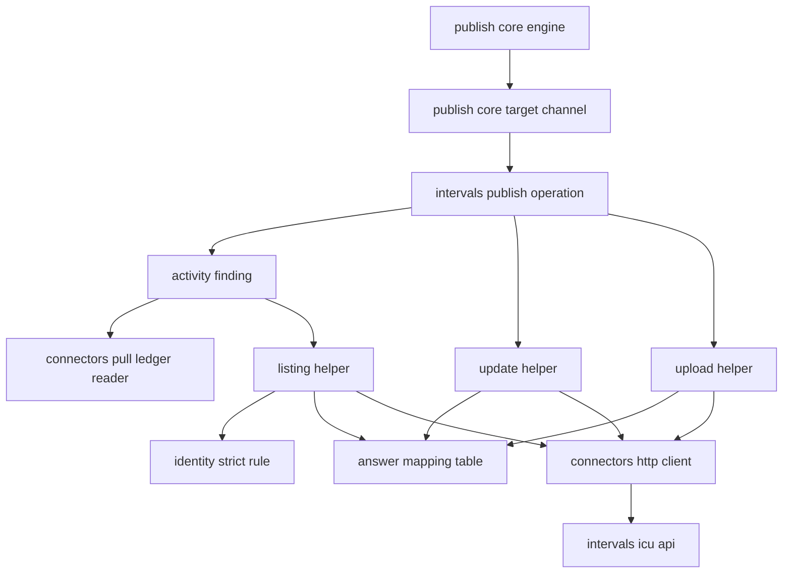
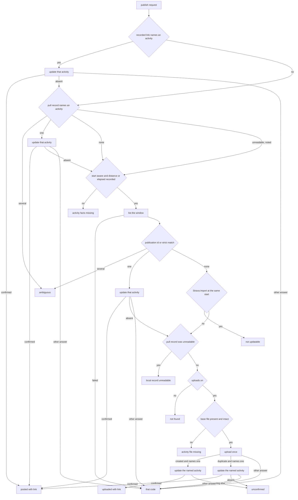

# Design Document: intervals-publish

## Overview

**Purpose**: intervals-publish makes the existing intervals.icu connector the
first concrete publish target. It implements publish-core's
`PostPublisher` contract: for each publish request it finds the
intervals.icu activity that records the page's session, sets that
activity's name and description, or uploads the page's own base `.fit` once
when no activity exists and the instance allows uploads, and it answers with
exactly one publish code and, when the post landed, the activity's direct
link.

**Users**: the athlete whose intervals.icu instance is already configured for
pulling, who opts pages in with publish-core's `publish` key and runs
`fitdocs publish --yes`; the authors of `relay-intervals`, who reuse the way
the activity is found and the answer mapping; the author of a later
planned-workout push, who reuses the transport and credential additions.

**Impact**: one connector module gains a publish operation, three declared
capabilities, a link label and one settings key; the connector transport
gains the `PUT` method; this first target rewrites the network statements
(shared with `strava-publish`, idempotently). No new module in `src/`, no new
command, no runtime dependency, no `CONTRACT_VERSION` or `DOC_VERSION`
change: the page contract and layout are publish-core's.

### Goals
- A post lands on the activity that records the page's session, found by
  evidence and one-to-one; ambiguity is a code.
- An upload is sent exactly once, carries the publication id, and is
  confirmed before `uploaded` is answered.
- Every intervals.icu answer maps into publish-core's target codes through
  one table by request kind; nothing intervals.icu returns reaches any
  output except the direct link fitdocs builds from an activity id.

### Non-Goals
- Composition, opt-in, dry run, the publish ledger, the `published` region
  and the command (publish-core).
- Fields beyond name and description; deleting activities; planned workouts
  and calendar events (Future Extension); the relay route
  (`relay-intervals`).
- Client-side pacing below intervals.icu's rate limits (the pull has none
  either).

## Boundary Commitments

### This Spec Owns
- The intervals.icu connector's publish operation: `IntervalsConnector.publish`
  and its helpers in `src/fitdocs/connectors/intervals.py`, the declared
  publish capabilities, `link_label`, and the `publish_upload` instance key.
- The way the page's activity is found on intervals.icu: recorded link, pull
  record, listing window, external-id and strict-rule matching, Strava
  detection.
- The update and upload request shapes (JSON body, multipart body, query
  parameters) and the upload's confirmation.
- The answer mapping table `ANSWER_CODES`, by answer class and request kind.
- `PUT` in `HttpRequest.method` and `HttpClient.put` (R4).
- This target's share of the network statements (R10): naming `fitdocs
  publish --yes` wherever the network-touching commands are listed, its
  no-request forms, and the intervals.icu host line in "What leaves your
  machine", written so that it holds in either landing order with
  `strava-publish`.
- The `### Publishing` subsection of `docs/connectors.md`'s intervals.icu
  section, the changelog entries, the site-copy queue item, and the
  amendment records on `connectors`, `intervals-connector` and (idempotently)
  `distribution`.

### Out of Boundary
- Everything publish-core owns: `PostPublisher`, `PublishRequest`,
  `PublishResult`, `CompletedActivity`, `Post`, `PublishCode` and its flags,
  `HttpRequest.single_attempt`, registration rules, the publish ledger, the
  `published` region, `fitdocs publish` and its report. This spec consumes
  them by name and appends no `PublishCode`.
- activity-identity's match rule: used, never restated or changed.
- The pull: `list_activities`, `fetch_activity`, `list_wellness`,
  `package_wellness`, `verify`, their messages and their tests are unchanged.
  The pull ledger is read, never written.
- Relay-server's and strava-publish's shares of the network statements, the
  `tech.md` "No server" amendment, and the relay connector.
- `docs/publishing.md` (it names no service, by publish-core's pin) and every
  page under `website/content/` (R9).
- `PUSH_PLANNED_WORKOUT` stays reserved and undriven (R8).

### Allowed Dependencies
- `src/fitdocs/connectors/intervals.py` imports, besides today's standard
  library modules (adding `math` and `enum`) and
  `fitdocs.connectors.{errors,http,protocol,secrets}`:
  - `fitdocs.connectors.ledger` (`load_ledger`, `LedgerError`), read-only;
  - `fitdocs.identity.matching` (`pair_evidence`, `SessionKey`, `Evidence`,
    `START_TOLERANCE_S`), imported inside the listing-match helper only, so
    importing `fitdocs.connectors` loads no identity module (it already
    loads `contract`, `docmerge`, `model` and `yaml` today, through
    `folder` and `inbox`). `fitdocs.identity` is not among the connectors
    guard's forbidden targets; the guard's direct-import pin sees the
    function-level import, so the intervals entry admits it.
  - The publish value types (`PublishRequest`, `PublishResult`,
    `CompletedActivity`, `Post`) and the vocabulary names (`PublishCode`,
    `TARGET_CODES`) come only through `fitdocs.connectors.protocol`, which
    re-exports them (publish-core; controller ruling R11). The intervals
    module imports nothing from `fitdocs.publish` directly, keeping
    publish-core's rule that only `protocol` and `registry` import the
    publish leaves (publish-core design.md:100-102).
- It still never imports `urllib.request`, `urllib.error`, `http`, `socket`
  or `ssl`, reads no clock and draws no randomness.
- `src/fitdocs/connectors/http.py` gains no import.
- No new runtime dependency.

### Revalidation Triggers
- Any change to `PostPublisher`, `PublishRequest`, `CompletedActivity`,
  `PublishResult`, `TARGET_CODES`, `LANDED_CODES`, `local_record_unreadable`,
  `connectors.protocol`'s re-export of `PublishCode`/`TARGET_CODES`, or
  `single_attempt` semantics (publish-core, R11): the publish operation and
  its tests re-check.
- A change to `pair_evidence`'s tiers, tolerances or `SessionKey` fields, or
  an extraction of the rule into a standard-library-only module
  (`identity.strict`, by `strava-publish`): the listing match re-checks. This
  spec keeps importing `identity.matching` in either landing order;
  switching the intervals connector to `identity.strict` is relay-intervals'
  amendment (controller ruling R13).
- A change to `connectors.ledger`'s record shape or `load_ledger`'s
  signature: the pull-record step re-checks.
- The live check contradicting a TBC-P item: the affected helper, its tests
  and this design are amended.
- `relay-intervals` reusing this resolution and mapping relay-side: a change
  to either here is a change there.
- A spec that drives `PUSH_PLANNED_WORKOUT` on this connector, or widens
  `PublishRequest.subject` (Future Extension).

## Architecture

### Existing Architecture Analysis
- **Connector shape**: `IntervalsConnector` is a stateless declaration with
  operation methods taking a `ConnectorSession`. publish-core's
  `prepare_target` builds that session in DATA mode exactly as `pull` does
  (`pull.py:715-724`), so `session.settings` is the instance's
  `IntervalsSettings`, `session.data_root` and `session.instance` locate the
  pull ledger, and `session.credentials.value("api_key")` is the key.
- **Transport**: DATA mode retries every method on 429, 5xx and transport
  failures (`http.py:297-317`); publish-core's `single_attempt` marker makes
  one transport call in either mode. `PUT` does not exist (`http.py:98`).
- **Service text**: `_service_text`/`_service_message` (`intervals.py:569-589`)
  feed the pull's and the key check's messages. The publish path never
  reaches them; a call-graph test pins that.
- **Registration**: publish-core's `validate_connector` requires a callable
  `publish` and a `link_label` passing `valid_label` once a publish
  capability is declared, and treats a connector that declares
  annotate-remote-activity as a publish target (`is_publish_target`).

### Architecture Pattern & Boundary Map



**Architecture Integration**:
- Selected pattern: one operation method over private helpers in the
  existing connector module (research.md, option A). Every helper is pure
  except the three that send a request and the two that read a local file.
- Boundaries: the connector receives plain values and answers a code; it
  never reads a page, the publish ledger or the settings file.
- Existing patterns preserved: `_auth_headers` for the credential; `API_BASE`
  and `SELF_ATHLETE` for addressing; the pull's lenient field parsing
  (absent or malformed is `None`); `ConnectorSettingsError` for a bad key.
- Steering compliance: absent data is `None` (a missing distance is never
  `0`); network code stays in `http.py`; no clock, no randomness.

**Dependency direction** (inside the module; each helper uses only those
above it):

```
constants, CallKind, AnswerClass, ANSWER_CODES      (stdlib, protocol's PublishCode)
_answer_class, _answer_code, _activity_link, _linked_activity,
_listing_window, _multipart_body, _uploaded_activity, _listed_activities
_record_activity (connectors.ledger), _match_listing (identity.matching, lazy)
_update, _list, _upload                             (session.http)
IntervalsConnector.publish
```

### Technology Stack

| Layer | Choice / Version | Role in Feature | Notes |
|-------|------------------|-----------------|-------|
| Transport | `connectors/http.py` (existing) | `PUT`, single-attempt `POST` | `urllib` only, as today |
| Encoding | standard library `json`, `hashlib`, `urllib.parse` | update body, file check, query strings | multipart body built by hand: one fixed part |
| Match rule | `fitdocs.identity.matching` (existing) | strict tier | imported lazily |
| Service | intervals.icu API v1 | list, update, upload | OpenAPI read 2026-10-31; TBC-P1..P5 |

## File Structure Plan

### Directory Structure
```
tests/connectors/
├── test_intervals_publish.py      # publish operation through FakeTransport: finding, update,
│                                  # upload, mapping table, link rule, no service text, call graph
└── test_intervals_publish_cli.py  # fitdocs publish --yes end to end over a synced data root
.kiro/queue/
└── 2026-10-31-intervals-publish-site-copy.md   # stale site lines for the next release (R9)
```

### Modified Files
- `src/fitdocs/connectors/http.py` — `HttpRequest.method` admits `"PUT"`;
  `HttpClient.put(...)`; a module docstring sentence naming the three
  request methods (none names them today; only the `Literal` at `:98` does).
- `src/fitdocs/connectors/intervals.py` — capabilities, `link_label`,
  `IntervalsSettings.publish_upload`, `parse_settings`, the publish
  constants, `CallKind`, `AnswerClass`, `ANSWER_CODES`, the helpers and
  `IntervalsConnector.publish`; the module docstring (`:3-9`: "Lists, filters
  and fetches" and the "imports only the standard library and
  `fitdocs.connectors.{errors,http,protocol,secrets}`" sentence), rewritten by
  the task that makes each part stale.
- `src/fitdocs/connectors/__init__.py` — the package docstring's
  allowed-import sentence (`:13-16`) admits `fitdocs.identity.matching` in
  the intervals module's publish path.
- `tests/connectors/test_http.py` — `PUT` through the client and the urllib
  transport.
- `tests/connectors/test_intervals.py` (`:118-120`) and
  `tests/connectors/test_intervals_wellness.py` (`:822-825`) — the
  capability pins become the five-member set; `test_intervals.py` gains the
  `publish_upload` settings cases.
- `tests/connectors/test_boundary.py` — the intervals entry of
  `_ALLOWED_IMPORT_TARGETS` adds `fitdocs.connectors.ledger` and
  `fitdocs.identity.matching` (nothing from `fitdocs.publish`).
- `tests/connectors/test_docs.py` — `_EXPECTED_HEADINGS` gains `### Publishing`
  after `### Wellness`; the `intervals.icu` exemption entry adds the two new
  test modules.
- `tests/connectors/test_intervals_docs.py` — the subsection list gains
  `### Publishing`; the answer table binding; the retired never-writes
  sentence.
- `tests/connectors/test_network_statements.py` — the `fitdocs publish --yes`
  predicate over every rewritten place (idempotent with `strava-publish`).
- `docs/connectors.md` — the intervals.icu section's opening paragraph,
  `### Configuring`, a new `### Publishing`; "What leaves your machine"; "The
  ledger" (the pull record is also read when publishing).
- `README.md` (the Connectors paragraph and the Route maps network
  statement), `docs/configuration.md` (two network places), and the network
  statements in the docstrings of `src/fitdocs/cli.py`, `src/fitdocs/sync.py`
  and `src/fitdocs/tiles.py` (three places).
- `CHANGELOG.md` — Unreleased entries.
- `.kiro/steering/tech.md` — "Network and Credentials": `fitdocs publish
  --yes` among the commands that make connector requests, and a separate
  sentence for its no-request forms (the pinned no-request list is not
  edited).
- `.kiro/steering/structure.md` — the connectors sentence states the intervals
  connector's dependency on `identity.matching` and that it names publish
  codes through the protocol; the identity sentence (`:68-71`, "`render`,
  `sync`, `audit` and `cli` import it") adds the intervals connector's publish
  path among its importers.
- `.kiro/specs/connectors/requirements.md`,
  `.kiro/specs/intervals-connector/requirements.md`,
  `.kiro/specs/distribution/requirements.md` — amendment records (next free
  number at landing).

## System Flows

### One publish request



Key decisions:
- Each activity is updated at most once per request; an activity answered
  absent is excluded from every later step of the same request (3.10).
- After a creation, every answer to the confirming update other than
  success is `unconfirmed`, because the activity exists and the post is not
  confirmed; after a duplicate answer (nothing created) the update maps as
  any other (6.5-6.7).
- The facts check sits after the two steps that need no facts, so a page
  without distance or elapsed time can still be updated through its link or
  its pull record (3.9).
- An unreadable pull record never stops the read-only steps (the link, the
  listing), which may still post. When they do not resolve the activity, the
  answer is `local_record_unreadable` whatever the upload setting
  (controller ruling R11): `not_found` would assert that no matching
  activity exists, which the unread record leaves unverified, and an upload
  cannot be undone (3.4, 6.1, 6.8). connectors Req 7.6 never reads an
  unreadable ledger as absent.

## Requirements Traceability

| Requirement | Summary | Components | Interfaces | Flows |
|-------------|---------|------------|------------|-------|
| 1.1, 1.2 | capabilities, label | IntervalsDeclaration | `capabilities`, `link_label` | — |
| 1.3 | listed as a target | IntervalsDeclaration, PublishTests | publish-core `list_targets` | — |
| 1.4 | existing key | IntervalsPublisher | `_auth_headers`, `session.credentials` | request |
| 1.5 | pull unchanged | IntervalsDeclaration | existing pull tests | — |
| 2.1, 2.2, 2.3 | `publish_upload` | IntervalsDeclaration, PublishCliTests | `IntervalsSettings.publish_upload`, `parse_settings`, the CLI exit 2 case | request |
| 3.1 | recorded link first | ActivityFinding | `_linked_activity` | request |
| 3.2, 3.3, 3.4 | pull record | ActivityFinding | `_record_activity` | request |
| 3.5 | listing window | ActivityFinding | `_listing_window`, `_list` | request |
| 3.6, 3.7, 3.8 | external id, strict rule, ambiguity | ActivityFinding | `_match_listing` | request |
| 3.9 | facts missing | IntervalsPublisher | `publish` | request |
| 3.10 | each activity once | IntervalsPublisher | `publish` (`absent` set) | request |
| 4.1, 4.2 | Strava imports | ActivityFinding | `_match_listing` | request |
| 5.1, 5.2, 5.6 | update body | ActivityWrites | `_update` | request |
| 5.3, 5.4 | posted, absent | IntervalsPublisher, ActivityWrites | `_update`, `UpdateResult` | request |
| 5.5 | update retried | TransportPut, ActivityWrites | `HttpClient.put` (unmarked) | — |
| 6.1, 6.2, 6.3 | upload gate and file | IntervalsPublisher, ActivityWrites | `_upload`, `_base_file` | request |
| 6.4 | upload once | ActivityWrites | `post(..., single_attempt=True)` | request |
| 6.5, 6.6, 6.7 | confirmation | IntervalsPublisher, ActivityWrites | `_uploaded_activity`, `_update` | request |
| 6.8 | unreadable pull record answers local record unreadable | IntervalsPublisher, ActivityFinding | `_record_activity`, `publish` step 5 | request |
| 7.1 | one target code | IntervalsPublisher | `publish` | — |
| 7.2-7.6 | answer table | AnswerMapping | `ANSWER_CODES`, `_answer_class` | — |
| 7.7 | by request kind | AnswerMapping | `CallKind` | — |
| 7.8 | unconfirmed after a creation | IntervalsPublisher | `publish` step 5 | request |
| 8.1 | no service text | IntervalsPublisher, PublishTests | call-graph and sentinel tests | — |
| 8.2, 8.3 | link and id form | AnswerMapping | `_activity_link`, `ACTIVITY_ID_PATTERN` | — |
| 9.1 | only `--yes` | IntervalsPublisher, PublishCliTests | publish-core engine | — |
| 9.2, 9.3, 9.5 | addressing and secrets | ActivityWrites, ActivityFinding | `_auth_headers`, URLs | — |
| 9.4 | request bound | IntervalsPublisher | `publish` | request |
| 9.6 | offline tests | PublishTests, PublishCliTests | `FakeTransport` | — |
| 10.1-10.4 | network statements | NetworkStatements | `test_network_statements.py` | — |
| 11.1, 11.2, 11.3 | connectors docs | ConnectorsDocs | `### Publishing`, table binding | — |
| 11.4 | changelog | Records | `CHANGELOG.md` | — |
| 11.5, 11.7 | amendments, steering | Records | requirements amendments, `structure.md` | — |
| 11.6 | site copy | Records | queue item | — |
| 12.1-12.5 | live check | LiveCheck | `research.md` findings | — |

## Components and Interfaces

| Component | Domain | Intent | Req Coverage | Key Dependencies | Contracts |
|-----------|--------|--------|--------------|------------------|-----------|
| TransportPut | transport | `PUT` request method | 5.5 | `HttpClient` (P0) | Service |
| IntervalsDeclaration | connector | capabilities, label, `publish_upload` | 1.1-1.5, 2.1-2.3 | publish-core registry (P0) | State |
| AnswerMapping | connector | answer class to code, link and id rules | 7.1-7.7, 8.2, 8.3 | `PublishCode` (P0) | State |
| ActivityFinding | connector | link, pull record, listing, match | 3.1-3.8, 4.1, 4.2, 9.3, 9.5 | ledger, identity rule (P0) | Service |
| ActivityWrites | connector | update and upload requests | 5.1-5.6, 6.2-6.7, 9.2, 9.5 | `HttpClient` (P0) | Service |
| IntervalsPublisher | connector | the publish operation | 1.4, 3.9, 3.10, 5.3, 6.1, 6.8, 7.1, 7.8, 8.1, 9.1, 9.4 | the above (P0) | Service |
| PublishTests | tests | offline unit coverage | 1.3, 8.1, 9.6 | `FakeTransport` (P0) | — |
| PublishCliTests | tests | end to end | 2.3, 9.1, 9.6 | publish-core CLI (P0) | — |
| ConnectorsDocs | docs | `### Publishing`, table | 11.1-11.3 | — | — |
| NetworkStatements | docs, tests | `fitdocs publish --yes` named | 10.1-10.4 | relay-server's places (P1) | — |
| Records | records | changelog, amendments, steering, queue | 11.4-11.7 | — | — |
| LiveCheck | process | optional, maintainer-gated | 12.1-12.5 | maintainer (P2) | — |

### Transport

#### TransportPut (`src/fitdocs/connectors/http.py`)

| Field | Detail |
|-------|--------|
| Intent | Add the idempotent update method every later intervals.icu write reuses |
| Requirements | 5.5 |

**Contracts**: Service [x]

```python
@dataclass(frozen=True)
class HttpRequest:
    method: Literal["GET", "POST", "PUT"]
    ...                                   # fields unchanged; single_attempt is publish-core's

class HttpClient:
    def put(
        self,
        url: str,
        *,
        body: bytes,
        headers: Mapping[str, str] | None = None,
        secret_headers: Mapping[str, Secret] | None = None,
        single_attempt: bool = False,
    ) -> HttpResponse: ...
```
- `put` builds `HttpRequest(method="PUT", ...)` and calls `send`, exactly as
  `post` does. Unmarked, a DATA-mode `PUT` is retried like any data request
  (idempotent); marked, it is sent once (publish-core's guard).
- `urllib_transport` is unchanged: it already passes `request.method`.
- Implementation Notes: tests at the transport seam show a `PUT` reaching a
  scripted transport with its method, body and secret headers; three calls
  for an unmarked DATA `PUT` answered 503 twice then 200; one call when
  marked; and through `urllib_transport` with a patched `urlopen`, a
  `urllib.request.Request` whose `get_method()` is `PUT`. Named mutation:
  `put` sending `"POST"` reds the method assertion.

### Connector

#### IntervalsDeclaration (`src/fitdocs/connectors/intervals.py`)

| Field | Detail |
|-------|--------|
| Intent | Declare the target and read its one key |
| Requirements | 1.1, 1.2, 1.3, 1.4, 1.5, 2.1, 2.2, 2.3 |

**Contracts**: State [x]

```python
PUBLISH_UPLOAD_KEY: Final[str] = "publish_upload"
LINK_LABEL: Final[str] = "intervals.icu"

@dataclass(frozen=True)
class IntervalsSettings:
    sources: frozenset[str]
    publish_upload: bool = False

class IntervalsConnector:
    capabilities = frozenset({
        Capability.PULL_ACTIVITIES, Capability.PULL_WELLNESS,
        Capability.PUSH_ACTIVITY, Capability.ANNOTATE_REMOTE_ACTIVITY,
        Capability.RESOLVE_REMOTE_ACTIVITY,
    })
    link_label = LINK_LABEL
    def publish(self, session: ConnectorSession, request: PublishRequest) -> PublishResult: ...
```
- `parse_settings`: `publish_upload` absent → `False`; a `bool` → that value;
  anything else → `ConnectorSettingsError("publish_upload", "publish_upload
  must be true or false, got <repr>")`, which the framework wraps naming the
  file and instance (connectors Req 3.4). `sources` handling and "every other
  key is ignored" are unchanged.
- `PUSH_ACTIVITY` is declared for every instance (capabilities are per
  connector); whether an instance uploads is `publish_upload`'s.
- Implementation Notes: the capability pins
  (`test_intervals.py:118-120`, `test_intervals_wellness.py:822-825`) become
  the five-member literal; named mutation: dropping `PUSH_ACTIVITY` reds
  both. `validate_connector(IntervalsConnector())` passes publish-core's
  rules; `list_targets` over one instance shows the three publish
  capabilities in vocabulary order. Settings tests: absent, `true`, `false`,
  `"yes"`, `1` (an `int`, not a `bool`), each with the wrapped message naming
  the key; named mutation: accepting a truthy non-`bool`.

#### AnswerMapping (`src/fitdocs/connectors/intervals.py`)

| Field | Detail |
|-------|--------|
| Intent | The one table from intervals.icu's answers to publish codes, and the id and link rules |
| Requirements | 7.1, 7.2, 7.3, 7.4, 7.5, 7.6, 7.7, 8.2, 8.3 |

**Contracts**: State [x]

```python
class CallKind(StrEnum):
    READ = "read"        # the listing; retried by the transport
    UPDATE = "update"    # a write that is safe to repeat; retried by the transport
    CREATE = "create"    # a write that creates something; single attempt

class AnswerClass(StrEnum):
    SUCCESS = "success"
    UNAUTHORIZED = "401"
    FORBIDDEN = "403"
    NOT_FOUND = "404"
    RATE_LIMITED = "429"
    CLIENT_ERROR = "other 4xx"
    SERVER_ERROR = "5xx"
    OTHER = "other status"
    NETWORK_FAILURE = "network failure"

SUCCESS_STATUSES: Final[Mapping[CallKind, frozenset[int]]]  # READ {200}, UPDATE {200}, CREATE {200, 201}
ANSWER_CODES: Final[Mapping[AnswerClass, Mapping[CallKind, PublishCode | None]]]
ACTIVITY_ID_PATTERN: Final[str] = r"^[A-Za-z0-9]{1,64}$"
ACTIVITY_LINK_BASE: Final[str] = "https://intervals.icu/activities/"

def _answer_class(kind: CallKind, status: int) -> AnswerClass: ...
def _answer_code(kind: CallKind, answer: AnswerClass) -> PublishCode | None: ...
def _activity_link(activity_id: str) -> str: ...            # ACTIVITY_LINK_BASE + id
def _linked_activity(link: str | None) -> str | None: ...   # inverse, or None
```

The table (`None`: the calling flow decides; both are `MappingProxyType`):

| Answer class | read | update | create |
|--------------|------|--------|--------|
| success | — | — | — |
| 401 | `auth_rejected` | `auth_rejected` | `auth_rejected` |
| 403 | `permission_denied` | `permission_denied` | `permission_denied` |
| 404 | `rejected` | — | `rejected` |
| 429 | `rate_limited` | `rate_limited` | `rate_limited` |
| other 4xx | `rejected` | `rejected` | `rejected` |
| 5xx | `unavailable` | `unavailable` | `unconfirmed` |
| other status | `unavailable` | `unconfirmed` | `unconfirmed` |
| network failure | `unavailable` | `unavailable` | `unconfirmed` |

- `_answer_class`: a status in `SUCCESS_STATUSES[kind]` is `SUCCESS`; 401,
  403, 404 and 429 are their own classes; any other 400-499 is
  `CLIENT_ERROR`; 500-599 `SERVER_ERROR`; everything else (1xx, other 2xx,
  3xx) `OTHER`. A `TransportError` is `NETWORK_FAILURE`. A status reaching
  the table is what the transport returned after its retries for `READ` and
  `UPDATE`, and the one answer for `CREATE`.
- Why `create` differs: a 5xx, an unexpected status or a lost connection may
  follow a creation the service completed, so it is `unconfirmed` (the next
  run looks before it uploads again). A 401, 403, 404, 429 or other 4xx is a
  refusal before processing, so nothing was created.
- Every code in the table is in publish-core's `TARGET_CODES`; none is
  `posted` or `uploaded` (those come only from a confirmed flow).
- The table is keyed by request kind, never by the object written, so a
  later events write maps identically (R8).
- Link and id rule: a remote identifier is usable only when it matches
  `ACTIVITY_ID_PATTERN` (letters and digits, 1-64; live ids are `i` and
  digits, intervals-connector TBC-4). `_activity_link` is called only with a
  usable id, so every link it returns passes publish-core's `valid_link`.
  `_linked_activity` returns the id when the link is exactly
  `ACTIVITY_LINK_BASE` plus a usable id, else `None`.
- Implementation Notes: tests pin `ANSWER_CODES` as a literal; every cell's
  code is a `TARGET_CODES` member; `_answer_class` over 200, 201, 202, 204,
  301, 307, 400, 401, 403, 404, 409, 413, 415, 422, 429, 500, 502, 503, 504
  per kind. Named mutations: swapping `create`'s 5xx cell to `unavailable`;
  classifying 201 as success for `UPDATE`; loosening the id pattern to admit
  `/` (a link test with `i1/x` reds).

#### ActivityFinding (`src/fitdocs/connectors/intervals.py`)

| Field | Detail |
|-------|--------|
| Intent | Find the page's activity from the request's facts, one-to-one |
| Requirements | 3.1, 3.2, 3.3, 3.4, 3.5, 3.6, 3.7, 3.8, 4.1, 4.2, 9.3, 9.5 |

**Contracts**: Service [x]

```python
RESOLVE_FIELDS: Final[tuple[str, ...]] = (
    "id", "source", "start_date", "start_date_local",
    "distance", "elapsed_time", "external_id",
)
WINDOW_DAYS_BEFORE: Final[int] = 1
WINDOW_DAYS_AFTER: Final[int] = 2

@dataclass(frozen=True)
class ListedActivity:
    activity_id: str               # usable id
    strava: bool                   # source == STRAVA_SOURCE
    start: datetime | None         # start_date with an offset, in UTC
    local_start: datetime | None   # start_date_local's wall clock, naive
    distance_m: float | None       # finite, >= 0, not bool
    elapsed_s: float | None        # int >= 0, not bool
    external_id: str | None        # non-empty str

def _record_activity(session: ConnectorSession, subject: CompletedActivity) -> str | PublishCode | None: ...
def _listing_window(start: datetime) -> tuple[str, str]: ...
def _list(session: ConnectorSession, headers: Mapping[str, Secret],
          subject: CompletedActivity) -> tuple[ListedActivity, ...] | PublishCode: ...
def _listed_activities(body: bytes) -> tuple[ListedActivity, ...] | None: ...   # None: not documented form
def _match_listing(listed: Sequence[ListedActivity], subject: CompletedActivity,
                   publication_id: str, *, absent: Collection[str]) -> str | PublishCode | None: ...
```

- **Recorded link** (3.1): `_linked_activity(request.recorded_link)`.
- **Pull record** (3.2-3.4): `load_ledger(session.data_root, session.instance,
  connector_id=INTERVALS_CONNECTOR_ID)`; an absent file is an empty ledger
  (`None`); `LedgerError` → `LOCAL_RECORD_UNREADABLE`, which the operation
  notes and does not return here (the read-only steps continue; when they
  do not resolve the activity, the operation answers it whatever the upload
  setting). The ledger is never written. Tier one: distinct usable `remote_id`s of entries whose `sha256`
  equals the base digest (`subject.source_shas[-1]`); tier two, only when
  tier one is empty: those whose `sha256` is any other source digest. A tier
  with one id answers it; more than one answers `AMBIGUOUS`; both empty, or
  no source digest, answer `None`. An entry's outcome does not matter: a
  matching digest is the identity. Ids failing the pattern name nothing.
- **Window** (3.5): with `D = subject.start.astimezone(UTC).date()`, `oldest =
  f"{D - 1 day}T00:00:00"`, `newest = f"{D + 2 days}T00:00:00"`. The service
  reads both as local date-times; every local start lies within 14 hours of
  the UTC start, so the window holds it in any zone, and the inclusive bounds
  overlap by a full day either side.
- **Listing request** (9.3, 9.5): `GET {API_BASE}/athlete/0/activities?oldest=
  …&newest=…&fields=<RESOLVE_FIELDS joined>` (query by `urlencode`), DATA
  mode, the credential as `secret_headers`. A `TransportError` or a
  non-success answer maps through `ANSWER_CODES[...][READ]`. A 200 body that
  is not UTF-8 JSON, not an array, or holds an entry that is not an object
  or lacks a usable `id` is not in documented form → `UNAVAILABLE`. A
  repeated id is kept once (first wins).
- **Entry fields** (TBC-P2): as `ListedActivity`; `start_date` without an
  offset, or malformed, is `None` (never the local zone); `start_date_local`
  parsed with `datetime.fromisoformat` and its wall clock kept (an offset, if
  any, dropped); a missing or malformed value is `None`, never `0`.
- **Match** (3.6-3.8, 4.1, 4.2), over entries whose id is not in `absent`:
  1. entries, not Strava, with `external_id == publication_id`: one → its
     id; several → `AMBIGUOUS`;
  2. otherwise entries, not Strava, with
     `pair_evidence(page_key, entry_key) is Evidence.STRICT`, where both keys
     carry `sport=subject.sport`, `device=None`, `kind=None` (so only the
     strict tier can hold, and sport is not compared): one → its id; several →
     `AMBIGUOUS`;
  3. otherwise, a Strava entry whose `start` is within `START_TOLERANCE_S` of
     `subject.start`, or, with no `start`, whose `local_start` is within it of
     `subject.start.replace(tzinfo=None)` (the recorded wall clock) →
     `NOT_UPDATABLE`;
  4. otherwise `None`.
  No step orders or ranks candidates; a count above one is the answer.
- Implementation Notes: the identity import is inside `_match_listing`. Tests
  build `ListedActivity` values and listing bodies by hand with synthetic ids
  (`i9000001`...). Named mutations: accepting `Evidence.SHIFTED`; comparing
  with `is not None` instead of `is Evidence.STRICT`; picking the first of
  two strict matches; matching a Strava entry in step 2; reading tier two
  when tier one has an id; `WINDOW_DAYS_BEFORE = 0` (a start at 00:30 UTC
  read at UTC-10:00 is the previous local day, outside `oldest`);
  `WINDOW_DAYS_AFTER = 1` (a start at 23:30 UTC read at UTC+13:00 is past
  `newest`).

#### ActivityWrites (`src/fitdocs/connectors/intervals.py`)

| Field | Detail |
|-------|--------|
| Intent | The update and the upload, and what each answer means |
| Requirements | 5.1, 5.2, 5.5, 5.6, 6.2, 6.3, 6.4, 6.5, 6.6, 6.7, 9.2, 9.5 |

**Contracts**: Service [x]

```python
UPLOAD_FIELD: Final[str] = "file"
UPLOAD_FILENAME: Final[str] = "activity.fit"
MULTIPART_BOUNDARY_PREFIX: Final[str] = "fitdocs-"

class UpdateResult(Enum):
    CONFIRMED = "confirmed"
    ABSENT = "absent"

@dataclass(frozen=True)
class UploadAnswer:
    created: bool          # 201 (True) or 200 (False)
    activity_id: str | None  # the one usable id named, or None

def _update(session: ConnectorSession, headers: Mapping[str, Secret],
            activity_id: str, post: Post) -> UpdateResult | PublishCode: ...
def _base_file(subject: CompletedActivity) -> bytes | None: ...
def _multipart_body(data: bytes, publication_id: str) -> tuple[bytes, str]: ...  # body, content type
def _uploaded_activity(body: bytes) -> str | None: ...
def _upload(session: ConnectorSession, headers: Mapping[str, Secret],
            data: bytes, publication_id: str) -> UploadAnswer | PublishCode: ...
```

- **Update** (5.1, 5.2, 5.5, 5.6; TBC-P1): `session.http.put(
  f"{API_BASE}/activity/{quote(id, safe='')}", body=json.dumps({"name":
  post.title, "description": post.description}, ensure_ascii=False,
  separators=(",", ":")).encode("utf-8"), headers={"Content-Type":
  "application/json"}, secret_headers=headers)`, unmarked, so DATA-mode
  retries apply. `SUCCESS` → `CONFIRMED` (the body is not read); `NOT_FOUND`
  → `ABSENT`; every other class → `ANSWER_CODES[...][UPDATE]`. An empty
  description is sent as `""`.
- **Base file** (6.3): `None` when `subject.base_fit` is `None`, when
  `subject.source_shas` is empty, when reading raises `OSError`, or when
  `hashlib.sha256(data).hexdigest() != subject.source_shas[-1]`.
- **Multipart body** (6.2): one part, `Content-Disposition: form-data;
  name="file"; filename="activity.fit"`, `Content-Type:
  application/octet-stream`, CRLF line ends, the file's bytes unmodified.
  The boundary is the first of `fitdocs-<publication id>`,
  `fitdocs-<publication id>-1`, `-2`, ... whose delimiter line does not occur
  in the file; content type `multipart/form-data; boundary=<boundary>`.
  Deterministic: the same file and id give the same bytes.
- **Upload** (6.2, 6.4; TBC-P3, TBC-P4): `session.http.post(
  f"{API_BASE}/athlete/0/activities?{urlencode({'external_id': id})}",
  body=…, headers={"Content-Type": …}, secret_headers=headers,
  single_attempt=True)`. `TransportError` → `UNCONFIRMED`. `SUCCESS` (200 or
  201) → `UploadAnswer(created=status == 201,
  activity_id=_uploaded_activity(body))`. Every other class →
  `ANSWER_CODES[...][CREATE]`. No title or description is in the address.
- **Upload answer** (6.5-6.7): `_uploaded_activity` returns the id only when
  the body is a JSON object whose `activities` is a non-empty list of objects
  each holding a usable string `id`, all naming one id; anything else
  (missing key, two distinct ids from a split multisport file, a malformed
  id) is `None`.
- Implementation Notes: a `FakeTransport` records each request; tests assert
  the exact method, address (scheme, host, path, decoded query), header
  names, the JSON body as parsed, the multipart body's single part and its
  bytes equal to the archived file's, and that the `Authorization` value is
  only in `secret_headers`. Named mutations: dropping `single_attempt=True`
  (a 503 then shows three transport calls); putting the title in the upload
  query; skipping the digest check (a tampered archive file is uploaded).

#### IntervalsPublisher (`IntervalsConnector.publish`)

| Field | Detail |
|-------|--------|
| Intent | Answer one publish request with one code |
| Requirements | 1.4, 3.4, 3.9, 3.10, 5.3, 5.4, 6.1, 6.5, 6.6, 6.7, 6.8, 7.1, 7.8, 8.1, 9.1, 9.4 |

**Contracts**: Service [x]

```python
def publish(self, session: ConnectorSession, request: PublishRequest) -> PublishResult: ...
```
- Preconditions: `session.settings` is an `IntervalsSettings` (otherwise a
  `ConnectorError` with fitdocs-written text, which publish-core reports as
  `target_error`); publish-core has checked the subject's sport and aware
  start and minted the publication id.
- Steps (the flow above): `headers = _auth_headers(session,
  session.credentials.value("api_key"))`; `absent: set[str]`;
  1. recorded link id → `_update`; `CONFIRMED` → `PublishResult(POSTED,
     link)`; a code → that code; `ABSENT` → add to `absent`.
  2. `_record_activity`: `AMBIGUOUS` → that; `LOCAL_RECORD_UNREADABLE` →
     note `record_unreadable` and go on; an id not in `absent` → `_update` as
     in 1.
  3. facts: `subject.start.utcoffset() is None`, or both
     `subject.distance_m` and `subject.elapsed_s` are `None` →
     `ACTIVITY_FACTS_MISSING`.
  4. `_list` → a code, or entries; `_match_listing(..., absent=absent)`:
     `AMBIGUOUS` or `NOT_UPDATABLE` → that; an id → `_update`:
     `CONFIRMED` → `POSTED`, a code → that code, `ABSENT` → step 5; `None` →
     step 5.
  5. `record_unreadable` → `LOCAL_RECORD_UNREADABLE`, whatever the upload
     setting (no file read, no upload). Uploads off → `NOT_FOUND`.
     `_base_file` is `None` → `ACTIVITY_FILE_MISSING`. `_upload` → a code → that code; an answer
     naming no usable id, or an id in `absent` → `UNCONFIRMED`; otherwise
     `_update` of the named id: `CONFIRMED` → `UPLOADED` (created) or
     `POSTED` (duplicate) with the link; after a creation anything else →
     `UNCONFIRMED`; after a duplicate `ABSENT` → `UNCONFIRMED` and a code →
     that code.
- Postconditions: exactly one `PublishResult` with a `TARGET_CODES` code;
  `link` set only with `POSTED` or `UPLOADED`, always
  `_activity_link(<usable id>)`; at most one listing, one upload and one
  update per distinct activity; nothing written anywhere.
- Never raises for an intervals.icu answer: every status and every
  `TransportError` is mapped. Only a defect raises (publish-core turns it
  into `target_error` and keeps no text). `KeyboardInterrupt` propagates.
- The publish path reaches neither `_service_text`, `_service_message`,
  `auth_failure_from`, `_raise_for_status` nor `_raise_for_wellness_status`,
  and raises no exception built from a response.
- Implementation Notes: the call-graph test parses `intervals.py`, walks
  every module-level function named by a call reachable from
  `IntervalsConnector.publish`, and asserts those five names are unreachable
  and that `_update`, `_list`, `_upload` and `_auth_headers` are reachable
  (positive control); named mutation: a `_service_message(session,
  response)` call added in `_update` reds it. The sentinel test scripts every
  answer class for every step with a body and headers holding a sentinel
  string and asserts the sentinel is in no field of any `PublishResult` and
  that no call raises.

### Tests

#### PublishTests (`tests/connectors/test_intervals_publish.py`)
- Unit coverage through `FakeTransport` with the connectors conftest's socket
  guard and environment isolation; sessions built as `test_intervals.py`'s
  `_session` does, in DATA mode; pull ledgers written with
  `connectors.ledger.save_ledger`; archive files from
  `tests/fixtures/builder.py` written under `fit-archive/<sha>.fit`.
- Listed in the `intervals.icu` neutral-scan exemption (it spells the link
  base).

#### PublishCliTests (`tests/connectors/test_intervals_publish_cli.py`)
- Through `fitdocs publish` over a synced temporary data root with an
  `[connectors.intervals]` table, the key in
  `FITDOCS_CONNECTOR_INTERVALS_API_KEY`, and `cli._connector_transport`
  patched to a `FakeTransport` (the `test_cli_connectors.py:842` pattern).
- Listed in the same exemption entry.

### Documentation and records

#### ConnectorsDocs (`docs/connectors.md`)
- Intervals section opening: the connector pulls (activities, and wellness
  when enabled) and publishes posts for pages that opt in; it writes only an
  activity's name and description and, while uploads are on, the page's base
  file. The sentence "It never writes to the account." is removed.
- `### Configuring`: the example gains `publish_upload = false   # optional;
  this is the default`, and the "no other key is read" sentence names it.
- `### Publishing` (after `### Wellness`): opting a page in (`publish:
  intervals` on the page, publish-core's key; link to `publishing.md`);
  `publish_upload`; the order (the activity the post last landed on, the
  pull record, a listing of the dates around the start matched by publication
  id and then by start time to the second and distance or elapsed time,
  sport not compared); ambiguity; Strava-imported activities and the
  different-time-zone caveat; what each request sends (the update's body is
  the name and description; the upload's body is the base file and its
  address the publication id; the listing's address the date window and the
  field names); the direct link and its label; the answer table (a markdown
  table equal to `ANSWER_CODES`) and what `posted`, `uploaded`, `not_found`,
  `ambiguous`, `not_updatable`, `activity_file_missing`,
  `local_record_unreadable` and `unconfirmed` mean for intervals.icu (an
  unreadable instance ledger never stops an update through the link or the
  listing; when neither finds the activity, the answer is
  `local_record_unreadable` whether or not uploads are on, never `not_found`
  and never an upload; `fitdocs
  pull` names the file to fix). A malformed `publish_upload` is a
  configuration error for every command that reads the connectors table,
  `fitdocs pull` included, since it goes through the same settings loader.
- "The ledger": one sentence that publishing to an intervals.icu instance
  also reads its ledger, never writes it.
- Tests (`tests/connectors/test_intervals_docs.py`, `test_docs.py`): the
  subsection list gains `### Publishing`; the table is parsed and held equal
  to `ANSWER_CODES` (row labels are `AnswerClass` values; cells are code
  values or `—`); the phrase "never writes to the account" is absent from
  `docs/connectors.md`; the `publish_upload` default in the example equals
  `IntervalsSettings` default. Named mutations: changing one cell; restoring
  the retired sentence.

#### NetworkStatements (R9, R10)
- Every place in `REWRITTEN_PLACES` (the eight today plus relay-server's
  connectors-page place, added here if relay-server has not yet landed it)
  names `fitdocs publish --yes`; a new predicate
  `_names_publish_command(window)` requires it in every window, with one
  named mutation per place. `_names_publish_command` is the predicate name
  shared with `strava-publish` (the same name in both specs), so whichever
  target lands second finds it and adds nothing. The `tech.md` "Network and
  Credentials" sentence that lists the commands making connector requests
  names it too (with "one or more update, listing or upload requests per
  page it posts, for the targets it posts to"), and a separate following
  sentence states that "`fitdocs publish` without `--yes` and `fitdocs
  publish --targets` make none" (skipped when an earlier target recorded
  it); the pinned no-request list sentence is not edited (its three pins
  stay green).
- "What leaves your machine" names `fitdocs publish --yes` and says an
  intervals.icu instance's publish requests go to intervals.icu (the bare
  host, linking the section anchor, no URL, so the neutral scan is
  unaffected).
- Idempotent with `strava-publish`: if a place already names `fitdocs publish
  --yes`, it is left as it is; `_names_publish_command`, the no-request
  sentence, the connectors Req 14.1 amendment text and the distribution Req
  10.4 amendment are each added once, skipped when an earlier target
  recorded them. The skip applies per clause: in connectors Req 14.1,
  `fitdocs publish --yes` among the request commands and the no-request
  forms (without `--yes`, and `--targets`) are checked and added
  independently, so a strava-first landing that recorded only its own
  requests still gets the no-request forms from this spec. The host line
  is per target.

#### Records
- `CHANGELOG.md` Unreleased (11.4), read through
  `tests/_changelog_view.unreleased_since(text, V0_2_0)`: Added, publishing to
  intervals.icu (the update, the optional upload, `publish_upload`, the
  direct link); Changed, the intervals connector now writes to the account
  for pages that opt in, and, unless an earlier publish target's entry
  already says so, the network statements name `fitdocs publish --yes`. No
  contract version change; no action needed.
- Amendments (11.5), next free number at landing, each "landed by
  intervals-publish":
  - **connectors**: Req 9 criterion 3's bounded retries cover an update that
    is safe to repeat; the transport offers the update method; Req 14
    criterion 1 adds `fitdocs publish --yes` to the commands that make
    connector requests and `fitdocs publish` without `--yes` and `fitdocs
    publish --targets` to those that make none (skipped when an earlier
    target recorded it); the design's Allowed Dependencies admit, in the
    intervals module, the pull ledger reader and (lazily) activity-identity's
    match rule, and record that a connector target names publish codes
    (`PublishCode`, `TARGET_CODES`) only through `connectors.protocol`'s
    re-export (R11), never by importing `fitdocs.publish`.
  - **intervals-connector**: Req 1.1 declares the three publish capabilities
    beside pull-activities and pull-wellness; Req 2.4's ignored keys exclude
    `publish_upload`, which is read; the design's "never reads the ledger,
    the archive" responsibility reads "the pull never …; the publish
    operation reads the instance's own ledger and the one base file a request
    names"; the publish behaviour is this spec's Requirements 3-8; Req 9's
    live check is extended by this spec's Requirement 12.
  - **distribution**: Req 10.4 names `fitdocs publish --yes` among the
    explicit commands with network access (skipped when an earlier target
    recorded it).
- Steering (11.7): `structure.md`'s connectors sentence states that the
  intervals connector imports, on its publish path only, activity-identity's
  match rule and names publish codes through the protocol (appended after
  whatever clauses are present at landing, R7); the identity sentence's
  importer list gains the intervals connector's publish path; `tech.md` as
  under NetworkStatements.
- Site copy (11.6): `.kiro/queue/2026-10-31-intervals-publish-site-copy.md`,
  written with this spec: `website/content/guides/connectors.md:14` ("It
  never writes to the account."), `website/content/guides/privacy-and-network.md:50`
  (the connect/pull-only sentence and "The connector never writes to your
  account."), and a publishing-to-intervals.icu section for the next
  release. A landing task refreshes the line numbers.

#### LiveCheck (optional, maintainer-gated)
- What it confirms: TBC-P1..P5 on the maintainer's own account, with the
  maintainer's key, only on the maintainer's explicit go at implementation
  time; it writes to that account (one update of an activity the maintainer
  names, and optionally one upload the maintainer then deletes by hand).
- Findings go to this spec's `research.md` as shapes, statuses and
  vocabulary only. No other task waits for it; a contradiction amends this
  design and its tasks.

## Data Models

### `[connectors.<name>]` for this connector
```toml
[connectors.intervals]
sources = ["GARMIN_CONNECT"]   # optional (pull)
wellness = false               # optional (framework key)
publish_upload = false         # optional; default false: never create an activity
```

### intervals.icu requests (publish path)

| Kind | Method and address | Body | Mode |
|------|--------------------|------|------|
| read | `GET /api/v1/athlete/0/activities?oldest=<D-1>T00:00:00&newest=<D+2>T00:00:00&fields=id,source,start_date,start_date_local,distance,elapsed_time,external_id` | none | DATA, retried |
| update | `PUT /api/v1/activity/<id>` | `{"name": "...", "description": "..."}` (UTF-8 JSON) | DATA, retried |
| create | `POST /api/v1/athlete/0/activities?external_id=<publication id>` | multipart, one `file` part | single attempt |

All carry the fitdocs User-Agent and `Authorization: Basic <API_KEY:key>` as
an unredirected secret header.

## Error Handling

| Situation | Response |
|-----------|----------|
| any intervals.icu status or transport failure | `ANSWER_CODES` by request kind, or the flow's own success and absence handling |
| listing body not in documented form | `unavailable` |
| upload answer not naming one usable activity | `unconfirmed` |
| pull ledger unreadable | step skipped; link and listing still apply and may post; otherwise `local_record_unreadable`, whatever the upload setting |
| base file missing, unreadable or altered | `activity_file_missing` |
| settings object of another connector | `ConnectorError` (fitdocs text) → publish-core `target_error` |
| any other exception | propagates → publish-core `target_error`, no text kept |

Nothing is logged. The only output is publish-core's report of the code and
the link.

## Testing Strategy

Every assertion names the production mutation it dies on (`tech.md`,
Testing; `change-protocol.md` § Fixture Discrimination). Synthetic key
`"ik-synthetic-7Q2x9"`, synthetic ids `i9000001`..., synthetic publication
ids, builder FIT bytes; no value from any real account.

- **Unit (`test_http.py`)**: `PUT` method, body and secret headers reach the
  transport; unmarked DATA `PUT` retried, marked sent once; urllib request
  method is `PUT`.
- **Unit (`test_intervals_publish.py`)**:
  - Declaration: five capabilities; `link_label`; `validate_connector`
    passes; `list_targets` row.
  - Mapping: literal `ANSWER_CODES`; `_answer_class` table per kind; link
    and id rules (accept `i9000001`; refuse `i9/1`, `i 1`, 65 characters, an
    `http://` link, a link with a query).
  - Finding: recorded link updated first and only once; pull record tiers,
    ambiguity in each tier, unreadable ledger (file of invalid TOML) skipped for updates and answered as `local_record_unreadable` when nothing else resolves,
    malformed id ignored; for starts at 00:30 and 23:30 UTC, the window holds
    the local wall-clock start at every offset from -12:00 to +14:00 in
    whole hours; external-id match
    before the strict rule; strict match by distance, by elapsed time when
    one distance is missing, and no match when both are missing; a sport
    mismatch still matching; two strict matches ambiguous; a Strava entry by
    `start` and by `local_start` giving `not_updatable`; a Strava entry never
    updated; facts missing with no link and no record.
  - Writes: update address and body; empty description; 404 → absent; upload
    address, query, multipart body equal to the archived bytes; digest
    mismatch → `activity_file_missing`; uploads off with a readable or absent
    pull ledger → `not_found` with no POST; 201 and confirmation → `uploaded`; 200 and confirmation → `posted`;
    an unreadable pull ledger with nothing else resolving →
    `local_record_unreadable` with uploads on (no file read, no POST) and
    with uploads off alike, and with a recorded link or a listing match →
    `posted` (the read-only steps still run);
    201 with no id, two ids, a malformed id → `unconfirmed`; confirming update
    404 or 503 after 201 → `unconfirmed`; upload 503 and `TransportError` →
    `unconfirmed` with exactly one transport call; upload 429 →
    `rate_limited`, 422 → `rejected`.
  - Bounds: per request at most one GET, one POST, one PUT per id (the
    recorded transport calls are counted, retries aside).
  - Privacy: the sentinel test; the call-graph test; the key appears in no
    address; the title and description appear in no address.
- **Integration (`test_intervals_publish_cli.py`)**:
  - `fitdocs publish --yes` over a synced root, one page opted in: listing
    then update; the publish ledger records `posted` with the direct link;
    the page's `published` region reads `Published:
    [intervals.icu](https://intervals.icu/activities/i9000001)`; a second
    run sends nothing (an empty script).
  - The same page after `fitdocs pull` delivered its file from `i9000001`
    (a ledger written by the test): update with no listing.
  - Uploads on, nothing listed: one upload then one update; `uploaded`; the
    upload's `external_id` equals the publication id the publish ledger
    recorded (the CLI mints it randomly, so the test reads it back rather
    than fixing it).
  - `publish_upload = "yes"`: `fitdocs publish --yes` exits 2 naming the
    settings file, the instance, the key and the value, with an empty script
    and the page and ledgers byte-identical (2.3 at the CLI).
  - `fitdocs publish` (no `--yes`) and `fitdocs publish --targets` with the
    instance configured: an empty script, so any request fails the test.
  - Sentinel strings in every scripted body and header appear in no stdout,
    stderr, ledger or page.
- **Docs and statements**: the table binding; the subsection list; the
  retired sentence; `test_network_statements.py`'s publish predicate.

## Security Considerations
- The key is sent only as the unredirected `Authorization` header to
  intervals.icu (`_auth_headers`, registered with the redactor). No address
  holds the key, the title or the description.
- The connector writes nothing locally; it reads the pull ledger and one
  archive file named by the request, inside the data root.
- The direct link is built from an id restricted to letters and digits, so
  no service-chosen text reaches the page.

## Performance & Scalability
- At most six transport requests per page (two stale updates, one listing,
  one update, one upload, one confirming update), typically one or two.
  Rate limits are intervals.icu's; a persistent 429 stops the target for the
  run (publish-core).
- The pull ledger is read once per request that reaches step 2; it is small
  and the run posts only pages whose post is new or changed.

## Cross-spec seams
- **publish-core (upstream)**: consumed names `PostPublisher`,
  `PublishRequest(publication_id, post, subject, recorded_link)`,
  `CompletedActivity(sport, start, elapsed_s, distance_m, source_shas,
  base_fit)`, `Post(title, description)`, `PublishResult(code, link)`,
  `PublishCode` members `POSTED`, `UPLOADED`, `NOT_FOUND`, `AMBIGUOUS`,
  `NOT_UPDATABLE`, `ACTIVITY_FILE_MISSING`, `ACTIVITY_FACTS_MISSING`,
  `AUTH_REJECTED`, `PERMISSION_DENIED`, `RATE_LIMITED`, `UNAVAILABLE`,
  `REJECTED`, `UNCONFIRMED`, `LOCAL_RECORD_UNREADABLE` (the code the
  controller folded into publish-core after `ready`, R11), all through
  `fitdocs.connectors.protocol`'s re-export of `PublishCode` and
  `TARGET_CODES` (R11), and `HttpRequest.single_attempt` through
  `HttpClient.post(..., single_attempt=True)`. This spec appends no code.
  publish-core's design says each target spec adds its own documentation
  section, and also pins that `docs/publishing.md` names no service; this
  spec documents the target in `docs/connectors.md` and leaves
  `docs/publishing.md` unedited.
- **strava-publish (wave 2 sibling)**: shares the network-statement task
  (idempotent, either order), the `distribution` Req 10.4 amendment (first
  lander only), the `connectors` Req 14.1 amendment text, `CHANGELOG.md`
  (append-only), `tests/connectors/test_boundary.py` (each edits its own
  entry), and possibly the identity rule's form (Revalidation Triggers).
- **relay-server (wave 1)**: its connectors-page network place and
  `fitdocs disconnect` predicate are expected to land first; this spec's
  predicate is additive and its tasks hold in either order (the network
  task adds the connectors-page place itself if it is missing, and the
  steering and changelog edits append after whatever clauses are present).
- **activity-identity**: `pair_evidence`, `SessionKey`, `Evidence`,
  `START_TOLERANCE_S` consumed unchanged.
- **relay-intervals (downstream)**: reuses the finding order, the strict
  match without sport, the Strava rule and `ANSWER_CODES`' semantics
  relay-side.

## Future Extension: planned-workout push

Out of scope (R8): pushing planned workouts or syncing a training block to
intervals.icu is the roadmap follow-on "Planned-workout push to
intervals.icu"; `PUSH_PLANNED_WORKOUT` stays reserved. This design leaves the
door open without building for it:
- **Transport**: `HttpClient.put` and publish-core's `single_attempt` cover
  an events update (repeatable) and an events creation (once).
- **Credential and addressing**: `_auth_headers` and `SELF_ATHLETE` address
  `/athlete/0/events` as they address activities.
- **Mapping**: `ANSWER_CODES` is keyed by request kind, so an events request
  maps without a new table; only the flow decides what a 404 means for its
  object.
- **Finding**: the activity-finding steps apply to a `CompletedActivity`
  subject only; a planned-workout subject would bring its own finding (by
  its own publication id as the event's external id), not reuse the strict
  rule.
- **Revalidation trigger**: a spec that drives `PUSH_PLANNED_WORKOUT` on this
  connector, or a publish-core change that widens `PublishRequest.subject`,
  makes `publish` dispatch on the subject type and re-checks these four
  points.
