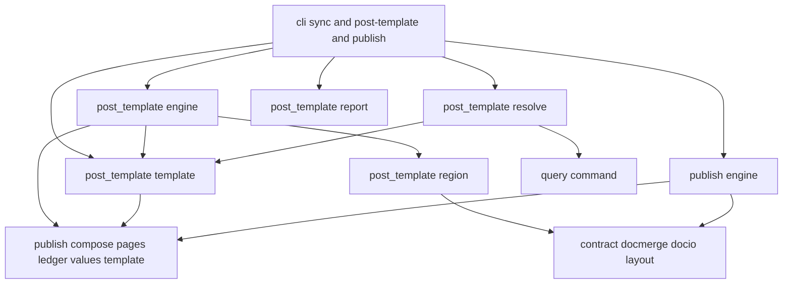
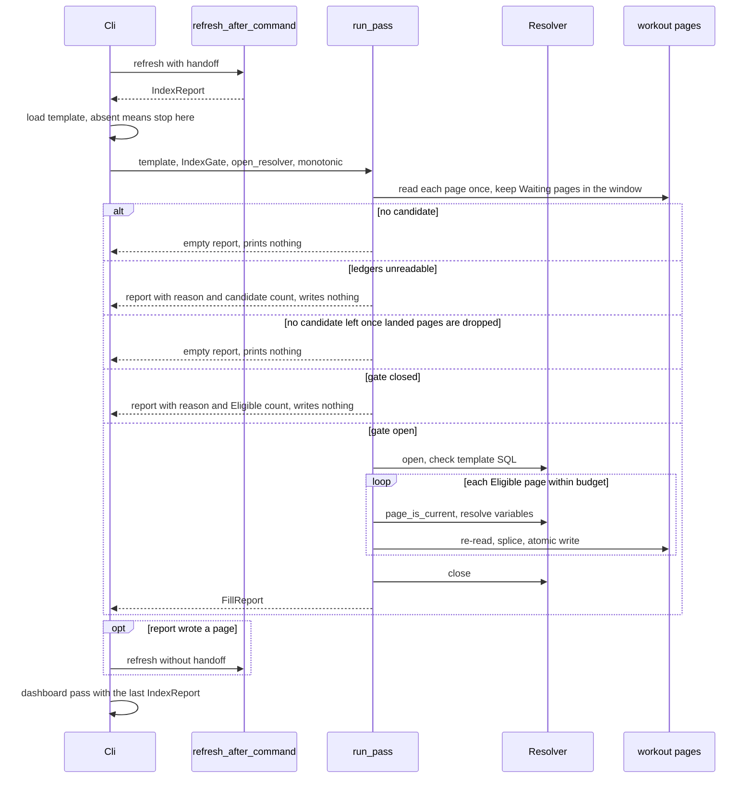
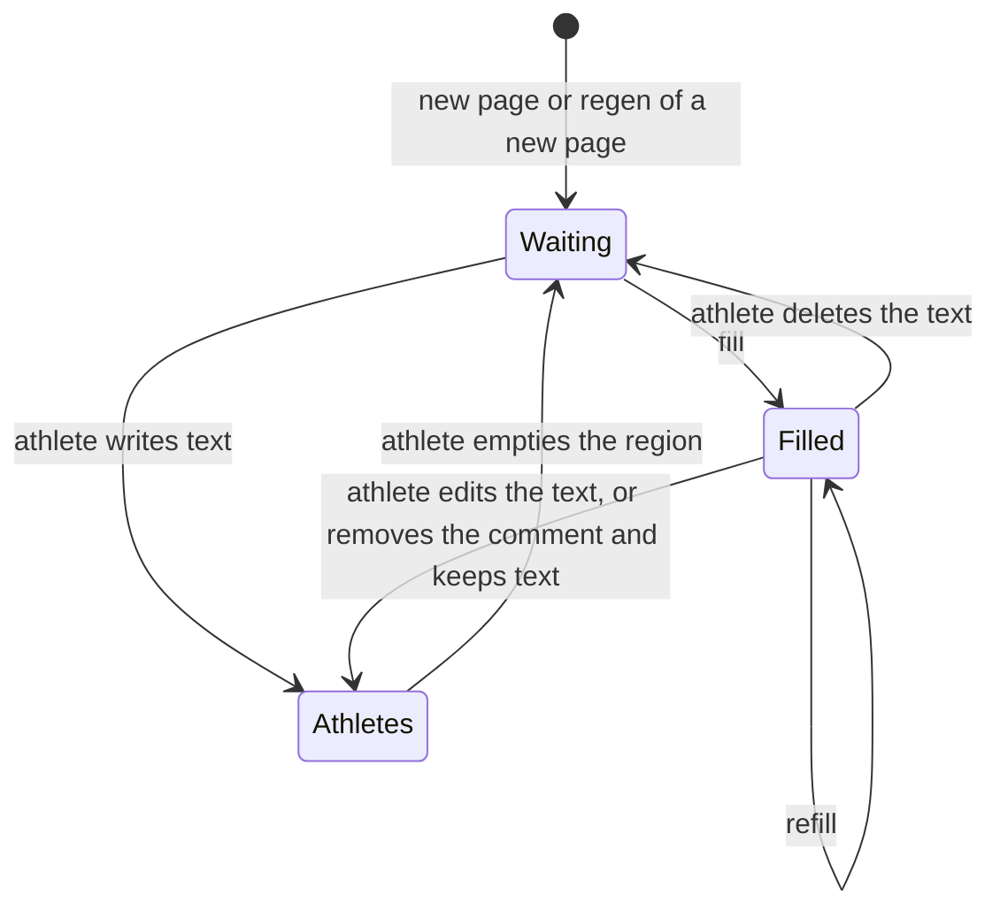

# Design Document: post-templates

## Overview

**Purpose.** An athlete writes `post-template.toml` once: a post title and description in the existing `{name}` grammar, plus one SQL statement per variable. In the `fitdocs sync` that creates a workout page, fitdocs fills the page's `post` region with the finished text, numbers included, computed as of the workout's recorded start.

**Users.** Athletes who publish to intervals.icu or Strava, and the LLM assistants who write templates for them.

**Impact.** This is the second named exception to "the index is never read back into a document". A filled region is produced from the index once and is then carried like any athlete-owned text. `fitdocs publish` stays offline: it gains one input, the template's `since`, and one outcome code. Every other command behaves as before, and with no template file present nothing changes at all.

### Goals

- A new page arrives with its post filled, in the same command that created it, with no further command (6.1).
- The athlete's words are never overwritten. The decision comes from the region's bytes alone (5.1, 5.2).
- A filled post stays exactly as written until the athlete asks for a refill (8.1 to 8.6).
- `fitdocs publish` sends exactly what the page shows (4.7, 12.10).

### Non-Goals

- One template per sport or per target, or variables in a hand-written `post` region.
- Re-querying during `regen`, or SQL during `publish`.
- Filling history, block or dashboard pages.
- New index tables or columns, or an as-of dimension in the index.
- Expressions, filters or formatting in the template. The SQL does the formatting.

## Boundary Commitments

### This Spec Owns

- The `post-template.toml` format, its parser and its validation (1.1 to 1.15).
- Checking, binding and running a variable's SQL, and turning one result into text (2.1 to 2.5, 3.1 to 3.10).
- The three region states, the provenance comment, and the write into a `post` region (5.1 to 5.9).
- The Fill Pass inside `fitdocs sync` and `fitdocs pull --sync`, with its gates, limits and report (6.1 to 6.13, 7.1 to 7.6).
- The `fitdocs post-template check|refill` command (9.1 to 9.8, 10.1 to 10.15, 11.1 to 11.3).
- One appended publish outcome code, `post_waiting`, and the refusal that gives it (12.1 to 12.10).
- The contract, guide and skill changes that state all of the above (14.1 to 14.10).

### Out of Boundary

- **Post composition rules.** `publish.compose` and `publish.template` are reused unchanged; this spec adds no grammar.
- **Publish decisions for a filled page.** `would_post`, `unchanged` and `would_update` come from the existing path (12.10).
- **Targets and connectors.** They see only composed text.
- **The index schema and producers, and refresh semantics.** This spec calls `refresh_after_command` as every writing command does.
- **`dashboards`.** It is the pattern, not a dependency.
- **`fitdocs check`.** It does not read the template.
- **Whether a query's numbers are right.**

### Allowed Dependencies

- `post_template` may import:
  - the standard library;
  - `fitdocs.contract`, `fitdocs.docio`, `fitdocs.docmerge`, `fitdocs.layout` and `fitdocs.settings`;
  - `fitdocs.publish.compose`, `publish.ledger`, `publish.outcomes` (engine, for the composer's refusal codes; added at 3.1), `publish.pages`, `publish.request`, `publish.template` and `publish.values`;
  - `fitdocs.query.command` and `fitdocs.query.statement`, in `post_template.resolve` only.
- `post_template` never imports `duckdb`, `fitdocs.index`, `dashboards`, `render`, `load`, `metrics`, `ingest`, `sync` or a network module. It calls no clock: `monotonic` and the timer are injected.
- `fitdocs.publish` never imports `post_template`. It receives `since` through `PublishPlan`.
- Only `fitdocs.cli` imports `post_template`, lazily.
- `fitdocs.query` gains one importer, `fitdocs.post_template.resolve`. `_INDEX_IMPORTERS` does not change.

### Revalidation Triggers

- A change to `POST_PLACEHOLDER`'s wording. The old wording must stay in `POST_PLACEHOLDER_WORDINGS`.
- A change to `POST_FILL_STAMP`. Every filled page carries the old form, so the old grammar must stay recognized.
- A change to `compose_post`, `read_post_region`, `override_templates` or the template grammar. The fill/publish round trip (4.7) must be re-proven.
- A change to how the index derives `page_key` or `start_time_local`. The `$as_of` and `$page_key` binding (3.1, 3.2) must be re-checked.
- A change to `refresh_after_command` outcomes or `RefreshResult` errors. The pass gate (6.4) must be re-checked.
- A change to the publish ledger's notion of landed (`digest` set). `has_landed_post` must be re-checked.
- A new publish outcome code appended after `post_waiting`. The relay copy must be re-synced.
- Renaming `pages.load_value` or `pages.load_methodology`. The skill recipe must be updated.

## Architecture

### Existing Architecture Analysis

- `sync`, drain and `pull --sync` end with `_run_index_pass` and then `_run_dashboard_pass` (`cli.py` lines 1030-1031 and 1125-1126). `regen` and `load` call the same pair (lines 1236-1237 and 1276-1277) and stay unchanged (6.13).
- `fitdocs publish` composes from `read_post_region`, then `override_templates`, then `compose_post`. `read_post_region` strips hidden comments first.
- `QuerySession` (`query/command.py`) runs one screened, sandboxed statement with named parameters, a row cap and a timeout. `dashboards.binding` is the only non-CLI importer of `query` today.
- `publish/outcomes.py` is append-only and copied byte for byte into the relay.

### Architecture Pattern & Boundary Map



- **Pattern.** A pure core with a single query adapter, composed by `cli`. This is the `dashboards` shape.
- **Dependency direction inside the package:** `model`, then `template`, then `region`, then `engine`, then `report`. `resolve` depends on `model`, `template` and `query`, and never on `engine`. `engine` declares the `Resolver` protocol that `resolve.SessionResolver` satisfies structurally.
- **Steering compliance.** Absent values stay `None` (3.4). No new runtime dependency, since `tomllib` is standard library (13.4). No network access (13.1). No clock in the package.

### Technology Stack

| Layer | Choice / Version | Role in Feature | Notes |
|---|---|---|---|
| CLI | `typer`, `rich` (existing) | `post-template` command, pass output | `cli.Console` defaults `emoji=False` |
| Template file | `tomllib` (stdlib, Python 3.11+) | Parse `post-template.toml` | No YAML anywhere in this feature |
| Index access | `duckdb` floor 1.2, lock 1.5.6, through `fitdocs.query` only | Screen, lint and run variable SQL | `json_serialize_sql` drives the lint |
| Page writes | `docio.write_bytes_if_changed` | Atomic page write | Unchanged |

## File Structure Plan

### Directory Structure

```
src/fitdocs/post_template/
├── __init__.py      # package marker, no imports
├── model.py         # FillCode, RegionState, Variable, Binding, VariableOutcome, PageResult, FillReport, Unavailable
├── template.py      # PostTemplate, PostTemplateError, parse_post_template, load_post_template, template digest
├── region.py        # classify, FillStamp, render_filled, the provenance comment grammar
├── resolve.py       # SessionResolver: SQL screen and lint, binding, run, value to text. The only query importer
├── engine.py        # Resolver protocol, IndexGate, run_pass, run_check, run_refill, the per-page fill
└── report.py        # render_pass_text, render_text, render_json

tests/post_template/
├── test_boundary.py     # import table, forbidden names, no clock, only resolve imports query
├── test_template.py     # 1.x
├── test_region.py       # 5.x and the round trip in 4.7
├── test_resolve.py      # 2.x, 3.x against a real sandboxed index fixture
├── test_engine.py       # 4.x, 6.2, 6.3, 6.5, 6.6, 7.x, 8.5, 9.x and 10.x with a fake Resolver
├── test_report.py       # 7.5, 7.6, 11.2
├── test_cli_post_template.py  # 9.x, 10.x, 11.x exits and forms, end to end
└── test_sync_fill.py    # 6.1, 6.4, 6.9 to 6.13, 8.1 to 8.4, end to end through sync
```

### Modified Files

- `src/fitdocs/contract.py`
  - Adds `POST_PLACEHOLDER_WORDINGS`, `POST_FILL_STAMP` and `is_waiting_post`.
  - Restates the post-region and index-read-back sentences (14.1, 14.3).
  - Updates the contract-19 history text (14.9).
- `src/fitdocs/layout.py` — adds `POST_TEMPLATE_FILE` and `post_template_path`. `OWNED_PATHS` does not change, and its docstring names the file among the deliberate exclusions (14.2).
- `src/fitdocs/docmerge.py` — adds `replace_region`.
- `src/fitdocs/publish/links.py` — `replace_published` delegates to `docmerge.replace_region`, with behavior unchanged.
- `src/fitdocs/publish/template.py` — exports `is_placeholder_name` and `template_names`.
- `src/fitdocs/publish/outcomes.py` — appends `POST_WAITING` with flag `F` (12.2, 12.3).
- `relay/src/fitdocs_relay/shared/outcomes.py` — regenerated by `scripts/sync_relay_shared.py`.
- `src/fitdocs/publish/ledger.py` — adds `has_landed_post`.
- `src/fitdocs/publish/engine.py` — adds `PublishPlan.post_template_since: date | None = None` and the waiting check in `_decide_pair` (12.1, 12.4 to 12.7, 12.9).
- `src/fitdocs/query/command.py` — adds `QuerySession.page_is_current`.
- `src/fitdocs/cli.py`
  - Adds `_index_gate` and `_run_post_fill_pass` and wires them into both sync paths.
  - Adds the `post-template` command.
  - Adds a template preflight to `publish_command` (12.8).
- `tests/query/test_boundary.py` — `_QUERY_IMPORTERS` gains `fitdocs.post_template.resolve`.
- `tests/publish/test_boundary.py` — import-table entries for the changed `publish` modules, and a check that no `publish` module imports `post_template`.
- `tests/test_confinement.py` — `WRITING_ENTRY_POINTS` gains `sync-with-post-template` and `post-template-refill`, each with `non_vacuous`.
- `tests/publish/test_outcomes.py` — classification of the new code (failure, not from a target).
- `docs/ownership-contract.md`, `docs/publishing.md` (it documents the command, since `docs/` has no separate CLI reference) and `CHANGELOG.md` (14.1 to 14.6). The website's CLI reference is the follow-up queue item of 14.10.
- `src/fitdocs/skills/fitdocs-workouts/SKILL.md` — the recipe (14.7).
- `.kiro/steering/tech.md`, `structure.md`, `product.md` — rule copies (14.4).
- Amendments recorded in `.kiro/specs/{publish-core,wiki-contract,analytics-index,analytics-query}/requirements.md`.
- Doc-binding tests turned red are deleted and named in those amendments (14.8). The expected ones are pins in `tests/index/test_contract_docs.py`, `tests/dashboards/test_published.py`, `tests/connectors/test_network_statements.py` and `tests/test_ownership_contract.py`, plus `tests/publish/test_docs.py::test_the_code_table_equals_the_vocabulary_in_order`, which pins the guide's code table at 35 rows.
- `contract.__all__` does not change: `POST_PLACEHOLDER_WORDINGS`, `POST_FILL_STAMP` and `is_waiting_post` are internal names that `publish` and `post_template` import directly, so the surface pin in `tests/test_public_api.py` stays as it is.
- The CLI count pins move from 17 to 18: `tests/test_cli_skill.py`, `tests/query/test_cli_query.py`, `tests/index/test_cli_index.py`, and the `cli.py` module docstring with its command list.

## System Flows

### The end of `fitdocs sync`



**Flow decisions:**
- The resolver is closed before the second refresh, because a refresh with an open reader in the same process reports `needs_rebuild`.
- The gate is evaluated only after Eligible pages are found, so a sync with nothing to fill prints nothing (7.6).

### Region states



Only Waiting and Filled are ever written. fitdocs never moves a page out of Athlete's; only the athlete does, by emptying the region (5.10).

## Requirements Traceability

| Requirement | Summary | Components | Interfaces | Flows |
|---|---|---|---|---|
| 1.1, 1.2, 1.3 | One file, read-only, absent means unchanged | PostTemplateFile, CliPostTemplate | `load_post_template`, `post_template_path` | sync end |
| 1.4, 1.5, 1.6, 1.7, 1.8, 1.9, 1.10, 1.11, 1.12, 1.13, 1.14, 1.15 | File grammar and validation | PostTemplateFile | `parse_post_template`, `PostTemplateError` | — |
| 2.1, 2.2, 2.3, 2.4, 2.5 | SQL screen, parameters and lint | VariableResolver | `SessionResolver.check` | sync end |
| 3.1, 3.2, 3.3 | Binding | FillEngine, VariableResolver | `Binding`, `binding_for` | — |
| 3.4, 3.5, 3.6, 3.7, 3.8, 3.9 | Result shape and values | VariableResolver | `to_text` | — |
| 3.10 | Per-page failure continues | FillEngine | `_fill_page` | — |
| 4.1, 4.2, 4.3, 4.4, 4.5, 4.6 | Composition | FillEngine | `_compose` | — |
| 4.7 | Round trip through publish | FillRegion | `render_filled` | — |
| 5.1, 5.2, 5.3, 5.4, 5.5, 5.10, 5.11 | States, provenance, digest, emptying reverts | FillRegion, PostTemplateFile, PublishWaitingRefusal | `classify`, `is_waiting_post`, `POST_FILL_STAMP`, `PostTemplate.digest` | Region states |
| 5.6, 5.7, 5.8, 5.9 | Safe write | FillEngine, RegionSplice | `docmerge.replace_region`, `_write` | sync end |
| 6.1, 6.9, 6.10, 6.11, 6.12, 6.13 | Pass placement and order | CliPostTemplate | `_run_post_fill_pass` | sync end |
| 6.2, 6.3, 6.5, 6.6, 6.7, 6.8 | Pass selection and gates | FillEngine | `run_pass` | sync end |
| 6.4 | Index gate | CliPostTemplate, FillEngine | `_index_gate`, `IndexGate` | sync end |
| 7.1, 7.2, 7.3, 7.4 | Limits | FillEngine | `PASS_STATEMENT_TIMEOUT_S`, `PASS_BUDGET_S` | — |
| 7.5, 7.6 | Pass report | FillReportRendering | `render_pass_text` | — |
| 8.1, 8.2, 8.3, 8.4, 8.6 | Stability | FillRegion, existing regen | `classify`; regen unchanged | — |
| 8.5 | No query for Filled in pass | FillEngine | `run_pass` selection | — |
| 9.1, 9.2, 9.3, 9.4, 9.5, 9.6, 9.7, 9.8 | `check` | FillEngine, CliPostTemplate, FillReportRendering | `run_check` | — |
| 10.1, 10.2, 10.3, 10.4, 10.5, 10.6, 10.7, 10.8, 10.9, 10.10, 10.11, 10.12, 10.13, 10.14, 10.15 | `refill` | FillEngine, CliPostTemplate | `run_refill` | — |
| 11.1, 11.2, 11.3 | Shared command behavior | CliPostTemplate, FillReportRendering | `select_pages`, `render_json` | — |
| 12.1, 12.4, 12.5, 12.6, 12.7, 12.9, 12.10 | Waiting refusal | PublishWaitingRefusal | `PublishPlan.post_template_since`, `_decide_pair` | — |
| 12.2, 12.3 | New code | PublishWaitingRefusal | `PublishCode.POST_WAITING` | — |
| 12.8 | Template preflight in publish | CliPostTemplate | `publish_command` | — |
| 13.1, 13.2, 13.3, 13.4, 13.5 | Local only, sandbox, no dependency, no format change | VariableResolver, PostTemplateBoundary | `test_boundary.py` | — |
| 14.1, 14.2, 14.3, 14.4, 14.5, 14.6, 14.7, 14.8, 14.9, 14.10 | Contract and documentation | ContractAndDocs | docs, contract, skill | — |

## Components and Interfaces

| Component | Layer | Intent | Req Coverage | Key Dependencies | Contracts |
|---|---|---|---|---|---|
| PostTemplateFile | post_template.template | Parse and validate the file | 1.x, 5.5 | publish.template (P0), publish.values (P0) | Service |
| FillRegion | post_template.region | States, provenance, filled text | 4.7, 5.1 to 5.5, 8.x | contract (P0), publish.request (P1) | Service, State |
| VariableResolver | post_template.resolve | SQL check, bind, run, convert | 2.x, 3.x, 13.3 | query.command (P0) | Service |
| FillEngine | post_template.engine | Select, compose, write, for pass, check and refill | 3.10, 4.x, 5.6 to 5.9, 6.x, 7.1 to 7.4, 9.x, 10.x | publish.pages, ledger, compose (P0) | Service, Batch |
| FillReportRendering | post_template.report | Text and JSON output | 7.5, 7.6, 11.2 | model (P0), engine (timeout constants only; 3.4 ruling) | Service |
| CliPostTemplate | cli | Pass wiring, command, publish preflight | 1.1 to 1.3, 6.1, 6.4, 6.9 to 6.13, 9.1, 9.7, 9.8, 10.1, 10.13 to 10.15, 11.x, 12.8 | all of the above (P0) | Batch |
| PublishWaitingRefusal | publish.engine, outcomes, ledger | Refuse Eligible pages | 12.x | contract (P0) | Service |
| RegionSplice | docmerge | Replace one region's content | 5.6 | — | Service |
| SessionFreshness | query.command | Per-page index currency | 6.5, 9.6, 10.10 | index.fingerprint, bookkeeping (P0) | Service |
| PostTemplateBoundary | tests/post_template/test_boundary.py | Pin imports, no clock, query only in resolve | 13.1, 13.3, 13.4 | — | — |
| ContractAndDocs | docs, contract, skill, steering | State the changed guarantees | 13.5, 14.x | — | — |

### post_template.model

Shared value types with no behavior. Defined once so `resolve` and `engine` do not import each other.

```python
class FillCode(StrEnum):
    FILLED = "filled"
    WOULD_FILL = "would_fill"
    UNCHANGED = "unchanged"            # refill composed the text the page holds (10.11)
    VALUE_MISSING = "value_missing"    # 4.2
    TITLE_EMPTY = "title_empty"        # 4.4
    UNSAFE_TEXT = "unsafe_text"        # 4.5: composed text holds a comment marker
    NO_START_TIME = "no_start_time"    # 3.3
    INDEX_BEHIND = "index_behind"      # 6.5, 9.6, 10.10
    SHAPE_INVALID = "shape_invalid"    # 3.5
    VALUE_REFUSED = "value_refused"    # 3.7, 3.8, 3.9
    STATEMENT_FAILED = "statement_failed"
    TIMED_OUT = "timed_out"            # 7.3, 10.12
    NOT_ATTEMPTED = "not_attempted"    # after a stop (7.3)
    PAGE_NOT_CURRENT = "page_not_current"  # older, newer, damaged or unreadable (5.9)
    PAGE_CHANGED = "page_changed"      # edited during the run (5.8)
    WRITE_FAILED = "write_failed"
    ATHLETES_TEXT = "athletes_text"    # 10.5

class RegionState(StrEnum):
    WAITING = "waiting"
    FILLED = "filled"
    ATHLETES = "athletes"

@dataclass(frozen=True)
class Binding:
    as_of: datetime        # naive local wall clock (3.1)
    page_key: str | None   # None: the page records no archived base (never current in the index)

@dataclass(frozen=True)
class VariableOutcome:
    name: str
    value: str | None      # None: absent (3.4) or failed
    code: FillCode | None  # None: resolved, value present or absent
    detail: str | None     # fitdocs-written, or the database's message for STATEMENT_FAILED

@dataclass(frozen=True)
class PageResult:
    page: str                      # data-root-relative POSIX path
    state: RegionState | None      # None when the page could not be classified
    in_window: bool
    landed: bool | None                  # None when check could not read the ledgers (3.3 ruling)
    code: FillCode
    detail: str | None
    variables: tuple[VariableOutcome, ...]
    post: Post | None              # composed post, when there is one
    changed: bool | None           # refill and check: would the text change

@dataclass(frozen=True)
class Unavailable:
    reason: str            # fitdocs-written: "the index is not built", and so on
    next_step: str         # "run fitdocs index", and so on

@dataclass(frozen=True)
class TemplateSummary:
    path: str              # data-root-relative
    since: date
    digest: str

@dataclass(frozen=True)
class FillReport:
    command: Literal["pass", "check", "refill"]
    writing: bool
    template: TemplateSummary | None     # None when the file was refused
    template_problems: tuple[str, ...]   # 1.x and 2.x, located
    waiting: int | None                  # pass: Eligible pages left unfilled, or candidates when ledgers are unreadable (7.5, 6.4, 6.8); check: Eligible pages, which the next sync will try to fill (9.2), None when check cannot read the ledgers (count not shown); refill: 0
    unavailable: Unavailable | None      # gate closed, index unavailable, ledgers unreadable
    rows: tuple[PageResult, ...]
    athletes_left_out: int               # 10.6
    published_left_out: int              # 10.6: a bare refill skips pages with a landed post
    older_template: int | None           # 9.2; None when check's template was refused (3.3 ruling) and for refill, which never computes it
    stopped: FillCode | None             # TIMED_OUT or NOT_ATTEMPTED after budget (7.4)
    stopped_variable: str | None
    @property
    def wrote(self) -> tuple[str, ...]: ...   # pages written this run
    @property
    def counts(self) -> Mapping[str, int]: ...  # rows per code, in FillCode order
    @property
    def failed(self) -> bool: ...             # any problem, unavailable, or failing row
```

When a run stops before reaching pages (gate closed, ledgers or index unavailable, SQL refused), `rows` is empty and `waiting` holds the number of Eligible pages, or of candidates when the ledgers are unreadable. The renderers therefore need nothing beyond the report. Rulings at 3.3:
- When `check` names pages and the template parsed but the index is unavailable or the SQL is refused, it still gives one NOT_ATTEMPTED row per named page carrying state, window and landed flag (Req 9.3). No variable is resolved.
- When `check`'s template is refused, `waiting` and `older_template` are None (unknowable without `since` and the digest) and there are no rows.
- `refill` always opens the resolver and runs `check`, even when no page needs the index, so refused SQL and an unavailable index give their exit codes (Req 10.15).
- `FillReport.landed_changed` names only FILLED or WOULD_FILL rows with a landed post (Req 10.7).

### PostTemplateFile (`post_template/template.py`)

| Field | Detail |
|---|---|
| Intent | Read `post-template.toml` and return a validated template or every problem found |
| Requirements | 1.1 to 1.15, 5.5 |

**Responsibilities & Constraints**
- Pure apart from one `read_bytes` in `load_post_template`. It opens no index (1.15).
- It collects every problem across keys, so `check` can report them all (9.2). `PostTemplateError.problems` holds them, and `str()` joins them for `_config_error`.

```python
POST_TEMPLATE_FILE: Final = "post-template.toml"   # defined in layout, re-exported

@dataclass(frozen=True)
class Variable:
    name: str
    sql: str

@dataclass(frozen=True)
class PostTemplate:
    path: Path
    since: date
    templates: TargetTemplates          # title, description parsed with PLACEHOLDERS + variable names
    variables: tuple[Variable, ...]     # sorted by name
    digest: str                         # 5.5

class PostTemplateError(SettingsError):
    problems: tuple[str, ...]           # each names the file, key and, for grammar, line and column

def parse_post_template(data: bytes, *, path: Path) -> PostTemplate: ...   # raises PostTemplateError
def load_post_template(data_root: Path) -> PostTemplate | None: ...       # None when no file exists (1.3)
```

**Validation rules, in order**
1. Decode the file as UTF-8 and parse it as TOML (1.14). `tomllib` keeps comments out of the data.
2. Allow only the top-level keys `since`, `title`, `description` and `vars`. `since` and `title` are required (1.4, 1.5).
3. `since` must satisfy `type(value) is date`. A `datetime` is a `date` subclass and is refused, with the message showing `since = 2026-11-07` (1.6).
4. Check `title` and `description`:
   - each must be text;
   - `title` must have no `has_control_character` (1.9);
   - neither raw text may contain `<!--`, `-->` or `--!>` (1.10);
   - each is parsed with `parse_template(names=PLACEHOLDERS + variable names)`. A `TemplateSyntaxError` gives the key, line and column (1.7, 1.8).
5. `vars` must be a table of tables. Each entry needs exactly the key `sql`, with text as its value (1.11, 1.13). Its name must satisfy `is_placeholder_name`, must not be in `PLACEHOLDERS`, and must be used: it must appear in `template_names(title) | template_names(description)` (1.12).
6. The digest is the SHA-256 of the compact JSON `[title, description, [[name, sql.rstrip("\r\n")], ...]]` in name order (5.5). `since` and TOML comments are outside it.

`load_post_template` uses `os.path.lexists`:
- nothing at the path returns `None`;
- a directory, a symlink or an unreadable file is a `PostTemplateError` naming the path.

### FillRegion (`post_template/region.py`)

| Field | Detail |
|---|---|
| Intent | Decide a region's state from its bytes and produce filled content |
| Requirements | 4.7, 5.1 to 5.5, 8.1 to 8.4 |

```python
@dataclass(frozen=True)
class FillStamp:
    template: str   # 64 lowercase hex
    as_of: datetime # naive
    text: str       # 64 lowercase hex, SHA-256 of the text below the comment

def classify(content: str) -> tuple[RegionState, FillStamp | None]: ...
def render_filled(post: Post, *, template_digest: str, as_of: datetime) -> str: ...
```

**State model**, checked in this order:
- **Waiting:** `contract.is_waiting_post(content)` (5.10). Remove every exact occurrence of a wording in `POST_PLACEHOLDER_WORDINGS` and every match of `POST_FILL_STAMP`. Waiting means only whitespace remains. That covers:
  - the untouched placeholder;
  - an emptied region;
  - a region where the athlete deleted the text but left the provenance comment.

  Any other comment, including one never closed, leaves text behind, so the page is the athlete's (5.11).
- **Filled:** the content has the form `<line>\n<rest>`. `<line>` fully matches `POST_FILL_STAMP`, `rest` is not blank, and `sha256(rest)` equals the stamp's `text`.
- **Athlete's:** anything else (5.4). That covers:
  - edited text;
  - text kept with the comment removed;
  - CRLF line endings introduced by an editor;
  - a note of the athlete's own in a hidden comment.

**Stamp grammar.** `contract.POST_FILL_STAMP` holds it, because `publish` needs it for the waiting check. The stamp is one line at the start of the region:

`<!-- fitdocs:post-fill template=<64hex> as_of=<YYYY-MM-DDTHH:MM:SS[.ffffff]> text=<64hex> -->`

It cannot match `docmerge._MARKER_RE`, which requires `begin:` or `end:`. `read_post_region` removes it as a hidden comment (5.3).

**Filled text.**
- `escape(s)` doubles every `{` and `}`.
- The text is `escape(post.title)`, followed by `"\n\n" + escape(post.description)` when the description is not empty.
- The region content is the stamp line, a newline, then that text.
- `read_post_region`, then `override_templates`, then `compose_post` over any values returns a `Post` equal to `post` (4.6, 4.7).

### VariableResolver (`post_template/resolve.py`)

| Field | Detail |
|---|---|
| Intent | The only `query` importer: check the template's SQL and resolve one variable for one page |
| Requirements | 2.1 to 2.5, 3.1, 3.2, 3.4 to 3.9, 13.3 |

**Dependencies**
- Outbound: `query.command.open_session`, `QuerySession`, `SessionUnavailable`, `QueryEnvironment` (P0). `query.statement` exceptions (P0).
- External: DuckDB through `query` only. `json_serialize_sql` exists at the 1.2 floor and at 1.5.6.

```python
def open_resolver(data_root: Path, env: QueryEnvironment) -> SessionResolver | Unavailable: ...

class SessionResolver:
    def check(self, template: PostTemplate) -> tuple[str, ...]: ...   # problems, each naming the variable (2.5)
    def page_is_current(self, page_key: str | None, path: str, data: bytes) -> bool: ...
    def resolve(self, variable: Variable, binding: Binding, *, timeout_s: float) -> VariableOutcome: ...
    def close(self) -> None: ...
```

**`check` (2.1 to 2.4).** For each variable:
1. `session.screen(sql)` must give kind `SELECT`. EXPLAIN is accepted by the sandbox and refused here.
2. The parameters must include `as_of` and be a subset of `{as_of, page_key}`.
3. The lint runs `SELECT json_serialize_sql($sql)` and walks the JSON. It refuses:
   - a `function_name` in `VOLATILE_FUNCTIONS`, compared lowercased: `now`, `today`, `current_timestamp`, `get_current_time`, `get_current_timestamp`, `transaction_timestamp`, `current_localtime`, `current_localtimestamp`, `random`, `setseed`, `uuid`, `uuidv4`, `uuidv7`, `gen_random_uuid`, `nextval`, `currval`, `query` and `query_table`. Added at implementation (2.3): the call forms `current_date`, `current_time`, `localtime` and `localtimestamp`, which DuckDB serializes as FUNCTION nodes when written with parentheses; the clock macros `ago`, `pg_conf_load_time` and `pg_postmaster_start_time`; and the per-run values `current_transaction_id`, `txid_current`, `current_query_id` and `current_connection_id`;
   - a single-part `COLUMN_REF` in `VOLATILE_KEYWORDS`: `current_date`, `current_time`, `current_timestamp`, `localtime` and `localtimestamp`;
   - any non-null `sample`.

   An `error` node is a refusal with its message. `check` only parses: it neither prepares nor binds, so an unknown column passes `check` and fails per page as `STATEMENT_FAILED`. `check` does not keep each statement's parameters, so `resolve` re-screens to learn which names to bind (2.3 ruling).

**`resolve` (3.1, 3.2, 3.4 to 3.9).** Ruling at 2.4: a TIMESTAMP WITH TIME ZONE result fails in the driver, because pytz is not a dependency. That failure is recognized by the query module's own TIMESTAMPTZ hint and mapped to `VALUE_REFUSED` with the timestamp row's advice, so for a one-row, one-column result the outcome does not depend on whether pytz is installed. Without pytz, the failure comes before the shape check, so a multi-column or multi-row TIMESTAMPTZ result is also refused with the timestamp advice rather than SHAPE_INVALID; the advice is still one the user can act on.
1. Bind exactly the screened parameter names from the `Binding`. DuckDB errors on an extra or a missing parameter.
2. `session.run(..., max_rows=2, timeout_s=timeout_s)`.
3. Check the shape: `len(columns) != 1` or more than one row gives `SHAPE_INVALID`. No rows, or a single `None`, means absent.
4. `to_text(value)` checks in this order:

| Python value | Result |
|---|---|
| `bool` | `VALUE_REFUSED`, cast to text |
| `int` | `str(value)` |
| `Decimal` | `format(value, "f")` if finite, else `VALUE_REFUSED` |
| `float` | `VALUE_REFUSED`, cast to `DECIMAL` or `INTEGER` |
| `datetime` | `VALUE_REFUSED`, cast to text or `DATE` |
| `date` | `isoformat()` |
| `str` | the value, unless it holds a line break of any kind (`_TITLE_BREAK` class plus `\x85`, U+2028, U+2029), `<!--`, `-->` or `--!>`, which gives `VALUE_REFUSED` |
| other | `VALUE_REFUSED`, cast to text |

5. Errors map as follows: `StatementTimedOut` gives `TIMED_OUT`, `StatementFailed` gives `STATEMENT_FAILED` with the message on one line, and `StatementRefused` gives `STATEMENT_FAILED` with the restriction text.

**`page_is_current`** delegates to `QuerySession.page_is_current`.

### SessionFreshness (`query/command.py`)

```python
class QuerySession:
    def page_is_current(self, page_key: str | None, path: str, data: bytes) -> bool:
        """Whether the index holds exactly this file for this page.

        `path` is data-root-relative POSIX. False for a None key or a page the
        index does not hold. Reads bookkeeping once per session.
        """
```

- It compares `fingerprint.document_fingerprint(path, data)` with `read_bookkeeping(conn).pages[page_key].document_fingerprint`.
- `query` already imports both modules, so `_INDEX_IMPORTERS` does not change.

### FillEngine (`post_template/engine.py`)

| Field | Detail |
|---|---|
| Intent | Choose pages, resolve, compose and write, for the pass, `check` and `refill` |
| Requirements | 3.3, 3.10, 4.1 to 4.6, 5.6 to 5.9, 6.2 to 6.8, 7.1 to 7.4, 8.5, 9.2 to 9.6, 10.2 to 10.12 |

**Contracts**: Service [x] / Batch [x]

```python
PASS_STATEMENT_TIMEOUT_S: Final = 5.0      # 7.1
PASS_BUDGET_S: Final = 30.0                # 7.2
COMMAND_STATEMENT_TIMEOUT_S: Final = 30.0  # 10.12, and check

class Resolver(Protocol):
    def check(self, template: PostTemplate) -> tuple[str, ...]: ...
    def page_is_current(self, page_key: str | None, path: str, data: bytes) -> bool: ...
    def resolve(self, variable: Variable, binding: Binding, *, timeout_s: float) -> VariableOutcome: ...
    def close(self) -> None: ...

OpenResolver = Callable[[], Resolver | Unavailable]

@dataclass(frozen=True)
class IndexGate:
    open: bool
    reason: str | None     # fitdocs-written, set when closed
    next_step: str | None

def run_pass(data_root: Path, template: PostTemplate, *, gate: IndexGate,
             open_resolver: OpenResolver, monotonic: Callable[[], float]) -> FillReport: ...
def run_check(data_root: Path, template: PostTemplate | PostTemplateError,
              pages: tuple[SelectedPage, ...], *, ledgers: Mapping[str, PublishLedger] | PublishLedgerError,
              open_resolver: OpenResolver) -> FillReport: ...
def run_refill(data_root: Path, template: PostTemplate, pages: tuple[SelectedPage, ...],
               *, writing: bool, ledgers: Mapping[str, PublishLedger],
               open_resolver: OpenResolver) -> FillReport: ...
```

**Page reading.**
- Each top-level `.md` in `workouts/` is read once with `docio.read_document`. Symlinks are skipped, as `publish.pages` does.
- A page is kept when `is_workout_document` holds. Its status follows `publish.pages` rules (current `DOC_VERSION`, intact regions with `post` present).
- Named pages come from `publish.pages.select_pages` (11.1).
- A page is in the window when `document_date(fm)` is at or after `since`.
- Landed is `publish.ledger.has_landed_post(ledgers.values(), source_shas(fm))`.

**Which pages each caller considers**

| Caller | Pages considered | Writes |
|---|---|---|
| `run_pass` | every Eligible page (6.2, 6.3, 8.5) | yes |
| `run_check` without pages | none filled; template and SQL, plus the Eligible count as `waiting` and the `older_template` count over Filled pages (9.2) | no |
| `run_check` with pages | each named page, any state (9.3, 9.4) | no |
| `run_refill` without pages | Eligible pages, and Filled pages with no landed post, in the window (10.2); Athlete's pages and landed pages counted, not refilled (10.6) | with `writing` |
| `run_refill` with pages | each named Waiting or Filled page; Athlete's reported (10.3, 10.5) | with `writing` |

**Run order (`run_pass`)**
1. Collect the candidates: Waiting pages in the window. If there are none, return an empty report (7.6).
2. Load the ledgers with `load_ledgers(data_root, {})`. If that raises `PublishLedgerError`, report `unavailable` with `waiting` set to the number of candidates, because no landed post can be ruled out (6.8).
3. Drop the candidates with a landed post. What remains is the Eligible pages. If none remain, return an empty report (6.3, 7.6).
4. If the gate is closed, report it with the count waiting (6.4).
5. Open the resolver. An `Unavailable` result is reported.
6. Run `check`. Any problems are reported once and nothing is written (2.5).
7. For each Eligible page, in file-name order:
   - stop if `monotonic() - started >= PASS_BUDGET_S` (7.2);
   - otherwise call `_fill_page`;
   - after a `TIMED_OUT`, mark the rest `NOT_ATTEMPTED` and stop (7.3).
8. Close the resolver in a `finally` block before returning.

`run_refill` follows the same order without the budget, using `COMMAND_STATEMENT_TIMEOUT_S`. It also stops at the first timeout (10.12). It takes the ledgers already loaded rather than loading them, because `cli` loads them first so that an unreadable ledger exits 2 before any write. The pass loads its own, because there an unreadable ledger is one line of output.

**`_fill_page(page, writing)`**
1. If there is no aware start, the result is `NO_START_TIME` (3.3).
2. Compute `binding = Binding(start.replace(tzinfo=None), sha_of_ref(source_refs(fm)[-1]))` (3.1, 3.2).
3. If `resolver.page_is_current(...)` is false, the result is `INDEX_BEHIND` (6.5, 9.6, 10.10).
4. Resolve each variable in name order. A failure stops this page: `TIMED_OUT` is raised to the run, and anything else becomes the page's result (3.10).
5. Compose: `compose_post(template.templates, page_values(fm) | variable values)`. A `Refusal` maps to `VALUE_MISSING` or `TITLE_EMPTY` (4.1 to 4.4). A comment marker in the composed title or description gives `UNSAFE_TEXT` (4.5).
6. Build the content with `render_filled(post, template_digest=template.digest, as_of=binding.as_of)` (4.6, 5.3, 10.4).
7. Decide `changed` by comparing the old and new text after the stamp line. If it would not change, the result is `UNCHANGED` (10.11). A changed text with a landed post sets `landed` on the row (10.7).
8. If writing: re-read the file. If its bytes differ from those read in step 1, the result is `PAGE_CHANGED` (5.8). Otherwise splice with `docmerge.replace_region(text, POST_REGION, content)` (5.6) and call `write_bytes_if_changed` (5.7). An `OSError` gives `WRITE_FAILED`. Success gives `FILLED`. When not writing, a successful compose gives `WOULD_FILL`.
9. Leave the page unchanged on every failure path (10.9).

Only pages at the current format version with intact markers reach steps 1 to 8. Others get `PAGE_NOT_CURRENT` (5.9).

### FillReportRendering (`post_template/report.py`)

```python
def render_pass_text(report: FillReport) -> str: ...   # "" when nothing to say (7.6)
def render_text(report: FillReport) -> str: ...        # check and refill
def render_json(report: FillReport) -> str: ...        # check and refill (11.2)
```

**Pass output (7.4, 7.5).**
- It is empty when there are no rows, no problems and nothing unavailable.
- Otherwise the first line is `Post template: N filled, M waiting.`, optionally followed by `; stopped after <variable> took longer than 5 seconds` or `; stopped after 30 seconds`.
- Up to five cause lines follow, grouped by code and variable name. Each gives the count, one example page and a fixed next step from a `NEXT_STEPS: Mapping[FillCode, str]` table. The step for `value_missing`, for example, is "make it optional with {?...}, write the post by hand, or fix the SQL".
- A template problem gives one line naming `fitdocs post-template check` (6.7).
- An unavailable index gives `Post template: M waiting; <reason>. <next step>.` (6.4).

**JSON** carries the same fields as text, keyed by the model's names, with codes as their string values:
- `command`, `writing` and `template` (`path`, `since`, `digest`);
- `problems`, `unavailable`, `pages` (one entry per `PageResult`), `counts`, `waiting`, `athletes_left_out`, `published_left_out`, `older_template` and `stopped`.

**Refill text** for a bare run that left published pages out ends with one line: `N published pages left out; name a page to refill it.` (10.6).

### CliPostTemplate (`cli.py`)

| Field | Detail |
|---|---|
| Intent | Wire the pass into sync, provide the command, and preflight publish |
| Requirements | 1.1 to 1.3, 6.1, 6.4, 6.9 to 6.13, 9.1, 9.5, 9.7, 9.8, 10.1, 10.13 to 10.15, 11.1 to 11.3, 12.8 |

**Pass wiring.** Both call sites (lines 1030-1031 and 1125-1126) become:

```python
index_report = _run_index_pass(data_root, handoff=handoff)
index_report = _run_post_fill_pass(data_root, index_report)
_run_dashboard_pass(data_root, index_report)
```

`regen` and `load` are untouched (6.13).

`_run_post_fill_pass(data_root, report) -> IndexReport | None`:
1. If `post_template_path(data_root)` does not `lexists`, return `report` with no import beyond `layout` and no output (1.3).
2. Lazily import `post_template`, then load the template. A `PostTemplateError` gives one line (6.7).
3. Build `_index_gate(report)`. The gate is open only for `REFRESHED`, `UNCHANGED` or `BUILT` with `result` carrying no `page_errors` and no `producer_errors` (6.4). Reasons reuse `_DASHBOARD_NOT_REFRESHED_REASONS`, plus "the index refresh reported errors, listed above".
4. Call `run_pass` with `open_resolver=lambda: open_resolver(data_root, _query_environment())` and `monotonic=time.monotonic`.
5. Print `render_pass_text`.
6. If `report.wrote` is not empty, return `_run_index_pass(data_root, handoff=None)` (6.9, 6.10). Otherwise return the input report.
7. Any `Exception` becomes one line and returns the input report (6.11). `BaseException` propagates (6.12).

**Command.** `fitdocs post-template FORM [PAGES...] [--yes] [--format text|json] [--out PATH]`, where `FORM` is a `_PostTemplateForm` of `check` or `refill`.
- `check --yes` is a configuration error.
- A missing template gives exit 2 naming the path (9.8, 10.15).
- `check` catches `PostTemplateError` and reports it as problems with exit 1 (9.2, 9.7). `refill` treats it as exit 2.
- `select_pages` errors give exit 2 (11.1).
- Both forms load `load_ledgers(data_root, {})` before running. `check` needs them for the Eligible count and the landed flag, and `refill` to leave out published pages (9.2, 9.3, 10.2). An error gives exit 2 for `refill` (10.15). For `check` it is reported as one more problem with exit 1, and the template and SQL checks still run (9.2, 9.7). The Eligible count is then not shown, and pages are shown without a landed flag.
- `run_refill` problems from SQL `check` give exit 2. An unavailable index gives exit 1. Failing rows give exit 1 (10.15).
- After `refill --yes` writes, call `_run_index_pass(data_root, handoff=None)` once (10.13).
- `KeyboardInterrupt` exits 130 (10.14).
- The text renderer prints to stdout, and the wait notice goes to stderr through `_query_environment`.

**Publish preflight (12.8).** Inside the existing `try` that loads the settings, `post_template = load_post_template(data_root)` runs. `PostTemplateError` is a `SettingsError`, so `_config_error` gives exit 2 before any request or write, `--targets` included. `PublishPlan(..., post_template_since=None if post_template is None else post_template.since)`.

### PublishWaitingRefusal (`publish/engine.py`, `outcomes.py`, `ledger.py`; `contract.py`)

```python
# contract.py
POST_PLACEHOLDER_WORDINGS: Final[tuple[str, ...]] = (POST_PLACEHOLDER,)
POST_FILL_STAMP: Final[re.Pattern[str]]   # the provenance comment's grammar
def is_waiting_post(content: str) -> bool: ...   # only whitespace once fitdocs's own comments are removed

# ledger.py
def has_landed_post(ledgers: Iterable[PublishLedger], shas: Collection[str]) -> bool:
    """A record for one of ``shas`` carries a landed digest in any ledger."""

# outcomes.py, appended after LOCAL_RECORD_UNREADABLE
POST_WAITING = "post_waiting"   # flags "F"
# explanation: "This page is waiting for its post from the post template, so nothing is
# sent from it; run `fitdocs post-template check` on the page to see why, or write the
# post by hand."
```

**`_decide_pair` change.** After the ledger-conflict checks and before `_compose`:
- If `plan.post_template_since` is set, the page's `document_date` is at or after it, `is_waiting_post(view.regions[POST_REGION])` holds, and `has_landed_post(run.ledgers.values(), subject.source_shas)` is false, return a row with `POST_WAITING` (12.1).
- Page-state, facts and ledger-conflict refusals come first (12.6).
- With no template, `since` is `None` and the branch never runs (12.7).
- A fill, or text the athlete writes, means the branch no longer matches (12.4, 12.5). An emptied region is Waiting again, so an Eligible page is refused until it is refilled (5.10).
- Publish reads no index and imports nothing new beyond `contract` and `ledger` names (12.9).

### RegionSplice (`docmerge.py`)

```python
def replace_region(markdown: str, region_id: str, content: str) -> str | None:
    """``markdown`` with only that region's inner content replaced; None when absent.

    Raises RegionError when any region is damaged. Uses the
    ``^begin\\n(?:.*?\\n)?end$`` form so adjacent markers match.
    """
```

`publish.links.replace_published` calls it and keeps raising `PublishedRegionMissing` on `None`.

## Data Models

### Domain Model

- **PostTemplate:** a value object. Its identity for provenance is `digest`, which excludes `since` and comments.
- **Region state:** derived from the region's bytes and never stored elsewhere. The only persistent state the feature adds is the stamp line inside a Filled region.
- **Invariants:**
  - An Athlete's region is never written.
  - A Filled region's text digest matches its stamp.
  - A fill is a snapshot: nothing re-runs a query except a fill or a refill (8.5).

### Logical Data Model

**`post-template.toml`**

```toml
since = 2026-11-07                     # TOML date, required

title = "{title}"                      # required, one line
description = '''
{?{percent_weekly_load}% of this week's load so far.}
'''                                    # optional

[vars.percent_weekly_load]             # name: placeholder grammar, not a page placeholder, used above
sql = '''
SELECT round(100 * max(load_value) FILTER (page_key = $page_key)
             / NULLIF(sum(load_value), 0))::INT
FROM pages
WHERE date >= date_trunc('week', $as_of)
  AND start_time_local <= $as_of
  AND load_methodology = 'threshold'
'''
```

**A Filled `post` region**

```
<!-- fitdocs:begin:post -->
<!-- fitdocs:post-fill template=<64hex> as_of=2026-11-07T07:05:00 text=<64hex> -->
Morning Run

42% of this week's load so far.
<!-- fitdocs:end:post -->
```

**Publish plan:** `post_template_since: date | None`, defaulting to `None` so existing constructions are unchanged.

## Error Handling

### Error Strategy

- **Before any write:** configuration errors exit 2 and name what to fix. These are a missing or refused template in the command, a template that fails Requirement 1 in publish, unknown pages, unreadable ledgers in `refill`, and SQL refused in `refill` (9.8, 10.15, 12.8).
- **Inside the pass:** nothing fails the command (6.11). Problems become at most one line each, and pages stay Waiting to retry (6.6).
- **Per page:** a failure leaves the page's bytes untouched and continues, except after a timeout, which stops the run (3.10, 7.3, 10.12).
- **Concurrency:**
  - An athlete edit during a run wins through the re-read compare (5.8).
  - Writes are atomic (5.7).
  - The resolver is closed before any refresh in the same process.
  - A busy index waits up to the sandbox's existing lock-retry window, then reports busy.

### Error Categories

| Situation | Where | Outcome |
|---|---|---|
| Template grammar, keys or `since` | pass, check, refill, publish | one line, check exit 1, refill or publish exit 2 |
| SQL refused (2.1 to 2.4) | pass, check, refill | one line, check exit 1, refill exit 2 |
| Index not built, needs rebuild, busy or unverified | pass, check, refill | pass one line, check and refill exit 1 |
| Index refresh errors | pass | one line, nothing written |
| Ledger unreadable | pass, check, refill | pass one line, check exit 1, refill exit 2 |
| Variable failure on a page | pass, check, refill | page row, others continue |
| Timeout or budget | pass, refill | stop, rest not attempted |
| Page edited mid-run, write error | pass, refill | `page_changed` or `write_failed` row |

## Testing Strategy

Every new assertion follows the fixture-discrimination gate in `change-protocol.md`: a named production mutation, observed red through `uv run pytest`, then reverted. No test reads documentation, a changelog or a spec (14.8).

### Unit tests

- **`parse_post_template`, one case per rule in 1.4 to 1.14:**
  - a `datetime` `since`;
  - `<!--` in the description;
  - an unused variable;
  - a variable named `load_value`;
  - a `{typo}` reporting key, line and column;
  - two problems reported together.

  Digest stability under a moved `since` and an added comment (5.5). Fixtures must defeat the rule: a template whose only fault is the `datetime` subclass.
- **`classify` and `render_filled`.**
  - The round trip through `read_post_region`, `override_templates` and `compose_post` with braces in a value and in a title, placeholder-like text `{title}` in a value, and an empty description (4.7).
  - Every edit that keeps text flips the state to Athlete's: a changed character, CRLF, a removed stamp with the text kept (5.4).
  - Each wording in `POST_PLACEHOLDER_WORDINGS` is Waiting, and so are an empty region, a whitespace-only region and a stamp with no text below it (5.10).
  - A region holding only the athlete's own hidden comment, or an unclosed one, is Athlete's (5.11).
- **`to_text`, one row per type:** `bool` must not pass as `int`, and `datetime` must not pass as `date` (3.6 to 3.9).
- **The lint, over a table of serialized forms:** every refused form named in the Resolver section, plus a clean example that passes, so a `return ()` mutation dies on a refused row (2.4).
- **`_decide_pair`.** A waiting refusal for an Eligible page, including one whose region the athlete emptied (5.10). No refusal with a landed record on another target, or out of the window, or with no template (12.1, 12.5, 12.7). `page_out_of_date` keeps precedence (12.6).

### Integration tests (real sandboxed index fixture)

- `SessionResolver.check` against a built synthetic index:
  - an EXPLAIN is refused;
  - a missing `$as_of` is refused;
  - `$foo` is refused;
  - `current_date` and `query('SELECT random()')` are refused (2.1 to 2.4).
- `resolve` returns the example share, NULL for a zero-load week through `NULLIF`, and `SHAPE_INVALID` for two rows. A pinned `$as_of` excludes a later workout on the same day (3.1, 3.4, 3.5).
- `page_is_current`: false after one byte of the page changes, true after a refresh (6.5).
- Engine with a fake `Resolver`:
  - the budget stop with an injected `monotonic` (7.2);
  - a timeout on the first page leaves the rest `not_attempted` (7.3);
  - a page with a landed post is left out of the pass but named in `refill` (6.3, 10.3, 10.7);
  - `PAGE_CHANGED` when the file changes between read and write (5.8).

### End-to-end tests (CLI over synthetic `.fit` fixtures)

- **`fitdocs sync` with a template and a built index.**
  - The new page's region is Filled when the command returns (6.1).
  - `fitdocs query` reports no drift afterwards (6.9).
  - A dashboard page sees the second report.
  - A second `sync` writes nothing and prints nothing (6.10, 7.6).
- **`fitdocs sync` with the index not built.** One line naming `fitdocs index`, the page stays Waiting, and exit 0 (6.4, 6.11). `fitdocs publish` then refuses the page with `post_waiting`, exit 1 (12.1, 12.2). After `fitdocs index` and `fitdocs sync` the page fills and publish decides `would_post` (12.10).
- **`regen` and stability.** `fitdocs regen` with the index directory deleted keeps a Filled region byte for byte (8.1, 8.2). A later workout and a load recompute leave it unchanged (8.3).
- **`fitdocs post-template refill`.**
  - Without `--yes` it writes nothing (10.1).
  - With `--yes` it updates a Filled page, names a page with a landed post (10.7), keeps text on a failure (10.9) and refreshes the index (10.13).
  - It leaves an Athlete's page untouched (10.5).
  - Exit codes are checked across cases (10.15).
- **`fitdocs post-template check`** with PAGES shows values and the composed post. Without PAGES it reports an unavailable index with exit 1 (9.3, 9.5).
- **No template file.** `sync`, `publish` and `regen` produce output and bytes identical to a run without the feature (1.3, 12.7).
- **Confinement.** The `sync-with-post-template` and `post-template-refill` entry points write only permitted locations, with `non_vacuous` asserting a region was filled.

### Performance

- The pass with no Eligible pages reads each page once and opens no index session. This is asserted by counting `open_resolver` calls, not by timing (7.6).
- Measured on a real archive of about 2,600 pages: reading 1 s, statements 1 to 20 ms (`research.md`).

## Security Considerations

- The SQL is the athlete's own and runs in the existing read-only sandbox, with no external access or extensions (13.3).
- The comment-marker refusals at template, value and composed-text level stop a value from closing the hidden comment or forging a region marker (1.10, 3.9, 4.5).
- Filled text leaves the machine only through `fitdocs publish --yes` for an opted-in target (13.2).
- Examples in the docs and skill use invented numbers (14.7).

## Migration Strategy

- No migration. `DOC_VERSION` stays at 12 and `POST_PLACEHOLDER` keeps its wording (13.5).
- With no file present, behavior is unchanged (1.3). Creating the file turns the feature on only for pages dated on or after `since`.
- `CONTRACT_VERSION` rides the unreleased 19. Its "What changed at this version" text in `docs/ownership-contract.md` and the contract-19 history in `contract.py` both gain the post-region and read-back sentences. If a release is cut first, the version moves to 20 instead (14.9).
- The relay's shared copy of `publish/outcomes.py` is regenerated in the same change. The relay's deploy, envelope and seam versions do not move, because `post_waiting` is not a code a target returns.
