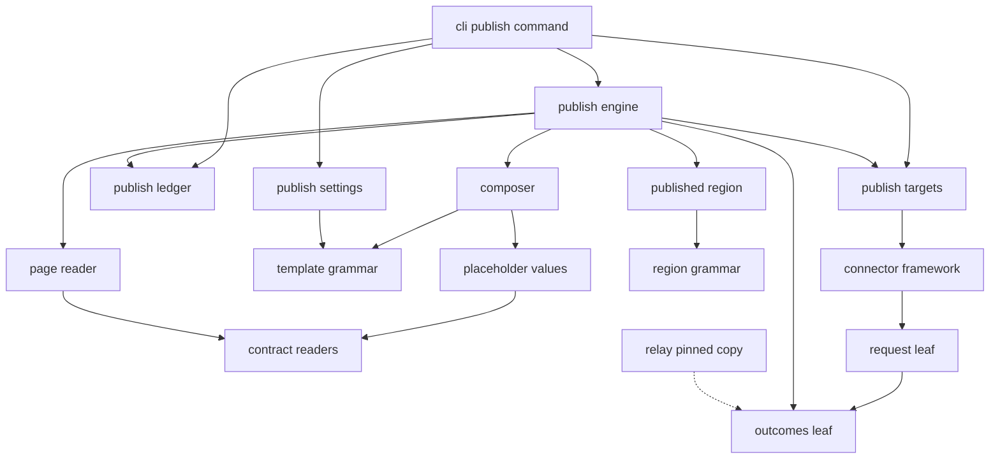
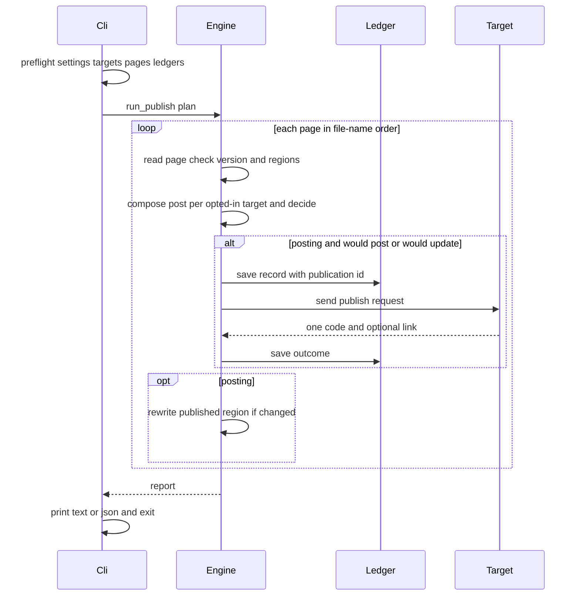
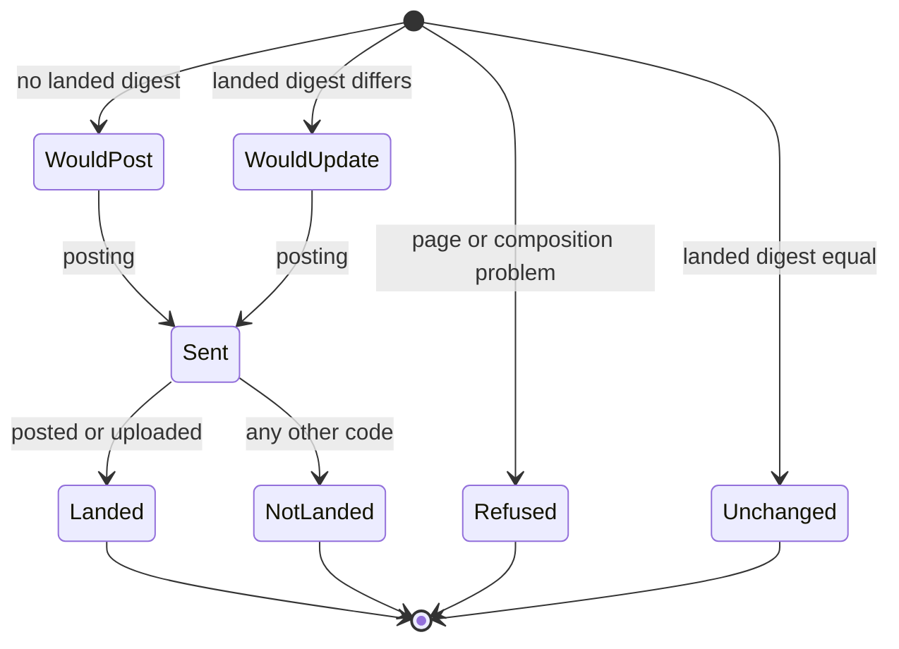

# Design Document: publish-core

## Overview

**Purpose**: publish-core gives fitdocs a target-neutral publishing core. A
workout page opts in per target; its post (a title and a description) is
composed offline from a template or from an athlete-owned `post` region;
`fitdocs publish` shows exactly what would be posted, and with `--yes` hands
each post to its target through one published contract; every outcome is a
code from a closed vocabulary; a ledger records what landed; and a
fitdocs-owned `published` region on the page links to the posted activity.

**Users**: the athlete who runs `fitdocs publish`; the authors of the
`intervals-publish`, `strava-publish` and `relay-intervals` targets, who
implement the contract; the relay, which carries a pinned copy of the
vocabulary; and agents working the athlete's wiki through the packaged
skill.

**Impact**: every workout page gains two regions (`DOC_VERSION` main + 1);
the ownership contract gains a user-owned region, a refreshed region, a
user-owned key, a tool-state location and a command (`CONTRACT_VERSION`
main + 1); the connector framework drives three reserved capabilities and
gains a single-attempt request mode. No concrete target ships here, so no
request reaches any service until a target spec lands.

### Goals
- One closed, append-only outcome vocabulary, importable with no dependency
  beyond the standard library (R1).
- Deterministic offline composition with no fabricated value.
- A dry run that equals what `--yes` does, and a `--yes` that never sends
  twice what landed once.
- A target contract that any target, direct or relay-backed, implements
  with one operation.

### Non-Goals
- Any concrete target, matching rule, upload path or service mapping.
- Planned-workout push, deleting posts, media, fields beyond title and
  description, a publish-target plugin kind, rule-based opt-in, scheduling.
- Rewriting the network statements (`tech.md`, `docs/connectors.md`, the
  README, connectors Req 14.1, distribution Req 10.4); see Revalidation
  Triggers.

## Boundary Commitments

### This Spec Owns
- `fitdocs.publish.outcomes`: the publish vocabulary (R1): `PublishCode`,
  its fixed explanations and flags.
- `fitdocs.publish.request`: the plain value types every target receives
  and returns (`Post`, `CompletedActivity`, `PublishRequest`,
  `PublishResult`).
- The publish target contract in the connector framework: `PostPublisher`,
  `PUBLISH_CAPABILITIES`, the driven flags of `PUSH_ACTIVITY`,
  `ANNOTATE_REMOTE_ACTIVITY` and `RESOLVE_REMOTE_ACTIVITY`, and their
  registration rules (R5).
- The single-attempt write mode: `HttpRequest.single_attempt` (R4).
- The template grammar, the placeholder set and formats, the built-in
  default, and the `[publish]` settings table.
- The `publish` frontmatter key, the `post` region and the `published`
  region, and their places in the page contract.
- The publish ledger: format, version 1, location
  `.fitdocs/publish/<target>.toml`, key `workout:<sha256>`.
- `fitdocs publish` (dry run, `--yes`, `--to`, PAGES, `--targets`,
  `--format`), its report shapes and exit codes.
- The packaged skill's publishing section, `docs/publishing.md`, the queue
  item recording the site's publishing copy, and the amendment records
  listed under Amendments.

### Out of Boundary
- How a target authenticates, finds its remote activity, decides to upload,
  sets fields, polls, or maps service answers to codes (target specs).
- Which link a target permits and its label text (target specs; e.g. "View
  on Strava" is `strava-publish`'s).
- `PUT` in `HttpRequest.method` (`intervals-publish`, R4); relay auth styles
  and relay envelope codes (`relay-server`, R3, R5); `OAUTH_BROWSER`
  (`strava-publish`).
- The relay's pinned copy of `outcomes.py` (R2, R9): `relay-server` ships
  the cross-check mechanism with its own pairs, and `strava-publish`, the
  first spec where both packages exist, appends the `outcomes.py` pair.
- Every page of the documentation site (`website/content/`, R9): this spec
  edits none and records the site's publishing copy in a queue item.
- Network statements in steering, docs, README and other specs' network
  criteria (the first target lander; see Revalidation Triggers).
- `PUSH_PLANNED_WORKOUT` stays reserved and undriven (R8).
- `fitdocs check` validating the `publish` key or the `post` region.

### Allowed Dependencies
- `fitdocs.publish.outcomes`: standard library only.
- `fitdocs.publish.request`: standard library and `outcomes`.
- `fitdocs.publish.template`: standard library only.
- `fitdocs.publish.values`: `contract`. `links`: `contract`, `docmerge`,
  `request`. `pages`: `contract`, `docio`, `docmerge`, `layout`, `request`.
- `fitdocs.publish.compose`: `template`, `values`, `outcomes`, `request`.
- `fitdocs.publish.settings`: `settings`, `template`, `values`.
- `fitdocs.publish.ledger`: `layout`, `docio`, `request`, `tomli_w`.
- `fitdocs.publish.targets`: `fitdocs.connectors` (its published surface,
  `connectors.settings.ConnectorInstance`, and `connectors.credentials`),
  `outcomes`, `request`, `links`. It is the only `fitdocs.publish` module
  that imports `fitdocs.connectors`.
- `fitdocs.publish.engine` and `report`: the modules above.
- `fitdocs.connectors.protocol` and `fitdocs.connectors.registry` may
  import `fitdocs.publish.request` (and so `outcomes`), and nothing else
  from `fitdocs.publish`.
- `fitdocs/publish/__init__.py` imports nothing, so importing a leaf loads
  no other fitdocs module.
- No `fitdocs.publish` module imports `render`, `load`, `metrics`,
  `ingest`, `sync`, `index`, `query`, `dashboards`, `identity`, `urllib`,
  `socket` or `http`, reads the system clock, or draws randomness; `now` and
  `mint_id` are injected by the CLI.
- No new runtime dependency (`tomli_w` is already required).

### Revalidation Triggers
- Any change to `PublishCode` members, order, values or flags: the relay's
  pinned copy, every target's mapping table, the skill and the docs
  re-check.
- Any change to `PublishRequest`, `PublishResult`, `CompletedActivity`,
  `Post` or `PostPublisher`: every target re-checks.
- Any change to `single_attempt` semantics: `intervals-publish`,
  `strava-publish` and `relay-server` re-check.
- Any change to the ledger key, record fields or version, or the
  `published` region's line format: the ownership contract and target link
  rules re-check.
- **Network statements.** The first spec whose target can make a publish
  request (expected `intervals-publish`; `relay-server` owns the `tech.md`
  "Network and Credentials" amendment per R7) rewrites the network
  statements to add `fitdocs publish --yes`, and adds `fitdocs publish`
  without `--yes` and `fitdocs publish --targets` to the no-request lists.
- A publish target whose connector uses the login auth style: this spec
  does not renew login tokens on the publish path; that target's spec adds
  the renewal.
- Planned-workout push (see Future Extension).

## Architecture

### Existing Architecture Analysis
- **Regions.** `docmerge.merge_regions` carries every region of the
  existing page into the fresh render and refuses a page holding a region
  the fresh render lacks (`docmerge.py`). So the `post` and `published`
  regions must be rendered on every workout page, not added by hand.
- **Refreshed regions.** The `morning` region (`contract.REFRESHED_REGIONS`)
  is the precedent: empty in a fresh render, carried by the merge, replaced
  by its own pass through a splice (`morning/docedit.py`). `published`
  follows it.
- **User-owned keys.** `contract.user_owned_lines` carries every
  `USER_KEYS` entry through `sync`, `regen` and the load pass; adding
  `publish` to `USER_KEYS` extends that carry with no caller change.
- **Connector framework.** `validate_connector` requires an operation for a
  driven capability; wellness-pull's Amendment 4 drove a reserved
  capability the same way. `HttpClient` DATA mode retries every method on
  429/5xx/transport failure (`http.py:297-317`); AUTH mode sends once.
- **CLI.** `dashboard` imports its package lazily and prints `text|json`;
  `pull` validates every input before any request.

### Architecture Pattern & Boundary Map

Pipeline of four stages (compose, decide, deliver, record) over a pure core,
with delivery behind a connector operation protocol.



**Architecture Integration**:
- Selected pattern: pure composition and decision in `fitdocs.publish`,
  delivery through a connector operation protocol (`PostPublisher`), state in
  a per-target TOML ledger (research.md, option A).
- Boundaries: `fitdocs.publish` reads pages, `fitdocs.connectors` never
  does; the only types crossing are the plain values in
  `fitdocs.publish.request`.
- Existing patterns preserved: contract readers for every frontmatter read;
  the region grammar; the refreshed-region splice; the connectors ledger's
  "absent is empty, atomic, sorted, write-if-different, refuse what cannot
  be read"; the CLI's preflight-before-write and exit codes.
- Steering compliance: absent data is `None`; no new runtime dependency;
  network code stays in `connectors/http.py`; no clock inside the package.

**Dependency direction** (each line imports only from lines above it):

```
outcomes                         (stdlib)
request, template                (stdlib; request -> outcomes)
values, links, pages             (contract, docio, docmerge, layout, request)
compose, settings, ledger        (template, values, request, outcomes, layout, docio, settings, tomli_w)
targets                          (connectors, request, outcomes, links)
engine                           (all of the above)
report                           (engine types, outcomes)
cli                              (lazy: engine, report, targets, settings, ledger, pages)
```

### Technology Stack

| Layer | Choice / Version | Role in Feature | Notes |
|-------|------------------|-----------------|-------|
| CLI | `typer` (existing) | `fitdocs publish` | no change to the dependency |
| Templates | standard library | own scanner | no template engine |
| Ledger | `tomllib`, `tomli_w` (existing) | per-target TOML | `tomli_w` already a runtime dependency |
| Transport | `connectors/http.py` (existing) | single-attempt marker | no new network module |

## File Structure Plan

### Directory Structure
```
src/fitdocs/publish/
├── __init__.py      # package marker: docstring only, imports nothing
├── outcomes.py      # R1 vocabulary: PublishCode, CodeInfo, OUTCOMES, code sets
├── request.py       # Post, CompletedActivity, PublishRequest, PublishResult, link/label rules
├── template.py      # template grammar: parse_template, render, TargetTemplates
├── values.py        # PLACEHOLDERS and page_values: managed values -> formatted text
├── compose.py       # post region grammar, composition, post_digest
├── settings.py      # [publish] table, built-in default, PublishSettings
├── ledger.py        # publish ledger: load, save, records, page keys
├── links.py         # published region content, link/label validation, splice
├── pages.py         # page selection, page state, subject building, sha index
├── targets.py       # publish targets: listing, preparation, guarded send
├── engine.py        # run_publish: compose, decide, deliver, record, links
└── report.py        # text and JSON renderers for runs and the listing

tests/publish/
├── __init__.py
├── conftest.py              # ScriptedPublisher connector fixture, page builders (task 6.1)
├── test_outcomes.py         # order prefix pin, flags, explanations, stdlib-only
├── test_request.py
├── test_template.py
├── test_values.py
├── test_compose.py
├── test_settings.py
├── test_ledger.py
├── test_links.py
├── test_pages.py
├── test_targets.py
├── test_engine.py
├── test_report.py
├── test_cli_publish.py
├── test_boundary.py         # import closure, forbidden names, no clock or randomness
├── test_isolation.py        # importing outcomes/request loads no other fitdocs module
└── test_docs.py             # docs/publishing.md code table and placeholder table pins

docs/publishing.md                       # contract-grade publishing reference
.kiro/queue/2026-10-31-publish-core-site-copy.md   # site copy for the next release (R9)
```

### Modified Files
- `src/fitdocs/contract.py` — `POST_REGION`, `PUBLISHED_REGION`,
  `POST_PLACEHOLDER`, `PUBLISHED_PLACEHOLDER`, `USER_REGIONS`,
  `REFRESHED_REGIONS`, `PUBLISH_KEY`, `USER_KEYS`, `USER_KEY_ORDER`,
  `document_publish_targets`, `InvalidPublishKey`, `document_summary`,
  `SummaryReading`, `DOC_VERSION`, `CONTRACT_VERSION` and their histories.
- `src/fitdocs/render/sections.py` — `post_region()`, `published_region()`.
- `src/fitdocs/render/views.py` — place both regions in all three views.
- `src/fitdocs/declaration.py` — workouts declaration names `post`,
  `publish` and the `published` region; user keys from `USER_KEY_ORDER`.
- `src/fitdocs/layout.py` — `PUBLISH_STATE_DIR`, `publish_ledger_path`.
- `src/fitdocs/connectors/protocol.py` — `PostPublisher`,
  `PUBLISH_CAPABILITIES`, driven flags, `DRIVEN_CAPABILITIES`.
- `src/fitdocs/connectors/registry.py` — publish capability validation.
- `src/fitdocs/connectors/http.py` — `HttpRequest.single_attempt`; `send`;
  `post(..., single_attempt=False)`.
- `src/fitdocs/connectors/__init__.py` — `__all__` appends `PostPublisher`,
  `PUBLISH_CAPABILITIES`, `Post`, `CompletedActivity`, `PublishRequest` and
  `PublishResult` (the value types re-exported through
  `connectors.protocol`, so the package module's own boundary entry is
  unchanged); docstring's allowed-import sentence.
- `src/fitdocs/cli.py` — `publish` command and its options.
- `src/fitdocs/skills/fitdocs-workouts/SKILL.md` — publishing section.
- `pyproject.toml` — `tests/publish` in `[tool.mypy].files` (so the
  scripted publisher is type-checked against `PostPublisher`), and a
  `[project.urls]` entry for `docs/publishing.md` (the skill links it).
- Tests whose pins move:
  - connectors: `tests/connectors/test_boundary.py`, `test_surface.py`
    (count pins at lines 127 and 158), `test_protocol.py`,
    `test_registry.py` (the non-driven example at 573-576 moves to
    `PUSH_PLANNED_WORKOUT`), `test_wellness_protocol.py` (the "other seven
    reserved" case at 176-195 becomes the four still reserved),
    `test_http.py`, `test_e2e.py`;
  - contract and rendering: `tests/test_contract.py`, `test_public_api.py`
    (`_CONTRACT_SURFACE`), `test_ownership_contract.py` (lines 130-138 and
    294), `test_declaration.py`, `test_docmerge.py`,
    `test_contract_consumers.py`, goldens under `tests/golden/` and
    `tests/declaration_golden/`;
  - current document-format literals: `tests/test_local_time_docs.py:46`
    (becomes the literal `(10, 11)`), `tests/metrics/test_sources.py:2270`,
    `tests/render/test_frontmatter.py:45`, `tests/morning/test_e2e.py:394,
    400, 454`;
  - command count (literal main + 1 at landing, R9): `tests/test_cli_skill.py`
    (266, 268), `tests/query/test_cli_query.py:811`,
    `tests/index/test_cli_index.py:609`, and the count word in `cli.py`'s
    docstring;
  - `tests/test_confinement.py` (`WRITING_ENTRY_POINTS` gains a posting
    run), `tests/test_docs_guarantees.py` (`_REQUIRED_ENTRY_POINT_LINKS`
    gains `publishing.md`), `tests/test_agent_skill.py`.
- `docs/ownership-contract.md`, `docs/configuration.md`, `docs/index.md`,
  `CHANGELOG.md`.
- `.kiro/steering/structure.md` — `fitdocs.publish` entry, and the
  connectors sentence (its imports, and who imports it).
- Amendment records in `.kiro/specs/{wiki-contract,workout-docs,connectors,
  effort-tags,distribution}/requirements.md`.

## System Flows

### One `fitdocs publish` run



Key decisions:
- Preflight completes before the engine runs, so a configuration error
  sends nothing and writes nothing (exit 2).
- A target is prepared lazily on its first pair; a preparation failure or a
  stopping code applies to every remaining pair of that target only.
- The ledger is saved before each request (the publication id) and after
  each outcome, so an interruption loses no received outcome.

### Decision for one page and target



## Requirements Traceability

| Requirement | Summary | Components | Interfaces | Flows |
|-------------|---------|------------|------------|-------|
| 1.1, 1.2, 1.3, 1.4, 1.5 | closed vocabulary | Outcomes | `PublishCode`, `OUTCOMES`, code sets | — |
| 1.6 | codes only | Targets, Engine, Report | `TargetChannel.send`, `ResultRow` | run |
| 1.7 | documented codes | PublishingDocs | `docs/publishing.md` table | — |
| 2.1, 2.2, 2.3, 2.8 | `publish` key | ContractChanges | `PUBLISH_KEY`, `USER_KEYS`, `document_publish_targets` | — |
| 2.4, 2.5, 2.6, 2.7 | per-target opt-in | Engine | `run_publish` | run |
| 3.1 | `post` region rendered | ContractChanges, RenderChanges | `POST_REGION`, `post_region()` | — |
| 3.2, 3.3, 3.4, 3.5, 3.6, 3.7 | post region grammar | Composer | `read_post_region`, `override_templates` | — |
| 3.8 | never changed | Engine, Links | `replace_published` touches one region | — |
| 4.1, 4.2, 4.3, 4.6, 4.8 | templates and settings | PublishSettings | `load_publish_settings`, `DEFAULT_*` | — |
| 4.4, 4.5 | grammar | TemplateGrammar | `parse_template`, `render` | — |
| 4.7 | region template error | Composer | `override_templates` | — |
| 5.1, 5.2, 5.3, 5.4, 5.5 | placeholder values | PlaceholderValues, ContractChanges | `PLACEHOLDERS`, `page_values`, `document_summary` | — |
| 5.6, 5.7 | absent values | TemplateGrammar, Composer | `MissingValue`, `compose_post` | — |
| 6.1, 6.2, 6.3, 6.4, 6.5 | composition | Composer | `compose_post`, `post_digest` | — |
| 6.6 | activity facts | PageReader | `completed_activity` | — |
| 7.1, 7.3, 7.4 | command and preflight | CliPublish, PageReader | `select_pages` | run |
| 7.2, 7.5, 7.6, 7.7, 7.8 | dry run | Engine | `run_publish`, `decide` | run, decision |
| 7.9, 7.10, 7.11 | report and exit | Report, CliPublish | `render_text`, `render_json` | — |
| 8.1, 8.2, 8.3, 8.4 | posting | Engine | `run_publish` | run |
| 8.5, 8.6, 8.7 | failure isolation | Engine, Targets | `prepare_target`, `TargetChannel.send` | run |
| 8.8, 8.9 | interruption | Engine, PublishLedger, CliPublish | `save_ledger` | run |
| 8.10 | posting report | Report | `render_text` | — |
| 9.1, 9.2, 9.9 | publish capabilities | ConnectorChanges | `PostPublisher`, `PUBLISH_CAPABILITIES`, `validate_connector` | — |
| 9.3, 9.4, 9.7 | request and result | RequestTypes, Targets | `PublishRequest`, `PublishResult` | — |
| 9.5, 9.6 | target steps | ConnectorChanges, PublishingDocs | `PostPublisher` docstring, docs | — |
| 9.8 | surface | ConnectorChanges | `connectors.__all__` | — |
| 10.1, 10.2 | single attempt | ConnectorChanges | `HttpRequest.single_attempt` | — |
| 10.3, 10.4 | publication id | Engine, PublishLedger | `mint_id`, `PublicationRecord.publication_id` | run |
| 10.5, 10.6 | unknown result | Outcomes, Engine, PublishingDocs | `UNCONFIRMED` | decision |
| 11.1, 11.2, 11.3, 11.4, 11.5, 11.6, 11.8 | ledger | PublishLedger | `load_ledgers`, `save_ledger` | — |
| 11.7 | ledger conflict | Engine, PageReader | `sha_index`, `PublishLedger.matching` | run |
| 12.1 | region rendered | ContractChanges, RenderChanges | `published_region()` | — |
| 12.2, 12.4, 12.5, 12.6, 12.7, 12.8 | region refresh | PublishedRegion, Engine | `published_content`, `replace_published` | run |
| 12.3 | link validation | PublishedRegion, Targets | `valid_link`, `valid_label` | — |
| 13.1, 13.2, 13.3, 13.4 | contract and versions | ContractChanges, PublishingDocs | `CONTRACT_VERSION`, `DOC_VERSION`, declaration | — |
| 13.5, 13.6, 13.7 | migration and stability | RenderChanges, Engine | views | — |
| 14.1, 14.2, 14.3, 14.4, 14.5, 14.6 | target listing | Targets, Report, CliPublish | `list_targets`, `render_targets_*` | — |
| 15.1, 15.2, 15.3, 15.4, 15.5, 15.6 | skill | SkillSection | `SKILL.md` | — |
| 16.1, 16.2, 16.3, 16.4, 16.5, 16.6 | docs and records | PublishingDocs, Amendments | — | — |

## Components and Interfaces

| Component | Domain | Intent | Req Coverage | Key Dependencies | Contracts |
|-----------|--------|--------|--------------|------------------|-----------|
| Outcomes | shared leaf | the vocabulary | 1.1-1.5, 10.5 | stdlib (P0) | State |
| RequestTypes | shared leaf | request and result values | 9.3, 9.4 | Outcomes (P0) | Service |
| TemplateGrammar | composition | parse and render templates | 4.4, 4.5, 5.6, 5.7 | stdlib | Service |
| PlaceholderValues | composition | page values as text | 5.1-5.5 | contract (P0) | Service |
| Composer | composition | post region, posts, digest | 3.2-3.7, 4.7, 6.1-6.5 | TemplateGrammar, PlaceholderValues (P0) | Service |
| PublishSettings | configuration | `[publish]` and defaults | 4.1-4.3, 4.6, 4.8 | settings, TemplateGrammar (P0) | Service |
| PublishLedger | state | per-target ledger | 10.3, 10.4, 11.1-11.8 | layout, docio, tomli_w (P0) | State |
| PublishedRegion | state | links line and splice | 12.2-12.8 | contract, docmerge (P0) | Service |
| PageReader | input | selection, page state, subject | 6.6, 7.2, 7.3, 7.8, 11.7 | contract, docio, docmerge, layout (P0) | Service |
| Targets | delivery | listing, preparation, guarded send | 1.6, 8.6, 8.7, 12.3, 14.1, 14.2, 14.5 | connectors (P0) | Service |
| Engine | orchestration | one run | 2.4-2.7, 7.5-7.8, 8.1-8.9, 10.3-10.5, 11.7, 12.2 | all above (P0) | Batch |
| Report | output | text and JSON | 7.9, 7.10, 8.10, 14.1, 14.6 | Engine types | Service |
| CliPublish | CLI | command and preflight | 7.1-7.4, 7.10, 7.11, 8.9, 14.3, 14.4 | Engine, Report, Targets (P0) | Service |
| ContractChanges | page contract | regions, key, readers, versions | 2.1-2.3, 2.8, 3.1, 5.2, 12.1, 13.1-13.4 | — | State |
| RenderChanges | rendering | regions on every page | 3.1, 12.1, 13.5-13.7 | ContractChanges | — |
| ConnectorChanges | connectors | contract, capabilities, single attempt | 9.1, 9.2, 9.5-9.9, 10.1, 10.2 | RequestTypes | Service |
| SkillSection | packaging | publishing section | 15.1-15.6 | — | — |
| PublishingDocs | docs | reference, contract docs, site-copy queue item | 1.7, 9.6, 10.6, 13.3, 16.1-16.4 | — | — |
| Amendments | records | amendment records and steering | 16.5, 16.6 | — | — |

### Shared leaves

#### Outcomes (`src/fitdocs/publish/outcomes.py`)

| Field | Detail |
|-------|--------|
| Intent | The closed, append-only publish vocabulary (R1) |
| Requirements | 1.1, 1.2, 1.3, 1.4, 1.5, 10.5 |

**Responsibilities & Constraints**
- Imports only the standard library (`enum`, `dataclasses`, `types`,
  `typing`); a test parses its AST and fails on any other import, and a
  subprocess test imports it and asserts no other `fitdocs.*` module loaded
  besides `fitdocs` and `fitdocs.publish`.
- Members are appended only; `tests/publish/test_outcomes.py` pins the
  values below as a literal prefix, in order (the `DashboardCode` pattern).
- Explanations are fixed one-sentence strings; none interpolates anything.

**Contracts**: State [x]

```python
class PublishCode(StrEnum): ...          # members below, in this order

@dataclass(frozen=True)
class CodeInfo:
    code: PublishCode
    explanation: str
    landed: bool          # the target confirmed the post is on its activity
    failure: bool         # counts toward exit status 1
    from_target: bool     # a target may return it
    stops_target: bool    # nothing more is sent to that target this run
    target_state: bool    # the target listing may show it

OUTCOMES: Final[Mapping[PublishCode, CodeInfo]]   # MappingProxyType, every member
LANDED_CODES: Final[frozenset[PublishCode]]
FAILURE_CODES: Final[frozenset[PublishCode]]
TARGET_CODES: Final[frozenset[PublishCode]]
STOPPING_CODES: Final[frozenset[PublishCode]]
STATE_CODES: Final[frozenset[PublishCode]]
def explanation(code: PublishCode) -> str: ...
```

The vocabulary (order is the pinned prefix; L landed, F failure, T a
target may return it, S stops the target, St a listing state):

| # | Member | Value | Flags | Explanation |
|---|--------|-------|-------|-------------|
| 1 | `WOULD_POST` | `would_post` | — | This page has no post on this target yet, and `fitdocs publish --yes` would post it. |
| 2 | `WOULD_UPDATE` | `would_update` | — | This page's post changed since it last landed on this target, and `fitdocs publish --yes` would update it. |
| 3 | `UNCHANGED` | `unchanged` | — | This target already carries this page's current post, so nothing is sent. |
| 4 | `NOT_OPTED_IN` | `not_opted_in` | — | This page's publish key does not name this target, so nothing is sent. |
| 5 | `OPT_IN_INVALID` | `opt_in_invalid` | F | This page's publish key is neither a target name nor a list of distinct target names, so nothing is sent from it. |
| 6 | `UNKNOWN_TARGET` | `unknown_target` | F | This page's publish key names something that is not a configured publish target, so nothing is sent to it. |
| 7 | `PAGE_OUT_OF_DATE` | `page_out_of_date` | F | This page was written by an older fitdocs; run `fitdocs regen` before publishing it. |
| 8 | `PAGE_NEWER` | `page_newer` | F | This page was written by a newer fitdocs, so this installation does not publish it. |
| 9 | `PAGE_DAMAGED` | `page_damaged` | F | This page's region markers are damaged or missing; restore them by hand before publishing it. |
| 10 | `PAGE_UNREADABLE` | `page_unreadable` | F | This page could not be read as a workout page, so nothing is sent from it. |
| 11 | `POST_INVALID` | `post_invalid` | F | This page's post region is not a title line, a blank line and a description, so nothing is sent from it. |
| 12 | `TEMPLATE_INVALID` | `template_invalid` | F | This page's post region has a template error, so nothing is sent from it. |
| 13 | `VALUE_MISSING` | `value_missing` | F | A placeholder outside an optional clause has no value on this page, so nothing is sent. |
| 14 | `TITLE_EMPTY` | `title_empty` | F | The composed title is empty, so nothing is sent. |
| 15 | `ACTIVITY_FACTS_MISSING` | `activity_facts_missing` | F T | The facts that identify this page's activity are missing, so nothing is sent. |
| 16 | `LEDGER_CONFLICT` | `ledger_conflict` | F | The publish ledger holds more than one record for this page, or one record matches several pages, so nothing is sent. |
| 17 | `POSTED` | `posted` | L T | The target's activity now carries this page's title and description. |
| 18 | `UPLOADED` | `uploaded` | L T | No matching activity existed, so the target created one from this page's activity file with its title and description. |
| 19 | `NOT_FOUND` | `not_found` | F T | The target has no activity matching this page and uploading is not enabled for it, so nothing was changed. |
| 20 | `AMBIGUOUS` | `ambiguous` | F T | More than one activity on the target matches this page, so nothing was changed. |
| 21 | `NOT_UPDATABLE` | `not_updatable` | F T | The matching activity cannot be changed through this target, so nothing was changed. |
| 22 | `ACTIVITY_FILE_MISSING` | `activity_file_missing` | F T | Uploading needs this page's activity file, which is not in the archive, so nothing was changed. |
| 23 | `NOT_CONNECTED` | `not_connected` | F T S St | This target has no usable credentials; run `fitdocs connect` for it. |
| 24 | `CREDENTIALS_UNREADABLE` | `credentials_unreadable` | F S St | This target's stored credentials could not be read or are not private to you; fix the file or connect it again. |
| 25 | `AUTH_REJECTED` | `auth_rejected` | F T S | The target refused the stored credentials; connect it again. |
| 26 | `PERMISSION_DENIED` | `permission_denied` | F T S | The credentials do not allow this change; connect again and grant the permission it needs. |
| 27 | `RATE_LIMITED` | `rate_limited` | F T S | The target's rate limit was reached, so nothing more is sent to it in this run; try again later. |
| 28 | `UNAVAILABLE` | `unavailable` | F T S | The target could not be reached or failed on its side, so nothing more is sent to it in this run; try again later. |
| 29 | `REJECTED` | `rejected` | F T | The target refused the request as invalid, so nothing was changed. |
| 30 | `UNCONFIRMED` | `unconfirmed` | F T | The request was sent but its result is unknown; the next run checks the target before sending again. |
| 31 | `TARGET_ERROR` | `target_error` | F | The target failed unexpectedly, which is a fitdocs defect, and nothing more was sent for this page. |
| 32 | `NOT_ATTEMPTED` | `not_attempted` | F | Nothing was sent, because an earlier result in this run stopped publishing to this target. |
| 33 | `PUBLISHED_NOT_WRITTEN` | `published_not_written` | F | The outcomes were recorded, but this page's published region could not be rewritten; the next `fitdocs publish --yes` rewrites it. |
| 34 | `READY` | `ready` | St | This target is configured and has the credentials it needs. |

**Implementation Notes**
- Validation: tests pin the prefix, the flag sets as literal frozensets,
  that every explanation is one sentence ending in `.` with no `{`, and that
  `TARGET_CODES` excludes every code a target must not return (1-14, 16,
  24, 31-34).
- Risks: an edit to an existing member breaks the relay's pinned copy;
  the drift check relay-server ships, with the pair strava-publish appends,
  catches it (R2, R9).

#### RequestTypes (`src/fitdocs/publish/request.py`)

| Field | Detail |
|-------|--------|
| Intent | Plain values crossing into and out of a target |
| Requirements | 9.3, 9.4, 9.7, 12.3 |

**Contracts**: Service [x]

```python
@dataclass(frozen=True)
class Post:
    title: str            # one line, non-empty
    description: str      # newline-separated, may be empty

@dataclass(frozen=True)
class CompletedActivity:
    """The completed activity a workout page records."""
    sport: str                       # the page's recorded sport, verbatim ("Run")
    start: datetime                  # aware, at the offset the device recorded
    elapsed_s: float | None          # base file's session elapsed time, else None
    distance_m: float | None         # base file's session distance, else None
    source_shas: tuple[str, ...]     # archived files' sha256, ascending rank, base last
    base_fit: Path | None            # fit-archive/<base sha>.fit when it is a file

@dataclass(frozen=True)
class PublishRequest:
    publication_id: str              # 32 lowercase hex characters
    post: Post
    subject: CompletedActivity       # the only subject kind in this version
    recorded_link: str | None        # the link recorded for this page and target, if any

@dataclass(frozen=True)
class PublishResult:
    code: PublishCode
    link: str | None = None

MAX_LINK_LENGTH: Final[int] = 2048
MAX_LABEL_LENGTH: Final[int] = 64
def valid_link(link: object) -> bool: ...
def valid_label(label: object) -> bool: ...
```
- `valid_link`: a `str` starting `https://` with a hostname, at most 2048
  characters, and no whitespace, control character, or any of
  ``<>()[]"`\``. `valid_label`: a non-empty `str` of at most 64 characters
  with no control character, `[` or `]`. Defined once here so the registry,
  the ledger, the guarded send and the region share one rule.
- Invariants: no field carries page text, frontmatter, a page path or a
  credential. `subject` is a field, not a flattening of the activity's
  values, so a later subject kind is an addition (Future Extension).

### Composition

#### TemplateGrammar (`src/fitdocs/publish/template.py`)

| Field | Detail |
|-------|--------|
| Intent | Parse and render the template language |
| Requirements | 4.4, 4.5, 5.6, 5.7 |

**Grammar** (scanned left to right):
- `{{` is a literal `{`; `}}` is a literal `}`.
- `{name}` is a placeholder; `name` matches `[a-z][a-z0-9_]*` and must be in
  the known set.
- `{?` opens an optional clause; inside it, text, escapes and placeholders;
  a `}` not part of an escape or a placeholder closes it. A clause holds at
  least one placeholder and never another clause.
- Any other `{` or `}` (a lone brace, `{ name}`, an unterminated
  placeholder or clause) is a syntax error.

**Contracts**: Service [x]

```python
@dataclass(frozen=True)
class Text: value: str
@dataclass(frozen=True)
class Placeholder: name: str
@dataclass(frozen=True)
class Clause: parts: tuple[Text | Placeholder, ...]
@dataclass(frozen=True)
class Template:
    source: str
    parts: tuple[Text | Placeholder | Clause, ...]

class TemplateSyntaxError(ValueError):
    line: int        # 1-based
    column: int      # 1-based
    reason: str      # fitdocs-written, e.g. "unknown placeholder {pace}"

@dataclass(frozen=True)
class TargetTemplates:
    title: Template
    description: Template

@dataclass(frozen=True)
class MissingValue: name: str

def parse_template(text: str, *, names: Collection[str]) -> Template: ...   # raises TemplateSyntaxError
def render(template: Template, values: Mapping[str, str | None]) -> str | MissingValue: ...
```
- `render` returns the first bare placeholder, left to right, whose value is
  `None` as `MissingValue`; a clause with any `None` placeholder renders `""`.
  Values are inserted literally and never re-parsed.

#### PlaceholderValues (`src/fitdocs/publish/values.py`)

| Field | Detail |
|-------|--------|
| Intent | A page's managed values as fixed-format text, or `None` |
| Requirements | 5.1, 5.2, 5.3, 5.4, 5.5 |

```python
PLACEHOLDERS: Final[tuple[str, ...]]   # the names below, in this order
KM_PER_MILE: Final[float] = 1.609344
def page_values(frontmatter: Mapping[str, object]) -> Mapping[str, str | None]: ...
def format_duration(seconds: float) -> str: ...   # h:mm:ss at >= 3600 s, else m:ss
```

| Name | Source (contract reader) | Format | No value when |
|------|--------------------------|--------|---------------|
| `title` | `document_summary().title` | verbatim | missing, empty, or holds a control character |
| `sport` | `document_sport` | verbatim (`Run`) | missing or holds a control character |
| `date` | `document_date` | `YYYY-MM-DD` | missing or malformed |
| `start_time` | `document_start_time` | `HH:MM` at its own offset | missing or naive |
| `distance_km` | `document_summary().distance_km` | two decimals | missing or malformed |
| `distance_mi` | `distance_km / 1.609344` | two decimals | `distance_km` has none |
| `moving_time` | `document_summary().moving_time_s` | duration | missing or malformed |
| `elapsed_time` | `document_source_identity().elapsed_s` | duration | missing |
| `pace_per_km` | `moving_time_s / distance_km` | `m:ss` | modality is not `run`, or either input is missing or zero |
| `pace_per_mi` | `moving_time_s / distance_mi` | `m:ss` | as `pace_per_km` |
| `speed_kmh` | `distance_km / (moving_time_s / 3600)` | one decimal | modality is not `bike`, or either input is missing or zero |
| `avg_hr_bpm` | `document_summary().avg_hr_bpm` | integer | missing |
| `avg_power_w` | `document_summary().avg_power_w` | integer | missing |
| `elevation_gain_m` | `document_summary().elevation_gain_m` | whole metres (`.0f`) | missing |
| `calories_kcal` | `document_summary().calories_kcal` | integer | missing |
| `load_value` | `document_load().value` | whole number (`.0f`) | no usable load |
| `load_methodology` | `document_load().methodology` | verbatim | no usable load |

- A recorded `0` renders `0` (5.5). A derived value is computed only from
  positive inputs (5.4). `format_duration` matches
  `render.format.fmt_duration`, held equal by a table test without
  `values.py` importing the render layer.
- Reads frontmatter only through contract readers; joins
  `tests/test_contract_consumers.py`'s `CONVERTED_MODULES`.

#### Composer (`src/fitdocs/publish/compose.py`)

| Field | Detail |
|-------|--------|
| Intent | The `post` region grammar, composition and the post digest |
| Requirements | 3.2, 3.3, 3.4, 3.5, 3.6, 3.7, 4.7, 6.1, 6.2, 6.3, 6.4, 6.5 |

**`post` region grammar**: normalize `\r\n` and `\r` to `\n`; remove every
`<!--`…`-->` span (an unclosed `<!--` is `post_invalid`); drop leading and
trailing blank lines. Nothing left: no override. Otherwise the first line,
stripped, is the title text; a second line, if any, must be blank
(`post_invalid` otherwise); lines from the third on are the description
text.

**Contracts**: Service [x]

```python
@dataclass(frozen=True)
class PostOverride:
    title: str          # template text
    description: str    # template text

@dataclass(frozen=True)
class Refusal:
    code: PublishCode   # POST_INVALID, TEMPLATE_INVALID, VALUE_MISSING or TITLE_EMPTY
    detail: str | None  # fitdocs-written: placeholder name, or "title, line 1, column 7: ..."

def read_post_region(content: str) -> PostOverride | Refusal | None: ...
def override_templates(override: PostOverride) -> TargetTemplates | Refusal: ...
def compose_post(templates: TargetTemplates, values: Mapping[str, str | None]) -> Post | Refusal: ...
def post_digest(post: Post) -> str: ...
```
- `compose_post` renders title then description; normalizes the title
  (stripped; a value holding a control character never reaches it) and the
  description (`\r` normalized, leading blank lines and trailing whitespace
  removed); an empty title is `TITLE_EMPTY`.
- `post_digest` is the lowercase hex SHA-256 of
  `json.dumps([title, description], ensure_ascii=False, separators=(",", ":"))`
  in UTF-8: unambiguous, and changed by exactly a title or description
  change (6.4).
- Pure: no I/O, no clock.

#### PublishSettings (`src/fitdocs/publish/settings.py`)

| Field | Detail |
|-------|--------|
| Intent | The `[publish]` table and the built-in default |
| Requirements | 4.1, 4.2, 4.3, 4.6, 4.8 |

```toml
[publish]                         # optional
title = "{title}"                 # optional: every target
description = "..."               # optional: every target

[publish.targets.<name>]          # optional: one configured publish target
title = "..."
description = "..."
```

```python
PUBLISH_TABLE: Final[str] = "publish"
DEFAULT_TITLE: Final[str] = "{title}"
DEFAULT_DESCRIPTION: Final[str]   # see below

@dataclass(frozen=True)
class PublishSettings:
    per_target: Mapping[str, TargetTemplates]   # every configured publish target
    def for_target(self, name: str) -> TargetTemplates: ...

class PublishSettingsError(SettingsError): ...

def load_publish_settings(
    document: Mapping[str, object], *, settings_file: Path, targets: Collection[str]
) -> PublishSettings: ...
```

`DEFAULT_DESCRIPTION` is the concatenation of these optional clauses, each
ending in a newline inside the clause:

```
{?Distance: {distance_km} km\n}{?Time: {moving_time}\n}{?Pace: {pace_per_km} /km\n}
{?Speed: {speed_kmh} km/h\n}{?Average heart rate: {avg_hr_bpm} bpm\n}
{?Average power: {avg_power_w} W\n}{?Elevation gain: {elevation_gain_m} m\n}
```

- Field resolution per target: `[publish.targets.<name>]`, then
  `[publish]`, then the built-in default, field by field.
- Errors (all `PublishSettingsError`, exit 2, message naming the file,
  `[publish]` or `[publish.targets.<name>]`, the key, and for a template the
  position and reason): a non-table `[publish]` or `[publish.targets]` or
  target entry; an unknown key; a non-string value; a title template with a
  newline; a template syntax error or unknown placeholder; a
  `[publish.targets]` name that is not a configured publish target.
- The built-in default is parsed at import against `PLACEHOLDERS`; a test
  composes it over a page with no optional values and gets the title and an
  empty description (4.1).

### State

#### PublishLedger (`src/fitdocs/publish/ledger.py`)

| Field | Detail |
|-------|--------|
| Intent | The per-target record of publications |
| Requirements | 10.3, 10.4, 11.1, 11.2, 11.3, 11.4, 11.5, 11.6, 11.8 |

**Contracts**: State [x]

```python
PUBLISH_LEDGER_VERSION: Final[int] = 1
WORKOUT_PAGE_KIND: Final[str] = "workout"

def workout_page_key(sha256: str) -> str: ...          # "workout:<sha256>"

@dataclass(frozen=True)
class PublicationRecord:
    page: str                    # page key
    publication_id: str
    digest: str | None = None    # last landed post's digest
    code: str | None = None      # last outcome code value
    at: datetime | None = None   # when that outcome was received (UTC)
    link: str | None = None
    label: str | None = None

@dataclass(frozen=True)
class PublishLedger:
    target: str
    connector: str
    records: tuple[PublicationRecord, ...]
    def matching(self, shas: Collection[str]) -> tuple[PublicationRecord, ...]: ...
    def with_record(self, record: PublicationRecord) -> PublishLedger: ...

class PublishLedgerError(Exception): ...   # names the file

def load_ledgers(data_root: Path, configured: Mapping[str, str]) -> dict[str, PublishLedger]: ...
def save_ledger(data_root: Path, ledger: PublishLedger) -> bool: ...
```

- **Location**: `layout.publish_ledger_path(data_root, target)` =
  `<data_root>/.fitdocs/publish/<target>.toml`, under the already-owned
  `.fitdocs/`.
- **Load** (`configured` maps each configured publish target to its
  connector id): reads every regular `*.toml` file directly in
  `.fitdocs/publish/` (stem must be a valid target name) plus an empty
  ledger for each configured target without a file; reading creates
  nothing. A configured target's file must name the same `connector`. Any
  unreadable file, invalid TOML, wrong shape, newer `ledger_version`,
  connector mismatch or violated invariant raises `PublishLedgerError`
  (exit 2); nothing is rebuilt or overwritten.
- **Invariants** (checked on load and on save): `page` matches
  `workout:[0-9a-f]{64}` and is unique; `publication_id` matches
  `[0-9a-f]{32}` and is unique; `digest` matches `[0-9a-f]{64}`; `code`
  matches `[a-z][a-z0-9_]*` (kept as text, so a code a newer fitdocs
  appended reads); `code` and `at` (timezone-aware) appear together; `link`
  and `label` appear together, and pass `valid_link`/`valid_label`.
- **Save**: records sorted by `page`, `None` fields omitted, directory
  created on demand, written through `docio.write_bytes_if_changed`
  (atomic, write-if-different); returns whether it wrote.
- **Matching**: a record matches a page when its `page` key's digest is
  one of the page's source digests.

#### PublishedRegion (`src/fitdocs/publish/links.py`)

| Field | Detail |
|-------|--------|
| Intent | Render and splice the links line |
| Requirements | 12.2, 12.4, 12.5, 12.7, 12.8 |

```python
PUBLISHED_PREFIX: Final[str] = "Published: "
LINK_SEPARATOR: Final[str] = " · "

def published_content(links: Sequence[tuple[str, str, str]]) -> str: ...   # (target, label, link)
def read_published(markdown: str) -> str | None: ...                        # raises RegionError
def replace_published(markdown: str, content: str) -> str: ...              # raises RegionError, PublishedRegionMissing
```
- Content: `""` with no link; otherwise `Published: [label](link) · ...`
  ordered by target name.
- Links and labels are checked with `request.valid_link` and
  `request.valid_label` before they reach this module.
- The splice replaces only the `published` region's inner content (the
  `morning/docedit.py` pattern) and leaves every other byte unchanged.

#### PageReader (`src/fitdocs/publish/pages.py`)

| Field | Detail |
|-------|--------|
| Intent | Page selection, page state and the publish subject |
| Requirements | 6.6, 7.2, 7.3, 7.8, 11.7 |

```python
@dataclass(frozen=True)
class SelectedPage:
    path: Path
    rel: str            # data-root-relative POSIX path
    named: bool         # named in PAGES

class PageSelectionError(Exception): ...

class PageStatus(StrEnum):
    CURRENT = "current"; OLDER = "older"; NEWER = "newer"; DAMAGED = "damaged"

@dataclass(frozen=True)
class PageView:
    text: str
    frontmatter: Mapping[str, object]
    status: PageStatus
    regions: Mapping[str, str] | None    # None unless CURRENT
    detail: str | None                   # fitdocs-written reason for DAMAGED

def select_pages(data_root: Path, names: Sequence[str], *, cwd: Path) -> tuple[SelectedPage, ...]: ...
def read_page(page: SelectedPage) -> PageView | None: ...            # None: unreadable or not a workout page
def source_shas(frontmatter: Mapping[str, object]) -> tuple[str, ...]: ...
def completed_activity(frontmatter: Mapping[str, object], data_root: Path) -> CompletedActivity | None: ...
def sha_index(data_root: Path) -> Mapping[str, tuple[str, ...]]: ...   # sha -> page rels, every workout page
```
- Selection: no names means every `workouts/*.md` (top level, not a
  symlink) whose frontmatter is a workout document, sorted by file name. A
  name without a path separator is `workouts/<name>` or
  `workouts/<name>.md`; a name with one is a path from `cwd` that must be a
  file directly in `<data_root>/workouts/`. A name that resolves to nothing,
  to a symlink, to a file elsewhere, or to a non-workout page raises
  `PageSelectionError` (exit 2). Duplicates collapse; order is by file name.
- State: `doc_version` absent or lower is `OLDER`; higher is `NEWER`;
  `extract_regions` raising, or a current page missing the `post` or
  `published` region, is `DAMAGED` with the `RegionError` message.
- Subject: `None` unless `document_sport` and an aware
  `document_start_time` exist (6.6). `elapsed_s`/`distance_m` come from
  `document_source_identity`; `source_shas` from `source_refs` and
  `sha_of_ref`, lowercased; `base_fit` is `layout.archive_path` of the last
  digest when it is a regular file.

### Delivery

#### Targets (`src/fitdocs/publish/targets.py`)

| Field | Detail |
|-------|--------|
| Intent | Which instances are publish targets, their state, and a guarded send |
| Requirements | 1.6, 8.6, 8.7, 12.3, 14.1, 14.2, 14.5 |

**Contracts**: Service [x]

```python
def is_publish_target(instance: ConnectorInstance) -> bool: ...
# ANNOTATE_REMOTE_ACTIVITY in instance.connector.capabilities

@dataclass(frozen=True)
class TargetRow:
    name: str
    connector: str
    display_name: str
    capabilities: tuple[str, ...]     # declared publish capabilities, vocabulary order
    state: PublishCode                # READY, NOT_CONNECTED or CREDENTIALS_UNREADABLE

def list_targets(instances: Sequence[ConnectorInstance], *, store: CredentialStore | None,
                 environ: Mapping[str, str]) -> tuple[TargetRow, ...]: ...

@dataclass(frozen=True)
class Delivery:
    code: PublishCode
    link: str | None
    link_refused: bool

class TargetChannel:
    name: str
    label: str
    def send(self, request: PublishRequest) -> Delivery: ...   # never raises Exception

def prepare_target(instance: ConnectorInstance, *, data_root: Path,
                   store: CredentialStore | None, environ: Mapping[str, str],
                   transport: Transport, now: Callable[[], datetime],
                   sleep: Callable[[float], None]) -> TargetChannel | PublishCode: ...
```
- `prepare_target` resolves credentials with
  `connectors.credentials.resolve_credentials` with a fresh `Redactor`;
  `NotConnectedError` gives
  `NOT_CONNECTED`, `CredentialStoreError` gives `CREDENTIALS_UNREADABLE`,
  and no request is made. It builds a `CallMode.DATA` `HttpClient` and a
  `ConnectorSession` exactly as `pull` builds its data session. No token
  renewal (see Revalidation Triggers).
- `send` calls `publisher.publish(session, request)`. Any `Exception`, a
  non-`PublishResult` answer or a code outside `TARGET_CODES` becomes
  `TARGET_ERROR`; no exception text is kept. A link is kept only with a code
  in `LANDED_CODES` and only when `valid_link` passes; otherwise it is
  dropped, with `link_refused=True` when one was offered. `KeyboardInterrupt`
  propagates.
- `list_targets` resolves credentials the same way and never reads or shows
  a value.

### Orchestration

#### Engine (`src/fitdocs/publish/engine.py`)

| Field | Detail |
|-------|--------|
| Intent | One publish run over the selected pages and targets |
| Requirements | 2.4, 2.5, 2.6, 2.7, 3.8, 7.2, 7.5, 7.6, 7.7, 7.8, 8.1, 8.2, 8.3, 8.4, 8.5, 8.6, 8.7, 8.8, 10.3, 10.4, 10.5, 11.7, 12.2, 12.6, 12.7, 12.8, 13.5 |

**Contracts**: Batch [x]

```python
@dataclass(frozen=True)
class PublishPlan:
    data_root: Path
    pages: tuple[SelectedPage, ...]
    considered: tuple[str, ...]        # selected target names, sorted
    configured: frozenset[str]         # every configured publish target
    settings: PublishSettings
    ledgers: Mapping[str, PublishLedger]  # every ledger; the engine updates a working copy
    posting: bool                      # --yes

@dataclass(frozen=True)
class ResultRow:
    page: str
    target: str | None                 # None for a page-level row
    code: PublishCode
    decision: PublishCode | None
    post: Post | None
    link: str | None
    link_refused: bool
    detail: str | None

@dataclass(frozen=True)
class PublishReport:
    posting: bool
    rows: tuple[ResultRow, ...]
    not_opted_in: int
    configured: int
    @property
    def failed(self) -> bool: ...      # any row code in FAILURE_CODES

OpenTarget = Callable[[str], TargetChannel | PublishCode]

def decide(record: PublicationRecord | None, digest: str) -> PublishCode: ...
def run_publish(plan: PublishPlan, *, open_target: OpenTarget,
                now: Callable[[], datetime], mint_id: Callable[[], str]) -> PublishReport: ...
```

Per page, in order:
1. `read_page`; `None` gives a `PAGE_UNREADABLE` page row when the page was
   named and is skipped otherwise.
2. `document_publish_targets`: `InvalidPublishKey` gives an
   `OPT_IN_INVALID` page row. Each name outside `configured` gives an
   `UNKNOWN_TARGET` row (target = that name) unless `--to` excludes it. The
   page's considered targets are its valid names in `considered`; none
   counts toward `not_opted_in`, or gives a `NOT_OPTED_IN` page row when the
   page was named.
3. For each considered target (name order): `OLDER`, `NEWER`, `DAMAGED`
   give `PAGE_OUT_OF_DATE`, `PAGE_NEWER`, `PAGE_DAMAGED`; a missing subject
   gives `ACTIVITY_FACTS_MISSING`; more than one matching record, or a
   record whose digest `sha_index` maps to several pages, gives
   `LEDGER_CONFLICT`; the `post` region and the target's templates give a
   `Post` or a `Refusal`; then `decide`.
4. Posting, for `WOULD_POST`/`WOULD_UPDATE`: a stopped target gives
   `NOT_ATTEMPTED`; the target is opened on first use (a code from
   `open_target` is that pair's code and stops the target); with no record
   one is created with `mint_id()` and saved; the request is sent; the
   record gets `code`, `at=now()`, `digest` when landed, and `link`/`label`
   when a link was kept; the ledger is saved; a code in `STOPPING_CODES`
   stops the target.
5. Posting, every `CURRENT` page considered: the `published` content is
   rebuilt from every ledger's matching record with a link, whatever the
   page's current opt-in (2.7); if it differs
   from the page's region, the page is re-read, spliced and written through
   `docio.write_bytes_if_changed`; `OSError` or `RegionError` gives a
   `PUBLISHED_NOT_WRITTEN` page row. `OLDER`/`NEWER` pages are never
   written (12.8).

- Determinism: identical inputs give identical rows and identical ledger
  and page bytes apart from `at`.
- Never writes the `post` region (3.8): the splice touches only
  `published`.

#### Report (`src/fitdocs/publish/report.py`)

| Field | Detail |
|-------|--------|
| Intent | Text and JSON output |
| Requirements | 7.9, 7.10, 8.10, 14.1, 14.6 |

```python
REPORT_FORMAT: Final[int] = 1
def render_text(report: PublishReport) -> str: ...
def render_json(report: PublishReport) -> str: ...
def render_targets_text(rows: Sequence[TargetRow]) -> str: ...
def render_targets_json(rows: Sequence[TargetRow]) -> str: ...
```

Text (dry run shown; a posting run prints `fitdocs publish: posting.`, and a
row's link as `  link: <url>`):
```
fitdocs publish: dry run; nothing is sent (add --yes to post).
workouts/2026-10-30-run-1.md -> example-target: would_post
  title: Run 2026-10-30 07:12
  description:
    Distance: 10.02 km
workouts/2026-10-29-ride.md -> example-target: unchanged
workouts/2026-10-28-run.md -> example-target: value_missing (avg_power_w)
1 would_post, 1 unchanged, 1 value_missing; 12 pages opted in to no selected target.

would_post: <explanation>
unchanged: <explanation>
value_missing: <explanation>
```

JSON (`render_json`), keys in this order:
```json
{"format": 1, "posting": false,
 "results": [{"page": "...", "target": "...", "code": "would_post",
              "decision": "would_post", "title": "...", "description": "...",
              "link": null, "link_refused": false, "detail": null}],
 "counts": {"would_post": 1}, "not_opted_in": 12,
 "explanations": {"would_post": "..."}}
```
`counts` and `explanations` list codes in vocabulary order. Targets JSON:
`{"format": 1, "targets": [{"name", "connector", "display_name",
"capabilities", "state", "explanation"}]}`.

#### CliPublish (`src/fitdocs/cli.py`)

| Field | Detail |
|-------|--------|
| Intent | The command, its preflight and exit codes |
| Requirements | 7.1, 7.3, 7.4, 7.10, 7.11, 8.9, 14.2, 14.3, 14.4 |

`fitdocs publish [PAGES...] [--to TARGET]... [--yes] [--targets]
[--format text|json] [--out PATH]`. Imports `fitdocs.publish` lazily. A test
pins that importing `fitdocs.cli` loads no `fitdocs.publish` module other than
the package marker, `outcomes` and `request`: `cli.py` imports
`fitdocs.connectors.protocol` at module load, and that module imports the
request leaf.

Preflight, in order, each failure exiting 2 before any request or write:
1. data root; 2. `--targets` combined with PAGES, `--to` or `--yes`;
3. settings document, inbox settings (validated, not created), connectors
table, publish targets (`is_publish_target`); 4. `[publish]`;
5. with `--targets`: credentials directory (when a target authenticates),
`list_targets`, print, exit 0; 6. `--to` names; 7. PAGES; 8. ledgers;
9. with `--yes` and a selected authenticating target: credentials directory
resolved and checked outside the data root. Then `run_publish` with
`now=lambda: datetime.now(UTC)`, `mint_id=lambda: secrets.token_hex(16)` and
`open_target` closing over `prepare_target(..., transport=_connector_transport())`.
No target configured and no page opted in: prints "No publish target is
configured." and exits 0 (7.11). `KeyboardInterrupt`: prints that the run
was interrupted and received outcomes are recorded, exits 130.

### Page contract and rendering

#### ContractChanges (`src/fitdocs/contract.py`)

| Field | Detail |
|-------|--------|
| Intent | Regions, key, readers and versions |
| Requirements | 2.1, 2.2, 2.3, 2.8, 3.1, 5.2, 12.1, 13.1, 13.2 |

```python
POST_REGION: Final[str] = "post"
PUBLISHED_REGION: Final[str] = "published"
USER_REGIONS = (NOTES_REGION, WORKOUT_REGION, POST_REGION)
PRESERVED_REGIONS = USER_REGIONS + TOOL_REGIONS          # ("notes", "workout", "post", "load")
REFRESHED_REGIONS = (MORNING_REGION, PUBLISHED_REGION)
POST_PLACEHOLDER: Final[str] = (
    "<!-- post: to give this page its own post, write the title on one line, "
    "then a blank line, then the description. Left empty, the template is used. -->"
)
PUBLISHED_PLACEHOLDER: Final[str] = ""
PUBLISH_KEY: Final[str] = "publish"
USER_KEY_ORDER: Final[tuple[str, ...]] = EFFORT_KEYS + (PUBLISH_KEY,)
USER_KEYS = frozenset(USER_KEY_ORDER)

@dataclass(frozen=True)
class InvalidPublishKey:
    detail: str

def document_publish_targets(frontmatter: Mapping[str, object] | None) -> tuple[str, ...] | InvalidPublishKey: ...

@dataclass(frozen=True)
class SummaryReading:
    title: str | None
    distance_km: float | None
    moving_time_s: float | None
    avg_hr_bpm: int | None
    avg_power_w: int | None
    elevation_gain_m: float | None
    calories_kcal: int | None

def document_summary(frontmatter: Mapping[str, object] | None) -> SummaryReading: ...
```
- `document_publish_targets`: absent key or empty list is `()`; a non-empty
  `str` is a one-name tuple; a list of non-empty distinct `str` is that
  tuple in order; anything else (a `bool`, number, mapping, nested list,
  empty or duplicate name) is `InvalidPublishKey`. Never raises.
- `document_summary`: numbers are genuine finite non-negative `int`/`float`
  (never `bool`); `moving_time` parses only `h:mm:ss` or `m:ss`; anything
  else is `None` for that field. Never raises.
- `DOC_VERSION` and `CONTRACT_VERSION`: one more than main at landing (12
  and 18 if this lands first), each with an appended history paragraph.

#### RenderChanges (`src/fitdocs/render/sections.py`, `views.py`)

| Field | Detail |
|-------|--------|
| Intent | Both regions on every workout page |
| Requirements | 3.1, 12.1, 13.5, 13.6, 13.7 |

- `post_region()` → `region_block(POST_REGION, POST_PLACEHOLDER)`;
  `published_region()` → `region_block(PUBLISHED_REGION, PUBLISHED_PLACEHOLDER)`.
- Placement in all three views: the `published` region directly after the
  head (H1 and attribution line), before the `notes` region; the `post`
  region directly before the `morning` region. `PRESERVED_REGIONS` stays in
  document order.
- No heading for either region; both render as nothing while empty.

### Connector framework

#### ConnectorChanges (`connectors/protocol.py`, `registry.py`, `http.py`, `__init__.py`)

| Field | Detail |
|-------|--------|
| Intent | Drive the publish capabilities; single-attempt requests |
| Requirements | 9.1, 9.2, 9.5, 9.6, 9.7, 9.8, 9.9, 10.1, 10.2 |

```python
# protocol.py
PUBLISH_CAPABILITIES: Final[frozenset[Capability]] = frozenset(
    {Capability.PUSH_ACTIVITY, Capability.ANNOTATE_REMOTE_ACTIVITY,
     Capability.RESOLVE_REMOTE_ACTIVITY})
DRIVEN_CAPABILITIES = {PULL_ACTIVITIES, PULL_WELLNESS} | PUBLISH_CAPABILITIES

class PostPublisher(Protocol):
    """Required when any publish capability is declared."""
    @property
    def link_label(self) -> str: ...
    def publish(self, session: ConnectorSession, request: PublishRequest) -> PublishResult: ...

# http.py
@dataclass(frozen=True)
class HttpRequest:
    ...
    single_attempt: bool = False

class HttpClient:
    def post(self, url: str, *, body: bytes, headers=..., secret_headers=...,
             single_attempt: bool = False) -> HttpResponse: ...
```
- Capabilities: `driven=True` for the three; `changes_remote` and
  `irreversible` unchanged; `PUSH_PLANNED_WORKOUT`,
  `PULL_PLANNED_WORKOUTS`, `PULL_PLANS`, `PULL_THRESHOLDS` stay reserved.
- Registration (after the wellness checks): resolve or push declared
  without annotate is rejected ("resolve-remote-activity and push-activity
  require annotate-remote-activity"); with any publish capability,
  `publish` must be callable and `link_label` must pass
  `fitdocs.publish.request.valid_label`.
- `HttpClient.send`: a `single_attempt` request calls the transport exactly
  once in either mode; a `TransportError` propagates and any status is
  returned. Unmarked requests behave exactly as before.
- The `PostPublisher` docstring states the target obligations: one code from
  `TARGET_CODES` per request; a link only with a landed code; never print,
  log or return service text; resolve before creating, with the publication
  id as the idempotency key; `AMBIGUOUS` for several matches and
  `ACTIVITY_FACTS_MISSING` when the facts given cannot identify the
  activity, never a pick or an upload; a non-idempotent request marked
  `single_attempt`.
- `__all__` appends `PostPublisher`, `PUBLISH_CAPABILITIES` and the four
  value types `Post`, `CompletedActivity`, `PublishRequest` and
  `PublishResult`. `connectors.protocol` imports the value types from
  `fitdocs.publish.request` and the package module imports them from
  `connectors.protocol`, as the wellness value types are exported, so only
  the protocol and registry boundary entries admit the request leaf
  (surface count + 6; peers append their own names, so the literal count
  moves at landing). The single-attempt mode is
  published as a field of the already-published `HttpRequest` (9.8).

### Packaging and documentation

#### SkillSection (`src/fitdocs/skills/fitdocs-workouts/SKILL.md`)
- A `## Publishing posts` section between `## Reading the report` and
  `## Ownership boundary`, and one "When this applies" bullet (the athlete
  asks to preview or publish a workout's post). It states (15.1-15.5): fitdocs
  can publish workout posts to several publish targets the athlete
  configured; `fitdocs publish --targets` lists them; the `publish` key and
  the `post` region's syntax with placeholders and `{?...}`; `fitdocs
  publish` is a dry run that changes nothing; `--yes` posts irreversibly and
  runs only when the athlete asked; every printed code comes with its
  explanation, failure codes are told to the athlete, `not_connected` and
  `auth_rejected` mean the athlete runs `fitdocs connect` (never the agent);
  a link to `docs/publishing.md`.
- Tests (`tests/test_agent_skill.py`): the inbox skill's heading profile
  gains the section; a scan of the section fails on any service, platform or
  brand name (a literal list including the two Phase 14 services and the
  relay's host); the existing command/option binding guard covers `fitdocs
  publish`, `--targets` and `--yes` (15.6); every code the section names is
  a `PublishCode` value.

#### PublishingDocs
- `docs/publishing.md` (16.1): the command and options, preflight and exit
  codes; `[publish]` keys and resolution; the template grammar; the
  placeholder table (names, formats, when absent); the `post` region
  syntax; the `publish` key; the code table (value, explanation, flags); the
  ledger (location, fields, version, what deleting it means); the
  `published` region; the target obligations (9.6, 10.6); the statement
  that nothing a service returns is printed, logged or written except
  permitted links. It names no service; each target spec adds its own
  section. Linked from `docs/index.md` (and `_REQUIRED_ENTRY_POINT_LINKS`),
  and declared in `[project.urls]` (16.3); `docs/configuration.md` names the
  table.
- The documentation site is not edited (16.2, R9). A new queue item,
  `.kiro/queue/2026-10-31-publish-core-site-copy.md`, records the site's
  publishing copy for the next release: a publishing guide page, the
  `fitdocs publish` entry in `website/content/reference/cli.md`, the
  `[publish]` entry in `website/content/reference/configuration.md`, and the
  stale lines `website/content/guides/workout-pages.md:25`
  (`doc_version: 11`) and `website/content/reference/ownership.md:10`
  (contract version).
- `docs/ownership-contract.md` (13.3): the two regions, the key, the ledger
  location, `[publish]`, and a `publish` entry in "Overwrite Semantics of
  Every Writing Operation". The lists that `tests/test_ownership_contract.py`
  holds equal to the contract's tuples (the preserved regions, the refreshed
  regions, the user-owned keys) change in the same task as their tuple
  (2.2, 2.3); the version head, the ledger, `[publish]`, the overwrite entry
  and the history change with `CONTRACT_VERSION` (8.1). Likewise in the
  workouts declaration, the tuple-driven region and key lists change with
  their tuples and the `published` sentence with `CONTRACT_VERSION`.
- `CHANGELOG.md` Unreleased (16.4), pinned through
  `tests/_changelog_view.unreleased_since`.
- Tests (`tests/publish/test_docs.py`): the code table equals `OUTCOMES`
  (values, explanations, flags) and the placeholder table equals
  `PLACEHOLDERS` in order (1.7); the page names no service.

## Data Models

### Publish ledger file (`.fitdocs/publish/<target>.toml`, version 1)

```toml
ledger_version = 1
connector = "example"

[[publication]]
page = "workout:0f3a...64 hex"
id = "9c1e...32 hex"
digest = "5b7d...64 hex"          # absent until a post lands
code = "posted"                   # absent while an attempt was interrupted
at = 2026-10-31T09:15:02Z         # with code
link = "https://example.invalid/a/1"   # with label; only from a landed code
label = "Example"
```
- One file per target; one record per page; records sorted by `page`.
- A record with `id` and no `code` is an attempt interrupted after the id
  was saved; the next run decides from `digest` as usual and reuses `id`.

### Domain rules
- A pair posts only with the page's opt-in and `--yes` (8.2).
- `digest` changes only on a landed code (10.5); `link` and `label` change
  only with a kept link; a later non-landed outcome keeps the earlier link.

## Error Handling

| Situation | Where | Response |
|-----------|-------|----------|
| bad settings, `[publish]`, `--to`, PAGES, ledger, credentials directory | CLI preflight | exit 2, message names the file/table/key/name; nothing sent or written |
| page problem, composition problem | Engine | row with refusal code and fitdocs detail; run continues; exit 1 |
| target cannot be prepared | Targets | code per pair; no request; target stopped |
| target answer | Targets | code only; exception text discarded |
| region write failure | Engine | `PUBLISHED_NOT_WRITTEN`; ledger already saved |
| interrupt | CLI | exit 130; every received outcome already saved |

## Testing Strategy

Every assertion names the mutation it dies on (`tech.md` Testing).

- **Unit**
  - Outcomes: literal prefix pin of all 34 values (dies on reorder or
    rename); literal flag sets; a stdlib-only AST check (dies on a
    `fitdocs` import); subprocess isolation for `outcomes` and `request`
    (dies on an import in `fitdocs/publish/__init__.py`).
  - Template: every grammar case including `{?{x}}`, `{?{x}}}}`, lone
    braces, nested clauses, clause without placeholder, unknown name,
    positions; render with absent values in and out of clauses (dies on a
    `0` fallback).
  - Values: each placeholder present, absent, malformed and zero; pace only
    for run, speed only for bike; duration parity with `fmt_duration`.
  - Compose: region grammar (comments, unclosed comment, title-only, missing
    blank line, CRLF); digest changes with title or description only.
  - Settings: field resolution order; each error class with file/table/key.
  - Ledger: round trip, invariants, newer version, connector mismatch,
    unreadable file, write-if-different (mtime unchanged), sort order.
  - Links: line format and order, link/label validation boundary cases,
    splice leaves every other byte unchanged.
  - Pages: selection forms and refusals, states, subject absence cases,
    `sha_index` conflict detection.
  - Connectors: registration rules; driven flags; `single_attempt` sends once
    on 429, 503 and `TransportError` in DATA and AUTH mode (dies on removing
    the guard); unmarked DATA retries unchanged.
- **Integration** (engine over a temp data root with a `ScriptedPublisher`
  test connector registered in `tests/publish/conftest.py`)
  - dry run prints decisions and posts, writes nothing (file tree and mtimes
    unchanged), and its decisions equal the following `--yes` run's.
  - `--yes` twice: the second sends nothing and leaves ledger and pages
    byte-identical.
  - update after a post-region edit and after a `[publish]` template edit.
  - stopping codes stop one target and not another; `NOT_ATTEMPTED` rows.
  - an exception carrying a sentinel service string is reported as
    `target_error` and the sentinel appears in no output, ledger or page.
  - publication id saved before send (the scripted target reads the ledger
    file during `publish`); reused after an interrupted attempt.
  - links line after posts to two targets; hand edit replaced; page renamed
    keeps its record.
- **CLI and E2E**
  - exit codes 0, 1, 2, 130; JSON shapes pinned by literal; `--targets` text
    and JSON; preflight order (each error before any write).
  - socket-guarded case in `tests/connectors/test_e2e.py` for `fitdocs
    publish` (dry run) and `fitdocs publish --targets`.
  - a `WRITING_ENTRY_POINTS` entry in `tests/test_confinement.py` for a
    posting run through the scripted target, whose non-vacuous check sees a
    ledger and a `published` region written (wiki-contract Req 7.5, 7.6).
  - goldens regenerated with both regions; regen of a version-11 page adds
    both regions and preserves notes, workout, load and user keys.

## Security Considerations
- No credential value is read into the publish package except through
  `resolve_credentials` into the session; the listing shows states only.
- No service text is printed, logged or written (1.6): `TargetChannel.send`
  keeps only a code and a validated link.
- The publication id is random and carries no page content.

## Migration Strategy
- A page stamped `DOC_VERSION` 11 or lower is reported `page_out_of_date`
  when it opts in; `fitdocs regen` adds both regions (empty `published`,
  placeholder `post`) and preserves everything else. `fitdocs check` already
  reports the lower version.

## Amendments carried (numbers: next free at landing)
- **wiki-contract**: Requirement 1 gains criteria for the `post` region
  (user-owned), the `published` region (refreshed, written by `fitdocs
  publish --yes` from the ledger) and the `publish` key (user-owned);
  Requirement 2 gains criteria for the published statements (ledger
  location, `[publish]`, `publish`'s overwrite semantics, both regions);
  `CONTRACT_VERSION` main + 1; the workouts declaration changes.
- **workout-docs**: every view renders `published` after the head and `post`
  before `morning`; `DOC_VERSION` main + 1.
- **connectors**: Req 1.2-1.4 (three capabilities driven, four reserved),
  a publish-operation criterion beside 1.5, Req 1.9 outputs, Req 2.3
  validation, Req 2.7 surface, a Req 9 single-attempt criterion; the
  Allowed Dependencies statement admits `fitdocs.publish.request` in
  `protocol.py`.
- **effort-tags**: Req 2.1's "exactly four user-owned keys" reads as the
  effort tag's four keys; the user-owned set also holds `publish`.
- **distribution**: Req 8.1 and 8.2 gain publishing (the skill previews and,
  on request, publishes posts, and explains the publish codes).
- **steering** `structure.md`: a `fitdocs.publish` entry, and the
  connectors sentence admits `fitdocs.publish.request` among its imports
  and `fitdocs.publish.targets` beside `cli` among its importers (R7:
  line-disjoint from relay-server's entries).
- No `docs-site` amendment: the site is not edited (R9); its copy is a
  queue item.

## Future Extension: planned-workout push

Out of scope (R8): pushing planned workouts, including syncing a training
block back to intervals.icu, is the roadmap follow-on "Planned-workout push
to intervals.icu"; `PUSH_PLANNED_WORKOUT` stays reserved. This design leaves
four extension points open without building for them:
- **Target contract**: `PublishRequest.subject` is typed
  `CompletedActivity` today; a later spec widens it to a union with a
  planned-workout subject, and only a target declaring
  `PUSH_PLANNED_WORKOUT` receives one. Resolution is already each target's
  own step.
- **Ledger key**: the `workout:` prefix names the page kind; a later kind
  adds its own prefix with a ledger version bump.
- **Page selection**: `fitdocs publish` selects from `workouts/` only; a
  later kind adds its own selection.
- **Vocabulary**: append-only; new codes are additions.
- **Revalidation trigger**: a spec that drives `PUSH_PLANNED_WORKOUT` or
  publishes a page that is not a workout page re-checks these four points.
