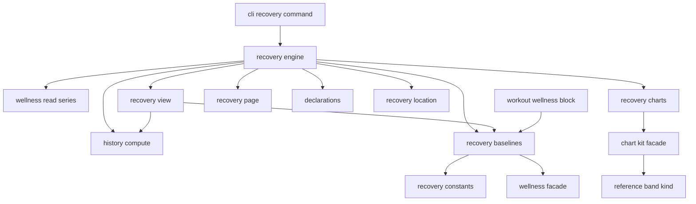
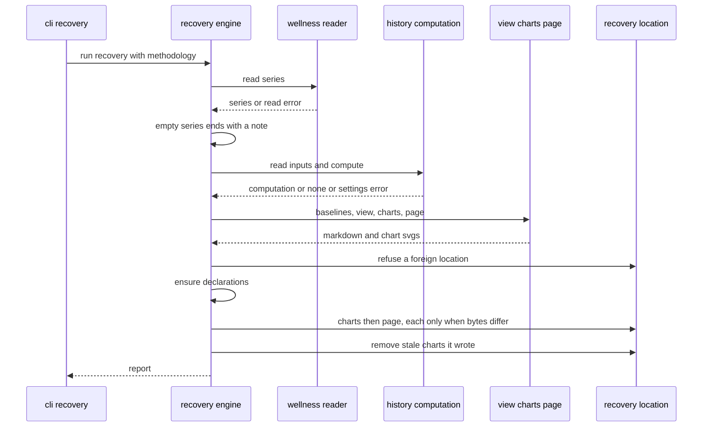
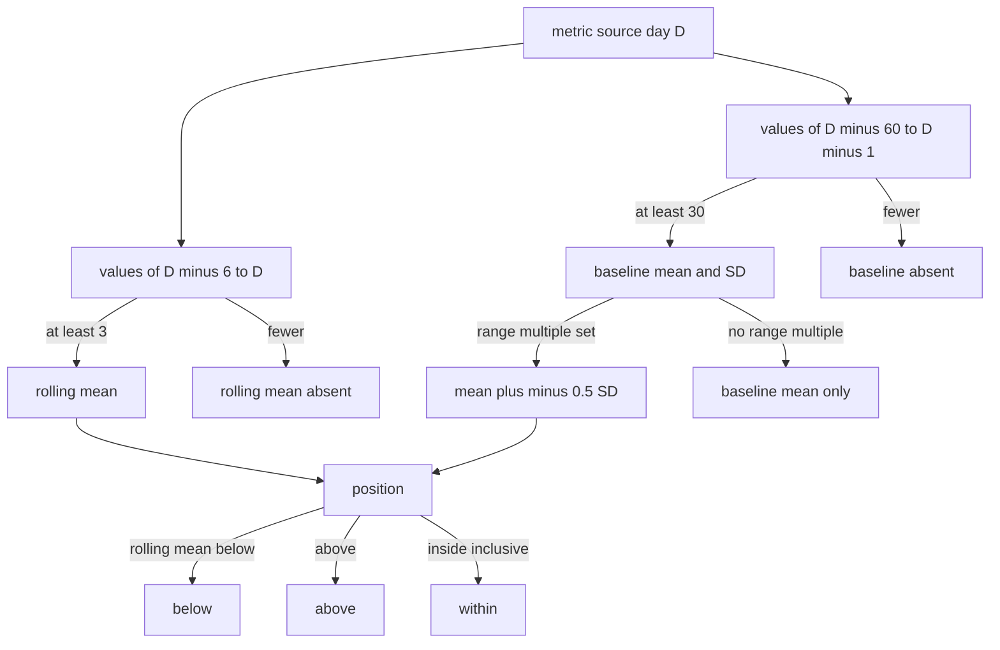

# Design Document — recovery

## Overview

**Purpose**: recovery shows the athlete whether the body is absorbing the
training load. A new command, `fitdocs recovery`, writes one fitdocs-owned
page, `recovery/recovery.md`, with its charts. For HRV (SDNN and rMSSD
separately) and resting heart rate the page draws the daily values, the
7-day rolling mean and the normal range from the 60 days before, each kept
per source, and marks the days whose rolling mean leaves the range. Sleep is
drawn against its rolling mean, the other daily signals as plain series, and
fitness, fatigue and form on the same 90-day axis, computed by load-history's
own functions. Every constant is cited or stated as fitdocs's choice. The page
describes; it never judges.

**Users**: the athlete (reads the page in the wiki), the athlete's agent (runs
the command after a drain that brought wellness), and `workout-wellness`,
which shows the morning of each workout through this feature's baseline
library so the block and the page agree.

**Impact**: a new package `fitdocs.recovery`, one CLI command, one owned
location (`CONTRACT_VERSION` main + 1), one appended chart kind
(`reference-band`, chart-catalog Amendment 1), four appended wellness
attribution names in `fitdocs.render.attribution` (settled at the Phase 12
cross-spec review; `workout-wellness` consumes them), and `recovery` in the
no-network command lists. It consumes `MetricInfo.label`, which
wellness-store provides (controller ruling R1, 2026-10-12: the field is
folded into wellness-store's own spec at cross-spec review). No workout, history, block or wellness file changes; no index schema
change; no `DOC_VERSION` change.

### Goals
- One pure, per-source baseline computation with explicit "as of day D"
  semantics, consumed unchanged by the page and by `workout-wellness`.
- A cited, descriptive, deterministic page that changes only when its inputs
  change, written only into its own owned location.
- No silent splice: a source change is drawn as a new segment and stated.

### Non-Goals
- Readiness scores, status labels, recommendations, overload warnings.
- Wellness on the history page; the morning-of block (`workout-wellness`).
- Deriving or showing resting/max-HR benchmarks (`hr-derivation`).
- A baselines index table, a `[recovery]` settings table, a long-term view
  beyond the 90-day window, source display names beyond the source id.

## Boundary Commitments

### This Spec Owns
- **`fitdocs.recovery`**: the baseline methods and their cited constants
  (`constants`), the per-source baseline library and the shown-source rule
  (`baselines`, re-exported by the package facade), the page model (`view`),
  the chart requests (`charts`), the page text (`page`) and the only writer
  of `recovery/` (`engine`).
- **The `fitdocs recovery` command** in `cli.py` and its report.
- **The recovery location**: `layout` constants and helpers, the
  `recovery/` declaration branch and golden, the `OWNED_PATHS` /
  `DECLARED_DIRS` appends, the `CONTRACT_VERSION` bump and its history
  paragraph, the `docs/ownership-contract.md` section (wiki-contract
  amendment).
- **The `reference-band` chart kind** (chart-catalog Amendment 1): its
  module, registration, tests, goldens and budget.
- **The wellness attribution names** in `src/fitdocs/render/attribution.py`,
  appended after the existing workout-page names (append-only; settled at
  the Phase 12 cross-spec review, consumed by `workout-wellness`):
  `GARMIN_ORIGIN`, `WellnessAttribution`, `wellness_attribution`,
  `wellness_attribution_line` ([AttributionNames](#attributionnames-renderattributionpy-append-only)).
- **`recovery` in the no-network lists** (connectors amendment).
- `docs/recovery.md`, the recovery parts of `docs/index.md`,
  `docs/ownership-contract.md`, `README.md`, the workouts skill, the
  CHANGELOG and `pyproject.toml` `[project.urls]`; the confinement entry
  point; tests under `tests/recovery/`.

### Out of Boundary
- Parsing, archiving, merging, precedence, the day-boundary rule and the
  series files (`wellness-store`). recovery reads the series through
  `fitdocs.wellness.read_series` and the `WellnessSeries` API only.
- The load series, the fitness/fatigue/form model, methodology selection and
  coverage suppression (`load-history`): consumed through
  `read_history_inputs`, `compute_history` and `day_rows`, never re-derived.
- How a kind looks beyond the `reference-band` kind it adds; the chart kit's
  shared layers (`chart-kit`, `chart-catalog`), which it does not edit.
- The morning-of block, its fingerprint and its re-render pass
  (`workout-wellness`); benchmark values (`hr-derivation`,
  `athlete-benchmarks`).
- The analytics index and dashboards: recovery reads neither.

### Allowed Dependencies
- `fitdocs.recovery.constants`, `fitdocs.recovery.baselines` and the package
  facade `fitdocs/recovery/__init__.py` import only the standard library,
  `fitdocs.citation` and the `fitdocs.wellness` facade. Importing
  `fitdocs.recovery` therefore loads, beyond what `import fitdocs.wellness`
  itself loads (which includes `fitdocs.settings` and `fitdocs.layout`),
  only `fitdocs.recovery`, `fitdocs.recovery.constants`,
  `fitdocs.recovery.baselines` and `fitdocs.citation`; in particular never
  `fitdocs.render`, `fitdocs.history` or `fitdocs.recovery.engine`.
- `fitdocs.recovery.view` adds `fitdocs.history` (`HistoryComputation`,
  `DayRow`, `day_rows`) and nothing from `fitdocs.render`: the panel limit
  it needs is passed in by the engine (controller ruling R2), and it only
  collects the origins the attribution is decided from; `page` decides the
  attribution (cross-spec review I-1, choice recorded in Decisions).
- `fitdocs.recovery.charts` adds `fitdocs.render.charts.kit` (facade) and
  `fitdocs.units`.
- `fitdocs.recovery.page` adds `fitdocs.contract`, `fitdocs.layout`,
  `fitdocs.render.charts.kit.format` (`format_value`, `escape_markdown`) and
  `fitdocs.render.attribution` (`wellness_attribution`,
  `wellness_attribution_line`). `render.attribution` itself imports
  `fitdocs.model` for its workout-page rule; that is a transitive load only —
  no recovery module imports `fitdocs.model` (the forbidden-name scan checks
  each module's direct imports).
- The appended attribution names import only the standard library
  (`collections.abc.Iterable`, `enum.StrEnum`); `render/attribution.py`'s
  existing imports are unchanged.
- `fitdocs.recovery.engine` adds `fitdocs.history` (`read_history_inputs`,
  `compute_history`), `fitdocs.declaration` (`ensure_declarations`),
  `fitdocs.layout`, `fitdocs.contract`, and the chart kit facade's
  `describe_kinds` (to read the `small-multiples` kind's panel limit, which
  it passes to `build_view`).
- Never: `duckdb`, `fitdocs.index`, `fitdocs.query`, `fitdocs.dashboards`,
  `fitdocs.sync`, `fitdocs.inbox`, `fitdocs.ingest`, `fitdocs.model`,
  `fitdocs.connectors`, `fitdocs.tiles`, `fitdocs.load`, `fitdocs.benchmarks`,
  `fitdocs.cli`, any `fitdocs.wellness` submodule other than the facade, a
  network module, a clock.
- Only `fitdocs.cli` imports `fitdocs.recovery.engine`. The facade
  `fitdocs.recovery` may be imported by any module that may import
  `fitdocs.wellness` (workout-wellness's renderer is the expected second
  importer).
- Module order inside the package (no module imports one to its right):
  `constants` → `baselines` → `__init__` (facade) ; `baselines` → `view` →
  `charts` → `page` → `engine`.

### Revalidation Triggers
- Any change to a `BaselineMethod`, a constant's value, the shown-source rule
  or the as-of semantics (`workout-wellness` blocks move; `BASELINES_VERSION`
  is bumped).
- Any change to `BaselineDay`'s fields.
- Any change to `fitdocs.recovery.page._FORBIDDEN_PHRASE_PATTERN`, which
  `workout-wellness`'s tests consume to keep the morning-of block
  descriptive.
- Any change to the wellness attribution names, their rule or the line text
  (`workout-wellness` consumes them).
- A change to wellness-store's `WellnessSeries` API, canonical rule or
  day-boundary rule.
- A change to `compute_history`/`day_rows` or the methodology rule.
- A change to the `reference-band` kind's channels or options (dashboards
  users and the docs kinds block).

## Existing Spec Amendments Carried by This Spec

Each is a task. An amendment number is the next free one in the target spec
at landing.

- **wiki-contract — the recovery location**: `layout.RECOVERY_DIR`,
  `RECOVERY_DOC_STEM`, path helpers; `OWNED_PATHS` += `recovery/`,
  `recovery/assets/`; `DECLARED_DIRS` += `recovery/` (appended after whatever
  main holds: dashboards' and wellness-store's entries kept);
  `declaration.py` recovery branch and golden; `CONTRACT_VERSION` main + 1
  with its history paragraph; `docs/ownership-contract.md`;
  `requirements.md` `## Amendment N`, `design.md` dated paragraph,
  `spec.json` entry.
- **connectors — `recovery` makes no connector request**: Req 14.1 lists
  `recovery`; `tech.md`'s list becomes, in its final order with dashboards,
  "`sync`, `regen`, `load`, `dashboard`, `recovery`, `check`, `query`,
  `history`, `plan`, `derive-benchmarks`, `index`" (inserted before `check`,
  so the tail pins `tests/connectors/test_network_statements.py:667-670` and
  `tests/query/test_changelog_entry.py:143-146` stay green unedited); when
  dashboards is on `main`, its pin of "`load`, `dashboard`, `check`" is
  re-pinned to "`load`, `dashboard`, `recovery`, `check`, `query`,
  `history`"; a new pin covers `recovery`; `tests/connectors/test_e2e.py`'s
  parametrization ends `…, ("query", …), ("dashboard", ["refresh"]),
  ("recovery", [])`, over a root whose series holds values (staged through
  the drain), so the command really renders under the socket guard, and the
  module docstring's command list names `recovery`; if recovery lands before
  dashboards, the landing task logs a TOUCHING line telling impl-dashboards
  to insert `dashboard` before `recovery`;
  `requirements.md` `## Amendment N`, `spec.json` entry. Disjoint from
  `wellness-pull`'s connectors amendment (which changes Req 1.x and the
  pull, not Req 14.1's command list).
- **chart-catalog — Amendment 1, the `reference-band` kind**: normative text
  in [ReferenceBandKind](#referencebandkind-chart-catalog-amendment-1).

## Architecture

### Existing Architecture Analysis
- **History** is a standalone command (`cli.py:979-1006`; load-history Req
  8.7) whose engine (`history/engine.py:394-534`) reads settings once, scans
  workout pages, computes, refreshes declarations, writes the chart then the
  page through a module-local atomic write (`:336-356`) after a
  foreign-occupant check (`:315-333`). The computation is reusable without
  the page: `read_history_inputs` (`:203-213`), `compute_history`
  (`:229-271`, returns `None` for an archive without load, raises
  `MethodologyConfigurationError` `:168`), `day_rows`
  (`history/page.py:390-411`). `index/derived/load_series.py:186-235`
  consumes exactly this trio.
- **Owned locations**: `layout.OWNED_PATHS` (`layout.py:133-142`),
  `DECLARED_DIRS` (`:161-166`), history path helpers (`:263-293`);
  `declaration_text` dispatches per directory (`declaration.py:371-487`);
  `ensure_declarations` (`:538`) refreshes every declared directory;
  `CONTRACT_VERSION = "9"` (`contract.py:328`) with dashboards taking "10"
  and wellness-store one more before this feature lands.
- **Generated markers**: `contract.GENERATED_PREFIX` (`:799`), `DOC_BANNER`
  (`:810`), `is_generated` (`:989`, a line-prefix scan). Dashboards'
  storage prefixes `f"{GENERATED_PREFIX} -->"` to each SVG it writes and
  writes only when the bytes differ.
- **Chart kit**: facade `render.charts.kit` (`kit/__init__.py:12-46`):
  `ChartRequest`, `ChartData`, `Column`, `ValueKind`, `render_chart`,
  `ChartError`. Registered kinds include `line` (2000 rows, 8 series),
  `band` (1000 rows, one band), `small-multiples` (12 panels, 2000 rows).
  `kit.format.format_value` (`format.py:116`) formats a value by its
  column's unit.
- **Confinement and command lists**: `tests/test_confinement.py:1209`
  (`WRITING_ENTRY_POINTS`, history at `:1235-1240`);
  `tests/connectors/test_e2e.py:320-332` (no-network parametrization);
  `tech.md:44-48` (no-network list); connectors Req 14.1
  (`requirements.md:289`); command-count pins
  `tests/test_cli_skill.py:266` and `tests/query/test_cli_query.py:811`
  (13 on main; re-derived as main + 1 at landing).

### Architecture Pattern & Boundary Map



**Architecture Integration**:
- Selected pattern: a domain package beside `history` with a pure core
  (`constants`, `baselines`, `view`, `charts`, `page`) and one I/O shell
  (`engine`), the history precedent; a light facade so the baseline library
  can be imported from the rendering layer without dragging in the page.
- Existing patterns preserved: the history computation reused by import;
  append-only owned paths and declared directories; atomic temp-then-replace
  writes; foreign-occupant refusal; the generated SVG marker and
  write-if-different from dashboards; citation records from
  `fitdocs.citation`; charts only through the kit facade.
- Steering compliance: absent is `None`; no new runtime dependency; no
  network; no clock; deterministic bytes; no personal data in the repository.

### Technology Stack

| Layer | Choice / Version | Role in Feature | Notes |
|-------|------------------|-----------------|-------|
| CLI | typer + rich (existing) | `fitdocs recovery`, its report | command count main + 1 |
| Computation | stdlib `math` (`fsum`, `sqrt`, `log`, `exp`) | baselines | no `statistics`, no numpy |
| Charts | chart kit (existing) + `reference-band` (new kind) | SVG charts | no private renderer |
| Storage | stdlib `os.replace`, `tempfile` | atomic page and chart writes | no new location outside `recovery/` |
| Runtime | Python 3.11+, mypy --strict | — | — |

## File Structure Plan

### Directory Structure
```
src/fitdocs/recovery/
├── __init__.py      # Facade: re-exports the baseline library only (no page, no engine)
├── constants.py     # Transform, BaselineMethod, MethodRule, the CitedConstants and their source records,
│                    #   METHODS, BASELINED_METRICS, SLEEP_METRICS, lookback_days, LOOKBACK_DAYS, BASELINES_VERSION, RULES
├── baselines.py     # RangePosition, BaselineDay, Baselines (of/on/shown_source/shown)
├── view.py          # The page model: Window, ShownDay, MarkedRun, SourceChange, SourceNote, SignalView,
│                    #   SleepView, Panel, OtherView, LoadView, CoverageRow, RecoveryView, OTHER_SIGNALS,
│                    #   WINDOW_DAYS, build_view (pure)
├── charts.py        # CHART_NAMES, chart requests and data per section, render_charts (pure, via the kit)
├── page.py          # RECOVERY_TYPE, RECOVERY_TITLE, RECOVERY_VERSION, frontmatter keys, render_page (pure)
└── engine.py        # FileOutcome, FileResult, RecoveryReport, run_recovery (the only writer of recovery/)

src/fitdocs/render/charts/kit/kinds/reference_band.py   # chart-catalog Amendment 1: the reference-band kind
docs/recovery.md                                       # the recovery guide
tests/recovery/      # builders.py (synthetic series and pages), test_constants.py, test_baselines.py, test_shown.py,
                     #   test_view.py, test_charts.py, test_page.py, test_engine.py, test_cli_recovery.py,
                     #   test_boundary.py, test_constant_guard.py, test_docs_recovery.py, golden/
tests/render/charts/kit/test_reference_band.py         # the kind's CASES and tests
tests/render/charts/kit/golden/reference-band/         # its goldens
tests/declaration_golden/recovery.AGENTS.md
```

### Modified Files
- `src/fitdocs/layout.py` — `RECOVERY_DIR = "recovery"`,
  `RECOVERY_ASSETS_SUBDIR = ASSETS_SUBDIR`, `RECOVERY_DOC_STEM = "recovery"`;
  `recovery_doc_path`, `recovery_asset_path`, `recovery_asset_rel_path`;
  `OWNED_PATHS` and `DECLARED_DIRS` appends.
- `src/fitdocs/contract.py` — `CONTRACT_VERSION` main + 1, history paragraph.
- `src/fitdocs/declaration.py` — `_RECOVERY_CONTENT`, `_RECOVERY_RERUNNABLE`
  (each with a CLAIM ANCHOR comment) and the `RECOVERY_DIR` branch.
- `src/fitdocs/cli.py` — `recovery_command`, `_report_recovery`, the module
  docstring's command list and exit codes.
- `src/fitdocs/render/charts/kit/registry.py` — append `reference_band.KIND`.
- `src/fitdocs/render/attribution.py` — append `GARMIN_ORIGIN`,
  `WellnessAttribution`, `wellness_attribution`,
  `wellness_attribution_line` (append-only; nothing existing changes).
- `src/fitdocs/skills/fitdocs-workouts/SKILL.md` — the recovery paragraph
  and fence.
- `.kiro/steering/tech.md` — `recovery` in the no-network list;
  `.kiro/steering/structure.md` — the `recovery` dependency rule.
- `docs/ownership-contract.md`, `docs/index.md`, `docs/dashboards.md` (kinds
  block regenerated when dashboards is on main), `README.md` (ownership
  summary and one capability sentence), `CHANGELOG.md`, `pyproject.toml`
  (`[project.urls] Recovery`; mypy test-module entry).
- Spec amendments appended to `.kiro/specs/{wiki-contract,connectors,
  chart-catalog}/requirements.md` with `spec.json` entries.
- Tests re-pinned (append-only where the pin is a list): `tests/test_layout.py`
  (`:649`, `:863`, `:885`), `tests/test_declaration.py`,
  `tests/test_declaration_goldens.py` and every existing declaration golden
  (the owner block carries the version), `tests/test_ownership_contract.py`,
  `tests/index/derived/test_preserved.py:246`, `tests/identity/test_contract_docs.py`,
  `tests/index/test_contract_docs.py`, `tests/test_confinement.py`,
  `tests/connectors/test_e2e.py`, `tests/connectors/test_network_statements.py`,
  `tests/test_cli_skill.py:266`, `tests/query/test_cli_query.py:811`,
  `tests/test_agent_skill.py` (fences of the workouts skill),
  `tests/test_public_api.py` (`_RECOVERY_SURFACE`),
  `tests/render/charts/kit/test_boundary.py` (module tuple and kind rank),
  `tests/render/charts/kit/test_catalog_budgets.py` (one budget appended),
  `tests/render/test_attribution.py` (the appended names' tests).
- `tests/identity/test_contract_docs.py`: a literal history-paragraph pin,
  appended to `test_the_version_history_records_the_amendment` (:189), and
  the head-paragraph pin (:177-187) re-pinned to recovery's "What changed"
  paragraph, together with every peer head-paragraph pin on `main` at
  landing (found by grepping the outgoing paragraph's phrases).

## System Flows

### The recovery command



Key decisions: the series is read first, so an empty series ends the run
before any settings are read and before anything is written (1.4); settings
and methodology problems raise `SettingsError` before any write (9.4); a
chart that fails to write stops the page write (torn-state safety, history
precedent); a run whose inputs did not change writes nothing (14.3).

### One day's baseline



For HRV every step runs on the natural log of the values and the results are
converted back with `exp`; positions are decided in the transformed scale.

## Requirements Traceability

| Requirement | Summary | Components | Interfaces | Flows |
|-------------|---------|------------|------------|-------|
| 1.1, 1.6 | Command regenerates and reports | Engine, CliRecovery | `run_recovery`, `RecoveryReport` | Command |
| 1.2 | Data-root precedence | CliRecovery | `_resolved_data_root` | — |
| 1.3 | Series only, via the reader | Engine, Boundary guard | `read_series` | Command |
| 1.4, 1.5 | Empty series; unreadable series | Engine | `RecoveryReport.note/failure` | Command |
| 1.7 | Write failure fails the run | Engine, CliRecovery | `FileOutcome.FAILED` | Command |
| 1.8 | Not chained into other passes | CliRecovery | only `recovery_command` calls `run_recovery` | — |
| 2.1, 2.2, 2.3 | As-of from data, 90-day window, stated | View, Page, Charts | `Window`, `build_view` | — |
| 3.1, 3.2 | One source, one metric; no conversion | Baselines | `Baselines.on` | Baseline |
| 3.3, 3.4 | Rolling and baseline windows, minimums | Baselines, Constants | `METHODS` | Baseline |
| 3.5 | Natural log for HRV | Constants, Baselines | `Transform.LOG` | Baseline |
| 3.6, 3.7 | Range for baselined, none for sleep | Constants, Baselines | `range_multiple` | Baseline |
| 3.8 | Absent days | Baselines | `BaselineDay` `None` fields | Baseline |
| 3.9 | Depends on D and 60 days before | Baselines | `LOOKBACK_DAYS` | Baseline |
| 3.10 | Identical results anywhere | Baselines | `math.fsum`, no clock or timezone | — |
| 4.1, 4.2, 4.3, 4.4 | Marked days and runs | Baselines, View, Charts, Page | `RangePosition`, `MarkedRun`, flag column | — |
| 5.1, 5.2 | Canonical source; short-gap carry | Baselines | `shown_source`, `shown` | — |
| 5.3 | Shown source's own baseline | Baselines | `Baselines.on` | Baseline |
| 5.4 | Segments, never joined, named | Charts, ReferenceBandKind | `segment` channel | — |
| 5.5, 5.6 | Changes and sources stated | View, Page | `SourceChange`, `SourceNote` | — |
| 6.1, 6.2, 6.3, 6.4 | Baselined sections | View, Charts, Page | `SignalView` | — |
| 7.1, 7.2, 7.3 | Sleep | View, Charts, Page | `SleepView` | — |
| 8.1, 8.2, 8.3, 8.4 | Other signals | View, Charts, Page | `OTHER_SIGNALS`, `Panel`, `OtherView` | — |
| 9.1, 9.6, 9.7 | Load chart; unavailable days; methodology named | View, Charts, Page | `LoadView` | — |
| 9.2, 9.3, 9.4, 9.5 | History's computation and errors | Engine, View | `read_history_inputs`, `compute_history`, `day_rows` | Command |
| 10.1, 10.2, 10.3 | Descriptive only | Page | forbidden-phrase pin | — |
| 11.1, 11.2, 11.3, 11.4, 11.5 | Method, citations, departures, references | Constants, Page | `CitedConstant`, `MethodRule` | — |
| 12.1, 12.2, 12.3 | One page, markdown, frontmatter, relative links | Page, OwnedLocation | `render_page`, `recovery_asset_rel_path` | — |
| 12.4 | Unit symbols and precision as charts | Page | `kit.format.format_value` | — |
| 12.5 | Days with a value per metric and source | View, Page | `CoverageRow` | — |
| 12.6 | Light and dark | Charts | kit theme | — |
| 12.7, 12.8 | Garmin attribution beneath the title, or none | View, Page, AttributionNames | `RecoveryView.origins`, `wellness_attribution`, `wellness_attribution_line` | — |
| 13.1, 13.2, 13.3 | Owned, declared, contract bump | OwnedLocation, ConfinementEntry | `OWNED_PATHS`, `DECLARED_DIRS`, `CONTRACT_VERSION` | — |
| 13.4 | Confined writes | Engine, ConfinementEntry | write set | Command |
| 13.5 | Foreign occupants refused | Engine | `FileOutcome.FOREIGN` | Command |
| 13.6 | Atomic, unchanged untouched, stale removed | Engine | `_write_if_changed`, stale removal | Command |
| 14.1, 14.2, 14.3 | Determinism and churn | all pure modules, Engine | no clock; byte compare | — |
| 15.1, 15.2 | One computation for every consumer | Baselines, Facade | `Baselines.shown`, `Baselines.on` | — |
| 16.1 | Charts through the kit | Charts | `render_chart` | — |
| 16.2, 16.3, 16.4 | The new kind | ReferenceBandKind | `reference-band` `KindSpec` | — |
| 17.1, 17.2 | No network; lists name recovery | NoNetworkLists, Boundary guard | connectors amendment | — |
| 17.3, 17.4, 17.5 | No dependency, no clock, no personal data | Boundary guard, tests | — | — |
| 18.1, 18.2, 18.3, 18.4, 18.5 | Docs, contract doc, skill, release notes, kinds listing | Docs | — | — |

## Components and Interfaces

### Summary

| Component | Domain/Layer | Intent | Req Coverage | Key Dependencies | Contracts |
|-----------|--------------|--------|--------------|------------------|-----------|
| Constants | recovery core | Methods, cited constants, rules | 3.3-3.7, 11.1-11.5 | citation, wellness facade (P0) | State |
| Baselines | recovery core | Per-source baselines, shown source | 3, 4.1, 4.4, 5.1-5.3, 15 | Constants, wellness facade (P0) | Service |
| Facade | recovery API | What other features import | 15.1 | Baselines (P0) | Service |
| View | recovery core | What the page shows, as data | 2, 4.2, 4.3, 5.5, 5.6, 6-9, 12.5, 12.7 | Baselines, history (P0) | Service |
| Charts | recovery render | Chart requests and SVGs | 4.1, 5.4, 6.2, 7.1, 8.1, 9.1, 12.6, 16.1 | kit facade (P0) | Service |
| Page | recovery render | Markdown and frontmatter | 2.3, 6.3, 7.2, 10, 11, 12 | contract, layout, kit.format, render.attribution (P0) | Service |
| Engine | recovery I/O | Read, compute, write, report | 1, 9.2-9.5, 13.4-13.6, 14 | all of the above, declaration (P0) | Batch |
| CliRecovery | cli | Command, report, exit | 1.2, 1.6-1.8 | Engine (P0) | Service |
| OwnedLocation | layout/contract/declaration/docs | Location, declaration, version | 12.1, 13.1-13.3, 18.2 | — | State |
| ReferenceBandKind | chart kit | The new kind | 4.1, 5.4, 16.2-16.4 | kit shared layers (P0) | Service |
| AttributionNames | render | Wellness Garmin attribution rule and line | 12.7, 12.8 | — | Service |
| NoNetworkLists | steering/tests/connectors | `recovery` named offline | 17.1, 17.2 | — | — |
| ConfinementEntry | tests | `recovery` writing entry point | 13.2, 13.4 | — | — |
| Docs | docs/skill/changelog | User-facing text | 18 | — | — |
| RecoveryBoundaryGuard | tests | Imports, clock, network, literals | 1.3, 15.1, 17 | — | — |

### Recovery Core

#### Constants (`src/fitdocs/recovery/constants.py`)

| Field | Detail |
|-------|--------|
| Intent | Every methodologically significant value and rule, each with its governing source record |
| Requirements | 3.3, 3.4, 3.5, 3.6, 3.7, 11.1, 11.2, 11.3, 11.4 |

**Responsibilities & Constraints**
- Holds the only numeric literals of the baseline method, each inside a
  `fitdocs.citation.CitedConstant`; `METHODS` reads `.value` from them, never
  a bare number (pinned by `test_constant_guard.py`, the history
  precedent).
- Each constant's governing `source` is a `Citation` with
  `verification=PRIMARY_TEXT` and a locator **only** when task 1.1 verified
  it; otherwise a `FitdocsChoice` whose `justification` states the reason
  and whose `search_basis` records what was searched and found. A work
  attested only by secondary sources may appear as a `Corroboration`
  (`SECONDARY_ATTESTATION`, its `note` saying so), never as governing.
- A finding that a cited work states a different value is recorded as a
  `Departure`; the value is not changed without a maintainer decision.

| Constant | Value | Planned governing record (task 1.1 decides) |
|----------|-------|---------------------------------------------|
| `ROLLING_DAYS` | 7 | `Citation` Plews et al. 2013 *Sports Med* 43:773 (7-day rolling ln rMSSD); corroborator Plews et al. 2013 *IJSPP* 8:688 |
| `MIN_ROLLING_VALUES` | 3 | `Citation` Plews et al. 2014 *IJSPP* 9:783 (recordings per week); else `FitdocsChoice` |
| `BASELINE_DAYS` | 60 | `Citation` Altini & Plews 2021 *Sensors* 21:7932 if it states the 60-day normal values; else `FitdocsChoice` (the maintainer's 2026-10-12 decision for the HRV4Training-style 60-day normal range) |
| `MIN_BASELINE_VALUES` | 30 | `FitdocsChoice`: half the window, so the SD rests on at least a month of nights |
| `RANGE_SD_MULTIPLE` | 0.5 | `Citation` (the smallest worthwhile change as 0.5 × the baseline SD): Vesterinen et al. 2016 *MSSE* 48:1347, Plews et al. 2013 or Buchheit 2014 *Front Physiol* 5:73, whichever is verified; else `FitdocsChoice` with the measured rationale (a 7-day mean of stationary daily values leaves ±0.5 SD about one day in five) |

| Rule (`MethodRule`) | Statement on the page | Planned source |
|---------------------|-----------------------|----------------|
| `LOG_TRANSFORM` | HRV is averaged as the natural log of its values and shown back in ms | `Citation` Plews et al. 2013 / Buchheit 2014 |
| `SDNN_APPLICATION` | The same method is applied to SDNN, never mixed with rMSSD | `Departure` (works study rMSSD) |
| `RESTING_HR_APPLICATION` | Resting HR uses the same windows and range on its own values (no log) | `Departure`; corroborator Buchheit 2014 |
| `COMPARED_QUANTITY` | A day is marked when its 7-day mean lies outside the normal range | `Citation` Plews et al. 2013 |
| `SAMPLE_SD` | The SD is the sample SD (n − 1) of the baseline days | `FitdocsChoice` |
| `SLEEP_METHOD` | Sleep signals get a 7-day mean and a 60-day mean, no range | `FitdocsChoice` (no cited range method for sleep) |
| `PER_SOURCE` | Every computation uses one source and one metric | `FitdocsChoice` (maintainer, research 2026-10-12: definitions differ by platform) |
| `SHOWN_SOURCE` | The shown source is the day's canonical source, carried for at most six days | `FitdocsChoice` |

```python
class Transform(StrEnum):
    LINEAR = "linear"
    LOG = "log"                 # natural log; results shown via exp

@dataclass(frozen=True)
class BaselineMethod:
    metric: Metric
    transform: Transform
    rolling_days: int           # ROLLING_DAYS.value
    min_rolling: int            # MIN_ROLLING_VALUES.value
    baseline_days: int          # BASELINE_DAYS.value
    min_baseline: int           # MIN_BASELINE_VALUES.value
    range_multiple: float | None  # RANGE_SD_MULTIPLE.value, or None (no normal range)

@dataclass(frozen=True)
class MethodRule:
    key: str
    statement: str              # the sentence the page prints
    source: SourceRecord        # Citation | FitdocsChoice
    corroborators: tuple[Corroboration, ...] = ()
    departure: Departure | None = None

ROLLING_DAYS: Final[CitedConstant[int]]
MIN_ROLLING_VALUES: Final[CitedConstant[int]]
BASELINE_DAYS: Final[CitedConstant[int]]
MIN_BASELINE_VALUES: Final[CitedConstant[int]]
RANGE_SD_MULTIPLE: Final[CitedConstant[float]]
CONSTANTS: Final[tuple[CitedConstant[int] | CitedConstant[float], ...]]   # page order
RULES: Final[tuple[MethodRule, ...]]                                      # page order

BASELINED_METRICS: Final[tuple[Metric, ...]] = (HRV_SDNN_MS, HRV_RMSSD_MS, RESTING_HR_BPM)
SLEEP_METRICS: Final[tuple[Metric, ...]] = (SLEEP_S, SLEEP_DEEP_S, SLEEP_LIGHT_S, SLEEP_REM_S, SLEEP_AWAKE_S, SLEEP_HR_BPM)
METHODS: Final[Mapping[Metric, BaselineMethod]]   # BASELINED_METRICS (LOG for HRV, LINEAR for resting HR,
                                                  #   with range) then SLEEP_METRICS (LINEAR, no range)
def lookback_days(methods: Mapping[Metric, BaselineMethod]) -> int: ...
                                # max over methods of max(baseline_days, rolling_days - 1)
LOOKBACK_DAYS: Final[int]       # lookback_days(METHODS) == 60
BASELINES_VERSION: Final[int] = 1   # bumped whenever a method, constant or rule changes the numbers
```

`METHODS`, `BASELINED_METRICS`, `SLEEP_METRICS` and `OTHER_SIGNALS` (View)
are selections of `wellness.Metric` members, not a second metric vocabulary:
names, units, ranges and labels stay in wellness-store's `METRICS`.

#### Baselines (`src/fitdocs/recovery/baselines.py`)

| Field | Detail |
|-------|--------|
| Intent | The per-source rolling mean, baseline, normal range and position of any day, and the shown source |
| Requirements | 3.1-3.10, 4.1, 4.4, 5.1, 5.2, 5.3, 15.1, 15.2 |

**Responsibilities & Constraints**
- `Baselines.of(series)` indexes the series once: for each `(metric,
  source)` of `METHODS`' metrics a `{day: (value, origin)}` map from
  `series.values`; for each `(metric, day)` the canonical source (the
  `SeriesValue` with `canonical=True`). It never reads a file, a clock or
  the machine timezone.
- `on(metric, source, day)` for a metric in `METHODS` (else `ValueError`),
  with `m = METHODS[metric]`, `t` the transform (`math.log` or identity)
  and `u` its inverse (`math.exp` or identity):
  - `value`, `origin`: the source's value and origin on `day`, or `None`.
  - Rolling: `xs = [t(v) for d in day−(m.rolling_days−1) … day]`;
    `rolling_count = len(xs)`; `rolling_mean = u(fsum(xs)/n)` when
    `n >= m.min_rolling`, else `None`.
  - Baseline: `ys = [t(v) for d in day−m.baseline_days … day−1]`;
    `baseline_count = len(ys)`; when `n >= m.min_baseline`:
    `mu = fsum(ys)/n`, `sd = sqrt(fsum((y−mu)**2 for y in ys)/(n−1))`,
    `baseline_mean = u(mu)`, `baseline_sd = sd` (in the transformed scale);
    else both `None`.
  - Range: when `m.range_multiple` is set and the baseline is present:
    `range_low = u(mu − k·sd)`, `range_high = u(mu + k·sd)`; else `None`.
  - Position: when the rolling mean and the range are present, compared in
    the transformed scale (`r = fsum(xs)/n`): `r < mu − k·sd` → `BELOW`,
    `r > mu + k·sd` → `ABOVE`, otherwise `WITHIN` (bounds inclusive); else
    `None` (4.4).
- `shown_source(metric, day)`: the canonical source of `(metric, day)`;
  else the canonical source of the latest day in `day−(rolling_days−1) …
  day−1` that has one; else `None` (5.1, 5.2).
- `shown(metric, day)`: `on(metric, shown_source, day)` or `None`.
- **As-of semantics (normative for every consumer)**: `on(metric, s, D)`
  depends only on source `s`'s values on `D−60 … D`; `shown(metric, D)`
  additionally on the canonical flags of `D−6 … D`. The baseline and range of
  D never include D; the rolling mean does. A value arriving for day X can
  change results for days X … X + `LOOKBACK_DAYS` only (3.9).

```python
class RangePosition(StrEnum):
    BELOW = "below"
    WITHIN = "within"
    ABOVE = "above"

@dataclass(frozen=True)
class BaselineDay:
    metric: Metric
    source: str
    day: date
    value: float | None            # the source's value on day, as recorded
    origin: str | None
    rolling_mean: float | None     # in the metric's unit
    rolling_count: int             # days of the rolling window holding a value
    baseline_mean: float | None    # in the metric's unit
    baseline_sd: float | None      # in the method's transformed scale
    baseline_count: int            # days of the baseline window holding a value
    range_low: float | None        # in the metric's unit
    range_high: float | None
    position: RangePosition | None

class Baselines:
    @classmethod
    def of(cls, series: WellnessSeries) -> Baselines: ...
    def on(self, metric: Metric, source: str, day: date) -> BaselineDay: ...
    def shown_source(self, metric: Metric, day: date) -> str | None: ...
    def shown(self, metric: Metric, day: date) -> BaselineDay | None: ...
```

- Cost: `of` is O(n) over `series.values`; `on` is O(`LOOKBACK_DAYS`) map
  lookups, so a 2,500-page re-render pass stays linear.

#### Facade (`src/fitdocs/recovery/__init__.py`)

Re-exports exactly: `Baselines`, `BaselineDay`, `RangePosition`,
`BaselineMethod`, `Transform`, `METHODS`, `BASELINED_METRICS`,
`SLEEP_METRICS`, `LOOKBACK_DAYS`, `BASELINES_VERSION`. (`baseline_key`,
drafted for workout-wellness's fingerprint, was dropped at the Phase 12
cross-spec review: no consumer uses it.)
Imports nothing but `baselines` and `constants`; pinned by
`tests/test_public_api.py` (`_RECOVERY_SURFACE`, a literal set, with
`_RECOVERY_SURFACE_OWNERS` naming the submodule that defines each name) and
by the boundary guard: in a fresh interpreter, the modules `import
fitdocs.recovery` loads minus the modules `import fitdocs.wellness` loads
are a subset of `{fitdocs.recovery, fitdocs.recovery.constants,
fitdocs.recovery.baselines, fitdocs.citation}`, and none of them is
`fitdocs.render…`, `fitdocs.history…` or `fitdocs.recovery.engine`.

#### View (`src/fitdocs/recovery/view.py`)

| Field | Detail |
|-------|--------|
| Intent | Everything the page shows, as typed data, from the series, the baselines and the history computation |
| Requirements | 2.1, 2.2, 4.2, 4.3, 5.5, 5.6, 6.1, 6.3, 7.2, 7.3, 8.1, 8.2, 8.3, 9.1, 9.5, 9.6, 12.5, 12.7, 12.8 |

- `WINDOW_DAYS: Final = 90` (a display choice, not a method constant).
- `build_view(series, baselines, load, *, panel_limit) -> RecoveryView | None`: `None` when
  `series.is_empty()`. As-of = `series.days()[-1]`; window = as-of − 89 …
  as-of (2.1, 2.2).
- **Signals** (`BASELINED_METRICS` order): a `SignalView` for each metric
  with at least one value from any source in the window; one `ShownDay` per
  window day (`shown_source`, `shown`); `latest` = the last window day whose
  shown `BaselineDay.value` is present; `runs` = maximal runs of consecutive
  window days with the same `position` in {`ABOVE`, `BELOW`} and the same
  shown source (4.2); `changes` = each window day whose shown source differs
  from the previous window day's non-`None` shown source (5.5); `sources` =
  each shown source with the distinct origins of its shown values and its
  number of shown days (5.6).
- **Sleep**: a `SleepView` when `sleep_s` has a value in the window: the
  `SignalView` of `sleep_s`, and for the latest night with a shown total,
  `rows` = `baselines.on(m, s, night)` for each `m` in `SLEEP_METRICS` that
  source `s` records that night (7.2, 7.3).
- **Other signals**: `OTHER_SIGNALS = (respiration_brpm, spo2_pct,
  stress_level, body_battery_highest, body_battery_lowest, steps,
  weight_kg, vo2max_ml_per_kg_min, vo2max_run_ml_per_kg_min,
  vo2max_ride_ml_per_kg_min, fatigue_rating, soreness_rating, mood_rating,
  motivation_rating, stress_rating, injury_rating, hydration_rating)`; one
  candidate `Panel` per (metric in that order, source in id order) with a
  value in the window, holding that source's own value per window day (8.2);
  the first `panel_limit` are charted, the rest are `overflow` (8.3);
  `panel_limit` is an argument the engine reads from the `small-multiples`
  kind's listing (`describe_kinds()`, its `bound["limit"]`, 12 today) and
  never re-spells (controller ruling R2).
- **Load**: from `HistoryComputation | None`: `rows` = `day_rows(...)`
  mapped onto the window (a window day outside the series span → `None`);
  `unavailable_days` = window days whose row is `None` or suppressed (9.6);
  `methodology` = `computation.choice.methodology`; with no computation,
  `rows = ()` and `note` set (9.5).
- **Coverage**: one `CoverageRow` per (page metric, source) with at least one
  value in the window, counting window days with a value (12.5); `absent` =
  the baselined metrics and `sleep_s` with no value in the window (6.1).
- **Origins** (12.7, 12.8): `origins` is the set of origins, `None` included
  for a value whose origin is unrecorded, of every series value a printed or
  charted figure uses — a rolling mean, baseline or range that did not form
  (too few days) is not shown and uses none (cross-spec round 2, N-1; the
  same rule as workout-wellness's "Row sources"). With `m = METHODS[metric]`
  and the shown `BaselineDay` `bd` of source s on day D:
  - for each baselined `SignalView` and each window day D with a shown
    source: D's own value when `bd.value` is present; s's values on
    D − (`m.rolling_days` − 1) … D when `bd.rolling_mean` is present; s's
    values on D − `m.baseline_days` … D − 1 when `bd.baseline_mean` is
    present (the range drawn that day is built from them);
  - for the `sleep_s` `SignalView`: the same, without the baseline window
    (its chart draws the value and the 7-day mean only);
  - for each `SleepView.rows` entry (metric, source s, night N): N's value,
    N − 6 … N when its rolling mean is present, and N − 60 … N − 1 when its
    baseline mean is present (both windows from `METHODS`);
  - every present value of every charted other-signal panel (overflow pairs
    are only named, so they contribute none). The fitness, fatigue and form section
  uses no series value. `view` does not decide the attribution; `page` does
  (no `fitdocs.render` import in `view`).

```python
@dataclass(frozen=True)
class Window:
    as_of: date
    start: date
    def days(self) -> tuple[date, ...]: ...

@dataclass(frozen=True)
class ShownDay:
    day: date
    source: str | None
    baseline: BaselineDay | None

@dataclass(frozen=True)
class MarkedRun:
    first: date
    last: date
    position: RangePosition        # ABOVE or BELOW
    source: str

@dataclass(frozen=True)
class SourceChange:
    day: date
    before: str
    after: str

@dataclass(frozen=True)
class SourceNote:
    source: str
    origins: tuple[str, ...]       # sorted, distinct; empty when none recorded
    days_shown: int

@dataclass(frozen=True)
class SignalView:
    metric: Metric
    days: tuple[ShownDay, ...]     # one per window day
    latest: ShownDay | None
    runs: tuple[MarkedRun, ...]
    changes: tuple[SourceChange, ...]
    sources: tuple[SourceNote, ...]

@dataclass(frozen=True)
class SleepView:
    total: SignalView
    night: date | None
    rows: tuple[BaselineDay, ...]

@dataclass(frozen=True)
class Panel:
    metric: Metric
    source: str
    values: tuple[float | None, ...]   # one per window day

@dataclass(frozen=True)
class OtherView:
    panels: tuple[Panel, ...]
    overflow: tuple[tuple[Metric, str], ...]

@dataclass(frozen=True)
class LoadView:
    methodology: str | None
    rows: tuple[DayRow | None, ...]    # one per window day, or () when no load
    unavailable_days: int
    note: str | None

@dataclass(frozen=True)
class CoverageRow:
    metric: Metric
    source: str
    days_with_value: int

@dataclass(frozen=True)
class RecoveryView:
    window: Window
    load: LoadView
    signals: tuple[SignalView, ...]
    sleep: SleepView | None
    other: OtherView | None
    coverage: tuple[CoverageRow, ...]
    absent: tuple[Metric, ...]
    origins: frozenset[str | None]     # see Origins above

OTHER_SIGNALS: Final[tuple[Metric, ...]]
WINDOW_DAYS: Final[int]
def build_view(series: WellnessSeries, baselines: Baselines,
               load: HistoryComputation | None, *, panel_limit: int) -> RecoveryView | None: ...
```

### Recovery Rendering

#### Charts (`src/fitdocs/recovery/charts.py`)

| Field | Detail |
|-------|--------|
| Intent | One kit request per section, rendered to SVG |
| Requirements | 4.1, 5.4, 6.2, 6.4, 7.1, 8.1, 9.1, 12.6, 16.1 |

- `CHART_NAMES: Final = ("load", "hrv-sdnn", "hrv-rmssd", "resting-hr",
  "sleep", "other")`; a chart exists only when its section does.
- Every chart has one row per window day (so each spans exactly the window,
  2.2; days without a value are counted by the kit's "Not drawn" note) and
  the kit's default width.
- User-approved prerequisite 2.3 (2026-10-16) corrects the existing line,
  small-multiples and reference-band kinds: when at least one genuine mark
  is drawable, every received present x position sets the x domain and
  accessible x extrema, including date-only missing-value endpoint rows.
  Small-multiples uses the global union across panels; y domains and marks
  still use only drawable values. Reference-band's flags-only path uses
  separate true flag entries, so domain-only dates add no marks. Existing
  all-markless no-data output remains; it has no time axis. No public API,
  option, schema, shared layer or chart-table change is introduced.

| Chart | Kind | Columns (unit) | Channels / options |
|-------|------|----------------|--------------------|
| `load` | `line` | `day` DATE; `value` NUMBER (no unit, label "daily-average load"); `series` CATEGORY (`fitness`, `fatigue`, `form`) | x=day, y=value, color=series; `y_zero=true` |
| `hrv-sdnn`, `hrv-rmssd`, `resting-hr` | `reference-band` | `day`; `value` (metric unit, label = metric label); `low`, `high` (unit, labels "normal range low/high"); `mean` (unit, "7-day mean"); `source` CATEGORY; `outside` BOOLEAN ("outside the normal range") | x, y=value, low, high, mid=mean, segment=source, flag=outside |
| `sleep` | `reference-band` | `day`; `value` (`s`, "Sleep"); `mean` (`s`, "7-day mean"); `source` | x, y, mid, segment |
| `other` | `small-multiples` | `day`; `value` NUMBER (no unit); `panel` CATEGORY (`"<label> (<symbol>) · <source>"`) | x, y, facet=panel; `y_axes="independent"` |

- `outside` is `True` exactly when the shown `position` is `ABOVE` or
  `BELOW`; `False` otherwise (absent position is not flagged, 4.4).
- `render_charts(view) -> tuple[tuple[str, str], ...]` returns
  `(name, svg)` in `CHART_NAMES` order; a `ChartError` is a programming
  error and propagates (the data is built to the kinds' contracts).

#### Page (`src/fitdocs/recovery/page.py`)

| Field | Detail |
|-------|--------|
| Intent | The recovery page's markdown, pure |
| Requirements | 2.3, 4.2, 4.3, 5.5, 5.6, 6.1, 6.3, 7.2, 8.3, 9.5, 9.6, 9.7, 10.1-10.3, 11.1-11.5, 12.1-12.5, 12.7, 12.8 |

- `RECOVERY_TYPE = "recovery"` (≠ `contract.WORKOUT_TYPE`, ≠
  `history.HISTORY_TYPE`), `RECOVERY_TITLE = "Recovery"`,
  `RECOVERY_VERSION = 1`, `RECOVERY_FRONTMATTER_KEYS = ("title", "type",
  "generator", "recovery_version", "baselines_version", "as_of",
  "window_start", "window_end", "methodology")`; frontmatter emitted as
  ordered plain lines like history's (`methodology` omitted when no load is
  shown; dates quoted ISO strings).
- Body, fixed order: frontmatter; `contract.DOC_BANNER`; `# Recovery`; the
  attribution line `wellness_attribution_line(wellness_attribution(view.origins))`
  directly beneath the title when it is not `None` ("Data source: Garmin" or
  "Data sources: Garmin and other sources"; no line at all otherwise, 12.7,
  12.8); the opening paragraph (as-of, window, "Each signal is shown against the
  athlete's own baseline, computed separately for every source. This page
  describes the data and draws no conclusion from it."); `## Fitness,
  Fatigue and Form`; one `## <label>` section per `SignalView`
  (`HRV (SDNN)`, `HRV (rMSSD)`, `Resting HR`); `## Sleep`; `## Other
  Signals`; `## Coverage`; `## Method`; `## References`.
- Signal section: the chart image (``,
  `layout.recovery_asset_rel_path`); `Latest: <day>, <value> (<source>).`;
  `7-day mean: <m>.` or `7-day mean: not shown — <k> of the 7 days hold a
  value; at least <min> are needed.`; `Normal range: <lo> to <hi>, from <n>
  of the 60 days before.` or the same "not shown" form; the marked runs
  (`- <first> to <last>: above|below (<source>)`, one day as `<day>`) or
  `No day of the window has a 7-day mean outside the normal range.`; each
  source change (`On <day> the shown source changed from <a> to <b>; from
  that day the 7-day mean and normal range are <b>'s own.`); `Sources
  shown: <source> (origins <o1>, <o2>) on <n> days.`
- Sleep section: chart; a table `| Signal | <night> | 7-day mean | 60-day
  mean |` with one row per `SleepView.rows` entry.
- Other signals: chart; `Shown as recorded, one panel per metric and source,
  with no baseline.`; overflow sentence `Also recorded in this window but
  not charted: <label> (<source>), …`.
- Load section: chart and `Computed exactly as fitdocs history computes it,
  under the methodology <m>.`; `<n> days of the window have no fitness,
  fatigue or form: they fall outside the load series or in a week
  suppressed for low coverage.` when `n > 0`; with no load: `No workout page
  records a training load, so fitness, fatigue and form are not shown.`
- Coverage: `| Signal | Source | Days with a value (of 90) |`; then `No value
  in this window: <labels>.` when `absent` is non-empty.
- Method: one bullet per `CONSTANTS` entry (`<name>: <value> — <source
  text>`) and per `RULES` entry (`<statement> — <source text>`), where a
  `Citation` reads `<authors> (<year>), <work>, <locator>`, a
  `FitdocsChoice` reads `fitdocs's choice: <justification>`, each
  corroborator `see also …` with its status, and a departure `Departure:
  <source_specifies>; fitdocs <fitdocs_does> (<reason>)` (11.1-11.4).
- References: every `Citation` named as a source or corroborator, once, in
  key order (11.5).
- Every number through `kit.format.format_value(value, column,
  with_unit=True)` on the same `Column` the chart uses (12.4); every source
  id, origin and label through `escape_markdown`.
- `_FORBIDDEN_PHRASE_PATTERN` (exported for its test): `\b(readiness|ready|
  verdicts?|overload\w*|recommend\w*|forecast\w*|scores?|status|advice|
  advis\w*|should|warn\w*)\b`, case-insensitive; the rendered page never
  matches (10.1-10.3).

```python
@dataclass(frozen=True)
class RenderedRecovery:
    markdown: str
    charts: tuple[tuple[str, str], ...]   # (chart name, svg) in CHART_NAMES order

def render_page(view: RecoveryView, charts: Sequence[tuple[str, str]]) -> RenderedRecovery: ...
```

### Recovery I/O

#### Engine (`src/fitdocs/recovery/engine.py`)

| Field | Detail |
|-------|--------|
| Intent | The recovery run: read, compute, write, report; the only writer of `recovery/` |
| Requirements | 1.1, 1.3, 1.4, 1.5, 1.6, 1.7, 9.2, 9.3, 9.4, 13.4, 13.5, 13.6, 14.1, 14.3 |

**Contracts**: Batch [x]

##### Batch / Job Contract
- **Trigger**: `fitdocs recovery` only (1.8).
- **Input / validation**: `read_series(data_root)` — `SeriesReadError` →
  report `failure`, nothing written (1.5); empty → report `note`, nothing
  written, no settings read (1.4). Then `read_history_inputs(data_root)` and
  `compute_history(inputs, methodology=…)`; any `SettingsError` (malformed
  `[history]`/`[load]`, `MethodologyConfigurationError`) propagates to the
  CLI before any write (9.4). The panel limit is the `small-multiples`
  entry of `describe_kinds()`'s `bound["limit"]`, passed to `build_view`.
- **Location check**: `recovery/` or `recovery/assets/` existing as a
  symlink or a non-directory → `FOREIGN` for that path, nothing written, no
  declaration refresh (13.5).
- **Output / destination**: `ensure_declarations(data_root)`; then each
  chart of the run (`recovery/assets/recovery-<name>.svg`, content
  `f"{GENERATED_PREFIX} -->\n" + svg`), then the page; each path: a symlink,
  a directory, an unreadable or non-UTF-8 file, or a file without a line
  starting `GENERATED_PREFIX` → `FOREIGN`, untouched; identical bytes →
  `UNCHANGED`, untouched (14.3); otherwise an atomic temp-then-`os.replace`
  write (`.recovery-*.tmp` in the same directory) → `WRITTEN`, or `FAILED`
  with the reason. A failed chart stops the page write (the page is
  reported `FAILED`, "not written because a chart failed").
- **Stale charts**: for each `CHART_NAMES` entry not in this run's charts,
  an existing regular file carrying the marker is removed (`REMOVED`); a
  foreign one is reported `FOREIGN` and kept; no other file in
  `recovery/assets/` is read or touched (13.6).
- **Idempotency & recovery**: deterministic bytes; a second run with
  unchanged inputs writes nothing; a crash mid-run leaves whole files only.

```python
class FileOutcome(StrEnum):
    WRITTEN = "written"
    UNCHANGED = "unchanged"
    REMOVED = "removed"
    FOREIGN = "foreign"
    FAILED = "failed"

@dataclass(frozen=True)
class FileResult:
    path: str                   # data-root-relative POSIX
    outcome: FileOutcome
    detail: str | None

@dataclass(frozen=True)
class RecoveryReport:
    as_of: date | None
    window_start: date | None
    methodology: str | None
    files: tuple[FileResult, ...]   # charts in CHART_NAMES order, the page, then removals
    note: str | None                # empty series
    failure: str | None             # unreadable series, with the remedy
    @property
    def failed(self) -> bool: ...   # failure is set or any FAILED file

def run_recovery(data_root: Path, *, methodology: str | None = None) -> RecoveryReport: ...
```

#### CliRecovery (`src/fitdocs/cli.py`)

- `@app.command("recovery") recovery_command(out: Path | None =
  _OUT_OPTION, methodology: str | None = _METHODOLOGY_OPTION)`: resolve the
  data root (exit 2 with the standard guidance, 1.2); `run_recovery`;
  `SettingsError` → `_config_error` (exit 2, 9.4); `_report_recovery`;
  `_finish(failed=report.failed)` (1.7). Its docstring's first paragraph is
  a plain sentence ("Regenerate the recovery page from the wellness series
  and the workout documents."). No other command calls `run_recovery` (1.8).
- `_report_recovery`: the as-of day and window, the methodology, one row per
  `FileResult` (path, outcome, detail), the note or the failure.
- The module docstring's command list and exit-code paragraphs gain
  `recovery`.

### Integration With Existing Modules

#### OwnedLocation (`layout.py`, `contract.py`, `declaration.py`, docs) — wiki-contract amendment

| Field | Detail |
|-------|--------|
| Intent | The recovery location, its declaration and the contract bump |
| Requirements | 12.1, 12.3, 13.1, 13.2, 13.3, 18.2 |

- `RECOVERY_DIR = "recovery"`, `RECOVERY_ASSETS_SUBDIR = ASSETS_SUBDIR`,
  `RECOVERY_DOC_STEM = "recovery"`; `recovery_doc_path(root)` →
  `<root>/recovery/recovery.md`; `recovery_asset_path(root, chart)` →
  `<root>/recovery/assets/recovery-<chart>.svg`;
  `recovery_asset_rel_path(chart)` → `assets/recovery-<chart>.svg`.
- `OWNED_PATHS` += `"recovery/"`, `"recovery/assets/"`; `DECLARED_DIRS` +=
  `"recovery/"`, appended after main's entries at landing.
- Declaration: heading "Generated Recovery Page";
  `_RECOVERY_CONTENT` = "This directory holds one generated recovery page
  and its chart images, rewritten by `fitdocs recovery` whenever what they
  show changes. None carries a user-owned region of any kind.";
  `_RECOVERY_RERUNNABLE` = "The page is re-derivable from `wellness/` and
  the workout documents alone: deleting it costs only a re-run of `fitdocs
  recovery`."; both after `_WRITTEN_AND_OWNED`, then the owner block, each
  with a CLAIM ANCHOR comment naming `recovery/engine.py` and
  `layout.recovery_*`.
- `CONTRACT_VERSION` = main + 1, history paragraph: "Raised from ``N`` to
  ``N+1`` by recovery because the data root gains an owned location.
  ``recovery/`` holds the recovery page ``recovery/recovery.md`` and its
  charts under ``recovery/assets/``, written by ``fitdocs recovery`` from the
  wellness series and the workout documents and rewritten only when their
  content changes; a chart the page no longer shows is removed. Run
  ``fitdocs sync``, ``fitdocs regen``, ``fitdocs history`` or ``fitdocs
  recovery`` once to place ``recovery/AGENTS.md``."
- `docs/ownership-contract.md`: version line, the "What changed" paragraph,
  the two owned-path bullets, the declared-directory count, a "Recovery
  Page" section (what is written, when, what is never written, foreign
  files kept).
- **Version pins** (cross-spec review I-2/M-2): a LITERAL history-paragraph
  pin, appended to `tests/identity/test_contract_docs.py`'s
  `test_the_version_history_records_the_amendment`: `"Raised from ``N`` to
  ``N+1`` by recovery"` with the landed numbers written as literals at
  landing (never derived from the live `CONTRACT_VERSION`); and the
  head-paragraph pin (`test_the_changed_at_this_version_paragraph_names_the_amendment`,
  `:177-187`) re-pinned to recovery's "What changed" phrases, with every
  peer head-paragraph pin on `main` at landing found by grepping the
  outgoing paragraph's phrases and re-pinned in the same change.

#### ReferenceBandKind (chart-catalog Amendment 1)

| Field | Detail |
|-------|--------|
| Intent | Values as points against a reference band, per segment, with flagged rows marked |
| Requirements | 4.1, 5.4, 16.2, 16.3, 16.4 |

**Normative amendment text** (appended to chart-catalog `requirements.md`
as `## Amendment 1 (<date>): the reference-band kind, carried by recovery`,
with chart-catalog Requirement 2 and Requirement 12 applying to it):
1. The chart catalog shall draw a `reference-band` chart from an `x` channel
   (number, duration, date or date-time) and a `y` channel (number or
   duration) drawn as points, with optional `low` and `high` channels (a band
   between them), an optional `mid` channel (a centre line), an optional
   `segment` channel (category) and an optional `flag` channel (boolean), in
   ascending x order.
2. If the `y`, `low`, `high` and `mid` columns differ in value kind or unit,
   then the chart catalog shall refuse the request with a problem naming the
   columns and their units.
3. If exactly one of `low` and `high` is bound, then the chart catalog shall
   refuse the request with a problem naming the unbound one.
4. If a row's present low value exceeds its present high value, then the
   chart catalog shall refuse the chart with a problem naming the row, both
   values and a fix.
5. If two rows share an x value, then the chart catalog shall refuse the
   chart with a problem naming the x value and the first duplicate row.
6. Where `segment` is bound, the chart catalog shall draw each segment's
   points, band and centre line in that segment's own style, shall never
   join a band or centre line across a row of another segment in x order,
   and shall name in the legend, with its own point shape, each segment that
   draws a mark; rows whose segment is absent form the `—` segment, ordered
   last.
7. When a row's low or high value is absent, the chart catalog shall break
   the band at that row and draw a band position with no present neighbour
   as a vertical line; when a row's mid value is absent it shall break the
   centre line alone and draw a centre point with no present neighbour as a
   dot.
8. Where `flag` is bound, the chart catalog shall mark each row whose flag is
   true at its x along the bottom edge of the plot, shall treat an absent
   flag as not flagged, and shall name the flag column in the legend.
9. The chart catalog shall name the points, the band and the centre line in
   the legend, each with a swatch of its own shape.
10. The chart catalog shall refuse a `reference-band` chart with more than 8
    segments or more than 1000 rows.

**Design** (`kit/kinds/reference_band.py`, the catalog's Common rules apply):
- Channels in order `x`, `y`, `low`, `high`, `mid`, `segment`, `flag`;
  options `y_zero` (boolean, false) plus `svg_options(height=320)`; bound
  `MarkBound(1000, "rows", REFUSE, …)`; `max_series=8`.
- `_validate`: `y`, `low`, `high`, `mid` share kind (`channel_kind`) and unit
  (`unit_mismatch`), as `band`; exactly one of `low`/`high` bound →
  `missing_channel` naming the other.
- `_check`: `bound_problem`; `duplicate_position` on `("x",)`; `value_order`
  with `band`'s message and fix; more than 8 segments → `too_many_series`
  naming the segment column.
- Draw, rows sorted by x: the y scale covers present `y`, present `mid` and
  the edges of rows that place a band position (`include_zero=y_zero`,
  `nice=True`); x as `band`. Segment order: first appearance in x order,
  `—` last; segment `i` uses `series_style(i)` (colour, dash, shape), or
  `series_style(0)` when `segment` is unbound. Runs are maximal sequences of
  x-consecutive rows of one segment; within a run the band is split by
  `series.gap_segments` and drawn with `marks.band_path` (`fill-opacity
  0.2`, 1 px outline) or a vertical line for a lone position; the centre
  line is `marks.line_series` over the run; points are `theme.shape_path`
  of the segment's shape. Flags: a `Shape.TRIANGLE_UP` marker per flagged
  row centred on its x, 5 px above the plot's bottom edge, in the neutral
  `ink(STROKE)` colour (the `cells` absent-entry precedent).
- Legend: with `segment` bound, one `shape` entry per segment that draws a
  mark (label = the segment value), then neutral (`ink(STROKE)`) entries:
  `display_label(y)` (shape), `display_label(mid)` (line, when bound),
  `"<low> to <high>"` (block, when bound), `display_label(flag)` (shape,
  when bound); with `segment` unbound the element entries use
  `series_style(0)`.
- Undrawn counts (common rule): `x`, then `y`, `low`, `high`, `mid`.
- Description: kind, title, each bound channel's label and unit, rows,
  segments, not-drawn counts, the x and y ranges.
- Tests and goldens: `CASES` with `typical` first (two segments, band, mid,
  flags), the standard classes (`empty`, `all_absent`, `long_labels`,
  `single`, `negative`, `at_bound`) and kind-local `no_band`,
  `absent_segment`, `segment_switch` (no join across a switch), `lone_edges`;
  `at_bound` under chart-kit's 80,000-byte ceiling; a budget in
  `test_catalog_budgets.py` (90 rows, band, mid, two segments, flags) set
  to measured + 25 %. Appended after the last registered kind; prefix pins
  stay green.

#### Metric labels (consumed from wellness-store)

- Every metric's short display label is `fitdocs.wellness.METRICS[metric].label`
  (`MetricInfo.label`), owned by wellness-store (controller ruling R1,
  2026-10-12: the controller folds the field, its Label column and its pins
  into wellness-store's spec at cross-spec review). recovery uses it for
  section headings, chart column labels, panel titles and table rows, and
  holds no label table of its own. The labels this design was written
  against: Resting HR, Lowest HR, Highest HR, HRV (SDNN), HRV (rMSSD), Sleep,
  Deep sleep, Light sleep, REM sleep, Awake in sleep, Sleeping HR,
  Respiration, SpO2, Weight, VO2max, VO2max (running), VO2max (cycling),
  Steps, Stress level, Body battery (highest), Body battery (lowest), Fatigue
  (rating), Mood (rating), Motivation (rating), Soreness (rating), Stress
  (rating), Injury (rating), Hydration (rating).

#### AttributionNames (`render/attribution.py`, append-only)

| Field | Detail |
|-------|--------|
| Intent | The wellness Garmin attribution rule and its line, shared by recovery and workout-wellness |
| Requirements | 12.7, 12.8 |

Settled at the Phase 12 cross-spec review (binding names). Appended after
the existing workout-page names; nothing existing changes, and the
appended code imports only the standard library.

```python
GARMIN_ORIGIN: Final[str] = "garmin"          # the wellness origin token

class WellnessAttribution(StrEnum):
    NONE = "none"
    SOLE = "sole"
    CONTRIBUTING = "contributing"

def wellness_attribution(origins: Iterable[str | None]) -> WellnessAttribution:
    """NONE when "garmin" is absent; SOLE when the recorded origins are exactly
    {"garmin"} and none is None (unrecorded); otherwise CONTRIBUTING."""

def wellness_attribution_line(attribution: WellnessAttribution) -> str | None:
    """SOLE → SOLE_SOURCE_PREFIX + "Garmin"; CONTRIBUTING → SOURCES_PREFIX +
    "Garmin and other sources"; NONE → None."""
```

- The line reuses the module's existing `SOLE_SOURCE_PREFIX` ("Data
  source: ") and `SOURCES_PREFIX` ("Data sources: "), so a workout page's
  device line and a wellness line read alike.
- Recovery lands before `workout-wellness`, which consumes these names.

#### NoNetworkLists and ConfinementEntry
- Connectors amendment as listed above; `structure.md` gains the
  `recovery` dependency sentence ("`recovery` imports `wellness`,
  `history`, `citation`, `contract`, `layout`, `declaration`, `units`, the
  chart kit facade and the render layer's attribution helpers; only `cli`
  imports `recovery.engine`; its facade imports only `wellness` and
  `citation`").
- `tests/test_confinement.py`: `EntryPoint(id="recovery", prepare=<stage a
  series and two workout pages with load>, run=<invoke the CLI>,
  non_vacuous=<the recovery page exists>)`.

#### Docs
- `docs/recovery.md`: what the page shows; running `fitdocs recovery` (and
  when: after a drain that archived wellness or changed the series); each
  section; the method with its constants and citations (generated text is
  not duplicated: the page's Method section is the reference, the doc
  explains it); per-source baselines and the shown-source rule; absent
  values and "not shown" lines; the Garmin attribution line beneath the
  title (when it appears, and that chart images carry none); what the page
  never does; the `reference-band` kind for dashboard authors.
- `docs/index.md` row; `[project.urls] Recovery`; README ownership summary
  and one sentence under "Show training history".
- Workouts skill: after the `fitdocs regen` block in "Commands to run", a
  paragraph — run `fitdocs recovery` after the routine pair when the drain
  report's `Wellness archived` count is above zero or it printed a wellness
  series summary, or when the athlete asks for the recovery page; never as
  part of the routine pair — and a fence holding exactly `fitdocs recovery`.
- `docs/dashboards.md` kinds block regenerated (when dashboards is on main).
- CHANGELOG `[Unreleased]`: Added (the command and page; the
  `reference-band` kind), Changed (ownership contract version, new owned
  location, the action: run `fitdocs recovery`).

## Data Models

### Methods (normative)

| Metric | Transform | Rolling days / min | Baseline days / min | Range |
|--------|-----------|--------------------|---------------------|-------|
| `hrv_sdnn_ms`, `hrv_rmssd_ms` | LOG | 7 / 3 | 60 / 30 | mean ± 0.5 SD (ln scale) |
| `resting_hr_bpm` | LINEAR | 7 / 3 | 60 / 30 | mean ± 0.5 SD |
| `sleep_s`, `sleep_deep_s`, `sleep_light_s`, `sleep_rem_s`, `sleep_awake_s`, `sleep_hr_bpm` | LINEAR | 7 / 3 | 60 / 30 | none |

### Page frontmatter (example, synthetic)
```yaml
---
title: "Recovery"
type: "recovery"
generator: "fitdocs"
recovery_version: 1
baselines_version: 1
as_of: "2026-10-11"
window_start: "2026-07-14"
window_end: "2026-10-11"
methodology: threshold
---
```

### Files
- `recovery/recovery.md`; `recovery/assets/recovery-{load,hrv-sdnn,
  hrv-rmssd,resting-hr,sleep,other}.svg` (only those whose section exists);
  `recovery/AGENTS.md` (declaration).

## Seams for downstream specs

Normative for `workout-wellness` (and any later consumer of baselines).

- **Module**: `fitdocs.recovery` (`src/fitdocs/recovery/__init__.py`),
  re-exporting `fitdocs.recovery.baselines` and `fitdocs.recovery.constants`
  names only. Importing it loads, beyond what `import fitdocs.wellness`
  loads, only `fitdocs.recovery`, its `constants` and `baselines` modules
  and `fitdocs.citation` — never rendering, history or engine code — so a
  renderer may import it.
- **Public names**: `Baselines`, `BaselineDay`, `RangePosition`,
  `BaselineMethod`, `Transform`, `METHODS`, `BASELINED_METRICS`,
  `SLEEP_METRICS`, `LOOKBACK_DAYS`, `BASELINES_VERSION`.
- **Input**: `fitdocs.wellness.read_series(data_root) -> WellnessSeries`;
  build once per run with `Baselines.of(series)`.
- **Output**: `Baselines.shown(metric, day) -> BaselineDay | None` (the
  number the recovery page shows for that metric and day, from the shown
  source); `Baselines.on(metric, source, day) -> BaselineDay` for a named
  source; `Baselines.shown_source(metric, day)`.
- **As-of semantics**: for day D, `value` is the source's value of wellness
  day D (that morning's resting HR and HRV; the night ending on D for sleep,
  by wellness-store's day-boundary rule); `rolling_mean` covers D−6 … D;
  the baseline, its SD and the normal range cover D−60 … D−1 only (the
  baseline as of the morning of D, never including D); `position` compares
  the rolling mean with that range. The result for D depends only on the
  source's values on D−60 … D and, for `shown`, on the canonical flags of
  D−6 … D. A value arriving for day X changes results for days X … X +
  `LOOKBACK_DAYS` (60) only — the bound for a targeted re-render.
- **Attribution**: `fitdocs.render.attribution.GARMIN_ORIGIN`,
  `WellnessAttribution`, `wellness_attribution(origins)` and
  `wellness_attribution_line(attribution)`, appended by recovery (which
  lands first); a consumer passes the origins (`None` for unrecorded) of
  every value its figures use and prints the returned line.
- **Descriptive guard**: `fitdocs.recovery.page._FORBIDDEN_PHRASE_PATTERN`
  is the pattern a consumer's tests apply to its own text (a private name
  consumed by tests only; a Revalidation Trigger).
- **Labels and units**: `fitdocs.wellness.METRICS[metric].label` and
  `.unit`; numbers formatted like the page through
  `fitdocs.render.charts.kit.format.format_value` with a `Column` of that
  unit.
- **Rule**: a consumer never recomputes a mean, SD or range, never picks a
  source by another rule, and never reads the recovery page.

## Error Handling

| Condition | Where | Outcome | Exit |
|-----------|-------|---------|------|
| Data root unresolved | CLI | standard guidance | 2 |
| Malformed `[history]`/`[load]`, unresolvable methodology | Engine (history) | configuration error, nothing written | 2 |
| Series unreadable | Engine | failure named with "run `fitdocs sync` or `fitdocs regen`", nothing written | 1 |
| Series empty | Engine | note, nothing written | 0 |
| No workout page records a load | View | page without the load chart, stated | 0 |
| Location is a symlink or not a directory | Engine | `FOREIGN`, nothing written | 0 |
| Page or chart path foreign | Engine | `FOREIGN`, kept; other files still written | 0 |
| Write fails | Engine | `FAILED` with reason; page skipped after a failed chart | 1 |
| `ChartError` | Charts | propagates (a defect, never expected) | crash |

A foreign occupant is reported, not a failure (the history precedent, load-
history Req 8.8).

## Testing Strategy

Every new assertion names the production mutation it dies on
(`change-protocol.md` § Fixture Discrimination). Fixtures are synthetic
series built by `tests/recovery/builders.py` — in memory as
`WellnessSeries(values=tuple(sorted(values)))`, and on disk only through
wellness-store's sanctioned `tests/wellness/builders_series.py::write_series`
(controller ruling, 2026-10-12; recovery never imports
`fitdocs.wellness.series` internals) — and synthetic workout pages; no
maintainer value. End-to-end staging goes through the drain with a
synthetic intervals.icu delivery (wellness-store design § Seams 2), which
carries 17 metrics and no sleep stages or body battery.

### Unit Tests
- Constants: `METHODS` reads only `CitedConstant.value`s (literal scan,
  history precedent); every `Citation` governing a constant has
  `PRIMARY_TEXT` and a locator (a synthetic `Citation` without a locator
  must fail the check); `LOOKBACK_DAYS == lookback_days(METHODS) == 60`,
  and `lookback_days` of a synthetic table with `rolling_days=70` is 69
  (mutation: drop `rolling_days − 1` from the max).
- Baselines: rolling window includes D (value on D changes the mean;
  mutation: window `D−7…D−1`); baseline excludes D (a value on D leaves the
  range unchanged; mutation: `D−59…D`); minimum counts at 2/3 and 29/30
  (mutation: `>` for `>=`); ln for HRV with values whose arithmetic and
  geometric means differ (mutation: LINEAR for HRV); sample vs population
  SD with n = 30 (mutation: `n` for `n−1`); position bounds inclusive with a
  resting-HR rolling mean exactly on a bound (linear scale, an exact float
  tie); per-source isolation
  with two sources of pairwise-distinct values (mutation: index by metric
  only); absent days never zero (a day of 0-like gap leaves the mean of the
  others); the shown-source carry at 6 and 7 days (mutation: 7); X + 60
  bound (a value at X changes X + 60 and not X + 61).
- Attribution names (`tests/render/test_attribution.py`): `{"garmin"}` →
  SOLE; `{"garmin", "apple"}` and `{"garmin", None}` → CONTRIBUTING; `{"apple"}`,
  `{None}` and `{}` → NONE; the exact lines "Data source: Garmin" and "Data
  sources: Garmin and other sources" built from the existing prefixes, and
  `None` for NONE (mutations: ignore `None` origins; SOLE on any garmin;
  spell the brand twice).
- View origins: with a formed baseline, a Garmin value read only by the
  range (D − 60) is included and one at D − 61 is not; with an unformed
  baseline (29 of 60 days) the same D − 60 value is not included, and with
  an unformed rolling mean (2 of 7 days) a value at D − 3 is not; an
  overflow panel's origins are not included; the
  page prints the line beneath the title for SOLE and CONTRIBUTING and none
  for NONE.
- View: as-of from the series (equal views under two faked system dates,
  using the history precedent's `time.time` fake, `tests/test_history_e2e.py:213`;
  `date.today` itself cannot be monkeypatched); window length 90; runs grouping with a
  direction change and a source change inside a run (both split); source
  change list; latest; sleep rows only for recorded stages; other-signal
  ordering and overflow at 13 panels; coverage counts; load mapping with a
  window extending past the series end and a suppressed week.
- Charts: one row per window day; `outside` mapping; segment values; no
  chart for an absent section; kinds and options as the table.
- Page: section order; every fixed sentence; frontmatter keys and order;
  `methodology` omitted without load; forbidden phrases never match (and the
  pattern matches each forbidden word in a synthetic string: positive
  control); every number equals `format_value` of the chart column; the
  Method section lists every constant and rule; References lists each
  `Citation` once.

### Integration Tests
- Engine: a staged data root → page and charts written, declarations
  placed; second run → every file `UNCHANGED`, mtimes unchanged; an input
  change (one more day) → only changed files written; a section disappearing
  → its chart `REMOVED`; a foreign page, a foreign chart, a symlinked
  `recovery/` → `FOREIGN` and untouched; a chart write failure (read-only
  `assets/`) → page not written, exit 1; unreadable series → failure, nothing
  written; empty series → note, existing page untouched; malformed
  `[history]` → `SettingsError` before any write.
- History equality: the load chart's fitness/fatigue/form rows equal
  `day_rows(compute_history(...))` for the window, for an explicit
  `--methodology` too.
- The `reference-band` kind: its own CASES, goldens and problems; the
  catalog's cross-cutting tests (theme coverage, determinism, registry
  round trip, size ceiling) visit it.

### E2E Tests
- `fitdocs recovery` via the CLI on a staged root: exit 0, report rows;
  rerun: all unchanged; `fitdocs check` clean (the declaration present).
- Confinement entry point `recovery`.
- `fitdocs recovery` under the connectors socket guard (connectors
  amendment).
- Determinism: the page and charts are byte-identical under `TZ=UTC` and
  `TZ=Pacific/Kiritimati` and across two calendar dates (frozen clock not
  needed: no clock is read; the clock scan guards it).

### Boundary
- `tests/recovery/test_boundary.py`: per-module import sets by equality
  (the history pattern), the facade's fresh-interpreter import closure, the
  forbidden-name scan, the clock scan, the network scan, and the reverse
  half (only `fitdocs.cli` imports `fitdocs.recovery.engine`), each with a
  positive control.

## Open Questions / Risks
- **Chart images** (maintainer decision, the same question intervals-connector
  `design.md:1190-1194` leaves open): Garmin's "Visual and social media"
  section asks for the attribution "in every image" of exported visual
  assets. This design places the line beneath the page title, above every
  embedded chart, and does not stamp the chart SVGs.

## Security Considerations
- Paths are composed only from fixed names (`recovery`, `CHART_NAMES`); no
  series content reaches a path. Symlinks are never written through.
- The page carries personal data only inside the athlete's data root.

## Performance & Scalability
- `Baselines.of` is linear in the series (tens of thousands of values);
  the page asks for at most 90 days × 9 metrics; the history computation is
  the same scan `fitdocs history` runs.

## Decisions Taken Without Asking
Taken in auto-approve mode, consistent with the roadmap's "Decisions taken
at discovery" and the brief; each is revisable at review.
1. **Command only** (`fitdocs recovery`), not chained into sync, drain,
   regen or load — the brief says "mirror history" and history is
   standalone (load-history Req 8.7); the workouts skill tells the agent
   when to run it.
2. **Location** `recovery/recovery.md` with charts in `recovery/assets/`.
3. **Window**: the 90 days ending on the as-of day; as-of = the latest
   wellness day with any value.
4. **Windows and range**: rolling 7 days including D; baseline 60 days
   before D, excluding D; normal range = baseline mean ± 0.5 × sample SD;
   HRV in the natural-log scale; a day is marked when its 7-day mean leaves
   the range — for resting HR too (one rule; the daily value is still
   drawn).
5. **Minimum days**: 3 of 7 for a rolling mean; 30 of 60 for a baseline.
6. **Sleep**: 7-day mean and 60-day mean, no normal range, no marking.
7. **Shown source**: the day's canonical source; on a day with no value,
   the source of the latest canonical day within the previous six days.
8. **No settings table** for the method; no baselines index table; no
   benchmark values on the page; no long-term view.
9. **A new catalog kind** `reference-band` (chart-catalog Amendment 1)
   instead of a private renderer or a misused `band`.
10. **Methodology errors** are configuration errors (exit 2), exactly as in
    `fitdocs history`.
11. **Other signals**: the 17 listed metrics, one panel per metric and
    source, at most 12 panels, the rest named.
12. **Stale charts** of the fixed set are removed; nothing else in
    `recovery/assets/` is touched.
13. **Sources named by id and origin**; no display-name amendment.
14. **Metric labels** are consumed from wellness-store's `MetricInfo.label`
    (controller ruling R1) instead of a label table in recovery.
15. **Unverified citations** ship as `FitdocsChoice`; values are fixed by
    this design and change only by a maintainer decision.
16. **Attribution split** (cross-spec review I-1): `view` collects the
    origins and `page` calls `wellness_attribution`, so `view` keeps no
    `fitdocs.render` dependency; the line goes on the page only, not into the
    chart images (an Open Question for the maintainer).
