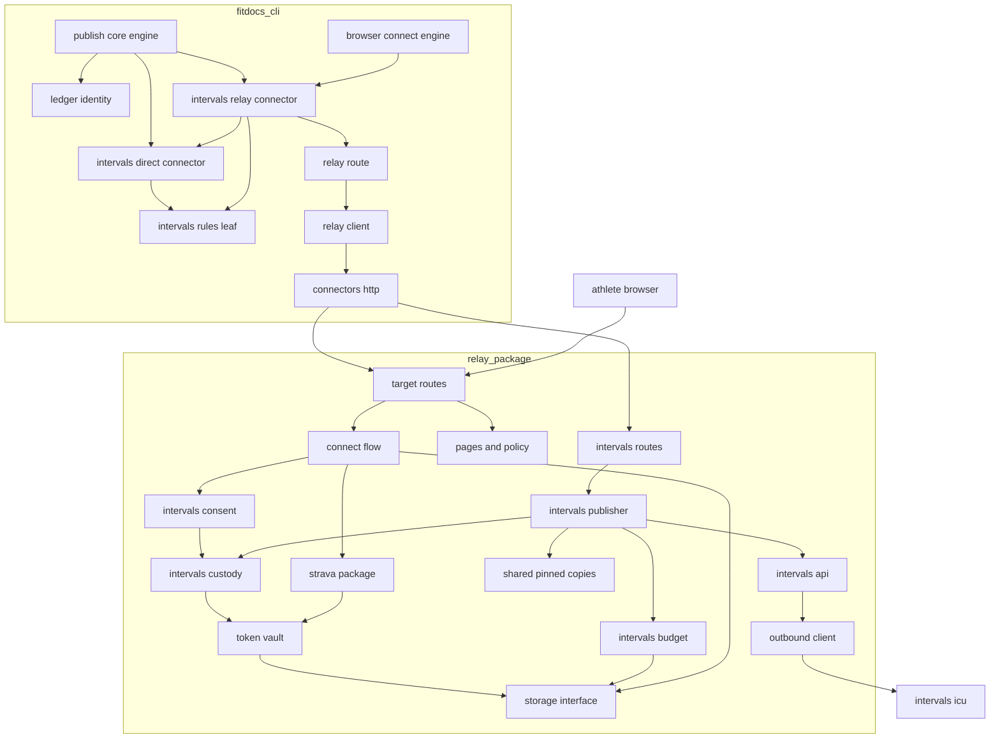
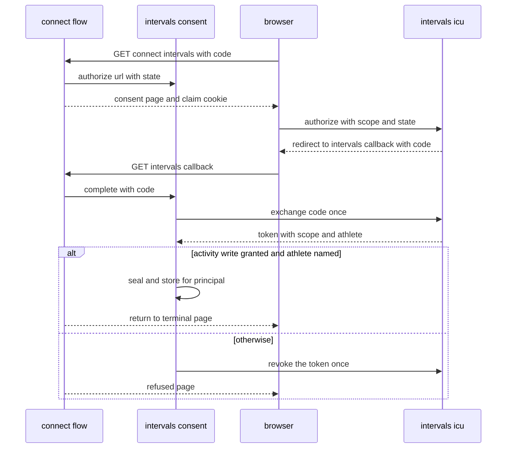
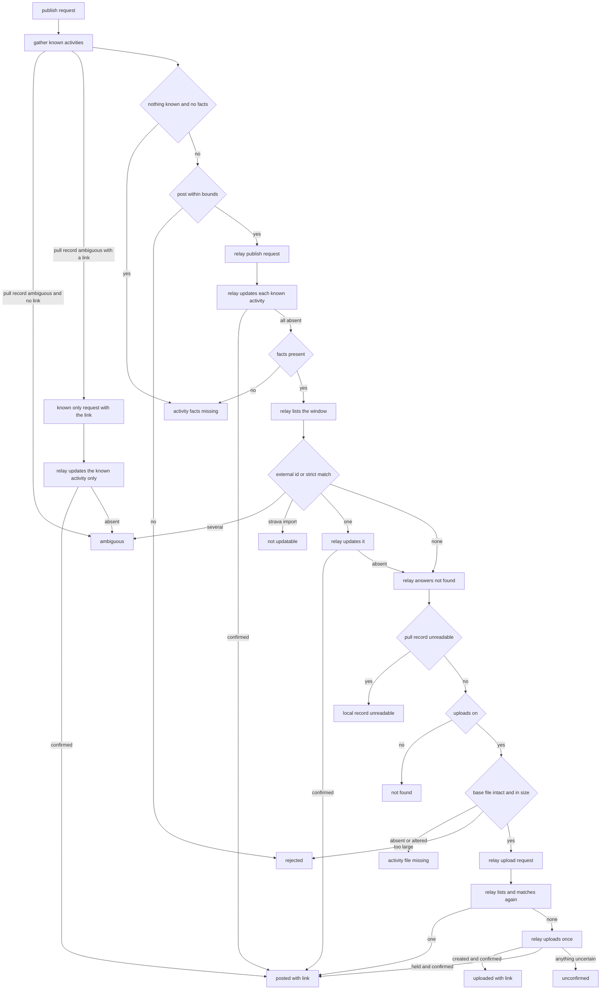

# Design Document: relay-intervals

## Overview

**Purpose**: This feature adds a second route to intervals.icu: through a
relay that holds one intervals.icu OAuth application, so that fitdocs
publishes posts without holding a personal API key. The route is chosen per
instance; the direct route of `intervals-publish` stays the default and
unchanged. A relay-routed instance finds the page's activity in the same
order, maps every intervals.icu answer to the same code and writes the same
direct link as the direct route. The only difference is that the relay makes
the intervals.icu calls.

**Surfaces**:
- A relay-routed instance in `fitdocs.toml` (`connector = "intervals-relay"`,
  `relay = "<relay instance>"`, `publish_upload`), and the behaviour of
  `fitdocs connect`, `fitdocs publish` and `fitdocs disconnect` for it.
- The relay's intervals.icu configuration in the deploy environment, its
  connect page and callback, and its publish and upload routes.
- The relay's and fitdocs's target-neutral relay-target machinery, lifted
  out of strava-publish's Strava modules so both targets share one copy.

**Impact**:
- fitdocs gains a built-in `intervals-relay` connector, an optional
  shared-ledger protocol, a `service_name` on browser-consent connectors,
  and a target-neutral `connectors/relay_route.py`.
- intervals-publish's intervals.icu rules move into a standard-library-only
  leaf, `connectors/intervals_rules.py`, which the relay pins.
- The relay gains a `targets/` package (lifted from `strava/`), an
  `intervals/` package and seven deploy-contract variables. It needs no
  schema change: strava-publish's `target_connections` already stores an
  absent expiry (R13.6).
- Neither `CONTRACT_VERSION` nor `DOC_VERSION` changes; no command, no
  `PublishCode` and no `RelayCode` is added.

### Goals
- One meaning per intervals.icu answer on both routes, enforced by one
  definition, not by review.
- A post lands on the right activity or nowhere: the direct route's order,
  strict one-to-one matching, ambiguity as a code; an upload never runs on
  unreadable identity state.
- Nothing from intervals.icu crosses the relay boundary except the
  identifier the direct link needs.
- No second copy of the connect, custody, page, policy or relay-answer
  mapping machinery.

### Non-Goals
- Any change to the direct route's behaviour, pull or key check.
- Planned workouts, wellness, thresholds or pulling through the relay (R8).
- Applying for, or operating, the maintainer's intervals.icu application.
- Any website edit (R9).

## Boundary Commitments

### This Spec Owns
- **fitdocs side**:
  - the built-in `intervals-relay` connector (`connectors/intervals_relay.py`):
    its settings, its consent operations, its publish operation, its known
    activities and local refusals;
  - the per-instance route rule (the `connector` key) and the shared
    publish-ledger identity: `PublishLedgerShared` in `connectors/protocol.py`
    and its registry rule, and `ledger_connector` in `fitdocs.publish.targets`
    (a publish-core amendment);
  - the shared intervals.icu rules leaf `connectors/intervals_rules.py`
    (moved from `intervals.py`, an intervals-publish amendment), and the
    intervals.icu fields and outcome sets appended to
    `connectors/relay_targets.py`;
  - `connectors/relay_route.py` (the consent operations and the
    relay-answer mapping, lifted from `connectors/strava.py`) and
    `BrowserConsentClient.service_name` with its uses in `browser_connect`,
    `disconnect` and `cli` (strava-publish amendments).
- **Relay side** (under `relay/src/fitdocs_relay/`):
  - the `targets/` package lifted from `strava/` (config, connect flow over
    a provider protocol, token vault, pages, policy composition, the
    target-neutral routes, the generic operator commands);
  - the `intervals/` package: configuration, API client, budget policy,
    custody, consent provider, publisher, consent and policy text, routes;
  - the seven intervals.icu rows, and `FITDOCS_RELAY_INTERVALS_CLIENT_ID`
    appended to the four target-neutral rows' `required_with` tuple;
  - the route-table, body-limit, reserved-prefix and capabilities appends.
- **Shared-copy pair** (R2): `src/fitdocs/connectors/intervals_rules.py` →
  `relay/src/fitdocs_relay/shared/intervals_rules.py`, appended to
  `SHARED_MODULES` and the cross-check test.
- **Docs**: the relay-route subsection of `docs/connectors.md`; the
  `## Targets` and `## The intervals.icu target` sections of `docs/relay.md`;
  the intervals.icu policy sections and consent text (served by the relay);
  the network-statement task (R10); the steering sentences; changelog
  entries; the site-copy queue item; the maintainer's live-check documents.

### Out of Boundary
- The direct route's behaviour: its requests, codes, retries, pull, key
  check and link (intervals-publish). This spec moves code out of
  `intervals.py` without changing a result.
- The outcome vocabulary, the target contract, the publish ledger's format,
  the link rule and `fitdocs publish` (publish-core). This spec appends no
  `PublishCode` (R10) and adds only the ledger-identity hook.
- Relay tokens, principals, the envelope codec, the storage interface's
  extension rule, the pinned-copy mechanism, the deploy contract's
  relay-server rows (relay-server).
- Strava's behaviour, its budget, resolver, publisher, webhook and `/go/`
  link (strava-publish). This spec moves their target-neutral neighbours
  and keeps every Strava result.
- The strict rule's tolerances (activity-identity).
- `PUSH_PLANNED_WORKOUT`, calendar events, wellness through the relay (R8).
- The packaged agent skill: unchanged.

### Allowed Dependencies
- **fitdocs side**:
  - `intervals_rules`: standard library only (`collections.abc`,
    `dataclasses`, `datetime`, `enum`, `json`, `math`, `re`, `types`,
    `typing`, `urllib.parse`); no relative import;
  - `relay_targets`: its strava-publish imports plus the relative
    `.intervals_rules`;
  - `relay_route`: `errors`, `protocol`, `secrets`, `relay`, `relay_codes`,
    `relay_envelope`, `relay_targets`;
  - `intervals_relay`: `errors`, `protocol`, `secrets`, `relay`,
    `relay_codes`, `relay_envelope`, `relay_targets`, `relay_route`,
    `intervals`, `intervals_rules`. Publish codes and request types come only
    through `fitdocs.connectors.protocol` (R11); nothing from
    `fitdocs.publish`;
  - `intervals`: its intervals-publish imports, with `fitdocs.identity.strict`
    replacing `fitdocs.identity.matching`, plus `intervals_rules`;
  - `fitdocs.publish.targets` keeps its import set (it already imports the
    connectors surface);
  - no new runtime dependency; no clock read; network only through
    `connectors/http.py`; no intervals.icu address in `intervals_relay.py` or
    `relay_route.py`.
- **Relay side**: strava-publish's dependencies, unchanged (no new
  package). `outbound.py` stays the only `urllib` importer; `crypto.py` the
  only `cryptography` importer. `targets/pages.py`, `targets/policy.py` and
  `intervals/policy.py` import the standard library only. Never `fitdocs`.
- **Tests**: no request to intervals.icu anywhere. intervals.icu is scripted
  at the relay's `Outbound` seam; the relay is scripted at fitdocs's
  transport.

### Revalidation Triggers
- `intervals_rules` (the table, the identifier rule, the window, the parser,
  the match, the upload reading, the request shapes): the direct route, the
  relay copy and both sides' tests.
- intervals-publish's resolution order, `ANSWER_CODES` or `publish_upload`
  meaning: this spec's fitdocs connector and relay publisher.
- strava-publish's `ConnectFlow`, `Custody`, storage areas, `relay_targets`
  codec, `BrowserConsentClient`, `RelayBound`, binding pass,
  `OAUTH_BROWSER` resolution, its nullable `access_expires_at`, its
  `required_with` tuple, its neutral CLI started line, or
  `RelayClient.post`'s `max_request_bytes` keyword: the lifted modules and
  both targets.
- publish-core's ledger identity rule, `PublishRequest`, `TARGET_CODES` or
  the link rule: the shared-ledger hook and the mapping.
- The deploy-contract rows or `required_with`'s meaning: every deployment.
- Any confirmed or contradicted TBC-R item (research.md): the function it
  sits behind and its tests.

### Implementation Gate
- Implementation of this spec starts only after the maintainer records in
  this spec's `research.md` ("Implementation gate") either that intervals.icu
  approved the maintainer's OAuth application, or a written decision to
  implement before approval (16.1). Until then the record reads
  `pending`.
- The tasks express it three times: the plan's prerequisites name the gate
  and say no task is dispatched while task 1.1 is unchecked; task 1.1 reads
  the record and, when it shows neither, stops the whole run for a human
  (kiro-impl's `STOP_FOR_HUMAN`, never a skippable task block); and the
  first task of every later group declares `_Depends: 1.1_`.
- The gate guards against building on an OAuth contract that cannot yet be
  exercised (TBC-R1 to TBC-R9). Every automated test runs against scripted
  answers either way.

### Future extension: planned-workout push (R8)
Out of scope; `PUSH_PLANNED_WORKOUT` stays reserved. Nothing here closes the
door:
- relay routes are keyed by target id and action, so a planned-workout
  action is a new route on the `intervals` target;
- `intervals_rules.ANSWER_CODES` is keyed by request kind, never by the
  object written, so an events update or creation maps identically;
- the relay's `IntervalsApi` gains an events call beside the activity calls;
- `ACTIVITY:WRITE` does not cover the calendar: a later spec requests
  `CALENDAR:WRITE` too, which means a new consent from each athlete.
- **Revalidation trigger**: a spec that drives `PUSH_PLANNED_WORKOUT` on
  either intervals.icu route re-checks the requested scope, the route
  builder and the outcome sets.

### Settled Seams Applied
- **R1, R10**: every intervals.icu answer maps into publish-core's existing
  `TARGET_CODES`; no `PublishCode` is appended. `local_record_unreadable`
  (R11) is answered by the fitdocs side, never by the relay.
- **R2, R9**: one pair (`intervals_rules.py`) appended to `SHARED_MODULES`
  and `tests/test_relay_shared_copies.py`; `relay_targets.py`, already
  pinned by strava-publish, gains appended names and its copy is re-synced.
- **R3**: no `RelayCode` is appended; the connect codes are target-neutral.
- **R4, R9**: every relay request is single-attempt through strava-publish's
  `RelayClient` marking. The relay's own intervals.icu `PUT` is the relay's.
- **R5**: `OAUTH_BROWSER` is already driven (strava-publish); this spec adds
  a second browser-consent connector and the `service_name` member.
- **R6**: no version constant moves. `DEPLOY_CONTRACT_VERSION`,
  `ENVELOPE_VERSION` and `SEAM_VERSION` stay 1 (the changes are additive).
- **R7**: steering edits are separate sentences, line-disjoint from other
  specs'; `CHANGELOG.md` is appended to and read through
  `unreleased_since(text, V0_2_0)`.
- **R8**: see Future extension.
- **R9**: no `website/content/` edit; a queue item records the site copy;
  `_EXPECTED_HEADINGS` gains rows for the new subsection only; no command
  is added, so the command-count pins do not move.
- **R10 network statements**: the idempotent task (NetworkStatements).
- **R10 live check, R12**: the live check is a maintainer procedure plus a
  record template; no session carries out any of its steps (it needs the
  maintainer's approved application, its secret and a browser grant).
- **R11**: `intervals_relay` names `PublishCode`, `TARGET_CODES` and the
  request types through `fitdocs.connectors.protocol`; `intervals_rules`
  holds code values as strings and imports nothing; an upload request is
  sent only when the pull record was readable or absent.

### Amendments Carried (each takes the next free amendment number at landing)
- **strava-publish**:
  - Design "File Structure Plan": the target-neutral relay modules move to
    `fitdocs_relay/targets/` (config, connect flow, vault, pages, policy
    composition, routes for connect, poll, disconnect, the connect page, the
    callback and `/privacy`, and the `reencrypt` and `new-encryption-key`
    commands); `strava/` keeps `StravaConsent`, its refresh lease, budget,
    resolver, publisher, webhook, `/go/`, `robots.txt` and its webhook
    commands. `connectors/strava.py`'s consent operations and mapping tables
    move to `connectors/relay_route.py`.
  - Design "StravaConfig": `FITDOCS_RELAY_INTERVALS_CLIENT_ID` is appended
    to the four target-neutral rows' `required_with` tuple, which
    strava-publish ships as `("FITDOCS_RELAY_STRAVA_CLIENT_ID",)` (R13.6).
    The tuple form and the nullable `SealedTokens.access_expires_at` are
    strava-publish's own (folded by R13.6), not amendments of this spec.
  - Design "ProtocolAmendment": `BrowserConsentClient` gains
    `service_name`; `StravaConnector.service_name = "Strava"`.
  - Design "BrowserConnectEngine": the stored credentials name
    `instance.connector.connector_id`; the disconnect notes name the
    service from `service_name`; the CLI's started line stays strava-publish's
    neutral line (R13.5).
  - Design "SharedTargetWire": the intervals.icu names are appended.
  - Design "Pages and Policy": the privacy page groups each configured
    target's sections under its service name.
  - Requirement 14.2's "every Strava test passes" condition is recorded.
- **intervals-publish**:
  - Design "AnswerMapping", "ActivityFinding", "ActivityWrites": the
    standard-library rules move to `connectors/intervals_rules.py`;
    `ANSWER_CODES` there holds code values; `intervals.py` imports them and
    wraps values as `PublishCode`.
  - The listing match's strict test is `identity.strict.strict_match` with
    the page sport on both sides (equal to `pair_evidence(...) is
    Evidence.STRICT` with no device and no kind); the boundary pin admits
    `fitdocs.identity.strict` in place of `fitdocs.identity.matching`.
  - `_activity_link`, `_linked_activity`, `_record_activity` and
    `_base_file` become the public `activity_link`, `linked_activity`,
    `pull_record_activity` and `archived_base_file`.
  - Every intervals-publish test result is unchanged.
- **publish-core**: Design "PublishLedger": a configured target's ledger
  identity is `fitdocs.publish.targets.ledger_connector(instance)`: the
  connector's `publish_ledger_connector` when it implements
  `PublishLedgerShared`, else its `connector_id`. The mismatch check is
  otherwise unchanged. publish-core pre-words its Req 11.6 as "the target's
  ledger identity (its connector id)" (R13.6), so this amendment changes
  only that definition: the ledger identity is `ledger_connector(instance)`.
- **relay-server**:
  - Req 9.2: the variable table gains the seven intervals.icu rows; the
    generic rows' requirement reads "with either target".
  - Design "AnswersGlue, CoreRoutes": `OFFERED_TARGETS` gains `intervals`;
    `RESERVED_PREFIXES` gains `/intervals/`; `ROUTE_BODY_LIMITS` gains the
    intervals.icu upload route.
- **connectors**:
  - New: the built-in `intervals-relay` connector (this spec's Requirement
    1).
  - Req 2.3: a connector implementing `PublishLedgerShared` must name a
    connector id other than its own; a browser-consent connector must
    declare a `service_name` that passes `valid_label`.
  - Req 2.7: the surface gains `PublishLedgerShared`.
  - Req 14.1 and 14.4: the requests `connect`, `disconnect` and `publish
    --yes` make for a relay-routed intervals.icu instance.
- **intervals-connector**: the intervals.icu service is reachable through a
  second, publish-only connector kind; the "only module naming the service"
  responsibility reads "the only module naming the service's API address";
  `intervals_rules.py` holds the rules both routes share.
- **steering**: `tech.md` and `structure.md`, one sentence each
  (Steering).

## Architecture

### Existing Architecture Analysis
- A connector's auth style, credential fields and capabilities are per
  connector (`settings.py:82-90`, `credentials.py:391-409`); the settings
  loader resolves the instance's `connector` key, defaulting to the
  instance's own name (`settings.py:113-132`).
- publish-core's ledger loader refuses a ledger whose `connector` differs
  from the configured connector; the link is kept only beside a landed code
  and must pass `valid_link`.
- strava-publish's browser-consent engine, binding pass and disconnect rows
  are keyed on `AuthStyle.OAUTH_BROWSER`, not on Strava, except for two
  literals (the stored connector id and the disconnect notes); its CLI
  started line is neutral (R13.5).
- strava-publish's relay connect machinery (sessions, claim, state, poll,
  connection-token issuance, sealing, re-encryption, pages, `/privacy`) is
  target-neutral but lives under `strava/` and is built inside
  `StravaServices`.
- intervals-publish's rules are private helpers of `intervals.py`, which
  imports `errors`, `http`, `protocol`, `secrets` and `ledger`.

### Architecture Pattern & Boundary Map



**Architecture Integration**:
- **Pattern**: on fitdocs, the existing connector pattern (declaration,
  operation protocols, engine, CLI presentation); on the relay, strava-
  publish's ports and adapters, with a target-neutral core and one provider
  per target.
- **Boundaries**: `IntervalsApi` is the only relay code that reads an
  intervals.icu response; it returns typed values or an `AnswerClass`, never
  text. `intervals_rules` is the only definition of what an answer means.
- **Preserved patterns**: injected clocks; closed, append-only
  vocabularies; absent values as `None`; credentials outside the data root;
  pinned copies for shared code; every relay request single-attempt.

**Dependency direction** (each imports only from those to its left; a
violation is a defect):
- fitdocs: `intervals_rules` → `relay_codes` → `relay_envelope` →
  `relay_targets` → `protocol` → `relay` → `relay_route` → `strava`;
  `identity.strict`, `intervals_rules` → `intervals` → `intervals_relay`
  (which also imports `relay_route`) → `browser_connect` / `disconnect` →
  `cli`. `fitdocs.publish.targets` imports the connectors surface only.
- relay: `shared.*` → `contract` → `crypto` → `config` (with
  `targets.config`, `strava.config`, `intervals.config`) →
  `storage.interface` → backends → `storage` → `identity`, `ratelimit` →
  `outbound` → `targets.vault` → `strava.api`, `intervals.api` →
  `strava.budget`, `intervals.budget`, `strava.resolve` → `strava.custody`,
  `intervals.custody` → `strava.connect`, `intervals.connect` →
  `targets.connect` → `strava.publish`, `intervals.publish`,
  `strava.webhook` → `seam` → `answers` → `targets.routes`, `strava.routes`,
  `intervals.routes` → `routes` → `app` → `serve` → `targets.cli`,
  `strava.cli` → `cli`. `targets.pages`, `targets.policy`, `strava.policy`
  and `intervals.policy` are standard-library leaves.

### Technology Stack

| Layer | Choice / Version | Role in Feature | Notes |
|-------|------------------|-----------------|-------|
| fitdocs CLI | existing typer CLI, `connectors/http.py` | relay-routed connect, publish, disconnect | No new runtime dependency |
| Relay HTTP and storage | relay-server's Starlette, uvicorn, `sqlite3`, `psycopg` | routes, pages, custody, budget | Unchanged versions |
| Relay encryption | strava-publish's `cryptography` (AES-GCM) | token sealing | Unchanged |
| Relay outbound HTTP | strava-publish's `Outbound` over `urllib` | intervals.icu calls | Unredirected secret headers |
| Service | intervals.icu OAuth and API v1 | authorize, token, list, update, upload, disconnect-app | Public forum docs, TBC-R1 to TBC-R9 |

## File Structure Plan

### Directory Structure
```
src/fitdocs/connectors/intervals_rules.py   # NEW, shared: CallKind, AnswerClass, SUCCESS_STATUSES, ANSWER_CODES (values),
                                            #   answer_class/answer_code, the identifier rule, listing window/path/fields,
                                            #   ListedActivity, listed_activities, Matched/MatchRefusal/match_listing,
                                            #   UploadAnswer/uploaded_activity, multipart_body, update_body, update_path,
                                            #   upload_path, SELF_ATHLETE, STRAVA_SOURCE (moved from intervals.py)
src/fitdocs/connectors/relay_route.py       # NEW (lifted from strava.py): start/poll/withdraw consent per target,
                                            #   PUBLISH_MAPPING, UPLOAD_MAPPING, answer_code()
src/fitdocs/connectors/intervals_relay.py   # NEW: IntervalsRelayConnector, IntervalsRelaySettings

relay/src/fitdocs_relay/
├── shared/intervals_rules.py   # NEW copy of src/fitdocs/connectors/intervals_rules.py
├── targets/                    # NEW package, lifted from strava/ (no second copy remains there)
│   ├── __init__.py             # package marker
│   ├── config.py               # TargetsConfig, load_targets_config (from strava/config.py)
│   ├── connect.py              # ConsentProvider, ConnectFlow and its outcome types (from strava/connect.py)
│   ├── vault.py                # TokenVault, Opened, account_key (from strava/custody.py)
│   ├── pages.py                # Page, PAGE_HEADERS, Operator, every page (from strava/pages.py), service-parameterised
│   ├── policy.py               # COMMON_OPENING, COMMON_CLOSING, policy_sections(providers) (from strava/policy.py)
│   ├── routes.py               # target_routes(services): connect, poll, disconnect, connect page, callback, /privacy
│   └── cli.py                  # reencrypt, new-encryption-key (from strava/cli.py)
├── intervals/
│   ├── __init__.py             # package marker
│   ├── config.py               # IntervalsConfig, IntervalsLimits, load_intervals_config
│   ├── api.py                  # IntervalsApi, Grant, Unreadable: the only reader of intervals.icu responses
│   ├── budget.py               # IntervalsBudget: application day, application fifteen minutes, athlete day
│   ├── custody.py              # IntervalsCustody: access, rejected, withdraw (over TokenVault)
│   ├── connect.py              # IntervalsConsent: the ConsentProvider for intervals.icu
│   ├── publish.py              # IntervalsPublisher: publish, upload; Landed; deadlines
│   ├── policy.py               # CONSENT_TEXT, POLICY_SECTIONS (intervals.icu's group)
│   └── routes.py               # intervals_routes(services): publish, upload
relay/tests/
├── targets/                    # MOVED from relay/tests/strava/ where the code moved: test_connect.py, test_vault.py,
│                               #   test_pages.py, test_policy.py, test_routes.py, test_cli.py (assertions kept)
├── intervals/                  # NEW: scripted_intervals.py (the Outbound fake), test_config.py, test_api.py,
│                               #   test_budget.py, test_custody.py, test_consent.py, test_publish.py, test_upload.py,
│                               #   test_routes.py, test_rules_copy.py, test_boundary_sentinel.py
│                               #   (no schema change: strava-publish's nullable expiry column is used)
relay/contract/intervals-cases.json      # NEW: ParityCases, the match and resolution cases both suites run
relay/LIVE_CHECK_INTERVALS.md            # NEW: the maintainer's live-check procedure
relay/LIVE_CHECK_INTERVALS_RECORD.md     # NEW: the record template

tests/connectors/test_intervals_rules.py           # NEW: the leaf's table, rules and case table
tests/connectors/test_intervals_relay.py           # NEW: settings, binding, known activities, refusals, mapping, link
tests/connectors/test_intervals_relay_cli.py       # NEW: connect, publish, disconnect, route switch through the CLI
tests/connectors/test_intervals_relay_wire.py      # NEW: decodes the recorded intervals.icu exchanges
tests/connectors/test_relay_route.py               # MOVED from test_strava.py where the code moved (assertions kept)
tests/publish/test_ledger_identity.py              # NEW: ledger_connector and the route switch
.kiro/queue/2026-10-31-relay-intervals-site-copy.md   # NEW (written with this spec): site copy follow-up (R9)
```

### Modified Files
- `src/fitdocs/connectors/intervals.py`: imports the rules from
  `intervals_rules` (`SELF_ATHLETE`, `STRAVA_SOURCE` included); wraps table
  values as `PublishCode`; the listing match uses `identity.strict`; the four
  helpers become public names; module docstring (two route sentence and the
  import sentence).
- `src/fitdocs/connectors/relay_targets.py`: the intervals.icu names
  (IntervalsWire).
- `src/fitdocs/connectors/strava.py`: delegates its consent operations and
  mapping to `relay_route`; declares `service_name = "Strava"`.
- `src/fitdocs/connectors/protocol.py`: `PublishLedgerShared`;
  `BrowserConsentClient.service_name`; docstrings.
- `src/fitdocs/connectors/registry.py`: the two new rules.
- `src/fitdocs/connectors/browser_connect.py`: stored connector id.
- `src/fitdocs/connectors/disconnect.py`: the `OAUTH_BROWSER` notes name the
  service.
- `src/fitdocs/connectors/__init__.py`: register `IntervalsRelayConnector()`
  after `IntervalsConnector()`; export `PublishLedgerShared`; the package
  docstring's allowed-import sentence, which intervals-publish extended with
  `fitdocs.identity.matching` for the intervals module's publish path, names
  `fitdocs.identity.strict` instead (task 1.3).
- `src/fitdocs/cli.py`: no change to the started line (strava-publish's
  neutral line, R13.5); the disconnect notes print `service_name`.
- `src/fitdocs/publish/targets.py`: `ledger_connector`; the CLI's ledger
  mapping uses it (publish-core's CliPublish in `src/fitdocs/cli.py`).
- `scripts/sync_relay_shared.py`, `tests/test_relay_shared_copies.py`: one
  pair; `relay_targets` re-synced.
- relay: `contract.py` (the intervals.icu rows; the client id appended to
  the target-neutral rows' `required_with`), `config.py`
  (`RelayConfig.intervals`, `targets` from `targets.config`), `routes.py`
  (`OFFERED_TARGETS`, `RESERVED_PREFIXES`, `ROUTE_BODY_LIMITS`,
  `core_routes`), `app.py` (`RelayServices.target_core`, `.intervals`),
  `logs.py` (redaction, intervals.icu call events), `cli.py` (registration
  of the moved commands), `strava/*` (imports from `targets/`; StravaConsent),
  `contract/envelope-v1.json` (intervals.icu exchanges),
  `tests/test_boundary.py`, `tests/test_contract.py`,
  `tests/test_docs_relay.py`, `CHANGELOG.md`.
- **fitdocs tests whose pins move**: `tests/connectors/test_intervals.py`,
  `test_intervals_publish.py`, `test_intervals_publish_cli.py` (imports of
  moved names; results unchanged); `test_strava.py` (imports); `test_boundary.py`
  (module list and allowed imports per the table below); `test_surface.py`
  (`EXPECTED_ALL` appended, count literal at landing); `test_registry.py`
  (the two rules); `test_docs.py` (`_EXPECTED_HEADINGS`, the preamble's
  built-in list bound to the registry); `test_intervals_docs.py`
  (subsection list); `test_network_statements.py` (NetworkStatements);
  `test_e2e.py` (a relay-routed instance in the wired root);
  `tests/test_confinement.py` (connect writes nothing under the data root).
- **This spec's own record**: `.kiro/specs/relay-intervals/research.md`
  "Implementation gate" (the maintainer's dated line) and "Live-check
  findings".
- **Docs and steering**: `docs/connectors.md`, `docs/relay.md`,
  `CHANGELOG.md`, `relay/CHANGELOG.md`, the network-statement places,
  `.kiro/steering/tech.md`, `.kiro/steering/structure.md`, and the
  amendment records in `.kiro/specs/{strava-publish,intervals-publish,
  publish-core,relay-server,connectors,intervals-connector}/requirements.md`.

**Connectors boundary table** (new and changed `_ALLOWED_IMPORT_TARGETS`
entries, non-standard-library only):

| Module | Allowed direct imports |
|--------|------------------------|
| `intervals_rules` | none |
| `relay_targets` | `relay_codes`, `relay_envelope`, `intervals_rules` |
| `relay_route` | `errors`, `protocol`, `secrets`, `relay`, `relay_codes`, `relay_envelope`, `relay_targets` |
| `strava` | strava-publish's set, plus `relay_route` |
| `intervals` | intervals-publish's set, with `fitdocs.identity.strict` in place of `fitdocs.identity.matching`, plus `intervals_rules` |
| `intervals_relay` | `errors`, `protocol`, `secrets`, `relay`, `relay_codes`, `relay_envelope`, `relay_targets`, `relay_route`, `intervals`, `intervals_rules` |
| `fitdocs.connectors` (package) | existing + `fitdocs.connectors.intervals_relay` |

Each new module joins `CONNECTORS_MODULE_NAMES` and `_ALLOWED_IMPORT_TARGETS`
(`tests/connectors/test_boundary.py`, exact equality over the files on disk)
in the task that creates it.

## System Flows

### Connecting a relay-routed instance
The sequence is strava-publish's "Connecting a Strava instance" with the
target `intervals`; only the provider steps differ:



- The scope arrives in the exchange's answer, not on the callback, so the
  intervals.icu provider checks it after the exchange and revokes a token it
  will not keep.
- The poll, the connection-token issuance and the fitdocs-side loop are the
  target-neutral flow's, unchanged.

### Publishing one page



Key decisions:
- The local steps (known activities, the pull record's ambiguity and
  readability, the file check) are fitdocs's; the remote steps are the
  relay's. Together they are the direct route's order: the direct route
  updates the recorded link's activity before it reads the pull record, so
  an ambiguous pull record with a recorded link sends a known-only request
  carrying the link alone, and the relay's `not_found` for it becomes
  `ambiguous`, exactly as the direct route answers after the link's
  activity is absent.
- Parity is pinned by one shared case file (ParityCases) that both suites
  run.
- An upload request is sent only after a definite `not_found`, with uploads
  on, a readable or absent pull record and an intact file (R11).
- Every arrow from a failed call carries the answer table's code for that
  call kind; the diagram omits them.

### Revocation paths
- **CLI disconnect**: `POST /v1/targets/intervals/disconnect` →
  `IntervalsCustody.withdraw`: one `DELETE <api>/disconnect-app` with the
  token (when the budget allows), then `delete_connection(generation=None)`
  whatever happened → `ok`.
- **Revoked at intervals.icu**: the next call answered 401 →
  `delete_connection(generation=g)` → `auth_rejected`.
- **Re-authorized elsewhere** (a newer grant of the same application
  replaced the token, TBC-R4): as above, at the next 401.
- **Same account connected by another principal**: `put_connection`
  displaces the earlier row and revokes its connection token.
- **Principal deleted**: foreign-key cascade in the same transaction.

## Requirements Traceability

| Requirement | Summary | Components | Interfaces | Flows |
|-------------|---------|------------|------------|-------|
| 1.1, 1.3, 1.4, 1.9 | The relay-routed connector and settings | IntervalsRelayConnector, RegistryAmendment | `IntervalsRelaySettings`, `link_label` | — |
| 1.2 | Route chosen by `connector` | IntervalsRelayConnector, settings loader | `connector` key | — |
| 1.5 | `wellness` refused | IntervalsRelayConnector (no pull-wellness) | `_resolve_wellness` | — |
| 1.6 | Requests only to the relay | IntervalsRelayConnector, RelayRoute | `RelayClient` | Publishing |
| 1.7, 1.8 | Credential and ready state | IntervalsRelayConnector | `resolve_credentials` | — |
| 1.10 | No pull | IntervalsRelayConnector (no pull capability) | relay-server's bare-pull selection | — |
| 2.1, 2.2 | Ledger kept across the switch | LedgerIdentity | `PublishLedgerShared`, `ledger_connector` | — |
| 2.3 | Not connected after a switch | IntervalsRelayConnector | stored `connector_id` check | — |
| 2.4 | Own pull record read only | IntervalsRelayConnector, IntervalsDirectAmendment | `pull_record_activity` | Publishing |
| 3.1, 3.2 | CLI connect | BrowserConsentAmendment, IntervalsRelayConnector | `run_browser_connect`, `start_consent`, `poll_consent` | Connecting |
| 3.3 | Stored connector id | BrowserConsentAmendment | `StoredCredentials.connector_id` | Connecting |
| 4.1, 4.4, 4.7 | Sessions, page refusals, polls | TargetsCore | `ConnectFlow.start`, `page`, `poll` | Connecting |
| 4.2, 4.3 | Consent page and authorization | TargetsCore, IntervalsConsent, IntervalsApi | `connect_page`, `authorize_url` | Connecting |
| 4.5, 4.6 | Exchange, grant, refusal | IntervalsConsent, IntervalsApi | `complete`, `exchange`, `revoke` | Connecting |
| 4.8 | One account, one principal | TargetsCore (TokenVault), storage | `put_connection` | Revocation |
| 5.1, 5.5, 5.6, 5.7 | Sealing, keys, account key | TokenVault, IntervalsCustody | `store`, `open`, `reencrypt_all`, `account_key` | — |
| 5.2 | No expiry, no renewal | IntervalsCustody (on strava-publish's nullable expiry) | `SealedTokens.access_expires_at` | — |
| 5.3 | Refused token deleted | IntervalsCustody, IntervalsPublisher | `rejected`, `delete_connection` | Revocation |
| 5.4 | Header-only tokens | IntervalsApi | `OutboundRequest.secret_headers` | — |
| 6.1, 6.2, 6.3, 6.4, 6.5 | Known activities and local refusals | IntervalsRelayConnector | `publish`, `intervals_publish_fields` | Publishing |
| 6.6, 6.7 | Upload request gate | IntervalsRelayConnector | `publish`, `upload_fields` | Publishing |
| 6.8 | Single attempt | RelayRoute (strava-publish's `RelayClient`) | `single_attempt=True` | — |
| 6.9 | Mapping | RelayRoute, IntervalsRelayConnector | `answer_code`, `PUBLISH_MAPPING`, `UPLOAD_MAPPING` | — |
| 6.10, 6.11 | Link and nothing else | IntervalsRelayConnector, IntervalsDirectAmendment | `activity_link`, `parse_landed_data` | Publishing |
| 7.1, 7.2, 7.3, 7.5, 7.6, 7.7, 7.8 | Relay-side finding | IntervalsPublisher, IntervalsRules | `match_listing`, `listing_path`, `listed_activities` | Publishing |
| 7.4 | Pinned rules | IntervalsRules, SharedCopyPair | `SHARED_MODULES` | — |
| 7.9 | No page-to-activity map | IntervalsPublisher, storage | physical model | — |
| 7.10 | Malformed known activities | IntervalsWire, IntervalsRoutes | `parse_intervals_publish_fields` | — |
| 7.11 | Known activities only | IntervalsPublisher, IntervalsWire | `KnownActivities.only` | Publishing |
| 8.1, 8.2, 8.9 | Update and repeats | IntervalsPublisher, IntervalsApi | `update_activity`, `_call` | Publishing |
| 8.3, 8.4, 8.5, 8.6, 8.8 | Upload, confirmation, guard | IntervalsPublisher, IntervalsApi | `upload`, `uploaded_activity` | Publishing |
| 8.7 | Deadlines | IntervalsPublisher | `PUBLISH_DEADLINE_S`, `UPLOAD_DEADLINE_S` | — |
| 9.1, 9.2, 9.3, 9.5, 9.6 | One table, two routes | IntervalsRules, IntervalsDirectAmendment, SharedCopyPair, ConnectorsDocs | `ANSWER_CODES`, `answer_code` | — |
| 9.4 | Not connected | IntervalsCustody | `access` | — |
| 9.7 | Parity case table | ParityCases | `relay/contract/intervals-cases.json` | Publishing |
| 10.1, 10.2, 10.3, 10.4, 10.5, 10.6, 10.7 | Budget | IntervalsBudget, IntervalsConfig | `spend`, `reserve_upload`, `spend_budget` | — |
| 11.1, 11.2 | CLI disconnect | BrowserConsentAmendment, IntervalsRelayConnector | `run_disconnect`, `withdraw_consent` | Revocation |
| 11.3 | Relay disconnect | TargetsCore, IntervalsCustody | `withdraw` | Revocation |
| 11.4 | Revoked at intervals.icu | IntervalsCustody | `rejected` | Revocation |
| 11.5 | Principal deleted | storage | foreign keys | Revocation |
| 12.1 | Answers carry codes and the id | IntervalsRoutes, IntervalsWire | `landed_data`, `route_outcome` | — |
| 12.2 | Logs | LogsAmendment, IntervalsApi | redacting filter | — |
| 12.3 | Nothing stored | TokenVault, storage | physical model | — |
| 12.4 | Pages | TargetsCore (pages), IntervalsPolicy | `Page` | — |
| 12.5 | Routes | IntervalsRoutes, TargetsCore (routes) | route tables | — |
| 13.1, 13.2, 13.3, 13.6 | Configuration | DeployContractRows, IntervalsConfig, TargetsCore (config) | `ENVIRONMENT`, `required_with`, `load_intervals_config` | — |
| 13.4, 13.5 | Offered only when configured | RoutesAmendment | capabilities, `OFFERED_TARGETS` | — |
| 13.7 | Self-hosting note | RelayDocs | `docs/relay.md` | — |
| 14.1, 14.4 | One machinery | TargetsCore, RelayRoute | `ConsentProvider`, `TokenVault`, `policy_sections` | — |
| 14.2 | Strava unchanged | TargetsCore, StravaConsent | the moved Strava tests | — |
| 14.3 | Service named | BrowserConsentAmendment | `service_name` | Connecting |
| 15.1 | Connectors docs | ConnectorsDocs | `docs/connectors.md` | — |
| 15.2 | Relay docs | RelayDocs | `docs/relay.md` | — |
| 15.3 | Network statements | NetworkStatements | `test_network_statements.py` | — |
| 15.4 | Steering | Steering | `tech.md`, `structure.md` | — |
| 15.5 | Changelogs | Changelogs | both changelogs | — |
| 15.6 | Site copy | SiteFollowUp | queue item | — |
| 15.7, 15.8 | Guards and skill | ConnectorsDocs, RelayDocs | existing guards | — |
| 16.1 | Implementation gate | ImplementationGate | research.md record, task 1.1 | — |
| 16.2, 16.3, 16.4 | Live check | LiveCheck | `relay/LIVE_CHECK_INTERVALS.md` | — |

## Components and Interfaces

| Component | Domain | Intent | Req Coverage | Key Dependencies | Contracts |
|-----------|--------|--------|--------------|------------------|-----------|
| IntervalsRules | shared | The one definition of intervals.icu answers, ids, listing, match and upload shapes | 7.3, 7.4, 7.5, 7.6, 8.1, 8.5, 9.1, 9.2, 9.3 | stdlib (P0) | Service, State |
| IntervalsWire | shared | The intervals.icu relay fields and outcome sets | 6.5, 6.9, 7.10, 12.1 | relay_targets (P0) | API |
| SharedCopyPair | gates | One pinned pair | 7.4, 9.2 | sync script (P0) | Batch |
| ParityCases | gates | One case file both suites run, pinning equal codes on both routes | 7.4, 9.7 | both suites (P0) | State |
| LedgerIdentity | fitdocs publish, connectors | Keep a ledger across a route switch | 2.1, 2.2 | protocol (P0), publish-core (P0) | Service |
| RelayRoute | fitdocs connectors | Consent operations and relay-answer mapping for every relay target | 6.8, 6.9, 14.4 | RelayClient (P0) | Service |
| BrowserConsentAmendment | fitdocs connectors, cli | Name the service; store the instance's connector | 3.1, 3.3, 11.1, 11.2, 14.3 | browser_connect, disconnect (P0) | Service |
| IntervalsDirectAmendment | fitdocs connectors | The direct route on the shared leaf, results unchanged | 2.4, 6.10, 9.1, 9.5 | intervals_rules, identity.strict (P0) | Service |
| IntervalsRelayConnector | fitdocs connectors | The relay-routed target | 1, 2.3, 2.4, 3, 6, 11.1, 11.2 | RelayRoute (P0), intervals (P0) | Service |
| TargetsCore | relay | The target-neutral connect, custody, pages, policy, routes and commands | 4.1, 4.2, 4.3, 4.4, 4.7, 4.8, 5.1, 5.7, 11.3, 12.4, 12.5, 13.3, 14 | storage, keyring, identity (P0) | Service, API |
| DeployContractRows, IntervalsConfig | relay | Environment | 10.1, 13.1, 13.2, 13.3, 13.6 | contract (P0) | State |
| IntervalsApi | relay | The only reader of intervals.icu responses | 4.3, 4.5, 4.6, 5.4, 8.1, 8.4, 8.5, 12.2 | Outbound (P0), shared rules (P0) | Service |
| IntervalsBudget | relay | Count calls before making them | 10 | BudgetStore (P0) | Service |
| IntervalsCustody | relay | Token use, deletion on refusal, withdrawal | 5.2, 5.3, 5.5, 9.4, 11.3, 11.4 | TokenVault (P0), IntervalsApi (P0) | Service |
| IntervalsConsent | relay | The ConsentProvider for intervals.icu | 4.2, 4.3, 4.5, 4.6 | IntervalsApi, IntervalsCustody, IntervalsBudget (P0) | Service |
| IntervalsPublisher | relay | Publish and upload, each to one code | 7, 8, 9.1, 9.4 | IntervalsApi, IntervalsCustody, IntervalsBudget, shared rules (P0) | Service |
| IntervalsPolicy | relay | Consent text and policy sections | 4.2, 12.4 | stdlib (P0) | — |
| IntervalsRoutes | relay | The intervals.icu envelope routes | 6.9, 7.10, 12.1, 12.5 | answers, IntervalsPublisher (P0) | API |
| RoutesAmendment, AppAmendment, LogsAmendment, BoundaryAmendment | relay | Seams this feature extends | 12.2, 13.4, 13.5 | relay-server, strava-publish (P0) | API |
| ConnectorsDocs, RelayDocs, NetworkStatements, Steering, Changelogs, SiteFollowUp, ImplementationGate, LiveCheck | docs and gates | Keep statements true | 13.7, 15, 16 | — | — |

### Shared modules (fitdocs source, pinned into the relay)

#### IntervalsRules — `src/fitdocs/connectors/intervals_rules.py`

| Field | Detail |
|-------|--------|
| Intent | The rules both routes share: what an intervals.icu answer means, which identifiers are usable, which activities are listed and which one is the page's, how an upload answers, what each request looks like |
| Requirements | 7.3, 7.4, 7.5, 7.6, 8.1, 8.5, 9.1, 9.2, 9.3 |

**Contracts**: Service [x] State [x]

```python
class CallKind(StrEnum): READ = "read"; UPDATE = "update"; CREATE = "create"
class AnswerClass(StrEnum):
    SUCCESS = "success"; UNAUTHORIZED = "401"; FORBIDDEN = "403"; NOT_FOUND = "404"
    RATE_LIMITED = "429"; CLIENT_ERROR = "other 4xx"; SERVER_ERROR = "5xx"
    OTHER = "other status"; NETWORK_FAILURE = "network failure"
SUCCESS_STATUSES: Final[Mapping[CallKind, frozenset[int]]]    # READ {200}, UPDATE {200}, CREATE {200, 201}
ANSWER_CODES: Final[Mapping[AnswerClass, Mapping[CallKind, str | None]]]   # publish-code values; None: the flow decides
def answer_class(kind: CallKind, status: int | None) -> AnswerClass    # None: a network failure
def answer_code(kind: CallKind, answer: AnswerClass) -> str | None

ACTIVITY_ID_PATTERN: Final = r"^[A-Za-z0-9]{1,64}$"
def is_activity_id(value: object) -> bool
SELF_ATHLETE: Final = "0"
STRAVA_SOURCE: Final = "STRAVA"
RESOLVE_FIELDS: Final[tuple[str, ...]]   # id, source, start_date, start_date_local, distance, elapsed_time, external_id
WINDOW_DAYS_BEFORE: Final = 1; WINDOW_DAYS_AFTER: Final = 2

def listing_window(start: datetime) -> tuple[str, str]     # ("<D-1>T00:00:00", "<D+2>T00:00:00"), D the UTC date
def listing_path(start: datetime) -> str                    # "/athlete/0/activities?oldest=..&newest=..&fields=.."
def update_path(activity_id: str) -> str                    # "/activity/<id>"
def update_body(title: str, description: str) -> bytes      # {"name": .., "description": ..}, UTF-8, compact
def upload_path(publication_id: str) -> str                 # "/athlete/0/activities?external_id=<id>"
UPLOAD_FIELD: Final = "file"; UPLOAD_FILENAME: Final = "activity.fit"; MULTIPART_BOUNDARY_PREFIX: Final = "fitdocs-"
def multipart_body(data: bytes, publication_id: str) -> tuple[bytes, str]   # body, content type

@dataclass(frozen=True)
class ListedActivity:
    activity_id: str; strava: bool; start: datetime | None; local_start: datetime | None
    distance_m: float | None; elapsed_s: float | None; external_id: str | None
def listed_activities(body: bytes) -> tuple[ListedActivity, ...] | None    # None: not in documented form

@dataclass(frozen=True)
class Matched: activity_id: str
class MatchRefusal(StrEnum): AMBIGUOUS = "ambiguous"; NOT_UPDATABLE = "not_updatable"
def match_listing(listed: Sequence[ListedActivity], *, publication_id: str, page_start: datetime,
                  absent: Collection[str], same_session: Callable[[ListedActivity], bool],
                  start_tolerance_s: float) -> Matched | MatchRefusal | None

@dataclass(frozen=True)
class UploadAnswer: created: bool; activity_id: str | None
def uploaded_activity(body: bytes) -> str | None
```
- **What moves, unchanged in meaning**: everything above is intervals-publish's
  design (AnswerMapping, ActivityFinding, ActivityWrites) as it states it:
  the table cells, the status classification per kind, the identifier rule,
  the window and its offset coverage, the entry parsing (absent or malformed
  is `None`, never `0`; `start_date` without an offset is `None`; a repeated
  id kept once), the three match steps in order, the upload answer rule (one
  usable id, else `None`) and the deterministic one-part multipart body.
- **The table holds values**: `ANSWER_CODES` maps to publish-code values
  (`"auth_rejected"`, ...), because the leaf cannot import `fitdocs.publish`.
  `intervals.py` wraps them with `PublishCode(...)`; the relay wraps them
  with its pinned `PublishCode`.
- **`match_listing`**: over entries whose id is not in `absent`: (1) entries
  not from Strava with `external_id == publication_id`: one gives `Matched`,
  several `AMBIGUOUS`; (2) else non-Strava entries for which `same_session`
  holds: one `Matched`, several `AMBIGUOUS`; (3) else a Strava entry whose
  `start` is within `start_tolerance_s` of `page_start`, or with no `start`
  whose `local_start` is within it of `page_start.replace(tzinfo=None)`:
  `NOT_UPDATABLE`; (4) else `None`. No step orders candidates. Callers pass
  `same_session` built from `strict_match` with the page's sport on both
  `StrictFacts`, and `start_tolerance_s=START_TOLERANCE_S` from the same
  strict module (fitdocs's, or the relay's pinned copy).
- **Paths are relative**: each side prefixes its own API base (fitdocs's
  `API_BASE`; the relay's configured `FITDOCS_RELAY_INTERVALS_API_URL`).
- **Implementation Notes**: the leaf's tests are the direct route's existing
  tests for these rules, moved with them, plus: a stdlib-only AST check (no
  relative import either); every table value is a `TARGET_CODES` value and
  neither `posted` nor `uploaded` (9.3); the `MatchRefusal` values are
  `PublishCode` values; the `match` cases of ParityCases (external id
  before strict, two strict ambiguous, a different sport still matching,
  Strava by instant and by local start, absent excluded), which the relay
  suite runs too against its copy. Named mutation: swapping `create`'s 5xx
  cell to `unavailable` reds both suites.

#### IntervalsWire — appended to `src/fitdocs/connectors/relay_targets.py`

| Field | Detail |
|-------|--------|
| Intent | The intervals.icu target's relay fields and outcome sets |
| Requirements | 6.5, 6.9, 7.10, 12.1 |

```python
INTERVALS: Final = "intervals"
KNOWN_ACTIVITIES_FIELD: Final = "known_activities"; MAX_KNOWN_ACTIVITIES: Final = 2
KNOWN_ONLY_FIELD: Final = "known_only"
ACTIVITY_ID_FIELD: Final = "activity_id"
INTERVALS_PUBLISH_FIELDS: Final[frozenset[str]]   # PUBLISH_FIELDS | {"known_activities", "known_only"}
INTERVALS_UPLOAD_FIELDS: Final[frozenset[str]]    # UPLOAD_FIELDS
INTERVALS_PUBLISH_OUTCOMES: Final[frozenset[str]] # posted, not_found, ambiguous, not_updatable, activity_facts_missing,
                                                  #   not_connected, auth_rejected, permission_denied, rate_limited,
                                                  #   unavailable, rejected, unconfirmed
INTERVALS_UPLOAD_OUTCOMES: Final[frozenset[str]]  # posted, uploaded, ambiguous, not_updatable, activity_facts_missing,
                                                  #   not_connected, auth_rejected, permission_denied, rate_limited,
                                                  #   unavailable, rejected, unconfirmed
@dataclass(frozen=True)
class KnownActivities:
    ids: tuple[str, ...]        # 0 to 2 distinct usable ids, in try order
    only: bool                  # try these and nothing else; requires at least one id
def intervals_publish_fields(facts: PublishFacts, known: KnownActivities) -> dict[str, object]
def parse_intervals_publish_fields(fields: Mapping[str, object]) -> tuple[PublishFacts, KnownActivities]
def landed_data(activity_id: str) -> dict[str, object]          # {"activity_id": <id>}
def parse_landed_data(data: Mapping[str, object]) -> str | None # the id when usable, else None
```
- `known_activities` is a JSON array of 0 to 2 distinct strings, each
  passing `intervals_rules.is_activity_id`; `known_only` is a JSON boolean,
  `true` only with at least one known activity; anything else raises
  `EnvelopeError` with fixed text (7.10). Every other field uses
  strava-publish's `PublishFacts` codec and bounds, including `elapsed_s`
  and `distance_m` both `null` (the relay decides `activity_facts_missing`
  after the known activities).
- The publish set includes `unconfirmed` (an update answered with an
  unexpected status, per the answer table) and excludes `uploaded`; the
  upload set excludes `not_found` (a definite none leads to the upload).
  Both exclude `local_record_unreadable`, which only fitdocs answers.
- Implementation Notes: a fitdocs test pins both sets as literals and as
  subsets of `TARGET_CODES`; a relay test pins them within the pinned
  `PublishCode`. Named mutations: adding `not_found` to the upload set;
  accepting three known activities; accepting `known_only` with none.

### fitdocs connectors

#### LedgerIdentity — `connectors/protocol.py`, `connectors/registry.py`, `fitdocs/publish/targets.py`

| Field | Detail |
|-------|--------|
| Intent | Let two connectors that reach one service account share a target's publish ledger |
| Requirements | 2.1, 2.2 |

```python
# protocol.py (appended)
@runtime_checkable
class PublishLedgerShared(Protocol):
    """A publish target whose instances keep the publish ledger of another connector."""
    @property
    def publish_ledger_connector(self) -> str: ...

# fitdocs/publish/targets.py (publish-core amendment)
def ledger_connector(instance: ConnectorInstance) -> str: ...
```
- `ledger_connector` returns `instance.connector.publish_ledger_connector`
  when the connector implements `PublishLedgerShared`, else
  `instance.connector.connector_id`. publish-core's CLI builds the
  `configured` mapping it passes to `load_ledgers` with it, so a new ledger
  is created, and an existing one checked, under that identity.
- **Registry**: when a connector implements `PublishLedgerShared`, the value
  must match the connector-id pattern, must differ from its own id, and the
  connector must be a publish target; the reason names the member.
- `IntervalsRelayConnector.publish_ledger_connector = "intervals"`; no
  other connector implements it. A ledger whose `connector` is anything but
  the identity is refused exactly as before (2.2).
- Implementation Notes: tests show an instance switched from `intervals` to
  `intervals-relay` reading its ledger and deciding `unchanged` for a
  landed page, the reverse switch, and a ledger written for `strava` under
  the same name refused with exit 2 and nothing written. Named mutation:
  `ledger_connector` returning `connector_id` reds the switch test.

#### RelayRoute — `src/fitdocs/connectors/relay_route.py` (lifted from `strava.py`)

| Field | Detail |
|-------|--------|
| Intent | What every relay-routed publish target shares on the fitdocs side |
| Requirements | 6.8, 6.9, 14.4 |

```python
def start_consent(session: ConnectorSession, relay: RelaySettings, target: str,
                  relay_token: Secret) -> ConsentStarted | RelayRefused: ...
def poll_consent(session: ConnectorSession, relay: RelaySettings, target: str,
                 started: ConsentStarted, relay_token: Secret) -> ConsentPolled | RelayRefused: ...
def withdraw_consent(session: ConnectorSession, relay: RelaySettings, target: str,
                     token: Secret) -> RelayRefused | None: ...
PUBLISH_MAPPING: Final[Mapping[RelayCode, PublishCode]]
UPLOAD_MAPPING: Final[Mapping[RelayCode, PublishCode]]
def answer_code(reply: RelayReply, *, upload: bool, allowed: frozenset[str]) -> PublishCode: ...
```
- The bodies are `StravaConnector`'s consent operations and mapping tables
  (strava-publish "StravaConnector"), with the target a parameter.
  `answer_code` is "an `ok` answer whose outcome passes `route_outcome(...,
  allowed)` gives that outcome; every other answer maps through the table
  for the route". `StravaConnector` calls these with `STRAVA`; its pinned
  mapping tests import from here.
- Every relay request goes through `RelayClient`, which marks it
  single-attempt (6.8).
- Implementation Notes: the Strava mapping tests move to
  `tests/connectors/test_relay_route.py` with their assertions unchanged.
  Named mutation: mapping `relay-unreachable` to `unavailable` on the
  upload route reds both the Strava and the intervals.icu upload tests.

#### BrowserConsentAmendment — `protocol.py`, `registry.py`, `browser_connect.py`, `disconnect.py`, `cli.py`

| Field | Detail |
|-------|--------|
| Intent | Store the instance's own connector; name the service in the disconnect notes only |
| Requirements | 3.1, 3.3, 11.1, 11.2, 14.3 |

- `BrowserConsentClient` gains `@property service_name -> str`; the registry
  requires it for `OAUTH_BROWSER`, passing `valid_label`.
- `run_browser_connect` stores `StoredCredentials(connector_id=
  instance.connector.connector_id, ...)` (3.3).
- The CLI's started line is strava-publish's neutral line, `NAME: open this
  address in a browser to connect this instance:` (R13.5), for every
  browser-consent instance; no CLI line reads "connect <service>". Only the
  relay's connect page names the service on its control.
- The disconnect notes read "... revoked in <service>'s settings", from
  `service_name`. For Strava every printed line is the same text as before.
- Implementation Notes: a CLI test pins the intervals.icu lines, including
  the neutral started line; the Strava CLI pins pass unchanged. Named mutation: storing `"strava"` literally
  reds the route-switch credential test.

#### IntervalsDirectAmendment — `src/fitdocs/connectors/intervals.py`

| Field | Detail |
|-------|--------|
| Intent | The direct route on the shared leaf, with every result unchanged |
| Requirements | 2.4, 6.10, 9.1, 9.5 |

- Imports `CallKind`, `AnswerClass`, `ANSWER_CODES`, `answer_class`, the
  identifier rule, the listing helpers, `match_listing`, `UploadAnswer`,
  `uploaded_activity`, `multipart_body`, `update_body`, the paths,
  `SELF_ATHLETE` and `STRAVA_SOURCE` from `intervals_rules`; its own
  `ANSWER_CODES`-shaped lookups wrap values as `PublishCode`.
- The listing match passes `same_session = lambda entry:
  strict_match(StrictFacts(subject.sport, subject.start, subject.elapsed_s,
  subject.distance_m), StrictFacts(subject.sport, entry.start,
  entry.elapsed_s, entry.distance_m))` from `fitdocs.identity.strict`,
  imported inside the helper as today.
- Public names for the relay-routed connector: `activity_link(id)`,
  `linked_activity(link)`, `pull_record_activity(session, subject) -> str |
  PublishCode | None` and `archived_base_file(subject) -> bytes | None`.
  `LINK_LABEL`, `PUBLISH_UPLOAD_KEY` and `INTERVALS_CONNECTOR_ID` are already
  public.
- Implementation Notes: every intervals-publish test passes with only its
  imports changed. Named mutation: building `same_session` with the entry's
  own sport (never set) reds the different-sport case on the direct route.

#### IntervalsRelayConnector — `src/fitdocs/connectors/intervals_relay.py`

| Field | Detail |
|-------|--------|
| Intent | The relay-routed intervals.icu target |
| Requirements | 1.1-1.10 (each), 2.3, 2.4, 3.1, 3.2, 3.3, 6.1-6.11 (each), 11.1, 11.2 |

```python
INTERVALS_RELAY_CONNECTOR_ID: Final = "intervals-relay"

@dataclass(frozen=True)
class IntervalsRelaySettings:          # implements RelayBound
    relay_instance: str
    publish_upload: bool
    relay: RelaySettings | None = None
    def bound(self, relay_settings: object) -> IntervalsRelaySettings: ...

class IntervalsRelayConnector:         # Connector, PostPublisher, BrowserConsentClient, PublishLedgerShared
    connector_id = "intervals-relay"; display_name = "intervals.icu through a relay"
    service_name = "intervals.icu"; link_label = "intervals.icu"     # intervals.LINK_LABEL
    publish_ledger_connector = "intervals"                           # intervals.INTERVALS_CONNECTOR_ID
    auth_style = AuthStyle.OAUTH_BROWSER
    capabilities = frozenset({RESOLVE_REMOTE_ACTIVITY, ANNOTATE_REMOTE_ACTIVITY, PUSH_ACTIVITY})
    credential_fields = (CredentialField("token", "Connection token", True),)
    def parse_settings(self, table, context) -> IntervalsRelaySettings: ...
    def start_consent(...) -> ConsentStarted | RelayRefused: ...     # relay_route with INTERVALS
    def poll_consent(...) -> ConsentPolled | RelayRefused: ...
    def withdraw_consent(...) -> RelayRefused | None: ...
    def publish(self, session: ConnectorSession, request: PublishRequest) -> PublishResult: ...
```
- **Settings**: `relay` required, a non-empty string (the binding pass
  checks it names a relay instance); `publish_upload` optional `bool`
  (default `False`, never an int), read with the direct route's key name;
  every other key is ignored (connectors Req 3.3), `sources` included.
  `wellness = true` is refused by the framework because the connector
  declares no `PULL_WELLNESS` (1.5).
- **Consent and publish calls** each go through one `RelayClient(settings=
  settings.relay, http=session.http, token=...)`: the bound relay
  instance's token for `start_consent` and `poll_consent` (as strava-publish
  passes it), and the instance's own connection token
  (`session.credentials.value("token")`) for `publish` and
  `withdraw_consent`.
- **Publish** (per request, in order; `known: list[str]`, `only = False`):
  1. `linked_activity(request.recorded_link)` → append when not `None`.
  2. `pull_record_activity(session, request.subject)`: `AMBIGUOUS` with
     `known` empty → that code, no request; `AMBIGUOUS` with the link's id
     in `known` → note `record_ambiguous` and set `only = True` (6.2), so the
     relay tries the link's activity and nothing else, as the direct route
     does before it reads the pull record; `LOCAL_RECORD_UNREADABLE` → note
     `record_unreadable`; an id → append when not already present.
  3. `known` empty and both `elapsed_s` and `distance_m` `None` →
     `ACTIVITY_FACTS_MISSING`, no request (6.3).
  4. Title or description over `MAX_TITLE_CHARS`/`MAX_DESCRIPTION_CHARS` →
     `REJECTED`, no request (6.4).
  5. One publish request: `target_route(INTERVALS, ACTION_PUBLISH)` with
     `intervals_publish_fields(facts, KnownActivities(tuple(known), only))`;
     `answer_code(reply,
     upload=False, allowed=INTERVALS_PUBLISH_OUTCOMES)`; a `posted` outcome
     whose `parse_landed_data` gives `None` is treated as "ok without an
     outcome" (`unavailable`).
  6. Only on `NOT_FOUND`: `record_ambiguous` → `AMBIGUOUS`;
     `record_unreadable` → `LOCAL_RECORD_UNREADABLE`;
     uploads off → `NOT_FOUND`; `archived_base_file(subject)` `None` →
     `ACTIVITY_FILE_MISSING`; more than `MAX_FIT_BYTES` → `REJECTED` unsent;
     otherwise one upload request with `upload_fields(facts, data)` through
     `RelayClient.post(route, fields, max_request_bytes=
     MAX_UPLOAD_REQUEST_BYTES)` (the keyword strava-publish adds to
     relay-server's client, R13.3), mapped with `upload=True`
     and `INTERVALS_UPLOAD_OUTCOMES`; a landed outcome without a usable id
     is treated as "ok without an outcome" (`unconfirmed`).
  7. `POSTED` or `UPLOADED` carries `activity_link(id)`; no other code
     carries a link.
- The upload request follows only a definite `NOT_FOUND` from step 5 in the
  same call (6.7). The pull record is read, never written (2.4).
- Implementation Notes: tests over a scripted transport cover every step
  and code; `fitdocs pull NAME` leaves the instance's pull record
  byte-identical; the module names no intervals.icu address; it imports
  `PublishCode` only through `connectors.protocol` (a boundary assertion).
  Named mutations: sending the upload request after a malformed answer;
  dropping the `record_unreadable` branch (an unreadable record then
  uploads); sending a known activity twice.

### Relay package

#### TargetsCore — `relay/src/fitdocs_relay/targets/` (lifted from `strava/`)

| Field | Detail |
|-------|--------|
| Intent | The target-neutral relay-target machinery, one copy for every target |
| Requirements | 4.1, 4.2, 4.3, 4.4, 4.7, 4.8, 5.1, 5.7, 11.3, 12.4, 12.5, 13.3, 14.1, 14.2, 14.4 |

```python
# targets/connect.py
class ConsentProvider(Protocol):
    @property
    def target(self) -> str: ...
    @property
    def service_name(self) -> str: ...
    @property
    def connect_label(self) -> str: ...                      # "Connect with Strava", "Connect to intervals.icu"
    @property
    def consent_text(self) -> tuple[str, ...]: ...
    @property
    def policy_sections(self) -> tuple[tuple[str, str], ...]: ...
    def authorize_url(self, *, state: str, redirect_uri: str) -> str: ...
    def complete(self, principal_id: str, *, code: str | None, scope: str | None) -> bool: ...   # True: granted
    def withdraw(self, principal_id: str) -> None: ...
class ConnectFlow:
    def __init__(self, records: RecordStore, tokens: TokenService, providers: Mapping[str, ConsentProvider], *,
                 public_url: str, clock: Callable[[], int]) -> None: ...
    def start(self, principal_id: str, target: str) -> Started: ...
    def page(self, target: str, user_code: str | None, cookie: str | None) -> ShowConsent | PageOutcome: ...
    def callback(self, target: str, *, state: str | None, code: str | None, scope: str | None,
                 error: str | None, cookie: str | None) -> CallbackOutcome: ...
    def poll(self, principal_id: str, target: str, poll_secret: str) -> PollGranted | PollOutcome: ...

# targets/vault.py
@dataclass(frozen=True)
class Opened:
    generation: int; access: str = field(repr=False); refresh: str | None = field(repr=False)
    access_expires_at: int | None
class TokenVault:
    def __init__(self, storage: TargetConnectionStore, keyring: Keyring, *, pepper: bytes,
                 clock: Callable[[], int]) -> None: ...
    def seal(self, principal_id: str, target: str, *, access: str, refresh: str | None,
             access_expires_at: int | None) -> SealedTokens: ...
    def store(self, principal_id: str, target: str, *, account_id: str, access: str, refresh: str | None,
              access_expires_at: int | None) -> None: ...      # put_connection with account_key(...)
    def open(self, principal_id: str, target: str) -> Opened | None: ...   # None: no connection or no key opens it
    def reencrypt_all(self) -> tuple[int, int]: ...             # (re-encrypted, unreadable), every target
def account_key(pepper: bytes, target: str, account_id: str) -> str: ...

# targets/policy.py
COMMON_OPENING: Final[tuple[tuple[str, str], ...]]   # Who runs this relay; What fitdocs sends
COMMON_CLOSING: Final[tuple[tuple[str, str], ...]]   # Security; Contact
def policy_sections(providers: Sequence[ConsentProvider]) -> tuple[tuple[str, tuple[tuple[str, str], ...]], ...]

# targets/routes.py
def target_routes(services: RelayServices) -> list[BaseRoute]: ...
```
- **What moves** (strava-publish amendment; nothing of it stays under
  `strava/`): `TargetsConfig` and `load_targets_config` (`any_target` true
  when either client id is set); `ConnectFlow` with `Started`,
  `ShowConsent`, `PageOutcome`, `CallbackOutcome`, `PollGranted`,
  `PollOutcome` and its constants (`CONNECT_INTERVAL_S`,
  `CONNECT_EXPIRES_IN_S`, `RECORD_NAMESPACE`, `CLAIM_COOKIE`); sealing with
  the context `fitdocs-relay:v1:<target>:<principal>:<field>`,
  `account_key`, `reencrypt_all`; `Page`, `PAGE_HEADERS`, `Operator` and
  every page; the common policy sections; the routes in the table below;
  the `reencrypt` and `new-encryption-key` commands.
- **What Strava keeps**: `StravaConsent` (`strava/connect.py`), which
  implements `ConsentProvider` with strava-publish's callback logic (the
  `scope` parameter checked before one budget spend and one exchange, then
  `Custody.store_grant`); `Custody`'s refresh lease, `withdraw` and
  `forget_account`, now over `TokenVault`; its budget, resolver, publisher,
  webhook, policy sections and consent text, `/go/`, `robots.txt` and the
  `strava webhook` commands.
- **Generalised behaviour**: the flow's session records already carry the
  target; `page`, `callback` and `poll` refuse a session of another target
  as unknown (4.4); the redirect address is `<public_url>/<target>/callback`;
  the connection token's label is `connection:<target>`; `callback` with
  `error` set is refused before the provider is asked.
- **Pages**: `connect_page(*, user_code, authorize_url, control_label,
  consent_text, operator)`; pages that name the service take
  `service_name`. With Strava's arguments every page is its earlier text.
- **Privacy page**: `COMMON_OPENING`, then for each configured provider in
  target order a group headed by its `service_name` holding its
  `policy_sections`, then `COMMON_CLOSING` (14.1). Served at `/privacy`
  while any target is configured.
- **Routes** (only for configured targets, as literal paths, so an
  unconfigured target falls to the pipeline's `not-offered` or 404):

| Method | Path | Auth | Request fields | Answer |
|--------|------|------|----------------|--------|
| POST | `/v1/targets/<target>/connect` | bearer | `{}` | `connect-started` |
| POST | `/v1/targets/<target>/connect/poll` | bearer | `poll_secret` | `connect-pending`, `connect-granted`, `connect-refused`, `connect-expired` |
| POST | `/v1/targets/<target>/disconnect` | bearer | `{}` | `ok` (after `provider.withdraw`) |
| GET | `/connect/<target>?code=<user code>` | claim cookie | — | page |
| GET | `/<target>/callback` | claim cookie, state | — | page |
| GET | `/privacy` | none | — | page |

- Implementation Notes: the lift is one task group (2.1 to 2.4), each task
  green on its own. Every moved Strava test keeps every expected value; it
  may change only its imports, its setup and the construction of the
  objects it tests (Strava's `Custody` now takes the `TokenVault`;
  `ConnectFlow` takes `providers`; registry fakes for browser-consent
  connectors declare `service_name`), the target argument the shared
  operations now take, the `required_with` shape in the contract pin, the
  place of moved documentation headings, and the privacy page's grouping
  (Req 14.2). The full relay suite, on both backends, passes after each
  task. Each task that creates or moves a relay module updates
  `relay/tests/test_boundary.py` for it in the same task. Named mutation:
  dropping the session-target check in `page` lets a Strava user code open
  the intervals.icu page.

#### DeployContractRows and IntervalsConfig — `contract.py`, `intervals/config.py`

| Field | Detail |
|-------|--------|
| Intent | The intervals.icu target's configuration, from the environment only |
| Requirements | 10.1, 13.1, 13.2, 13.3, 13.6 |

- strava-publish ships `EnvVar.required_with: tuple[str, ...] = ()`
  ("required when any named variable is set"), with the four
  target-neutral rows (`FITDOCS_RELAY_PUBLIC_URL`, `_ENCRYPTION_KEYS`,
  `_OPERATOR_NAME`, `_SUPPORT_CONTACT`) at
  `("FITDOCS_RELAY_STRAVA_CLIENT_ID",)` (R13.6). This spec appends
  `FITDOCS_RELAY_INTERVALS_CLIENT_ID` to those four tuples, so they read
  `("FITDOCS_RELAY_STRAVA_CLIENT_ID", "FITDOCS_RELAY_INTERVALS_CLIENT_ID")`
  and `docs/relay.md` renders "with `A` or `B`". The literal full-table pin
  gains the appended name in those four rows and the rows below.
  `DEPLOY_CONTRACT_VERSION` stays 1.

| Variable | Required | Default | Secret | Meaning |
|----------|----------|---------|--------|---------|
| `FITDOCS_RELAY_INTERVALS_CLIENT_ID` | no | — | no | The intervals.icu OAuth application's client id (1-128 of `[A-Za-z0-9._-]`, TBC-R9); setting it enables the intervals.icu target |
| `FITDOCS_RELAY_INTERVALS_CLIENT_SECRET` | with intervals.icu | — | yes | The application's client secret |
| `FITDOCS_RELAY_INTERVALS_AUTHORIZE_URL` | no | `https://intervals.icu/oauth/authorize` | no | intervals.icu's authorization page |
| `FITDOCS_RELAY_INTERVALS_TOKEN_URL` | no | `https://intervals.icu/api/oauth/token` | no | intervals.icu's code-exchange endpoint |
| `FITDOCS_RELAY_INTERVALS_API_URL` | no | `https://intervals.icu/api/v1` | no | intervals.icu's API base (activities, `disconnect-app`) |
| `FITDOCS_RELAY_INTERVALS_RATE_LIMIT` | no | `2500,5000` | no | The application's rolling fifteen-minute and daily limits, as its management page shows them |
| `FITDOCS_RELAY_INTERVALS_ATHLETE_DAILY_LIMIT` | no | `100` | no | Calls per connected athlete per UTC day |

```python
@dataclass(frozen=True)
class IntervalsLimits: rolling_15m: int; daily: int; athlete_daily: int
@dataclass(frozen=True)
class IntervalsConfig:
    client_id: str; client_secret: str = field(repr=False)
    authorize_url: str; token_url: str; api_url: str; limits: IntervalsLimits
def load_intervals_config(environ: Mapping[str, str]) -> IntervalsConfig | None
```
- `load_targets_config(environ, any_target=...)` receives `any_target` true
  when either client id is set, so an intervals.icu-only environment
  requires the four target-neutral variables (13.3).
- `RelayConfig` gains `intervals: IntervalsConfig | None`. An intervals.icu
  variable set without the client id, a missing secret, an address that is
  neither `https` nor `http` to a loopback host (the rule
  `FITDOCS_RELAY_PUBLIC_URL` follows), a limit that is not a positive
  integer, or a fifteen-minute figure above the daily one is a
  `ConfigError` naming the variable, never its value.
- Implementation Notes: configuration tests mirror Strava's, with a planted
  secret absent from every message; an unconfigured environment loads as
  before; a Strava-only environment loads as before (the appended name in
  the generic rows' `required_with` changes nothing for it).

#### Stored expiry (consumed, no component of this spec)
- strava-publish ships `SealedTokens.access_expires_at: int | None` with a
  nullable column in its own `NNNN_target_custody` pair, Strava's custody
  treating `None` as "no time-based refresh" (R13.6). intervals.icu
  connections are stored with `None` through `TokenVault.store`; this spec
  adds no schema change, so no schema-count or `/readyz` literal moves.

#### IntervalsApi — `intervals/api.py`

| Field | Detail |
|-------|--------|
| Intent | Speak intervals.icu; return typed values or an answer class, never text |
| Requirements | 4.3, 4.5, 4.6, 5.4, 8.1, 8.4, 8.5, 12.2 |

```python
REQUESTED_SCOPE: Final = "ACTIVITY:WRITE"
@dataclass(frozen=True)
class Grant:
    access: str = field(repr=False); scopes: frozenset[str]; athlete_id: str | None = field(repr=False)
@dataclass(frozen=True)
class Unreadable: pass
class IntervalsApi:
    def __init__(self, config: IntervalsConfig, *, outbound: Outbound) -> None: ...
    def authorize_url(self, *, state: str, redirect_uri: str) -> str: ...
    def exchange(self, code: str, *, timeout: float) -> Grant | AnswerClass | Unreadable: ...
    def revoke(self, access: str, *, timeout: float) -> AnswerClass: ...
    def list_activities(self, access: str, start: datetime, *,
                        timeout: float) -> tuple[ListedActivity, ...] | AnswerClass | Unreadable: ...
    def update_activity(self, access: str, activity_id: str, *, title: str, description: str,
                        timeout: float) -> AnswerClass: ...
    def upload(self, access: str, *, fit: bytes, publication_id: str,
               timeout: float) -> UploadAnswer | AnswerClass: ...
```
- `authorize_url`: `<authorize>?client_id=..&redirect_uri=..&scope=ACTIVITY:WRITE&state=..`
  (TBC-R2).
- `exchange`: one form POST to the token address with `client_id`,
  `client_secret` and `code` (TBC-R3); a 2xx JSON object with a non-empty
  string `access_token` gives `Grant` (`scopes` from the comma-separated
  `scope`, `athlete_id` from `athlete.id` as a string, `None` when absent);
  a 2xx without `access_token` gives `Unreadable`; any other status or an
  `OutboundError` gives its `AnswerClass`.
- `revoke`: `DELETE <api>/disconnect-app`; any 2xx is `SUCCESS`.
- `list_activities`: `GET <api>` + `listing_path(start)`; a 200 body through
  `listed_activities` (`None` → `Unreadable`).
- `update_activity`: `PUT <api>` + `update_path(id)` with `update_body`,
  `Content-Type: application/json`; the answer's body is never read.
- `upload`: `POST <api>` + `upload_path(publication_id)` with
  `multipart_body`; 200 or 201 → `UploadAnswer(created=status == 201,
  activity_id=uploaded_activity(body))`.
- Every call sends `Authorization: Bearer <token>` (exchange: none) as an
  unredirected secret header; statuses are classified with
  `answer_class(kind, status)` (`READ` for the listing, `UPDATE`, `CREATE`);
  no response text is read beyond the fields named; nothing is logged but
  the call kind and the answer class.
- Implementation Notes: scripted `Outbound` tests show each call's method,
  path, query, headers and body; a sentinel in every scripted body and
  header appears in no returned value. Named mutation: putting the token in
  the query reds the header-only test.

#### IntervalsBudget — `intervals/budget.py`

| Field | Detail |
|-------|--------|
| Intent | Count every intervals.icu call against the application's and the athlete's limits before making it |
| Requirements | 10.1-10.7 (each) |

```python
class IntervalsBudget:
    def __init__(self, storage: BudgetStore, limits: IntervalsLimits, *, clock: Callable[[], int]) -> None: ...
    def spend(self, principal_id: str, *, count: int = 1) -> BudgetDecision: ...
    def reserve_upload(self, principal_id: str) -> BudgetDecision: ...   # the upload and its confirming update
```
- One all-or-nothing `spend_budget` with three charges: `intervals:all:86400`
  (ceiling `daily`), `intervals:all:900` (ceiling `max(1, rolling_15m // 2)`)
  and `intervals:p:<principal>:86400` (ceiling `athlete_daily`, tagged with
  the principal for the cascade). Day windows start at midnight UTC
  (`now - now % 86400`).
- Two fixed fifteen-minute windows at half the rolling limit each can hold
  no more than the rolling limit in any fifteen-minute span (10.3).
- `reserve_upload` charges `count=2` once. The code exchange and the
  revocation call spend like any call (10.6).
- A 429 answers `rate_limited` and marks no window spent, because
  intervals.icu's answer does not say which limit it hit (TBC-R7).
- Implementation Notes: tests show a call refused at the athlete's ceiling
  while another principal's is allowed, the fifteen-minute ceiling at half
  the configured figure, the reservation all-or-nothing, and counts surviving
  a new `IntervalsBudget` over the same storage. Named mutation: a
  fifteen-minute ceiling equal to the rolling figure reds the straddle test
  (two windows filled across a boundary).

#### IntervalsCustody — `intervals/custody.py`

| Field | Detail |
|-------|--------|
| Intent | Use, delete and withdraw a principal's intervals.icu token |
| Requirements | 5.2, 5.3, 5.5, 9.4, 11.3, 11.4 |

```python
@dataclass(frozen=True)
class Usable: principal_id: str; generation: int; access: str = field(repr=False)
class IntervalsCustody:
    def __init__(self, vault: TokenVault, storage: TargetConnectionStore, api: IntervalsApi,
                 budget: IntervalsBudget, *, clock: Callable[[], int]) -> None: ...
    def store(self, principal_id: str, grant: Grant) -> None: ...           # vault.store, no refresh, no expiry
    def access(self, principal_id: str) -> Usable | PublishCode: ...         # NOT_CONNECTED when vault.open is None
    def rejected(self, usable: Usable) -> None: ...                          # delete_connection(generation=)
    def withdraw(self, principal_id: str) -> None: ...
```
- `access` never refreshes (5.2). `rejected` deletes the connection only
  when its generation is still `usable.generation`, so a re-connect made
  meanwhile survives (5.3).
- `withdraw`: when a connection opens and the budget allows, one `revoke`;
  then `delete_connection(generation=None)` whatever happened (11.3).
- Implementation Notes: tests over both backends show an undecryptable
  token reading as not connected, a stale `rejected` leaving a newer
  connection, and a withdrawal with the budget spent still deleting.

#### IntervalsConsent — `intervals/connect.py`

| Field | Detail |
|-------|--------|
| Intent | intervals.icu's `ConsentProvider` |
| Requirements | 4.2, 4.3, 4.5, 4.6 |

- `target = INTERVALS`, `service_name = "intervals.icu"`, `connect_label =
  "Connect to intervals.icu"`, `consent_text` and `policy_sections` from
  `intervals/policy.py`, `authorize_url` from `IntervalsApi`.
- `complete(principal_id, code, scope)`: `scope` is ignored (the callback
  carries none); no `code` → `False`; a refused budget spend → `False`;
  `exchange(code)` once; a `Grant` whose `scopes` contain
  `REQUESTED_SCOPE` and whose `athlete_id` is set → `custody.store`, `True`;
  a `Grant` that fails either test → one `revoke` when the budget allows,
  `False`; any other answer → `False`.
- `withdraw` → `custody.withdraw`.
- Implementation Notes: tests show a narrowed scope refused with the token
  revoked once and nothing stored, a missing athlete refused likewise, an
  exchange failure storing nothing, and the code exchanged exactly once.

#### IntervalsPublisher — `intervals/publish.py`

| Field | Detail |
|-------|--------|
| Intent | Answer one publish or upload request with one code |
| Requirements | 7.1, 7.2, 7.3, 7.5, 7.6, 7.7, 7.8, 7.9, 7.11, 8.1-8.9 (each), 9.1, 9.4 |

```python
PUBLISH_DEADLINE_S: Final = 20.0; UPLOAD_DEADLINE_S: Final = 25.0; CALL_TIMEOUT_S: Final = 8.0
TRANSIENT_REPEATS: Final = 1       # repeats of a listing or an update after a 5xx or a network failure
@dataclass(frozen=True)
class Landed: code: PublishCode; activity_id: str        # POSTED or UPLOADED
class IntervalsPublisher:
    def __init__(self, api: IntervalsApi, custody: IntervalsCustody, budget: IntervalsBudget, *,
                 monotonic: Callable[[], float]) -> None: ...
    def publish(self, principal_id: str, facts: PublishFacts, known: KnownActivities) -> Landed | PublishCode: ...
    def upload(self, principal_id: str, facts: PublishFacts, fit: bytes) -> Landed | PublishCode: ...
```
- **A call** (`_call`): spend one unit (refused → `RATE_LIMITED`); timeout
  `min(CALL_TIMEOUT_S, time left)`; a `SERVER_ERROR` or `NETWORK_FAILURE` on
  a listing or an update with time left and budget for one more is repeated
  up to `TRANSIENT_REPEATS` times (8.2); a 429 is never repeated (the direct
  route's transport waits and repeats one); an `UNAUTHORIZED` answer calls
  `custody.rejected`; the code is
  `answer_code(kind, answer)` wrapped as the pinned `PublishCode`.
- **Publish**: `custody.access` (else `NOT_CONNECTED`); each known activity in
  order: update → `SUCCESS` gives `Landed(POSTED, id)`, `NOT_FOUND` adds it
  to `absent`, any other answer is its code (7.1); with `known.only`, every
  known activity absent → `NOT_FOUND` with no facts check and no listing
  (7.11); both facts absent →
  `ACTIVITY_FACTS_MISSING` (7.2); list (`Unreadable` → `UNAVAILABLE`, 7.8);
  `match_listing(..., absent=absent, same_session=<shared.strict>)`:
  `MatchRefusal` → its code; `Matched` → update (`SUCCESS` → posted,
  `NOT_FOUND` → `NOT_FOUND`, else its code); `None` → `NOT_FOUND` (7.7).
- **Upload**: `custody.access`; both facts absent →
  `ACTIVITY_FACTS_MISSING`; list and match as above with an empty `absent`
  (8.3; the upload request carries no absent set, so an activity the
  publish request found absent but the listing still shows is matched
  again, a state outside the parity table, see ParityCases): `Matched` → update (`SUCCESS` → posted; `NOT_FOUND` → go on to the
  upload); `MatchRefusal` → its code; then `reserve_upload` (refused →
  `RATE_LIMITED`); `upload` once, never repeated (8.4): an `AnswerClass`
  maps through the `CREATE` column; an `UploadAnswer` without an id, or with
  an id in `absent`, is `UNCONFIRMED`; otherwise one confirming update
  (already reserved): `SUCCESS` → `Landed(UPLOADED if created else POSTED,
  id)`; after a creation anything else → `UNCONFIRMED`; after an
  already-held answer `NOT_FOUND` → `UNCONFIRMED`, another answer its code
  (8.5, 8.6). A 401 on the confirming update after a creation still calls
  `custody.rejected` and answers `UNCONFIRMED`.
- **Deadlines** (8.7): the publish deadline gives `UNAVAILABLE`; the upload
  deadline gives `UNAVAILABLE` before `upload` is called and `UNCONFIRMED`
  after; the upload call's timeout is the time left.
- **Upload guard** (8.8, R11): `upload` is reached only after a listing that
  parsed completely and matched nothing, for a token that opened, with the
  reservation granted; any unreadable state on that path (an entry that does
  not parse, a token no key opens, a storage failure) ends the request first
  with its own code. After `upload` was called, any later failure in the
  request is caught by the route and answered `ok` with `unconfirmed`, logged
  by type only.
- **Nothing stored** (7.9): the publisher writes no row; the known
  activities and every listed id live only inside the request.
- Implementation Notes: scripted tests cover every branch and every cell the
  publisher reaches; the scripted upload endpoint is hit exactly once even
  when it answers 503; a fake monotonic clock drives both deadlines. Named
  mutations: repeating a 429 (the call count reds); repeating the upload;
  skipping the upload-route listing.

#### IntervalsPolicy — `intervals/policy.py`
- `CONSENT_TEXT`: the relay will find the activity matching each workout
  published with fitdocs, by the activities fitdocs names, then by start
  time and distance or duration; set its name and description; and only with
  uploads enabled create one from the workout's file. It will never read
  activities for another purpose, store or show them, share the access, or
  change anything else. How to disconnect.
- `POLICY_SECTIONS` (intervals.icu's group): What the relay receives from
  intervals.icu and keeps (the access token, encrypted, and a keyed hash of
  the athlete id; nothing else); What the relay sends to intervals.icu (the
  listing window, the name and description, the activity file only on an
  upload); Deletion (on disconnect, when intervals.icu next refuses the
  token, when the principal is deleted); Your choices (disconnect, revoke the
  application in intervals.icu's settings).
- Every text is fixed fitdocs text; a test binds `docs/relay.md`'s policy
  summary to `policy_sections` for both providers.

#### IntervalsRoutes — `intervals/routes.py`

| Method | Path | Auth | Request fields | Answer |
|--------|------|------|----------------|--------|
| POST | `/v1/targets/intervals/publish` | bearer | `INTERVALS_PUBLISH_FIELDS` | `ok`, `outcome` in `INTERVALS_PUBLISH_OUTCOMES`, `data.activity_id` beside `posted` |
| POST | `/v1/targets/intervals/upload` | bearer | `INTERVALS_UPLOAD_FIELDS` | `ok`, `outcome` in `INTERVALS_UPLOAD_OUTCOMES`, `data.activity_id` beside `posted` or `uploaded` |

- Both reuse relay-server's authentication, per-token limit, strict reader
  and `answer`; a malformed field set or known-activities list answers
  `request-malformed` with no intervals.icu call (7.10); every answer's
  outcome passes `route_outcome` for its route.
- Handlers are synchronous and run in Starlette's thread pool.

#### Relay seams this feature extends (summary-only)
- **RoutesAmendment** (`routes.py`): `OFFERED_TARGETS = ("strava",
  "intervals")`; the capabilities endpoint lists configured targets only
  (13.4, 13.5); `RESERVED_PREFIXES` appends `/intervals/`;
  `ROUTE_BODY_LIMITS` gains `target_route(INTERVALS, ACTION_UPLOAD):
  MAX_UPLOAD_REQUEST_BYTES`; `core_routes` appends `target_routes(services)`
  when any target is configured and `intervals_routes(services)` when
  intervals.icu is.
- **AppAmendment** (`app.py`): `RelayServices` gains `target_core:
  TargetCore | None` (targets config, keyring, vault, connect flow,
  providers) and `intervals: IntervalsServices | None` (config, api, budget,
  custody, consent, publisher); `StravaServices` drops what moved;
  `create_app(..., outbound=None, monotonic=None)` as strava-publish adds.
- **LogsAmendment** (`logs.py`): the redacting filter covers the
  intervals.icu client secret; intervals.icu call events carry only `call`
  (kind) and `answer` (class).
- **BoundaryAmendment** (`relay/tests/test_boundary.py`): `starlette`
  additionally in `targets/routes.py` and `intervals/routes.py`;
  `targets/pages.py`, `targets/policy.py`, `intervals/policy.py` standard
  library only (strava-publish's pins on `strava.pages` and `strava.policy`
  move with the code); `intervals/api.py` imports no `urllib`. The task
  that creates or moves each module updates the test in the same task, so
  the suite never goes red between tasks.
- **ParityCases** (`relay/contract/intervals-cases.json`, 7.4, 9.7): one
  data file both suites read, as they read `envelope-v1.json`. Its `match`
  cases give listed entries, page facts, a publication id and an absent set
  with the expected match. Its `resolution` cases give a resolution state
  (recorded link, pull record tiers or unreadable, facts, upload setting,
  file state, intervals.icu's answer per call) with: the expected code; the
  publish request the relay-routed connector sends (`known_activities`,
  `known_only`), the relay's answer to it, and, when the case sends one, the
  upload request and the relay's answer to that.
  - **Scripting rule**: each scripted intervals.icu answer is fixed per call
    kind and activity (the update of a given id, the listing, the upload)
    and is returned on every attempt, so the direct route's up to three
    attempts and the relay's up to two see the same answer. Sequences that
    change between attempts (503 then 200, 429 then 200) give different
    codes by design (Req 9.6) and are left to each route's own repeat tests.
  - **Outside the table**: two known activities that both answer 404 to the
    update and still appear in the listing and strict-match. The direct
    route excludes both within its one request and uploads; the relay's
    upload request carries no absent set, re-lists, and answers
    `ambiguous`. The state needs intervals.icu to list an activity it has
    just answered as absent, so it is left outside Req 9.7 and the
    difference is documented in the connectors docs' relay subsection. The fitdocs suite runs every case through the
  direct connector over a scripted intervals.icu transport and through the
  relay-routed connector over a scripted relay (asserting the request it
  sends and the code it gives for the case's relay answer); the relay suite
  runs every case's request through `IntervalsPublisher` over a scripted
  `Outbound` and asserts the case's relay answer. Equal codes on both routes
  then hold for every case by construction; a case that differs reds one
  suite. Values are visibly fake (ids `i9000001`..., publication ids of all
  `0`).
- **Recorded exchanges** (`relay/contract/envelope-v1.json`): one exchange
  per intervals.icu envelope route answer kind, with visibly fake values
  (tokens of all `a`, publication id of all `0`, activity id `i0000001`);
  both suites replay or decode them.

### Docs, gates and steering (summary-only components)
- **SharedCopyPair** (7.4, 9.2): `SHARED_MODULES` appends
  `src/fitdocs/connectors/intervals_rules.py` →
  `relay/src/fitdocs_relay/shared/intervals_rules.py`; the cross-check test
  asserts the pair by literal; `relay_targets`'s copy is re-synced.
- **ConnectorsDocs** (15.1, 9.6): in `docs/connectors.md`'s `## intervals.icu`
  section, a `### Publishing through a relay` subsection after `###
  Publishing`: choosing the route (`connector = "intervals-relay"`, `relay`,
  `publish_upload`; direct is the default; a `relay` key on a direct
  instance is ignored; the bound relay instance's `url` must be the relay's
  public address, as for Strava), connecting with and without a browser, the known
  activities and local refusals, the direct link, `local_record_unreadable`,
  switching routes (the publish record is kept; connect again on the new
  route), disconnecting, the mapping (strava-publish's table, by
  reference), the one resolution state the routes answer differently (an
  activity intervals.icu answers as absent yet still lists, see
  ParityCases), the attempt counts (the direct route's transport makes up to
  three attempts and waits and repeats after a 429; the relay repeats a
  listing or an update once after a server or network failure and never
  after a 429; the code for the final answer is the same; the fitdocs docs
  test binds the direct figures to `MAX_DATA_ATTEMPTS` and
  `RETRYABLE_STATUSES`), and the differences (posts over 255 or 8,000 characters and
  files over 16 MiB are refused before any request). It names no URL, so
  the section's existing neutral-scan exemption covers it. `_EXPECTED_HEADINGS`
  and `test_intervals_docs.py`'s subsection list gain the heading in page
  order; the preamble's built-in list names `intervals-relay` in the task
  that registers it.
- **RelayDocs** (13.7, 15.2): `docs/relay.md` gains `## Targets` (before
  the Strava section) with the target-neutral variables and their "with
  either target" requirement, `### Encryption keys and rotation` (moved from
  the Strava section), `### Connect pages` and `### Privacy policy and
  consent`; and `## The intervals.icu target` with `### Configuring
  intervals.icu`, `### Routes`, `### The call budget`, `### What the relay
  keeps and when it deletes it` and `### Running your own intervals.icu
  application` (apply at intervals.icu, wait for approval, register
  `<FITDOCS_RELAY_PUBLIC_URL>/intervals/callback`, never another operator's
  credentials). Its variable and policy tables are bound by the relay docs
  tests, and `### Routes` states the relay's single repeat, which
  `relay/tests/test_docs_relay.py` binds to `TRANSIENT_REPEATS`.
- **NetworkStatements** (15.3, R10), written to hold in either landing
  order:
  - each `REWRITTEN_PLACES` statement names `fitdocs publish --yes`; if it
    already does (a Phase 14 target landed first), only the pin is
    confirmed;
  - `docs/connectors.md` "What leaves your machine" gains a line: a
    relay-routed intervals.icu instance's requests go to its bound relay
    instance's URL and never to intervals.icu;
  - pins in `tests/connectors/test_network_statements.py` require both, one
    named mutation per place.
- **Steering** (15.4): `tech.md` "Network and Credentials" gains one
  sentence: for a relay-routed intervals.icu instance, `fitdocs connect`
  makes one connect-start request and one poll per stated interval to its
  bound relay, `fitdocs disconnect` one disconnect request, and `fitdocs
  publish --yes` at most two requests per page; no fitdocs command contacts
  intervals.icu for it. `structure.md` gains: "`connectors.intervals_rules`
  (the intervals.icu answer table and the rules both intervals.icu routes
  share) imports only the standard library, and the relay runs a pinned copy
  of it". The two `structure.md` clauses intervals-publish added (the
  connectors sentence's "the intervals connector imports activity-identity's
  match rule on its publish path", and the intervals connector's publish
  path among the identity sentence's importers) are rewritten to name
  `identity.strict`, which the intervals connector imports in place of
  `identity.matching` once task 1.3 lands.
- **Changelogs** (15.5): root Unreleased (read through
  `unreleased_since(text, V0_2_0)`): Added, the relay route to intervals.icu
  (the `intervals-relay` connector, `publish_upload`, connecting in a
  browser); Changed, browser-consent connect and disconnect name the
  service. Relay changelog: a new section recording the intervals.icu
  target, its variables, routes and pages, `required_with` naming either
  target, and the internal `targets/` package, restating
  deploy contract 1, envelope 1 and seam 1.
- **SiteFollowUp** (15.6): `.kiro/queue/2026-10-31-relay-intervals-site-copy.md`,
  written with this spec.
- **ImplementationGate** (16.1): research.md's record and task 1.1.
- **LiveCheck** (16.2-16.4, R12): `relay/LIVE_CHECK_INTERVALS.md`, a
  procedure the maintainer carries out against the maintainer's own approved
  intervals.icu application and account (connect, publish an update, follow
  the direct link, disconnect), stating first that it writes to that real
  account, and what to observe for TBC-R1 to TBC-R9; and
  `relay/LIVE_CHECK_INTERVALS_RECORD.md`, one row per step for the fitdocs
  code and the shapes observed. No session carries out a step; a session
  fills the template only with what the maintainer reports.

## Data Models

### Domain Model
- **Connection** (strava-publish's aggregate, per principal and target):
  for `intervals`, the sealed access token, no refresh token, an absent
  expiry, the account key, the generation and the connection token id.
- **Connect session**: strava-publish's expiring records, now naming the
  target they belong to.
- **Budget window**: `(key, window start)` counts for the application's
  day and fifteen minutes and each principal's day.
- No publication record for `intervals`: the link is direct.

### Physical Data Model
- No table or column changes: an intervals.icu connection stores `NULL` in
  strava-publish's nullable `target_connections.access_expires_at` and in
  `refresh_sealed`.
- No column holds an intervals.icu activity, activity id, athlete id, name
  or response text (12.3).

### Data Contracts
- **fitdocs to relay, publish**: `publication_id`, `sport`, `start`,
  `elapsed_s`, `distance_m`, `title`, `description` (strava-publish's codec)
  and `known_activities` (0-2 ids) with `known_only` (`true` only with at
  least one id). **Upload**: the same without `known_activities` and
  `known_only`, plus `fit` (standard base64).
- **Relay to fitdocs**, in relay-server's canonical key order
  `{"envelope", "code", "data"[, "outcome"]}` (R13.4): `{"envelope": 1,
  "code": "ok", "data": {}, "outcome": "<code>"}`, or with `"data":
  {"activity_id": "<id>"}` beside `posted` and `uploaded` only.

## Error Handling

### Error Strategy
- **fitdocs**: settings errors exit 2 before any request; local refusals
  are codes without a request; every relay interaction is a code through
  `relay_route`; the target returns only `TARGET_CODES`; relay text is never
  printed.
- **Relay**: every intervals.icu answer becomes an `AnswerClass`, then a
  code by the shared table; a 401 deletes the connection; configuration
  errors exit 2; storage connection failures are `unavailable`; an
  unexpected exception is `relay-failure` (fitdocs: `unavailable` for a
  publish request, `unconfirmed` for an upload request).

| Situation | Response |
|-----------|----------|
| pull record ambiguous, no recorded link | `ambiguous`, no request |
| pull record ambiguous, recorded link | a known-only request with the link; `posted` if it takes the update, else `ambiguous` |
| pull record unreadable | known activities from the link only; on `not_found`, `local_record_unreadable` and no upload request |
| nothing known, facts absent | `activity_facts_missing`, no request |
| post or file over the wire bounds | `rejected`, no request |
| relay unreachable or malformed answer | `unavailable` (publish) / `unconfirmed` (upload) |
| intervals.icu 401 | connection deleted; `auth_rejected` (`unconfirmed` after a creation) |
| budget spent or intervals.icu 429 | `rate_limited`, no further call |
| deadline | `unavailable`, or `unconfirmed` once the file was sent |

### Monitoring
Request logs carry the route template, code and outcome; intervals.icu call
events carry the call kind and the answer class only.

## Testing Strategy

Every assertion names the mutation it dies on (`tech.md` Testing).
Synthetic values only: relay tokens of all `a`, publication ids of all `0`,
activity ids `i9000001`..., the key-free scripted transports.

**fitdocs unit**:
- `intervals_rules`: the moved intervals-publish tests unchanged; the
  stdlib-only AST check; the table's values within `TARGET_CODES`; the
  ParityCases `match` cases.
- ParityCases `resolution` cases through the direct connector and the
  relay-routed connector, including a recorded link with an ambiguous pull
  record (posted when the link's activity accepts the update, ambiguous when
  it is absent, on both routes).
- `relay_targets` (intervals.icu names): the field codec with 0, 1 and 2
  known activities, a repeat, a malformed id and three refused; the outcome
  set literals within `TARGET_CODES`.
- `intervals_relay`: settings errors per key; the binding pass; known
  activities from a recorded link, a pull record (base tier, other tier),
  both, and neither; an ambiguous pull record answering `ambiguous` with no
  request when no link is known, and sending a known-only request when one
  is; an unreadable pull record still posting through the link and
  answering `local_record_unreadable` on `not_found` with uploads on and off;
  facts missing; bounds; the upload request only after `not_found` with
  uploads on and an intact file; a tampered file `activity_file_missing`; a
  landed answer without an id treated as malformed; the link equal to the
  direct route's for the same id; single attempt over a DATA-mode client
  scripted with 503, for the publish request and for the upload request.
- `LedgerIdentity`: the registry rule; `ledger_connector`; the switch
  tests.
- `relay_route`: the moved Strava mapping tests, plus the intervals.icu
  outcome sets.
- `BrowserConsentAmendment`: the stored connector id; the service-named
  lines; the Strava lines unchanged.

**fitdocs integration** (`test_intervals_relay_cli.py`):
- `fitdocs connect NAME --no-browser` for a relay-routed instance (lines
  pinned, no browser call, the file written with mode 0600 and connector
  `intervals-relay`); `--register` refused with exit 2.
- `fitdocs publish --yes` over a synced root with a scripted relay: posted
  with the direct link in the ledger and the `published` region; a second run
  sends nothing; uploads on and nothing found: one publish request, one
  upload request, `uploaded`.
- Route switch: a root published through `intervals` switched to
  `intervals-relay` reports `not_connected` until connected, then decides
  `unchanged` for the landed page and sends its recorded id as a known
  activity for a changed one.
- `fitdocs publish` without `--yes`, `--targets` and `fitdocs pull` with a
  relay-routed instance: an empty script.
- `fitdocs disconnect NAME` per row; `--local-only` note.
- Sentinel strings in every scripted relay answer appear in no stdout,
  stderr, ledger or page.

**Relay unit**: `IntervalsApi` calls and classification against a scripted
`Outbound`; `IntervalsBudget` ceilings and the straddle; `IntervalsCustody`;
`IntervalsConsent`; the pinned rules' case table against `shared.strict`;
the policy and pages escaping, every page carrying the support contact.

**Relay integration** (Starlette test client, scripted intervals.icu, both
backends):
- Connect: start, page claim, a Strava code refused on the intervals.icu
  page, callback with a narrowed scope (refused, token revoked once),
  grant, poll issuing the token once, re-connect revoking the earlier token,
  account moving between principals.
- Publish and upload: each branch, the one repeat of a listing and of an
  update, no repeat of an upload, deadlines with a fake monotonic clock, a
  401 deleting the connection.
- Capabilities: none without configuration; `intervals` with it; Strava
  only, intervals.icu only, and both; partial configuration refusing to
  start.
- The lift: the whole Strava suite, moved where its code moved, passes.
- Boundary sentinel: a scripted intervals.icu answer carrying a sentinel in
  every field and header; after a full exercise the sentinel appears in no
  envelope answer, log record, page or database row except the sealed token,
  and an `activity_id` that is not the scripted id never crosses.

**Cross-package**: the pinned-copy test with the new pair; the recorded
exchanges decoded by the fitdocs suite.

## Security Considerations
- Tokens: sealed with AES-GCM bound to principal, target and field, keys only
  in the environment; access tokens only in headers, never redirected.
- Connect: strava-publish's claim cookie and single-use state; a session of
  one target never opens another target's page; the exchange's scope is
  checked and a token the relay will not keep is revoked.
- A principal's relay tokens act only on that principal's own connections;
  a connection token issued for one target can reach another target's
  routes for the same principal only, never another principal's.
- The activity identifier is the only intervals.icu value that crosses the
  boundary; it is validated as letters and digits on both sides and the link
  is built by fitdocs.
- No intervals.icu text, id or header reaches a log, a page or a row.

## Performance & Scalability
- A publish whose recorded link is known costs one intervals.icu call; a
  first publish costs a listing and an update; a first upload costs four
  calls over the two requests. At the default 100 calls per athlete per day,
  an athlete updates about 100 posts or publishes about 50 new ones a day; a
  large first run stops at `rate_limited` and resumes on later runs.
- Each request finishes within 20 s (publish) or 25 s (upload), under
  fitdocs's 30 s request timeout.

## Migration Strategy
- No relay schema change: the migration command has nothing new to apply.
  A relay without the intervals.icu variables behaves as before, Strava
  included.
- Existing fitdocs configurations are unchanged; the relay route is opt-in
  per instance. An instance switched between routes keeps its publish
  record and needs one `fitdocs connect` on its new route.
