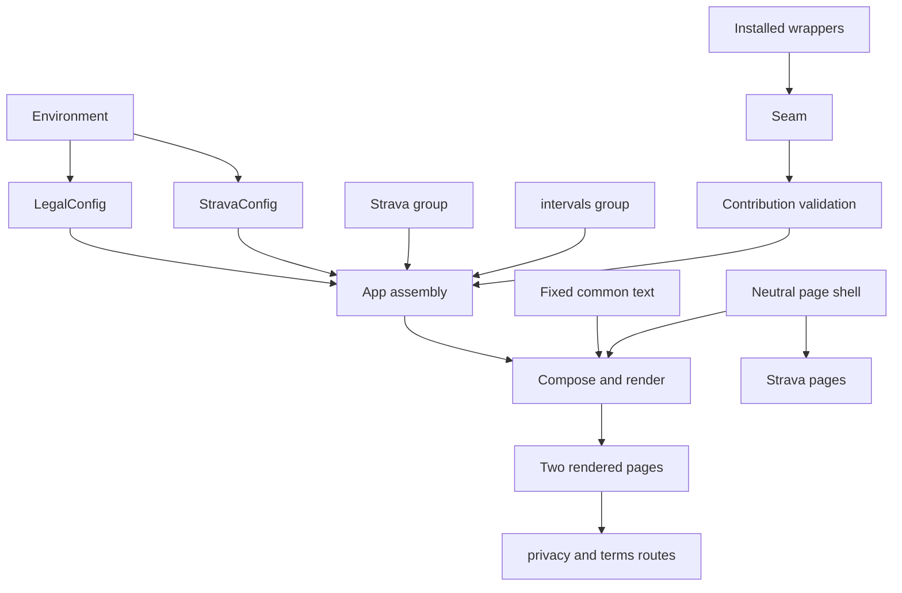
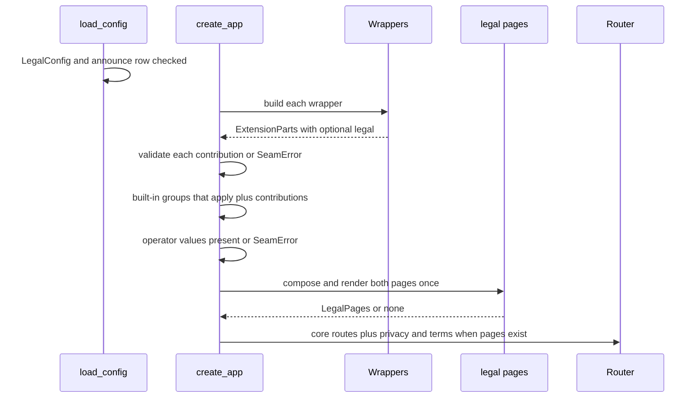

# Design Document

## Overview

**Purpose**: This feature gives the relay one privacy policy at `/privacy`
and one terms page at `/terms`, composed from fixed fitdocs text and from
sections a deployment contributes, so that every platform's developer
application can cite a policy that is true of what the relay does.

**Users**: relay operators (the hosted deployment and self-hosters) cite the
two addresses in platform applications; athletes read them before
connecting; the hosted wrapper contributes its own provider and operator
sections through the extension seam.

**Impact**: `/privacy` stops being a Strava route and becomes a relay page
served whenever a provider section applies, configured or announced. The
page shell moves out of the Strava package, every page links the terms, the
operator variables are accepted without a target, the seam gains a legal
contribution and advances to version 2, and the deploy contract gains two
optional rows without a version change.

### Goals
- Serve both pages from start-up-composed bytes, with no database on the
  request path.
- Keep every Strava policy sentence word for word, under the existing tests.
- Ship the common sections and the intervals.icu relay-route section, and let
  an operator announce a built-in provider before its credentials exist.
- Give wrappers one validated, plain-text contribution shape that built-in
  providers share.

### Non-Goals
- Any Garmin text, and any operator-specific content (legal entity,
  jurisdiction, sub-processors).
- An operator command that exports what the relay holds about one athlete.
- The `targets/` lift, provider registration and consent machinery
  (relay-providers); the intervals.icu routes and consent page
  (relay-intervals); the held-data section (relay-held-files).
- Translation, cookie banners, legal advice, enforcing anything the policy
  states.

## Boundary Commitments

### This Spec Owns
- The neutral page shell `fitdocs_relay/pages.py`: `Page`, `Operator`
  (with the new `terms_url`), `PAGE_HEADERS`, the document wrapper and the
  footer that links the policy, the terms and the support contact.
- The `fitdocs_relay/legal/` package: the content model and its validation,
  the fixed common text of both pages, the intervals.icu relay-route group,
  composition and rendering, the operator configuration loader, and the
  `/privacy` and `/terms` routes.
- The Strava group builder, retention statement and text date in
  `strava/policy.py` (the nine sections themselves are unchanged).
- The seam's `ExtensionParts.legal` field, the re-exported content types,
  and `SEAM_VERSION` 1 → 2.
- The deploy-contract rows `FITDOCS_RELAY_ANNOUNCED_PROVIDERS` and
  `FITDOCS_RELAY_TERMS_URL`, the widened `required_with` of the operator name
  and support contact, and `/terms` in `RESERVED_PREFIXES`.
- The documentation sections and tests that bind them, the relay changelog
  entry, and the amendments to relay-server, strava-publish and
  relay-intervals.

### Out of Boundary
- Strava's connect flow, consent text, webhook, `/go/`, `robots.txt` and
  every other Strava page's content (only their footer gains the terms link).
- Provider registration, `ConsentProvider`, `TokenVault` and the `targets/`
  package (relay-providers consumes `ProviderPages` from here).
- The intervals.icu target itself; this spec ships only its policy group.
- Held-item retention text (relay-held-files contributes a `ProviderPages`
  or operator section through this shape).
- The fitdocs CLI: no `src/fitdocs` code changes; only
  `docs/connectors.md` gains the terms address.

### Allowed Dependencies
- `legal.content`, `legal.text`, `legal.intervals`, `legal.pages` and
  `fitdocs_relay.pages` import the standard library and each other only, in
  the direction of the dependency rule below.
- `legal.config` imports `fitdocs_relay.config` (`ConfigError`,
  `web_address`) and `fitdocs_relay.contract`.
- `legal.routes` imports Starlette, `legal.pages` and `fitdocs_relay.pages`.
- `strava.policy` may import `legal.content`; nothing under `legal/` imports
  `strava`, `storage`, `app` or `seam`.
- `seam` imports `legal.content` to re-export the content types.
- `app` is the only place that assembles built-in groups, contributions and
  configuration into pages.

### Revalidation Triggers
- Any change to `ProviderPages`, `OperatorPages`, `LegalContribution`,
  `Section` or the block types (relay-providers, relay-held-files, the
  hosted wrapper).
- `SEAM_VERSION` moving again (the hosted wrapper re-declares).
- The common heading constants or the page order (docs bindings, the hosted
  wrapper's heading choices).
- Moving `fitdocs_relay/pages.py` (relay-providers' lift of Strava pages
  builds on it).
- relay-intervals changing what its route stores, sends, returns or deletes
  (its group text must move with it).

## Architecture

### Existing Architecture Analysis
- `strava/policy.py` (stdlib leaf) holds the nine `(heading, text)` pairs;
  `strava/pages.py` (stdlib leaf) renders every Strava page through
  `_document` and `_footer`; `strava/routes.py` serves `/privacy` only while
  Strava is configured, through `browser()`, which gates on readiness and a
  database-backed client limit.
- `create_app` builds services, then installs wrappers (refusing with
  `SeamError`), then builds `core_routes` (which include Strava's routes).
- The pipeline makes only versioned routes wait for readiness; a path with no
  route answers the envelope's `not-offered`.
- `load_config` raises `ConfigError` (exit 2 for every command); a
  `SeamError` raised in `create_app` exits 2 from `serve`; any other
  exception there exits 1 as unexpected.

### Architecture Pattern & Boundary Map



**Architecture Integration**:
- Selected pattern: compose once at start-up, serve fixed bytes. All
  validation happens before the server accepts a request.
- Domain boundaries: the `legal` package knows providers only as
  `ProviderPages` values; the Strava package adapts its unchanged sections
  into that shape; `app` decides which groups apply.
- Existing patterns preserved: stdlib-only leaves for text and pages,
  `SeamError` for wrapper refusals, `ConfigError` for variables, the
  environment table as the single variable list, literal version histories.
- Steering compliance: no new dependency; the relay keeps one state store;
  no platform text reaches a page.

**Dependency direction** (each module imports only modules to its left):
`legal.content` → `legal.text`, `legal.intervals` → `fitdocs_relay.pages`
→ `legal.pages` → `legal.routes`; `config` → `legal.config`;
`legal.content` → `strava.policy` → `strava.pages`; all of these →
`seam` → `app`. A reverse import is a boundary-test failure.

### Technology Stack

| Layer | Choice / Version | Role in Feature | Notes |
|-------|------------------|-----------------|-------|
| Backend / Services | Starlette (relay's existing pin) | Two GET routes | No new dependency |
| Backend / Services | Python 3.11 stdlib (`html`, `dataclasses`, `datetime`, `hashlib` in tests) | Content model, escaping, rendering | Same as the Strava pages |
| Data / Storage | none | The pages read no stored state | Database untouched; no migration |

## File Structure Plan

### Directory Structure
```
relay/src/fitdocs_relay/
├── pages.py                 # NEW: neutral page shell moved from strava/pages.py:
│                            #   Page, Operator(+terms_url), PAGE_HEADERS, escape, document(), footer,
│                            #   BUILT_IN_POLICY_PATH "/privacy", BUILT_IN_TERMS_PATH "/terms",
│                            #   policy_address(), terms_address()
└── legal/
    ├── __init__.py          # NEW: package docstring only
    ├── content.py           # NEW: Paragraph, Bullets, OperatorLine, ContactLine, Block, Section,
    │                        #   ProviderPages, OperatorPages, LegalContribution, limits,
    │                        #   contribution_problem()
    ├── text.py              # NEW: fixed common text of both pages, headings, announced statement,
    │                        #   provider list wording, relay-wide retention, closing format, dates
    ├── intervals.py         # NEW: INTERVALS_KEY, INTERVALS_NAME, intervals_pages(announced)
    ├── pages.py             # NEW: LegalDocument, compose_policy(), compose_terms(), render(),
    │                        #   LegalPages, build_legal_pages()
    ├── config.py            # NEW: LegalConfig, BUILT_IN_PROVIDERS, load_legal_config(),
    │                        #   operator name and support-contact validators (moved from strava/config.py)
    └── routes.py            # NEW: PRIVACY_PATH, TERMS_PATH, legal_routes(pages)

relay/tests/legal/
├── test_legal_content.py    # NEW: contribution validation, one refusal per reason
├── test_legal_text.py       # NEW: the text module's structure (heading lists match sections, formats take a name or date)
├── test_legal_intervals.py  # NEW: the intervals.icu group's structure, announced flag, validation
├── test_legal_compose.py    # NEW: applicability, order, announced statement, dates, escaping, determinism
├── test_legal_routes.py     # NEW: served/not served, headers, HEAD, unreachable store, every-page links
└── test_legal_config.py     # NEW: announce row, terms address, operator rows without a target
                             # (unique basenames: the relay tests have no __init__.py and pytest
                             #  uses prepend import mode, so a repeated basename fails collection)

relay/tests/strava/
└── test_policy_group.py      # NEW: the Strava group mapped from the unchanged sections (code against code)
```

### Modified Files
- `relay/src/fitdocs_relay/strava/pages.py` — imports the shell from
  `fitdocs_relay.pages` and re-exports `Page`, `Operator`, `PAGE_HEADERS`,
  `BUILT_IN_POLICY_PATH` and `policy_address` explicitly; drops
  `privacy_page`; every page's footer comes from the shell (adds the terms
  link).
- `relay/src/fitdocs_relay/strava/policy.py` — adds `STRAVA_KEY`,
  `STRAVA_NAME`, `STRAVA_RETENTION`, `STRAVA_TEXT_CHANGED` and
  `strava_pages(links, *, announced) -> ProviderPages`; `POLICY_HEADINGS`,
  `policy_sections` and `consent_text` are unchanged.
- `relay/src/fitdocs_relay/strava/routes.py` — removes the `/privacy` route
  and `privacy_view`; `browser()` builds its pages through the shell.
- `relay/src/fitdocs_relay/strava/config.py` — `TARGETS_VARIABLES` keeps only
  `ENV_PUBLIC_URL` and `ENV_ENCRYPTION_KEYS`; `load_targets_config` takes the
  loaded `LegalConfig` for the operator fields (the `TargetsConfig` fields are
  unchanged); the operator-name and contact validators move to
  `legal/config.py`; `_web_address` moves to `config.py` as `web_address`.
- `relay/src/fitdocs_relay/config.py` — `RelayConfig.legal: LegalConfig |
  None = None` (imported under `TYPE_CHECKING`, as `TargetsConfig` is, since
  `legal.config` imports `ConfigError` from this module); `load_config`
  always sets it, loading it before the targets config, and every consumer
  reads `None` as an empty `LegalConfig`; `web_address` (moved).
- `relay/src/fitdocs_relay/contract.py` — `ENV_ANNOUNCED_PROVIDERS`,
  `ENV_TERMS_URL` and their rows; `_WITH_ANY_SECTION`; operator name and
  support contact rows use it.
- `relay/src/fitdocs_relay/seam.py` — `SEAM_VERSION = 2`;
  `ExtensionParts.legal: LegalContribution | None = None`; re-exports the
  content types.
- `relay/src/fitdocs_relay/app.py` — `RelayServices.operator` and
  `RelayServices.legal`; `_install_extensions` validates and collects legal
  contributions; `_legal_pages()` assembles and composes; routes include
  `legal_routes`.
- `relay/src/fitdocs_relay/routes.py` — `RESERVED_PREFIXES` gains `/terms`;
  `core_routes` appends `legal_routes(services.legal)` when present.
- `relay/tests/test_boundary.py` — stdlib-leaf entries for the new modules;
  Starlette placement gains `legal.routes`.
- `relay/tests/test_seam.py`, `relay/tests/test_contract.py` — the seam
  surface and version pins and the environment-table pin (code).
- Removed documentation tests (maintainer, 2026-11-03: only code is under
  test). Each test below reads a part of a document this feature changes, so
  it is deleted rather than updated: in `relay/tests/test_docs_relay.py`, the
  environment-table binding group and the versions binding group; in
  `relay/tests/test_contract.py`, the changelog group and its helper; in
  `relay/tests/strava/test_policy_docs.py`, the routes-table binding group;
  in the root `tests/connectors/test_strava_changelog.py`, the
  restated-versions and marks-nothing-breaking tests. Any other test that
  reads a changed document and would go red is deleted the same way.
- `relay/tests/strava/test_pages.py`, `test_policy_docs.py`,
  `relay/tests/test_strava_pages_routes.py` — imports and the place on the
  page where a section is looked for; every expected policy and consent value
  kept. The route-gating tests that use `/privacy` as a sample page (not
  ready, store unreachable, client-limited, shared client count) change
  expectation under 1.5 and move to another Strava page path.
- `relay/tests/test_config_strava.py` — the operator rows' `required_with`,
  the literal refusal group and counts, and the refusal labels change under
  9.1; the two new rows gain refusal cases.
- `relay/tests/test_config.py` — the whole-config comparison gains the
  loaded `LegalConfig`; `relay/tests/test_seam.py` — the designed services
  fields gain `operator` and `legal`; `relay/tests/test_strava_routes.py` —
  the shared Strava test world, which builds its app without `create_app`,
  assembles the legal pages through `_legal_pages` as the factory does.
- `relay/CHANGELOG.md`, `docs/relay.md`, `docs/connectors.md`.
- `.kiro/specs/relay-server/requirements.md`,
  `.kiro/specs/strava-publish/requirements.md`,
  `.kiro/specs/relay-intervals/requirements.md` — one amendment each.

## System Flows



Applicability: Strava's group applies while Strava is configured or
`strava` is announced; intervals.icu's applies only while `intervals` is
announced; a contributed group applies while its wrapper is installed. When
nothing applies, `LegalPages` is `None` and neither path has a route.

## Requirements Traceability

| Requirement | Summary | Components | Interfaces | Flows |
|-------------|---------|------------|------------|-------|
| 1.1 | Serve both pages while a section applies | LegalRoutes, AppAssembly | `legal_routes`, `build_legal_pages` | Start-up |
| 1.2 | Neither page when nothing applies | AppAssembly, LegalRoutes | `LegalPages | None` | Start-up |
| 1.3 | Same headers, no cookie, no outside resource | PageShell, LegalRoutes | `PAGE_HEADERS`, `document` | — |
| 1.4 | Non-GET answered as other pages | LegalRoutes | `Route(..., methods=["GET"])` | — |
| 1.5 | Served while the store is unreachable | LegalRoutes | fixed bytes, no store call | — |
| 1.6 | Every page links policy and terms | PageShell | `footer` | — |
| 1.7 | Operator's own addresses override | PageShell, LegalConfig | `policy_address`, `terms_address` | — |
| 1.8 | Missing operator values refused | LegalConfig, AppAssembly | `load_legal_config`, `SeamError` | Start-up |
| 2.1 | Built-in section only while configured or announced | AppAssembly | `_legal_pages` | Start-up |
| 2.2 | Announce setting | LegalConfig, Contract | `ENV_ANNOUNCED_PROVIDERS` | — |
| 2.3 | Unknown or repeated announce refused | LegalConfig | `ConfigError` | — |
| 2.4 | Announced statement and list entry | LegalText, Composer | `ANNOUNCED_LEAD_FORMAT`, `ANNOUNCED_ENTRY_FORMAT` | — |
| 2.5 | Configuring drops only the statement | Composer, StravaGroup | `strava_pages(announced=)` | — |
| 2.6 | intervals.icu only when announced | AppAssembly, IntervalsGroup | `intervals_pages` | — |
| 2.7 | Announcing adds no route or capability | AppAssembly | `services.targets` unchanged | — |
| 2.8 | Contributed sections apply; may be announced | AppAssembly, LegalContent | `ProviderPages.announced` | — |
| 3.1 | Policy order | Composer | `compose_policy` | — |
| 3.2 | Byte-identical per configuration | Composer, AppAssembly | composed once | Start-up |
| 3.3 | Only fitdocs, operator and contributed text | Composer | inputs are values, never platform data | — |
| 3.4 | Every value escaped | Composer, PageShell | `render`, `escape` | — |
| 4.1 | Strava's nine sections verbatim as its group | StravaGroup | `strava_pages` | — |
| 4.2 | Announced Strava follows default link setting | AppAssembly, StravaGroup | `LinkSetting.ACTIVITY` | — |
| 4.3 | Consent text and control unchanged | StravaPages | unchanged `consent_text` | — |
| 4.4 | Strava tests keep expected values | StravaPages tests | re-exported names | — |
| 5.1 | intervals.icu group content | IntervalsGroup | `intervals_pages` | — |
| 5.2 | Agrees with relay-intervals; relay route only | IntervalsGroup | text (Supporting References) | — |
| 5.3 | Direct route does not involve the relay | IntervalsGroup | "Your choices" text | — |
| 6.1 | Common opening | LegalText, Composer | `POLICY_OPENING_BEFORE`, `POLICY_OPENING_AFTER`, `compose_policy` | — |
| 6.2 | Security | LegalText | `POLICY_SECURITY` | — |
| 6.3 | Breach | LegalText | `POLICY_BREACH` | — |
| 6.4 | Rights and how to use them | LegalText | `POLICY_RIGHTS` | — |
| 6.5 | AI statement | LegalText | `POLICY_AI` | — |
| 6.6 | Retention per provider and relay-wide | LegalText, Composer | `RELAY_RETENTION`, `ProviderPages.retention` | — |
| 6.7 | Retention names a real trigger | LegalText, StravaGroup, IntervalsGroup | text review against storage | — |
| 6.8 | Contact and changes | LegalText | `POLICY_CONTACT`, `POLICY_CHANGES` | — |
| 6.9 | Closing date is the latest shown date | Composer | `LegalDocument.changed` | — |
| 7.1 | Terms order | Composer | `compose_terms` | — |
| 7.2 | Common terms content | LegalText | `TERMS_COMMON` | — |
| 7.3 | Same providers; links the policy | Composer, PageShell | `compose_terms`, `footer` | — |
| 7.4 | No legal entity, law or jurisdiction in fixed text | LegalText | text | — |
| 8.1 | Contribution kinds | LegalContent, Seam | `LegalContribution` | — |
| 8.2 | Malformed contribution refused | LegalContent, AppAssembly | `contribution_problem`, `SeamError` | Start-up |
| 8.3 | Read once at start-up | AppAssembly | composed in `create_app` | Start-up |
| 8.4 | Empty contribution changes nothing | Composer | — | — |
| 8.5 | Seam version 2, breaking, refusal kept | Seam, Changelog | `SEAM_VERSION` | — |
| 8.6 | Built-ins use the same shape | StravaGroup, IntervalsGroup | `ProviderPages` | — |
| 9.1 | Contract rows, reserved path, version unchanged | Contract, LegalConfig, Routes | `ENVIRONMENT`, `RESERVED_PREFIXES` | — |
| 9.2 | Docs privacy section | Docs | `docs/relay.md` | — |
| 9.3 | Docs operator obligations | Docs | `docs/relay.md` | — |
| 9.4 | Seam docs; no documentation tests; touched doc tests removed | Docs, tests | removed-test list (File Structure Plan) | — |
| 9.5 | Connectors docs terms address | Docs | `docs/connectors.md` | — |
| 9.6 | Wording rules | LegalText, Docs | review | — |
| 9.7 | Amendments | Spec records | three amendments | — |

## Components and Interfaces

| Component | Domain | Intent | Requirements | Key Dependencies | Contracts |
|-----------|--------|--------|--------------|------------------|-----------|
| PageShell | relay pages | Document wrapper, headers, footer, operator values | 1.3, 1.6, 1.7, 3.4 | stdlib (P0) | Service |
| LegalContent | legal | Content model and contribution validation | 2.8, 8.1, 8.2, 8.6 | stdlib (P0) | Service |
| LegalText | legal | Fixed common text and dates | 2.4, 6.1-6.8, 7.2, 7.4, 9.6 | LegalContent (P0) | State |
| IntervalsGroup | legal | intervals.icu relay-route group | 2.6, 5.1-5.3, 6.7, 8.6 | LegalContent (P0) | Service |
| StravaGroup | strava | Strava's nine sections as a group | 2.5, 4.1, 4.2, 6.7, 8.6 | LegalContent (P0) | Service |
| Composer | legal | Order, applicability lists, dates, rendering | 2.4, 3.1-3.4, 6.9, 7.1, 7.3, 8.4 | LegalText, PageShell (P0) | Service |
| LegalConfig | legal | Operator variables and the announce row | 1.7, 1.8, 2.2, 2.3, 9.1 | config, contract (P0) | Service |
| LegalRoutes | legal | Serve the two pages | 1.1-1.5 | Starlette, Composer (P0) | API |
| AppAssembly | relay app | Decide what applies; validate; compose once | 1.1, 1.2, 1.8, 2.1, 2.6-2.8, 3.2, 8.2, 8.3 | all above, seam (P0) | Service |
| Seam | relay seam | Contribution field, re-exports, version | 8.1, 8.5 | LegalContent (P0) | Service |
| Contract and Docs | relay contract | Rows, reserved path, docs, changelog, amendments | 9.1-9.7 | — | — |

### Relay pages

#### PageShell — `fitdocs_relay/pages.py`

| Field | Detail |
|-------|--------|
| Intent | The fitdocs-written HTML document every relay page uses |
| Requirements | 1.3, 1.6, 1.7, 3.4 |

**Responsibilities & Constraints**
- Moved unchanged from `strava/pages.py` except: `Operator` gains
  `terms_url: str | None = None`; the footer renders the policy link, then a
  terms link, then the support contact.
- Escapes every interpolated value with `html.escape(value, quote=True)`.

**Contracts**: Service [x]

```python
BUILT_IN_POLICY_PATH: Final = "/privacy"
BUILT_IN_TERMS_PATH: Final = "/terms"
PAGE_HEADERS: Final[Mapping[str, str]]          # unchanged values

@dataclass(frozen=True)
class Page:
    status: int
    html: str

@dataclass(frozen=True)
class Operator:
    name: str
    support_contact: str
    policy_url: str | None
    terms_url: str | None = None

def escape(value: str) -> str: ...
def policy_address(operator: Operator) -> str: ...   # policy_url or "/privacy"
def terms_address(operator: Operator) -> str: ...    # terms_url or "/terms"
def document(title: str, body: str, operator: Operator, status: int) -> Page: ...
```
- Footer markup: `<footer><p><a href="{policy}">Privacy policy</a></p><p><a
  href="{terms}">Terms of use</a></p><p>Support: {contact}</p></footer>`.
- Implementation Notes: `strava/pages.py` keeps its own page functions and
  re-exports the moved names with explicit `X as X` imports, so its tests
  import unchanged; `privacy_page` leaves it.

### Legal package

#### LegalContent — `legal/content.py`

| Field | Detail |
|-------|--------|
| Intent | One plain-text content shape for built-in and contributed sections |
| Requirements | 2.8, 8.1, 8.2, 8.6 |

**Contracts**: Service [x]

```python
@dataclass(frozen=True)
class Paragraph:
    text: str

@dataclass(frozen=True)
class Bullets:
    items: tuple[str, ...]

@dataclass(frozen=True)
class OperatorLine:
    """Rendered as 'Operator: <configured operator name>'."""

@dataclass(frozen=True)
class ContactLine:
    """Rendered as 'Support contact: <configured support contact>'."""

Block = Paragraph | Bullets | OperatorLine | ContactLine

@dataclass(frozen=True)
class Section:
    heading: str
    blocks: tuple[Block, ...]

@dataclass(frozen=True)
class ProviderPages:
    key: str                              # ^[a-z][a-z0-9-]{0,31}$
    service_name: str                     # group heading and list entry
    policy: tuple[Section, ...]           # at least one section
    retention: tuple[Paragraph | Bullets, ...]   # at least one block
    policy_changed: date
    terms: tuple[Section, ...] = ()
    terms_changed: date | None = None     # set exactly when terms is non-empty
    announced: bool = False

@dataclass(frozen=True)
class OperatorPages:
    policy: tuple[Section, ...] = ()
    policy_changed: date | None = None    # set exactly when policy is non-empty
    terms: tuple[Section, ...] = ()
    terms_changed: date | None = None     # set exactly when terms is non-empty

@dataclass(frozen=True)
class LegalContribution:
    providers: tuple[ProviderPages, ...] = ()
    operator: OperatorPages | None = None

HEADING_MAX: Final = 120
NAME_MAX: Final = 60
TEXT_MAX: Final = 4000
ITEM_MAX: Final = 1000
ITEMS_MAX: Final = 50
SECTIONS_MAX: Final = 40
PROVIDERS_MAX: Final = 8

def contribution_problem(
    contribution: object,
    *,
    taken_keys: frozenset[str],
    taken_names: frozenset[str],        # casefolded service names already used
    reserved_headings: frozenset[str],  # common headings of both pages, casefolded
) -> str | None: ...                    # None when valid, else the reason
```
- Preconditions checked by `contribution_problem`, each with its own reason
  string: the object types (tuples, not lists; `date`, not `datetime`); every
  heading, name, paragraph and item is a non-empty `str` within its bound
  and `str.isprintable()`; no heading repeats within one provider's policy,
  one provider's terms, an operator's policy or an operator's terms; a
  provider key matches the pattern and is not in `taken_keys` or used twice;
  a service name's casefold is not in `taken_names` or used twice; an
  operator section's heading is not in `reserved_headings` and is not a
  service name; a provider has at least one policy section and one retention
  block; each `*_changed` is present exactly when its sections are.
- The function never raises for bad input; `app` turns a reason into a
  `SeamError`.

#### LegalText — `legal/text.py`

| Field | Detail |
|-------|--------|
| Intent | The fixed fitdocs text of both pages, as data |
| Requirements | 2.4, 6.1-6.8, 7.2, 7.4, 9.6 |

**Contracts**: State [x]
- Constants (text in Supporting References): `POLICY_TITLE`,
  `TERMS_TITLE`, `POLICY_OPENING_HEADING`, `POLICY_OPENING_BEFORE` and
  `POLICY_OPENING_AFTER` (blocks around the provider list),
  `POLICY_COMMON: tuple[Section, ...]` (Security, If there is a breach, Your
  rights, Artificial intelligence), `RETENTION_HEADING`, `RETENTION_LEAD`,
  `RELAY_RETENTION_HEADING`, `RELAY_RETENTION: Bullets`,
  `POLICY_CLOSING_SECTIONS` (Contact, Changes to this policy),
  `TERMS_OPENING_HEADING`, `TERMS_OPENING_BEFORE`, `TERMS_OPENING_AFTER`,
  `TERMS_COMMON: tuple[Section, ...]`, `ANNOUNCED_LEAD_FORMAT`,
  `OFFERED_ENTRY_FORMAT`, `ANNOUNCED_ENTRY_FORMAT`, `CLOSING_FORMAT`,
  `POLICY_COMMON_CHANGED: date`, `TERMS_COMMON_CHANGED: date`,
  `POLICY_COMMON_HEADINGS`, `TERMS_COMMON_HEADINGS`.
- The `*_CHANGED` dates are set by the implementing task to the date the
  text lands, and move with every later text change (kept by review; no
  test pins the wording).

#### IntervalsGroup — `legal/intervals.py`

```python
INTERVALS_KEY: Final = "intervals"
INTERVALS_NAME: Final = "intervals.icu"
INTERVALS_TEXT_CHANGED: Final[date]
INTERVALS_RETENTION: Final[tuple[Paragraph | Bullets, ...]]
def intervals_pages(*, announced: bool) -> ProviderPages: ...
```
- Seven sections, in the Strava group's heading pattern, text in Supporting
  References. Written from relay-intervals Requirements 4.3, 4.8, 5.2-5.6,
  6.5, 6.7, 7.1-7.3, 7.9, 7.10, 8.1-8.9, 11.3-11.5 and 12.1-12.3.
- relay-intervals moves this module into its own package when it lands, and
  owns the text from then on (its amendment says so).

#### StravaGroup — `strava/policy.py` additions

```python
STRAVA_KEY: Final = "strava"
STRAVA_NAME: Final = "Strava"
STRAVA_TEXT_CHANGED: Final[date]
STRAVA_RETENTION: Final[tuple[Paragraph | Bullets, ...]]
def strava_pages(links: LinkSetting, *, announced: bool) -> ProviderPages: ...
```
- `strava_pages` maps `policy_sections(links)` one to one into `Section`s
  holding `Paragraph(text)`, appending `OperatorLine()` to "The relay's
  operator" and `ContactLine()` to "Contact", exactly as `privacy_page` adds
  those lines today. No text changes.

#### Composer — `legal/pages.py`

**Contracts**: Service [x]

```python
@dataclass(frozen=True)
class Group:
    heading: str
    lead: tuple[Block, ...]
    sections: tuple[Section, ...]

Part = Section | Group

@dataclass(frozen=True)
class LegalDocument:
    title: str
    parts: tuple[Part, ...]
    changed: date

@dataclass(frozen=True)
class LegalPages:
    policy: Page
    terms: Page

def compose_policy(
    providers: tuple[ProviderPages, ...], operators: tuple[OperatorPages, ...]
) -> LegalDocument: ...
def compose_terms(
    providers: tuple[ProviderPages, ...], operators: tuple[OperatorPages, ...]
) -> LegalDocument: ...
def render(document: LegalDocument, operator: Operator) -> Page: ...
def build_legal_pages(
    providers: tuple[ProviderPages, ...],
    operators: tuple[OperatorPages, ...],
    operator: Operator,
) -> LegalPages: ...
```
- Preconditions: `providers` is non-empty and already in page order;
  `operators` in wrapper order.
- `compose_policy` parts: opening `Section` (before blocks, provider list
  `Bullets`, after blocks); one `Group` per provider (heading
  `service_name`, lead `(Paragraph(ANNOUNCED_LEAD_FORMAT.format(name=...)),)`
  when announced else `()`, sections `policy`); `POLICY_COMMON`; the
  retention `Group` (lead `RETENTION_LEAD`, one `Section` per provider
  headed by its name holding its `retention`, then the relay-wide
  `Section`); `POLICY_CLOSING_SECTIONS`; each operator's `policy` sections.
  `changed` is the maximum of `POLICY_COMMON_CHANGED`, each provider's
  `policy_changed` and each operator's `policy_changed`.
- `compose_terms` parts: opening `Section`; `TERMS_COMMON`; one `Group` per
  provider with non-empty `terms` (no lead); each operator's `terms`
  sections. `changed` is the maximum of `TERMS_COMMON_CHANGED` and the
  shown `terms_changed` values.
- `render`: `<h1>` title; a top-level `Section` as
  `<section><h2>…</h2>{blocks}</section>`; a `Group` as
  `<section><h2>…</h2>{lead}{<section><h3>…</h3>{blocks}</section>…}</section>`;
  `Paragraph` as `<p>`, `Bullets` as `<ul><li>…</li></ul>`, `OperatorLine`
  as `<p>Operator: {name}</p>`, `ContactLine` as `<p>Support contact:
  {contact}</p>`; then `<p>{CLOSING_FORMAT}</p>` with `changed.isoformat()`;
  wrapped by `document(title, body, operator, 200)`. Every string passes
  `escape`. Elements are joined with `\n` so visible text keeps block
  boundaries.

#### LegalConfig — `legal/config.py`

**Contracts**: Service [x]

```python
BUILT_IN_PROVIDERS: Final = ("strava", "intervals")   # page order

@dataclass(frozen=True)
class LegalConfig:
    operator_name: str | None = None
    support_contact: str | None = None
    privacy_policy_url: str | None = None
    terms_url: str | None = None
    announced: frozenset[str] = frozenset()

def load_legal_config(environ: Mapping[str, str], *, any_target: bool) -> LegalConfig: ...
def operator_from(legal: LegalConfig | None) -> Operator | None: ...   # None unless name and contact are set
```
- Reads `FITDOCS_RELAY_OPERATOR_NAME`, `..._SUPPORT_CONTACT`,
  `..._PRIVACY_POLICY_URL`, `..._TERMS_URL` and
  `..._ANNOUNCED_PROVIDERS`, whether or not a target is configured.
- The announce value is comma-separated, each entry stripped; an empty value
  means none; an entry outside `BUILT_IN_PROVIDERS` raises `ConfigError`
  naming the variable and the entry (`FITDOCS_RELAY_ANNOUNCED_PROVIDERS:
  unknown provider 'x'; known: strava, intervals`), and a repeated entry
  likewise (`... names 'strava' twice`).
- When `any_target` or `announced` is non-empty, a missing operator name or
  support contact raises `ConfigError` naming that variable with the
  existing wording (`<VARIABLE>: is required`).
- Validation of each value is the existing rule: the operator name 1-100
  printable characters; the contact an email address or `https` address;
  each page address `https` only.

#### LegalRoutes — `legal/routes.py`

**Contracts**: API [x]

| Method | Endpoint | Request | Response | Errors |
|--------|----------|---------|----------|--------|
| GET | `/privacy` | none | 200 HTML, `PAGE_HEADERS` | HEAD: 405 with `Allow: GET` |
| GET | `/terms` | none | 200 HTML, `PAGE_HEADERS` | HEAD: 405 with `Allow: GET` |

```python
PRIVACY_PATH: Final = BUILT_IN_POLICY_PATH
TERMS_PATH: Final = BUILT_IN_TERMS_PATH
def legal_routes(pages: LegalPages) -> list[BaseRoute]: ...
```
- Each handler returns the pre-rendered page; it reads no store, checks no
  readiness and counts no client request (1.5). Routes are built as
  `Route(path, handler, methods=["GET"])`, like Strava's page routes. Starlette
  admits HEAD on a GET route, and Strava's 405 comes from its `browser()`
  wrapper, which these routes do not use, so each handler answers HEAD itself
  with 405, `PAGE_HEADERS` and `Allow: GET`; any other method falls to the
  router as it does for Strava's pages (1.4).

### Relay app and seam

#### Seam — `seam.py`

```python
SEAM_VERSION: Final = 2

@dataclass(frozen=True)
class ExtensionParts:
    routes: tuple[BaseRoute, ...] = ()
    registration: RegistrationProvider | None = None
    legal: LegalContribution | None = None
```
- Re-exports `Paragraph`, `Bullets`, `OperatorLine`, `ContactLine`, `Block`,
  `Section`, `ProviderPages`, `OperatorPages` and `LegalContribution` from
  `legal.content`; the seam surface pin lists them.
- A wrapper declaring any version other than 2 is refused as today.

#### AppAssembly — `app.py`

**Contracts**: Service [x]

```python
@dataclass
class RelayServices:
    ...                                   # existing fields
    operator: Operator | None = None
    legal: LegalPages | None = None

def _install_extensions(
    services: RelayServices, extensions: Sequence[RelayExtension]
) -> tuple[list[BaseRoute], tuple[tuple[str, LegalContribution], ...]]: ...
def _legal_pages(
    config: RelayConfig,
    services: RelayServices,
    contributed: tuple[tuple[str, LegalContribution], ...],
) -> LegalPages | None: ...
```
- `_install_extensions` validates each wrapper's `parts.legal` (when not
  `None`) with `contribution_problem`, passing the built-in keys and names
  plus those of earlier wrappers, and raises `SeamError(f"extension {name}:
  {reason}")`.
- `_legal_pages` builds the applying provider list in page order:
  `strava_pages(links, announced=not configured)` when Strava is configured
  or announced (`links` from the Strava configuration, else
  `LinkSetting.ACTIVITY`); `intervals_pages(announced=True)` when
  `intervals` is announced; then each wrapper's providers in installation
  order. It returns `None` when the list is empty. Otherwise, when
  `services.operator` is `None` (only possible when every applying group is
  contributed), it raises `SeamError` naming the first contributing wrapper
  and the missing variable; else it returns `build_legal_pages(...)`.
- `create_app` order: services, wrappers, `services.legal =
  _legal_pages(...)`, then routes. `StravaServices.operator` is
  `services.operator`.

## Data Models

### Domain Model
- A **page** is a title, an ordered tuple of parts and a date. A **part** is
  a top-level section or a group of sections under a heading.
- A **provider group** is identified by its key and shown under its service
  name; it is offered or announced; it carries policy sections, a retention
  statement and optional terms clauses, each with its own text date.
- Invariants: page order is a pure function of configuration and installed
  wrappers; no part holds a value read from a store or a platform; every
  string is escaped at render.

No database, migration or wire format changes.

## Error Handling

### Error Strategy
All failures are start-up refusals; a served page cannot fail.

| Situation | Raised as | Exit | Message names |
|-----------|-----------|------|---------------|
| Unknown or repeated announced provider | `ConfigError` in `load_config` | 2 (every command) | the variable and the entry |
| Announce or target set, operator name or contact missing | `ConfigError` | 2 (every command) | the missing variable |
| Bad operator value or page address | `ConfigError` | 2 | the variable |
| Malformed contribution | `SeamError` in `create_app` | 2 (`serve`) | the wrapper and the reason |
| Only contributed groups apply, operator name or contact missing | `SeamError` | 2 (`serve`) | the wrapper and the variable |
| Wrapper declares seam version 1 | `SeamError` | 2 (`serve`) | the wrapper and the implemented version |

### Monitoring
Requests to `/privacy` and `/terms` are logged as every request is, by route
template; nothing new is logged.

## Testing Strategy

Only code is under test (maintainer, 2026-11-03). No test reads the
documentation, the changelog or a spec, and no test pins the wording of the
served pages: the pages are tested for structure (which parts appear, their
order, links, escaping, the announced lead, dates). The fixed text is written
exactly as Supporting References gives it and checked by reading, in its task
and in the final sweep. Every new assertion names the production mutation it
dies on (change-protocol § Fixture Discrimination). Mutations run through
`uv run pytest` in the relay project.

### Unit Tests
- `legal/test_legal_content.py`: one malformed contribution per reason, each
  refused with its own reason, plus one valid contribution accepted.
  Mutations: removing the casefold in the name check (a "STRAVA" provider is
  admitted); dropping the reserved-heading check (an operator section headed
  "Security" is admitted); accepting a `list` (a list-valued `blocks`
  passes).
- `legal/test_legal_text.py`: each common heading list equals the headings
  of its sections in order; the announced and list-entry formats render a
  given service name; the closing format renders an ISO date. Mutation:
  moving one section in `POLICY_COMMON` without its heading list.
- The Strava group: for both link settings, each section's paragraph is the
  matching `policy_sections(links)` text (code against code, not a literal),
  with the operator and contact lines placed. Mutation: attaching the
  operator line to another section.
- `legal/test_legal_compose.py`: order for a fixture with Strava configured,
  intervals.icu announced and two wrappers with distinct providers and
  operator sections (pairwise-distinct names and dates, the latest date on
  the second wrapper's operator part so neither `max` over providers alone
  nor the first wrapper wins). Mutations: reversing wrapper order; taking the
  common date instead of the maximum; dropping the announced lead.
- Escaping: a contribution whose heading, paragraph and item carry
  `<script>`, `"`, `&` and `</section>`, and an operator name with `<b>`;
  the rendered page contains none of them unescaped. Mutation: removing
  `escape` from the heading render.

### Integration Tests
- `legal/test_legal_routes.py`: through `create_app` with a scripted store —
  Strava unconfigured and nothing announced answers both paths as
  `not-offered` and lists no target; `ANNOUNCED_PROVIDERS=intervals` serves
  both pages, lists no target and adds no intervals.icu route; with the store
  raising `StorageUnreachable` and readiness false, both pages still answer
  200 (mutation: gating on `services.ready`); HEAD answers 405 `Allow: GET`;
  headers equal `PAGE_HEADERS` and no `Set-Cookie`.
- Every-page links: each Strava page and both legal pages link `/privacy`
  and `/terms` exactly once, and the operator's own addresses replace them
  (mutation: dropping the terms anchor from the footer).
- `legal/test_legal_config.py`: the operator variables accepted without a target;
  each `ConfigError` above with its message; `test_contract.py` pins the two
  new rows and the widened `required_with`.
- Seam: version 1 refused; a wrapper contributing nothing leaves both pages
  byte-identical to the no-wrapper pages (8.4); a wrapper-only provider with
  no operator variables refused naming the wrapper and
  `FITDOCS_RELAY_OPERATOR_NAME`.

### Preserved Tests
- strava-publish's `test_every_policy_section_is_pinned_word_for_word` and
  `test_every_consent_paragraph_is_pinned_word_for_word` run unchanged;
  `test_the_privacy_page_lists_the_sections_in_order_and_names_the_operator`
  reads the Strava group of the composed page; Strava's existing brand scan
  keeps running over the Strava pages it covers, minus the retired privacy
  page. No brand scan or wording test is added for the legal pages.

## Security Considerations
- Contributions are data, not markup: no contributed or configured value can
  add an element, attribute, script, style or link; the CSP stays
  `default-src 'none'` with inline style only.
- The pages are fixed bytes without store access or client counting; their
  cost per request is a memory copy, so leaving them outside the client
  limit adds no amplification.
- The pages state what the relay does; an operator whose wrapper stores
  platform tokens itself, logs more, or processes data with AI must publish
  their own policy instead (documented obligation, 9.3).

## Supporting References

The fixed text, word for word. `{name}` and `{date}` are filled at render
and escaped. Headings are shown as `##` (top-level part) and `###` (inside a
group).

### Privacy policy (title "Privacy policy")

**## About this relay**
- P: "This relay is a service that connects your fitdocs to the platforms listed on this page, on your behalf, once you connect them. It is operated by the person or organization named below."
- OperatorLine
- P: "This policy covers these platforms:"
- Bullets, one per applying provider: offered "{name}: you can connect it through this relay."; announced "{name}: announced; this relay does not offer connecting to it yet."
- P: "You can use fitdocs without this relay. This policy covers only what the relay does."

**Announced lead** (first block of an announced group): "This relay does not offer connecting to {name} yet. This section describes what will apply once it does."

**## Strava** — the nine sections of `policy_sections(links)`, unchanged, as `###` sections.

**## intervals.icu**
- ### What fitdocs sends: "When you publish a workout, your fitdocs sends the relay the workout's sport, its start time, elapsed time and distance (leaving out any that the workout's page does not record), the name and description to set, an identifier fitdocs made for the publication, the identifiers of up to two intervals.icu activities that fitdocs already knows for the workout, and, only when you have enabled uploads and no activity matches, the workout's file. Each request carries the relay token that identifies you to the relay."
- ### What the relay receives from intervals.icu and keeps: "When you connect, intervals.icu gives the relay an access token for your account. The relay keeps the token encrypted, with a keyed hash of your intervals.icu athlete identifier (not the identifier itself), so that one intervals.icu account is connected to one relay account at a time. It keeps nothing else from intervals.icu: no activities, activity identifiers, athlete identifiers, names, profile details or copies of any answer, and no record of which activity a workout was posted to. Anything else intervals.icu returns to a request is used inside that request and then dropped."
- ### What the relay sends to intervals.icu: "When you connect, the relay sends intervals.icu the authorization code it received, to exchange it for a token, and asks only for permission to read and write your activities; if the connection is then refused, it asks intervals.icu once, when its call budget allows, to revoke any token the exchange returned. To act on your account it sends your token in the header of each request. For each workout you publish, it sets the name and description of the first activity fitdocs named that intervals.icu accepts the change for; when none does, it may ask intervals.icu to list your activities over the dates around the workout, to find the one that carries the publication's identifier or matches the workout's start time and its distance or duration, and set that activity's name and description. Only with uploads enabled, and only when no activity matches, it uploads the workout's file once, with the publication's identifier as the upload's external identifier, and sets the name and description of the activity the upload creates. When a disconnect request reaches it and its call budget allows, it asks intervals.icu to revoke the token. It changes no other field and deletes nothing on intervals.icu. It reads activities for no other purpose."
- ### What the relay returns to fitdocs: "For each workout that the relay posts or uploads, it returns to your fitdocs the identifier of the intervals.icu activity the post landed on, and your fitdocs writes a link to that activity into the workout's page. It returns nothing else that intervals.icu supplied. The relay does not record the identifier it returned."
- ### Deletion: "The relay deletes your intervals.icu token and the keyed hash of your account at once in each of these cases: you disconnect; intervals.icu refuses the token the next time the relay uses it, as it does once you have revoked the relay's access in your intervals.icu settings; your relay account is deleted; or the same intervals.icu account is connected from another relay account."
- ### Your choices: "The command fitdocs disconnect withdraws the connection: when the relay's call budget allows, it also asks intervals.icu to revoke the relay's access. Revoking the relay's access in your intervals.icu settings also ends the connection; the relay then deletes your token the next time intervals.icu refuses it. Connecting intervals.icu directly with your own API key, as fitdocs also allows, does not involve this relay. You can use fitdocs without this relay."
- ### Security: "intervals.icu tokens are encrypted before they are stored and are sent to intervals.icu only in request headers. The relay writes no intervals.icu token, authorization code or response into its logs."

**## Security**: "Tokens that a platform grants the relay are encrypted before they are stored. Your relay token is kept only as its identifier and a keyed hash, never as the token itself. The relay's logs carry no token, authorization code, platform response, request body or client network address."

**## If there is a breach**: "If a breach of the relay's security affects your data, the operator will notify each platform whose data it affects, within any time that platform's section above states."

**## Your rights**
- P: "You have the right to see, export and delete what this relay holds about you, and to withdraw your consent at any time."
- Bullets:
  - "To withdraw your consent for a platform and have the relay delete what it keeps for it at once, run fitdocs disconnect for that connection. Revoking the relay's access in a platform's own settings also withdraws your consent; that platform's section above says when the relay then deletes what it keeps."
  - "To get a copy of what the relay holds about you, or to have your relay account and everything the relay holds for it deleted, ask the operator at the support contact shown on this page."
  - "Withdrawing your consent stops the relay acting for you. It does not undo what the relay already did, such as a post it made."

**## Artificial intelligence**: "The relay does not process the data it receives with artificial intelligence or machine learning, does not use that data to train such a system, and sends it nowhere except as this policy describes. What each platform does with what the relay sends it is governed by that platform's own policy."

**## How long the relay keeps data**
- Lead P: "The relay keeps each kind of data no longer than stated here."
- ### {name} per provider: its retention blocks.
  - Strava (`STRAVA_RETENTION`): "Your Strava tokens and the time the access token expires, the keyed hash of your Strava account, and the records of your publications: kept at most until one of the cases listed under Deletion in the Strava section occurs, and then deleted at once."
  - intervals.icu (`INTERVALS_RETENTION`): "Your intervals.icu token and the keyed hash of your intervals.icu account: kept at most until one of the cases listed under Deletion in the intervals.icu section occurs, and then deleted at once."
- ### Across the relay — Bullets:
  - "Your relay account's identifier, label and creation time, and for each of its relay tokens the identifier, keyed hash, label and the times it was created and revoked, revoked tokens included: kept until your relay account is deleted, and then deleted at once."
  - "A connect session: it expires ten minutes after it starts at the latest, and the relay deletes expired sessions the next time it stores a short-lived record."
  - "Request and call counts: kept per relay token, per relay account or per keyed hash of the client's network address (never the address itself), in fixed time windows. Once its window has ended, a count may be deleted; the relay removes ended counts as it records new counts of the same kind."
  - "Log records: they name a relay token only by its identifier and carry nothing listed under Security; how long they are kept is the operator's choice."

**## Contact**: "Questions about this policy or your data go to the operator's support contact shown on this page." + ContactLine

**## Changes to this policy**: "The operator may change this policy, and what it shows also follows how the operator has configured the relay. The version at this address is the one in force. The date at the end of this page is the latest date on which any of its text was written."

Operator policy sections (contributed), then the closing paragraph "Text dated {date}." (`CLOSING_FORMAT`)

### Terms of use (title "Terms of use")

**## About these terms**
- P: "These terms apply when you connect a platform to your fitdocs through this relay. The relay is a service that connects your fitdocs to the platforms listed below, on your behalf. It is operated by the person or organization named below."
- OperatorLine
- Bullets: the same provider list as the policy.
- P: "By connecting a platform through this relay, you accept these terms. The relay's privacy policy, linked at the foot of this page, says what the relay does with your data."

**## Your responsibilities** — Bullets:
- "Connect only accounts that are your own."
- "Follow each platform's own terms when you use it through this relay."
- "Do not misuse the relay: do not try to reach anyone else's data or connections, to get around its limits, or to disrupt it."

**## No warranty**: "The relay is provided as is and as available, without any warranty, to the extent the law allows. The operator may change, suspend or stop the relay at any time."

**## Limitation of liability**: "To the extent the law allows, the operator is not liable for any loss or damage that arises from your use of the relay, including lost data, posts that are not made or are made wrongly, and any interruption of the service."

**## The platforms**: "Each platform listed above is a separate service that you use under its own terms. The platforms are not parties to these terms, make no warranty about the relay, and are not liable to you for the relay or for anything it does. Each platform may rely on and enforce the terms written for its benefit, including this section."

**## Ending**: "You can stop using the relay at any time: disconnect each platform with fitdocs disconnect, or revoke the relay's access in the platform's settings. The operator may revoke your access to the relay at any time. The privacy policy says what then happens to your data."

**## Changes to these terms**: "The operator may change these terms, and what they show also follows how the operator has configured the relay. The version at this address is the one in force. The date at the end of this page is the latest date on which any of its text was written."

**## Contact**: "Questions about these terms go to the operator's support contact shown on this page." + ContactLine

Provider terms groups (contributed), operator terms sections (contributed), then "Text dated {date}."

### Contract rows

| Variable | Required | Default | Secret | Meaning |
|---|---|---|---|---|
| `FITDOCS_RELAY_TERMS_URL` | no | the relay's /terms | no | An `https` address of the operator's own terms |
| `FITDOCS_RELAY_ANNOUNCED_PROVIDERS` | no | none | no | Comma-separated built-in providers (`strava`, `intervals`) whose sections the privacy policy and terms show before the provider is configured |

`FITDOCS_RELAY_OPERATOR_NAME` and `FITDOCS_RELAY_SUPPORT_CONTACT` become
required with `FITDOCS_RELAY_STRAVA_CLIENT_ID` or a non-empty
`FITDOCS_RELAY_ANNOUNCED_PROVIDERS`, and their meanings add "also required
while an installed wrapper contributes a provider section". The rows sit
after `FITDOCS_RELAY_PRIVACY_POLICY_URL`. `DEPLOY_CONTRACT_VERSION` stays 1.

### Documentation outline (`docs/relay.md`)
- New `## Privacy policy and terms`, before `## The Strava target`: when the
  pages are served; the addresses to give a platform application; the order
  of both pages and the common headings; announcing and the announced
  statement; the operator's own addresses; what a wrapper contributes
  (provider groups, operator sections such as legal entity, jurisdiction and
  sub-processors, terms clauses, dates) and what it must keep true; the
  operator obligations of 9.3; and that the text is not legal advice.
- `### Privacy policy and consent` under the Strava target keeps its section
  list and points to the new section for the composition; the Strava routes
  table moves its `/privacy` row to the new section.
- `## Seam v1` becomes `## Seam v2` with the `legal` field, the content types
  and the contribution refusals; "Versions" lists seam version 2;
  the environment table gains the two rows.
