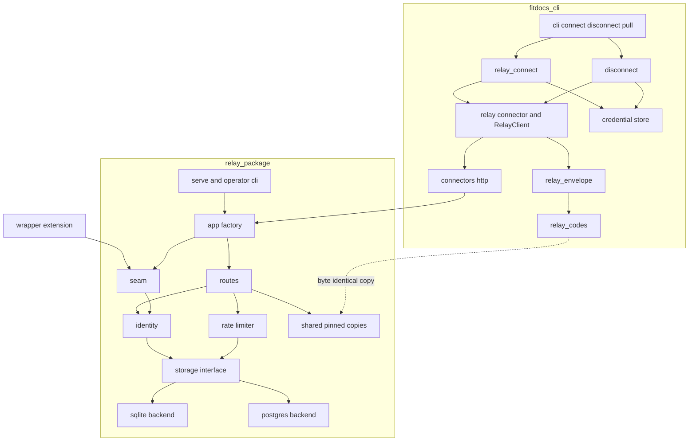
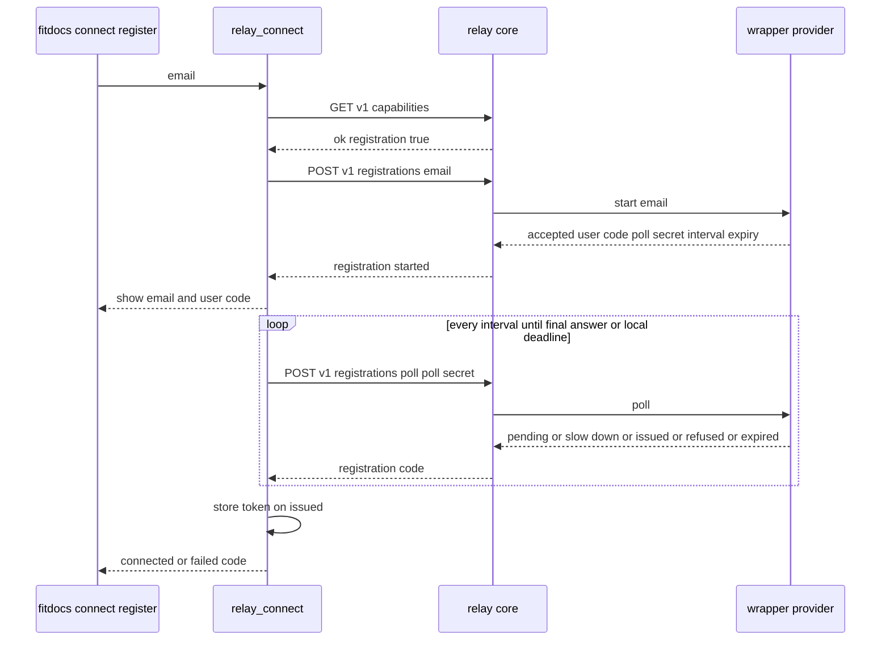
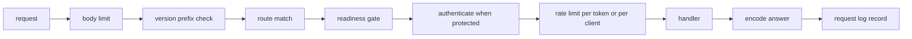
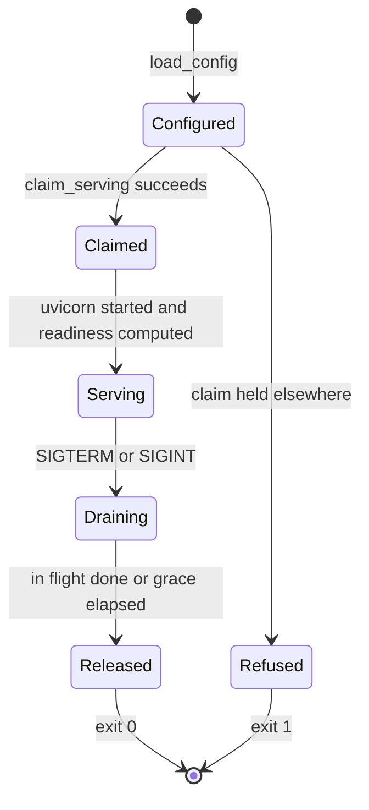

# Design Document: relay-server

## Overview

**Purpose**: This feature gives fitdocs a relay. The relay is a small,
self-hostable server that can hold a platform application on the athlete's
behalf. It also gives fitdocs the client side that authenticates to it. The
relay has no accounts and sends no email. Its operator mints relay tokens,
and a wrapping deployment may add its own token issuance through a
documented in-process seam.

**Users**:
- Operators run the relay locally on a SQLite file or deploy its image
  against PostgreSQL.
- fitdocs users configure a relay connector instance, run `fitdocs connect`
  (with a pasted token or `--register`), and run `fitdocs disconnect`.
- Later specs (`strava-publish`, `relay-intervals`) add targets on top.

**Impact**:
- The repository gains `relay/`, a second Python project with its own
  manifest, lockfile, tests, image definition, changelog and CI workflow.
  It is never part of the `fitdocs` release.
- The connector framework gains a fifth authentication style, a built-in
  `relay` connector, and `fitdocs disconnect`.
- A bare `fitdocs pull` now selects only the instances that pull.
- Neither `CONTRACT_VERSION` nor `DOC_VERSION` changes (R6).

### Goals
- A relay that runs locally on SQLite with nothing installed beyond its
  package, and identically on PostgreSQL. One conformance suite proves the
  two backends equal.
- Operator-minted tokens, stored only as keyed hashes; operator commands;
  a versioned envelope whose answers are closed codes with no free text.
- A versioned deploy contract and a versioned wrapper seam, both documented
  and pinned.
- The fitdocs client: a relay connector, `connect` by paste or by
  device-style registration, `disconnect`, and nothing a relay says printed.

### Non-Goals
- Any publish target, third-party OAuth, or publish route
  (`strava-publish`, `relay-intervals`).
- The relay side of registration (verification, email delivery, pages).
- Composing posts, `fitdocs publish`, the outcome vocabulary
  (`publish-core`).
- Publishing an image or a relay distribution.
- Hosting, TLS termination, backups, or several replicas per database.

## Boundary Commitments

### This Spec Owns
- **The relay package** `relay/` (distribution `fitdocs-relay`, import name
  `fitdocs_relay`), including its manifest, lockfile, Dockerfile,
  changelog, tests and `.github/workflows/relay.yml`.
- **Relay identity**: principals, relay tokens (format, hashing,
  verification, revocation) and the operator command `fitdocs-relay`.
- **The storage interface** `fitdocs_relay.storage.interface.Storage`, its
  SQLite and PostgreSQL backends, the schema changes `0001`, the migration
  runner, and the conformance suite under `relay/tests/conformance/`.
- **The relay's own rate limiting.**
- **The envelope**, version 1:
  - its routes `/livez`, `/readyz`, `/v1/capabilities`, `/v1/token`,
    `/v1/token/revoke`, `/v1/registrations` and `/v1/registrations/poll`;
  - the answer shape and the registration wire format;
  - the relay code vocabulary (R3) at `src/fitdocs/connectors/
    relay_codes.py` and the codec at `src/fitdocs/connectors/
    relay_envelope.py`.
- **The pinned-copy mechanism (R2)**:
  - the copies under `relay/src/fitdocs_relay/shared/`;
  - `scripts/sync_relay_shared.py` and its `SHARED_MODULES` table;
  - the cross-check test `tests/test_relay_shared_copies.py`.
- **The wrapper seam**, version 1 (`fitdocs_relay.seam`).
- **The deploy contract**, version 1 (`fitdocs_relay.contract`, `docs/
  relay.md`), and the decision that CI builds the image and publishes none.
- **The fitdocs side**:
  - `AuthStyle.RELAY_TOKEN`, `RelayTokenClient` and the relay value types
    in `connectors/protocol.py`;
  - `connectors/relay.py` (`RelayConnector`, `RelayClient`, `RelaySettings`);
  - `connectors/relay_connect.py` and `connectors/disconnect.py`;
  - `CredentialStore.remove`;
  - the CLI's `connect --register/--email`, `disconnect [--local-only]`
    and the bare-pull selection.
- **The amendments it carries**: connectors, distribution (release
  exclusion and the packaged-skill line), docs-site (two guides, the CLI
  reference, the privacy guide), and steering (`tech.md` "No server" and
  "Network and Credentials"; `structure.md` `relay/`) (R7).

### Out of Boundary
- **publish-core's** outcome vocabulary (`fitdocs.publish.outcomes`, R1),
  its single-attempt write mode (R4), its target contract and the driving
  of `RESOLVE_REMOTE_ACTIVITY`, `ANNOTATE_REMOTE_ACTIVITY` and
  `PUSH_ACTIVITY` (R5). This spec references them only:
  - the envelope's `outcome` field carries an R1 code;
  - relay-server sends none;
  - relay-server copies no outcome module.
- **Target routes**, target ids in `OFFERED_TARGETS`, storage operations
  for token custody, deploy-contract variables for targets, browser pages,
  and `OAUTH_BROWSER` driven (`strava-publish`, `relay-intervals`).
- **The relay side of registration**: no `RegistrationProvider`
  implementation, no email, no verification page.
- **Hosting**: TLS termination, process supervision, backups, scaling, and
  any provider or infrastructure.
- **Changes to existing connectors' pull behaviour**: `run_pull` is
  unchanged; only the CLI's bare selection changes.

### Allowed Dependencies
- **fitdocs side**:
  - the new modules import only the standard library and
    `fitdocs.connectors.{errors,http,protocol,secrets,credentials,settings,
    relay_codes,relay_envelope,relay}`, each per the boundary table in the
    File Structure Plan;
  - `relay_codes` imports nothing outside the standard library;
  - `relay_envelope` imports only the standard library and
    `.relay_codes`, relatively;
  - no new runtime dependency (connectors Req 14.5);
  - no clock read (`now`/`sleep` are injected);
  - network only through `connectors/http.py`.
- **Relay side**:
  - the standard library, `starlette>=1.0,<2` and `uvicorn>=0.30,<1`;
  - `psycopg[binary,pool]>=3.2,<4`, only in the `postgres` extra and
    imported only by `storage/postgres.py`;
  - `sqlite3`, imported only by `storage/sqlite.py`;
  - never `fitdocs`;
  - dev only: `pytest`, `httpx` (Starlette's test client), `ruff`, `mypy`.
- **CI**: GitHub-hosted runners, a PostgreSQL service container pinned by
  digest, and Docker on the runner for the image build. Nothing is pushed.

### Revalidation Triggers
- **The `RelayCode` vocabulary or its order, `ENVELOPE_VERSION`, the route
  table, the answer shape, or a field format** (token, user code, poll
  secret, target id, interval and expiry bounds). Re-check `strava-publish`,
  `relay-intervals` and every wrapper.
- **The `Storage` protocol's shape, the transaction guarantees, the
  conformance coverage rule, or the migration numbering.** Re-check
  `strava-publish` and `relay-intervals`.
- **`SEAM_VERSION` or any seam signature.** Re-check every wrapper; the
  relay changelog marks it as breaking.
- **`DEPLOY_CONTRACT_VERSION`, the environment table, the probes, the
  commands, the image user, port or entrypoint, or the one-replica or state
  rule.** Re-check every deployment.
- **`RelayClient`, `RelaySettings`, `RelayTokenClient`, `AuthStyle.
  RELAY_TOKEN`, `run_disconnect`'s per-style table, or the bare-pull
  selection rule.** Re-check the fitdocs-side consumers in `strava-publish`
  and `relay-intervals`.
- **`SHARED_MODULES`, or a shared module gaining a non-standard-library
  import.** Re-check the pinned-copy test and every relay consumer.

### Future extension: planned-workout push (R8)
Nothing here assumes a completed-activity page:
- the envelope, the capabilities endpoint and `RelayClient` are
  target-neutral;
- `targets` lists opaque ids, and the codes are append-only.

A later planned-workout route through a relay adds a route, a target id and
any codes it needs. No abstraction is built for it now.

**Revalidation trigger**: a target id format or capabilities shape that
cannot name a non-activity target.

### Settled Seams Applied (controller rulings R1-R8)
- **R1**: publish-core's `fitdocs.publish.outcomes` is referenced, not
  defined. The envelope's optional `outcome` field carries one of its
  codes. relay-server sends none and copies no outcome module.
- **R2**: the copies live in `relay/src/fitdocs_relay/shared/`.
  `scripts/sync_relay_shared.py` (`SHARED_MODULES`) writes them, and
  `tests/test_relay_shared_copies.py` is the one cross-check test later
  specs append to.
- **R3**: the vocabulary is `src/fitdocs/connectors/relay_codes.py`
  (`RelayCode`), with the codec beside it in `relay_envelope.py`.
- **R4**: every relay-server client call (token check, capabilities read,
  registration start and poll, revocation) is an authentication-class call
  and goes through the existing `CallMode.AUTH`, which makes one attempt
  whatever the answer (`connectors/http.py:281-282`). relay-server adds no
  transport mode and does not consume publish-core's single-attempt write
  mode. `RelayClient` takes its caller's `HttpClient`, so strava-publish
  passes publish-core's mode for the publish request. The name is
  reconciled at cross-spec review.
- **R5**: `AuthStyle.RELAY_TOKEN` is added. `RESOLVE_REMOTE_ACTIVITY`,
  `ANNOTATE_REMOTE_ACTIVITY` and `PUSH_ACTIVITY` are not touched, and
  `OAUTH_BROWSER` stays reserved (`fitdocs disconnect` refuses it until
  strava-publish drives it).
- **R6**: neither `CONTRACT_VERSION` nor `DOC_VERSION` changes. Every
  version pin this spec adds (`ENVELOPE_VERSION`, `SEAM_VERSION`,
  `DEPLOY_CONTRACT_VERSION`) is a literal.
- **R7**: this spec edits only its own lines:
  - `tech.md` "No server" and "Network and Credentials";
  - the `structure.md` `relay/` entry and its connectors-bullet wording;
  - the self-hosting guide;
  - its own nav entries (by page frontmatter);
  - its own `protocol.py` and registry members;
  - appended `CHANGELOG.md` entries.
- **R8**: see "Future extension" above.

### Amendments Carried (each takes the next free amendment number at landing)
- **connectors**:
  - Req 1.7: five authentication styles; the relay-token style is
    supported.
  - Req 2.3: a relay-token connector may declare no capability and must
    provide the five relay operations.
  - Req 2.7: the published surface gains the relay protocol names.
  - Req 4.5: the environment override covers the relay token.
  - Req 5: for a relay instance, connect behaves per relay-server Reqs 12
    and 13. 5.6's quoted service message becomes the relay code with
    fitdocs's explanation. 5.7's single attempt holds per request, within
    the registration sequence.
  - Req 6.1: a bare pull selects pulling instances only.
  - Req 9.4: the authentication requests include the relay calls.
  - Req 14.1 and 14.4: `fitdocs disconnect` joins `connect` and `pull` as
    a connector-request command.
  - New: `fitdocs disconnect` (relay-server Req 14).
- **distribution**: the release gate forbids `relay/*` and
  `fitdocs_relay/*`. The packaged skill's never-run-`fitdocs disconnect`
  line. No image is published (CI builds it only).
- **docs-site**: the relay and self-hosting guides, the CLI reference
  entries, and the privacy guide's relay paragraph.
- **steering**: `tech.md` and `structure.md`, per SteeringAmendment below.
  This spec carries them; the controller's merge lands them.

## Architecture

### Existing Architecture Analysis
- The connector framework is a plain-declaration protocol plus a registry
  with one validation gate.
  - Credentials live in a per-user TOML store and are resolved by
    auth-style rules.
  - All network traffic goes through `HttpClient`: AUTH mode attempts once,
    and DATA mode retries.
  - A guard pins each connectors module's direct imports, the tree-wide
    network allow-list, and a no-clock scan.
- The CLI (`cli.py`) does presentation only. Engines return typed results,
  and exit codes are 0/1/2/130.
- The release gate (`scripts/check_artifacts.py` reading `release/
  artifact-policy.toml`) checks built artifacts, never the source tree.

### Architecture Pattern & Boundary Map



**Architecture Integration**:
- **Pattern**: ports and adapters on the relay side, with domain services
  over one `Storage` port and two backend adapters. On the fitdocs side,
  the existing connector pattern (declaration, operation protocol, engine,
  CLI presentation).
- **Boundaries**: the shared code and codec are the only coupling between
  the two packages, and they are pinned copies. SQL exists only in the two
  backend modules.
- **Preserved patterns**:
  - injected clock on both sides (the relay's storage takes `now` as an
    argument);
  - closed, append-only vocabularies pinned by prefix;
  - credentials stored outside the data root;
  - `AUTH` mode for every authentication-class call;
  - engines return values and the CLI prints them.
- **Steering compliance**:
  - absent values are `None` (an unstated `retry_after_s` is `None`, never
    `0`);
  - nothing secret under the data root;
  - the network allow-list is unchanged.

**Dependency direction** (each layer imports only from layers to its left;
a violation is a defect):
- fitdocs side: `relay_codes` → `relay_envelope` → `protocol` → `relay` →
  `relay_connect` / `disconnect` → `cli`. `credentials`, `http` and
  `secrets` keep their existing positions.
- relay side: `shared.*` → `contract` → `config` → `storage.interface` →
  `storage.sqlite` / `storage.postgres` / `storage.migrate` → `storage` →
  `identity`, `ratelimit` → `seam` → `answers` → `routes` → `app` → `serve`
  → `cli`. `logs` is a leaf that `app`, `serve` and `cli` import.

### Technology Stack

| Layer | Choice / Version | Role in Feature | Notes |
|-------|------------------|-----------------|-------|
| fitdocs CLI | existing typer CLI, standard library | relay connector, connect, disconnect | No new runtime dependency |
| Relay HTTP | `starlette>=1.0,<2` | Routing, request and response, lifespan | Routes passed to the constructor; `lifespan=` (1.0 removed `on_startup`) |
| Relay server | `uvicorn>=0.30,<1` (no `standard` extra) | ASGI server, graceful shutdown, proxy headers | Access log off; own signal handlers (research.md) |
| Relay storage (default) | standard library `sqlite3`, SQLite at least 3.35 | Default backend, WAL, `BEGIN IMMEDIATE` | Version checked at open |
| Relay storage (extra) | `psycopg[binary,pool]>=3.2,<4` (LGPL-3.0, unmodified) | PostgreSQL backend, connection pool, row and advisory locks | Only in extra `postgres` |
| Relay image | `python:3.12-slim-bookworm@sha256:<digest>`; uv pinned by digest in the build stage | Container image | Non-root uid 10001; licence texts in `/usr/share/licenses/fitdocs-relay/` |
| CI | GitHub Actions, `postgres:17@sha256:<digest>` service | Conformance on both backends, image smoke | Publishes nothing |

## File Structure Plan

### Directory Structure
```
relay/
├── pyproject.toml          # fitdocs-relay 0.1.0, requires-python >=3.11; deps starlette, uvicorn;
│                           #   extra postgres = psycopg[binary,pool]; dev group pytest, httpx, ruff, mypy;
│                           #   script fitdocs-relay = fitdocs_relay.cli:main; [tool.ruff] extends ../pyproject.toml;
│                           #   [tool.mypy] strict on src and tests; [tool.pytest.ini_options] testpaths = ["tests"]
├── uv.lock                 # the relay's own lock (never the root lock)
├── README.md               # short pointer to docs/relay.md and the self-hosting guide
├── CHANGELOG.md            # relay changelog: contract, envelope and seam versions; breaking changes marked
├── Dockerfile              # two-stage build; non-root; no secret, no database; licence texts
├── .dockerignore           # .venv, tests, caches
├── contract/envelope-v1.json   # recorded request/answer exchanges both test suites replay
├── scripts/
│   ├── collect_licences.py # image build: copies installed distributions' licence files
│   └── image_smoke.sh      # CI: migrate, serve, probe, SIGTERM, log scan, for one backend
├── src/fitdocs_relay/
│   ├── __init__.py         # __version__ only
│   ├── __main__.py         # python -m fitdocs_relay -> cli.main
│   ├── shared/__init__.py  # states: byte-identical copies, never edited; written by scripts/sync_relay_shared.py
│   ├── shared/relay_codes.py     # copy of src/fitdocs/connectors/relay_codes.py
│   ├── shared/relay_envelope.py  # copy of src/fitdocs/connectors/relay_envelope.py
│   ├── contract.py         # DEPLOY_CONTRACT_VERSION, ENV_PREFIX, ENVIRONMENT, probes, image constants, COMMANDS
│   ├── config.py           # RelayConfig, DatabaseTarget, load_config(environ), ConfigError
│   ├── storage/
│   │   ├── __init__.py     # open_storage(target) -> Storage; MissingPostgresSupport
│   │   ├── interface.py    # Storage protocol (per-area protocols), value types, storage errors
│   │   ├── sqlite.py       # SqliteStorage: the only sqlite3 importer
│   │   ├── postgres.py     # PostgresStorage: the only psycopg/psycopg_pool importer
│   │   ├── migrate.py      # SchemaChange discovery, migrate(), MigrationReport; no SQL execution of its own
│   │   └── migrations/{sqlite,postgres}/0001_initial.sql
│   ├── identity.py         # token format, generation, keyed hash, TokenService
│   ├── ratelimit.py        # RateLimiter (keys, windows) over Storage
│   ├── seam.py             # SEAM_VERSION and the wrapper surface; load_extensions
│   ├── answers.py          # server glue: answer(), read_request(), bearer_token(), client_address()
│   ├── routes.py           # core handlers, OFFERED_TARGETS, RESERVED_PREFIXES
│   ├── app.py              # create_app(); RelayServices; middleware; lifespan; readiness gate
│   ├── logs.py             # JSON-lines formatter, redacting filter, failure logging
│   ├── serve.py            # run_server(): claim, signals, uvicorn config
│   └── cli.py              # fitdocs-relay: serve, migrate, principal, token, new-pepper
└── tests/
    ├── conftest.py         # environment isolation, test pepper, backend fixtures, REQUIRE_POSTGRES rule
    ├── conformance/        # one module per storage area + test_concurrency.py + test_coverage.py
    ├── test_boundary.py    # import rules (no fitdocs; SQL drivers only in backends; starlette/uvicorn placement)
    ├── test_config.py, test_contract.py, test_identity.py, test_ratelimit.py, test_migrate.py
    ├── test_routes.py, test_envelope_server.py, test_wire_examples.py, test_seam.py
    ├── test_logs.py, test_serve.py (subprocess shutdown and claim), test_cli.py
    ├── test_dockerfile.py  # static image rules
    └── test_docs_relay.py  # docs/relay.md environment table and versions bound to contract.py

src/fitdocs/connectors/
├── relay_codes.py          # NEW, shared: RelayCode, CodeOrigin, RelayCodeInfo, RELAY_CODES, explain()
├── relay_envelope.py       # NEW, shared: ENVELOPE_VERSION, routes, formats, Answer, codec, data parsers
├── relay.py                # NEW: RelayConnector, RelaySettings, RelayClient, RelayReply
├── relay_connect.py        # NEW: run_relay_connect, run_relay_registration, results, relay_next_step
└── disconnect.py           # NEW: run_disconnect and its results, per auth style

scripts/sync_relay_shared.py    # NEW: SHARED_MODULES; writes the copies (--check reports drift)
.github/workflows/relay.yml     # NEW: the relay job
docs/relay.md                   # NEW: the operator-facing contract page
website/content/guides/relay.md                 # NEW: connecting fitdocs to a relay
website/content/guides/self-hosting-a-relay.md  # NEW: running your own relay
tests/test_relay_shared_copies.py               # NEW: R2 cross-check
tests/test_relay_workflow.py                    # NEW: relay.yml pins
tests/connectors/test_relay_codes.py            # NEW: vocabulary prefix pin, explanations, statuses, origins
tests/connectors/test_relay_envelope.py         # NEW: codec and format validators
tests/connectors/test_relay.py                  # NEW: connector, settings, RelayClient
tests/connectors/test_relay_connect.py          # NEW: paste and registration engines
tests/connectors/test_disconnect.py             # NEW: per-style disconnect
tests/connectors/test_relay_wire_examples.py    # NEW: decodes relay/contract/envelope-v1.json answers
tests/connectors/test_cli_relay.py              # NEW: CLI connect/disconnect/pull selection
tests/connectors/test_relay_docs.py             # NEW: docs/relay.md code table bound to RELAY_CODES
```

### Modified Files
- `src/fitdocs/connectors/protocol.py`:
  - add `AuthStyle.RELAY_TOKEN` and add it to `SUPPORTED_AUTH_STYLES`;
  - add `RelayRefused`, `RelayCapabilities`, `RegistrationStarted`,
    `RegistrationPolled` and `RelayTokenClient`;
  - import `relay_codes`.
- `src/fitdocs/connectors/registry.py`: empty capabilities allowed only for
  `RELAY_TOKEN`; the five relay operations required for it.
- `src/fitdocs/connectors/credentials.py`:
  - `RELAY_TOKEN` resolves like `API_KEY`;
  - `CredentialStore.remove(instance) -> bool`.
- `src/fitdocs/connectors/connect.py`: `_env_override` covers `RELAY_TOKEN`.
- `src/fitdocs/connectors/__init__.py`: register `RelayConnector()`, and
  export the new protocol names.
- `src/fitdocs/cli.py`:
  - `connect_command` gains `--register` and `--email`, plus the relay
    branch;
  - new `disconnect_command`;
  - `pull_command`'s bare selection filter and its empty-selection line.
- `src/fitdocs/skills/fitdocs-workouts/SKILL.md`: the never-run
  `fitdocs disconnect` sentence beside the connect rule.
- `release/artifact-policy.toml`: `relay/*` and `fitdocs_relay/*` in
  `[forbidden].members`.
- `pyproject.toml`: mypy `files` gains the new root test modules.
  Dependencies are unchanged.
- **Tests that pin what changes**:
  - `tests/connectors/test_boundary.py`: module list and import sets;
  - `tests/connectors/test_surface.py`: `EXPECTED_ALL` appended;
  - `tests/connectors/test_registry.py` and `test_credentials.py`: the new
    rules;
  - `tests/connectors/test_docs.py`: the `api.fitdocs.ai` exemption entry;
  - `tests/connectors/test_network_statements.py`: the tech.md "No server"
    pin rewritten as a literal;
  - `tests/test_release_artifacts.py`: the controls;
  - `tests/test_agent_skill.py`: the disconnect pin.
- **Docs and changelog**:
  - `docs/connectors.md`: the relay section;
  - `docs/index.md`: the `relay.md` row;
  - `website/content/reference/cli.md`;
  - `website/content/guides/privacy-and-network.md`;
  - `CHANGELOG.md`: Unreleased.
- **Steering**: `.kiro/steering/tech.md` and `.kiro/steering/structure.md`.

**Connectors boundary table** (new and changed `_ALLOWED_IMPORT_TARGETS`
entries, non-standard-library only):

| Module | Allowed direct imports |
|--------|------------------------|
| `relay_codes` | none |
| `relay_envelope` | `fitdocs.connectors.relay_codes` |
| `protocol` | existing + `fitdocs.connectors.relay_codes` |
| `relay` | `errors`, `http`, `protocol`, `secrets`, `relay_codes`, `relay_envelope` |
| `relay_connect` | `credentials`, `http`, `protocol`, `secrets`, `settings`, `relay_codes`, `relay_envelope` |
| `disconnect` | `credentials`, `http`, `protocol`, `secrets`, `settings`, `relay_codes` |
| `fitdocs.connectors` (package) | existing + `fitdocs.connectors.relay` |

## System Flows

### Registration client



- Every request is one `CallMode.AUTH` attempt, and a failed request ends
  the flow. The loop itself is the protocol.
- `slow-down` adds `SLOW_DOWN_STEP_S`, capped at `MAX_POLL_INTERVAL_S`.
- The local deadline is the started time (from the injected `now`) plus
  `expires_in_s`. Once it passes, the outcome is `registration-expired`.
- A `KeyboardInterrupt` raised from `sleep` propagates. The CLI maps it to
  exit 130, and nothing is stored.

### Request pipeline on the relay



- An oversized body answers `request-too-large`.
- A `/vN/` prefix with N not served answers `envelope-unsupported` with
  `{"envelopes": [1]}`.
- An unmatched path, or a registration route without a provider, answers
  `not-offered`.
- While not ready, every `/v1` route answers `unavailable`. The probes stay
  served.
- A failed authentication first counts against the client's limit, then
  answers the token code.
- An unhandled exception answers `relay-failure`. `StorageUnreachable`
  answers `unavailable`.

### Serve lifecycle



## Requirements Traceability

| Requirement | Summary | Components | Interfaces | Flows |
|-------------|---------|------------|------------|-------|
| 1.1, 1.2, 1.3, 1.5, 1.6 | Separate package, local SQLite run, PostgreSQL by URL, own CI, no fitdocs import | RelayPackage, StorageFactory, RelayWorkflow, RelayBoundaryGuard | `open_storage`, `relay.yml` | Serve lifecycle |
| 1.4 | Release excludes the relay | ReleaseExclusion | `artifact-policy.toml` | — |
| 2.1, 2.2, 2.3, 2.4, 2.5, 2.6, 2.7, 2.8 | Principals and tokens | IdentityService, StorageInterface, ConfigLoader, RelayDocsPage | `TokenService`, `TokenStore`, `PrincipalStore` | Request pipeline |
| 3.1, 3.2, 3.3, 3.4, 3.5, 3.6, 3.7 | Operator commands | OperatorCli | `fitdocs-relay principal/token` | — |
| 4.1, 4.2, 4.3, 4.4, 4.5, 4.6, 4.7, 4.8, 4.10, 4.11 | Envelope and codes | SharedRelayCodes, SharedEnvelopeCodec, AnswersGlue, CoreRoutes, AppFactory | `RelayCode`, `encode_answer`, `decode_answer` | Request pipeline |
| 4.9 | Pinned copies | SharedCopySync | `SHARED_MODULES`, `tests/test_relay_shared_copies.py` | — |
| 5.1, 5.2, 5.3, 5.4, 5.5, 5.6 | Authentication and capabilities | CoreRoutes, IdentityService | `/v1/token`, `/v1/token/revoke`, `/v1/capabilities` | Request pipeline |
| 6.1, 6.2, 6.3, 6.4 | Rate limits | RateLimiter, StorageInterface | `RateLimitStore.count_request` | Request pipeline |
| 7.1, 7.2, 7.3, 7.4, 7.5, 7.6, 7.7, 7.8 | Storage and conformance | StorageInterface, SqliteBackend, PostgresBackend, StorageFactory, ConformanceSuite, RelayWorkflow | `Storage` | — |
| 8.1, 8.2, 8.3, 8.4, 8.5, 8.6, 8.7 | Migrations | MigrationRunner, backends, OperatorCli | `migrate`, `apply_schema_change` | — |
| 9.1, 9.2, 9.3, 9.4, 9.5, 9.6, 9.7, 9.8, 9.9, 9.10, 9.11, 9.12 | Deploy contract | DeployContract, ConfigLoader, RelayImage, AppFactory, Serve, RelayLogs, RelayWorkflow, RelayChangelog | `ENVIRONMENT`, `/livez`, `/readyz` | Serve lifecycle |
| 10.1, 10.2, 10.3, 10.4, 10.5, 10.6, 10.7, 10.8, 10.9 | Wrapper seam | Seam, CoreRoutes, AppFactory | `RelayExtension`, `RegistrationProvider`, `ExtensionRecords` | Registration client |
| 11.1, 11.2, 11.3, 11.4, 11.5, 11.6 | Relay instances | RelayConnector, ProtocolAmendment, RegistryAmendment, CredentialsAmendment, CliRelay | `RelaySettings`, `AuthStyle.RELAY_TOKEN` | — |
| 12.1, 12.2, 12.3, 12.4, 12.5, 12.6 | Pasted token | RelayConnectEngine, CliRelay | `run_relay_connect` | — |
| 13.1, 13.2, 13.3, 13.4, 13.5, 13.6, 13.7, 13.8, 13.9, 13.10, 13.11 | Registration client | RelayConnectEngine, RelayConnector, CliRelay | `run_relay_registration` | Registration client |
| 14.1, 14.2, 14.3, 14.4, 14.5, 14.6, 14.7 | Disconnect | DisconnectEngine, CliRelay, CredentialsAmendment | `run_disconnect`, `CredentialStore.remove` | — |
| 15.1, 15.2, 15.3, 15.4, 15.5, 15.6 | fitdocs-side network and text | RelayConnector, RelayClient, RelayConnectEngine, ConnectorsBoundaryAmendment | `HttpClient(AUTH)` | — |
| 16.1, 16.2 | Steering | SteeringAmendment | tech.md, structure.md | — |
| 16.3, 16.4, 16.5, 16.6, 16.7, 16.8 | Docs, skill, changelogs | ConnectorsDocs, RelayDocsPage, SiteGuides, SkillLine, Changelogs | docs and site pages | — |

## Components and Interfaces

| Component | Domain | Intent | Req Coverage | Key Dependencies | Contracts |
|-----------|--------|--------|--------------|------------------|-----------|
| SharedRelayCodes | shared | Closed code vocabulary | 4.2, 4.3, 4.10 | none | State |
| SharedEnvelopeCodec | shared | Wire codec and formats | 4.1, 4.4, 4.5, 4.6, 4.7 | SharedRelayCodes (P0) | Service |
| SharedCopySync | shared | Copies plus drift test | 1.6, 4.9 | — | Batch |
| ProtocolAmendment, RegistryAmendment, CredentialsAmendment | fitdocs connectors | Relay style in the framework | 11.3, 11.4, 14.7 | protocol (P0) | Service |
| RelayConnector + RelayClient | fitdocs connectors | Relay instances and envelope calls | 11.1, 11.2, 11.6, 15.2, 15.3 | http (P0), codec (P0) | Service, API |
| RelayConnectEngine | fitdocs connectors | Paste and registration | 12, 13, 15.4 | RelayConnector (P0), credentials (P0) | Service |
| DisconnectEngine | fitdocs connectors | Per-style disconnect | 14 | credentials (P0), RelayConnector (P1) | Service |
| CliRelay | fitdocs cli | Flags, commands, bare-pull filter | 11.5, 12, 13, 14, 15.1 | engines (P0) | Service |
| DeployContract + ConfigLoader | relay | Env table, config | 2.7, 7.2, 7.3, 9.2, 9.3, 9.4, 9.10 | — | State |
| StorageInterface + backends + StorageFactory | relay | Domain operations on two engines | 1.2, 1.3, 2.5, 6.3, 7, 8, 9.6 | sqlite3, psycopg (P0) | Service, State |
| MigrationRunner | relay | Ordered, idempotent schema changes | 8 | backends (P0) | Batch |
| ConformanceSuite | relay tests | Equal behaviour proof | 7.4, 7.5, 7.6, 7.7 | backends (P0) | — |
| IdentityService | relay | Tokens and principals | 2, 5.2, 5.3 | Storage (P0) | Service |
| RateLimiter | relay | Per-token and per-client limits | 6 | Storage (P0) | Service |
| Seam | relay | Wrapper surface | 10 | IdentityService (P0), Storage (P0) | Service |
| AnswersGlue + CoreRoutes + AppFactory | relay | HTTP envelope server | 4, 5, 9.5, 9.9, 10.4, 10.5, 10.6, 10.7 | Starlette (P0) | API |
| RelayLogs | relay | Secret-free JSON logs | 9.8, 9.9 | — | — |
| Serve + OperatorCli | relay | Process lifecycle and commands | 3, 8.1, 8.6, 9.6, 9.7 | uvicorn (P0) | Batch |
| RelayImage + RelayWorkflow | relay build | Image and CI | 1.5, 7.6, 9.1, 9.11 | Docker, Actions (P1) | Batch |
| ReleaseExclusion, SteeringAmendment, ConnectorsDocs, RelayDocsPage, SiteGuides, SkillLine, Changelogs, RelayChangelog | docs and gates | Keep statements true | 1.4, 2.8, 9.12, 16 | — | — |

### Shared modules (fitdocs source, pinned into the relay)

#### SharedRelayCodes — `src/fitdocs/connectors/relay_codes.py`

| Field | Detail |
|-------|--------|
| Intent | The closed, append-only relay code vocabulary (R3) |
| Requirements | 4.2, 4.3, 4.10 |

**Responsibilities & Constraints**
- Standard library only (`enum`, `dataclasses`, `typing`, `collections.abc`).
  It never imports `http`, because the network scan forbids it.
- Declaration order is the pinned prefix. A later spec only appends.

```python
class CodeOrigin(StrEnum):
    RELAY = "relay"     # the relay may send it
    CLIENT = "client"   # only the fitdocs client concludes it; never on the wire

class RelayCode(StrEnum):
    OK = "ok"
    TOKEN_MISSING = "token-missing"
    TOKEN_UNKNOWN = "token-unknown"
    TOKEN_REVOKED = "token-revoked"
    ENVELOPE_UNSUPPORTED = "envelope-unsupported"
    REQUEST_MALFORMED = "request-malformed"
    REQUEST_TOO_LARGE = "request-too-large"
    NOT_OFFERED = "not-offered"
    RATE_LIMITED = "rate-limited"
    UNAVAILABLE = "unavailable"
    RELAY_FAILURE = "relay-failure"
    STORAGE_UNREACHABLE = "storage-unreachable"
    SCHEMA_BEHIND = "schema-behind"
    SCHEMA_AHEAD = "schema-ahead"
    REGISTRATION_STARTED = "registration-started"
    REGISTRATION_PENDING = "registration-pending"
    REGISTRATION_SLOW_DOWN = "registration-slow-down"
    REGISTRATION_ISSUED = "registration-issued"
    REGISTRATION_REFUSED = "registration-refused"
    REGISTRATION_EXPIRED = "registration-expired"
    RELAY_UNREACHABLE = "relay-unreachable"
    ANSWER_MALFORMED = "answer-malformed"

@dataclass(frozen=True)
class RelayCodeInfo:
    code: RelayCode
    explanation: str          # fitdocs-written, one sentence
    http_status: int | None   # None exactly when origin is CLIENT
    origin: CodeOrigin

RELAY_CODES: Final[Mapping[RelayCode, RelayCodeInfo]]
def explain(code: RelayCode) -> str: ...
```

| Code | Status | Origin | Explanation (fitdocs-written) |
|------|--------|--------|-------------------------------|
| ok | 200 | relay | The relay accepted the request. |
| token-missing | 401 | relay | The request carried no relay token. |
| token-unknown | 401 | relay | The relay does not recognise this token. |
| token-revoked | 401 | relay | This relay token has been revoked. |
| envelope-unsupported | 400 | relay | The relay does not serve this envelope version. |
| request-malformed | 400 | relay | The relay could not read the request. |
| request-too-large | 413 | relay | The request is larger than the relay accepts. |
| not-offered | 404 | relay | This relay does not offer that. |
| rate-limited | 429 | relay | The relay is limiting requests; wait before trying again. |
| unavailable | 503 | relay | The relay is temporarily unavailable. |
| relay-failure | 500 | relay | The relay failed while handling the request. |
| storage-unreachable | 503 | relay | The relay cannot reach its database. |
| schema-behind | 503 | relay | The relay's database needs migrating. |
| schema-ahead | 503 | relay | The relay's database was migrated by a newer relay. |
| registration-started | 200 | relay | The relay started the registration. |
| registration-pending | 200 | relay | The registration is waiting for confirmation. |
| registration-slow-down | 200 | relay | The relay asked fitdocs to poll less often. |
| registration-issued | 200 | relay | The relay issued a relay token. |
| registration-refused | 403 | relay | The relay refused the registration. |
| registration-expired | 410 | relay | The registration expired before it was confirmed. |
| relay-unreachable | — | client | fitdocs could not reach the relay. |
| answer-malformed | — | client | The relay's answer was not a valid fitdocs relay answer. |

#### SharedEnvelopeCodec — `src/fitdocs/connectors/relay_envelope.py`

| Field | Detail |
|-------|--------|
| Intent | Envelope v1: version, routes, field formats, encode/decode, per-route data parsers |
| Requirements | 4.1, 4.4, 4.5, 4.6, 4.7 |

**Responsibilities & Constraints**
- Standard library only (`json`, `re`, `dataclasses`, `typing`,
  `collections.abc`), plus `from .relay_codes import RelayCode,
  RELAY_CODES, CodeOrigin`. The relative import is what lets the same bytes
  import in both packages.
- `EnvelopeError` messages are fixed fitdocs text that never interpolates
  the input.

```python
ENVELOPE_VERSION: Final = 1
SERVED_ENVELOPES: Final[tuple[int, ...]] = (1,)
ROUTE_LIVEZ = "/livez"; ROUTE_READYZ = "/readyz"
ROUTE_CAPABILITIES = "/v1/capabilities"; ROUTE_TOKEN = "/v1/token"
ROUTE_TOKEN_REVOKE = "/v1/token/revoke"
ROUTE_REGISTRATIONS = "/v1/registrations"; ROUTE_REGISTRATION_POLL = "/v1/registrations/poll"
TOKEN_PREFIX = "fdr1"
TOKEN_RE = r"^fdr1_([a-z2-7]{16})_([a-z2-7]{52})$"      # id 80 bits, secret 260 bits
USER_CODE_RE = r"^[BCDFGHJKLMNPQRSTVWXZ]{4}-[BCDFGHJKLMNPQRSTVWXZ]{4}$"
POLL_SECRET_RE = r"^[A-Za-z0-9_-]{32,128}$"
TARGET_ID_RE = r"^[a-z][a-z0-9-]{0,31}$"
EMAIL_RE = r"^[^@\s]{1,64}@[^@\s]+\.[^@\s]+$"; MAX_EMAIL_CHARS = 254
MIN_POLL_INTERVAL_S = 1; MAX_POLL_INTERVAL_S = 60; SLOW_DOWN_STEP_S = 5
MIN_EXPIRES_IN_S = 60; MAX_EXPIRES_IN_S = 3600
MAX_REQUEST_BYTES = 65_536; MAX_ANSWER_BYTES = 65_536

@dataclass(frozen=True)
class Answer:
    code: RelayCode
    data: Mapping[str, object]      # route-defined fields only; never printed unparsed
    outcome: str | None = None      # an R1 publish-outcome code on publish routes; None otherwise

class EnvelopeError(ValueError): ...

def encode_answer(answer: Answer) -> bytes            # {"envelope":1,"code":..,"data":{..}[, "outcome":..]}
def decode_answer(raw: bytes) -> Answer               # strict; raises EnvelopeError
def encode_request(fields: Mapping[str, object]) -> bytes
def decode_request(raw: bytes, *, required: frozenset[str], allowed: frozenset[str]) -> dict[str, object]
def split_relay_token(value: str) -> tuple[str, str] | None   # (token_id, secret)
def is_user_code(value: str) -> bool
def is_poll_secret(value: str) -> bool
def is_email(value: str) -> bool

@dataclass(frozen=True)
class CapabilitiesData: envelopes: tuple[int, ...]; registration: bool; targets: tuple[str, ...]
@dataclass(frozen=True)
class StartedData: user_code: str; poll_secret: str; interval_s: int; expires_in_s: int

def parse_capabilities(data: Mapping[str, object]) -> CapabilitiesData
def parse_started(data: Mapping[str, object]) -> StartedData
def parse_issued(data: Mapping[str, object]) -> str            # a TOKEN_RE-valid token
def parse_retry_after(data: Mapping[str, object]) -> int | None
def parse_envelopes(data: Mapping[str, object]) -> tuple[int, ...]
```
- **Decoding rules**:
  - UTF-8 JSON object, at most `MAX_ANSWER_BYTES`;
  - duplicate keys are refused (`object_pairs_hook`), and so are `NaN` and
    `Infinity`;
  - `envelope` must be an `int` in `SERVED_ENVELOPES`, never a `bool`;
  - `code` must be a `RelayCode` whose origin is `relay`;
  - `data` must be an object;
  - `outcome` is absent or a non-empty string;
  - any other top-level key is malformed.
- Each parser enforces its field set exactly, together with its types,
  patterns and bounds.

#### SharedCopySync — `scripts/sync_relay_shared.py`, `tests/test_relay_shared_copies.py`

- `SHARED_MODULES: Final[tuple[tuple[str, str], ...]]` holds the
  repository-relative `(source, copy)` pairs. relay-server ships two:
  - `src/fitdocs/connectors/relay_codes.py` → `relay/src/fitdocs_relay/
    shared/relay_codes.py`;
  - `src/fitdocs/connectors/relay_envelope.py` → `relay/src/fitdocs_relay/
    shared/relay_envelope.py`.

  Later specs append (for example, strava-publish appends
  `src/fitdocs/publish/outcomes.py` → `.../shared/outcomes.py`).
- `python -m scripts.sync_relay_shared` writes every copy byte for byte.
  `--check` writes nothing and exits 1, listing each drifted pair.
- The test does four things:
  - asserts byte equality per pair;
  - asserts that every `.py` in `shared/` other than `__init__.py` is a
    listed copy (no orphan, no hand-written module);
  - asserts that each source imports only the standard library or a
    relative sibling listed in the table;
  - asserts that relay-server's two pairs are present by literal.

  Its failure message names the sync command.

### fitdocs connectors

#### ProtocolAmendment, RegistryAmendment, CredentialsAmendment

| Field | Detail |
|-------|--------|
| Intent | Admit the relay style into the connector framework |
| Requirements | 11.3, 11.4, 14.7 |

```python
class AuthStyle(StrEnum):   # appended member
    RELAY_TOKEN = "relay-token"
SUPPORTED_AUTH_STYLES = frozenset({NONE, API_KEY, LOGIN, RELAY_TOKEN})

@dataclass(frozen=True)
class RelayRefused:
    code: RelayCode
    retry_after_s: int | None = None        # None when the relay stated none

@dataclass(frozen=True)
class RelayCapabilities:
    envelopes: tuple[int, ...]; registration: bool; targets: tuple[str, ...]

@dataclass(frozen=True)
class RegistrationStarted:
    user_code: str                  # validated USER_CODE_RE
    poll_secret: Secret             # registered with the session redactor
    interval_s: int
    expires_at: datetime            # session.now() + expires_in_s

@dataclass(frozen=True)
class RegistrationPolled:
    code: RelayCode                 # REGISTRATION_PENDING | _SLOW_DOWN | _ISSUED
    token: Secret | None            # set exactly when ISSUED

class RelayTokenClient(Protocol):
    """Required when AuthStyle.RELAY_TOKEN is declared."""
    def check_token(self, session: ConnectorSession, token: Secret) -> RelayRefused | None: ...
    def read_capabilities(self, session: ConnectorSession) -> RelayCapabilities | RelayRefused: ...
    def start_registration(self, session: ConnectorSession, email: str) -> RegistrationStarted | RelayRefused: ...
    def poll_registration(self, session: ConnectorSession, started: RegistrationStarted) -> RegistrationPolled | RelayRefused: ...
    def revoke_token(self, session: ConnectorSession, token: Secret) -> RelayRefused | None: ...
```
- **Registry**:
  - `capabilities` must be a `frozenset` of `Capability`, non-empty unless
    `auth_style is RELAY_TOKEN`;
  - for `RELAY_TOKEN`, the five methods must be callable, checked in
    declaration order;
  - the gate's reason names the member.
- **Credentials**:
  - `resolve_credentials` treats `RELAY_TOKEN` exactly as `API_KEY`: the
    stored value, or a non-empty `FITDOCS_CONNECTOR_<INSTANCE>_TOKEN`;
  - `CredentialStore.remove(instance) -> bool` unlinks the instance's file
    when present, returns whether it existed, and touches nothing else;
  - `_env_override` in `connect.py` covers `RELAY_TOKEN`.
- **Surface**: `fitdocs.connectors.__all__` appends `RelayTokenClient`,
  `RelayRefused`, `RelayCapabilities`, `RegistrationStarted` and
  `RegistrationPolled`, and `test_surface.py` appends them too.

#### RelayConnector and RelayClient — `src/fitdocs/connectors/relay.py`

| Field | Detail |
|-------|--------|
| Intent | The built-in `relay` connector, and the one way fitdocs code speaks the envelope |
| Requirements | 11.1, 11.2, 11.6, 15.2, 15.3, 15.5 |

**Responsibilities & Constraints**
- It is the only connectors module that names `https://api.fitdocs.ai`.
  The neutral-scan exemption covers it, its tests, and its section of
  `docs/connectors.md`.
- It reads no clock: expiry uses `session.now`.

```python
RELAY_CONNECTOR_ID: Final = "relay"
DEFAULT_RELAY_URL: Final = "https://api.fitdocs.ai"
TOKEN_FIELD: Final = "token"

@dataclass(frozen=True)
class RelaySettings:
    url: str        # normalised: no trailing slash; https, or http to 127.0.0.1, ::1 or localhost

class RelayConnector:   # implements Connector and RelayTokenClient
    connector_id = "relay"; display_name = "fitdocs relay"
    auth_style = AuthStyle.RELAY_TOKEN; capabilities = frozenset()
    credential_fields = (CredentialField("token", "Relay token", True),)
    def parse_settings(self, table, context) -> RelaySettings: ...   # key "url" only
    # RelayTokenClient methods, each one RelayClient call on session.http

@dataclass(frozen=True)
class RelayReply:
    code: RelayCode
    data: Mapping[str, object]
    outcome: str | None
    retry_after_s: int | None

class RelayClient:
    def __init__(self, *, settings: RelaySettings, http: HttpClient, token: Secret | None) -> None: ...
    def get(self, route: str) -> RelayReply: ...
    def post(self, route: str, fields: Mapping[str, object]) -> RelayReply: ...
```
- `RelayClient` never raises for a relay answer.
  - `TransportError` gives `relay-unreachable`.
  - A body that does not decode gives a status fallback: 429 is
    `rate-limited`, with `Retry-After` when it is a whole number of seconds
    and `None` otherwise; 5xx is `unavailable`; anything else is
    `answer-malformed`.
  - The token travels only in `secret_headers={"Authorization":
    Secret("Bearer " + token)}`.
  - `RelayReply.data` is untrusted. Callers parse it with the codec's
    parsers and never print it.
- `RelayClient` takes whatever `HttpClient` its caller built.
  - relay-server always passes `CallMode.AUTH`.
  - A later publish route passes publish-core's single-attempt write mode
    (R4).
- `parse_settings` errors raise `ConnectorSettingsError` naming `url`.
  - The scheme is `https`, or `http` with host `127.0.0.1`, `::1` or
    `localhost`.
  - The URL is absolute, and has no query, fragment or userinfo.
  - A path prefix is allowed, and a trailing slash is stripped.
  - Any other key is ignored, per connectors Req 3.3.

#### RelayConnectEngine — `src/fitdocs/connectors/relay_connect.py`

| Field | Detail |
|-------|--------|
| Intent | Paste-and-check, and the registration loop; store only on success |
| Requirements | 12.2, 12.3, 12.4, 12.6, 13.1, 13.3, 13.4, 13.5, 13.6, 13.7, 13.8, 13.9, 13.10, 15.4 |

```python
@dataclass(frozen=True)
class RelayConnected: instance: str; path: Path; env_override: tuple[str, ...]
@dataclass(frozen=True)
class RelayConnectFailed:
    instance: str; code: RelayCode; explanation: str; next_step: str; retry_after_s: int | None
@dataclass(frozen=True)
class RegistrationShown: email: str; user_code: str; expires_in_s: int

class RelayTokenFormatError(ValueError): ...   # raised before any request; CLI exits 2

def run_relay_connect(instance: ConnectorInstance, token_text: str, *, store: CredentialStore,
    transport: Transport, environ: Mapping[str, str], now: Callable[[], datetime],
    sleep: Callable[[float], None], redactor: Redactor) -> RelayConnected | RelayConnectFailed
def run_relay_registration(instance: ConnectorInstance, email: str, *, store: CredentialStore,
    transport: Transport, environ: Mapping[str, str], now: Callable[[], datetime],
    sleep: Callable[[float], None], redactor: Redactor,
    on_started: Callable[[RegistrationShown], None]) -> RelayConnected | RelayConnectFailed
def relay_next_step(code: RelayCode, *, name: str, retry_after_s: int | None) -> str
```
- **Preconditions**: the instance's connector style is `RELAY_TOKEN`, its
  settings are `RelaySettings`, and the credentials directory has already
  been checked by the CLI.
- **Postconditions**:
  - The credentials file is written only on `ok` (paste) or
    `registration-issued`, with `StoredCredentials(connector_id="relay",
    auth_style=RELAY_TOKEN, values={"token": ...}, expires_at=None,
    scopes=None)`. Writing replaces atomically and revokes nothing.
  - The poll secret and every token are registered with the redactor
    before first use. The email is never stored.
- **Behaviour**:
  - Every request uses one `HttpClient(transport, mode=CallMode.AUTH, ...)`.
  - A paste that fails `split_relay_token` raises `RelayTokenFormatError`
    before any request.
  - `explanation` is `relay_codes.explain(code)`.
  - `relay_next_step` gives fixed fitdocs text per code, naming
    `fitdocs connect NAME`, `--register`, `--local-only`, or the operator
    as fits.

#### DisconnectEngine — `src/fitdocs/connectors/disconnect.py`

| Field | Detail |
|-------|--------|
| Intent | One command that forgets credentials, and revokes first where the style allows |
| Requirements | 14.1, 14.2, 14.3, 14.4, 14.5, 14.7 |

```python
@dataclass(frozen=True)
class Disconnected: instance: str; path: Path; code: RelayCode | None; remote_revoked: bool; note: str | None
@dataclass(frozen=True)
class NothingToDisconnect: instance: str; env_override: tuple[str, ...]
@dataclass(frozen=True)
class DisconnectFailed: instance: str; code: RelayCode; explanation: str; next_step: str

class UnsupportedDisconnect(ValueError): ...   # reserved style; CLI exits 2

def run_disconnect(instance: ConnectorInstance, *, local_only: bool, store: CredentialStore,
    transport: Transport, environ: Mapping[str, str], now: Callable[[], datetime],
    sleep: Callable[[float], None], redactor: Redactor
) -> Disconnected | NothingToDisconnect | DisconnectFailed
```

| Style | Stored file | Behaviour |
|-------|-------------|-----------|
| `RELAY_TOKEN` | present, `local_only=False` | One `POST /v1/token/revoke` with the stored token (never the environment override). On `ok`, `token-unknown` or `token-revoked`, remove the file and return `Disconnected(code, remote_revoked=code is OK)`. On anything else, return `DisconnectFailed` and keep the file. |
| `RELAY_TOKEN` | present, `local_only=True` | No request. Remove the file and return `Disconnected(code=None, note="the token stays valid at the relay until its operator revokes it")`. |
| `API_KEY`, `LOGIN` | present | No request. Remove the file, and note that the credential remains valid at the service. |
| any authenticating style | absent | `NothingToDisconnect`, listing any set override variable (which stays set and is not revoked). |
| `NONE` | — | `NothingToDisconnect`. |
| `OAUTH_BROWSER` | — | Raise `UnsupportedDisconnect`, until strava-publish drives the style. |

#### CliRelay — `src/fitdocs/cli.py`

| Field | Detail |
|-------|--------|
| Intent | Present the relay flows; keep relay instances out of a bare pull |
| Requirements | 11.5, 12.1, 12.5, 13.2, 13.11, 14.6, 15.1 |

- **`fitdocs connect NAME [--register] [--email ADDRESS]`**:
  - For a `RELAY_TOKEN` instance:
    - without `--register`, it prompts `Relay token: ` through the no-echo
      seam and calls `run_relay_connect`;
    - with `--register`, it takes the address from `--email`, or from
      `_ask_value("Email address: ")` when standard input is interactive,
      checks `is_email`, and calls `run_relay_registration`. Its
      `on_started` prints three lines (the email, the user code, the
      confirm-only-if-same instruction) and the minutes remaining.
  - `--register` or `--email` on a non-relay instance exits 2 before any
    request.
  - With non-interactive standard input and no `--email`, it exits 2,
    naming `FITDOCS_CONNECTOR_<NAME>_TOKEN` for the paste path.
  - Success prints `NAME: connected.`, `Credentials: <path>`,
    `Relay: <url>` and any override line.
  - Failure prints `NAME: <code>: <explanation>` and then the next step.
  - Exit codes are 0, 1, 2, and 130 on `KeyboardInterrupt`.
  - The existing non-relay paths are unchanged.
- **`fitdocs disconnect NAME [--local-only]`**:
  - It takes the same preflight as connect: data root, settings, instance
    lookup (an unknown name exits 2, naming every configured instance),
    and the credentials directory checked outside the data root.
  - It calls `run_disconnect`, which writes nothing under the data root.
- **`fitdocs pull`**:
  - Without NAMES, `selected` holds only the instances whose connector
    declares `PULL_ACTIVITIES` or `PULL_WELLNESS`.
  - If that is empty while instances exist, it prints "No configured
    connector instance pulls activities or wellness; nothing to pull."
  - Otherwise behaviour is unchanged. Named instances are unchanged.

### Relay package

#### DeployContract and ConfigLoader — `contract.py`, `config.py`

| Field | Detail |
|-------|--------|
| Intent | The versioned deploy contract as data, and the one environment reader |
| Requirements | 2.7, 7.2, 7.3, 9.2, 9.3, 9.4, 9.10 |

```python
DEPLOY_CONTRACT_VERSION: Final = 1
ENV_PREFIX: Final = "FITDOCS_RELAY_"
@dataclass(frozen=True)
class EnvVar: name: str; required: bool; default: str | None; secret: bool; meaning: str
ENVIRONMENT: Final[tuple[EnvVar, ...]]
IMAGE_USER_ID: Final = 10001; IMAGE_PORT: Final = 8080; IMAGE_ENTRYPOINT: Final = ("fitdocs-relay",)
IMAGE_DEFAULT_COMMAND: Final = ("serve",)
COMMANDS: Final[tuple[str, ...]] = ("serve", "migrate", "principal", "token", "new-pepper")

@dataclass(frozen=True)
class SqliteTarget: path: Path
@dataclass(frozen=True)
class PostgresTarget: conninfo: str = field(repr=False); password: str | None = field(repr=False)
DatabaseTarget = SqliteTarget | PostgresTarget
@dataclass(frozen=True)
class RelayConfig:
    database: DatabaseTarget; pepper: bytes = field(repr=False); host: str; port: int
    forwarded_allow_ips: tuple[str, ...]; token_limit_per_minute: int; client_limit_per_minute: int
    shutdown_grace_s: int; log_level: str; extensions: tuple[str, ...]
class ConfigError(Exception): ...   # names the variable, never a secret value
def load_config(environ: Mapping[str, str]) -> RelayConfig
```

| Variable | Required | Default | Secret | Meaning |
|----------|----------|---------|--------|---------|
| `FITDOCS_RELAY_DATABASE_URL` | yes | — | yes | `sqlite:///relative.db`, `sqlite:////absolute/path.db`, or `postgresql://` / `postgres://user@host:port/db[?params]`; anything else, including in-memory SQLite, is an error |
| `FITDOCS_RELAY_DATABASE_PASSWORD` | no | — | yes | PostgreSQL password. An error with a SQLite URL, or when the URL already carries a password |
| `FITDOCS_RELAY_TOKEN_PEPPER` | yes | — | yes | Token-hashing secret, at least 43 characters (`fitdocs-relay new-pepper` prints one) |
| `FITDOCS_RELAY_HOST` | no | `127.0.0.1` | no | Listen address (the image sets `0.0.0.0`) |
| `FITDOCS_RELAY_PORT` | no | `8080` | no | Listen port, 1-65535 |
| `FITDOCS_RELAY_FORWARDED_ALLOW_IPS` | no | empty | no | Comma-separated proxy addresses trusted for forwarded client addresses |
| `FITDOCS_RELAY_TOKEN_RATE_LIMIT_PER_MINUTE` | no | `60` | no | Requests per token per minute, 1-100000 |
| `FITDOCS_RELAY_CLIENT_RATE_LIMIT_PER_MINUTE` | no | `20` | no | Unauthenticated requests per client address per minute, 1-100000 |
| `FITDOCS_RELAY_SHUTDOWN_GRACE_SECONDS` | no | `20` | no | Graceful-shutdown wait, 0-600 |
| `FITDOCS_RELAY_LOG_LEVEL` | no | `info` | no | `debug`, `info`, `warning` or `error` |
| `FITDOCS_RELAY_EXTENSIONS` | no | empty | no | Comma-separated `module:attribute` references to `RelayExtension` objects |

- Any other `FITDOCS_RELAY_*` name in the environment is a `ConfigError`.
  The prefix is reserved for the relay. Later specs append their rows.
- A `ConfigError` makes `serve` and every command exit 2.

#### StorageInterface — `storage/interface.py`

| Field | Detail |
|-------|--------|
| Intent | All relay state through domain operations; the port both backends implement |
| Requirements | 2.5, 6.3, 6.4, 7.1, 7.4, 7.7, 7.8, 9.6, 10.3 |

```python
@dataclass(frozen=True)
class Principal: principal_id: str; label: str | None; created_at: int
@dataclass(frozen=True)
class NewPrincipal: principal_id: str; label: str | None
@dataclass(frozen=True)
class NewToken: token_id: str; verifier: str; label: str | None
@dataclass(frozen=True)
class TokenRecord: token_id: str; principal_id: str; verifier: str = field(repr=False)
    label: str | None; created_at: int; revoked_at: int | None
@dataclass(frozen=True)
class TokenSummary: token_id: str; principal_id: str; label: str | None; created_at: int; revoked_at: int | None
class RevokeResult(StrEnum): REVOKED = "revoked"; ALREADY_REVOKED = "already-revoked"; UNKNOWN = "unknown"
@dataclass(frozen=True)
class RateDecision: allowed: bool; count: int; retry_after_s: int | None   # None when allowed
@dataclass(frozen=True)
class SchemaState: current: int; expected: int
@dataclass(frozen=True)
class SchemaChange: version: int; name: str; sql: str
class ServingClaim(Protocol):
    def release(self) -> None: ...

class StorageError(Exception): ...            # unexpected backend failure -> relay-failure
class StorageUnreachable(StorageError): ...   # connection failure -> unavailable / storage-unreachable
class DuplicateIdentifier(StorageError): ...
class UnknownPrincipal(StorageError): ...
class SchemaAhead(StorageError): ...

class PrincipalStore(Protocol):
    def create_principal(self, principal: NewPrincipal, *, now: int) -> Principal: ...
    def get_principal(self, principal_id: str) -> Principal | None: ...
    def list_principals(self) -> tuple[Principal, ...]: ...             # by created_at, then id
    def delete_principal(self, principal_id: str) -> bool: ...          # cascades owned rows
class TokenStore(Protocol):
    def mint_token(self, token: NewToken, *, principal_id: str | None,
                   new_principal: NewPrincipal | None, now: int) -> TokenRecord: ...   # exactly one of the two
    def find_token(self, token_id: str) -> TokenRecord | None: ...
    def list_tokens(self, principal_id: str | None) -> tuple[TokenSummary, ...]: ...
    def revoke_token(self, token_id: str, *, now: int) -> RevokeResult: ...
class RateLimitStore(Protocol):
    def count_request(self, *, key: str, window_s: int, limit: int, now: int) -> RateDecision: ...
class RecordStore(Protocol):
    def put_record(self, *, namespace: str, key: str, value: bytes, expires_at: int, now: int) -> None: ...
    def get_record(self, *, namespace: str, key: str, now: int) -> bytes | None: ...
    def take_record(self, *, namespace: str, key: str, now: int) -> bytes | None: ...
    def delete_record(self, *, namespace: str, key: str) -> bool: ...
class SchemaStore(Protocol):
    def schema_state(self) -> SchemaState: ...                          # raises StorageUnreachable
    def apply_schema_change(self, change: SchemaChange, *, now: int) -> bool: ...   # False if already applied
class ServingStore(Protocol):
    def claim_serving(self) -> ServingClaim | None: ...                 # None: another instance holds it
class Storage(PrincipalStore, TokenStore, RateLimitStore, RecordStore, SchemaStore, ServingStore, Protocol):
    @property
    def backend(self) -> Literal["sqlite", "postgres"]: ...
    def ping(self) -> None: ...                                         # raises StorageUnreachable
    def close(self) -> None: ...
```
- **Invariants**:
  - Every operation is one transaction, and storage never reads a clock
    (`now` is an argument).
  - SQLite writes run under `BEGIN IMMEDIATE`. PostgreSQL uses `SELECT ...
    FOR UPDATE` for read-modify-write, `INSERT ... ON CONFLICT ... RETURNING`
    for counts, `DELETE ... RETURNING` for `take_record`, and
    `pg_advisory_xact_lock` in `apply_schema_change`.
- **Semantics**:
  - `count_request` uses a fixed window starting at `now - now % window_s`.
    It increments and returns the count; `retry_after_s` is the seconds to
    the window's end when the count exceeds the limit. It deletes rows whose
    window has ended.
  - Expired records are invisible to reads, and `put_record` purges them.
  - `claim_serving`:
    - SQLite takes `fcntl.flock(LOCK_EX|LOCK_NB)` on the sidecar file
      `<database>.serve-lock`;
    - PostgreSQL takes `pg_try_advisory_lock(hashtext('fitdocs-relay:' ||
      current_schema()))` on a dedicated connection held until `release()`.
- **Extension rule (7.7)**: a later spec adds a `Protocol` area (for
  example `StravaCustodyStore`), adds it to `Storage`'s bases, implements
  it in both backends, adds a schema change pair, and adds conformance
  tests marked with the operations they cover.

#### SqliteBackend, PostgresBackend, StorageFactory — `storage/sqlite.py`, `storage/postgres.py`, `storage/__init__.py`

| Field | Detail |
|-------|--------|
| Intent | The two implementations, and selection by URL |
| Requirements | 1.2, 1.3, 7.1, 7.2, 7.3, 7.4, 9.6 |

- **SQLite**:
  - a new `sqlite3` connection per operation (`isolation_level=None`),
    with `PRAGMA foreign_keys=ON` and `busy_timeout=5000`;
  - `journal_mode=WAL` is set at open;
  - `sqlite3.sqlite_version` must be at least 3.35 (for `RETURNING`), or
    opening raises `StorageError` naming the version;
  - the database's parent directory must exist;
  - the file is created at mode 0600 when absent.
- **PostgreSQL**: a `psycopg_pool.ConnectionPool` (min 1, max 8) built from
  the conninfo, with `PostgresTarget.password` passed as a separate
  keyword. Driver connection errors become `StorageUnreachable`, and other
  driver errors become `StorageError`. The message is fixed text and never
  includes the driver's message.
- **Factory**: `open_storage(target: DatabaseTarget) -> Storage`.
  `PostgresTarget` imports `storage.postgres` lazily. An `ImportError` of
  psycopg raises `MissingPostgresSupport` (exit 2: "install the relay with
  the postgres extra").

#### MigrationRunner — `storage/migrate.py`, `storage/migrations/`

| Field | Detail |
|-------|--------|
| Intent | Ordered, idempotent, concurrency-safe schema changes |
| Requirements | 8.1, 8.2, 8.3, 8.4, 8.5, 8.6, 8.7 |

```python
@dataclass(frozen=True)
class MigrationReport: found: int; left: int; applied: tuple[int, ...]
def schema_changes(backend: Literal["sqlite", "postgres"]) -> tuple[SchemaChange, ...]   # NNNN_slug.sql, contiguous from 1
def migrate(storage: Storage, *, now: int) -> MigrationReport      # raises SchemaAhead, StorageError
def pending(storage: Storage) -> tuple[SchemaChange, ...]
```
- Each backend's `apply_schema_change` takes its writer lock, re-reads the
  current version, skips the change if it is already applied, and runs the
  change's SQL plus `INSERT INTO relay_schema` in one transaction. A
  failure rolls back to the last applied version.
- `schema_state().expected` is `len(schema_changes(backend))`.
- `fitdocs-relay migrate --check` exits 3 when changes are pending.
- Parity: `{f.name for f in sqlite dir} == {f.name for f in postgres dir}`.

#### IdentityService — `identity.py`

| Field | Detail |
|-------|--------|
| Intent | Token format, generation, keyed hashing, authentication, and the operations operator and seam share |
| Requirements | 2.1, 2.2, 2.3, 2.4, 2.5, 2.6, 5.2, 5.3, 10.1 |

```python
@dataclass(frozen=True)
class MintedToken: token_id: str; principal_id: str; token: str = field(repr=False)
@dataclass(frozen=True)
class Authenticated: principal_id: str; token_id: str
class TokenService:
    def __init__(self, storage: Storage, *, pepper: bytes, clock: Callable[[], int]) -> None: ...
    def create_principal(self, label: str | None) -> Principal: ...
    def mint(self, *, principal_id: str | None, label: str | None, principal_label: str | None = None) -> MintedToken: ...
    def authenticate(self, presented: str | None) -> Authenticated | RelayCode: ...
    def revoke(self, token_id: str) -> RevokeResult: ...
    def delete_principal(self, principal_id: str) -> bool: ...
```
- **Identifiers**: the token id is 16 base32 characters (`[a-z2-7]`) from
  `secrets`, and the secret is 52 base32 characters (260 bits). The token
  is `fdr1_<id>_<secret>`, and the principal id is `prn_` plus 16 base32
  characters.
- **Verifier**: `hex(HMAC-SHA256(pepper, b"fitdocs-relay-token-v1\0" + id +
  b"\0" + secret))`, compared with `hmac.compare_digest`.
- **Unknown tokens**: an unknown id still computes one verifier against a
  fixed dummy, which equalises timing.
- **`authenticate` outcomes**:
  - `None` gives `token-missing`;
  - a value not matching `TOKEN_RE` gives `token-unknown`;
  - an id not found or a verifier mismatch gives `token-unknown`;
  - a revoked token gives `token-revoked`.
  - A deleted principal cascades away its tokens, which then answer
    `token-unknown`.
- **Duplicates**: `DuplicateIdentifier` on mint retries generation once,
  then raises.

#### RateLimiter — `ratelimit.py`

| Field | Detail |
|-------|--------|
| Intent | Per-token and per-client limits, counted in the database |
| Requirements | 6.1, 6.2, 6.3, 6.4 |

```python
class RateLimiter:
    def __init__(self, storage: Storage, *, pepper: bytes, clock: Callable[[], int],
                 token_limit: int, client_limit: int) -> None: ...
    def check_token(self, token_id: str) -> RateDecision: ...      # key "t:" + token_id
    def check_client(self, address: str | None) -> RateDecision: ...  # key "c:" + hex(HMAC(pepper, "client\0"+address))[:32]
```
- The window is 60 seconds. A request with no client address (no `client`
  in the ASGI scope) counts under the key `c:unknown`.

#### Seam — `seam.py`

| Field | Detail |
|-------|--------|
| Intent | The documented, versioned in-process surface a wrapper uses |
| Requirements | 10.1, 10.2, 10.3, 10.4, 10.5, 10.6, 10.7, 10.8, 10.9 |

```python
SEAM_VERSION: Final = 1
EXTENSION_ROUTE_PREFIX: Final = "/x/"          # every extension route is under /x/<name>/
@dataclass(frozen=True)
class IssuedToken: token_id: str; principal_id: str; token: str = field(repr=False)
class TokenIssuance(Protocol):
    def issue(self, *, principal_id: str | None, label: str | None) -> IssuedToken: ...
    def revoke(self, token_id: str) -> bool: ...
    def delete_principal(self, principal_id: str) -> bool: ...
class ExtensionRecords(Protocol):     # namespace = extension name; key <=128 chars; value <=4096 bytes; ttl 1..2592000 s
    def put(self, key: str, value: bytes, *, ttl_s: int) -> None: ...
    def get(self, key: str) -> bytes | None: ...
    def take(self, key: str) -> bytes | None: ...
    def delete(self, key: str) -> bool: ...
@dataclass(frozen=True)
class StartAccepted: user_code: str; poll_secret: str; interval_s: int; expires_in_s: int
@dataclass(frozen=True)
class StartRefused: pass
@dataclass(frozen=True)
class RateLimitedAnswer: retry_after_s: int
@dataclass(frozen=True)
class PollPending: pass
@dataclass(frozen=True)
class PollSlowDown: pass
@dataclass(frozen=True)
class PollIssued: token: IssuedToken
@dataclass(frozen=True)
class PollRefused: pass
@dataclass(frozen=True)
class PollExpired: pass
StartAnswer = StartAccepted | StartRefused | RateLimitedAnswer
PollAnswer = PollPending | PollSlowDown | PollIssued | PollRefused | PollExpired | RateLimitedAnswer
class RegistrationProvider(Protocol):
    def start(self, email: str) -> StartAnswer: ...          # sync; run in a worker thread
    def poll(self, poll_secret: str) -> PollAnswer: ...
@dataclass(frozen=True)
class ExtensionContext:
    tokens: TokenIssuance; records: ExtensionRecords; clock: Callable[[], int]; logger: logging.Logger
@dataclass(frozen=True)
class ExtensionParts:
    routes: tuple[BaseRoute, ...] = (); registration: RegistrationProvider | None = None
class RelayExtension(Protocol):
    @property
    def name(self) -> str: ...            # ^[a-z][a-z0-9-]{0,31}$
    @property
    def seam_version(self) -> int: ...
    def build(self, context: ExtensionContext) -> ExtensionParts: ...
def envelope_response(code: RelayCode, data: Mapping[str, object] | None = None) -> Response: ...
class SeamError(Exception): ...           # names the extension and the reason; serve exits 2
def load_extensions(references: tuple[str, ...]) -> tuple[RelayExtension, ...]: ...
```
- **`create_app` refuses at build time** (raising `SeamError`):
  - a seam version other than `SEAM_VERSION`;
  - a duplicate or invalid name;
  - a route whose path does not start with `/x/<name>/`;
  - a second provider.
- **Validation of provider answers** happens in `routes.py`:
  - `StartAccepted` fields must pass `is_user_code` and `is_poll_secret`
    and the codec's bounds;
  - `PollIssued.token` must authenticate to its `token_id` through
    `TokenService`.

  A failure gives `relay-failure`, logged by type only.
- The relay ships no provider (10.9).

#### AnswersGlue, CoreRoutes, AppFactory — `answers.py`, `routes.py`, `app.py`

| Field | Detail |
|-------|--------|
| Intent | Serve envelope v1 over Starlette with the pipeline above |
| Requirements | 4.1, 4.4, 4.5, 4.6, 4.7, 4.8, 4.10, 4.11, 5.1, 5.2, 5.3, 5.4, 5.5, 5.6, 9.5, 9.9, 10.2, 10.4, 10.5, 10.6, 10.7 |

```python
# answers.py
def answer(code: RelayCode, data: Mapping[str, object] | None = None, *,
           outcome: str | None = None, retry_after_s: int | None = None) -> Response
def bearer_token(request: Request) -> str | None
def client_address(request: Request) -> str | None
async def read_request(request: Request, *, required: frozenset[str], allowed: frozenset[str]) -> dict[str, object] | Response
# routes.py
OFFERED_TARGETS: tuple[str, ...] = ()        # later specs append target ids here
RESERVED_PREFIXES: Final = ("/v", "/livez", "/readyz", "/x/")
def core_routes(services: RelayServices) -> list[BaseRoute]
# app.py
@dataclass
class RelayServices:
    storage: Storage; tokens: TokenService; limiter: RateLimiter; clock: Callable[[], int]
    registration: RegistrationProvider | None; ready: bool
def create_app(config: RelayConfig, *, extensions: Sequence[RelayExtension] = (),
               storage: Storage | None = None, clock: Callable[[], int] | None = None) -> Starlette
```
- **Every answer**:
  - `Content-Type: application/json`, `Cache-Control: no-store`, and the
    status from `RELAY_CODES`;
  - `rate-limited` also sets `Retry-After`;
  - encoded by `encode_answer`, so a code with origin `client` cannot be
    emitted (`answer()` raises).
- **Probes**:
  - `/livez` answers `ok` with no database access;
  - `/readyz` runs `ping` plus `schema_state` and answers `ok`,
    `storage-unreachable`, `schema-behind` or `schema-ahead`, with data
    `{"schema": {"current": n, "expected": m}}` (omitted when unreachable).
    It also refreshes `services.ready`.
- **`/v1/capabilities`**:
  - `{"envelopes": [1], "registration": <provider installed>, "targets":
    [...OFFERED_TARGETS]}`;
  - unauthenticated, and rate-limited per client.
- **Registration routes**: request field sets are exactly `{"email"}` and
  `{"poll_secret"}`. Answer data for started: `{"user_code", "poll_secret",
  "interval_s", "expires_in_s"}`; for issued: `{"token"}`; for the other
  outcomes: `{}`.
- **Lifespan**: on startup, compute readiness; on shutdown, close storage.
  The serving claim is held by `serve`, not by the app, so tests can build
  apps freely.

#### RelayLogs — `logs.py`

| Field | Detail |
|-------|--------|
| Intent | One JSON record per line on stdout, with no secret, address, body, header or query |
| Requirements | 9.8, 9.9 |

- **Record fields**:
  - always: `ts` (UTC ISO-8601), `level` and `event`;
  - request events: `request_id` (server-generated), `method`, `route`
    (the route template or `null`), `status`, `code`, `duration_ms`, and
    `token_id` when authenticated;
  - startup, shutdown and migration events carry integers and codes only.
- **Redacting filter**: a last line of defence that replaces any substring
  matching `TOKEN_RE`, the pepper, or the database password with
  `[redacted]`.
- **Unexpected exceptions**: logged as the type name and a frame list
  (file, line, function) only.
- uvicorn's loggers route through the same formatter, and its access log
  is off.

#### Serve and OperatorCli — `serve.py`, `cli.py`

| Field | Detail |
|-------|--------|
| Intent | Run one serving instance with graceful shutdown; operator commands |
| Requirements | 3.1, 3.2, 3.3, 3.4, 3.5, 3.6, 3.7, 8.1, 8.6, 9.6, 9.7 |

- **`run_server(config, extensions) -> int`**:
  1. open storage;
  2. `claim_serving()`; if `None`, log `serve-refused` and return 1;
  3. install no-op handlers for SIGTERM and SIGINT, so uvicorn's
     cooperative re-raise lands on them;
  4. run `uvicorn.Server(Config(app, host, port, lifespan="on",
     access_log=False, log_config=None, proxy_headers=True,
     forwarded_allow_ips=..., timeout_graceful_shutdown=grace)).run()`;
  5. release the claim, close storage, and return 0.
- **`fitdocs-relay` (argparse)**:

  | Command | Behaviour |
  |---------|-----------|
  | `serve` | Runs `run_server`. |
  | `migrate [--check]` | Prints `schema <found> -> <left>`, or with `--check` exits 3 when changes are pending. |
  | `principal create [--label L]` | Creates a principal. |
  | `principal list` | Lists principals. |
  | `principal delete ID` | Deletes a principal. |
  | `token mint (--principal ID \| --new-principal) [--label L] [--principal-label L]` | Prints the token alone on stdout, and `token_id` and `principal_id` on stderr. |
  | `token list [--principal ID]` | Lists tokens. |
  | `token revoke TOKEN_ID` | Revokes a token. |
  | `new-pepper` | Prints `secrets.token_urlsafe(32)`; needs no configuration. |

  - Exit codes: 0 ok; 1 operation failed (unknown id, unreachable, schema
    not current or ahead); 2 configuration error; 3 migrations pending
    (`--check`).
  - Every command except `migrate` and `new-pepper` first requires
    `schema_state().current == expected`.
  - Labels are at most 64 printable characters. Listings are tab-separated
    with ISO-8601 UTC times, ordered by `created_at` then id.

#### RelayImage and RelayWorkflow — `relay/Dockerfile`, `.github/workflows/relay.yml`

| Field | Detail |
|-------|--------|
| Intent | The image definition, and CI on both backends |
| Requirements | 1.5, 7.6, 9.1, 9.11 |

- **Dockerfile**:
  - Build stage: from the uv image pinned by digest, `uv sync --locked
    --no-dev --extra postgres --no-editable`, then
    `scripts/collect_licences.py`.
  - Runtime stage: `FROM python:3.12-slim-bookworm@sha256:<digest>`,
    which copies the venv and the licences, creates user 10001 and an
    empty `/data` it owns, and sets `ENV FITDOCS_RELAY_HOST=0.0.0.0`,
    `EXPOSE 8080`, `USER 10001`, `ENTRYPOINT ["fitdocs-relay"]` and
    `CMD ["serve"]`.
  - No `ENV` of a secret variable, no `VOLUME`, and no database file.
- **relay.yml**:
  - Triggers on `push` and `pull_request`, with `permissions: contents:
    read`.
  - One job `relay` on `ubuntu-latest`, with a `postgres:17@sha256:<digest>`
    service (a non-secret CI password).
  - Steps:
    - pinned `actions/checkout`;
    - `astral-sh/setup-uv@v10.1.0`;
    - `uv python install 3.11`;
    - `uv sync --directory relay --locked --extra postgres`;
    - `uv run --directory relay pytest`, with
      `FITDOCS_RELAY_TEST_POSTGRES_URL` and
      `FITDOCS_RELAY_REQUIRE_POSTGRES=1`;
    - ruff check, ruff format check and mypy in `relay`;
    - `docker build -t fitdocs-relay:ci relay`;
    - `relay/scripts/image_smoke.sh sqlite` and `... postgres`.
  - No `docker push` or `docker login`, no `id-token`, and no registry
    action.

### Docs, gates and steering (summary-only components)

- **RelayPackage** (1.1, 1.2, 1.3): `relay/pyproject.toml`, `relay/uv.lock`
  and `relay/README.md`. The `postgres` extra and the `fitdocs-relay`
  script are declared there.
- **RelayBoundaryGuard** (1.6, 7.1): `relay/tests/test_boundary.py`. It
  asserts that no module imports `fitdocs`, that only `storage/sqlite.py`
  imports `sqlite3`, that only `storage/postgres.py` imports `psycopg` or
  `psycopg_pool`, that only `answers`, `routes`, `app`, `seam` and `serve`
  import `starlette`, that only `serve` imports `uvicorn`, and that
  `shared/` imports only the standard library and relative siblings.
- **ConnectorsBoundaryAmendment** (15.5, 15.6): `tests/connectors/
  test_boundary.py` gains the five new modules in `CONNECTORS_MODULE_NAMES`
  and the import sets of the table above. The clock scan and the tree-wide
  network allow-list cover the new modules unchanged.
- **RelayChangelog** (9.12): `relay/CHANGELOG.md`. `relay/tests/
  test_contract.py` asserts that its newest section names the current
  `DEPLOY_CONTRACT_VERSION`, `SEAM_VERSION` and `ENVELOPE_VERSION`, so a
  version bump without a changelog entry fails. A breaking entry carries
  the marker `**Breaking for deployments:**`.

- **ReleaseExclusion** (1.4): `relay/*` and `fitdocs_relay/*` in
  `[forbidden].members`. Positive controls `relay/pyproject.toml` and
  `fitdocs_relay/__init__.py`; negative control
  `src/fitdocs/connectors/relay.py`; `relay` absent from the sdist
  `only-include`.
- **SteeringAmendment** (16.1, 16.2):
  - `tech.md` Architecture: "No server, no background jobs." becomes "The
    `fitdocs` CLI runs no server and no background jobs.", followed by a
    paragraph on the separately deployed relay (`relay/`, `fitdocs_relay`,
    never in the release, its own dependencies, one database, pinned-copy
    rule).
  - `tech.md` "Network and Credentials" names `fitdocs connect` (one
    authentication call per attempt; for a registering relay instance, a
    capabilities read, a registration start and one poll per stated
    interval) and `fitdocs disconnect` (one revocation call for a relay
    instance, none otherwise), and says relay tokens use the same
    credential store.
  - `structure.md` gains a "Relay server" directory entry, and its
    connectors bullet adds `disconnect` and the standard-library-only
    shared modules.
  - `test_network_statements.py`'s Architecture pin is rewritten to the new
    literal sentence in the same task.
- **ConnectorsDocs** (16.3): a `docs/connectors.md` section for the relay
  connector. It holds the neutral-scan exemption entry for `api.fitdocs.ai`
  in the intervals entry's form.
- **RelayDocsPage** (2.8, 16.4): `docs/relay.md`, which says it is not
  governed by fitdocs's compatibility policy. It holds:
  - the deploy contract v1 (image, the environment table above, URLs,
    probes, commands, migrate-before-serve, stop-then-start, state,
    shutdown, logs, and TLS terminated in front of the relay);
  - the operator commands;
  - envelope v1 (the route table and answer shape), the code table, and the
    registration format;
  - seam v1;
  - the pepper-rotation statement;
  - the shared-network-filesystem limit.

  It carries no fitdocs release version literal. Its environment table is
  bound in `relay/tests/test_docs_relay.py`, and its code table in
  `tests/connectors/test_relay_docs.py`.
- **SiteGuides** (16.5):
  - `website/content/guides/relay.md` ("Connecting to a relay");
  - `website/content/guides/self-hosting-a-relay.md` ("Running your own
    relay"), covering a local SQLite run, building the image from a pinned
    commit, running `migrate` then `serve`, minting a token, connecting
    fitdocs, and switching to PostgreSQL;
  - both in section Guides at the next free orders at landing, linking
    `docs/relay.md` by GitHub URL;
  - `reference/cli.md` gains `fitdocs connect --register` and
    `fitdocs disconnect`, and `guides/privacy-and-network.md` gains what a
    relay instance sends.
- **SkillLine** (16.6): "Never run `fitdocs disconnect` either: it revokes
  a relay token, which cannot be undone." beside the connect rule, pinned
  next to the existing never-connect pins.
- **Changelogs** (16.7):
  - Root `CHANGELOG.md` Unreleased, appended:
    - Added: the relay connector, `fitdocs connect --register`, and
      `fitdocs disconnect`;
    - Changed: a bare `fitdocs pull` skips non-pulling instances, and the
      credentials file `auth_style` gains `relay-token` (action: none).
  - `relay/CHANGELOG.md`: fitdocs-relay 0.1.0 with deploy contract 1,
    envelope 1 and seam 1.
  - Pins read through `unreleased_since(text, V0_2_0)`.
- **Docs guards (16.8)**: no new page names a hosting or email provider.

## Data Models

### Domain Model
- **Principal** (aggregate root): owns tokens. Deleting it cascades, and
  later specs' owned rows use `ON DELETE CASCADE` too.
- **Token**: belongs to one principal. It is revocable once; a revoked
  token is never un-revoked.
- **Rate count**: (key, window). Ephemeral, but kept in the database.
- **Extension record**: (namespace, key). Expiring, and owned by an
  extension name, not by a principal.

### Physical Data Model (`0001_initial`, both backends; times are integer epoch seconds UTC)

| Table | Columns | Keys and indexes |
|-------|---------|------------------|
| `relay_schema` | `version` int, `name` text, `applied_at` bigint | PK `version` |
| `principals` | `principal_id` text, `label` text null, `created_at` bigint | PK `principal_id` |
| `tokens` | `token_id` text, `principal_id` text, `verifier` text, `label` text null, `created_at` bigint, `revoked_at` bigint null | PK `token_id`; FK `principal_id` → `principals` ON DELETE CASCADE; index `principal_id` |
| `rate_counts` | `key` text, `window_start` bigint, `count` int, `window_end` bigint | PK (`key`, `window_start`); index `window_end` |
| `records` | `namespace` text, `key` text, `value` blob (SQLite) or bytea (PostgreSQL), `expires_at` bigint | PK (`namespace`, `key`); index `expires_at` |

### Data Contracts — Envelope v1

| Method | Path | Auth | Request fields | Answer codes (data) |
|--------|------|------|----------------|---------------------|
| GET | `/livez` | none | — | ok (`{}`) |
| GET | `/readyz` | none | — | ok, storage-unreachable, schema-behind, schema-ahead (`{"schema": {...}}`) |
| GET | `/v1/capabilities` | none | — | ok (`envelopes`, `registration`, `targets`), rate-limited |
| GET | `/v1/token` | bearer | — | ok (`{}`), token-missing, token-unknown, token-revoked, rate-limited |
| POST | `/v1/token/revoke` | bearer | `{}` | ok, token-*, rate-limited |
| POST | `/v1/registrations` | none | `email` | registration-started, registration-refused, rate-limited, not-offered |
| POST | `/v1/registrations/poll` | none | `poll_secret` | registration-pending, -slow-down, -issued (`token`), -refused, -expired, rate-limited, not-offered |
| any | `/vN/...` (N not served) | — | — | envelope-unsupported (`envelopes`) |
| any | unmatched | — | — | not-offered |

- Every route may also answer `request-malformed`, `request-too-large`,
  `unavailable` or `relay-failure`.
- `rate-limited` carries `{"retry_after_s": int}`.
- `relay/contract/envelope-v1.json` records one exchange per row and per
  code. The relay suite replays the requests against seeded state and
  asserts each answer byte for byte. The fitdocs suite decodes each answer
  through `RelayClient` with a fake transport and asserts the decoded code
  and parsed data.
- Every token in the examples is visibly fake: an id of all `a`, and a
  secret of all `a`.

## Error Handling

### Error Strategy
- **Relay**:
  - every failure is a code;
  - configuration errors exit 2 before serving;
  - storage connection failures become `unavailable` (requests) or
    `storage-unreachable` (readiness);
  - unexpected exceptions become `relay-failure`, logged by type and
    frames;
  - provider misbehaviour becomes `relay-failure`.
- **fitdocs**:
  - every relay interaction returns a code;
  - format errors (token, email, URL) exit 2 before any request;
  - relay codes exit 1, with the fitdocs explanation and next step;
  - interrupts exit 130;
  - no relay text is printed except the validated user code.

### Monitoring
Probes, plus JSON request logs carrying the code and duration. The relay
emits no metrics endpoint in v1.

## Testing Strategy

**Unit**:
- `relay_codes`: the prefix pin (a literal list of the 22 values in
  order), every code having an explanation, status iff relay origin, and
  statuses per the table.
- `relay_envelope`: strict decoding (duplicate keys, extra keys, bool
  envelope, client-origin code, oversize) and every parser's bounds.
  - Mutations it must die on: dropping the extra-key rule; accepting
    `True` as envelope 1; allowing `interval_s` = 61.
- `RelaySettings` URL rules; `RelayClient` fallback mapping (429/5xx/other
  without an envelope; `TransportError`); identity verifier and constant
  formats; config parsing including the unknown prefixed variable and
  secret-free messages.

**Integration (relay)**:
- The conformance suite on both backends. Concurrency cases: 20 threads
  `count_request` on one key total exactly 20; one winner of `take_record`;
  a revoke racing authenticate never authenticates after the revoke
  returns; duplicate mint ids give exactly one `DuplicateIdentifier`;
  concurrent `migrate` applies each change once.
- The coverage check over `Storage` members.
- Routes through Starlette's test client: the pipeline order; rate-limited
  headers; readiness gating; the seam's refusals and provider-answer
  validation; replay of the wire examples.

**fitdocs**:
- Paste connect, success and each failure, with nothing stored.
- Registration with a scripted transport and fake `now`/`sleep`: pending,
  slow-down step, issued, refused, expired, local deadline, interrupt.
- Disconnect per style.
- The CLI flags and exit codes; the bare-pull selection with a relay
  instance configured (exit 0, relay never contacted).
- The socket-guarded no-network case for `pull` with only a relay instance.
- The confinement case: `connect --register` and `disconnect` write
  nothing under the data root.

**Cross-process**:
- An operator `token mint` and `token revoke` run while an app serves the
  same SQLite file. The next request authenticates, then answers
  `token-revoked` (3.5).
- `tests/connectors/test_e2e.py::test_offline_commands_complete_unchanged_
  with_connectors_and_socket_guarded` gains a configured relay instance in
  its wired root, so every offline command stays request-free with one
  configured (15.1).

**E2E and process**:
- `serve` subprocess: SIGTERM during an in-flight request (a test extension
  route that sleeps) completes the request and exits 0; a second `serve`
  on the same database exits 1.
- Log capture over a full exercise contains none of the planted token,
  pepper, email, poll secret or password.
- CI image smoke on both backends.

**Docs and gates**: the docs bindings; the release-artifact controls; the
workflow pins; the pinned-copy test; the skill pin; the changelog pins;
the steering pin.

## Security Considerations
- The token travels only in `Authorization: Bearer`, and fitdocs sends it
  unredirected. It is never in a URL. Clients require `https` except to
  loopback.
- The database holds only HMAC verifiers. Without the pepper (from the
  environment only), a database copy yields no usable token. Verification
  compares in constant time.
- Answers carry `Cache-Control: no-store`. Request ids are generated by the
  server, never taken from a header (no log injection).
- Bodies are capped at 64 KiB, and parsing is strict (no duplicate keys, no
  extra fields).
- Client addresses are stored only as keyed hashes, and never logged.
  Forwarded addresses are trusted only from `FITDOCS_RELAY_FORWARDED_ALLOW_
  IPS`.
- The registration user code defends against registering someone else's
  address: the CLI shows the code, and the wrapper's page must show the
  same one.

## Performance & Scalability
- One replica by contract.
- Each authenticated request costs one token read and one rate-count
  upsert. SQLite in WAL mode with `busy_timeout` handles the operator
  commands' concurrent writes.
- The PostgreSQL pool is capped at 8 connections.
