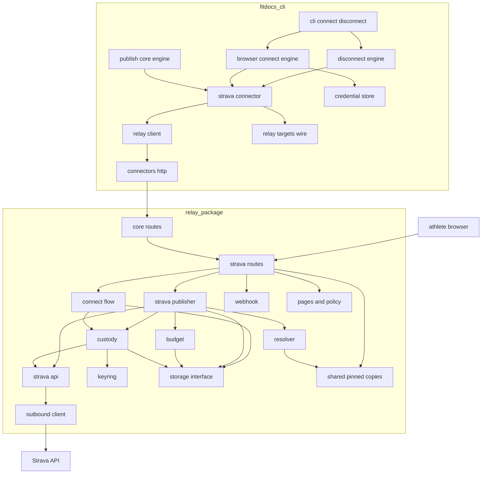
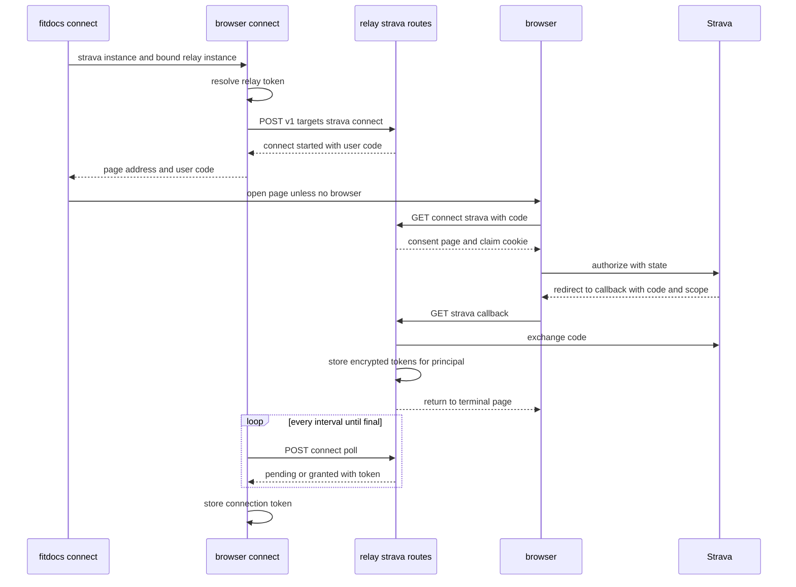
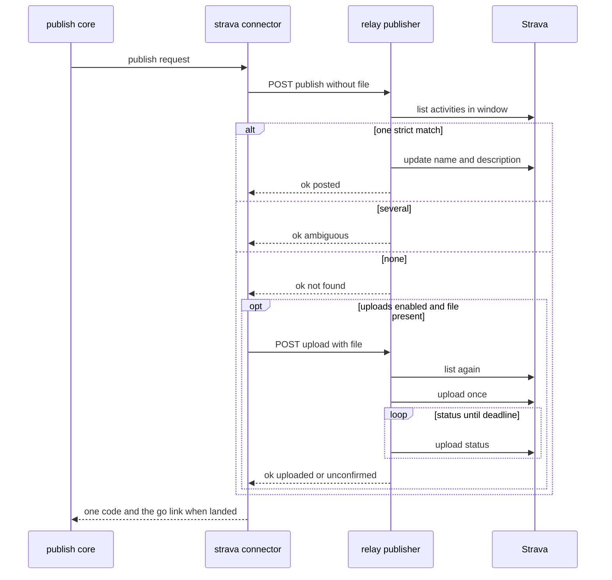
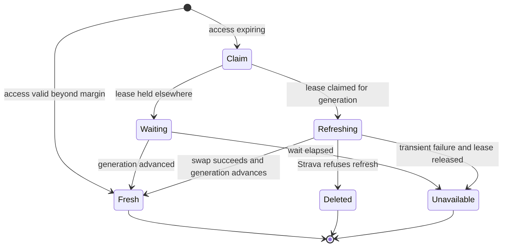

# Design Document: strava-publish

## Overview

**Purpose**: This feature publishes a workout's post to Strava. fitdocs
never talks to Strava itself: a relay holding one Strava application makes
every Strava call, and answers fitdocs only with fitdocs codes. A Strava
instance in `fitdocs.toml` names the relay instance it goes through.
`fitdocs connect` opens the relay's connect page, where the athlete
connects their Strava account to their relay principal. `fitdocs publish
--yes` then asks the relay, page by page, to find the athlete's activity
by start time and set its name and description, or, when none exists and
uploads are enabled, to upload the page's activity file once.

**Surfaces**:
- A Strava instance in `fitdocs.toml`, and the behaviour of `fitdocs
  connect`, `fitdocs publish` and `fitdocs disconnect` for it.
- The relay's Strava configuration in the deploy environment, and its
  webhook and key-rotation commands.
- The relay's connect machinery, which `relay-intervals` reuses for a
  second provider.

**Impact**:
- The connector framework drives its last reserved authentication style
  (`OAUTH_BROWSER`, consent in a browser at a relay) and gains a built-in
  `strava` connector and a cross-instance relay binding.
- The relay gains the Strava target: routes, pages, a Strava client, token
  custody, a call budget, three storage areas and one schema change pair,
  and deploy-contract variables.
- activity-identity's strict rule moves into a standard-library-only module
  that both fitdocs and the relay run.
- This spec changes neither `CONTRACT_VERSION` nor `DOC_VERSION` (relay-server's
  ownership-contract bump for `fitdocs disconnect` already covers its
  disconnect rows, R13.1), and no command is added (`fitdocs connect`
  gains `--no-browser`).

### Goals
- A post lands on the right Strava activity or nowhere: strict one-to-one
  matching on every publish, ambiguity as a code.
- Nothing Strava returns crosses the relay boundary, and the relay keeps no
  Strava Data beyond the encrypted tokens of live connections.
- Tokens are encrypted, rotate atomically on both backends, and are
  deleted at once on every revocation path.
- The application's shared rate limits are counted before every call.

### Non-Goals
- Reading anything from Strava for display, storage, the index or a page.
- Fields other than name and description, media, deleting activities.
- Hosting, a capacity review with Strava, charging for the feature.
- Any website edit (R9).

## Boundary Commitments

### This Spec Owns
- **fitdocs side**:
  - the built-in `strava` connector (`connectors/strava.py`): its
    settings, its publish operation, its consent operations and its code
    mapping;
  - the browser-consent engine (`connectors/browser_connect.py`) and the
    CLI's `connect --no-browser` branch;
  - the driving of `AuthStyle.OAUTH_BROWSER` (R5): `BrowserConsentClient`,
    `ConsentStarted`, `ConsentPolled` and `RelayBound` in
    `connectors/protocol.py`; its registry rule; its credential
    resolution; the relay-binding pass in `connectors/settings.py`; its
    `run_disconnect` rows, lifting relay-server's refusal;
  - the shared Strava wire module `connectors/relay_targets.py`;
  - `RelayClient`'s single-attempt marking (R9);
  - the strict-rule module `identity/strict.py` and `matching.py`'s use of
    it.
- **Relay side** (under `relay/src/fitdocs_relay/`):
  - `crypto.py` (the keyring), `outbound.py` (the provider HTTP client);
  - the `strava/` package: configuration, API client, budget, custody,
    resolution, publishing, connect sessions, webhook, pages, policy text,
    routes, operator commands;
  - three storage areas (`TargetConnectionStore`, `PublicationStore`,
    `BudgetStore`), their two backend implementations, the schema change
    pair `NNNN_target_custody`, and their conformance tests;
  - the deploy-contract variable rows and commands this feature appends;
  - the `RelayCode` appends `connect-started` to `connect-expired` (R10).
- **Shared-copy pairs** (R2, R9): `src/fitdocs/publish/outcomes.py`,
  `src/fitdocs/connectors/relay_targets.py` and
  `src/fitdocs/identity/strict.py`, appended to `SHARED_MODULES` and the
  cross-check test; the outcome membership check on both sides.
- **Docs**: the Strava sections of `docs/connectors.md` and `docs/relay.md`;
  the privacy policy and consent text (served by the relay); the network
  statement task for `fitdocs publish --yes` (R10); the steering sentences
  listed under Amendments; changelog entries; the site-copy queue item.

### Out of Boundary
- Composing posts, opt-in, the publish ledger, the `published` region,
  `fitdocs publish` and its listing, the outcome vocabulary, the target
  contract and `HttpRequest.single_attempt` (publish-core). This spec appends
  no `PublishCode` (R10).
- Relay tokens, principals, the envelope codec, the relay's own token and
  client rate limits, the storage interface's existing areas and extension
  rule, the pinned-copy mechanism, the deploy contract's existing rows, the
  relay connector and `fitdocs connect` for a relay instance
  (relay-server).
- `PUT` in fitdocs's `HttpRequest.method` (intervals-publish, R4): the
  Strava update is made by the relay's own client.
- The match rule's tolerances and its device and shifted tiers
  (activity-identity).
- The relay route to intervals.icu (relay-intervals); planned workouts (R8).
- The packaged agent skill: unchanged; its publishing section names no
  target.

### Allowed Dependencies
- **fitdocs side**:
  - `identity.strict`: standard library only (`dataclasses`, `datetime`,
    `typing`);
  - `connectors.relay_targets`: standard library plus the relative
    `.relay_codes` and `.relay_envelope`;
  - `connectors.strava`: `errors`, `protocol`, `secrets`, `relay`,
    `relay_codes`, `relay_envelope` and `relay_targets`. It names
    `PublishCode`, `TARGET_CODES` and the request types through
    `fitdocs.connectors.protocol`, which re-exports them (R11); it imports
    nothing from `fitdocs.publish` directly;
  - `connectors.browser_connect`: `credentials`, `http`, `protocol`,
    `secrets`, `settings`, `relay_codes`;
  - no new runtime dependency; no clock read; network only through
    `connectors/http.py`; no Strava host in `src/fitdocs/`.
- **Relay side**: relay-server's dependencies plus `cryptography` (for
  AES-GCM, imported only by `crypto.py`). `outbound.py` is the only module
  that imports `urllib.request` or `http.client`. Never `fitdocs`.
- **Tests**: no request to Strava anywhere. Every Strava answer is scripted
  at the `Outbound` seam.

### Revalidation Triggers
- `relay_targets.py` routes, field sets, bounds or per-route outcome sets:
  the relay's copy and both sides' tests.
- The `RelayCode` appends, or the meaning of `connect-*`: `relay-intervals`.
- `TargetConnectionStore`, `PublicationStore` or `BudgetStore` shapes, or
  the lease and generation rule: `relay-intervals` and both backends.
- `identity.strict` (its constants or `strict_match`): activity-identity's
  callers, the relay copy and `intervals-publish`, which reuses
  `pair_evidence`.
- `BrowserConsentClient`, `RelayBound`, the binding pass, or
  `OAUTH_BROWSER`'s resolution rule: `relay-intervals`.
- The deploy-contract rows or commands appended here: every deployment.
- publish-core's `TARGET_CODES`, `PublishRequest` or `CompletedActivity`
  changing: the Strava mapping tables.

### Future extension: planned-workout push (R8)
Strava has no planned-workout write in scope. Nothing here assumes a
completed-activity page beyond the Strava target itself: routes are keyed
by target id and action, the custody tables by target, and the codes are
append-only. **Revalidation trigger**: a later spec that adds a non-activity
action to a relay target re-checks `relay_targets.py`'s route builder and
outcome sets.

### Settled Seams Applied
- **R1, R10**: every Strava answer maps into publish-core's existing
  `TARGET_CODES`. No `PublishCode` is appended.
- **R2, R9**: three pairs appended to `SHARED_MODULES` and
  `tests/test_relay_shared_copies.py` (see SharedCopyPairs).
- **R3, R10**: five `RelayCode` values appended, hyphenated.
- **R4, R9**: `RelayClient` sets publish-core's `single_attempt=True` on
  every request it builds. No other mechanism is added. Strava's `PUT` is
  the relay's.
- **R5**: `OAUTH_BROWSER` is driven here. `run_disconnect`'s refusal is
  lifted.
- **R6**: no version constant moves.
- **R7**: steering edits are separate sentences, line-disjoint from
  relay-server's and publish-core's.
- **R9**: no `website/content/` edit; a queue item records the site copy.
  `_EXPECTED_HEADINGS` gains rows for the new section only. No command is
  added, so the command-count pins do not move.
- **R10 pair_evidence**: `matching.py` is not standard-library-only (it
  imports `identity.kinds` and `fitdocs.model`), so the strict tier is
  extracted into `identity/strict.py` (an activity-identity amendment), and
  that module is pinned.
- **R10 privacy**: the policy and consent text ship in the relay package and
  are served by the relay at `/privacy` and on the connect page; the Strava
  application's privacy-policy field points at `<FITDOCS_RELAY_PUBLIC_URL>/
  privacy` (for the maintainer's instance, `https://api.fitdocs.ai/
  privacy`), or at the operator's own `FITDOCS_RELAY_PRIVACY_POLICY_URL`.
- **R11**: `PublishCode` and `TARGET_CODES` come from
  `fitdocs.connectors.protocol`'s re-export; `local_record_unreadable` is
  not used (no local record of fetched activities exists on this path); an
  upload never runs on unreadable identity state (StravaPublisher, "Upload
  guard").
- **R12**: no implementation, review or validation session carries out a
  step that reaches the real Strava API or a relay connected to it. The
  live check is a maintainer procedure plus a record template (LiveCheck).
  This design states command behaviour, never who runs a command.
- **R13** (cross-spec rulings):
  - R13.1: relay-server's ownership-contract statement (disconnect removes
    the instance's own credentials file and nothing else) covers this
    spec's browser-consent disconnect rows; this spec bumps no version.
  - R13.2: the packaged skill's publishing rule stays as publish-core Req
    15.4 has it; the maintainer accepted the residual terms risk of that
    user-end use (Security Considerations).
  - R13.3: `RelayClient.post(route, fields, *, max_request_bytes: int |
    None = None)` is carried here as a relay-server amendment.
  - R13.4: answers use relay-server's canonical key order
    `{"envelope", "code", "data"[, "outcome"]}`.
  - R13.5: the CLI's started line is neutral; only the relay page says
    "Connect with Strava".
  - R13.6: `SealedTokens.access_expires_at` is nullable and
    `EnvVar.required_with` is a tuple, both shipped here so relay-intervals
    only appends.
- **Interpretation of "a PostPublisher on the relay connector"**: the
  publisher is the new `strava` connector, built on relay-server's
  `RelayClient`. The `relay` connector itself gains no capability: a
  connector's capabilities are per connector, so a publishing relay
  connector would make every relay instance a publish target, and its
  relay-token style would leave `OAUTH_BROWSER` undriven.

### Amendments Carried (each takes the next free amendment number at landing)
- **connectors**:
  - Req 1.7: five supported styles; browser consent is consent given in a
    browser at the instance's bound relay.
  - Req 2.3: a browser-consent connector must provide `start_consent`,
    `poll_consent` and `withdraw_consent`, and parse settings that bind a
    relay instance.
  - Req 2.7: the surface gains `BrowserConsentClient`, `ConsentStarted`,
    `ConsentPolled` and `RelayBound`.
  - Req 3: a new criterion: an instance whose settings bind a relay
    instance must name a configured relay-token instance, checked across
    instances before any request.
  - Req 4.5: the environment override covers the browser-consent style's
    token.
  - Req 5: for a browser-consent instance, `fitdocs connect` behaves per
    strava-publish Req 2, including `--no-browser`.
  - Req 14.1 and 14.4: the requests `connect`, `disconnect` and `publish
    --yes` make for a Strava instance.
  - New: the built-in Strava connector (strava-publish Req 1).
  - relay-server's Disconnect criterion 14.5 ("where its style is reserved")
    now has no reserved style; a browser-consent instance follows
    strava-publish Req 11.1-11.4.
- **relay-server**:
  - Req 4.3: the vocabulary gains the five connect codes.
  - Req 4.7: the body limit is per route; the Strava upload route allows
    `MAX_UPLOAD_REQUEST_BYTES`.
  - Req 5.4 and 5.5: the capabilities endpoint lists a target only while it
    is configured.
  - Req 7.1: the interface gains the three storage areas; 7.5-7.7 apply to
    them.
  - Req 9.2: the variable table gains thirteen rows, and `EnvVar` gains
    `required_with: tuple[str, ...] = ()`, "required when any named
    variable is set";
    `DEPLOY_CONTRACT_VERSION` stays 1 (the change is additive). The command
    list gains `strava`, `reencrypt` and `new-encryption-key`. The recorded
    `/readyz` exchange and every schema-count literal move with the new
    schema change pair, by appended literals.
  - Req 9.8: logs never carry encryption keys, the Strava client secret,
    the webhook secret, Strava tokens or anything Strava returned.
  - Design "RelayClient": every request is marked `single_attempt=True`,
    and `post` gains `max_request_bytes: int | None = None` (R13.3).
  - Design "IdentityService": `TokenService.prepare` (a token generated
    but not stored) for connection-token issuance.
  - Design "AnswersGlue": an answer's `outcome` must be a member of the
    pinned `PublishCode`.
  - Design "DisconnectEngine": the `OAUTH_BROWSER` rows.
- **activity-identity**: the strict tier lives in `fitdocs.identity.strict`
  (standard library only, pinned into the relay); `matching` re-exports its
  constants and calls it; every result is unchanged.
- **publish-core**: none of its own. This spec consumes the R11 re-export
  of `PublishCode` and `TARGET_CODES` through `fitdocs.connectors.protocol`
  (folded into publish-core by the controller). It does not use
  `local_record_unreadable` (R11): neither fitdocs nor the relay keeps a
  local record of fetched Strava activities, so no target state of that
  kind exists on this path.
- **distribution**: Req 10.4 names `fitdocs publish --yes` among the
  explicit commands with network access (skipped when an earlier target
  recorded it).
- **steering**: `tech.md` and `structure.md`, one sentence each (Steering),
  plus the idempotent no-request sentence (NetworkStatements).

## Architecture

### Existing Architecture Analysis
- Connector credentials resolve by auth style from the instance name and
  connector only (`credentials.py:391-485`); settings are not visible
  there. publish-core resolves a target's credentials through that
  function. Hence the Strava instance holds its own relay token.
- The settings loader validates instances one by one, then runs one
  cross-instance pass (`settings.py:225-240`). The relay binding is a second
  such pass.
- `HttpClient` DATA mode retries 429, 5xx and transport failures
  (`http.py:297-317`); publish-core's session client is DATA mode. Every
  relay request is therefore marked single-attempt at its source.
- The relay serves an envelope over Starlette, keeps all state behind one
  storage interface with an extension rule, and treats browser pages as
  outside the envelope.

### Architecture Pattern & Boundary Map



**Architecture Integration**:
- **Pattern**: on fitdocs, the existing connector pattern (declaration,
  operation protocols, engine, CLI presentation). On the relay, ports and
  adapters: domain services (`ConnectFlow`, `StravaPublisher`, `Custody`,
  `StravaBudget`) over the `Storage` port and an `Outbound` port, with
  `StravaApi` the one adapter that speaks Strava.
- **Boundaries**: `StravaApi` is the only code that reads Strava's
  responses, and it returns typed values or a `Failure` class, never text.
  Routes turn results into codes and fitdocs-written pages.
- **Preserved patterns**: injected clocks (the relay's `clock`, plus
  `monotonic` and `sleep` for deadlines and polls); closed, append-only
  vocabularies; absent values as `None`; credentials outside the data root;
  pinned copies for shared code.

**Dependency direction** (each imports only from those to its left; a
violation is a defect):
- fitdocs: `identity.strict` → `identity.matching`; `relay_codes` →
  `relay_envelope` → `relay_targets` → `protocol` → `relay` → `strava` →
  `browser_connect` / `disconnect` → `cli`.
- relay: `shared.*` → `contract` → `crypto` → `config` →
  `storage.interface` → backends → `storage` → `identity`, `ratelimit` →
  `outbound` → `strava.api` → `strava.budget`, `strava.resolve` →
  `strava.custody` → `strava.publish`, `strava.connect`, `strava.webhook`
  → `seam` → `answers` → `strava.routes` → `routes` → `app` → `serve` →
  `strava.cli` → `cli`. `strava.pages` and `strava.policy` are leaves
  (standard library only) that `strava.routes` imports.

### Technology Stack

| Layer | Choice / Version | Role in Feature | Notes |
|-------|------------------|-----------------|-------|
| fitdocs CLI | existing typer CLI, standard library `webbrowser` | Strava connect, publish, disconnect | No new runtime dependency |
| Relay encryption | `cryptography>=44` (AES-GCM; Apache-2.0 or BSD) | Token encryption | New relay dependency; upper bound set by the relay lock at implementation |
| Relay outbound HTTP | standard library `urllib` | Strava calls | Unredirected secret headers, per-call timeouts, response cap |
| Relay HTTP, storage | relay-server's Starlette, uvicorn, `sqlite3`, `psycopg` | Routes, pages, custody tables | Unchanged versions |

## File Structure Plan

### Directory Structure
```
src/fitdocs/identity/strict.py          # NEW, shared: strict-tier constants, within(), StrictFacts, strict_match()
src/fitdocs/connectors/relay_targets.py # NEW, shared: target routes, connect page path, link path, field sets,
                                        #   bounds, PublishFacts codec, per-route outcome sets, route_outcome()
src/fitdocs/connectors/strava.py        # NEW: StravaConnector, StravaSettings, the two mapping tables
src/fitdocs/connectors/browser_connect.py  # NEW: run_browser_connect, results, consent_next_step

relay/src/fitdocs_relay/
├── shared/outcomes.py        # NEW copy of src/fitdocs/publish/outcomes.py
├── shared/relay_targets.py   # NEW copy of src/fitdocs/connectors/relay_targets.py
├── shared/strict.py          # NEW copy of src/fitdocs/identity/strict.py
├── crypto.py                 # NEW: EncryptionKey, Keyring (seal, open, key_id_of), parse_keys, new_key
├── outbound.py               # NEW: OutboundRequest/Response, OutboundError, Outbound, urllib_outbound
├── strava/
│   ├── __init__.py           # package marker
│   ├── config.py             # TargetsConfig, StravaConfig, Limits, loaders (called by config.load_config)
│   ├── api.py                # StravaApi, Step, Failure, StravaFailure, Grant, TokenPair, Candidate,
│   │                         #   Listing, UploadState, SubscriptionState, classify()
│   ├── budget.py             # StravaBudget, CallKind, budget keys, PRINCIPAL_SHARE, LINK_HEADROOM
│   ├── resolve.py            # SPORT_FAMILIES, LIST_WINDOW_S, LIST_PAGE_SIZE, list_window(), pick()
│   ├── custody.py            # Custody: store_grant, access_token (refresh lease), withdraw, forget_account,
│   │                         #   account_key(), reencrypt_all()
│   ├── publish.py            # StravaPublisher: publish, upload, resolve_link; deadlines; step mapping table
│   ├── connect.py            # ConnectFlow over RecordStore: start, page, callback, poll
│   ├── webhook.py            # Webhook: validate, event
│   ├── policy.py             # POLICY_SECTIONS, CONSENT_TEXT (fixed fitdocs text)
│   ├── pages.py              # Page, the fitdocs-written HTML pages, PAGE_HEADERS
│   ├── routes.py             # strava_routes(services): envelope routes and browser routes
│   └── cli.py                # operator subcommands: strava webhook show|create|delete; reencrypt; new-encryption-key
├── storage/migrations/sqlite/NNNN_target_custody.sql     # NEW (NNNN = next free at landing; 0002 if first)
└── storage/migrations/postgres/NNNN_target_custody.sql   # NEW, same name
relay/tests/
├── conformance/test_target_connections.py   # NEW, coverage-marked, both backends
├── conformance/test_publications.py         # NEW
├── conformance/test_budget.py               # NEW
├── conformance/test_concurrency_custody.py  # NEW: lease, swap, account move, budget races
├── test_crypto.py, test_outbound.py          # NEW
└── strava/                                   # NEW: test_config.py, test_api_mapping.py, test_budget.py,
                                              #   test_resolve.py, test_custody.py, test_publish.py,
                                              #   test_connect.py, test_webhook.py, test_pages.py,
                                              #   test_policy_docs.py, test_routes.py, test_cli.py,
                                              #   scripted_strava.py (the Outbound fake)

tests/identity/test_strict.py                 # NEW: constants, within, strict_match table
tests/connectors/test_relay_targets.py        # NEW: codec, bounds, outcome sets within TARGET_CODES
tests/connectors/test_strava.py               # NEW: settings, binding, publish mapping, link, single attempt
tests/connectors/test_browser_connect.py      # NEW: engine over a scripted transport and fake clock
tests/connectors/test_cli_strava.py           # NEW: connect, --no-browser, disconnect, flag refusals
tests/connectors/test_strava_wire_examples.py # NEW: decodes the recorded Strava-route exchanges
.kiro/queue/2026-10-31-strava-publish-site-copy.md   # NEW (written with this spec): site copy follow-up (R9)
relay/LIVE_CHECK_STRAVA.md                    # NEW (task 8): the maintainer's live-check procedure (R12)
relay/LIVE_CHECK_STRAVA_RECORD.md             # NEW (task 8): the record template, filled only with maintainer-reported codes
```

### Modified Files
- `src/fitdocs/identity/matching.py`: import the strict constants and
  `within` from `strict`, re-export the constants in `__all__`, and call
  `strict_match` for the strict tier.
- `src/fitdocs/connectors/protocol.py`: `SUPPORTED_AUTH_STYLES` gains
  `OAUTH_BROWSER`; docstrings; `ConsentStarted`, `ConsentPolled`,
  `RelayBound`, `BrowserConsentClient`.
- `src/fitdocs/connectors/registry.py`: the consent operations required for
  `OAUTH_BROWSER`; the docstring's reserved-style sentence.
- `src/fitdocs/connectors/credentials.py`: `OAUTH_BROWSER` resolves like
  `RELAY_TOKEN`; the final unsupported-style raise stays for safety.
- `src/fitdocs/connectors/settings.py`: `_bind_relay_instances` after
  `_check_credential_collisions`.
- `src/fitdocs/connectors/connect.py`: `_env_override` covers
  `OAUTH_BROWSER`.
- `src/fitdocs/connectors/relay.py`: `RelayClient` marks every request
  `single_attempt=True`.
- `src/fitdocs/connectors/relay_codes.py`: five appended codes.
- `src/fitdocs/connectors/disconnect.py`: the `OAUTH_BROWSER` rows.
- `src/fitdocs/connectors/__init__.py`: register `StravaConnector()`;
  export the four new protocol names.
- `src/fitdocs/cli.py`: `connect_command`'s `--no-browser` option and
  browser-consent branch; `_open_browser`.
- `scripts/sync_relay_shared.py`, `tests/test_relay_shared_copies.py`:
  three pairs.
- relay: `pyproject.toml` (`cryptography`), `uv.lock`, `contract.py`
  (rows, `EnvVar.required_with`, `COMMANDS`), `config.py`
  (`RelayConfig.targets`, `.strava`),
  `storage/interface.py`, `storage/sqlite.py`, `storage/postgres.py`,
  `identity.py` (`TokenService.prepare`), `answers.py` (outcome guard),
  `routes.py` (`OFFERED_TARGETS`, capabilities, `RESERVED_PREFIXES`,
  `ROUTE_BODY_LIMITS`, `core_routes`), `app.py` (`RelayServices.strava`,
  `.targets`, per-route body limit, `outbound=` factory argument),
  `logs.py` (redaction, `outcome` field), `cli.py` (the new commands),
  `contract/envelope-v1.json` (Strava exchanges), `tests/test_boundary.py`,
  `tests/test_contract.py`, `tests/test_docs_relay.py`, `CHANGELOG.md`.
- **Tests whose pins move** (fitdocs): `tests/connectors/test_protocol.py:
  224-236` (every style supported); `test_registry.py:579-585` (a
  browser-consent connector without consent operations is rejected);
  `test_credentials.py:631-640` (browser consent resolves like a relay
  token); `test_cli_connectors.py:96-104, 350-362, 435-450` (the
  reserved-style refusal tests retire; the refusal branch stays for any
  future reserved style); `test_boundary.py` (three new modules and import
  sets; `strava` reaches publish codes only through `protocol`);
  `test_surface.py`
  (`EXPECTED_ALL` appended, count literal at landing); `test_docs.py`
  (`_EXPECTED_HEADINGS` rows, the neutral-scan entry for the Strava
  section, the preamble connector list); `test_network_statements.py`
  (NetworkStatements); `test_e2e.py` (a Strava instance in the wired
  root); `tests/test_confinement.py` (Strava connect writes nothing under
  the data root); `tests/identity/test_boundary.py:99-108` and
  `tests/test_public_api.py` `_IDENTITY_SUBMODULES` (the `strict` module).
- **Docs and steering**: `docs/connectors.md`, `docs/relay.md`,
  `CHANGELOG.md`, the network-statement places (README, `docs/
  configuration.md`, the `cli.py`, `sync.py` and `tiles.py` docstrings),
  `.kiro/steering/tech.md`, `.kiro/steering/structure.md`, and the
  amendment records in `.kiro/specs/{connectors,relay-server,
  activity-identity}/requirements.md`.

**Connectors boundary table** (new and changed `_ALLOWED_IMPORT_TARGETS`
entries, non-standard-library only):

| Module | Allowed direct imports |
|--------|------------------------|
| `relay_targets` | `fitdocs.connectors.relay_codes`, `fitdocs.connectors.relay_envelope` |
| `protocol` | existing (re-exports `PublishCode` and `TARGET_CODES` per R11) |
| `relay` | unchanged |
| `strava` | `errors`, `protocol`, `secrets`, `relay`, `relay_codes`, `relay_envelope`, `relay_targets` (no `fitdocs.publish.*`, R11) |
| `browser_connect` | `credentials`, `http`, `protocol`, `secrets`, `settings`, `relay_codes` |
| `fitdocs.connectors` (package) | existing + `fitdocs.connectors.strava` |

Each new module joins `CONNECTORS_MODULE_NAMES` and `_ALLOWED_IMPORT_TARGETS`
(`tests/connectors/test_boundary.py`, exact equality over the files on
disk) in the task that creates it.

## System Flows

### Connecting a Strava instance



- Every fitdocs request is one `CallMode.AUTH` attempt; a failed request
  ends the flow.
- The local deadline is the started time plus `expires_in_s`; after it the
  outcome is `connect-expired`. `KeyboardInterrupt` exits 130.
- The relay issues the connection token on the first poll after the grant,
  revoking the principal's earlier Strava connection token in the same
  transaction.

### Publishing one page



### Token refresh



### Revocation paths
- **CLI disconnect**: `POST /v1/targets/strava/disconnect` → `Custody.
  withdraw`: one `POST /oauth/revoke` with the refresh token (when the
  budget allows), then `delete_connection` (tokens, connection token, link
  records) whatever Strava answered → `ok`.
- **Strava revocation**: webhook event with `updates.authorized == "false"`
  → `forget_account(owner_id)` → `delete_connection_by_account` → 200.
- **Refresh refused**: `delete_connection(generation=g)` →
  `auth_rejected`.
- **Principal deleted**: foreign-key cascade in the same transaction.

## Requirements Traceability

| Requirement | Summary | Components | Interfaces | Flows |
|-------------|---------|------------|------------|-------|
| 1.1, 1.2, 1.3, 1.4, 1.7 | Strava instances | StravaConnector, SettingsBinding, RegistryAmendment | `StravaSettings`, `_bind_relay_instances`, `link_label` | — |
| 1.5, 1.6 | Credential and ready state | CredentialsAmendment | `resolve_credentials` | — |
| 1.8 | No pull | StravaConnector (no pull capability) | relay-server's bare-pull selection | — |
| 2.1, 2.2, 2.4, 2.5, 2.6, 2.7, 2.8, 2.9 | CLI connect | BrowserConnectEngine, StravaConnector | `run_browser_connect`, `start_consent`, `poll_consent` | Connecting |
| 2.3, 2.10 | Page address, flags | CliStrava, BrowserConnectEngine | `ConsentShown`, `--no-browser` | Connecting |
| 3.1, 3.2, 3.4, 3.5, 3.8, 3.9 | Sessions and pages | ConnectFlow, Pages, StravaRoutes | `ConnectFlow.start/page/poll` | Connecting |
| 3.3, 3.6, 3.7 | Authorization and callback | ConnectFlow, StravaApi, Custody | `authorize_url`, `exchange`, `store_grant` | Connecting |
| 3.10, 3.11 | One account, one connection | StorageCustody | `put_connection` | — |
| 4.1, 4.2, 4.7 | Encryption and rotation | Keyring, Custody, RelayOperatorCli | `Keyring.seal/open`, `reencrypt_all` | — |
| 4.3, 4.4, 4.5 | Atomic refresh | Custody, StorageCustody | `claim_refresh`, `swap_tokens`, `delete_connection` | Token refresh |
| 4.6 | Header-only tokens | Outbound, StravaApi | `OutboundRequest.secret_headers` | — |
| 4.8 | Account key | Custody | `account_key` | — |
| 4.9 | Key docs | RelayDocs | `docs/relay.md` | — |
| 5.1, 5.2, 5.3, 5.4, 5.6, 5.7, 5.8, 5.9, 5.10 | Publish from the CLI | StravaConnector, SharedTargetWire, ConnectorsDocs | `publish`, `PUBLISH_MAPPING`, `UPLOAD_MAPPING` | Publishing |
| 5.5 | Single attempt | RelayClientAmendment | `HttpRequest.single_attempt` | — |
| 6.1, 6.2, 6.4, 6.5 | Resolution | Resolver, StravaPublisher | `list_window`, `pick`, `SPORT_FAMILIES` | Publishing |
| 6.3 | Pinned rule | StrictRule, SharedCopyPairs | `strict_match` | — |
| 7.1, 7.2, 7.3, 7.4, 7.5, 7.6, 7.7, 7.8 | Writes and the upload guard | StravaPublisher, StravaApi, StravaConnector | `update_activity`, `create_upload`, `upload_state` | Publishing |
| 8.1, 8.2, 8.3 | Relay mapping | StravaApi, StravaPublisher | `classify`, `STEP_OUTCOMES` | — |
| 8.4 | fitdocs mapping | StravaConnector | `PUBLISH_MAPPING`, `UPLOAD_MAPPING` | — |
| 9.1, 9.2, 9.3, 9.4, 9.5, 9.6, 9.7 | Budget | StravaBudget, StorageBudget, StravaConfig | `spend_budget`, `exhaust_budget` | — |
| 10.1, 10.2, 10.3, 10.4, 10.5, 10.6 | The link | StravaPublisher, StorageCustody, Pages, StravaRoutes | `put_publication`, `resolve_link`, `/go/{id}` | — |
| 11.1, 11.2, 11.3, 11.4 | CLI disconnect | DisconnectAmendment, StravaConnector | `run_disconnect`, `withdraw_consent` | Revocation |
| 11.5, 11.10 | Relay disconnect | Custody, StravaRoutes | `withdraw`, `delete_connection` | Revocation |
| 11.6, 11.7 | Webhook | Webhook, StravaRoutes | `/strava/webhook/{secret}` | Revocation |
| 11.8 | Principal deletion | StorageCustody | foreign keys | Revocation |
| 11.9 | Webhook commands | RelayOperatorCli, StravaApi | `fitdocs-relay strava webhook` | — |
| 12.1, 12.4, 12.5 | Boundary | StravaRoutes, Pages, AnswersAmendment | `answer`, `Page` | — |
| 12.2 | Logs | LogsAmendment, StravaApi | redacting filter | — |
| 12.3 | No Strava Data stored | StorageCustody, Custody | physical model | — |
| 13.1, 13.2, 13.5 | Configuration | StravaConfig, DeployContractRows | `ENVIRONMENT`, `load_config` | — |
| 13.3, 13.4 | Offered only when configured | RoutesAmendment | capabilities, `OFFERED_TARGETS` | — |
| 13.6 | Self-hosting note | RelayDocs | `docs/relay.md` | — |
| 14.1, 14.2, 14.3, 14.4 | Storage | StorageCustody, StorageBudget, ConformanceCustody | the three areas, `NNNN_target_custody` | — |
| 15.1 | Pinned copies | SharedCopyPairs | `SHARED_MODULES` | — |
| 15.2 | Strict extraction | StrictRule, MatchingAmendment | `strict_match` | — |
| 15.3 | Outcome membership | AnswersAmendment, SharedTargetWire | `answer`, `route_outcome` | — |
| 15.4 | Connect codes | RelayCodesAmendment | `RelayCode` | — |
| 16.1, 16.2, 16.3 | Policy, consent, contact | Policy, Pages, StravaConfig, RelayDocs | `/privacy`, `CONSENT_TEXT` | — |
| 16.4, 16.5, 16.6 | Wording and obligations | Pages, StravaConnector, ConnectorsDocs, RelayDocs, Changelogs | — | — |
| 17.1 | Connectors docs | ConnectorsDocs | `docs/connectors.md` | — |
| 17.2 | Relay docs | RelayDocs | `docs/relay.md` | — |
| 17.3 | Network statements | NetworkStatements | `test_network_statements.py` | — |
| 17.4 | Steering | Steering | `tech.md`, `structure.md` | — |
| 17.5 | Changelogs | Changelogs | — | — |
| 17.6 | Site copy | SiteFollowUp | queue item | — |
| 17.7, 17.8 | Guards and skill | ConnectorsDocs, RelayDocs | existing guards | — |
| 18.1, 18.2 | Live check | LiveCheck | `relay/LIVE_CHECK_STRAVA.md` | — |

## Components and Interfaces

| Component | Domain | Intent | Req Coverage | Key Dependencies | Contracts |
|-----------|--------|--------|--------------|------------------|-----------|
| StrictRule, MatchingAmendment | shared, identity | Strict tier as a pinned leaf | 6.3, 15.2 | stdlib (P0) | Service |
| SharedTargetWire | shared | Strava wire format | 5.1, 5.6, 15.3 | relay_codes, relay_envelope (P0) | Service, API |
| RelayCodesAmendment | shared | Connect codes | 15.4 | relay_codes (P0) | State |
| ProtocolAmendment, RegistryAmendment, CredentialsAmendment, SettingsBinding | fitdocs connectors | Drive browser consent | 1.3, 1.5, 1.6 | protocol (P0) | Service |
| StravaConnector | fitdocs connectors | The Strava target | 1, 5, 8.4, 11.1 | RelayClient (P0), outcomes (P0) | Service |
| BrowserConnectEngine | fitdocs connectors | Connect loop | 2 | StravaConnector (P0), credentials (P0) | Service |
| RelayClientAmendment | fitdocs connectors | Single attempt on every relay request | 5.5 | http (P0) | Service |
| DisconnectAmendment | fitdocs connectors | Strava disconnect rows | 11.1-11.4 | StravaConnector (P0) | Service |
| CliStrava | fitdocs cli | Flags and presentation | 2.3, 2.9, 2.10 | engines (P0) | Service |
| StravaConfig, DeployContractRows | relay | Environment | 13 | contract (P0) | State |
| Keyring | relay | Authenticated encryption | 4.1, 4.2, 4.7 | cryptography (P0) | Service |
| Outbound | relay | Provider HTTP | 4.6, 12.2 | urllib (P0) | Service |
| StravaApi | relay | The only Strava reader | 3.6, 7, 8.1, 8.3, 11.9 | Outbound (P0) | Service |
| StravaBudget | relay | Call budget | 9 | BudgetStore (P0) | Service |
| Resolver | relay | Strict one-to-one pick | 6 | shared.strict (P0) | Service |
| Custody | relay | Tokens and their lifecycle | 3.6, 4, 11.5, 11.6 | Keyring, StravaApi, storage (P0) | Service |
| StravaPublisher | relay | Publish, upload, link | 5, 6, 7, 8.2, 10 | Custody, Resolver, StravaBudget (P0) | Service |
| ConnectFlow | relay | Sessions, page, callback, poll | 3 | RecordStore, Custody (P0) | Service |
| Webhook | relay | Validation and deauthorization | 11.6, 11.7 | Custody (P0) | API |
| Pages, Policy | relay | fitdocs-written HTML | 3.2, 3.5, 10.3, 10.4, 12.4, 16 | stdlib (P0) | — |
| StravaRoutes | relay | HTTP surface | 3, 5, 10, 11, 12, 13.3 | answers, flows (P0) | API |
| StorageCustody, StorageBudget, ConformanceCustody | relay storage | New areas on two backends | 3.10, 3.11, 4.3-4.5, 9.6, 10.1, 11.8, 12.3, 14 | backends (P0) | State |
| RoutesAmendment, AnswersAmendment, AppAmendment, IdentityAmendment, LogsAmendment | relay | Seams this feature extends | 12.1, 12.2, 13.3, 13.4, 15.3 | relay-server (P0) | API |
| RelayOperatorCli | relay | New operator commands | 4.2, 11.9 | Custody, StravaApi (P0) | Batch |
| SharedCopyPairs | gates | Three pinned pairs | 15.1 | sync script (P0) | Batch |
| ConnectorsDocs, RelayDocs, NetworkStatements, Steering, Changelogs, SiteFollowUp, LiveCheck | docs and gates | Keep statements true | 4.9, 13.6, 16, 17, 18 | — | — |

### Shared modules (fitdocs source, pinned into the relay)

#### StrictRule — `src/fitdocs/identity/strict.py`

| Field | Detail |
|-------|--------|
| Intent | The strict evidence tier of the match rule, standard library only |
| Requirements | 6.3, 15.2 |

```python
START_TOLERANCE_S: Final[float] = 1.0
ELAPSED_TOLERANCE_S: Final[float] = 10.0
DISTANCE_TOLERANCE_M: Final[float] = 5.0
DISTANCE_TOLERANCE_FRACTION: Final[float] = 0.2

@dataclass(frozen=True)
class StrictFacts:
    sport: str
    start: datetime | None      # aware
    elapsed_s: float | None
    distance_m: float | None

def within(delta: float, tolerance: float) -> bool: ...   # inclusive, relative slack 1e-9
def strict_match(a: StrictFacts, b: StrictFacts) -> bool: ...
```
- `strict_match` is true exactly when: the sports are equal; both starts
  are present and within `START_TOLERANCE_S`; and either both distances are
  present and within `max(DISTANCE_TOLERANCE_M, DISTANCE_TOLERANCE_FRACTION
  * max(distances))`, or a distance is missing, both elapsed times are
  present, and they are within `ELAPSED_TOLERANCE_S`. Both distances
  present but too far apart is never a match.
- **MatchingAmendment** (`identity/matching.py`): imports the four
  constants and `within` from `strict` (keeping `_within` as an alias for
  `_is_shift`), keeps them in `__all__` and `TOLERANCE_SOURCES`, and in
  `pair_evidence` replaces the two strict tests with `if strict_match(...):
  return Evidence.STRICT`, after the device tier and before the existing
  `return None` when either elapsed time is missing. Every existing identity
  test passes unchanged.

#### SharedTargetWire — `src/fitdocs/connectors/relay_targets.py`

| Field | Detail |
|-------|--------|
| Intent | Routes, field formats, bounds and outcome sets of relay targets |
| Requirements | 5.1, 5.3, 5.4, 5.6, 15.3 |

```python
STRAVA: Final = "strava"
TARGET_ROUTE_PREFIX: Final = "/v1/targets/"
ACTION_CONNECT: Final = "connect"; ACTION_CONNECT_POLL: Final = "connect/poll"
ACTION_PUBLISH: Final = "publish"; ACTION_UPLOAD: Final = "upload"; ACTION_DISCONNECT: Final = "disconnect"
CONNECT_PAGE_PREFIX: Final = "/connect/"; LINK_PREFIX: Final = "/go/"
PUBLICATION_ID_RE: Final = r"^[0-9a-f]{32}$"
SPORT_RE: Final = r"^[A-Z][A-Za-z]{0,31}$"
MAX_TITLE_CHARS: Final = 255
MAX_DESCRIPTION_CHARS: Final = 8000
MAX_FIT_BYTES: Final = 16 * 1024 * 1024
MAX_UPLOAD_REQUEST_BYTES: Final = 22 * 1024 * 1024
FITDOCS_SPORTS: Final[frozenset[str]]   # "Ride", "Run", "Swim", "Walk", "Hike", "Rowing", "Workout" (fitdocs.model.Sport)
PUBLISH_FIELDS: Final[frozenset[str]]   # publication_id, sport, start, elapsed_s, distance_m, title, description
UPLOAD_FIELDS: Final[frozenset[str]]    # PUBLISH_FIELDS | {"fit"}
PUBLISH_OUTCOMES: Final[frozenset[str]] # posted, not_found, ambiguous, not_updatable, not_connected, auth_rejected,
                                        #   permission_denied, rate_limited, unavailable, rejected, activity_facts_missing
UPLOAD_OUTCOMES: Final[frozenset[str]]  # posted, uploaded, ambiguous, not_updatable, not_connected, auth_rejected,
                                        #   permission_denied, rate_limited, unavailable, rejected, unconfirmed,
                                        #   activity_facts_missing

@dataclass(frozen=True)
class PublishFacts:
    publication_id: str
    sport: str
    start: datetime                 # aware
    elapsed_s: float | None
    distance_m: float | None
    title: str
    description: str

def target_route(target: str, action: str) -> str            # "/v1/targets/strava/publish"
def connect_page_path(target: str, user_code: str) -> str    # "/connect/strava?code=BCDF-GHJK"
def link_path(publication_id: str) -> str                    # "/go/<id>"
def publish_fields(facts: PublishFacts) -> dict[str, object]
def upload_fields(facts: PublishFacts, fit: bytes) -> dict[str, object]   # "fit": standard base64
def parse_publish_fields(fields: Mapping[str, object]) -> PublishFacts   # raises EnvelopeError
def parse_upload_fields(fields: Mapping[str, object]) -> tuple[PublishFacts, bytes]
def route_outcome(outcome: str | None, allowed: frozenset[str]) -> str | None
```
- **Formats**: `start` is ISO 8601 with an offset (`datetime.isoformat()`
  of an aware value); a naive value is malformed. `elapsed_s` and
  `distance_m` are JSON `null` when absent, otherwise finite non-negative
  numbers, never booleans. `title` is 1 to 255 characters with no control
  character; `description` is 0 to 8,000 characters whose only control
  characters are newline and tab. `fit` decodes to at most `MAX_FIT_BYTES`
  bytes whose bytes 8-11 are `.FIT`.
- `FITDOCS_SPORTS` is the literal set of fitdocs's sport labels; a fitdocs
  test pins it equal to `{s.value for s in fitdocs.model.Sport}`, so a new
  fitdocs sport reds it and prompts the relay's family table to follow.
- `route_outcome` returns `outcome` only when it is in `allowed`;
  otherwise `None`. A fitdocs test asserts both sets are subsets of
  `TARGET_CODES` values, and a relay test asserts every member is a
  `PublishCode` of the pinned copy.
- Connect answers reuse relay-server's codec: `connect-started` data is
  parsed by `parse_started`, and `connect-granted` data by `parse_issued`.
- `EnvelopeError` messages are fixed text and never interpolate input.

#### RelayCodesAmendment — `src/fitdocs/connectors/relay_codes.py`

Appended after `answer-malformed`, all of origin `relay`:

| Code | Status | Explanation (fitdocs-written) |
|------|--------|-------------------------------|
| connect-started | 200 | The relay started connecting this target. |
| connect-pending | 200 | The connection is waiting for the step in the browser. |
| connect-granted | 200 | The connection is made, and the relay issued this instance's token. |
| connect-refused | 403 | The connection was declined, or was not given every permission it needs. |
| connect-expired | 410 | The connection attempt expired or is not known to the relay. |

- The prefix pin of relay-server's 22 values stays; a new pin asserts the
  27 values in order. `docs/relay.md`'s code table and the recorded
  exchanges gain these rows.

### fitdocs connectors

#### ProtocolAmendment, RegistryAmendment, CredentialsAmendment, SettingsBinding

| Field | Detail |
|-------|--------|
| Intent | Make browser consent a driven style, and bind a Strava instance to its relay instance |
| Requirements | 1.3, 1.5, 1.6, 2.6 |

```python
# protocol.py (appended)
SUPPORTED_AUTH_STYLES = frozenset({NONE, API_KEY, LOGIN, RELAY_TOKEN, OAUTH_BROWSER})

@dataclass(frozen=True)
class ConsentStarted:
    user_code: str          # USER_CODE_RE-validated
    page_url: str           # composed by fitdocs: bound relay URL + connect_page_path
    poll_secret: Secret     # registered with the session redactor
    interval_s: int
    expires_at: datetime    # session.now() + expires_in_s

@dataclass(frozen=True)
class ConsentPolled:
    code: RelayCode         # CONNECT_PENDING or CONNECT_GRANTED
    token: Secret | None    # set exactly when CONNECT_GRANTED

@runtime_checkable
class RelayBound(Protocol):
    """Settings of a connector that reaches its service through a relay instance."""
    @property
    def relay_instance(self) -> str: ...
    def bound(self, relay_settings: object) -> object: ...   # raises ConnectorSettingsError

class BrowserConsentClient(Protocol):
    """Required when AuthStyle.OAUTH_BROWSER is declared."""
    def start_consent(self, session: ConnectorSession, relay_token: Secret) -> ConsentStarted | RelayRefused: ...
    def poll_consent(self, session: ConnectorSession, started: ConsentStarted,
                     relay_token: Secret) -> ConsentPolled | RelayRefused: ...
    def withdraw_consent(self, session: ConnectorSession, token: Secret) -> RelayRefused | None: ...
```
- **Registry**: for `OAUTH_BROWSER`, `start_consent`, `poll_consent` and
  `withdraw_consent` must be callable (checked in that order, after the
  login checks); the reason names the member. `credential_fields` stays
  non-empty for it.
- **Credentials**: `resolve_credentials` resolves `OAUTH_BROWSER` exactly
  as `RELAY_TOKEN` (stored value, or a non-empty
  `FITDOCS_CONNECTOR_<INSTANCE>_TOKEN`); `_env_override` covers it.
- **SettingsBinding** (`settings.py`): `_bind_relay_instances(instances, *,
  settings_file)` runs after `_check_credential_collisions`. For each
  instance whose connector declares `OAUTH_BROWSER`:
  - its settings must be a `RelayBound` (a connector defect otherwise,
    reported as a settings error naming the connector);
  - `relay_instance` must name a configured instance whose connector
    declares `RELAY_TOKEN`; otherwise `ConnectorsSettingsError` "`<file>:
    [connectors.<name>] relay: must name a configured relay instance;
    configured relay instances: <names or none>`";
  - the instance is replaced by one whose settings are
    `settings.bound(relay.settings)`.
  The result keeps its order by name. No file is read or written.

#### StravaConnector — `src/fitdocs/connectors/strava.py`

| Field | Detail |
|-------|--------|
| Intent | The built-in Strava target: settings, consent operations, publishing and the code mapping |
| Requirements | 1.1-1.4, 1.7, 1.8, 5.1-5.10, 8.4, 11.1 |

```python
STRAVA_CONNECTOR_ID: Final = "strava"
STRAVA_LINK_LABEL: Final = "View on Strava"
TOKEN_FIELD: Final = "token"

@dataclass(frozen=True)
class StravaSettings:              # implements RelayBound
    relay_instance: str
    upload: bool
    relay: RelaySettings | None = None     # set by the binding pass
    def bound(self, relay_settings: object) -> StravaSettings: ...

class StravaConnector:             # Connector, PostPublisher, BrowserConsentClient
    connector_id = "strava"; display_name = "Strava"
    auth_style = AuthStyle.OAUTH_BROWSER
    capabilities = frozenset({RESOLVE_REMOTE_ACTIVITY, ANNOTATE_REMOTE_ACTIVITY, PUSH_ACTIVITY})
    credential_fields = (CredentialField("token", "Connection token", True),)
    link_label = "View on Strava"
    def parse_settings(self, table, context) -> StravaSettings: ...
    def start_consent(...) -> ConsentStarted | RelayRefused: ...
    def poll_consent(...) -> ConsentPolled | RelayRefused: ...
    def withdraw_consent(...) -> RelayRefused | None: ...
    def publish(self, session: ConnectorSession, request: PublishRequest) -> PublishResult: ...

PUBLISH_MAPPING: Final[Mapping[RelayCode, PublishCode]]
UPLOAD_MAPPING: Final[Mapping[RelayCode, PublishCode]]
```
- **Settings**: `relay` is required, a non-empty string (the binding pass
  checks that it names a configured relay instance); `upload` is an
  optional `bool` (default `False`, never an int). Errors raise `ConnectorSettingsError` naming the
  key. Any other key is ignored (connectors Req 3.3). `bound` accepts only
  a `RelaySettings`.
- **Consent operations**: each is one `RelayClient` call over
  `session.http` with `settings.relay`:
  - `start_consent`: `POST target_route(STRAVA, ACTION_CONNECT)` with `{}`;
    `connect-started` data through `parse_started`; the page address is
    `relay.url + connect_page_path(STRAVA, user_code)`;
  - `poll_consent`: `POST ... connect/poll` with `{"poll_secret": ...}`;
    `connect-pending` gives `ConsentPolled(CONNECT_PENDING, None)`,
    `connect-granted` with a `TOKEN_RE` token gives
    `ConsentPolled(CONNECT_GRANTED, token)`; anything else is
    `RelayRefused(code)`;
  - `withdraw_consent`: `POST ... disconnect` with `{}`; `ok` gives `None`.
- **Publish** (per request, in order):
  1. Facts: `elapsed_s` and `distance_m` both `None` → `ACTIVITY_FACTS_
     MISSING`, no request.
  2. Bounds: title or description over the wire limits → `REJECTED`, no
     request.
  3. One publish request with `publish_fields`. The answer maps through
     `PUBLISH_MAPPING`; an `ok` answer's outcome must pass
     `route_outcome(..., PUBLISH_OUTCOMES)`.
  4. Only when that gives `NOT_FOUND` and `settings.upload`:
     `subject.base_fit` is `None`, missing or unreadable →
     `ACTIVITY_FILE_MISSING`; larger than `MAX_FIT_BYTES` → `REJECTED`
     unsent; otherwise one upload request with `upload_fields`, mapped
     through `UPLOAD_MAPPING` and `UPLOAD_OUTCOMES`.
  5. `POSTED` or `UPLOADED` carries the link `settings.relay.url +
     link_path(request.publication_id)`; no other code carries a link.
     `request.recorded_link` is not used. With a loopback `http` relay URL
     (relay-server's local run), publish-core's `valid_link` refuses the
     link, the row reports `link_refused`, and the page carries no "View on
     Strava" link (5.10); a test pins this and the connectors page says
     so.
- **Mapping tables** (both pinned row by row):

| Relay answer | Publish request | Upload request |
|--------------|-----------------|----------------|
| `ok` with an outcome in the route's set | that outcome | that outcome |
| `ok` without one, `answer-malformed`, `relay-failure`, `relay-unreachable` | `unavailable` | `unconfirmed` |
| `token-missing`, `token-unknown`, `token-revoked` | `auth_rejected` | `auth_rejected` |
| `rate-limited` | `rate_limited` | `rate_limited` |
| `not-offered` | `not_connected` | `not_connected` |
| `request-malformed`, `request-too-large` | `rejected` | `rejected` |
| `unavailable`, `storage-unreachable` | `unavailable` | `unconfirmed` |
| `schema-behind`, `schema-ahead`, `envelope-unsupported` | `unavailable` | `unavailable` |
| any other code | `unavailable` | `unconfirmed` |

- On the upload route, `unavailable` and `storage-unreachable` map to
  `unconfirmed` (5.7): `RelayClient` gives `unavailable` for any 5xx that
  is not an envelope, such as a gateway's answer after the file was sent,
  so the upload's result is then unknown. A scripted non-envelope 502 on the
  upload route is pinned to `unconfirmed`.
- Every value the operations wrap (poll secret, connection token) is
  registered with the session redactor. Nothing from a reply's `data`
  except the parsed fields is read. The module names no Strava host.

#### BrowserConnectEngine — `src/fitdocs/connectors/browser_connect.py`

| Field | Detail |
|-------|--------|
| Intent | The connect loop for a browser-consent instance; store only on success |
| Requirements | 2.1, 2.2, 2.4-2.9 |

```python
@dataclass(frozen=True)
class ConsentShown: instance: str; page_url: str; user_code: str; expires_in_s: int
@dataclass(frozen=True)
class BrowserConnected: instance: str; path: Path; relay_url: str; env_override: tuple[str, ...]
@dataclass(frozen=True)
class BrowserConnectFailed:
    instance: str; code: RelayCode; explanation: str; next_step: str; retry_after_s: int | None
@dataclass(frozen=True)
class RelayNotConnected: instance: str; relay_instance: str; next_step: str

def run_browser_connect(instance: ConnectorInstance, relay_instance: ConnectorInstance, *,
    store: CredentialStore, transport: Transport, environ: Mapping[str, str],
    now: Callable[[], datetime], sleep: Callable[[float], None], redactor: Redactor,
    on_started: Callable[[ConsentShown], None],
) -> BrowserConnected | BrowserConnectFailed | RelayNotConnected
def consent_next_step(code: RelayCode, *, name: str, relay: str, retry_after_s: int | None) -> str
```
- **Preconditions**: `instance.connector` is a `BrowserConsentClient`; its
  settings are bound; the CLI has checked the credentials directory.
- **Behaviour**:
  - resolves the relay instance's credentials with `resolve_credentials`;
    `NotConnectedError` gives `RelayNotConnected` with no request;
  - one `HttpClient(transport, mode=CallMode.AUTH, ...)`; a session whose
    credential access refuses every read (as `run_connect`'s does);
  - `start_consent`, then `on_started`, then the poll loop of the
    Connecting flow;
  - on `CONNECT_GRANTED`, `store.save(instance.name,
    StoredCredentials(connector_id="strava", auth_style=OAUTH_BROWSER,
    values={"token": token}, expires_at=None, scopes=None))`, which
    replaces any earlier file atomically.
- `explanation` is `relay_codes.explain(code)`. `consent_next_step` is fixed
  text per code: connect the relay instance first (`token-*`), ask the
  operator or use another relay (`not-offered`), run `fitdocs connect NAME`
  again and allow every permission (`connect-refused`), finish within ten
  minutes (`connect-expired`), wait N seconds (`rate-limited`), check the
  relay and retry later (otherwise).

#### RelayClientAmendment — `src/fitdocs/connectors/relay.py`
- `RelayClient.post` calls `http.post(..., single_attempt=True)`, and
  `RelayClient.get` sends `HttpRequest(method="GET", ..., single_attempt=
  True)` through `http.send`. Every relay request is one transport call in
  either mode (relay-server Req 15.2 holds by construction). Named mutation
  (relay-server's, restated so the tests stay discriminating): dropping
  `single_attempt=True` from `post` makes the publish test over a
  DATA-mode client with a scripted 503 see three transport calls.
- `RelayClient.post(route, fields, *, max_request_bytes: int | None =
  None)` (R13.3, a relay-server amendment carried here): `None` keeps
  relay-server's `MAX_REQUEST_BYTES`; an encoded body over the bound is
  refused before any request. The Strava connector passes
  `MAX_UPLOAD_REQUEST_BYTES` for the upload route. `relay.py`'s imports do
  not change.

#### DisconnectAmendment — `src/fitdocs/connectors/disconnect.py`

| Style | Stored file | Behaviour |
|-------|-------------|-----------|
| `OAUTH_BROWSER` | present, `local_only=False` | One `withdraw_consent` with the stored token (never the override). On `ok`, `token-unknown` or `token-revoked`: remove the file and return `Disconnected(code, remote_revoked=code is OK, note=...)`, the note for the last two stating that the relay no longer knows this token and that a remaining connection can be revoked in Strava's settings. Otherwise `DisconnectFailed`, file kept. |
| `OAUTH_BROWSER` | present, `local_only=True` | No request. Remove the file; note that the Strava connection stays at the relay until the instance is connected and disconnected again or access is revoked in Strava's settings. |
| `OAUTH_BROWSER` | absent | relay-server's generic row: `NothingToDisconnect`, listing a set override variable. |

- `UnsupportedDisconnect` is no longer raised for any current style; the
  class stays for a future reserved style.
- Every row removes at most the Strava instance's own credentials file, so
  relay-server's ownership-contract statement for `fitdocs disconnect`
  (R13.1) holds unchanged; this spec adds no `CONTRACT_VERSION` bump.

#### CliStrava — `src/fitdocs/cli.py`
- **`fitdocs connect NAME [--no-browser]`** for an `OAUTH_BROWSER`
  instance:
  - `--register` or `--email` exits 2 before any request; `--no-browser`
    on any other style exits 2;
  - no stdin interactivity is required, and nothing is prompted;
  - calls `run_browser_connect` with the bound relay instance (`by_name[
    settings.relay_instance]`). `on_started` prints:
    ```
    NAME: open this address in a browser to connect this instance:
      <page address>
    Code: <user code>. Continue only if the page shows this same code.
    This attempt expires in <m> minutes.
    ```
    and, unless `--no-browser`, calls `_open_browser(url)` (a thin
    wrapper over `webbrowser.open(url, new=2)`, imported inside the
    function); when that fails or returns `False` it prints "Could not open
    a browser; open the address above yourself."; no CLI line names the
    service in a "connect" phrase (R13.5);
  - success prints `NAME: connected.`, `Credentials: <path>`, `Relay:
    <url>` and any override line; failure prints `NAME: <code>:
    <explanation>` then the next step; `RelayNotConnected` prints its
    line and next step; exit codes 0, 1, 2 and 130.
- **`fitdocs disconnect NAME [--local-only]`**: unchanged command; prints
  the `run_disconnect` result as relay-server's CliRelay does.

### Relay package

#### StravaConfig and DeployContractRows — `strava/config.py`, `contract.py`, `config.py`

| Field | Detail |
|-------|--------|
| Intent | The Strava target's configuration, from the environment only |
| Requirements | 9.1, 13.1, 13.2, 13.5, 16.1, 16.3 |

Rows appended to `ENVIRONMENT`. relay-server's `EnvVar` gains one field,
`required_with: tuple[str, ...] = ()`: the variables any one of which, when
set, makes this one required. "with Strava" below means `required=False,
required_with=("FITDOCS_RELAY_STRAVA_CLIENT_ID",)`; relay-intervals later
appends its own client id to the generic rows' tuples. `docs/relay.md`'s
Required column renders a non-empty tuple as "with `<variable>`", the
names joined by " or " (relay-server's docs binding test reads that
rendering). The rows are also appended to relay-server's literal full-table
pin.

| Variable | Required | Default | Secret | Meaning |
|----------|----------|---------|--------|---------|
| `FITDOCS_RELAY_PUBLIC_URL` | with Strava | — | no | The relay's public base address (`https`, or `http` to loopback); builds the callback `<url>/strava/callback` and page links |
| `FITDOCS_RELAY_ENCRYPTION_KEYS` | with Strava | — | yes | Comma-separated `<id>:<key>` entries, 1-8; id `[a-z0-9]{1,16}`, key 32 bytes in unpadded base64url; the first encrypts (`fitdocs-relay new-encryption-key`) |
| `FITDOCS_RELAY_OPERATOR_NAME` | with Strava | — | no | The relay's operator, as the pages name them; 1-100 printable characters |
| `FITDOCS_RELAY_SUPPORT_CONTACT` | with Strava | — | no | An email address or `https` address where athletes reach the operator |
| `FITDOCS_RELAY_PRIVACY_POLICY_URL` | no | the relay's `/privacy` | no | An `https` address of the operator's own policy |
| `FITDOCS_RELAY_STRAVA_CLIENT_ID` | no | — | no | The Strava application's client id (digits); setting it enables the Strava target |
| `FITDOCS_RELAY_STRAVA_CLIENT_SECRET` | with Strava | — | yes | The application's client secret |
| `FITDOCS_RELAY_STRAVA_WEBHOOK_TOKEN` | with Strava | — | yes | 32-128 characters of `[A-Za-z0-9_-]`; the webhook path secret and verify token |
| `FITDOCS_RELAY_STRAVA_API_URL` | no | `https://www.strava.com/api/v3` | no | Strava's API base |
| `FITDOCS_RELAY_STRAVA_OAUTH_URL` | no | `https://www.strava.com/oauth` | no | Strava's OAuth base (authorize, token, revoke) |
| `FITDOCS_RELAY_STRAVA_WEB_URL` | no | `https://www.strava.com` | no | Base of activity pages (`/activities/<id>`) |
| `FITDOCS_RELAY_STRAVA_RATE_LIMIT` | no | `200,2000` | no | Overall limit per 15 minutes and per day |
| `FITDOCS_RELAY_STRAVA_READ_RATE_LIMIT` | no | `100,1000` | no | Non-upload limit per 15 minutes and per day |

```python
@dataclass(frozen=True)
class Limits: overall_15m: int; overall_day: int; read_15m: int; read_day: int
@dataclass(frozen=True)
class TargetsConfig:
    public_url: str; keys: tuple[EncryptionKey, ...] = field(repr=False)
    operator_name: str; support_contact: str; privacy_policy_url: str | None
@dataclass(frozen=True)
class StravaConfig:
    client_id: str; client_secret: str = field(repr=False); webhook_token: str = field(repr=False)
    api_url: str; oauth_url: str; web_url: str; limits: Limits
def load_targets_config(environ: Mapping[str, str], *, any_target: bool) -> TargetsConfig | None
def load_strava_config(environ: Mapping[str, str]) -> StravaConfig | None
```
- `RelayConfig` gains `targets: TargetsConfig | None` and `strava:
  StravaConfig | None`. A Strava variable set without the client id, a
  missing "with Strava" variable, an invalid value or a 15-minute limit
  above the daily one is a `ConfigError` naming the variable, never its
  value. Without the client id, every Strava variable must be unset.
- `DEPLOY_CONTRACT_VERSION` stays 1: the rows and the `required_with`
  field are additive. `COMMANDS` gains `strava`, `reencrypt` and
  `new-encryption-key` where those commands are built (RelayOperatorCli).
  The relay changelog records the additions in a new section that restates
  deploy contract 1, envelope 1 and seam 1, so relay-server's newest-section
  pin stays true.

#### Keyring — `crypto.py`

| Field | Detail |
|-------|--------|
| Intent | Authenticated encryption of tokens under rotating keys |
| Requirements | 4.1, 4.2, 4.7 |

```python
@dataclass(frozen=True)
class EncryptionKey: key_id: str; material: bytes = field(repr=False)
class Keyring:
    def __init__(self, keys: tuple[EncryptionKey, ...]) -> None: ...
    @property
    def current_id(self) -> str: ...
    def seal(self, plaintext: str, *, context: str) -> str: ...        # "v1.<key id>.<b64url(nonce||ct||tag)>"
    def open(self, sealed: str, *, context: str) -> str | None: ...    # None: unknown key, bad format, failed tag
    def key_id_of(self, sealed: str) -> str | None: ...
def parse_keys(value: str) -> tuple[EncryptionKey, ...]: ...           # ValueError with fixed text
def new_key() -> str: ...                                              # "<id>:<key>", 8-char random id
```
- AES-256-GCM with a fresh 96-bit random nonce per seal; the context is
  the associated data: `fitdocs-relay:v1:<target>:<principal_id>:<field>`
  (`access` or `refresh`). The only importer of `cryptography`.

#### Outbound — `outbound.py`

| Field | Detail |
|-------|--------|
| Intent | The relay's one client for provider calls |
| Requirements | 4.6, 12.2 |

```python
@dataclass(frozen=True)
class OutboundRequest:
    method: Literal["GET", "POST", "PUT", "DELETE"]; url: str
    headers: Mapping[str, str]; secret_headers: Mapping[str, str] = field(repr=False)
    body: bytes | None = None; url_is_secret: bool = False
@dataclass(frozen=True)
class OutboundResponse: status: int; headers: Mapping[str, str]; body: bytes = field(repr=False)
class OutboundError(Exception): ...    # message names the kind only (timeout, network, invalid, too-large)
Outbound = Callable[[OutboundRequest, float], OutboundResponse]
MAX_OUTBOUND_RESPONSE_BYTES: Final = 8 * 1024 * 1024
def urllib_outbound(request: OutboundRequest, timeout: float) -> OutboundResponse: ...
```
- Secret headers are added unredirected; the User-Agent is
  `fitdocs-relay/<version>`; an error message never carries a URL, a
  header or a body. The only importer of `urllib.request` and
  `http.client` in the relay.

#### StravaApi — `strava/api.py`

| Field | Detail |
|-------|--------|
| Intent | Speak Strava; return typed values or a failure class, never text |
| Requirements | 3.3, 3.6, 3.7, 7.1, 7.3, 7.4, 8.1, 8.3, 11.9 |

```python
class Step(StrEnum):
    EXCHANGE = "exchange"; REFRESH = "refresh"; REVOKE = "revoke"; LIST = "list"
    UPDATE = "update"; UPLOAD = "upload"; UPLOAD_STATUS = "upload-status"; SUBSCRIPTION = "subscription"
class Failure(StrEnum):
    AUTH = "auth"; FORBIDDEN = "forbidden"; MISSING = "missing"; LIMITED = "limited"
    INVALID = "invalid"; SERVER = "server"; NETWORK = "network"; UNREADABLE = "unreadable"
@dataclass(frozen=True)
class StravaFailure: step: Step; failure: Failure; daily_spent: bool = False
@dataclass(frozen=True)
class Grant: access: str = field(repr=False); refresh: str = field(repr=False); expires_at: int; athlete_id: str = field(repr=False)
@dataclass(frozen=True)
class TokenPair: access: str = field(repr=False); refresh: str = field(repr=False); expires_at: int
@dataclass(frozen=True)
class Candidate:
    activity_id: str = field(repr=False); sport_type: str | None; start: datetime
    elapsed_s: float | None; distance_m: float | None
@dataclass(frozen=True)
class Listing: candidates: tuple[Candidate, ...]; full: bool
@dataclass(frozen=True)
class UploadState: activity_id: str | None = field(repr=False); failed: bool
class SubscriptionState(StrEnum): ABSENT = "absent"; OURS = "ours"; OTHER = "other"

REQUESTED_SCOPES: Final = ("activity:read_all", "activity:write")

def classify(step: Step, response: OutboundResponse | OutboundError) -> Failure | None: ...

class StravaApi:
    def __init__(self, config: StravaConfig, *, outbound: Outbound) -> None: ...
    def authorize_url(self, *, state: str, redirect_uri: str) -> str: ...
    def exchange(self, code: str, *, timeout: float) -> Grant | StravaFailure: ...
    def refresh(self, refresh_token: str, *, timeout: float) -> TokenPair | StravaFailure: ...
    def revoke(self, token: str, *, timeout: float) -> None | StravaFailure: ...
    def list_activities(self, access: str, *, after: int, before: int, per_page: int,
                        timeout: float) -> Listing | StravaFailure: ...
    def update_activity(self, access: str, activity_id: str, *, name: str, description: str,
                        timeout: float) -> None | StravaFailure: ...
    def create_upload(self, access: str, *, fit: bytes, name: str, description: str,
                      external_id: str, timeout: float) -> str | StravaFailure: ...      # the upload id
    def upload_state(self, access: str, upload_id: str, *, timeout: float) -> UploadState | StravaFailure: ...
    def subscription_state(self, *, callback_url: str, timeout: float) -> SubscriptionState | StravaFailure: ...
    def create_subscription(self, *, callback_url: str, timeout: float) -> None | StravaFailure: ...
    def delete_subscription(self, *, timeout: float) -> bool | StravaFailure: ...   # False: none existed
```
- **`classify`**: an `OutboundError` is `NETWORK`; 401 `AUTH`; 403
  `FORBIDDEN`; 404 `MISSING`; 429 `LIMITED`; any other 4xx `INVALID`; 5xx
  `SERVER`; a 2xx whose body lacks a field the step needs `UNREADABLE`.
  For the token endpoint a 400 is `INVALID`. `daily_spent` is set on
  `LIMITED` when a usage header's daily figure has reached its limit;
  header values are read and discarded.
- **Calls**: access tokens in `Authorization: Bearer`; token, revoke and
  subscription calls send the client credentials in the form body or HTTP
  Basic as Strava documents, and the subscription view and delete
  addresses are marked secret. `authorize_url` is
  `<oauth>/authorize?client_id=..&redirect_uri=..&response_type=code&
  approval_prompt=auto&scope=activity:read_all,activity:write&state=..`.
  `list_activities` is `GET <api>/athlete/activities?after=..&before=..&
  per_page=..&page=1`; `update_activity` is `PUT <api>/activities/{id}`
  with only `name` and `description`; `create_upload` is a multipart
  `POST <api>/uploads` with `file`, `data_type=fit`, `name`, `description`
  and `external_id`; an upload is `failed` when its `error` field is
  non-null, ready when `activity_id` is set, and neither otherwise. No
  response text is read beyond these fields.

#### StravaBudget — `strava/budget.py`

| Field | Detail |
|-------|--------|
| Intent | Count every Strava call against the shared limits before making it |
| Requirements | 9.1-9.7 |

```python
class CallKind(StrEnum): READ = "read"; UPLOAD = "upload"
PRINCIPAL_SHARE: Final = 0.5
LINK_HEADROOM: Final = 0.2
class StravaBudget:
    def __init__(self, storage: BudgetStore, limits: Limits, *, clock: Callable[[], int]) -> None: ...
    def spend(self, principal_id: str, kind: CallKind = CallKind.READ, *, count: int = 1,
              for_link: bool = False) -> BudgetDecision: ...
    def reserve_upload(self, principal_id: str, *, reads: int) -> BudgetDecision: ...
    def mark_spent(self, *, daily: bool) -> None: ...
```
- A `READ` call charges `strava:all:900`, `strava:all:86400`,
  `strava:read:900` and `strava:read:86400`, and the principal's four
  windows (`strava:p:<principal>:...`) with ceilings of
  `max(1, floor(limit x PRINCIPAL_SHARE))`. An `UPLOAD` call charges only
  the overall windows (its own and the principal's). With `for_link`, the
  non-upload ceilings of both the application's and the principal's
  windows are lowered by the headroom: `floor(limit x (1 - LINK_HEADROOM))`
  and `floor(limit x PRINCIPAL_SHARE x (1 - LINK_HEADROOM))`, so neither
  the athletes together nor one athlete's own links can spend what that
  athlete's publishing needs (9.5).
- `reserve_upload` charges one upload and `reads` non-upload calls in one
  `spend_budget`. OAuth calls (exchange, refresh, revoke) and subscription
  calls charge as `READ`.
- `mark_spent` raises the 15-minute overall and non-upload windows to their
  limits, and the daily ones too when `daily`.

#### Resolver — `strava/resolve.py`

| Field | Detail |
|-------|--------|
| Intent | One activity, several, or none, by the strict rule |
| Requirements | 6.1, 6.2, 6.4, 6.5 |

```python
LIST_WINDOW_S: Final = 120
LIST_PAGE_SIZE: Final = 30
SPORT_FAMILIES: Final[Mapping[str, frozenset[str]]]
def list_window(start: datetime) -> tuple[int, int]   # (floor(start) - 120, ceil(start) + 120), epoch seconds
class Pick(StrEnum): NONE = "none"; MANY = "many"
def pick(facts: PublishFacts, listing: Listing) -> Candidate | Pick
```
- `SPORT_FAMILIES` (Strava sport type → fitdocs sports): `Run`,
  `TrailRun`, `VirtualRun` → {Run}; `Ride`, `MountainBikeRide`,
  `GravelRide`, `VirtualRide`, `Velomobile`, `Handcycle` → {Ride};
  `EBikeRide`, `EMountainBikeRide` → {Ride, Workout}; `Swim` → {Swim};
  `Walk` → {Walk}; `Hike` → {Hike}; `Rowing`, `VirtualRow` → {Rowing};
  every other sport type in Strava's documented list → {Workout}, because
  fitdocs labels every FIT sport it does not name as `Workout`
  (`ingest/sport.py:42-53`). A type outside the table never matches. The
  fitdocs sports are the literal `FITDOCS_SPORTS` in the shared wire module
  (a fitdocs test pins it equal to `fitdocs.model.Sport`'s values), and a
  relay test pins every family value within the pinned copy of it.
- `pick`: a `full` listing is `MANY`. Otherwise each candidate becomes
  `StrictFacts(sport=facts.sport if facts.sport in family else "", ...)`
  and is compared with the page's facts by `strict_match`; exactly one match
  is returned, two or more are `MANY`, none is `NONE`. Order never decides.

#### Custody — `strava/custody.py`

| Field | Detail |
|-------|--------|
| Intent | The lifecycle of a principal's Strava tokens |
| Requirements | 3.6, 3.10, 3.11, 4.1-4.8, 11.5, 11.6 |

```python
REFRESH_MARGIN_S: Final = 300; LEASE_S: Final = 60; LEASE_WAIT_S: Final = 5.0
@dataclass(frozen=True)
class Usable: principal_id: str; access: str = field(repr=False)
class Custody:
    def __init__(self, storage: Storage, keyring: Keyring, api: StravaApi, budget: StravaBudget, *,
                 pepper: bytes, clock: Callable[[], int], monotonic: Callable[[], float],
                 sleep: Callable[[float], None]) -> None: ...
    def store_grant(self, principal_id: str, grant: Grant) -> None: ...
    def access_token(self, principal_id: str, *, deadline: float, for_link: bool = False) -> Usable | PublishCode: ...
    def withdraw(self, principal_id: str) -> None: ...
    def forget_account(self, athlete_id: str) -> bool: ...
    def reencrypt_all(self) -> tuple[int, int]: ...      # (re-encrypted, unreadable)
def account_key(pepper: bytes, target: str, athlete_id: str) -> str: ...
```
- `account_key` is `hex(HMAC-SHA256(pepper, b"fitdocs-relay-account-v1\0"
  + target + b"\0" + athlete_id))`; the athlete id is used for this only
  and then dropped.
- `access_token`: no connection, or tokens that do not decrypt, give
  `NOT_CONNECTED`. A token valid beyond `REFRESH_MARGIN_S` is returned, and
  so is one whose `access_expires_at` is `None` (no time-based refresh;
  Strava's grants and refreshes always state an expiry, so Strava rows
  always carry a value).
  Otherwise `claim_refresh(generation=g, lease_id=random, lease_until=
  now + LEASE_S)`; the holder spends the budget and calls `refresh`; success
  is `swap_tokens(generation=g, lease_id)`; `AUTH`, `FORBIDDEN` or `INVALID`
  is `delete_connection(generation=g)` and `AUTH_REJECTED`; other failures
  `release_refresh` and give `UNAVAILABLE` (`RATE_LIMITED` when `LIMITED`
  or budget-refused). A request that does not get the lease re-reads every
  250 ms until the generation advances (then uses the new token) or until
  `LEASE_WAIT_S` or the deadline passes (`UNAVAILABLE`).
- `withdraw`: when a connection exists and the budget allows, one `revoke`
  with the refresh token; then `delete_connection(generation=None)`
  whatever happened.
- `forget_account`: `delete_connection_by_account(STRAVA, account_key)`.
- `reencrypt_all` opens and re-seals every connection whose ciphertexts do
  not use the current key, through `swap_tokens(lease_id=None)`; a row no
  key opens is counted unreadable and left unchanged.

#### StravaPublisher — `strava/publish.py`

| Field | Detail |
|-------|--------|
| Intent | Publish, upload and resolve links, each to one code |
| Requirements | 5.6, 6.1, 6.4, 7.1-7.8, 8.1, 8.2, 10.1-10.3, 10.6 |

```python
PUBLISH_DEADLINE_S: Final = 20.0; UPLOAD_DEADLINE_S: Final = 25.0; CALL_TIMEOUT_S: Final = 8.0
UPLOAD_POLL_INTERVAL_S: Final = 2.0; MAX_UPLOAD_POLLS: Final = 8; UPLOAD_FOLLOW_UPS: Final = 2
STEP_OUTCOMES: Final[Mapping[tuple[Step, Failure], PublishCode]]
class LinkRefusal(StrEnum): NOT_FOUND = "not-found"; TRY_LATER = "try-later"
class StravaPublisher:
    def publish(self, principal_id: str, facts: PublishFacts) -> PublishCode: ...
    def upload(self, principal_id: str, facts: PublishFacts, fit: bytes) -> PublishCode: ...
    def resolve_link(self, publication_id: str) -> str | LinkRefusal: ...
```
- **Common start**: both facts absent → `ACTIVITY_FACTS_MISSING`; the
  publication id recorded for another principal → `REJECTED`; then
  `access_token`; every call's timeout is `min(CALL_TIMEOUT_S, time left)`.
- **Publish**: spend a read; list; `pick`. `NONE` → `NOT_FOUND`; `MANY` →
  `AMBIGUOUS`; one → spend a read; update; on `SERVER` or `NETWORK` spend
  a read and repeat the identical update once; 2xx → `put_publication` and
  `POSTED`.
- **Upload**: list and pick as above; one → update as above (`POSTED`);
  `MANY` → `AMBIGUOUS`; `NONE` → `reserve_upload(reads=MAX_UPLOAD_POLLS +
  UPLOAD_FOLLOW_UPS)` (refused → `RATE_LIMITED`); `create_upload` once,
  never repeated; then poll `upload_state` every
  `UPLOAD_POLL_INTERVAL_S`, at most `MAX_UPLOAD_POLLS` times and never past
  the deadline: ready → `put_publication`, `UPLOADED`; failed → list and
  pick again (one → update, `POSTED`; `MANY` → `AMBIGUOUS`; `NONE` →
  `REJECTED`); deadline or poll failure → `UNCONFIRMED`.
- **Upload guard** (R11, 7.8): the upload call is reached only after a
  listing that read completely (every entry parsed, not full) and held no
  match, for a connection whose tokens decrypted, with the publication
  check and the budget reservation read from storage without error. Any
  unreadable state on that path (an entry that does not parse, an
  undecryptable token, a storage failure) ends the request first with its
  own code (`unavailable`, `not_connected` or `relay-failure`), never with
  an upload. On the fitdocs side the upload request is sent only after a
  definite `not_found` outcome, never after a malformed or missing answer,
  and only with a readable file.
- **`STEP_OUTCOMES`** (pinned row by row; a budget refusal counts as
  `LIMITED`):

| Failure | list | update | upload | upload-status | refresh |
|---------|------|--------|--------|---------------|---------|
| auth | auth_rejected | auth_rejected | auth_rejected | unconfirmed | auth_rejected |
| forbidden | permission_denied | permission_denied | permission_denied | unconfirmed | auth_rejected |
| missing | unavailable | not_updatable | rejected | unconfirmed | unavailable |
| limited | rate_limited | rate_limited | rate_limited | unconfirmed | rate_limited |
| invalid | unavailable | rejected | rejected | unconfirmed | auth_rejected |
| server | unavailable | unavailable | unconfirmed | unconfirmed | unavailable |
| network | unavailable | unavailable | unconfirmed | unconfirmed | unavailable |
| unreadable | unavailable | — (a 2xx update is posted) | unconfirmed | unconfirmed | unavailable |

  A `limited` answer also calls `mark_spent(daily=failure.daily_spent)`.
  After the upload was sent, a list failure during re-resolution gives
  `UNCONFIRMED`. A deadline before the upload gives `UNAVAILABLE`.
- **After the upload call**: once `create_upload` has been called, any
  later failure in that request (a storage error writing the publication
  record, an unexpected exception) is caught by the upload route, logged by
  type only, and answered `ok` with `unconfirmed`, never `relay-failure`.
- **`resolve_link`**: a malformed or unknown id, or no connection →
  `NOT_FOUND`; `access_token(for_link=True)` and a `for_link` budget spend
  (refused → `TRY_LATER`); list and pick: one → `"<web>/activities/<id>"`;
  `NONE`, `MANY` or a list failure other than `limited` → `NOT_FOUND`;
  `limited` → `TRY_LATER`. Nothing about the result is stored.

#### ConnectFlow — `strava/connect.py`

| Field | Detail |
|-------|--------|
| Intent | Connect sessions, the page, the callback and the poll |
| Requirements | 3.1-3.9 |

```python
CONNECT_INTERVAL_S: Final = 3; CONNECT_EXPIRES_IN_S: Final = 600
RECORD_NAMESPACE: Final = "core.connect"; CLAIM_COOKIE: Final = "fitdocs_connect"
@dataclass(frozen=True)
class Started: user_code: str; poll_secret: str = field(repr=False); interval_s: int; expires_in_s: int
@dataclass(frozen=True)
class ShowConsent: user_code: str; authorize_url: str; set_cookie: str | None = field(repr=False)
class PageOutcome(StrEnum): INVALID = "invalid"; IN_USE = "in-use"
class CallbackOutcome(StrEnum): GRANTED = "granted"; REFUSED = "refused"; INVALID = "invalid"
@dataclass(frozen=True)
class PollGranted: token: str = field(repr=False)
class PollOutcome(StrEnum): PENDING = "pending"; REFUSED = "refused"; EXPIRED = "expired"
class ConnectFlow:
    def start(self, principal_id: str) -> Started: ...
    def page(self, user_code: str | None, cookie: str | None) -> ShowConsent | PageOutcome: ...
    def callback(self, *, state: str | None, code: str | None, scope: str | None,
                 error: str | None, cookie: str | None) -> CallbackOutcome: ...
    def poll(self, principal_id: str, poll_secret: str) -> PollGranted | PollOutcome: ...
```
- **Records** (namespace `core.connect`, which no extension name can be,
  all expiring with the session): `session:<user code>` (principal, target,
  poll-secret hash, state), `unclaimed:<user code>`, `claim:<user code>`
  (cookie hash), `poll:<poll hash>`, `state:<state hash>`, `result:<poll
  hash>` (`granted` or `refused`). Hashes are SHA-256 hex.
- `start`: a fresh user code (`USER_CODE_RE` alphabet, unique among live
  sessions), a 43-character poll secret and state from `secrets`.
- `page`: format and liveness checks give `INVALID`; `take_record(
  unclaimed:...)` succeeding claims the session for a new random cookie;
  otherwise the presented cookie must hash to the claim (`IN_USE` if not).
- `callback`: `get_record(state:...)`, the session and the claim cookie are
  checked before `take_record(state:...)`, so another browser cannot burn a
  session's state. `error` present, or `scope` lacking either requested
  scope, writes `result: refused`. Otherwise one budget spend (refused:
  `refused`) and `exchange` once (failure: `refused`), `Custody.store_grant`, `result: granted`.
- `poll`: unknown poll hash or another principal → `EXPIRED` (Req 3.9);
  `take_record(result:...)`: `granted` → `TokenService.prepare(label=
  "connection:strava")` and `issue_connection_token` → `PollGranted(token)`
  (the label makes `fitdocs-relay token list` show what the token is), and the session records
  are deleted; `refused` → `REFUSED`; no result → `PENDING`.

#### Webhook — `strava/webhook.py`
- `validate(mode, challenge, verify_token)`: `mode == "subscribe"` and
  `verify_token` equal to the configured secret (constant time) → the
  challenge, echoed as `{"hub.challenge": ...}`; otherwise `None` (404).
- `event(body)`: an object of at most 64 KiB; `object_type == "athlete"`
  with `updates.authorized == "false"` → `Custody.forget_account(
  str(owner_id))`; every other event is acknowledged and ignored. Always
  200 within the request, with only a storage write.

#### Pages and Policy — `strava/pages.py`, `strava/policy.py`

| Field | Detail |
|-------|--------|
| Intent | Every page the Strava target serves, in fitdocs's words |
| Requirements | 3.2, 3.5, 3.6, 3.7, 10.3, 10.4, 12.4, 16.1-16.4 |

```python
@dataclass(frozen=True)
class Page: status: int; html: str
PAGE_HEADERS: Final[Mapping[str, str]]   # CSP default-src 'none'; style-src 'unsafe-inline';
                                         #   frame-ancestors 'none'; form-action 'none'; base-uri 'none';
                                         #   Referrer-Policy no-referrer; Cache-Control no-store; nosniff
def connect_page(*, user_code: str, authorize_url: str, operator: Operator) -> Page
def in_use_page(operator) -> Page; def invalid_code_page(operator) -> Page
def granted_page(operator) -> Page; def refused_page(operator) -> Page
def not_found_page(operator) -> Page; def try_later_page(operator) -> Page
def unavailable_page(operator) -> Page; def privacy_page(operator) -> Page
# policy.py
POLICY_SECTIONS: Final[tuple[tuple[str, str], ...]]   # (heading, text): The relay's operator; What fitdocs sends;
                                                      #   What the relay receives from Strava and keeps;
                                                      #   What the relay sends to Strava; Deletion; Your choices;
                                                      #   Security; Contact
CONSENT_TEXT: Final[tuple[str, ...]]
```
- `Operator(name, support_contact, policy_url)` comes from
  `TargetsConfig`. Every interpolated value is HTML-escaped and is either
  configuration or a value fitdocs generated or validated (the user code,
  the authorize address it built).
- The connect page shows, in order: the user code and the instruction to
  continue only if one's own terminal shows it; `CONSENT_TEXT`; the
  "Connect with Strava" control, a link to `authorize_url` rendered 48 px
  tall in text (no Strava artwork ships); the policy link and the support
  contact. Every other page carries the support contact and the policy
  link.
- `CONSENT_TEXT` states that the relay will find the activity matching
  each workout published with fitdocs by start time, sport, distance and
  duration, set its name and description, and only with uploads enabled
  create one from the workout's file; and that it will never read
  activities for another purpose, store or show them, share the access, or
  change anything else; and how to disconnect.

#### StravaRoutes — `strava/routes.py`

| Field | Detail |
|-------|--------|
| Intent | The Strava target's HTTP surface |
| Requirements | 3, 5.1, 10, 11.5-11.7, 12.1, 12.5, 13.3 |

| Method | Path | Auth | Request fields | Answer |
|--------|------|------|----------------|--------|
| POST | `/v1/targets/strava/connect` | bearer | `{}` | `connect-started` (`user_code`, `poll_secret`, `interval_s`, `expires_in_s`) |
| POST | `/v1/targets/strava/connect/poll` | bearer | `poll_secret` | `connect-pending`, `connect-granted` (`token`), `connect-refused`, `connect-expired` |
| POST | `/v1/targets/strava/publish` | bearer | `PUBLISH_FIELDS` | `ok` with `outcome` in `PUBLISH_OUTCOMES` |
| POST | `/v1/targets/strava/upload` | bearer | `UPLOAD_FIELDS` | `ok` with `outcome` in `UPLOAD_OUTCOMES` |
| POST | `/v1/targets/strava/disconnect` | bearer | `{}` | `ok` |
| GET | `/connect/strava?code=<user code>` | claim cookie | — | page |
| GET | `/strava/callback` | claim cookie, state | — | page |
| GET | `/go/{publication_id}` | none | — | 302 or page |
| GET | `/privacy` | none | — | page |
| GET | `/robots.txt` | none | — | `User-agent: *` and `Disallow: /go/`, served while Strava is configured |
| GET, POST | `/strava/webhook/{secret}` | path secret | Strava's | JSON challenge or empty 200 |

- Envelope routes reuse relay-server's authentication, per-token limit,
  strict request reader and `answer`. Every route may also answer the
  pipeline's codes (`token-*`, `rate-limited`, `request-malformed`,
  `request-too-large`, `unavailable`, `relay-failure`).
- Browser routes are rate-limited per client; a webhook request with the
  right secret is not counted (a wrong one is). While not ready, pages
  answer `unavailable_page` (503).
- `/go/` answers `302` with `Location` only, plus `PAGE_HEADERS`.
- Handlers are synchronous and run in Starlette's thread pool.

#### Storage additions — `storage/interface.py`, backends, `NNNN_target_custody`

| Field | Detail |
|-------|--------|
| Intent | Custody, link records and the budget behind the one interface |
| Requirements | 3.10, 3.11, 4.3-4.5, 9.2, 9.3, 9.6, 10.1, 10.6, 11.5, 11.6, 11.8, 12.3, 14 |

```python
@dataclass(frozen=True)
class SealedTokens:
    access: str = field(repr=False); refresh: str | None = field(repr=False)
    access_expires_at: int | None      # None: the provider states no expiry, so no time-based refresh
@dataclass(frozen=True)
class NewConnection: principal_id: str; target: str; account_key: str; tokens: SealedTokens
@dataclass(frozen=True)
class StoredConnection:
    principal_id: str; target: str; account_key: str; tokens: SealedTokens; generation: int
    lease_id: str | None; lease_until: int | None; token_id: str | None; created_at: int; updated_at: int
class TargetConnectionStore(StorageBase, Protocol):
    def put_connection(self, connection: NewConnection, *, now: int) -> None: ...
    def get_connection(self, principal_id: str, target: str) -> StoredConnection | None: ...
    def list_connections(self, target: str | None) -> tuple[StoredConnection, ...]: ...
    def claim_refresh(self, principal_id: str, target: str, *, generation: int, lease_id: str,
                      lease_until: int, now: int) -> bool: ...
    def swap_tokens(self, principal_id: str, target: str, *, generation: int, lease_id: str | None,
                    tokens: SealedTokens, now: int) -> bool: ...
    def release_refresh(self, principal_id: str, target: str, *, lease_id: str) -> None: ...
    def issue_connection_token(self, principal_id: str, target: str, token: NewToken, *,
                               now: int) -> TokenRecord | None: ...
    def delete_connection(self, principal_id: str, target: str, *, generation: int | None, now: int) -> bool: ...
    def delete_connection_by_account(self, target: str, account_key: str, *, now: int) -> bool: ...
@dataclass(frozen=True)
class Publication:
    target: str; publication_id: str; principal_id: str; sport: str; start_s: float
    elapsed_s: float | None; distance_m: float | None
class PublicationStore(StorageBase, Protocol):
    def put_publication(self, publication: Publication, *, now: int) -> bool: ...   # False: another principal's id
    def get_publication(self, target: str, publication_id: str) -> Publication | None: ...
@dataclass(frozen=True)
class BudgetCharge: key: str; window_s: int; ceiling: int; amount: int; principal_id: str | None = None
@dataclass(frozen=True)
class BudgetDecision: allowed: bool; retry_after_s: int | None    # None when allowed
class BudgetStore(StorageBase, Protocol):
    def spend_budget(self, charges: tuple[BudgetCharge, ...], *, now: int) -> BudgetDecision: ...
    def exhaust_budget(self, *, key: str, window_s: int, count: int, now: int) -> None: ...
```
- **Semantics** (each one transaction):
  - `put_connection` upserts by `(principal_id, target)` with generation
    reset to 1 and no lease; a row of another principal with the same
    `(target, account_key)` is deleted with its publications and its
    connection token revoked; when the same principal's `account_key`
    changes, that principal's publications for the target are deleted. A
    same-principal put keeps the row's `token_id`, so the next issuance
    revokes the earlier connection token (3.8).
  - `claim_refresh` succeeds only when the generation matches and no lease
    is live (`lease_until` absent or `<= now`).
  - `swap_tokens` succeeds only when the generation matches and either the
    lease id matches or, with `lease_id=None`, no lease is live; it writes
    the tokens, increments the generation and clears the lease.
  - `issue_connection_token` inserts the token (relay-server's `tokens`
    row for that principal), revokes the connection's previous token, and
    records the new id; `None` when no connection exists.
  - `delete_connection` (with a matching generation when one is given) and
    `delete_connection_by_account` delete the connection and its
    publications and revoke its connection token.
  - `put_publication` upserts by `(target, publication_id)` only for the
    same principal.
  - `spend_budget` uses fixed windows starting at `now - now % window_s`;
    it increments every charged window only when each stays within its
    ceiling, otherwise changes nothing and reports the longest wait; it
    deletes ended windows. `exhaust_budget` raises the current window's
    count to at least `count`.
- **Backends**: SQLite under `BEGIN IMMEDIATE`; PostgreSQL with `SELECT ...
  FOR UPDATE` on the connection row, budget rows created with `INSERT ...
  ON CONFLICT DO NOTHING` then locked in key order (no deadlock between
  concurrent spends).
- **Conformance**: every new member carries the coverage marker; the
  concurrency module covers twenty threads claiming one generation (one
  winner), a stale swap (refused, tokens unchanged), two principals putting
  one account at once (one connection remains), twenty one-unit spends
  against a ceiling of ten (exactly ten allowed), an all-or-nothing spend
  whose second charge is full (first unchanged), and concurrent connection
  token issuance (one live token remains).

#### Relay seams this feature extends (summary-only)

- **RoutesAmendment** (`routes.py`): `OFFERED_TARGETS = ("strava",)`;
  `services.targets` is the offered targets whose configuration is present,
  and the capabilities endpoint lists those only (13.3, 13.4);
  `RESERVED_PREFIXES` appends `/connect/`, `/strava/`, `/go/`,
  `/privacy` and `/robots.txt`; `ROUTE_BODY_LIMITS = {target_route(STRAVA, ACTION_UPLOAD):
  MAX_UPLOAD_REQUEST_BYTES}`, every other route keeping
  `MAX_REQUEST_BYTES`; `core_routes` appends `strava_routes(services)` when
  `services.strava` is set. Unconfigured, the Strava paths fall to the
  pipeline's unmatched answer (`not-offered`, HTTP 404).
- **AnswersAmendment** (`answers.py`): `answer(..., outcome=...)` raises
  when `outcome` is not a value of `shared.outcomes.PublishCode`, so the
  pipeline answers `relay-failure`; the Strava routes additionally check
  the route's outcome set.
- **AppAmendment** (`app.py`): `RelayServices` gains `targets` and
  `strava: StravaServices | None` (config, api, budget, custody,
  publisher, connect flow, webhook, operator); `create_app(...,
  outbound=None, monotonic=None, sleep=None)` for tests; the body limit is
  looked up per route.
- **IdentityAmendment** (`identity.py`): `TokenService.prepare(label) ->
  PreparedToken(new_token: NewToken, token: str)`, which `mint` also uses.
- **LogsAmendment** (`logs.py`): the redacting filter also covers the
  encryption key material, the client secret and the webhook secret;
  request records gain `outcome`; Strava call events carry only `step`
  and `failure`.
- **Boundary** (`relay/tests/test_boundary.py`): `cryptography` only in
  `crypto.py`; `urllib.request` and `http.client` only in `outbound.py`;
  `starlette` additionally in `strava/routes.py`; `strava.pages` and
  `strava.policy` import the standard library only.

#### RelayOperatorCli — `strava/cli.py`, `cli.py`

| Command | Behaviour |
|---------|-----------|
| `strava webhook show` | Prints `subscribed`, `subscribed elsewhere` (another callback) or `not subscribed`. |
| `strava webhook create` | Creates the subscription for `<public url>/strava/webhook/<secret>` with the secret as verify token; the relay must be serving. Prints `subscribed` or `already subscribed`. |
| `strava webhook delete` | Prints `deleted` or `not subscribed`. |
| `reencrypt` | Prints `re-encrypted <n>, unreadable <m>`; exit 1 when `m > 0`. |
| `new-encryption-key` | Prints a fresh `<id>:<key>`; needs no configuration. |

- Exit codes: 0 ok; 1 a Strava failure (printed as its `Failure` value
  only) or unreadable rows; 2 configuration error, including the Strava
  target not configured for `strava` commands.

### Docs, gates and steering (summary-only components)

- **SharedCopyPairs** (15.1): `SHARED_MODULES` appends
  `src/fitdocs/publish/outcomes.py` → `relay/src/fitdocs_relay/shared/
  outcomes.py`, `src/fitdocs/connectors/relay_targets.py` →
  `.../shared/relay_targets.py`, and `src/fitdocs/identity/strict.py` →
  `.../shared/strict.py`; the cross-check test asserts the three pairs by
  literal beside relay-server's two.
- **ConnectorsDocs** (5.10, 17.1, 16.4, 16.5): a `## Strava` section in
  `docs/connectors.md` after relay-server's relay section, with `###
  Connecting a Strava instance`, `### Publishing and uploads`, `### The View
  on Strava link` (including that a loopback `http` relay gives no link)
  and `### Disconnecting a Strava instance`. It says
  "Compatible with Strava", gives the settings table (`relay`, `upload`),
  the relay-instance prerequisite, the connect output, the two mapping
  tables, what leaves the machine (the post and match facts; the file only
  on an upload request), and the default relay's policy address
  `https://api.fitdocs.ai/privacy`. It states that the relay instance's
  `url` must be the relay's public address, since the connect page, its
  callback and the link are served there. Rows are added to
  `_EXPECTED_HEADINGS`
  in page order; the neutral-scan `api.fitdocs.ai` entry gains this
  section's key; the preamble's built-in list names `strava` (its pin
  binds to the registry). The section names no Strava host.
- **RelayDocs** (4.9, 13.6, 16.1, 16.6, 17.2): `docs/relay.md` gains `##
  The Strava target` with `### Configuring Strava` (the rows above),
  `### Encryption keys and rotation` (generate, prepend, restart,
  `reencrypt`, remove), `### The webhook subscription`, `### Routes and
  pages` (including that `FITDOCS_RELAY_PUBLIC_URL` must equal the URL
  fitdocs instances configure), `### What the relay keeps and when it
  deletes it`, `### Privacy
  policy and consent` (the `/privacy` address for the application's
  field), `### Operator obligations` (consent and policy pages, support
  contact, breach notice within 24 hours, capacity of one athlete then up
  to ten, no charging, no announcement), and `### Running your own Strava
  application` (its own subscription and callback domain; never another
  operator's credentials). Its variable and code tables are bound by the
  existing relay docs tests, and `relay/tests/strava/test_policy_docs.py`
  binds its policy summary's section list to `POLICY_SECTIONS`.
- **NetworkStatements** (17.3, R10), written to hold in either landing
  order:
  - each `REWRITTEN_PLACES` statement names `fitdocs publish --yes`; if it
    already does (the other target landed first), only the pin is
    confirmed;
  - where a statement lists the commands making no request (and in
    `tech.md`, in its own sentence after the pinned no-request list), it
    states that `fitdocs publish` without `--yes` and `fitdocs publish
    --targets` make none, unless an earlier target added that;
  - the distribution Req 10.4 amendment names `fitdocs publish --yes`,
    unless an earlier target recorded it;
  - `docs/connectors.md` "What leaves your machine" gains a Strava line:
    a Strava instance's requests go to its bound relay instance's URL
    (`api.fitdocs.ai` by default) and never to Strava;
  - pins in `tests/connectors/test_network_statements.py` use the shared
    predicate `_names_publish_command(window)` (added once, by whichever
    target lands first) to require `fitdocs publish --yes` in every place,
    plus a pin for the Strava line; each has a named mutation (dropping the
    mention reds it).
- **Steering** (17.4): `tech.md` "Network and Credentials" gains one
  sentence: for a Strava instance, `fitdocs connect` makes one connect-start
  request and one poll per stated interval to its bound relay,
  `fitdocs disconnect` makes one disconnect request, and `fitdocs publish
  --yes` makes at most two requests per page; no fitdocs command contacts
  Strava. `structure.md` gains: "`identity.strict` (the strict tier of the
  match rule) imports only the standard library, and the relay runs a
  pinned copy of it".
- **Changelogs** (17.5): root Unreleased (read through
  `unreleased_since(text, V0_2_0)`) adds the Strava connector ("Compatible
  with Strava", through a relay), `fitdocs connect --no-browser`, Strava
  disconnect, and Changed: `OAUTH_BROWSER` is supported; the relay
  changelog adds the Strava target, its variables, routes, commands and
  schema change.
- **SiteFollowUp** (17.6): `.kiro/queue/2026-10-31-strava-publish-site-
  copy.md`, written with this spec.
- **LiveCheck** (18, R12): `relay/LIVE_CHECK_STRAVA.md`, a written
  procedure the maintainer carries out against the maintainer's own Strava
  application and account (connect, publish an update, follow the link,
  disconnect), stating first that it writes to that real account, and
  `relay/LIVE_CHECK_STRAVA_RECORD.md`, a record template with one row per
  step for the fitdocs code observed. No implementation, review or
  validation session carries out any step that reaches the real Strava API
  or a relay connected to it; a session fills the template only with the
  codes the maintainer reports. Writing both files is task 8; carrying out
  the live check is optional and the maintainer's.

## Data Models

### Domain Model
- **Connection** (aggregate root, per principal and target): sealed tokens,
  account key, generation, lease, connection token id. Owned by a
  principal; deleted with it.
- **Publication** (per target and publication id): the principal and the
  match facts. fitdocs data; deleted with its connection or principal.
- **Connect session**: expiring records, at most ten minutes.
- **Budget window**: (key, window start) counts; application-wide or per
  principal.

### Physical Data Model (`NNNN_target_custody`, both backends; times are integer epoch seconds UTC)

| Table | Columns | Keys and indexes |
|-------|---------|------------------|
| `target_connections` | `principal_id` text, `target` text, `account_key` text, `access_sealed` text, `refresh_sealed` text null, `access_expires_at` bigint null, `generation` bigint, `lease_id` text null, `lease_until` bigint null, `token_id` text null, `created_at` bigint, `updated_at` bigint | PK (`principal_id`, `target`); UNIQUE (`target`, `account_key`); FK `principal_id` → `principals` ON DELETE CASCADE |
| `target_publications` | `target` text, `publication_id` text, `principal_id` text, `sport` text, `start_s` double/real, `elapsed_s` double/real null, `distance_m` double/real null, `created_at` bigint, `updated_at` bigint | PK (`target`, `publication_id`); index (`principal_id`, `target`); FK `principal_id` → `principals` ON DELETE CASCADE |
| `budget_counts` | `key` text, `window_start` bigint, `count` bigint, `window_end` bigint, `principal_id` text null | PK (`key`, `window_start`); index `window_end`; FK `principal_id` → `principals` ON DELETE CASCADE |

No column holds a Strava activity, an activity id, an athlete id, a
profile or any response text (12.3).

### Data Contracts
- The envelope rows are in StravaRoutes. Every answer uses relay-server's
  canonical key order `{"envelope", "code", "data"[, "outcome"]}` (R13.4).
  `relay/contract/envelope-v1.json`
  gains one exchange per Strava envelope route and per new relay code, with
  visibly fake values (tokens of all `a`, publication id of all `0`); both
  suites replay or decode them.

## Error Handling

### Error Strategy
- **fitdocs**: settings errors exit 2 before any request; every relay
  interaction is a code; the Strava target returns only `TARGET_CODES`;
  relay text is never printed.
- **Relay**: every Strava answer becomes a `Failure`, then a code by
  `STEP_OUTCOMES`; configuration errors exit 2; storage connection failures
  are `unavailable`; an unexpected exception is `relay-failure` (fitdocs:
  `unavailable` for publish, `unconfirmed` for upload).

### Monitoring
Request logs carry the route template, code and outcome; Strava call events
carry `step` and `failure` only.

## Testing Strategy

Every assertion names the mutation it dies on (`tech.md` Testing).

**fitdocs unit**:
- `identity.strict`: the strict table (start at 1.0 s and 1.000001 s;
  distances at the 5 m floor and at 20 %; distance missing with elapsed at
  10 s and 10.01 s; both distances present but far, elapsed equal: no
  match). Dies on `<` for `<=` and on comparing elapsed when both distances
  exist. The full identity suite passes unchanged after the extraction.
- `relay_targets`: field codec round trips; a naive start, a `bool`
  distance, a 256-character title, a description with a control character,
  a non-FIT file and an oversized `fit` each refused; outcome sets within
  `TARGET_CODES`. Dies on dropping the naive-start check.
- `strava`: settings errors per key; the binding pass (unknown name, a
  non-relay instance named, success binds the URL); both mapping tables row
  by row; `ACTIVITY_FACTS_MISSING`, `ACTIVITY_FILE_MISSING` and oversize
  without a request; the file sent only after `not_found` with uploads on;
  the link only with a landed code; an `ok` answer whose outcome is
  `uploaded` on the publish route is `unavailable`; a scripted non-envelope
  502 on the upload route is `unconfirmed`; a loopback `http` relay URL
  gives a landed code whose link publish-core refuses (`link_refused`);
  an upload body over `max_request_bytes` is refused before any request. Single attempt: a
  DATA-mode client scripted with 503 sees one call per request (dies on
  removing `single_attempt=True`).
- Registry, credentials and protocol pins as listed under Modified Files.

**fitdocs integration**:
- `browser_connect` with a scripted transport and fake `now`/`sleep`:
  pending then granted (file written, mode 0600), refused, expired by the
  local deadline, a malformed started answer, interrupt (nothing stored),
  relay instance not connected (no request).
- CLI: `--no-browser` on a Strava instance (no browser call; output lines
  pinned), on another instance (exit 2); `--register` on a Strava instance
  (exit 2); disconnect per row; the confinement case; a socket-guarded
  `fitdocs pull` with a Strava instance (no request); `fitdocs publish
  --targets` ready and not-connected states.

**Relay unit**:
- `classify` and `STEP_OUTCOMES` row by row against a scripted `Outbound`
  (no live call).
- `Keyring`: round trip; wrong context, tampered tag and unknown key give
  `None`; two seals of one plaintext differ.
- `pick`: zero, one and two matches; a full listing; a sport type outside
  the table; families.
- `StravaBudget`: ceilings per kind, link headroom on both the
  application's and the principal's non-upload windows (a principal's link
  refused at its own headroom while its publish is allowed), principal
  share, `mark_spent`.
- Pages: every interpolated value escaped; no page contains a planted
  Strava sentinel string the scripted API returned.

**Relay integration** (Starlette test client, scripted Strava, both
backends):
- Connect: start, page claim and second-browser refusal, callback with a
  narrowed scope (refused), callback from another browser (invalid), grant,
  poll issuing the token once, re-connect revoking the earlier token,
  account moving between principals.
- Publish and upload: each branch of the flows, the one repeat of an update,
  no repeat of an upload (the scripted upload endpoint is hit once even
  when it answers 503), deadlines with a fake monotonic clock, a
  publication id owned by another principal.
- Refresh: concurrent requests on an expiring token make one refresh call;
  a refused refresh deletes the connection and revokes its token.
- `/go/`: 302 with only `Location`; not found; try later at the headroom;
  no row written by a click.
- Webhook: validation with a wrong verify token (404), deauthorization
  deleting connection, publications and token, an activity event storing
  nothing, a wrong path secret counted against the client limit.
- Capabilities: no target without configuration, `strava` with it;
  partial configuration refuses to start.
- Boundary sentinel: a scripted Strava response carrying a sentinel in
  every field and header; after a full exercise the sentinel appears in no
  envelope answer, log record, page or database row except the sealed
  tokens' ciphertext.

**Cross-package**: the pinned-copy test with the three pairs; the recorded
exchanges decoded by the fitdocs suite.

## Security Considerations
- Terms (R13.2): the packaged skill's publishing rule stays as publish-core
  Req 15.4 states it, publishing only on the athlete's request and naming
  no backend. The maintainer chose this at discovery (2026-10-31) with
  Strava's API Policy §5.3 and §5.16 in view and accepted the residual
  terms risk of that user-end use; development sessions follow R12.
- Tokens: sealed with AES-GCM bound to principal, target and field; keys
  only in the environment; a database copy yields nothing usable without
  them. Access tokens only in headers, never redirected.
- Connect: a session serves one browser (claim cookie: HttpOnly, Secure
  with an `https` public address, SameSite=Lax, ten minutes); the state is
  single-use and accepted only with the claim; the page warns to continue
  only when one's own terminal shows the code. Pages forbid framing and
  carry no referrer, so the code never reaches Strava in a Referer header.
- Webhook: Strava does not sign events, so the path secret is the
  authenticator, compared in constant time; wrong secrets are rate-limited.
- Link: an unauthenticated capability address (128-bit random id). It only
  redirects; Strava's own visibility settings govern what the activity page
  shows.
- No Strava text, id or header reaches a log, an answer, a page or a row.

## Performance & Scalability
- A publish costs one list and one update against Strava; an upload at most
  `1 + 2 + MAX_UPLOAD_POLLS` reserved calls. With the default limits, the
  application fits about fifty updates in one 15-minute window, and one
  principal about twenty-five (two reads each against its share of fifty),
  or about 250 a day. A large first publish therefore completes over several
  runs (each run stops at `rate_limited`).
- Each request finishes within 20 s (publish) or 25 s (upload), under
  fitdocs's 30 s request timeout.

## Migration Strategy
- The relay's migration command applies `NNNN_target_custody`; a relay
  without the Strava variables behaves as before. Existing fitdocs
  configurations are unchanged; a Strava instance is opt-in.
