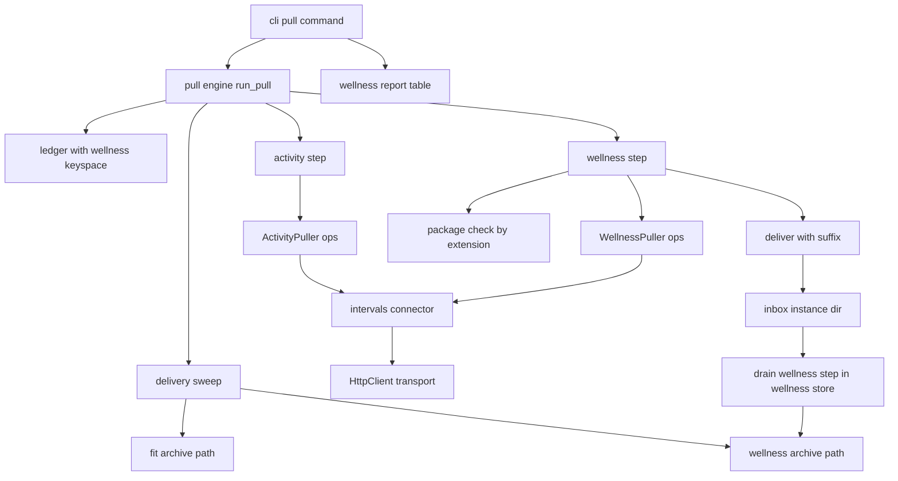
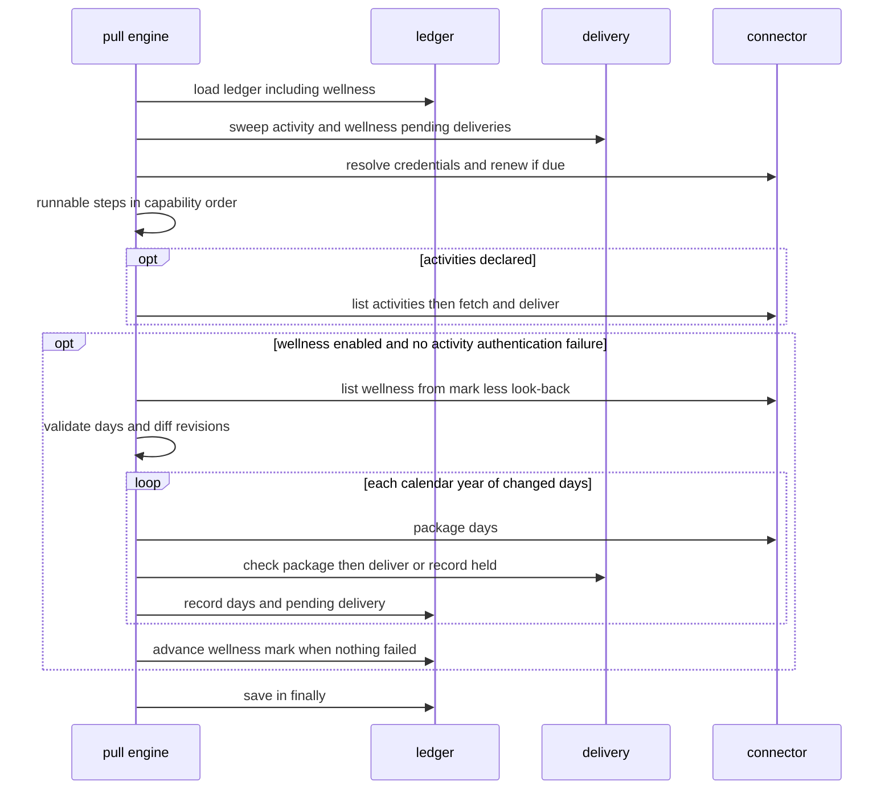
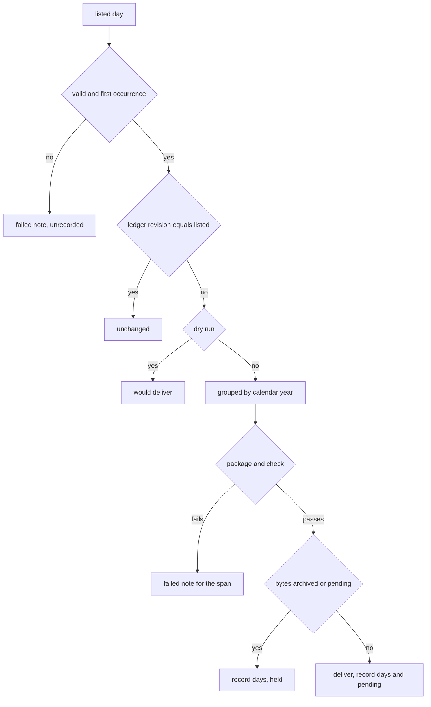
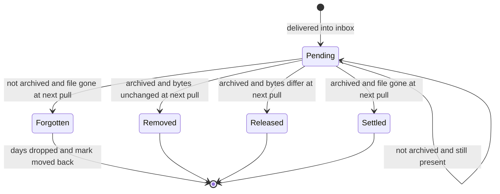

# Design Document — wellness-pull

## Overview

**Purpose**: wellness-pull lets `fitdocs pull` fetch an athlete's daily
wellness from intervals.icu and deliver it into the inbox as a wellness file
`wellness-store` reads. It drives the connector protocol's reserved
`pull-wellness` capability through two new optional operations, runs each
instance's driven capabilities in a fixed order, generalizes delivery and the
removal of archived deliveries from FIT files to declared wellness files,
gives the ledger a wellness keyspace, and teaches the intervals.icu connector
the wellness endpoint, change detection by `updated`, a whole-history first
pull and Garmin attribution.

**Users**: the athlete (enables `wellness = true`, runs `fitdocs pull --sync`
by hand or on a schedule), the athlete's agent (reads the wellness report
table through the packaged skill), and a future connector author (a Garmin or
HealthFit connector declaring `pull-wellness`).

**Impact**: `PULL_WELLNESS` becomes driven; the published connectors surface
grows by four names; the ledger gains a `[wellness]` table and format
version 2 when it holds one; the pull report gains a per-instance wellness
section; the intervals.icu connector declares `{PULL_ACTIVITIES,
PULL_WELLNESS}`. The ownership contract's `pull` guarantee widens to
wellness deliveries, so `CONTRACT_VERSION` advances to main + 1 at landing
(controller ruling R1, Decision 13). No document, page, index or owned
location changes; `DOC_VERSION` and the index `SCHEMA_VERSION` do not move.

### Goals
- An intervals.icu instance with `wellness = true` delivers, per pull, one
  file per calendar year of new or changed wellness days, byte-identical for
  identical content, in `wellness-store`'s delivery form.
- A pull with nothing changed delivers nothing and leaves the ledger
  byte-identical; an instance without wellness pulls exactly as before.
- The framework stays service-neutral and FIT activity handling is unchanged.

### Non-Goals
- Parsing, archiving, merging or storing wellness (`wellness-store`).
- Any other connector's wellness; a push; intervals.icu custom fields.
- Propagating a day intervals.icu deletes; per-value attribution.

## Boundary Commitments

### This Spec Owns
- The wellness half of the connector protocol: `WellnessPuller`,
  `WellnessDay`, `WellnessListing`, `WellnessPackage`; `PULL_WELLNESS`
  driven; the registration rule for it.
- The per-instance framework key `wellness` and its validation.
- The capability run order inside one instance's pull, and the wellness step:
  window start, validation, change detection, yearly packaging, the
  extension-keyed package check, held detection, delivery, recording, the
  wellness mark, the attribution-change notice, the wellness report.
- The ledger's `[wellness]` keyspace, its invariants, and the version rule
  (2 when present, 1 otherwise).
- Delivery by declared extension (`deliver(suffix=)`), the wellness delivery
  name, and the sweep of pending wellness deliveries against the wellness
  archive.
- The intervals.icu wellness listing, packaging (the delivery envelope's
  bytes), attribution from `*_wellness_keys`, and the wellness status
  mapping, plus the connector's capability declaration.
- The CLI wellness table, the skill's wellness channel table, the connectors
  documentation, the `wellness.md` passage, the ownership contract's `pull`
  statement with `CONTRACT_VERSION` main + 1 and its history paragraph, the
  regenerated declaration goldens, the CHANGELOG entry, the live check and
  its findings, and the `connectors`, `intervals-connector` and
  `wiki-contract` amendment records.

### Out of Boundary
- Everything `wellness-store` owns: recognition, the archive layout and its
  writes, the envelope's parser, the merge and its revision rule, the series,
  the drain's wellness step, `check` findings. This spec repeats two literals
  of the archive path and the envelope's two identifying literals, and pins
  them to `wellness-store`'s constants in tests.
- The activity pull's behavior, channels and FIT gate (unchanged; only moved
  under the run order).
- Inbox candidate selection (`inbox.select_candidates`, shared by
  `sync.py:878` and `connectors/folder.py:161`) and the folder connector's
  `.fit`-only listing (`wellness-store` Req 1.8): untouched.
- The no-network command list (connectors Req 14.1; `recovery` appends its
  command): untouched except that the existing offline e2e fixture's
  configuration gains a wellness-enabled instance.
- Rendering Garmin attribution on any page (`recovery`, `workout-wellness`).

### Allowed Dependencies
- Inside `fitdocs.connectors`, the existing allow-list
  (`tests/connectors/test_boundary.py:276-379`) is unchanged in kind: the
  package imports only the standard library, `fitdocs.layout`,
  `fitdocs.settings`, `fitdocs.inbox`, `fitdocs.version` and (ledger,
  credentials) `tomli_w`. It never imports `fitdocs.wellness`; it reaches the
  wellness archive only through `fitdocs.layout.wellness_archive_path`
  (`wellness-store` seam 2).
- `connectors/intervals.py` keeps importing only the standard library and
  `fitdocs.connectors.{errors,http,protocol,secrets}`; no clock call
  (`session.now` only).
- `connectors/ledger.py` keeps `{tomli_w, _atomic, layout}`; it does not
  import `protocol` (wellness days are passed as `(date, revision)` pairs).
- Tests may import `fitdocs.wellness` to pin literals and to run the
  delivered bytes through `wellness-store`'s real recognizer and parser.
- Upstream prerequisite: `wellness-store` merged to `main`
  (`layout.wellness_archive_path`, `fitdocs.wellness.formats.intervals`,
  `fitdocs.wellness.probe.JSON_PROBE_LIMIT`, the drain's wellness step).

### Revalidation Triggers
- Any change to `wellness-store`'s delivery envelope, its `intervals-icu`
  format id or archived suffix, its 64 MiB recognition bound, or its revision
  rule for `updated` (this spec's bytes, pins and change detection).
- Any change to the four protocol names or `WellnessPackage`'s fields (a
  future wellness connector, the surface pin).
- Any change to the ledger's `[wellness]` shape or the version rule (the
  ledger reader of every later fitdocs).
- `CONTRACT_VERSION`: re-derived as main + 1 at landing, like every Phase 12
  lander (the declaration goldens and the two literal version pins move with
  it).
- Any change to `WellnessPullReport`'s fields (the CLI table, the skill
  binding).
- A live-check contradiction (Requirement 11): repair tasks here, and a
  `wellness-store` format amendment for a field name or form.

## Architecture

### Existing Architecture Analysis
- `_pull_one` (`connectors/pull.py:341-712`) runs ledger load
  (`:359-366`), sweep (`:379-386`), credential resolution and login renewal
  (`:388-417`), a hard-coded refusal for any connector without
  `PULL_ACTIVITIES` (`:419-424`), the DATA-mode session (`:429-441`), the
  activity loop (`:442-693`), and a `finally` save (`:694-698`).
- The FIT-only seams have one `src/` caller each (grep, 2026-10-12):
  `deliver` (`pull.py:654`), `sweep` (`pull.py:380`), `delivery_name`
  (`pull.py:652`), `is_fit` in connectors (`pull.py:590`), `load_ledger`
  (`pull.py:360`), `save_ledger` (`pull.py:698`), `InstancePullReport(`
  (`pull.py:206`, `:700`), `ConnectorInstance(` (`settings.py:272`).
  `DRIVEN_CAPABILITIES` (`protocol.py:141-143`) is re-exported
  (`__init__.py:54`, `:93`) and read by no `src/` module; the registry
  hard-codes `PULL_ACTIVITIES` (`registry.py:193-207`).
- The ledger reads four top-level keys and writes back only those four
  (`ledger.py:305-338`, `:429-451`); `Ledger`'s copy methods rebuild the
  dataclass field by field (`ledger.py:165-196`).
- Settings strip `connector` and `lookback_days` before the connector's own
  parser (`settings.py:72-74`, `:257-259`).
- The pull table is driven by `_PULL_REPORT_ROWS` (`cli.py:1452-1468`) in
  `_report_pull` (`cli.py:1470-1546`); the skill's `Pull channel` table is
  bound to `InstancePullReport`'s fields minus `{name, connector_id, listed}`
  (`tests/test_agent_skill.py:137-178`, `:780-855`).

### Architecture Pattern & Boundary Map



**Architecture Integration**:
- Selected pattern: a second driven capability inside the existing per-
  instance engine, so one ledger load, one sweep, one credential resolution,
  one session and one `finally` save serve both steps (alternatives in
  `research.md`).
- Boundaries: the framework knows dates, opaque revisions, extensions,
  format names and platform tokens; only the connector knows the service's
  record shape and the envelope.
- Existing patterns preserved: the atomic writer, owned-path reuse, the
  six-outcome sweep, `_invariant_violation` shared by load and save,
  write-if-different saves, redaction of every reported string, the
  `finally` save that survives `KeyboardInterrupt`.
- Steering compliance: no new dependency, no clock in the package, network
  only in `fitdocs pull`, absent is `None`, no personal data in tests.

### Dependency Direction
Within the package (unchanged direction, left imports nothing to its right):
`secrets`, `errors` → `http` → `protocol` → `registry` → `settings`,
`credentials` → `ledger` → `delivery` → `pull`; connectors
(`intervals`, `folder`) import only `errors`, `http`, `protocol`, `secrets`
(`folder` also `inbox`); `cli` imports `pull`.

### Technology Stack

| Layer | Choice / Version | Role in Feature | Notes |
|-------|------------------|-----------------|-------|
| CLI | typer + rich (existing) | wellness table | no new flag or command |
| Connector | stdlib `json`, `hashlib`, `datetime`, `re`, `urllib.parse` | listing, envelope, attribution | via `HttpClient` only |
| State | stdlib `tomllib`, `tomli_w` (existing) | `[wellness]` ledger table | local dates as TOML dates |
| Runtime | Python 3.11+, mypy --strict | — | — |

## File Structure Plan

### Directory Structure
No new `src/` module. New test modules:
```
tests/connectors/
├── test_wellness_protocol.py   # protocol types, driven set, registry rule, surface additions
├── test_wellness_settings.py   # the `wellness` key
├── test_wellness_ledger.py     # [wellness] keyspace, version rule, invariants, copy methods
├── test_wellness_delivery.py   # package check, name, deliver(suffix=), wellness sweep
├── test_wellness_pull.py       # the wellness step and run order (ScriptedWellnessPuller)
├── test_intervals_wellness.py  # intervals listing, envelope, attribution, status mapping, literal pins,
│                               #   contract test through wellness-store's recognizer and parser
├── test_intervals_wellness_pull.py  # run_pull with the real intervals connector and FakeTransport
├── test_cli_wellness.py        # the wellness table and exit codes through CliRunner
├── test_wellness_docs.py       # connectors.md wellness passages pinned to code constants
├── test_wellness_records.py    # wellness.md link, contract bullet and head paragraph, changelog,
│                               #   amendment headings (the history pin lives in tests/identity)
└── test_wellness_e2e.py        # CLI pull --sync through the real drain; second pull sweeps
```

### Modified Files
- `src/fitdocs/connectors/protocol.py` — four new types; `PULL_WELLNESS`
  driven; `DRIVEN_CAPABILITIES`; module docstring.
- `src/fitdocs/connectors/registry.py` — the `PULL_WELLNESS` operation rule;
  docstrings (`:111-139`).
- `src/fitdocs/connectors/settings.py` — the `wellness` framework key;
  `ConnectorInstance.wellness`; module docstring's check order.
- `src/fitdocs/connectors/ledger.py` — wellness types, `Ledger.wellness`,
  copy methods via `dataclasses.replace`, version constants, load/save and
  invariants.
- `src/fitdocs/connectors/delivery.py` — `deliver(..., suffix=)`,
  `_candidates(primary, sha256, suffix)`, `WELLNESS_CHECKS`,
  `MAX_WELLNESS_JSON_BYTES`, `wellness_package_problem`,
  `wellness_delivery_name`, `wellness_archived`, the wellness half of `sweep`.
- `src/fitdocs/connectors/pull.py` — report types, the run order, the hoisted
  session, `_pull_wellness`, `_LedgerHolder`, `PullReport.failed`.
- `src/fitdocs/connectors/intervals.py` — capability set, wellness constants,
  `list_wellness`, `package_wellness`, helpers, status mapping.
- `src/fitdocs/connectors/__init__.py` — four names appended to `__all__`
  (46 → 50) and imported; the docstring's count at `:21`.
- `src/fitdocs/cli.py` — `_WELLNESS_REPORT_ROWS`, the wellness table in
  `_report_pull`, the `pull` command docstring.
- `src/fitdocs/skills/fitdocs-workouts/SKILL.md` — the `Wellness channel`
  table and one routine sentence.
- `src/fitdocs/contract.py` — `CONTRACT_VERSION` main + 1 and its history
  paragraph (ContractWording).
- `docs/connectors.md`, `docs/wellness.md`, `CHANGELOG.md`;
  `docs/ownership-contract.md`: the version line, the "What changed at this
  version" paragraph (replacing the previous lander's) and the `pull` bullet.
- `tests/declaration_golden/*.AGENTS.md` — regenerated for the new version
  line (every golden on `main` at landing, including peers').
- `.kiro/specs/connectors/{requirements.md,spec.json}`,
  `.kiro/specs/intervals-connector/{requirements.md,spec.json}`,
  `.kiro/specs/wiki-contract/{requirements.md,spec.json}` — amendment
  records; `.kiro/steering/roadmap.md` — the Phase 12 `wellness-pull` line
  and the Existing Spec Update lines ticked by the completion gate.
- Tests re-pinned (append-only where the pin is a list):
  `tests/connectors/test_protocol.py:191-194` (driven set),
  `tests/connectors/test_surface.py` (`EXPECTED_ALL`, `_DEFINING_MODULE`,
  the count at `:117-119` and
  `test_import_fitdocs_connectors_exposes_exactly_46_names` at `:147-149`,
  46 → 50), `tests/connectors/test_intervals.py:118`
  (capability set), `tests/connectors/conftest.py:359` and
  `tests/connectors/test_cli_connectors.py:106` (the "non-driven" default
  moves from `PULL_WELLNESS` to `PULL_PLANS`),
  `tests/connectors/test_pull.py:2497-2511` ("does not pull activities" →
  the nothing-to-pull detail), `tests/connectors/test_ledger.py`
  (`LEDGER_VERSION` references at `:50`, `:146`, `:445-448`, `:651`),
  `tests/connectors/test_delivery.py` (escalation stays `.fit`),
  `tests/connectors/test_docs.py` (`_EXPECTED_HEADINGS`; the instance-table
  key pin at `:353-361`, which becomes `== _RESERVED_KEYS`),
  `tests/connectors/test_settings.py:853-855` (`ConnectorInstance` field
  names gain `wellness`),
  `tests/connectors/test_cli_connectors.py:1737-1738` (the channel set
  derived from `InstancePullReport` excludes `wellness`),
  `tests/connectors/test_intervals_docs.py:60-65` (subsection list),
  `tests/connectors/test_e2e.py` (`_fresh_synced_root` settings gain a
  wellness-enabled intervals instance and its key variable),
  `tests/test_agent_skill.py` (`_PULL_EXCLUSIONS` at `:141` gains
  `wellness` together with the report field; then the wellness binding),
  `tests/index/test_contract_docs.py:140` and
  `tests/index/derived/test_preserved.py:246` (the literal
  `CONTRACT_VERSION`), `tests/identity/test_contract_docs.py:177-187` (the
  "What changed at this version" phrases, plus any peer's head-paragraph pin
  on `main` at landing) and `:189-209` (two literal history assertions
  appended), `tests/test_confinement.py` (`WRITING_ENTRY_POINTS`
  gains `pull-wellness`), `tests/connectors/test_boundary.py` only if a
  module's import set changes (none planned).
- `pyproject.toml` — unchanged: `[tool.mypy].files` already lists the
  `tests/connectors` directory, which holds every new test module.

## System Flows

### One instance's pull with wellness



Key decisions: the sweep precedes both steps so a forgotten wellness delivery
moves the mark back before this pull lists (6.3); wellness runs after
activities and is skipped only after an activity authentication failure
(9.6); each recorded package updates a holder the `finally` reads, so an
interruption keeps every delivery made (5.6).

### Per-day decision



### Wellness delivery lifecycle



"Archived" means `layout.wellness_archive_path(data_root, format, sha256,
suffix).is_file()` with the format and suffix recorded on the pending
delivery. `Removed`, `Released` and `Settled` drop the pending record and keep
the days; `Forgotten` also drops every day whose recorded `sha256` is the
delivery's and lowers the mark.

## Requirements Traceability

| Requirement | Summary | Components | Interfaces | Flows |
|-------------|---------|------------|------------|-------|
| 1.1 | pull-wellness driven, seven reserved | WellnessProtocol, RegistryRule | `CAPABILITIES`, `DRIVEN_CAPABILITIES` | — |
| 1.2 | two operations and their values | WellnessProtocol | `WellnessPuller`, `WellnessDay`, `WellnessListing`, `WellnessPackage` | One instance's pull |
| 1.3 | records handed back unread | WellnessProtocol, WellnessStep | `WellnessDay.record` | — |
| 1.4 | registration requires both operations | RegistryRule | `validate_connector` | — |
| 1.5 | absent revision | WellnessProtocol, WellnessStep | `WellnessDay.revision: str \| None` | — |
| 1.6 | inputs and outputs only | WellnessProtocol, WellnessStep | `ConnectorSession` | — |
| 1.7 | surface pin | PackageSurface | `__all__` | — |
| 2.1 | `wellness` key, default false | WellnessSettingsKey | `ConnectorInstance.wellness` | — |
| 2.2 | disabled: no request, no report | RunOrder, WellnessSettingsKey | `_runnable` | — |
| 2.3 | malformed or misplaced key | WellnessSettingsKey | `ConnectorsSettingsError` | — |
| 2.4 | framework key | WellnessSettingsKey | `_RESERVED_KEYS` | — |
| 2.5 | folder stays FIT-only | WellnessSettingsKey | `FolderConnector.capabilities` unchanged | — |
| 2.6 | nothing to pull | RunOrder | `_nothing_to_pull_detail` | — |
| 3.1 | mark less look-back | WellnessStep | `_wellness_oldest` | One instance's pull |
| 3.2 | first pull, connector's start | WellnessStep, IntervalsWellness | `oldest=None` | — |
| 3.3 | `--since` | WellnessStep | `PullOptions.since` | — |
| 3.4 | changed by revision | WellnessStep, WellnessLedger | `WellnessLedger.entry` | Per-day decision |
| 3.5 | ledger alone decides | WellnessStep | — | Per-day decision |
| 3.6 | malformed day | WellnessStep | `_day_problem` | Per-day decision |
| 3.7 | mark advance rule | WellnessLedger, WellnessStep | `with_coverage` | — |
| 3.8 | dry run | WellnessStep | `would_deliver` | Per-day decision |
| 3.9 | second pull delivers nothing | WellnessStep, WellnessLedger | `save_ledger` write-if-different | — |
| 3.10 | upstream deletion ignored | WellnessStep | — | — |
| 4.1 | one file per year, name | WellnessStep, WellnessDelivery | `wellness_delivery_name` | Per-day decision |
| 4.2 | atomic, unmodified | WellnessDelivery | `deliver`, `write_atomic` | — |
| 4.3 | name collision | WellnessDelivery | `_candidates(…, suffix)` | — |
| 4.4 | package check | WellnessDelivery | `wellness_package_problem`, `WELLNESS_CHECKS` | Per-day decision |
| 4.5 | FIT gate unchanged | ActivityStepUnchanged | `is_fit` | — |
| 4.6 | held | WellnessStep, WellnessDelivery | `wellness_archived` | Per-day decision |
| 4.7 | one year fails, continue | WellnessStep | — | — |
| 5.1 | wellness records | WellnessLedger | `WellnessDayEntry`, `WellnessPending`, `WellnessLedger` | — |
| 5.2 | stable order, no clock | WellnessLedger | `save_ledger` | — |
| 5.3 | activity-only byte-identical | WellnessLedger | `ACTIVITY_LEDGER_VERSION` | — |
| 5.4 | newer version when present | WellnessLedger | `WELLNESS_LEDGER_VERSION`, `LEDGER_VERSION` | — |
| 5.5 | malformed wellness refused | WellnessLedger | `_wellness_violation`, `LedgerError` | — |
| 5.6 | saved on every exit | RunOrder | `_LedgerHolder`, `finally` | One instance's pull |
| 5.7 | hash form | WellnessLedger | `_SHA256_RE` | — |
| 6.1 | remove archived | WellnessSweep | `sweep` | Lifecycle |
| 6.2 | never remove others | WellnessSweep | `sweep` | Lifecycle |
| 6.3 | forgotten | WellnessSweep, WellnessLedger | `WellnessLedger.forget` | Lifecycle |
| 6.4 | released, settled | WellnessSweep | `without_pending` | Lifecycle |
| 6.5 | failed removal | WellnessSweep | `SweepResult.failures` | — |
| 6.6 | sweep regardless of setting | WellnessSweep, RunOrder | `sweep` | — |
| 7.1 | intervals capabilities | IntervalsWellness | `capabilities` | — |
| 7.2 | windows, id, updated | IntervalsWellness | `list_wellness`, `_wellness_windows` | — |
| 7.3 | 2010-01-01 | IntervalsWellness | `WELLNESS_HISTORY_START` | — |
| 7.4 | content revision | IntervalsWellness | `_content_revision` | — |
| 7.5 | malformed listing | IntervalsWellness | `WELLNESS_LISTING_FORM_MESSAGE` | — |
| 7.6 | reads only id and updated | IntervalsWellness | `list_wellness`, `package_wellness` | — |
| 7.7 | envelope bytes | IntervalsWellness | `_envelope_bytes` | — |
| 7.8 | request counts | IntervalsWellness | `list_wellness`, `package_wellness` | — |
| 8.1 | attribution rule | IntervalsWellness | `_wellness_origins` | — |
| 8.2 | ambiguous or unlisted | IntervalsWellness | `_wellness_origins` | — |
| 8.3 | platform token | IntervalsWellness | `WELLNESS_KEYS_PATTERN` | — |
| 8.4 | settings only | IntervalsWellness | `_wellness_origins` | — |
| 8.5 | withheld field verbatim | IntervalsWellness | `_envelope_bytes` | — |
| 8.6 | attribution-change notice | WellnessStep, WellnessLedger | `ATTRIBUTION_DROPPED`, `with_origins` | — |
| 9.1 | unauthorized | IntervalsWellness, WellnessStep | `_raise_for_wellness_status`, `_instance_error` | — |
| 9.2 | forbidden, Garmin remedy | IntervalsWellness | `WELLNESS_REFUSED_MESSAGE` | — |
| 9.3 | rate limit, server error | IntervalsWellness | `RATE_LIMITED_MESSAGE`, `UNAVAILABLE_MESSAGE` | — |
| 9.4 | other status | IntervalsWellness | `WELLNESS_STATUS_MESSAGE` | — |
| 9.5 | ended early keeps work | WellnessStep, RunOrder | `_LedgerHolder` | — |
| 9.6 | run after activity failure | RunOrder | `activity_auth_failed` | One instance's pull |
| 9.7 | no re-delivery after drain refusal | WellnessStep, WellnessSweep | Pending stays Pending | Lifecycle |
| 9.8 | key never exposed | IntervalsWellness | `_auth_headers`, `Redactor` | — |
| 10.1 | wellness table rows | WellnessReportTable | `_WELLNESS_REPORT_ROWS` | — |
| 10.2 | detail lines | WellnessReportTable | `_report_pull` | — |
| 10.3 | dry run dates | WellnessReportTable | `would_deliver` | — |
| 10.4 | removed and deferred channels | WellnessSweep, RunOrder | `InstancePullReport.removed`, `.deferred` | — |
| 10.5 | exit code | RunOrder | `PullReport.failed` | — |
| 10.6 | ordering | WellnessStep | sorted tuples | — |
| 10.7 | no table when not run | WellnessReportTable | `wellness is None` | — |
| 11.1 | listing behavior confirmed | LiveCheckProcedure | TBC-W1, W2, W3, W6, W7 | — |
| 11.2 | record fields recorded | LiveCheckProcedure | TBC-W1, W4 | — |
| 11.3 | athlete settings recorded | LiveCheckProcedure | TBC-W5 | — |
| 11.4 | who runs it, key handling | LiveCheckProcedure | controller session script | — |
| 11.5 | shapes only | LiveCheckProcedure | research.md "Live check findings" | — |
| 11.6 | contradiction repairs | LiveCheckProcedure, tasks 1.1 and the completion gate | repair tasks, wellness-store amendment | — |
| 11.7 | only the gate waits | LiveCheckProcedure | tasks dependency | — |
| 12.1 | connectors docs, framework | ConnectorsDocs | `docs/connectors.md` | — |
| 12.2 | connectors docs, intervals.icu | ConnectorsDocs | `docs/connectors.md` `### Wellness` | — |
| 12.3 | wellness docs | WellnessDocs | `docs/wellness.md` | — |
| 12.4 | contract `pull` bullet and version | ContractWording | `docs/ownership-contract.md`, `CONTRACT_VERSION`, declaration goldens | — |
| 12.5 | skill table | SkillWellnessTable | `SKILL.md`, `tests/test_agent_skill.py` | — |
| 12.6 | changelog | ChangelogEntry | `CHANGELOG.md` | — |
| 12.7 | amendment records | SpecRecords | `requirements.md` of three specs | — |
| 13.1 | offline elsewhere | OfflineGuard | `tests/connectors/test_e2e.py` | — |
| 13.2 | no dependency | OfflineGuard | `tests/test_determinism.py` | — |
| 13.3 | determinism | IntervalsWellness, WellnessLedger | canonical bytes, sorted ledger | — |
| 13.4 | offline tests | all test modules | socket guard (`tests/connectors/conftest.py`) | — |
| 13.5 | no personal data | LiveCheckProcedure, tests | synthetic records | — |

## Components and Interfaces

### Summary

| Component | Domain | Intent | Requirements | Key dependencies |
|-----------|--------|--------|--------------|------------------|
| WellnessProtocol | protocol | Operations and value types | 1.1-1.3, 1.5, 1.6 | `http`, `secrets` (P0) |
| RegistryRule | registry | Both operations required | 1.1, 1.4 | protocol (P0) |
| PackageSurface | `__init__` | Four names published | 1.7 | protocol (P1) |
| WellnessSettingsKey | settings | The `wellness` key | 2.1-2.5 | registry (P0) |
| WellnessLedger | ledger | Keyspace, version, invariants | 3.4, 3.7, 3.9, 5.1-5.5, 5.7, 6.3, 8.6, 13.3 | `tomli_w`, `layout` (P0) |
| WellnessDelivery | delivery | Package check, name, deliver by suffix | 4.1-4.4, 4.6 | `layout`, `_atomic` (P0) |
| WellnessSweep | delivery | Pending wellness lifecycle | 6.1-6.6, 9.7, 10.4 | `layout.wellness_archive_path` (P0) |
| RunOrder | pull | Steps per instance, holder, report | 2.2, 2.6, 5.6, 6.6, 9.5, 9.6, 10.4, 10.5 | all above (P0) |
| WellnessStep | pull | The wellness step | 1.3, 1.5, 1.6, 3.1-3.10, 4.1, 4.6, 4.7, 8.6, 9.5, 9.7, 10.6 | delivery, ledger (P0) |
| ActivityStepUnchanged | pull | FIT step moved under the run order | 4.5 | — |
| IntervalsWellness | intervals | Listing, envelope, attribution, statuses | 7.1-7.8, 8.1-8.5, 9.1-9.4, 9.8, 13.3 | `HttpClient` (P0), intervals.icu (External, P0) |
| WellnessReportTable | cli | The wellness table | 10.1-10.3, 10.7 | pull (P0) |
| SkillWellnessTable | skill | Agent-facing channel table | 12.5 | cli (P1) |
| Docs and records | docs, specs | Documentation and amendments | 12.1-12.4, 12.6, 12.7 | — |
| OfflineGuard | tests | No request elsewhere | 13.1, 13.2 | — |
| LiveCheckProcedure | controller session | Confirm the TBC items | 11.1-11.7, 13.5 | intervals.icu (External) |

### Protocol layer

#### WellnessProtocol (`connectors/protocol.py`)

| Field | Detail |
|-------|--------|
| Intent | The wellness half of the published protocol |
| Requirements | 1.1, 1.2, 1.3, 1.5, 1.6 |

**Contracts**: Service [x]

```python
@dataclass(frozen=True)
class WellnessDay:
    """One wellness day a listing reports (Req 1.2, 1.5)."""
    day: date                      # a date, never a datetime
    revision: str | None           # changes when the day's record changes; None when unstated
    record: object = field(repr=False)   # the service's record, handed back unread (Req 1.3)

@dataclass(frozen=True)
class WellnessListing:
    """The answer to WellnessPuller.list_wellness (Req 1.2)."""
    oldest: date                   # the first date this listing covered
    newest: date                   # the last date this listing covered
    days: tuple[WellnessDay, ...]

@dataclass(frozen=True)
class WellnessPackage:
    """The answer to WellnessPuller.package_wellness (Req 1.2)."""
    data: bytes                    # the file's bytes, delivered unmodified
    suffix: str                    # the file's extension, e.g. ".json"
    format: str                    # the wellness format that archives it, e.g. "intervals-icu"
    origins: frozenset[str]        # platform tokens the package attributes any field to

class WellnessPuller(Protocol):
    """Required when Capability.PULL_WELLNESS is declared."""
    def list_wellness(self, session: ConnectorSession, oldest: date | None) -> WellnessListing: ...
    def package_wellness(self, session: ConnectorSession, days: tuple[WellnessDay, ...]) -> WellnessPackage: ...
```
- `CAPABILITIES[Capability.PULL_WELLNESS].driven = True`;
  `DRIVEN_CAPABILITIES = frozenset({PULL_ACTIVITIES, PULL_WELLNESS})`. The
  vocabulary, summaries and remote/irreversible flags are unchanged (1.1).
- `oldest=None` means "the instance has no wellness mark and no `--since`":
  the connector lists from the earliest date it documents (3.2).
- `days` passed to `package_wellness` are listed days of the same pull,
  sorted by `day`, distinct, all of one calendar year.
- Module docstring: "two driven capabilities".

#### RegistryRule (`connectors/registry.py`)
- After the `PULL_ACTIVITIES` block (`registry.py:193-207`): when
  `PULL_WELLNESS` is declared, `list_wellness` and then `package_wellness`
  must be callable, else the reason
  `"<op> must be callable when PULL_WELLNESS is declared"` (1.4). Inside the
  same `except Exception` boundary; never calls either operation. Docstrings
  (`:1-26`, `:111-139`) name the wellness operations.

#### PackageSurface (`connectors/__init__.py`)
- `__all__` (`__init__.py:89-136`) appends `"WellnessPuller"`,
  `"WellnessDay"`, `"WellnessListing"` and `"WellnessPackage"` at its end, so
  the existing order is untouched; 46 → 50 names, pinned by
  `tests/connectors/test_surface.py` (`EXPECTED_ALL`, `_DEFINING_MODULE`,
  the count at `:117-119`, and the import count at `:147-149`, whose test
  name says 46). The docstring's count at `__init__.py:21` follows (1.7).

#### WellnessSettingsKey (`connectors/settings.py`)
- `_WELLNESS_KEY = "wellness"` joins `_RESERVED_KEYS` (`settings.py:74`), so
  the connector's own `parse_settings` never sees it (2.4).
- `_resolve_wellness(table, *, name, connector, settings_file) -> bool`, run
  after `lookback_days` and before the credential-key check: absent →
  `False`; not a `bool` → error "must be true or false, got <repr>
  (<type>)"; `True` while `PULL_WELLNESS` is not in
  `connector.capabilities` → error "the <connector id> connector does not
  pull wellness" (2.3). `False` is accepted on any connector.
- `ConnectorInstance` gains `wellness: bool = False` as its last field
  (re-pin `tests/connectors/test_settings.py:853-855`).
- The folder connector's `capabilities` stays `{PULL_ACTIVITIES}`
  (`folder.py`), so `wellness = true` on a folder instance is refused (2.5).

### State layer

#### WellnessLedger (`connectors/ledger.py`)

| Field | Detail |
|-------|--------|
| Intent | The wellness keyspace of the per-instance ledger |
| Requirements | 3.4, 3.7, 3.9, 5.1-5.5, 5.7, 6.3, 8.6, 13.3 |

**Contracts**: State [x]

```python
LEDGER_VERSION: Final[int] = 2            # the newest format this version reads
ACTIVITY_LEDGER_VERSION: Final[int] = 1   # written when the ledger has no [wellness] table
WELLNESS_LEDGER_VERSION: Final[int] = 2   # written when it has one

@dataclass(frozen=True)
class WellnessDayEntry:
    day: date
    revision: str | None
    sha256: str                 # the delivery, or held bytes, that carried this revision

@dataclass(frozen=True)
class WellnessPending:
    path: str                   # inbox-relative POSIX path of the delivery
    sha256: str
    format: str                 # the wellness format that archives it
    suffix: str                 # its extension

@dataclass(frozen=True)
class WellnessLedger:
    through: date | None = None
    origins: tuple[str, ...] = ()                 # sorted, unique
    days: tuple[WellnessDayEntry, ...] = ()       # sorted by day, unique
    pending: tuple[WellnessPending, ...] = ()     # sorted by path, unique

    def entry(self, day: date) -> WellnessDayEntry | None: ...
    def with_days(self, days: Sequence[tuple[date, str | None]], sha256: str) -> WellnessLedger: ...
    def with_pending(self, pending: WellnessPending) -> WellnessLedger: ...
    def without_pending(self, path: str) -> WellnessLedger: ...
    def forget(self, path: str) -> WellnessLedger: ...
    def with_coverage(self, oldest: date, newest: date) -> WellnessLedger: ...
    def with_origins(self, origins: Iterable[str]) -> WellnessLedger: ...

# Ledger gains, as its last field:
#     wellness: WellnessLedger | None = None
# and def with_wellness(self, wellness: WellnessLedger) -> Ledger
```
- **Copy methods keep the other keyspace.** `with_entry`, `without` and
  `with_watermark` (`ledger.py:156-196`) build their result with
  `dataclasses.replace`, so a `Ledger` carrying wellness keeps it through an
  activity update, and `with_wellness` keeps entries and watermark.
- `with_days` replaces or adds one entry per date with the given revision and
  sha. `forget(path)` drops the pending record at `path`, drops every day
  whose `sha256` equals that record's, and, when any day was dropped and
  `through` is set, sets `through = min(through, earliest dropped day − 1
  day)` (6.3). An unknown `path` is a no-op.
- `with_coverage(oldest, newest)` (3.7): when `through` is `None`,
  `through = newest`; when `oldest <= through + 1 day`, `through =
  max(through, newest)`; otherwise unchanged (a gap is never crossed).
- `with_origins` stores the sorted distinct tokens.
- **Version rule.** `save_ledger` stamps `WELLNESS_LEDGER_VERSION` when
  `ledger.wellness is not None`, else `ACTIVITY_LEDGER_VERSION` (5.3, 5.4).
  `load_ledger` refuses a version above `LEDGER_VERSION` (`ledger.py:310-314`
  wording unchanged) and a `wellness` table under version 1 (5.5).
- **Invariants** (`_invariant_violation` gains a `wellness` argument and a
  version argument; same function for load and save): `through` is exactly a
  `date` (a TOML datetime is refused: `type(x) is date`); `origins` are
  strings matching `^[a-z0-9]+(-[a-z0-9]+)*$`, sorted, unique; each day's
  `day` is exactly a `date`, days sorted ascending and unique, `revision` a
  non-empty string of at most 512 characters with no control character, or
  absent, `sha256` present and 64 lowercase hex (5.7); each pending record's
  `path` is a safe relative path (`_is_safe_relative_path`), paths sorted and
  unique, `sha256` 64 lowercase hex, `format` a slug as above, `suffix`
  matching `^\.[a-z0-9]+$` and not `.fit`; and version 1 carries no
  wellness. A violation raises `LedgerError` naming the file on load and
  `ValueError` on save, writing nothing.
- Serialization adds, when `wellness is not None`, a `wellness` table:
  `through` (TOML local date, omitted when `None`), `origins` (omitted when
  empty), `days` (array of tables `day`, `revision` when present, `sha256`),
  `pending` (array of tables `path`, `sha256`, `format`, `suffix`). Sorted
  as above; no clock value; write-if-different unchanged (5.2, 3.9).

### Delivery layer

#### WellnessDelivery (`connectors/delivery.py`)

| Field | Detail |
|-------|--------|
| Intent | Check, name and write a wellness package |
| Requirements | 4.1, 4.2, 4.3, 4.4, 4.6 |

```python
MAX_WELLNESS_JSON_BYTES: Final[int] = 64 * 1024 * 1024   # pinned to fitdocs.wellness.probe.JSON_PROBE_LIMIT
FORMAT_NAME_PATTERN: Final[str] = r"^[a-z0-9]+(-[a-z0-9]+)*$"
WELLNESS_CHECKS: Final[Mapping[str, Callable[[bytes], str | None]]]   # {".json": _json_problem}

def wellness_package_problem(data: bytes, suffix: str, format: str, origins: frozenset[str]) -> str | None: ...
def wellness_delivery_name(first: date, last: date, suffix: str) -> str: ...  # "wellness-<first>_<last><suffix>"
def wellness_archived(data_root: Path, format: str, sha256: str, suffix: str) -> bool: ...
def deliver(inbox: Path, instance: str, name: str, data: bytes, sha256: str, *,
            owned: Mapping[str, str] = MappingProxyType({}), suffix: str = ".fit") -> DeliveryResult: ...
```
- `wellness_package_problem` checks in order: `format` matches the slug
  pattern; `suffix` is a key of `WELLNESS_CHECKS` (`.fit` never is); every
  origin token matches the slug pattern; `data` is non-empty; the
  extension's check. `_json_problem(data)`: `len(data) <=
  MAX_WELLNESS_JSON_BYTES` and `json.loads(data.decode("utf-8"))` succeeds
  (strict UTF-8; a byte-order mark fails). Returns the first problem as a
  sentence, or `None` (4.4).
- `deliver`'s `suffix` replaces the literal `.fit` in `_candidates`
  (`delivery.py:179-206`), which becomes `_candidates(primary, sha256,
  suffix)`: the stem drops `suffix` case-insensitively and every escalated
  name ends in `suffix` verbatim. The default `".fit"` keeps every activity
  delivery byte-for-byte as today (4.5); only the wellness step passes
  `".json"` (4.3).
- `wellness_archived` is `layout.wellness_archive_path(data_root, format,
  sha256, suffix).is_file()` (4.6).
- Writes still go through `write_atomic` (dot-prefixed temp, fsync,
  `os.replace`) and the bytes are never altered (4.2).

#### WellnessSweep (`connectors/delivery.py` `sweep`)

| Field | Detail |
|-------|--------|
| Intent | Resolve pending wellness deliveries |
| Requirements | 6.1-6.6, 9.7, 10.4 |

- After the activity entries (`delivery.py:267-300`, unchanged), `sweep`
  walks `ledger.wellness.pending` (when `wellness` is not `None`), in path
  order, with `archived = wellness_archived(data_root, p.format, p.sha256,
  p.suffix)` and `present = (inbox / p.path).is_file()`:
  - archived, present, hash equal → `_remove`, `without_pending`, path
    appended to `removed` (6.1);
  - archived, present, hash differs → `without_pending` (released, 6.4);
  - archived, absent → `without_pending` (settled, 6.4);
  - not archived, present → unchanged (6.2, 9.7);
  - not archived, absent → `forget(path)` (6.3).
- An `OSError` hashing or removing → `(path, "<Type>: <message>")` in
  `failures`, record stays pending (6.5); `pull.py` already reports each as a
  deferred note keyed by the path (`pull.py:383-386`, 10.4).
- The sweep runs for every instance, whether or not wellness is enabled
  (6.6), because it reads only the ledger.

### Orchestration layer

#### RunOrder (`connectors/pull.py` `_pull_one`)

| Field | Detail |
|-------|--------|
| Intent | Run the instance's driven capabilities in order over one ledger |
| Requirements | 2.2, 2.6, 5.6, 6.6, 9.5, 9.6, 10.4, 10.5 |

**Contracts**: Batch [x]

```python
@dataclass(frozen=True)
class WellnessDelivered:
    span: str          # "<first date>..<last date>"
    days: int
    path: str          # inbox-relative POSIX path

@dataclass(frozen=True)
class WellnessPullReport:
    listed: int                          # days the listing reported
    unchanged: int                       # days already recorded at the listed revision
    delivered: tuple[WellnessDelivered, ...]
    would_deliver: tuple[str, ...]       # ISO dates; non-empty only under --dry-run
    held: tuple[str, ...]                # spans whose bytes were already archived or pending
    failed: tuple[PullNote, ...]
    notices: tuple[PullNote, ...]
    error: PullNote | None

# InstancePullReport gains, as its last field:
#     wellness: WellnessPullReport | None = None     # None when the step did not run
# PullReport.failed additionally counts wellness.error and wellness.failed.

@dataclass
class _LedgerHolder:
    ledger: Ledger
```
Per instance (changes to `pull.py:341-712` only):
1. Ledger load, sweep, credentials and renewal: unchanged (6.6).
2. `runnable = _runnable(instance)`: `PULL_ACTIVITIES` when declared;
   `PULL_WELLNESS` when declared and `instance.wellness`; in `Capability`
   declaration order. Empty → `error = PullNote(name,
   _nothing_to_pull_detail(instance))`: "does not pull activities or
   wellness" when the connector declares neither, otherwise "pulls only
   wellness, which is not enabled for this instance; set wellness = true in
   [connectors.<name>]" (2.6). Replaces the refusal at `pull.py:419-424`.
3. The DATA-mode session (`pull.py:429-441`) is built once, before the steps.
4. Activity step: the existing block (`pull.py:426-693`) unchanged except
   that its two `_instance_error` sites (listing, `:444-447`; fetch,
   `:546-550`) also set `activity_auth_failed = isinstance(exc,
   AuthFailure)`.
5. Wellness step: when `PULL_WELLNESS in runnable` and not
   `activity_auth_failed` (9.6): `holder = _LedgerHolder(ledger)`;
   `wellness_report = _pull_wellness(holder, …)`; `ledger = holder.ledger`.
6. `finally`: when a holder exists, `ledger = holder.ledger` before the
   unchanged save condition, extended with `or ledger.wellness is not None`
   (5.6, 9.5). `KeyboardInterrupt` still propagates after the save.
7. The report carries `wellness=wellness_report` (`None` when step 5 did not
   run, 2.2, 10.7).

#### WellnessStep (`connectors/pull.py` `_pull_wellness`)

| Field | Detail |
|-------|--------|
| Intent | List, diff, package, deliver and record wellness for one instance |
| Requirements | 1.3, 1.5, 1.6, 3.1-3.10, 4.1, 4.6, 4.7, 8.6, 9.5, 9.7, 10.6 |

```python
ATTRIBUTION_DROPPED: Final[str]   # see 8.6 below
_MAX_REVISION_LEN: Final[int] = 512

def _wellness_oldest(since: datetime | None, through: date | None, lookback_days: int) -> date | None: ...
def _pull_wellness(holder: _LedgerHolder, *, instance: ConnectorInstance, session: ConnectorSession,
                   options: PullOptions, data_root: Path, inbox: Path, redactor: Redactor) -> WellnessPullReport: ...
```
1. `oldest = _wellness_oldest(...)`: `options.since` → its UTC date
   (`since.astimezone(UTC).date()`, never later than the typed local date,
   3.3); else `through − lookback_days` when the ledger has a mark (3.1);
   else `None` (3.2).
2. `listing = puller.list_wellness(session, oldest)`. `AuthFailure`,
   `ConnectorError` or any other `Exception` → `error =
   _instance_error(exc, …)` (the redacted type and message, plus the kind's
   next step for an `AuthFailure`), return (9.1-9.5). A listing whose
   `oldest`/`newest` are not exactly `date` or with `oldest > newest` → error
   "the connector's wellness listing is malformed".
3. Validate days in listing order (3.6): a day that is not exactly a `date`,
   a revision that is an empty string, longer than `_MAX_REVISION_LEN` or
   holding a control character, or a date already seen → `failed` note
   (subject the ISO date, or `"listing"` when no date), not recorded; the
   first occurrence of a date is kept. `listed = len(listing.days)`.
4. Diff (3.4, 3.5): a valid day is changed when `wellness.entry(day)` is
   `None` or its `revision` differs from the listed one (`None` equals
   `None`). `unchanged` counts the rest. Nothing reads `record` (1.3).
5. `--dry-run` → `would_deliver` = sorted ISO dates of the changed days;
   nothing packaged, written or recorded; return (3.8).
6. Group changed days by `day.year`, ascending, each group sorted by date
   (4.1). For each group, `span = "<first>..<last>"`:
   - `package_wellness(session, group)`: `AuthFailure` or `ConnectorError` →
     `error`, stop the remaining groups; any other `Exception` → `failed`
     note (subject `span`), next group (4.7).
   - `wellness_package_problem(...)` not `None` → `failed` note (4.4).
   - `sha = sha256(package.data)`; when `wellness_archived(...)` or `sha` is
     the `sha256` of a pending wellness record → `with_days(group, sha)`,
     `held.append(span)` (4.6).
   - Otherwise `deliver(inbox, instance.name,
     wellness_delivery_name(first, last, package.suffix), package.data, sha,
     owned={p.path: p.sha256 for p in pending}, suffix=package.suffix)`;
     `OSError` → `failed` note; success → `with_days(group, sha)`,
     `with_pending(WellnessPending(result.rel, sha, package.format,
     package.suffix))`, `delivered.append(...)`.
   - After each delivered or held package (8.6): for each token in the
     recorded `origins` not in `package.origins`, a `notices` entry (subject
     the token) reading `ATTRIBUTION_DROPPED` = "the connector no longer
     attributes any wellness field to {platform}; if {platform} data stopped
     reaching the service, import {platform}'s own export instead (see the
     wellness guide)"; then `with_origins(package.origins)`. A held package
     updates nothing about origins.
   - `holder.ledger` is reassigned after every recorded group, so the
     `finally` save keeps it on interruption (5.6).
7. When `error is None` and no `failed` note was added in this step,
   `with_coverage(listing.oldest, listing.newest)` (3.7); otherwise the mark
   stays (9.5).
8. A day the listing omits is never touched (3.10); a pending delivery the
   drain could not use stays pending and its days stay recorded, so they are
   not delivered again (9.7).
9. Every note detail passes `redactor.redact`. Report tuples are sorted:
   `delivered` and `held` by span, `would_deliver` by date, `failed` and
   `notices` by subject (10.6).

#### ActivityStepUnchanged
The activity block keeps `is_fit` (`pull.py:590-604`), `delivery_name`,
`deliver` without `suffix`, its six channels and its watermark (4.5). Its
existing tests stay green unmodified except the two re-pins named in the File
Structure Plan.

### Connector layer

#### IntervalsWellness (`connectors/intervals.py`)

| Field | Detail |
|-------|--------|
| Intent | intervals.icu wellness listing, envelope, attribution and statuses |
| Requirements | 7.1-7.8, 8.1-8.5, 9.1-9.4, 9.8, 13.3 |

**Contracts**: Service [x] / API [x]

```python
capabilities = frozenset({Capability.PULL_ACTIVITIES, Capability.PULL_WELLNESS})

WELLNESS_HISTORY_START: Final[date] = date(2010, 1, 1)
WELLNESS_WINDOW_DAYS: Final[int] = 365
WELLNESS_FORMAT: Final[str] = "intervals-icu"            # pinned to wellness.formats.intervals.FORMAT.id
WELLNESS_SUFFIX: Final[str] = ".json"                    # pinned to ...FORMAT.archived_suffix
WELLNESS_DELIVERY_FORMAT: Final[str] = "fitdocs.intervals-icu-wellness"   # pinned to ...DELIVERY_FORMAT
WELLNESS_DELIVERY_VERSION: Final[int] = 1                # pinned to ...DELIVERY_VERSION
WELLNESS_ID_PATTERN: Final[str] = r"^\d{4}-\d{2}-\d{2}$"
WELLNESS_KEYS_PATTERN: Final[str] = r"^(?:icu_)?([a-z0-9_]+?)_wellness_keys$"
CONTENT_REVISION_PREFIX: Final[str] = "sha256:"
WELLNESS_LISTING_FORM_MESSAGE: Final[str]   # "intervals.icu's wellness listing is not in its documented form: {problem}"
ATHLETE_FORM_MESSAGE: Final[str]            # "intervals.icu's athlete settings are not in their documented form: {problem}"
WELLNESS_STATUS_MESSAGE: Final[str]         # "intervals.icu answered the {request} with HTTP {status}: {message}"
WELLNESS_REFUSED_MESSAGE: Final[str]        # 9.2, below

def list_wellness(self, session: ConnectorSession, oldest: date | None) -> WellnessListing: ...
def package_wellness(self, session: ConnectorSession, days: tuple[WellnessDay, ...]) -> WellnessPackage: ...
```
**Listing** (7.2-7.6, 7.8):
- `start = oldest or WELLNESS_HISTORY_START`; `end =
  session.now().astimezone(UTC).date() + 1 day` (covers an athlete up to
  UTC+14); `start = min(start, end)`.
- `_wellness_windows(start, end)`: the first window starts one day before
  `start`; a new window starts every `WELLNESS_WINDOW_DAYS`; each window but
  the last ends one day past the next window's start; the last ends at
  `end`. So every window spans at most 366 days, and coverage holds whether
  each bound is inclusive or exclusive (mirrors `_windows`,
  `intervals.py:251-272`).
- One `GET {API_BASE}/athlete/0/wellness?oldest=<date>&newest=<date>` per
  window, Basic authorization through `_auth_headers` (`intervals.py:416-425`,
  9.8). Non-200 → `_raise_for_wellness_status(request="wellness listing")`.
  The body must be a JSON array of objects, each with an `id` string matching
  `WELLNESS_ID_PATTERN` that `date.fromisoformat` accepts; anything else →
  `ConnectorError(WELLNESS_LISTING_FORM_MESSAGE)` naming the window-relative
  record index (7.5).
- Per record: `day = date.fromisoformat(id)`; `revision = updated` when it is
  a non-empty string (TBC-W3), else `_content_revision(record)` =
  `"sha256:" + sha256(json.dumps(record, sort_keys=True,
  separators=(",",":"), ensure_ascii=False).encode()).hexdigest()` (7.4).
  A date already listed in an earlier window is skipped. No other field is
  read (7.6).
- Result: `WellnessListing(oldest=start, newest=end, days=…)`, days sorted by
  date.

**Packaging** (7.7, 7.8, 8.1-8.5):
- One `GET {API_BASE}/athlete/0` per call; non-200 →
  `_raise_for_wellness_status(request="athlete settings request")`; the body
  must be a JSON object, else `ConnectorError(ATHLETE_FORM_MESSAGE)`.
- `origins = _wellness_origins(athlete)` (8.1-8.4): for each key matching
  `WELLNESS_KEYS_PATTERN`, `platform = group(1).replace("_", "-")`; a
  platform that is not a slug, or is `icu`, is skipped (8.3); the value must
  be a list; its non-empty string elements are the fields it imports; an
  empty list imports nothing (TBC-W5 decides whether a separate switch must
  also be on). A field claimed by exactly one platform maps to it; a field
  claimed by several maps to none (8.2). Record values are never read
  (8.4).
- Each `WellnessDay.record` must be a `dict` this connector listed (else
  `ConnectorError`). The envelope is `{"format": WELLNESS_DELIVERY_FORMAT,
  "version": WELLNESS_DELIVERY_VERSION, "records": [records sorted by id]}`
  plus `"origins": origins` when non-empty, serialized as
  `json.dumps(envelope, sort_keys=True, separators=(",", ":"),
  ensure_ascii=False).encode("utf-8") + b"\n"` (7.7, 13.3). Records are the
  parsed objects re-serialized: every key and value intervals.icu sent,
  including `null`s and the computed `ctl`, `atl`, `rampRate`, `ctlLoad`,
  `atlLoad` and `sportInfo` (7.6, 8.5).
- Returns `WellnessPackage(data, WELLNESS_SUFFIX, WELLNESS_FORMAT,
  frozenset(origins.values()))`.

**Status mapping** (`_raise_for_wellness_status`, 9.1-9.4): 401 →
`AuthFailure(REJECTED)` from `auth_failure_from`; 403 →
`ConnectorError(WELLNESS_REFUSED_MESSAGE)` = "intervals.icu refused the
{request} (HTTP 403): {message}. intervals.icu may be withholding data it
received from Garmin. Set wellness = false in this instance's table to stop
requesting wellness; Garmin's own data export is the route for Garmin
wellness (see the wellness guide)."; 429 →
`ConnectorError(RATE_LIMITED_MESSAGE)`; 5xx →
`ConnectorError(UNAVAILABLE_MESSAGE)` (both existing, both say the next pull
resumes); any other → `ConnectorError(WELLNESS_STATUS_MESSAGE)`. Messages use
`_service_message` (redacted, bounded; `intervals.py:428-448`). The
transport never repeats a 401 or 403 (connectors Req 9.5).

**Implementation Notes**
- Integration: `verify`, `list_activities` and `fetch_activity` are
  untouched; `parse_settings` is untouched (the framework strips `wellness`).
- Validation: the contract test feeds `package_wellness` output to
  `fitdocs.wellness.registry.recognize` and the intervals format's `parse`
  and asserts recognition as `intervals-icu`, the dates, a mapped value and
  an origin; the four literal pins import `fitdocs.wellness.formats.intervals`
  and `fitdocs.wellness.probe` in tests only.
- Risks: TBC-W3 (`updated` form), TBC-W5 (switch), TBC-W6 (recompute churn).

### CLI layer

#### WellnessReportTable (`cli.py`)
```python
_WELLNESS_REPORT_ROWS: Final[tuple[tuple[str, str], ...]] = (
    ("Days listed", "listed"), ("Days unchanged", "unchanged"),
    ("Delivered", "delivered"), ("Would deliver", "would_deliver"),
    ("Already held", "held"), ("Failed", "failed"),
    ("Notices", "notices"), ("Error", "error"),
)
```
- In `_report_pull` (`cli.py:1470-1546`), after an instance's own table and
  detail blocks, when `instance.wellness is not None` (10.7): a table titled
  `fitdocs pull: <name> wellness`, one row per entry above, always present
  (an `int` field printed as is, `error` as 0 or 1, a tuple as its length)
  (10.1); then `Delivered:` lines `  <path> (<span>, <n> days)`, `Would
  deliver:` lines `  <date>` (10.3), `Already held:` lines `  <span>`,
  `Failed:` and `Notices:` note blocks and `Error:` (10.2). All printing
  uses `markup=False, highlight=False, soft_wrap=True` like the rest of the
  function.
- The exit code already follows `PullReport.failed` (`cli.py` `_finish`,
  10.5).

#### SkillWellnessTable (`src/fitdocs/skills/fitdocs-workouts/SKILL.md`)
- Under `## Reading the report`, after the `Pull channel` table, a paragraph
  ("An instance with wellness enabled also prints a wellness table ...") and
  a table headed `Wellness channel | Field | Meaning | Do` with one row per
  field of `WellnessPullReport` except `listed`: `unchanged`, `delivered`,
  `would_deliver`, `held`, `failed`, `notices`, `error`. Do-cells: notices →
  tell the athlete (a platform's attribution vanished; that platform's own
  export can fill the gap); error → report the printed next step, never edit
  `fitdocs.toml` or set `wellness = false` yourself (12.5).
- `tests/test_agent_skill.py`: `_PULL_EXCLUSIONS` gains `"wellness"` in the
  same change that adds `InstancePullReport.wellness` (otherwise
  `test_literal_pull_channel_set_matches_the_derived_dataclass_fields`,
  `:173-185`, reds at once; the pull table stays eight channels); then
  `_WELLNESS_EXCLUSIONS =
  frozenset({"listed"})`, `_WELLNESS_CHANNELS_LITERAL` (seven names),
  `_SkillProfile.wellness_channels`, and three tests mirroring
  `:161-178`, `:798-827`, `:839-855` against `WellnessPullReport` and
  `_WELLNESS_REPORT_ROWS`.

### Documentation and records

#### ConnectorsDocs (`docs/connectors.md`) (12.1, 12.2)
- Intro: a connector pulls activity files and, where enabled, wellness.
- `## Configuring an instance`: the `wellness` row (default `false`; only for
  a connector that pulls wellness; refused otherwise), and `lookback_days`'
  row adds that it is also the wellness re-check window.
- `## Pulling`: `--since` also starts the wellness listing.
- New `### Reading the wellness report` after `### Reading the report`: the
  eight rows and their meanings.
- `## Delivery and removal`: wellness files, their names, one per calendar
  year, the extension-keyed check, removal once the wellness archive holds
  identical bytes, and the forgotten-delivery rule (mark moved back).
- `## The ledger`: the `[wellness]` records and that a ledger holding them is
  format 2, which an older fitdocs refuses.
- New `### Wellness` in `## intervals.icu`, between `### What a pull fetches`
  and `### Garmin attribution`: enabling; the first pull reads from
  2010-01-01 (or `--since`); later pulls re-check the look-back window by
  `updated`; one request per window of up to a year plus one for the athlete
  settings per file; the freshness trap; attribution from the athlete's
  per-platform wellness import settings, its limits and the remedy; the
  possible Garmin restriction (403 message, `wellness = false`, Garmin's own
  export through the wellness guide); computed fields delivered, never
  imported; the delivered file holds every field including wellness
  comments; a day deleted on intervals.icu is not removed from fitdocs.
- No URL of any service other than intervals.icu, and intervals.icu's only in
  its own section (NeutralScan, `tests/connectors/test_docs.py:612-622`).

#### WellnessDocs, ContractWording, ChangelogEntry, SpecRecords
- `docs/wellness.md` (`wellness-store`'s page): its "getting files in"
  passage states the intervals.icu pull, with `wellness = true` and a link to
  `connectors.md#wellness` (12.3).
- `docs/ownership-contract.md` `pull` bullet (`:881-899`): "fetches new
  activity files and, for an instance with wellness enabled, wellness files
  …", each written under `<inbox>/<name>/` and removed by a later pull once
  `wellness-archive/` holds identical bytes; the never-writes list gains
  `wellness-archive/*` and `wellness/*` (12.4).
- **ContractWording: the version.** `CONTRACT_VERSION` advances to main + 1
  at landing (controller ruling R1, Decision 13): the pull's stated removal
  guarantee now covers a second archive, it writes a non-activity file into
  the inbox, and its never-writes list grows; `contract.py:329-335` says the
  version "changes whenever a stated guarantee changes", and connectors' own
  5 → 6 bump (`contract.py:355-366`) was for exactly what `pull` writes and
  removes. The history paragraph: "Raised from ``N`` to ``N+1`` by
  wellness-pull because the stated guarantees about what ``fitdocs pull``
  writes and removes changed. For an instance with ``wellness = true`` the
  pull also writes wellness files, ``wellness-<first>_<last>.json`` holding
  the records the service returned, under ``<inbox>/<name>/``, and removes
  each one once ``wellness-archive/`` holds identical bytes; it never writes
  ``wellness-archive/`` or ``wellness/``. A connector's ledger that holds
  wellness records is ledger format 2. Nothing is needed for existing
  documents; set ``wellness = true`` on an instance to pull wellness." The
  doc's version line and "What changed at this version" paragraph state the
  same; the declaration goldens are regenerated; the literal pins
  `tests/index/test_contract_docs.py:140` and
  `tests/index/derived/test_preserved.py:246` move; the head-paragraph
  phrase pin `tests/identity/test_contract_docs.py:177-187` (asserting the
  outgoing lander's "What changed" phrases), and any head-paragraph pin a
  peer has added on `main` by then, is re-pinned to wellness-pull's
  paragraph, its outgoing phrases moving into an assertion on the history
  docstring. `test_the_version_history_records_the_amendment`
  (`tests/identity/test_contract_docs.py:189-209`) gains, append-only, two
  literal assertions: "Raised from ``N`` to ``N+1`` by wellness-pull" with
  the landed numbers written as literals (5.2 writes the branch's numbers,
  6.2 rewrites them to the landed ones), never computed from the live
  `CONTRACT_VERSION` (a relative pin goes red when a later spec bumps), and
  one sentence of the paragraph above. The version-following pins
  (`tests/test_ownership_contract.py:82-85`, `tests/test_declaration.py:98`)
  and the existing history pins (`tests/identity/test_contract_docs.py:189-209`,
  `tests/compose/test_contract_docs.py:144-158`) stay green.
- `CHANGELOG.md` `[Unreleased]`: Added (the wellness pull, the `wellness`
  key, attribution, the wellness report table); Changed (ledger format 2 when
  wellness is enabled; an older fitdocs refuses such a ledger; to enable,
  set `wellness = true` and run `fitdocs pull --sync`) (12.6).
- `connectors` Amendment N, `intervals-connector` Amendment 1 and
  `wiki-contract` Amendment N (next free numbers at landing), text in
  [Existing Spec Amendments](#existing-spec-amendments) (12.7).

### Guards and pins
- **OfflineGuard** (13.1, 13.2): `tests/connectors/test_e2e.py`'s
  `_fresh_synced_root` settings gain `[connectors.wellness-src] connector =
  "intervals"` with `wellness = true`, and the test sets
  `FITDOCS_CONNECTOR_WELLNESS_SRC_API_KEY`; every offline command still makes
  no socket attempt. The parametrize list is not edited (recovery appends
  there). The existing dependency pin (`tests/test_determinism.py:672-712`)
  covers 13.2.
- **Confinement**: `WRITING_ENTRY_POINTS` appends `EntryPoint(id="pull-wellness",
  …)` driving `run_pull` with a test-local `ScriptedWellnessPuller` (no
  transport) and `non_vacuous` requiring the ledger and a
  `data/inbox/<instance>/wellness-*.json` delivery.

## Data Models

### Ledger file `<data-root>/.fitdocs/connectors/<name>.toml` with wellness
```toml
ledger_version = 2
connector = "intervals"
watermark = 2026-10-01T07:12:00Z

[wellness]
through = 2026-10-13
origins = ["garmin"]

[[wellness.days]]
day = 2026-10-11
revision = "2026-10-12T05:01:02.123+00:00"
sha256 = "3f…"

[[wellness.pending]]
path = "intervals/wellness-2026-10-01_2026-10-11.json"
sha256 = "3f…"
format = "intervals-icu"
suffix = ".json"

[[entries]]
remote_id = "i9000001"
outcome = "delivered"
sha256 = "9a…"
```
An instance that never enabled wellness keeps `ledger_version = 1` and no
`[wellness]` table, byte-identical to today.

### Delivered file (owned by `wellness-store`'s contract)
`<inbox>/<instance>/wellness-<first>_<last>.json`, escalating to
`wellness-<first>_<last>-<sha8>.json`, `-2`, …:
```json
{"format":"fitdocs.intervals-icu-wellness","origins":{"restingHR":"garmin"},"records":[{"atl":41.2,"ctl":55.0,"hrvSDNN":48.0,"id":"2026-10-11","restingHR":52,"updated":"2026-10-12T05:01:02.123+00:00"}],"version":1}
```
(synthetic values; one line plus `\n`; keys sorted at every level).

## Error Handling

| Condition | Where | Outcome | Exit |
|-----------|-------|---------|------|
| `wellness` not a bool, or true on a non-wellness connector | settings | configuration error naming file, instance, key | 2 |
| Nothing runnable | run order | instance `error` | 1 |
| Malformed `[wellness]` ledger or version 1 with wellness | ledger load | instance `error` naming the file; never rewritten | 1 |
| 401 on a wellness request | intervals | wellness `error` with the reconnect step | 1 |
| 403 on a wellness request | intervals | wellness `error` with the Garmin remedies | 1 |
| 429 / 5xx after retries | intervals | wellness `error`, next pull resumes | 1 |
| Other status, malformed listing or athlete body | intervals | wellness `error` naming it | 1 |
| Malformed listed day | step | `failed` note; mark not advanced | 1 |
| Package raises (not auth/connector) | step | `failed` note for the span; next year continues | 1 |
| Package fails its check | step | `failed` note naming the problem | 1 |
| `deliver` `OSError` | step | `failed` note | 1 |
| Sweep read/remove `OSError` | sweep | `deferred` note keyed by path | 0 |
| Delivery the drain refuses | drain | stays pending; not re-delivered | drain's |
| Activity step authentication failure | run order | wellness step not run | 1 |
| `KeyboardInterrupt` | any | ledger saved with every recorded group, re-raised | 130 (CLI) |

## Testing Strategy

Every new assertion names the production mutation it dies on
(`change-protocol.md` § Fixture Discrimination). Fixtures are synthetic: the
key `ik-synthetic-7Q2x9`, records built in the test with invented values and
dates from `tests/fixtures/builder.py`'s epoch, athlete objects with invented
lists. No real value, date or identifier.

Shared helper: `tests/connectors/conftest.py` gains `ScriptedWellnessPuller`,
built on `_ScriptedActivityPullerMixin` with a `capabilities=` override
(default `{PULL_WELLNESS}`; `{PULL_ACTIVITIES, PULL_WELLNESS}` for run-order
tests whose scripted activity listing raises), the way
`ScriptedLoginConnector` is built (`conftest.py:331-368`), with
`_typed_*` structural lines for it as a `Connector` and a `WellnessPuller`
beside `conftest.py:418-427`.

### Unit
- Protocol: `DRIVEN_CAPABILITIES` is exactly the two (mutation: leave
  `driven=False`); `WellnessDay`'s repr omits the record (mutation: drop
  `repr=False`).
- Registry: a `PULL_WELLNESS` connector lacking `package_wellness` is refused
  naming it, one lacking `list_wellness` likewise, one with both accepted,
  neither operation called (mutations: skip the block; check only one).
- Settings: absent → `False`; `true` on a scripted wellness connector →
  `True` and not passed to its `parse_settings`; `"yes"`, `1` refused naming
  `wellness`; `true` on `folder` refused naming the connector; `false` on
  `folder` accepted (mutations: accept `1`; drop the capability check; omit
  the key from `_RESERVED_KEYS`).
- Ledger: activity-only save writes `ledger_version = 1` byte-identical to a
  golden from today's format (mutation: always stamp 2); wellness save writes
  2 and round-trips; version 1 with `[wellness]` refused; version 3 refused;
  each invariant violated once (datetime `through`, unsorted days, duplicate
  day, bad sha, unsafe path, `.fit` suffix, bad format, unsorted origins);
  `with_entry` on a ledger with wellness keeps it (mutation: build `Ledger`
  field by field again); `forget` drops only days with the delivery's sha
  and lowers `through` to the day before the earliest (fixture: three days,
  two carried by the forgotten sha with the later one superseded by another
  sha; mutations: drop all days; drop by date range; skip the lowering);
  `with_coverage` advances on overlap, keeps on a gap, sets on `None`
  (mutation: `max` → `newest`).
- Delivery: `wellness_delivery_name`; `deliver(suffix=".json")` escalates to
  `-<sha8>.json` while a default call still escalates to `.fit` (mutation:
  keep literal `.fit`); `wellness_package_problem` for each failing input and
  a passing one (mutations: skip the size check; accept `.fit`); the size
  bound pinned to `fitdocs.wellness.probe.JSON_PROBE_LIMIT`.
- Sweep: each of the five wellness outcomes against a real
  `wellness-archive/intervals-icu/<sha>.json` file, and an activity entry in
  the same ledger resolved independently (mutations: use `layout.archive_path`
  for wellness; forget without lowering).
- Intervals: `_wellness_windows` coverage for a 3-year span and a 1-day span
  (every date in `[start−1, end]` inside some window; no window above 366
  days); listing across two windows with an overlapping record listed once;
  `updated` missing → `sha256:` revision equal for two key orders
  (mutation: hash without `sort_keys`); malformed body and bad `id` refused;
  `package_wellness` bytes equal a golden literal built from synthetic
  records (mutations: drop `sort_keys`; add a timestamp; emit `origins: {}`);
  origins rule with garmin alone, garmin and oura sharing a field, an empty
  list, a non-string element, `google_fit_wellness_keys` → `google-fit`
  (mutations: `>= 1` instead of `== 1`; read a record value); status
  mapping 401/403/429/503/404 for both requests; the key and its Basic form
  absent from every URL, message and the package bytes; capability set
  exactly the two (mutation: add `PULL_THRESHOLDS`); the four literal pins.
- Contract test: package bytes → `recognize` → the intervals format; `parse`
  yields the delivered dates, a mapped value and `origin == "garmin"`.

### Integration (`run_pull`, `ScriptedWellnessPuller`, `FakeTransport`)
- First pull with `oldest=None`; second pull lists from mark − look-back and
  delivers nothing, ledger bytes unchanged (3.9); a changed revision
  re-delivered alone; `--since` overrides; dry run writes nothing and
  reports dates.
- Two calendar years → two files, two pending records; a raising package for
  the first year fails it and still delivers the second; the mark stays.
- Held: package bytes already archived; bytes equal a pending delivery.
- Interrupt: `KeyboardInterrupt` from the second year's package → the saved
  ledger holds the first year's days and pending record (mutation: keep the
  ledger local to the step and assign on return).
- Run order: activity listing `ConnectorError` → wellness still runs;
  activity `AuthFailure` → wellness not run and `wellness is None`; wellness
  disabled → no `list_wellness` call and `wellness is None`; nothing
  runnable messages.
- Attribution notice: previous origins `("garmin",)`, new package without →
  one notice, no failure, `report.failed` false.
- Malformed days: duplicate and over-long revision → failed notes, mark
  unchanged.

### CLI / E2E
- `fitdocs pull intervals --sync` (patched transport serving a synthetic
  listing and athlete object) → a delivered `wellness-*.json`, the drain
  archives it at `wellness-archive/intervals-icu/<sha>.json`, the series
  holds the synthetic values with origin `garmin`; a second `pull` removes
  the delivery and delivers nothing; the wellness table rows and labels.
- The offline e2e with a wellness-enabled instance configured.
- Confinement `pull-wellness`.

## Security Considerations
- The key travels only in the `Authorization` header registered with the
  redactor; it never enters a URL, a delivered file, the ledger or a report
  (9.8). Every reported string passes the redactor.
- The delivered file holds the athlete's own wellness, including free-text
  comments, inside the athlete's own data root; nothing leaves the machine but
  the requests themselves.
- The live check reads the key in-process from the maintainer's gitignored
  `.env`, never prints it, never passes it to a subagent and never writes it.

## Performance & Scalability
- A scheduled pull makes one listing request (a 30-day re-check window) and,
  when anything changed, one athlete request per file: two or three requests
  a day against limits of 5,000 a day.
- The first pull from 2010 makes 17 listing requests and one athlete request
  per year with wellness; each file holds at most 366 records (well under a
  megabyte against the 64 MiB recognition bound).
- The ledger grows by one `[[wellness.days]]` table per wellness day ever
  delivered (about 100 bytes each; 40 KB a year); its write-if-different save
  is unchanged.

## LiveCheckProcedure (controller session; findings in `research.md`)

| Field | Detail |
|-------|--------|
| Intent | Confirm TBC-W1..W8 on the maintainer's account |
| Requirements | 11.1-11.7, 13.5 |

Run by the implementation's controller session, never an implementer
subagent, in a temporary directory outside the repository and the data root,
deleted afterwards. A Python script reads the key from the maintainer's
gitignored `.env` in-process (never echoed, never on a command line, never
written, never passed to a subagent), sends only read-only GETs with the
fitdocs User-Agent and Basic authorization, and prints only key names, value
types, booleans and counts.
- **TBC-W1** — `GET /api/v1/athlete/0/wellness?oldest=D1&newest=D2` answers
  200 with a JSON array of objects; record the set of key names across
  records; `id` matches `YYYY-MM-DD` on every record (count of mismatches).
- **TBC-W2** — bounds: `oldest=newest=D` for a `D` known to hold a record
  returns exactly one record (both inclusive); a `newest` after today
  answers 200.
- **TBC-W3** — `updated` is a string on every record and carries a UTC
  offset or `Z`; record its shape class (for example
  `YYYY-MM-DDTHH:MM:SS.fff+HH:MM`) and the count of records whose `updated`
  lacks an offset.
- **TBC-W4** — for `restingHR`, `hrv`, `hrvSDNN`, `sleepSecs`,
  `avgSleepingHR`, `respiration`, `spO2`, `steps`, `vo2max`, `weight`,
  `fatigue`, `mood`, `motivation`, `soreness`, `stress`, `injury`,
  `hydration` and `sleepQuality`: present as a key (yes/no), value types
  seen, non-null count.
- **TBC-W5** — `GET /api/v1/athlete/0` answers 200 with an object; every key
  matching `*_wellness_keys`: name, element type, length, count of elements
  that are wellness record key names; every boolean key whose name shares
  such a key's platform part and contains `wellness`, `health` or
  `download`: name and value. Decides whether `_wellness_origins` must also
  require a switch.
- **TBC-W6** — among records whose `id` is more than 60 days old, the count
  whose `updated` date is more than 7 days after the `id` date, and the
  total. A large share means `updated` moves on recomputation.
- **TBC-W7** — a 366-day window answers 200; its body size (rounded to
  10 KB) and record count.
- **TBC-W8** — every request above answered with the fitdocs User-Agent
  (no 403 attributable to the agent).

Findings are appended to `research.md` "Live check findings" with the check
date and each TBC confirmed or contradicted (11.5). A contradiction amends
this design at its TBC marker and adds a numbered repair task before
completion (11.6): TBC-W1 contradicted → `list_wellness`'s body and `id`
checks and `_wellness_windows`, plus a `wellness-store` intervals-format
amendment, because its recognizer (rule a, the `YYYY-MM-DD` `id`) and its
parser (`date(id)`) read the same form; TBC-W3 or TBC-W4 contradicted → a
`wellness-store` intervals-format amendment (its `FIELD_METRICS`, its
revision normalization, `rules_version` + 1, `docs/wellness.md`'s table)
carried by the repair task;
TBC-W5 → `_wellness_origins` gains the switch; TBC-W6 → the connector's
revision becomes the content digest of the record without `updated` and the
computed fields; TBC-W2 or TBC-W7 → `_wellness_windows`.

## Existing Spec Amendments
Carried out by this spec's implementation; numbers are the next free at
landing.
- **connectors (Amendment N; 3 is `dashboards`', `recovery` may take
  another)**: Req 1.4 now drives pull-activities and pull-wellness and keeps
  seven reserved; Req 1.5 gains its wellness counterpart (two operations,
  wellness-pull Req 1.2-1.3, 1.5); Req 1.9's outputs include wellness
  listings and packaged bytes (wellness-pull Req 1.6); Req 2.3's "a driven
  capability requires" now covers both wellness operations; Req 3.3 gains
  the `wellness` framework key (wellness-pull Req 2); Req 6.4-6.8, 7.1-7.3,
  7.6, 8.1-8.7 and 11.1-11.5 gain their wellness counterparts
  (wellness-pull Req 3-6, 10); Req 6.7's FIT check is unchanged for
  activities; Req 15.7's skill binding gains the wellness table. Req 14.1 is
  untouched.
- **intervals-connector (Amendment 1)**: Req 1.1 now declares pull-activities
  and pull-wellness; the Boundary Context's out-of-scope "wellness" is lifted
  for listing and packaging (wellness-pull Req 7-9); Req 9's live check gains
  the wellness items, recorded in wellness-pull's `research.md`
  (wellness-pull Req 11); Req 10.1 gains the wellness documentation
  (wellness-pull Req 12.2).
- **wiki-contract (Amendment N; wellness-store and recovery each take one
  too)**: Requirement 2 criterion 2.15's statement of what `pull` writes and
  removes extends to wellness deliveries (written under the instance's inbox
  subdirectory, removed once `wellness-archive/` holds identical bytes) and
  to the pull never writing `wellness-archive/` or `wellness/`; the published
  contract's version identifier changes on account of it (main + 1 at
  landing); that bump and its document are wellness-pull's to make
  (wellness-pull Req 12.4).

## Settled Seams (for later specs)
- `fitdocs.connectors.WellnessPuller`, `WellnessDay`, `WellnessListing`,
  `WellnessPackage` (`connectors/protocol.py`); a future wellness connector
  declares `PULL_WELLNESS`, returns a `WellnessPackage` whose `format` is a
  `wellness-store` format id archived as original bytes under `suffix`, and
  adds a `WELLNESS_CHECKS` entry for any new extension.
- Framework instance key `wellness` (`ConnectorInstance.wellness`).
- Delivered files: `<inbox>/<instance>/wellness-<first>_<last>.json`, one per
  calendar year of changed days; origin tokens per `wellness-store` seam 4.
- Ledger `[wellness]` table, version 2.
- `CONTRACT_VERSION` advances once here (main + 1 at landing); later Phase 12
  landers re-derive main + 1 again.
- Downstream display: values whose `origin` is `garmin` carry Garmin
  attribution wherever a page shows them (intervals.icu terms §1.1), which
  `recovery` and `workout-wellness` own.

## Decisions Taken Without Asking
Taken in auto-approve mode, consistent with the roadmap's Phase 8 and Phase 12
decisions; each is revisable at review.
1. `wellness` is a framework instance key (default `false`, opt-in), not an
   intervals.icu-only key; the roadmap listed "the enable setting" under the
   intervals-connector amendment, which now records that its instances use
   the framework key.
2. The wellness re-check window is the instance's existing `lookback_days`.
3. The first wellness pull lists from the connector's documented start
   (intervals.icu: 2010-01-01); `--since` overrides; no separate setting.
4. One delivery per calendar year of changed days.
5. The wellness keyspace lives in the same ledger file; version 2 only when
   it is present, so activity-only ledgers stay byte-identical.
6. A forgotten wellness delivery moves the wellness mark back; the activity
   watermark rule is unchanged.
7. Change detection by an opaque connector revision; intervals.icu's is
   `updated` verbatim, else a content digest.
8. The framework checks packages by extension (`.json`: well-formed JSON,
   ≤ 64 MiB); envelope correctness is the connector's, pinned by a contract
   test through `wellness-store`'s real parser.
9. Attribution: a field maps to a platform only when exactly one platform's
   `*_wellness_keys` list names it; the platform token is derived from the
   key name; no attribution setting.
10. An attribution-change notice from the ledger's recorded origins.
11. A wellness 403 is a wellness-specific error naming the Garmin restriction
    and the remedies, not the generic blocked-client step.
12. Activities run before wellness; only an activity authentication failure
    skips wellness.
13. **Reversed at the Step 3.5 review (controller ruling R1):**
    `CONTRACT_VERSION` advances to main + 1 at landing. The draft argued the
    `pull` bullet's guarantees were unchanged; they are not: the removal
    guarantee now covers a second archive, the pull writes non-activity files
    into the inbox, and the never-writes list grows. `contract.py:329-335`
    ties the version to any stated guarantee, and the 5 → 6 precedent
    (`contract.py:355-366`) bumped for exactly what `pull` writes and
    removes.
14. A separate wellness report section and CLI table; the skill gets a second
    bound table.
15. One athlete-settings request per package.
16. A day intervals.icu deletes is not propagated.
17. The connectors surface grows by four names.
18. The envelope omits `origins` when no field is attributed.

## Open Questions / Risks
- The TBC items above gate completion, not implementation.
- Attribution can over-claim when an integration is set to import a field it
  never supplies (documented remedy; TBC-W5).
- A Garmin block that nulls fields on re-delivered days removes the
  intervals.icu Garmin values from the series by `wellness-store`'s
  latest-record rule; the Garmin export route (a device source, ranked above
  the relay by default) is the fallback.
- `recovery`'s connectors amendment and this one land in either order; both
  re-derive the amendment number and keep both sides of the shared test
  file `tests/connectors/test_e2e.py`.
