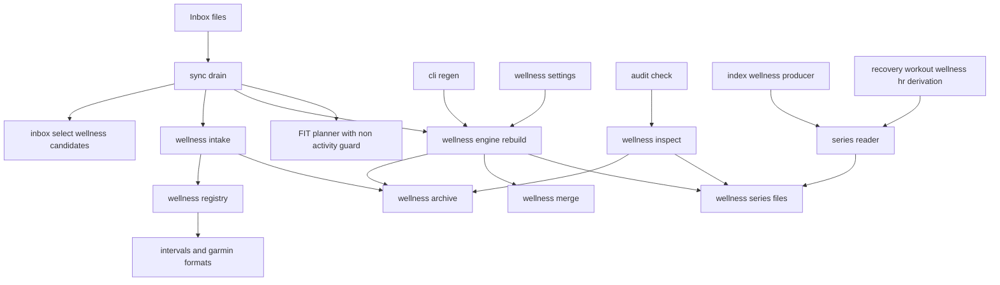
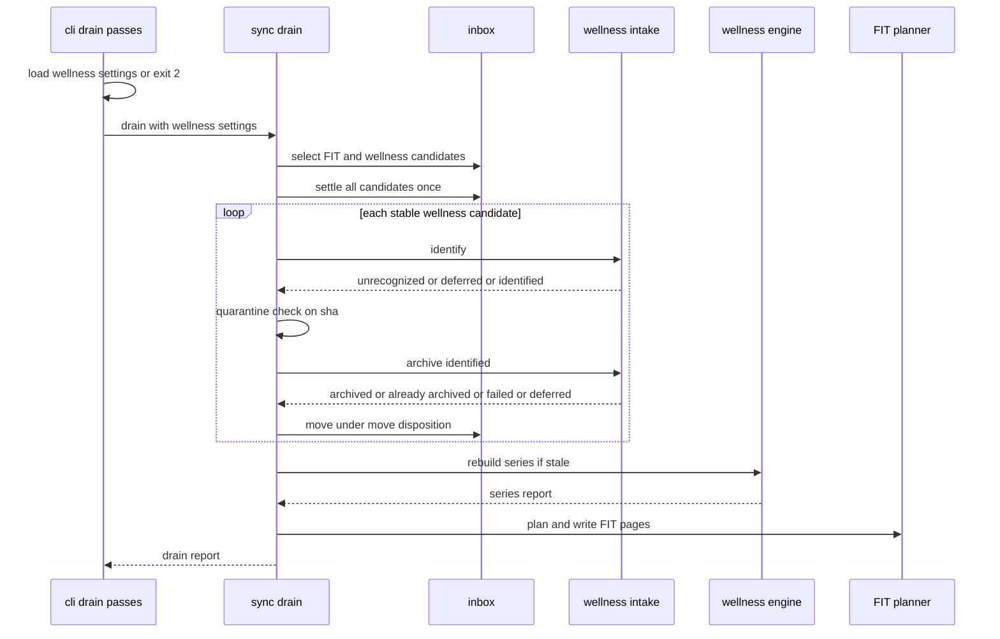
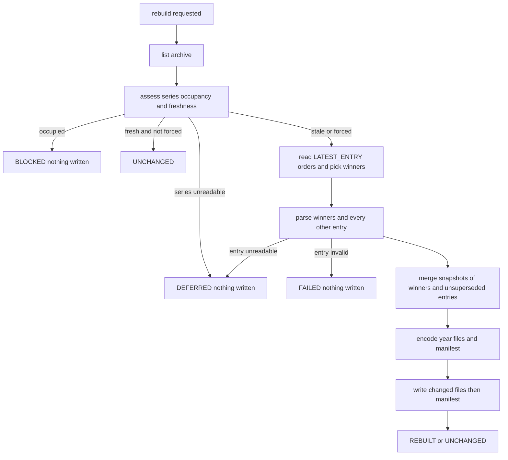

# Design Document — wellness-store

## Overview

**Purpose**: wellness-store gives fitdocs one place to keep daily wellness
(resting HR, HRV, sleep, weight, SpO2, VO2max, steps, stress, body battery,
subjective ratings) and one way to read it. Wellness files arrive in the
inbox, are recognized by a format registry, archived content-hashed in
`wellness-archive/`, parsed into per-day, per-metric, source-attributed
snapshots, and merged by a configurable per-metric source precedence into a
normalized daily series: yearly CSV files in `wellness/`. Every Phase 12
consumer reads that series through one reader; the analytics index exposes it
as `wellness_daily`.

**Users**: the athlete (drops exports, configures precedence, reads the
series in a spreadsheet), the athlete's agent (runs the drain and `check`),
and the downstream specs `wellness-pull`, `apple-health-import`,
`hr-derivation`, `recovery` and `workout-wellness`, which plug into or read
from the seams settled in [Seams for downstream specs](#seams-for-downstream-specs).

**Impact**: the drain learns non-FIT files; a FIT file that is not an
activity stops becoming an `undated-` page; two owned locations join the
ownership contract (`CONTRACT_VERSION` main + 1); the analytics index gains a
table (`SCHEMA_VERSION` main + 1); `check` gains four findings; the unit
vocabulary gains two units.

### Goals
- Recognize, archive and parse intervals.icu and Garmin-export wellness files
  dropped in (or delivered to) the inbox, with no network.
- One deterministic, diff-friendly, source-attributed daily series that is a
  function of the archive and `[wellness]` alone, rebuilt automatically.
- Settle every Phase 12 seam once: format registry, delivered-file contract,
  extract and supersession rules, metric vocabulary, day-boundary rule,
  precedence, series schema and reader, index table, owned locations.

### Non-Goals
- The Apple Health parser and extract (`apple-health-import`); the
  intervals.icu wellness pull (`wellness-pull`).
- Baselines, pages, charts, morning-of blocks, derived benchmarks.
- Garmin wellness FIT messages; a whole Garmin export zip; a generic wellness
  CSV; nutrition, blood pressure, glucose and menstrual data.
- A new CLI command, a parse cache, incremental merging.

## Boundary Commitments

### This Spec Owns
- The `fitdocs.wellness` package: the metric vocabulary, the day-boundary
  rule, the format and source registry, recognition, the archive layout and
  its commit protocol, the merge, the `[wellness]` settings, the series codec
  and reader, the rebuild engine and the read-only inspection used by `check`.
- The intervals.icu wellness format (both the API list and the fitdocs
  delivery envelope) and the four Garmin export formats.
- The `wellness-archive/` and `wellness/` owned locations: constants, path
  helpers, declarations, contract text, `CONTRACT_VERSION` main + 1.
- The drain's wellness step and its report channels; the `regen` rebuild and
  its report; the four `check` findings.
- The non-activity-FIT guard (fit-ingest `FileIdentity.file_type` and the
  planner's skip).
- The `wellness_daily` corpus producer and `SCHEMA_VERSION` main + 1.
- Two rows of `fitdocs.units.UNITS` (`ml_per_kg_min`, `brpm`).
- `docs/wellness.md`, the wellness parts of `docs/inbox.md`,
  `docs/configuration.md`, `docs/ownership-contract.md`, the workouts skill
  and the CHANGELOG.

### Out of Boundary
- How a connector fetches, names, delivers or sweeps wellness files
  (`wellness-pull`); this spec defines only the file it must deliver and the
  archive path it may check.
- The Apple Health recognizer, extract format, reducers and source
  de-duplication (`apple-health-import`); this spec defines the registry
  contract it implements.
- Any interpretation of the series: baselines, normal ranges, derived HR,
  rendering (`recovery`, `workout-wellness`, `hr-derivation`).
- The page and region contract of workout documents (`DOC_VERSION` is not
  touched).
- Parsing wellness from `.fit` files.

### Allowed Dependencies
- `fitdocs.wellness` imports only the standard library, `tomli_w`,
  `fitdocs.layout`, `fitdocs.settings` and `fitdocs.units`. It never imports
  `sync`, `inbox`, `audit`, `cli`, `index`, `query`, `render`, `ingest`,
  `model`, `connectors` or `duckdb`, and calls no clock.
- `fitdocs.sync` (drain), `fitdocs.audit` (check), `fitdocs.cli` and
  `fitdocs.index.derived.wellness` import `fitdocs.wellness`. Later consumers
  (`recovery`, `workout-wellness`, `hr-derivation`) import only the facade
  `fitdocs.wellness` and, for `SeriesReport`, `fitdocs.wellness.engine`.
- `fitdocs.inbox` stays independent of `fitdocs.wellness` (the drain passes it
  the suffix set).
- Inside the package the import order is one-way: `model` and `probe` (leaves)
  → `spec` → `formats/*` → `registry` → `settings`, `merge` and `archive`
  (mutually independent) → `series` → `intake`, `engine` → `inspect`; the
  facade re-exports from `model`, `series` and `settings`. No module imports
  one to its right. The boundary guard (`tests/wellness/test_boundary.py`)
  encodes this order as a rank table with **gapped ranks** (multiples of 10:
  `model`/`probe` 10, `spec` 20, `formats.*` 30, `registry` 40,
  `settings`/`merge`/`archive` 50, `series` 60, `intake`/`engine` 70,
  `inspect` 80, the facade 90); a module may import only strictly lower
  ranks. A downstream spec inserts its modules into the gaps (for example
  apple-health-import's `formats/apple/*` between 20 and 40) and never
  renumbers an existing rank.
- `fitdocs.connectors` never imports `fitdocs.wellness`; it reaches the
  archive only through `fitdocs.layout.wellness_archive_path`.

### Revalidation Triggers
- Any change to `Metric` names, units, valid ranges or zero-absent flags
  (consumers and the index read them).
- Any change to the series header, line order, value formatting or the
  manifest schema (`SERIES_VERSION`).
- Any change to the `FormatSpec`/`SourceSpec` contract, the recognition rule,
  the archive naming, or the extract/supersession rules (wellness-pull,
  apple-health-import).
- Any change to the intervals.icu delivery envelope (wellness-pull).
- Any change to the day-boundary rule or the default precedence
  (recovery, workout-wellness, hr-derivation).
- Any change to the `WellnessSeries` reader API or `SeriesReport.days`.
- The `wellness_daily` columns (dashboards over wellness, recovery's optional
  table).

## Architecture

### Existing Architecture Analysis
- **The drain** (`sync.drain`, `sync.py:739-1033`) selects `.fit` candidates
  (`inbox.select_candidates`, `inbox.py:563-597`), settles them once
  (`inbox.settle`, `inbox.py:667-721`), reads each whole (`sync.py:890`),
  partitions against the quarantine record, plans and writes pages, then
  moves archived candidates under the move disposition (`sync.py:988-998`).
  The default disposition is leave-in-place (`inbox.py:198-203`).
- **The folder connector** reuses `select_candidates` with
  `DEFAULT_INBOX_SETTINGS` (`connectors/folder.py:161-163`).
- **Owned locations** are `layout.OWNED_PATHS` (`layout.py:133-142`) and
  `layout.DECLARED_DIRS` (`layout.py:161-166`); `declaration_text`
  dispatches per directory over a fragment table (`declaration.py:444-485`);
  `ensure_declarations` creates a declared directory on demand. Contract
  version `"9"` (`contract.py:328`); `impl/dashboards` (not on main) takes
  `"10"` and appends `dashboards/`.
- **`check`** (`audit.audit`, `audit.py:542-622`) lists `fit-archive/*.fit`
  (`audit.py:503`) and never opens a source.
- **Ingest**: `parse_fit` (`ingest/__init__.py:41-142`) builds
  `FileIdentity` from the first `file_id` message without its `type`
  (`ingest/file_id.py:32-46`); the planner parses each new file once in
  preparation (`sync.py:1438-1449`).
- **Index**: corpus producers (`index/producer.py:108-117`) registered in
  `index/registry.py:22-26`; a failing producer is isolated and keeps its rows
  (`index/refresh.py:442-471`); `SCHEMA_VERSION = 2` (`index/schema.py:15`).
- **Units**: the single unit table `fitdocs.units.UNITS` (`units.py:41-61`).

### Architecture Pattern & Boundary Map



**Architecture Integration**:
- Selected pattern: a self-contained domain package (`fitdocs.wellness`)
  beside `history` and `plans`, with an append-only declarative registry
  (chart-kit `KINDS` precedent) and a pure core (model, merge, codec) wrapped
  by two I/O shells (`archive`/`intake` for writes into the archive,
  `engine` for the series).
- Domain boundaries: the drain owns inbox policy (selection, settle,
  quarantine, disposition, report); wellness owns what a wellness value is.
  The FIT pipeline is untouched except the guard.
- Existing patterns preserved: write-once archive with presence as the
  processed marker; the quarantine record; atomic temp-then-`os.replace`
  writes; foreign-occupant refusal; per-table settings readers over one
  parsed `fitdocs.toml`; append-only registries and owned-path tuples;
  corpus-producer isolation.
- Steering compliance: absent is `None`; no new runtime dependency; no
  network; deterministic bytes; personal data never in the repository.

### Technology Stack

| Layer | Choice / Version | Role in Feature | Notes |
|-------|------------------|-----------------|-------|
| CLI | typer + rich (existing) | drain/regen report rows, `check` findings | no new command |
| Parsing | stdlib `json`, `hashlib`, `zipfile` (probe only) | recognition, hashing, JSON formats | no new dependency |
| Storage | stdlib `csv`; `tomllib` + `tomli_w` (existing) | series CSV, manifest TOML | deterministic serialization |
| Index | duckdb (existing, via `index.store`) | `wellness_daily` table | the producer never imports duckdb |
| Runtime | Python 3.11+, mypy --strict | — | — |

## File Structure Plan

### Directory Structure
```
src/fitdocs/wellness/
├── __init__.py        # Facade: the reader API, metric vocabulary and settings consumers import
├── model.py           # Metric, MetricInfo, METRICS, accept_value, DaySnapshot, SeriesValue, is_origin,
│                      #   wellness_day_of_sleep_end (pure value types and rules)
├── spec.py            # SourceKind, SourceSpec, ArchiveForm, Supersession, FormatSpec, ExtractContext,
│                      #   WellnessFormatError, ParsedEntry (declaration and exchange types)
├── registry.py        # SOURCES, FORMATS (append-only), recognize, lookups, candidate_suffixes,
│                      #   default_source_order, validate_registry
├── probe.py           # CandidateProbe (bounded head, capped JSON, zip member list), hash_file
├── formats/
│   ├── __init__.py
│   ├── intervals.py   # INTERVALS_SOURCE, INTERVALS_FORMAT, the delivery envelope constants, FIELD_METRICS
│   └── garmin.py      # GARMIN_SOURCE, UDS/SLEEP/MAXMET/BIOMETRICS FormatSpecs
├── archive.py         # ArchiveEntry, ArchiveListing, Orphan, list_archive, entry_ref,
│                      #   commit_original, commit_extract, parse_entry
├── intake.py          # identify / archive_identified: per-candidate outcomes for the drain
├── settings.py        # WellnessSettings, load_wellness_settings, effective_order
├── merge.py           # Conflict, MergeResult, merge (pure)
├── series.py          # WellnessSeries, read_series, series_files, CSV and manifest codec,
│                      #   inputs_digest, SERIES_VERSION, SERIES_HEADER
├── engine.py          # SeriesStatus, SeriesReport, assess_series, rebuild_series (the only series writer)
└── inspect.py         # WellnessProblem, inspect_wellness (read-only, for check)

src/fitdocs/index/derived/wellness.py   # WELLNESS_DAILY_TABLE, WellnessProducer, WELLNESS_PRODUCER
docs/wellness.md                         # the wellness guide
tests/wellness/builders_series.py        # write_series: the one sanctioned way to stage a series without the drain
tests/wellness/                          # synthetic file builders + one test module per wellness module,
                                         #   test_boundary.py, test_drain_wellness.py, test_cli_wellness.py,
                                         #   test_docs_wellness.py
tests/index/derived/test_wellness_producer.py
tests/declaration_golden/wellness.AGENTS.md
tests/declaration_golden/wellness-archive.AGENTS.md
```

### Modified Files
- `src/fitdocs/layout.py` — `WELLNESS_ARCHIVE_DIR`, `WELLNESS_DIR`,
  `WELLNESS_MANIFEST_NAME`; appended to `OWNED_PATHS` and `DECLARED_DIRS`;
  pure helpers `wellness_archive_path`, `wellness_series_path`,
  `wellness_manifest_path`.
- `src/fitdocs/contract.py` — `CONTRACT_VERSION` main + 1 and its history
  paragraph.
- `src/fitdocs/declaration.py` — four fragments and two dispatch branches.
- `src/fitdocs/inbox.py` — `select_wellness_candidates`; a shared private
  walk; the `DEFAULT_IGNORE_PATTERNS` reachability docstring corrected.
- `src/fitdocs/sync.py` — the drain's wellness step, five `DrainReport`
  fields, the non-activity guard in `_run_planned`, docstrings (skipped
  causes, warning causes, partition).
- `src/fitdocs/model.py`, `src/fitdocs/ingest/file_id.py` —
  `FileIdentity.file_type`, `is_activity_file`.
- `src/fitdocs/audit.py` — four `FindingKind` members and the mapping of
  `inspect_wellness` problems; docstring's read list.
- `src/fitdocs/cli.py` — `[wellness]` preflight in the drain passes and
  `regen`, the `regen` rebuild call, the drain table rows, the series
  summary, the exit rule, the progress printer.
- `src/fitdocs/units.py` — two units appended.
- `src/fitdocs/index/schema.py` (`SCHEMA_VERSION`), `src/fitdocs/index/registry.py`
  (append `WELLNESS_PRODUCER`).
- `docs/ownership-contract.md`, `docs/index.md`, `docs/inbox.md`,
  `docs/configuration.md`, `docs/plugins.md`, `docs/analytics.md`
  (regenerated block), `CHANGELOG.md`, `pyproject.toml` (`[project.urls]`
  Wellness; mypy test-module list), `src/fitdocs/skills/fitdocs-workouts/SKILL.md`.
- `.kiro/steering/structure.md` (the wellness package's dependency rule;
  `index.derived` imports `wellness`), `.kiro/steering/tech.md` (pipeline
  line).
- Spec amendments appended to `.kiro/specs/{inbox,wiki-contract,fit-ingest,analytics-index,analytics-derived,chart-kit}/requirements.md`
  (see [Existing Spec Amendments](#existing-spec-amendments)).
- Tests re-pinned (append-only where the pin is a list): `tests/test_layout.py`,
  `tests/test_declaration.py`, `tests/test_declaration_goldens.py`, the four
  (five with dashboards) existing goldens, `tests/test_ownership_contract.py`,
  `tests/identity/test_contract_docs.py`, `tests/index/test_contract_docs.py`,
  `tests/index/derived/test_preserved.py`, `tests/test_units.py`,
  `tests/test_cli_drain_report.py`, `tests/test_agent_skill.py`,
  `tests/test_confinement.py`, `tests/index/test_schema_version.py`,
  `tests/index/derived/test_registration.py`,
  `tests/index/derived/test_boundary.py`, `tests/test_inbox.py`,
  `tests/test_sync.py`, `tests/ingest/test_file_id.py`, `tests/test_audit.py`,
  `tests/connectors/test_folder.py`, `tests/connectors/test_network_statements.py`
  (structure.md phrase pin, if the index bullet's wording moves).

## System Flows

### The drain with wellness



Key decisions: wellness is archived and the series rebuilt **before** pages
are rendered, so a page rendered in the same drain reads the day's wellness
(12.2). Wellness candidates share the FIT candidates' single settle interval
(1.2) and the quarantine record (2.6). The FIT loop is unchanged.

### The rebuild



All failures leave every series file as it was (11.6, 12.4-12.6). The
manifest is written last; a crash after a year file and before the manifest
leaves a series whose hashes disagree with the manifest, which the next
assessment reports as stale and the next drain repairs.

## Requirements Traceability

| Requirement | Summary | Components | Interfaces | Flows |
|-------------|---------|------------|------------|-------|
| 1.1, 1.6, 1.8 | Wellness candidates by registered suffix; others ignored; folder connector unchanged | InboxSelector, Registry | `select_wellness_candidates`, `candidate_suffixes` | Drain |
| 1.2 | One settle interval for all | DrainWellnessStep | `inbox.settle` | Drain |
| 1.3, 1.4, 1.5 | Recognition by content (and name pattern); unrecognized and ambiguous reported | Registry, Probe, Intake | `recognize`, `CandidateProbe`, `identify` | Drain |
| 1.7 | One channel per candidate | DrainWellnessStep, DrainReport | `DrainReport` fields | Drain |
| 1.9 | Explicit-source sync stays FIT-only | DrainWellnessStep | `sync.sync` unchanged | — |
| 2.1 | Owned archive location | OwnedLocations | `WELLNESS_ARCHIVE_DIR` | — |
| 2.2, 2.3 | Entry named by original sha, per format; original or extract | Archive | `entry_ref`, `commit_original`, `commit_extract` | Drain |
| 2.4 | Write-once after full read and parse | Archive | commit protocol | Drain |
| 2.5 | Already archived | Intake | `archive_identified` | Drain |
| 2.6, 2.7 | Failure, quarantine, retry | DrainWellnessStep | quarantine record | Drain |
| 2.8 | Changed during run, also when the change made the content fail | Archive | `Changed` result; re-hash before classifying | Drain |
| 2.9, 2.10 | Disposition; never delete | DrainWellnessStep | `inbox.move_processed` | Drain |
| 3.1, 3.2, 3.3 | Streaming hash/copy, bounded recognition | Probe, Archive | `hash_file`, `HEAD_BYTES`, `JSON_PROBE_LIMIT` | Drain |
| 3.4 | Progress | Registry, DrainWellnessStep, CliWellness | `ExtractContext.progress` | Drain |
| 4.1 | Read file type | FitIngestFileType | `FileIdentity.file_type` | — |
| 4.2, 4.3, 4.4, 4.6 | Skip, warn, leave; activity/untyped processed; no failure, no quarantine | NonActivityGuard | `is_activity_file`, `_run_planned` | Drain |
| 4.5 | Existing pages kept and rebuilt by regen | NonActivityGuard | `regen` page part unchanged | — |
| 5.1, 5.2, 5.3, 5.4 | Metric vocabulary, SDNN/rMSSD distinct, ratings as recorded | Model | `Metric`, `METRICS` | — |
| 5.5 | Labels, units and definitions documented | Docs, Model | `MetricInfo.label`, `MetricInfo.description` | — |
| 5.6 | No computed fields imported | IntervalsFormat, GarminFormats | field maps | — |
| 6.1, 6.5 | Absent = no row, reader returns None | Series, Model | `WellnessSeries.value/canonical` | — |
| 6.2, 6.3, 6.4 | Placeholders, zero-absent, range | Model, formats | `accept_value` | — |
| 7.1, 7.2, 7.3, 7.5 | Wellness day, wake date, 18:00 rule, recorded offset | Model | `wellness_day_of_sleep_end` | — |
| 7.4 | Source dates kept and documented | formats, Docs | — | — |
| 7.6 | Rule published once | Docs | `docs/wellness.md` | — |
| 8.1, 8.2 | Source and origin per value; all sources kept | Merge, Series | `SeriesValue` | Rebuild |
| 8.3, 8.4 | intervals origins; Garmin origin | IntervalsFormat, GarminFormats | envelope `origins` | — |
| 9.1, 9.2, 9.5 | Latest revision wins; later absence; equal values no conflict | Merge | `merge` | Rebuild |
| 9.3 | Latest-entry supersession; only the winner parsed | Engine, Archive, Merge, Registry | `read_entry_order`, `Supersession.LATEST_ENTRY` | Rebuild |
| 9.4 | Conflicting duplicate | Merge, Series, Inspect | `Conflict`, manifest | Rebuild |
| 10.1, 10.2 | Canonical by precedence; default by kind | Merge, Registry, Settings | `effective_order`, `default_source_order` | Rebuild |
| 10.3, 10.4, 10.5 | `[wellness]` keys and validation | Settings, CliWellness | `load_wellness_settings` | Drain |
| 10.6 | Precedence change rebuilds | Series, Engine | `inputs_digest` | Rebuild |
| 11.1 | `wellness/` owned; per-year files + manifest | OwnedLocations, Engine | `wellness_series_path` | Rebuild |
| 11.2, 11.3, 11.4 | Plain CSV, order, deterministic, no run data | Series | CSV codec | Rebuild |
| 11.5 | Atomic, unchanged untouched, empty years removed | Engine | `rebuild_series` | Rebuild |
| 11.6 | Occupied locations refused | Engine | `assess_series` | Rebuild |
| 11.7 | Declarations | Declarations | `declaration_text` | — |
| 11.8 | One reader | Series, Facade | `read_series`, `WellnessSeries` | — |
| 12.1 | Function of archive and settings | Engine, Series | `inputs_digest` | Rebuild |
| 12.2 | Drain rebuilds before pages | DrainWellnessStep | `rebuild_series(force=False)` | Drain |
| 12.3 | regen rebuilds first | CliWellness | `rebuild_series(force=True)` | — |
| 12.4, 12.5, 12.6 | Unreadable deferred; invalid fails; unreadable series deferred | Engine | `SeriesStatus` | Rebuild |
| 12.7 | Manifest lists entries and superseded | Series, Engine | manifest `entries` | Rebuild |
| 12.8 | Explicit sync never touches wellness | DrainWellnessStep | `sync.sync` | — |
| 13.1 | Drain rows | CliWellness | `_report_drain` | — |
| 13.2, 13.3, 13.4 | Series summary | CliWellness, Engine | `SeriesReport` | — |
| 13.5 | Exit rule | CliWellness | `_run_drain_passes`, `regen_command` | — |
| 13.6 | Idempotent second drain | Engine, Intake | freshness gate | Drain |
| 14.1, 14.2, 14.3, 14.4 | Four findings | Inspect, AuditWellness | `inspect_wellness`, `FindingKind` | — |
| 14.5 | check read-only, opens no entry | Inspect | listing only | — |
| 14.6 | Declaration findings | Declarations, audit | `inspect_declarations` | — |
| 15.1, 15.2, 15.3 | intervals list and envelope recognition | IntervalsFormat | `DELIVERY_FORMAT`, `DELIVERY_VERSION` | — |
| 15.4, 15.5 | Field mapping; ignored fields | IntervalsFormat | `FIELD_METRICS` | — |
| 15.6 | Original bytes | IntervalsFormat | `ArchiveForm.ORIGINAL` | — |
| 15.7 | Delivery contract documented | Docs, Seams | this design § Seams | — |
| 16.1 | Four Garmin kinds by content and name | GarminFormats | name patterns | — |
| 16.2, 16.3, 16.4, 16.5, 16.6 | Garmin mappings and sentinels | GarminFormats, Model | parsers | — |
| 16.7, 16.8 | Original bytes; no zip, no FIT wellness | GarminFormats | — | — |
| 17.1, 17.4, 17.5 | Added formats reuse everything; rules version; new metric no structure change | Registry, Series, IndexProducer | `FormatSpec.rules_version` | — |
| 17.2 | Extract protocol | Archive | `commit_extract` | Drain |
| 17.3 | Supersession order; superseded entries read for their order only | Engine, Archive | `entry_order`, `read_entry_order` | Rebuild |
| 18.1, 18.2, 18.3 | `wellness_daily` table, refresh, isolation | IndexProducer | `WellnessProducer` | — |
| 18.4 | Schema version, docs block | IndexProducer, Docs | `SCHEMA_VERSION` | — |
| 18.5 | Documents never read the index | IndexProducer | unchanged rule | — |
| 19.1 | Contract | OwnedLocations, Docs | `CONTRACT_VERSION` | — |
| 19.2, 19.3, 19.4, 19.5, 19.6 | Docs, skill, release notes | Docs | — | — |
| 20.1, 20.2, 20.3, 20.4, 20.5 | Offline, no dependency, deterministic, confined, no personal data | all; WellnessBoundaryGuard | boundary and confinement tests | — |

## Components and Interfaces

### Summary

| Component | Domain/Layer | Intent | Req Coverage | Key Dependencies | Contracts |
|-----------|--------------|--------|--------------|------------------|-----------|
| Model | wellness core | Metric vocabulary, absent rules, snapshot, day rule | 5, 6, 7 | units (P0) | Service, State |
| Registry | wellness core | Sources, formats, recognition, lookups | 1.3-1.6, 9.3, 10.2, 17 | Model, Probe (P0) | Service |
| Probe | wellness I/O | Bounded recognition input, streamed hashing | 1.3, 3.1-3.3 | — | Service |
| IntervalsFormat | wellness formats | intervals.icu list and envelope | 5.6, 8.3, 15 | Registry, Model (P0) | Service |
| GarminFormats | wellness formats | Four Garmin export kinds | 5.6, 8.4, 16 | Registry, Model (P0) | Service |
| Archive | wellness I/O | Layout, listing, commit protocol, entry parsing, header-only order read | 2.2-2.5, 2.8, 3.1, 3.3, 17.2, 17.3 | Registry, layout (P0) | Service, State |
| Intake | wellness I/O | Per-candidate outcomes for the drain | 1.3-1.5, 2.5-2.8 | Archive, Registry, Probe (P0) | Service |
| Settings | wellness core | `[wellness]` reader, effective order | 10.2-10.6 | Registry, settings (P0) | Service |
| Merge | wellness core | Snapshot resolution, conflicts, precedence | 8.1, 8.2, 9, 10.1 | Model (P0) | Service |
| Series | wellness core | CSV/manifest codec, reader, inputs digest | 6.1, 11.2-11.4, 11.8, 12.1, 12.7 | Model, layout (P0) | Service, State |
| Engine | wellness I/O | The only series writer; chooses LATEST_ENTRY winners before parsing | 9.3, 11.1, 11.5, 11.6, 12.1-12.6, 13.2-13.4, 17.3 | Archive, Merge, Series, Settings (P0) | Batch, State |
| Inspect | wellness I/O | Read-only problems for check | 14 | Archive, Series, Settings (P0) | Service |
| Facade | wellness API | What consumers import | 11.8 | Series, Model, Settings | Service |
| OwnedLocations | layout/contract/declaration | Constants, helpers, declarations, version | 2.1, 11.1, 11.7, 19.1 | — | State |
| InboxSelector | inbox | Wellness candidate selection | 1.1, 1.6, 1.8 | — | Service |
| DrainWellnessStep | sync | Drain orchestration and report fields | 1.2, 1.7, 1.9, 2.6, 2.7, 2.9, 2.10, 12.2, 12.8 | Intake, Engine (P0) | Batch |
| FitIngestFileType | ingest/model | `FileIdentity.file_type`, `is_activity_file` | 4.1, 4.4 | — | Service |
| NonActivityGuard | sync | Planner skip and warning | 4.2-4.6 | FitIngestFileType (P0) | Service |
| AuditWellness | audit | Four findings | 14 | Inspect (P0) | Service |
| CliWellness | cli | Preflight, regen call, report, exit, progress | 3.4, 10.5, 12.3, 13 | Engine, Settings (P0) | Service |
| IndexProducer | index.derived | `wellness_daily` | 18 | Facade (P0) | Batch |
| UnitsAmendment | units | `ml_per_kg_min`, `brpm` | 5.1 | — | State |
| Docs | docs/skill/changelog | User-facing text | 5.5, 7.4, 7.6, 15.7, 19 | — | — |
| WellnessBoundaryGuard | tests | Import, clock and network rules | 20.1, 20.2 | — | — |

### Wellness Core

#### Model (`src/fitdocs/wellness/model.py`)

| Field | Detail |
|-------|--------|
| Intent | The metric vocabulary, the absent-value rules, the day snapshot and the day-boundary rule |
| Requirements | 5.1, 5.2, 5.3, 5.4, 6.2, 6.3, 6.4, 7.1, 7.2, 7.3, 7.5 |

**Responsibilities & Constraints**
- `Metric` is a `StrEnum` whose values are the canonical names (table in
  [Data Models](#the-metric-vocabulary)); `METRICS: Final[Mapping[Metric, MetricInfo]]`
  covers every member exactly once. `MetricInfo.label` is the metric's short
  human label (the Label column); labels are pairwise distinct, and every
  consumer that shows a metric to the athlete (recovery's page,
  workout-wellness's block, docs) uses it and holds no label table of its
  own. Unit tokens come from `fitdocs.units`
  (`unit_named(token)` must resolve); unitless metrics have `unit=None`.
- `accept_value(metric, value)` returns `None` for a non-finite value or a
  value outside `[minimum, maximum]` (so zero is absent for every metric whose
  minimum is above zero, `MetricInfo.zero_is_absent`); otherwise the value as
  `float`. It is the single absent-value rule every parser calls.
- `DaySnapshot` is the parsed record unit (see Data Models). Invariants
  checked by `archive.parse_entry`: `values.keys() <= covers`,
  `origins.keys() <= values.keys()`, every origin `is_origin`, every value
  equals `accept_value(metric, value)`.
- `wellness_day_of_sleep_end(end)` takes a timezone-aware `datetime` carrying
  the recorded UTC offset and returns `(end + timedelta(hours=6)).date()`
  computed in that offset; a naive datetime raises `ValueError`. No machine
  timezone is consulted.

```python
class Metric(StrEnum):
    RESTING_HR_BPM = "resting_hr_bpm"
    # ... 28 members, see Data Models

@dataclass(frozen=True)
class MetricInfo:
    metric: Metric
    label: str                    # short human label (recovery headings, workout-wellness block); unique
    unit: str | None              # fitdocs.units token, or None
    minimum: float                # inclusive
    maximum: float                # inclusive
    description: str              # one sentence, used by docs and the index

    @property
    def zero_is_absent(self) -> bool: ...   # minimum > 0

METRICS: Final[Mapping[Metric, MetricInfo]]

def accept_value(metric: Metric, value: float) -> float | None: ...

@dataclass(frozen=True)
class DaySnapshot:
    day: date
    covers: frozenset[Metric]
    values: Mapping[Metric, float]
    origins: Mapping[Metric, str]
    revision: str | None
    ordinal: int                   # position in its entry's parse order

@dataclass(frozen=True, order=True)
class SeriesValue:                          # one line of the series
    day: date
    metric: Metric
    source: str
    origin: str | None
    value: float
    canonical: bool

ORIGIN_PATTERN: Final[re.Pattern[str]]   # [a-z0-9]+(-[a-z0-9]+)*
def is_origin(token: str) -> bool: ...
def wellness_day_of_sleep_end(end: datetime) -> date: ...
```

#### Registry (`src/fitdocs/wellness/spec.py`, `src/fitdocs/wellness/registry.py`)

| Field | Detail |
|-------|--------|
| Intent | Declares sources and formats; recognizes a candidate; validates the declarations |
| Requirements | 1.3, 1.4, 1.5, 1.6, 9.3, 10.2, 17.1, 17.3, 17.4 |

**Responsibilities & Constraints**
- The declaration types live in `spec.py`, which format modules import; the
  tuples and functions live in `registry.py`, which imports the format
  modules (chart-kit's `schema.py`/`registry.py` split), so there is no import
  cycle.
- `SOURCES` and `FORMATS` are append-only `Final` tuples assembled from the
  format modules (`intervals.SOURCE`, `garmin.SOURCE`; `intervals.FORMAT`,
  `garmin.UDS_FORMAT`, `garmin.SLEEP_FORMAT`, `garmin.MAXMET_FORMAT`,
  `garmin.BIOMETRICS_FORMAT`). Every function reads them at call time.
- `recognize(probe)` asks every format whose `suffixes` contain the probe's
  suffix; exactly one claim → that format; none → `Unrecognized` with reason
  "no supported wellness format reads this file"; several → `Unrecognized`
  naming every claimant. A recognizer that raises counts as no claim.
- No registry function caches: each reads `SOURCES`/`FORMATS` at call time,
  so a test that patches the tuples sees its own formats everywhere.
- `validate_registry()` (called by tests on the real registry and on test
  formats; nothing calls it at runtime): ids match `[a-z0-9]+(-[a-z0-9]+)*` and are unique among
  sources and among formats; every format's source is in `SOURCES`;
  suffixes are lowercase, start with `.`, are not `.fit`; `ORIGINAL` ⇒
  `archived_suffix in suffixes` and `extract is None`; `EXTRACT` ⇒ `extract`
  set; `LATEST_ENTRY` ⇒ `entry_order` set; `rules_version >= 1`; formats of
  one source declare pairwise disjoint `metrics`.
- `default_source_order()` sorts `SOURCES` by `(kind rank, id)` with
  `DEVICE < HUB < RELAY`.

```python
class SourceKind(StrEnum):
    DEVICE = "device"   # a device platform's own export
    HUB = "hub"         # a phone health store other apps write into
    RELAY = "relay"     # a third-party aggregator relaying other platforms

@dataclass(frozen=True)
class SourceSpec:
    id: str
    display_name: str
    kind: SourceKind

class ArchiveForm(StrEnum):
    ORIGINAL = "original"
    EXTRACT = "extract"

class Supersession(StrEnum):
    NONE = "none"
    LATEST_ENTRY = "latest-entry"

class WellnessFormatError(Exception):
    """The bytes are not a valid instance of the format (source-level)."""

@dataclass(frozen=True)
class ExtractContext:
    expected_sha256: str
    size: int
    progress: Callable[[int, int], None] | None   # (bytes read, total bytes)

@dataclass(frozen=True)
class FormatSpec:
    id: str
    display_name: str
    source: SourceSpec
    suffixes: frozenset[str]
    archive_form: ArchiveForm
    archived_suffix: str
    rules_version: int
    metrics: frozenset[Metric]
    recognize: Callable[[CandidateProbe], bool]
    parse: Callable[[BinaryIO], Iterator[DaySnapshot]]
    supersession: Supersession = Supersession.NONE
    extract: Callable[[Path, BinaryIO, ExtractContext], None] | None = None
    entry_order: Callable[[BinaryIO], str] | None = None

SOURCES: Final[tuple[SourceSpec, ...]]
FORMATS: Final[tuple[FormatSpec, ...]]

@dataclass(frozen=True)
class Recognized:
    format: FormatSpec

@dataclass(frozen=True)
class NotRecognized:
    reason: str

def recognize(probe: CandidateProbe) -> Recognized | NotRecognized: ...
def format_named(format_id: str) -> FormatSpec | None: ...
def source_named(source_id: str) -> SourceSpec | None: ...
def candidate_suffixes() -> frozenset[str]: ...
def default_source_order() -> tuple[str, ...]: ...
def validate_registry() -> None: ...   # raises ValueError naming the offending declaration
```

#### Probe (`src/fitdocs/wellness/probe.py`)

| Field | Detail |
|-------|--------|
| Intent | Bounded recognition input and streamed hashing |
| Requirements | 1.3, 3.1, 3.2, 3.3 |

- `HEAD_BYTES = 65_536`; `JSON_PROBE_LIMIT = 64 * 1024 * 1024`;
  `CHUNK_BYTES = 1_048_576`.
- `CandidateProbe.open(path)` reads `stat` and the first `HEAD_BYTES`;
  `json()` parses the whole file only when `size <= JSON_PROBE_LIMIT`, caches
  the result, and returns `None` on a decode error or an oversize file;
  `zip_members()` returns the member names of a zip (central directory only)
  or `None`. It goes through `zipfile.ZipFile`, whose reads are not all ours:
  the end-of-central-directory read is an **unsized** `read()` on Python 3.11
  (3.12+ pass a size), starting at or after `size − (1 << 16) −
  zipfile.sizeEndCentDir` (within 65,558 bytes of EOF; measured on 3.11.15,
  where the commented-zip fallback starts exactly 65,558 bytes from EOF), and
  the central directory is read in **one** sized read of the length the end
  record declares (measured 1,940,000 bytes for 20,000 members, above
  `CHUNK_BYTES`; 3.11 and 3.13 alike). A zip candidate is therefore read
  within bounds set by its own structure: the end record (at most 65,558
  bytes, read once), the central directory (exactly the size the end record
  declares, read once), and member data, which an extractor streams in
  requests of at most `CHUNK_BYTES` (`ZipExtFile` then reads the file in
  pieces no larger than the request; measured on 3.11 and 3.13). **Memory
  bound**: recognizing or extracting a zip holds at most its central
  directory (about 100 bytes per member) plus 65,558 bytes plus one
  `CHUNK_BYTES` buffer at a time, independent of the size of its member data.
  Every read error propagates as `OSError` (the intake maps it to
  deferral).
- `hash_file(path)` streams `CHUNK_BYTES` at a time and returns
  `(sha256 hex, size)`.

```python
class CandidateProbe:
    path: Path
    name: str          # basename
    suffix: str        # lowercased
    size: int
    head: bytes
    @classmethod
    def open(cls, path: Path) -> CandidateProbe: ...
    def json(self) -> object | None: ...
    def zip_members(self) -> tuple[str, ...] | None: ...

def hash_file(path: Path) -> tuple[str, int]: ...
```

#### Settings (`src/fitdocs/wellness/settings.py`)

| Field | Detail |
|-------|--------|
| Intent | The `[wellness]` table reader and the effective per-metric order |
| Requirements | 10.2, 10.3, 10.4, 10.5, 10.6 |

- Follows the per-table reader contract (`identity/settings.py`): reads the
  already-parsed settings mapping, never the file; absent table or key →
  default; unknown keys ignored.
- `precedence`: list of distinct known source ids. `metric_precedence`: a
  table mapping known metric names to lists of distinct known source ids.
  Any other shape raises `WellnessSettingsError(SettingsError)` naming
  `fitdocs.toml` and the key (for example `[wellness] precedence[2]`).
- `effective_order(settings, metric)` = the metric's list if configured, else
  `precedence`, followed by every remaining source of `default_source_order()`
  not yet named.

```python
@dataclass(frozen=True)
class WellnessSettings:
    precedence: tuple[str, ...]
    metric_precedence: Mapping[Metric, tuple[str, ...]]

DEFAULT_WELLNESS_SETTINGS: Final[WellnessSettings]
WELLNESS_TABLE: Final[str] = "wellness"

class WellnessSettingsError(SettingsError): ...

def load_wellness_settings(document: Mapping[str, object], *, data_root: Path) -> WellnessSettings: ...
def effective_order(settings: WellnessSettings, metric: Metric) -> tuple[str, ...]: ...
```

#### Merge (`src/fitdocs/wellness/merge.py`)

| Field | Detail |
|-------|--------|
| Intent | Pure resolution of parsed entries into series values and conflicts |
| Requirements | 8.1, 8.2, 9.1, 9.2, 9.3, 9.4, 9.5, 10.1 |

**Algorithm (normative)**
1. **Precondition (supersession is the engine's).** For a format with
   `LATEST_ENTRY` the engine passes only that format's winning entry (see §
   Engine: superseded entries are never parsed); `merge` raises
   `ValueError` if it receives two entries of one `LATEST_ENTRY` format.
2. **Within-source resolution.** Group contributing snapshots by
   `(source, day, metric)` for each metric in `covers`. Let `R` be the
   greatest revision (`None` below every string). Among snapshots with
   revision `R`, collect the present values:
   - none → no value (9.2);
   - one distinct value → that value; origin from the snapshot with the
     greatest `(entry_ref, ordinal)` holding it (9.1, 9.5);
   - several distinct values → keep the value of the snapshot with the
     greatest `(entry_ref, ordinal)`; emit a `Conflict` (9.4).
3. **Precedence.** For each `(day, metric)`, the value whose source comes
   first in `order_for(metric)` is canonical (10.1). Every value is kept
   (8.2).
4. Output values sorted by `(day, metric value, source)`; conflicts sorted by
   `(day, metric, source)`.

```python
# ParsedEntry (spec.py), produced by archive.parse_entry and consumed here:
@dataclass(frozen=True)
class ParsedEntry:
    entry_ref: str
    format_id: str
    source_id: str
    supersession: Supersession
    snapshots: tuple[DaySnapshot, ...]

@dataclass(frozen=True)
class Conflict:
    day: date
    metric: Metric
    source: str
    kept_entry: str
    kept_value: float
    others: tuple[tuple[str, float], ...]   # (entry_ref, value), sorted

@dataclass(frozen=True)
class MergeResult:
    values: tuple[SeriesValue, ...]
    conflicts: tuple[Conflict, ...]

def merge(entries: Sequence[ParsedEntry], *, order_for: Callable[[Metric], tuple[str, ...]]) -> MergeResult: ...
```

#### Series (`src/fitdocs/wellness/series.py`)

| Field | Detail |
|-------|--------|
| Intent | The series codec, the reader every consumer uses, and the inputs digest |
| Requirements | 6.1, 6.5, 8.1, 11.2, 11.3, 11.4, 11.8, 12.1, 12.7 |

**Responsibilities & Constraints**
- `SERIES_VERSION = 1`; `SERIES_HEADER = "day,metric,source,origin,value,canonical"`.
- `encode_year(values) -> bytes`: UTF-8, `\n` line endings, header line, one
  line per value in `(day, metric, source)` order, no quoting (every field is
  a token or number), `origin` empty when `None`, `canonical` `true`/`false`,
  value via `format_value`: an integral float below 2**53 as an integer,
  otherwise `repr(float)`.
- `decode_year(path, data) -> tuple[SeriesValue, ...]` is the strict inverse;
  any deviation raises `SeriesReadError(path, line, reason)`.
- `Manifest` encode/decode (schema in Data Models); `generator` must be
  `"fitdocs"`; a `series_version` above `SERIES_VERSION` decodes as
  `NewerSeries`.
- `inputs_digest(listing, settings)`: SHA-256 of the canonical JSON of
  `{"series_version", "formats": [[id, rules_version]...], "entries": [refs...],
  "precedence": {metric: effective_order...}}`, all sorted (12.1, 10.6, 17.4).
- `read_series(data_root)` reads the manifest and exactly the year files it
  lists; no manifest → an empty `WellnessSeries`; an unreadable or invalid
  manifest or listed file → `SeriesReadError`. It never reads the archive and
  never writes.
- `series_files(data_root)` returns the manifest path followed by the listed
  year-file paths that exist, for fingerprinting; `()` without a manifest.

```python
# SeriesValue is defined in model.py and re-exported here and by the facade.

class SeriesReadError(Exception):
    path: str
    reason: str

@dataclass(frozen=True)
class WellnessSeries:
    values: tuple[SeriesValue, ...]          # sorted (day, metric, source)
    def is_empty(self) -> bool: ...
    def days(self) -> tuple[date, ...]: ...
    def for_day(self, day: date) -> tuple[SeriesValue, ...]: ...
    def canonical(self, metric: Metric, day: date) -> SeriesValue | None: ...
    def value(self, metric: Metric, day: date, source: str) -> SeriesValue | None: ...
    def sources(self, metric: Metric) -> tuple[str, ...]: ...
    def by_source(self, metric: Metric, source: str) -> tuple[SeriesValue, ...]: ...
    def canonical_series(self, metric: Metric) -> tuple[SeriesValue, ...]: ...
    def day_digest(self, day: date) -> str: ...   # SHA-256 of the day's encoded lines

def read_series(data_root: Path) -> WellnessSeries: ...
def series_files(data_root: Path) -> tuple[Path, ...]: ...
def inputs_digest(listing: ArchiveListing, settings: WellnessSettings) -> str: ...
```

### Wellness Formats

#### IntervalsFormat (`src/fitdocs/wellness/formats/intervals.py`)

| Field | Detail |
|-------|--------|
| Intent | intervals.icu wellness records, as the API list or the fitdocs delivery envelope |
| Requirements | 5.6, 8.3, 15.1, 15.2, 15.3, 15.4, 15.5, 15.6 |

- `SOURCE = SourceSpec("intervals-icu", "intervals.icu", SourceKind.RELAY)`.
- `FORMAT`: id `intervals-icu`, suffixes `{".json"}`, `ORIGINAL`, archived
  suffix `.json`, `rules_version = 1`, metrics = the 17 values of
  `FIELD_METRICS`.
- **Recognition**: `probe.json()` is either
  (a) a non-empty list of objects, each with a string `id` matching
  `^\d{4}-\d{2}-\d{2}$`, at least one carrying `updated` or a key of
  `FIELD_METRICS`; or
  (b) an object whose `format` equals `DELIVERY_FORMAT` and whose `version`
  equals `DELIVERY_VERSION`. An object whose `format` equals
  `DELIVERY_FORMAT` with another `version` is not claimed; the intake reports
  it as unrecognized with the reason "written by a newer fitdocs (delivery
  version N)" (15.3).
- **Parsing**: each record → one `DaySnapshot` with `day = date(id)`,
  `covers = all 17 metrics`, values through `accept_value`, `revision` = the
  `updated` instant normalized to UTC
  `YYYY-MM-DDTHH:MM:SS.ffffffZ` (`None` when absent or unparseable), origins
  from the envelope's `origins` (field → token) for present values. A mapped
  field holding a non-number (a bool counts as a non-number) other than
  `null`, an invalid `id`, a duplicate `id` within one file, or an invalid
  origin token raises `WellnessFormatError`.
- Every other field is ignored, including `ctl`, `atl`, `rampRate`,
  `ctlLoad`, `atlLoad`, `sportInfo`, `sleepScore`, `readiness` (5.6, 15.5).

```python
DELIVERY_FORMAT: Final[str] = "fitdocs.intervals-icu-wellness"
DELIVERY_VERSION: Final[int] = 1
FIELD_METRICS: Final[Mapping[str, Metric]] = {
    "restingHR": Metric.RESTING_HR_BPM, "hrv": Metric.HRV_RMSSD_MS,
    "hrvSDNN": Metric.HRV_SDNN_MS, "sleepSecs": Metric.SLEEP_S,
    "avgSleepingHR": Metric.SLEEP_HR_BPM, "respiration": Metric.RESPIRATION_BRPM,
    "spO2": Metric.SPO2_PCT, "steps": Metric.STEPS,
    "vo2max": Metric.VO2MAX_ML_PER_KG_MIN, "weight": Metric.WEIGHT_KG,
    "fatigue": Metric.FATIGUE_RATING, "mood": Metric.MOOD_RATING,
    "motivation": Metric.MOTIVATION_RATING, "soreness": Metric.SORENESS_RATING,
    "stress": Metric.STRESS_RATING, "injury": Metric.INJURY_RATING,
    "hydration": Metric.HYDRATION_RATING,
}
SOURCE: Final[SourceSpec]
FORMAT: Final[FormatSpec]
```

#### GarminFormats (`src/fitdocs/wellness/formats/garmin.py`)

| Field | Detail |
|-------|--------|
| Intent | Garmin "Export Your Data" daily summaries, sleep, VO2max and body metrics, each as one JSON file |
| Requirements | 5.6, 6.2, 6.3, 8.4, 16.1, 16.2, 16.3, 16.4, 16.5, 16.6, 16.7, 16.8 |

- `SOURCE = SourceSpec("garmin-export", "Garmin export", SourceKind.DEVICE)`;
  every value's origin is `"garmin"`. All four formats: suffixes
  `{".json"}`, `ORIGINAL`, archived suffix `.json`, `rules_version = 1`,
  `Supersession.NONE`.
- **Recognition** (top level must be a JSON list of objects): a non-empty list
  is claimed when every element is an object with the kind's date key and at
  least one element carries the kind's signature key; an empty list is
  claimed only when the file name matches the kind's pattern
  (case-insensitive).

| Format id | Date key | Signature key | Name pattern | Covers | Revision |
|-----------|----------|---------------|--------------|--------|----------|
| `garmin-uds` | `calendarDate` | `includesWellnessData` | `^UDSFile_.*\.json$` | resting, min, max HR; steps; stress level; SpO2; body battery highest/lowest | none |
| `garmin-sleep` | `calendarDate` | `sleepStartTimestampGMT` | `^.*_sleepData\.json$` | sleep total, deep, light, REM, awake; respiration | none |
| `garmin-maxmet` | `calendarDate` | `vo2MaxValue` | `^MetricsMaxMetData_.*\.json$` | `vo2max_run_*` (sport `RUNNING`) or `vo2max_ride_*` (sport `CYCLING`) | `updateTimestamp` normalized |
| `garmin-biometrics` | `metaData.calendarDate` | `metaData` | `^.*_userBioMetrics\.json$` | weight | `weight.timestampGMT` normalized |

- **Daily summaries**: `currentDayRestingHeartRate` → `resting_hr_bpm`
  (Garmin's `restingHeartRate` is a seven-day rolling mean and is not read,
  16.2); `minHeartRate`, `maxHeartRate`; `totalSteps`; the `TOTAL` entry of
  `allDayStress.aggregatorList` → `averageStressLevel`; `averageSpo2Value`;
  `bodyBattery.bodyBatteryStatList` `HIGHEST`/`LOWEST` → `statsValue`.
  Negative and zero stress, zero steps and zero HR are absent through
  `accept_value` (16.6).
- **Sleep**: total = deep + light + REM of the stages present; the night's
  stages and total are emitted only when at least one of the three is present
  and the total is above zero; `awakeSleepSeconds` with them;
  `averageRespiration` independently; day = `calendarDate` (Garmin's wake
  date, 7.4).
- **VO2max**: records of other sports, or with no sport, contribute nothing
  (16.4); several records of one day and sport resolve by revision in the
  merge.
- **Body metrics**: `weight.weight` grams ÷ 1000 → `weight_kg`; records
  without a numeric weight contribute nothing.
- A record whose date key is missing or not `YYYY-MM-DD`, or whose mapped
  field holds a non-number, raises `WellnessFormatError`.

### Wellness I/O

#### Archive (`src/fitdocs/wellness/archive.py`)

| Field | Detail |
|-------|--------|
| Intent | The archive layout, its listing, and the write-once commit protocol |
| Requirements | 2.2, 2.3, 2.4, 2.5, 2.8, 3.1, 3.3, 17.2, 17.3 |

**Layout**: `wellness-archive/<format id>/<sha256 of the original><archived suffix>`
(`layout.wellness_archive_path`). An entry ref is the data-root-relative
POSIX path.

**Listing** (`list_archive`): every regular file in a registered format's
directory whose name is exactly 64 lowercase hex characters plus that
format's archived suffix is an entry; sorted by ref. Everything else under
`wellness-archive/` except `AGENTS.md` and dot-prefixed names is an `Orphan`
(an unregistered directory is one orphan naming its file count; a symlink is
an orphan). The listing never opens a file.

**Commit protocol** (both forms write into
`wellness-archive/<format id>/.incoming-*.tmp` and remove the temp file on any
outcome but success):
- `commit_original`: copy the candidate in `CHUNK_BYTES` chunks while hashing;
  hash ≠ expected → `Changed`; parse the temp file with `format.parse`
  (validating every snapshot) → `WellnessFormatError` → `Invalid(reason)`;
  then `os.replace` onto the entry path unless it already exists (`Exists`,
  temp discarded).
- `commit_extract`: call `format.extract(candidate_path, temp, ExtractContext)`
  (the extractor opens the candidate itself, read-only, and may seek). Then,
  **whether the extractor returned or raised an `Exception`**, re-hash the
  candidate **before classifying anything**: the re-hash raising `OSError` →
  `Unreadable`; hash ≠ expected → `Changed` (so a candidate changed or
  truncated mid-read is deferred, never quarantined, even when the change is
  what made the extractor fail). Only with the hash confirmed: the extractor
  raised `WellnessFormatError` → `Invalid` (failure and quarantine); it raised
  `OSError` → `Unreadable`; it returned → parse the temp extract (and
  `entry_order` when declared) → `Invalid` on error; then replace as above.
  A `BaseException` that is not an `Exception` (`KeyboardInterrupt`,
  `SystemExit`) propagates unchanged after the temp file is removed (a
  `finally`), with no re-hash and no entry.
- An `OSError` reading the candidate → `Unreadable(reason)`.
- `parse_entry(entry)` opens an archived entry and returns its validated
  snapshots (ordinals assigned in parse order).
- `read_entry_order(entry)` opens an entry of a `LATEST_ENTRY` format and
  returns `format.entry_order(stream)`; the format's `entry_order` reads only
  the entry's header (a bounded prefix), never its body. It raises `OSError`
  for an unreadable entry and `WellnessFormatError` for an unreadable
  header.

```python
@dataclass(frozen=True)
class ArchiveEntry:
    format: FormatSpec
    sha256: str
    path: Path
    ref: str

@dataclass(frozen=True)
class Orphan:
    ref: str
    reason: str

@dataclass(frozen=True)
class ArchiveListing:
    entries: tuple[ArchiveEntry, ...]
    orphans: tuple[Orphan, ...]

@dataclass(frozen=True)
class Committed:
    entry: ArchiveEntry
    snapshots: int

@dataclass(frozen=True)
class Exists:
    entry: ArchiveEntry

@dataclass(frozen=True)
class Changed:
    reason: str

@dataclass(frozen=True)
class Unreadable:
    reason: str

@dataclass(frozen=True)
class Invalid:
    reason: str

CommitResult = Committed | Exists | Changed | Unreadable | Invalid

def entry_ref(format: FormatSpec, sha256: str) -> str: ...
def list_archive(data_root: Path) -> ArchiveListing: ...
def commit_original(data_root: Path, format: FormatSpec, candidate: Path, expected_sha256: str) -> CommitResult: ...
def commit_extract(data_root: Path, format: FormatSpec, candidate: Path, expected_sha256: str, size: int,
                   progress: Callable[[int, int], None] | None) -> CommitResult: ...
def parse_entry(entry: ArchiveEntry) -> ParsedEntry: ...   # raises OSError or WellnessFormatError
def read_entry_order(entry: ArchiveEntry) -> str: ...      # header only; raises OSError or WellnessFormatError
```

#### Intake (`src/fitdocs/wellness/intake.py`)

| Field | Detail |
|-------|--------|
| Intent | The per-candidate decisions the drain composes |
| Requirements | 1.3, 1.4, 1.5, 2.5, 2.6, 2.8 |

- `identify(path)`: `CandidateProbe.open` → `recognize` → `hash_file`.
  `OSError` → `Deferred("could not be read (...); left in place and retried
  on a later drain")`.
- `archive_identified(data_root, identified, progress)`: entry exists →
  `AlreadyArchived`; else `commit_original` / `commit_extract`; `Committed` →
  `Archived`; `Exists` → `AlreadyArchived`; `Changed` → `Deferred("changed
  during the run ...")`; `Unreadable` → `Deferred`; `Invalid` →
  `Failed(reason)`.

```python
@dataclass(frozen=True)
class Identified:
    format: FormatSpec
    sha256: str
    size: int

@dataclass(frozen=True)
class IntakeUnrecognized:
    reason: str

@dataclass(frozen=True)
class IntakeDeferred:
    reason: str

@dataclass(frozen=True)
class Archived:
    entry: ArchiveEntry

@dataclass(frozen=True)
class AlreadyArchived:
    entry: ArchiveEntry

@dataclass(frozen=True)
class Failed:
    reason: str

def identify(path: Path) -> Identified | IntakeUnrecognized | IntakeDeferred: ...
def archive_identified(data_root: Path, path: Path, identified: Identified,
                       progress: Callable[[int, int], None] | None) -> Archived | AlreadyArchived | IntakeDeferred | Failed: ...
```

#### Engine (`src/fitdocs/wellness/engine.py`)

| Field | Detail |
|-------|--------|
| Intent | Assess and rebuild the series; the only writer of `wellness/` series files |
| Requirements | 9.3, 11.1, 11.5, 11.6, 12.1, 12.2, 12.3, 12.4, 12.5, 12.6, 12.7, 13.2, 13.3, 13.4, 13.6, 17.3 |

**Contracts**: Batch [x] / State [x]

##### Batch / Job Contract
- **Trigger**: the drain (`force=False`) after its wellness intake; `regen`
  (`force=True`) before page regeneration.
- **Input / validation**: the archive listing, the settings, the current
  series. `assess_series` decides: a symlink, directory or foreign file at a
  series path → `BLOCKED`; a manifest with a newer `series_version` →
  `BLOCKED` ("written by a newer fitdocs"); an unreadable manifest or year
  file → `DEFERRED`; manifest and files consistent with the current
  `inputs_digest` and their recorded hashes (or no entries and no manifest)
  → fresh.
- **Parsing (normative)**: for each `LATEST_ENTRY` format with entries, the
  engine reads every entry's order with `read_entry_order`, selects the
  winner by the greatest `(order, ref)`, parses **only the winner** with
  `parse_entry`, and records the others as `superseded` in the manifest.
  A superseded entry is never parsed, so a damaged body in a superseded
  entry never fails a rebuild. An entry whose order cannot be read is
  `DEFERRED` (`OSError`) or `FAILED` (`WellnessFormatError`), because the
  winner cannot be chosen without it. Every entry of a `NONE`-supersession
  format is parsed.
- **Ownership marker**: a year file (`wellness/<YYYY>.csv`, the only names
  the engine touches) is fitdocs's when its first line equals
  `SERIES_HEADER`; the manifest is fitdocs's when it parses and records
  `generator = "fitdocs"`. Other files in `wellness/` are never read or
  touched.
- **Output / destination**: year files with at least one value; the manifest
  last; a year file whose year has no value is removed; a file whose bytes
  would not change is not rewritten. With zero archive entries the result is
  no year files and no manifest.
- **Idempotency & recovery**: deterministic bytes; manifest-last ordering;
  any failure before the first write leaves everything untouched; a crash
  between writes is reported stale and repaired by the next drain.

```python
class SeriesStatus(StrEnum):
    UNCHANGED = "unchanged"
    REBUILT = "rebuilt"
    DEFERRED = "deferred"
    BLOCKED = "blocked"
    FAILED = "failed"

@dataclass(frozen=True)
class SeriesNote:
    subject: str     # data-root-relative path
    detail: str

@dataclass(frozen=True)
class SeriesReport:
    status: SeriesStatus
    written: tuple[str, ...]
    removed: tuple[str, ...]
    values_added: int
    values_changed: int
    values_removed: int
    canonical_days_changed: int
    days: frozenset[date]                 # every day whose lines changed
    conflicts: int
    notes: tuple[SeriesNote, ...]         # unreadable entries (DEFERRED), occupied paths (BLOCKED), invalid entries (FAILED)

@dataclass(frozen=True)
class SeriesAssessment:
    fresh: bool
    reasons: tuple[str, ...]              # why stale, for check
    blocked: tuple[SeriesNote, ...]
    unreadable: tuple[SeriesNote, ...]

def assess_series(data_root: Path, listing: ArchiveListing, settings: WellnessSettings) -> SeriesAssessment: ...
def rebuild_series(data_root: Path, *, settings: WellnessSettings, force: bool) -> SeriesReport: ...
```

#### Inspect (`src/fitdocs/wellness/inspect.py`)

| Field | Detail |
|-------|--------|
| Intent | Read-only problems for `check` |
| Requirements | 14.1, 14.2, 14.3, 14.4, 14.5 |

- Lists the archive (`list_archive`), loads settings from the parsed
  `fitdocs.toml` (a `SettingsError` becomes a `series_stale` problem whose
  detail says the series cannot be judged), runs `assess_series`, and reads the
  manifest's conflicts. Each orphan → `orphaned_entry`; each blocked path →
  `series_occupied`; a stale assessment → one `series_stale` naming every
  reason; an unreadable series file → `series_stale` naming the file and
  "could not be read"; each manifest conflict → `conflict`. Opens no archive
  entry; writes nothing; never creates a directory.

```python
class WellnessProblemKind(StrEnum):
    ORPHANED_ENTRY = "orphaned_entry"
    SERIES_STALE = "series_stale"
    SERIES_OCCUPIED = "series_occupied"
    CONFLICT = "conflict"

@dataclass(frozen=True)
class WellnessProblem:
    kind: WellnessProblemKind
    subject: str
    detail: str

def inspect_wellness(data_root: Path) -> tuple[WellnessProblem, ...]: ...
```

#### Facade (`src/fitdocs/wellness/__init__.py`)

Re-exports exactly: `Metric`, `MetricInfo`, `METRICS`, `accept_value`,
`wellness_day_of_sleep_end`, `SourceKind`, `SeriesValue`, `WellnessSeries`,
`SeriesReadError`, `read_series`, `series_files`, `WellnessSettings`,
`WellnessSettingsError`, `DEFAULT_WELLNESS_SETTINGS`,
`load_wellness_settings`, `effective_order`. Consumers import from here and
from `fitdocs.wellness.engine` (`SeriesReport`, `SeriesStatus`) only.

### Integration With Existing Modules

#### OwnedLocations (`layout.py`, `contract.py`, `declaration.py`, `docs/ownership-contract.md`)

| Field | Detail |
|-------|--------|
| Intent | The two owned locations, their declarations and the contract bump |
| Requirements | 2.1, 11.1, 11.7, 14.6, 19.1 |

- `WELLNESS_ARCHIVE_DIR = "wellness-archive"`, `WELLNESS_DIR = "wellness"`,
  `WELLNESS_MANIFEST_NAME = "manifest.toml"`; `OWNED_PATHS` and
  `DECLARED_DIRS` gain `"wellness/"` and `"wellness-archive/"` appended after
  whatever main holds at landing (dashboards' entries kept).
- Pure helpers: `wellness_archive_path(data_root, format_id, sha256, suffix)`
  → `<root>/wellness-archive/<format_id>/<sha256><suffix>`;
  `wellness_series_path(data_root, year)` → `<root>/wellness/<YYYY>.csv`;
  `wellness_manifest_path(data_root)` → `<root>/wellness/manifest.toml`.
- Declaration fragments (each with a CLAIM ANCHOR comment):
  `_WELLNESS_ARCHIVE_CONTENT` ("Each file here is a wellness file fitdocs
  handled, kept as its original bytes or as the canonical extract its format
  keeps instead, in one directory per format and named by the SHA-256 of the
  original."), `_WELLNESS_ARCHIVE_IMMUTABLE` ("fitdocs never modifies these
  files. Removing one withdraws its values from `wellness/` at the next
  `fitdocs sync` or `fitdocs regen`; remove the original from the inbox too,
  or the next drain archives it again."), `_WELLNESS_SERIES_CONTENT` ("One
  CSV file per calendar year holds every wellness value, one line per day,
  metric and source; `manifest.toml` records what they were built from."),
  `_WELLNESS_SERIES_REBUILT` ("fitdocs rebuilds these files from
  `wellness-archive/` and the `[wellness]` settings whenever either changes,
  and overwrites edits made here; `fitdocs check` reports whether they are
  current."). Headings "Wellness Archive" and "Wellness Series"; both select
  `_WRITTEN_AND_OWNED` first and the owner block main uses at landing.
- `CONTRACT_VERSION` = main + 1 with a history paragraph: "Raised from ``N``
  to ``N+1`` by wellness-store because the data root gains two owned
  locations. ``wellness-archive/`` keeps every wellness file fitdocs handled,
  as its original bytes or its format's canonical extract, named by the
  SHA-256 of the original and never modified. ``wellness/`` holds the
  normalized daily series, one CSV file per year and ``manifest.toml``,
  rebuilt from the archive and the ``[wellness]`` settings by the drain and by
  ``fitdocs regen``. The inbox drain now archives recognized wellness files
  and reports files it cannot use as unrecognized, leaving them in place. A
  ``.fit`` file whose header declares a type other than an activity no longer
  gets a workout page; a page that already lists one is kept and rebuilt by
  ``fitdocs regen``. Run ``fitdocs sync`` or ``fitdocs regen`` once
  to place ``wellness/AGENTS.md`` and ``wellness-archive/AGENTS.md``."
- `docs/ownership-contract.md`: version line, a new "What changed" paragraph
  replacing the previous one, the two owned-path bullets, the declared-
  directory count, and a section "Wellness Archive and Series".

#### InboxSelector (`inbox.py`)

| Field | Detail |
|-------|--------|
| Intent | Select wellness candidates without widening `.fit` selection |
| Requirements | 1.1, 1.6, 1.8 |

```python
def select_wellness_candidates(inbox: Path, settings: InboxSettings,
                               suffixes: frozenset[str]) -> tuple[Candidate, ...]: ...
```
- Regular files whose lowercased suffix is in `suffixes` (never `.fit`), under
  the same dot-component, default-pattern and configured-pattern rules, sorted
  by inbox-relative path. `select_candidates` is unchanged in behavior; both
  share one private walk. The folder connector keeps calling
  `select_candidates` (1.8).

#### DrainWellnessStep (`sync.py`)

| Field | Detail |
|-------|--------|
| Intent | Compose the wellness intake and rebuild into the drain |
| Requirements | 1.2, 1.7, 1.9, 2.6, 2.7, 2.9, 2.10, 12.2, 12.8 |

- `drain(...)` gains keyword parameters `wellness_settings: WellnessSettings =
  DEFAULT_WELLNESS_SETTINGS` and `wellness_progress: Callable[[str, int, int],
  None] | None = None`.
- Sequence: existing preamble; `select_candidates` and
  `select_wellness_candidates(inbox, settings, candidate_suffixes())`; one
  `settle` over both; for each stable wellness candidate in path order:
  `identify` → unrecognized / deferred, else quarantine check on the sha (not
  retrying → `quarantined` with the recorded reason), else
  `archive_identified` → `wellness_archived` (and a retried quarantine entry
  removed) / `wellness_skipped` / `deferred` / `wellness_failures` (and a
  quarantine entry recorded or updated with `QuarantineEntry(sha, rel,
  reason)`); then, under the move disposition with a processed directory, a
  candidate whose entry exists and that did not fail is moved with
  `move_processed` (moves and failed moves use the existing channels).
  Then `rebuild_series(data_root, settings=wellness_settings, force=False)`;
  then the unchanged FIT loop.
- `DrainReport` gains, with defaults: `unrecognized: tuple[InboxNote, ...] =
  ()`, `wellness_archived: tuple[InboxNote, ...] = ()` (detail: the entry ref
  and format), `wellness_skipped: tuple[InboxNote, ...] = ()`,
  `wellness_failures: tuple[InboxNote, ...] = ()`, `wellness_series:
  SeriesReport | None = None` (not a channel).
- `sync.sync` (explicit source) never calls the wellness step (1.9, 12.8).

#### FitIngestFileType and NonActivityGuard (`model.py`, `ingest/file_id.py`, `sync.py`)

| Field | Detail |
|-------|--------|
| Intent | Read the FIT file type; keep non-activity files off pages |
| Requirements | 4.1, 4.2, 4.3, 4.4, 4.5, 4.6 |

- `FileIdentity.file_type: str | None = None` (last field, keyword default):
  the profile's name for `file_id.type` (`"activity"`, `"monitoring_b"`) or
  the recorded number as text (`"49"`) when the profile names none; `None`
  when absent or of the wrong type — the same convention as `manufacturer`.
- `is_activity_file(identity) -> bool`: `True` when `file_type` is `None` or
  `"activity"`.
- In `_run_planned`'s preparation, right after `parse_fit(data)`
  (`sync.py:1446`): a file failing `is_activity_file` gets outcome `skipped`
  and a `DocWarning(doc=item.label, detail="not an activity file: its FIT
  header declares the file type '<type>'; fitdocs writes workout pages only
  for activity files, so it wrote no page from it and left the file where it
  is")`, and is not planned, so nothing archives it. The guard therefore
  covers every file `_run_planned` parses: a new file (sync, drain), an
  archived file no page lists (`regen`'s second part), and an archived,
  page-listed file re-processed under `sync --force`, whose page is then left
  untouched by that run. The warning text is true in all three (the file is
  left in the source directory, the inbox or the archive). In the drain the
  file's archive check fails, so the disposition never moves it, and it is
  not a failure, so it is never quarantined. `regen`'s page part
  (`_process_isolated` → `_page_task`) never reaches this code, so `regen`
  keeps rebuilding a page that already lists such a file (4.5).

#### AuditWellness (`audit.py`)

| Field | Detail |
|-------|--------|
| Intent | Map wellness problems to `check` findings |
| Requirements | 14.1, 14.2, 14.3, 14.4, 14.6 |

| `FindingKind` | Subject | Remedy |
|---------------|---------|--------|
| `WELLNESS_ORPHANED_ENTRY` (`wellness_orphaned_entry`) | the orphan's ref | "move it out of `wellness-archive/`: fitdocs never reads it; if it is a wellness file, drop it into the inbox instead" |
| `WELLNESS_SERIES_STALE` (`wellness_series_stale`) | `wellness/manifest.toml` | "run `fitdocs sync` or `fitdocs regen` to rebuild the wellness series" (or, for a settings error, "fix `fitdocs.toml`; sync and regen refuse to run until it is valid") |
| `WELLNESS_SERIES_OCCUPIED` (`wellness_series_occupied`) | the occupied path | "move or remove it: fitdocs never overwrites a file it did not write, and rebuilds the series once the path is free" |
| `WELLNESS_CONFLICT` (`wellness_conflict`) | `wellness/<YYYY>.csv` of the day | "if one of the entries is wrong, delete it from `wellness-archive/` and from the inbox, then run `fitdocs regen`; otherwise fitdocs keeps the value named here" |

The declaration findings for the two new directories come from the existing
`inspect_declarations` pass over `DECLARED_DIRS` with no new code (14.6).

#### CliWellness (`cli.py`)

| Field | Detail |
|-------|--------|
| Intent | Settings preflight, `regen` rebuild, report rows, exit rule, progress |
| Requirements | 3.4, 10.5, 12.3, 13.1, 13.2, 13.3, 13.4, 13.5 |

- `_wellness_settings(data_root)` (exit 2 via `_config_error` on
  `SettingsError`) runs in `_run_drain_passes` next to `_identity_settings`
  and in `regen_command` before any write.
- `regen_command` calls `rebuild_series(force=True)` before `regen(...)` and
  prints the series summary after the regen table.
- `_report_drain` adds four rows rendered unconditionally — `Unrecognized`,
  `Wellness archived`, `Wellness skipped`, `Wellness failed` — and detail
  listings for the non-empty ones; then the series summary when
  `wellness_series.status` is not `UNCHANGED`.
- Exit: the drain fails when `sync.failures`, `wellness_failures`, a `FAILED`
  series, a load failure or a plan failure is present; `regen` fails on its
  failures or a `FAILED` series.
- Progress: a printer writing `"<rel>: <percent>%"` lines to stderr only when
  stderr is a terminal, passed as `wellness_progress`.

#### IndexProducer (`index/derived/wellness.py`)

| Field | Detail |
|-------|--------|
| Intent | Project the series into `wellness_daily` |
| Requirements | 17.5, 18.1, 18.2, 18.3, 18.4, 18.5 |

**Contracts**: Batch [x]
- `name = "derived.wellness"`, one table (see Data Models).
- `fingerprint(corpus)` = `digest({"series": [[ref, file_digest(path)] for path in series_files(data_root)]})`.
- `rows(corpus)` = one row per `read_series(data_root).values` element with
  `unit = METRICS[metric].unit`. A `SeriesReadError` propagates; the refresh
  loop records it and keeps the previous rows (18.3).
- Appended to `CORPUS_PRODUCERS`; `SCHEMA_VERSION` = main + 1;
  `tests/index/test_schema_version.py` gains the new digest;
  `docs/analytics.md` block regenerated with
  `uv run python -m tests.query.test_docs_analytics`.

#### UnitsAmendment (`units.py`)

Appends `Unit("ml_per_kg_min", "millilitres per kilogram per minute",
"mL/kg/min", UnitFamily.QUANTITY, 1)` and `Unit("brpm", "breaths per minute",
"br/min", UnitFamily.QUANTITY, 1)`. No existing index column ends in either
suffix (checked by the schema digest staying equal apart from the new table).

#### Docs
- `docs/wellness.md`: getting files in (inbox; the intervals.icu pull, once
  `wellness-pull` lands; which Garmin export files to drop); formats and what
  each imports; the metric table with per-source definitions; the
  day-boundary rule (the one published statement, 7.6); absent values;
  precedence and `[wellness]`; the series files and how to read them in a
  spreadsheet, DuckDB `read_csv` or Python `csv`; the archive and removing an
  entry; `check` findings; `wellness_daily` with example queries; the
  non-activity guard.
- `docs/inbox.md`: wellness candidates, the unrecognized channel, silencing a
  file with `[inbox] ignore`, the non-activity guard.
- `docs/configuration.md`: `### [wellness]: source precedence for wellness`.
- `docs/plugins.md`: `FileIdentity.file_type` (additive).
- `docs/index.md` row and `[project.urls] Wellness`.
- Workouts skill: four rows in the channel table and a short "Wellness in
  `fitdocs check`" paragraph (stale → run `fitdocs sync`; orphaned, occupied
  and conflicting findings → tell the user, never delete).
- CHANGELOG entries under Added/Changed naming the contract and schema
  version changes and the actions.

## Data Models

### The Metric Vocabulary

| Metric | Label | Unit | Valid range | Zero absent | Meaning |
|--------|-------|------|-------------|-------------|---------|
| `resting_hr_bpm` | Resting HR | bpm | 1–250 | yes | The day's resting heart rate, as the source defines it |
| `min_hr_bpm` | Lowest HR | bpm | 1–250 | yes | Lowest heart rate recorded that day |
| `max_hr_bpm` | Highest HR | bpm | 1–250 | yes | Highest heart rate recorded that day, workouts included |
| `hrv_sdnn_ms` | HRV (SDNN) | ms | 1–1000 | yes | Heart-rate variability as SDNN |
| `hrv_rmssd_ms` | HRV (rMSSD) | ms | 1–1000 | yes | Heart-rate variability as rMSSD |
| `sleep_s` | Sleep | s | 1–86400 | yes | Total sleep (excluding awake time) of the night ending on the day |
| `sleep_deep_s` | Deep sleep | s | 0–86400 | no | Deep sleep of that night |
| `sleep_light_s` | Light sleep | s | 0–86400 | no | Light sleep of that night |
| `sleep_rem_s` | REM sleep | s | 0–86400 | no | REM sleep of that night |
| `sleep_awake_s` | Awake in sleep | s | 0–86400 | no | Awake time within that night's sleep |
| `sleep_hr_bpm` | Sleeping HR | bpm | 1–250 | yes | Average heart rate during that night's sleep |
| `respiration_brpm` | Respiration | brpm | 1–100 | yes | Average respiration rate, as the source defines it |
| `spo2_pct` | SpO2 | pct | 1–100 | yes | Average blood-oxygen saturation, as the source defines it |
| `weight_kg` | Weight | kg | 1–500 | yes | Body weight |
| `vo2max_ml_per_kg_min` | VO2max | ml_per_kg_min | 1–100 | yes | VO2max estimate not tied to a sport by its source |
| `vo2max_run_ml_per_kg_min` | VO2max (running) | ml_per_kg_min | 1–100 | yes | Running VO2max estimate |
| `vo2max_ride_ml_per_kg_min` | VO2max (cycling) | ml_per_kg_min | 1–100 | yes | Cycling VO2max estimate |
| `steps` | Steps | — | 1–1000000 | yes | Steps that day |
| `stress_level` | Stress level | — | 1–100 | yes | Average all-day stress level (Garmin's 0–100 scale) |
| `body_battery_highest` | Body battery (highest) | — | 1–100 | yes | Highest body battery that day |
| `body_battery_lowest` | Body battery (lowest) | — | 1–100 | yes | Lowest body battery that day |
| `fatigue_rating` | Fatigue (rating) | — | 1–4 | yes | The athlete's subjective rating, as recorded on the source's 1–4 scale |
| `mood_rating` | Mood (rating) | — | 1–4 | yes | As `fatigue_rating` |
| `motivation_rating` | Motivation (rating) | — | 1–4 | yes | As `fatigue_rating` |
| `soreness_rating` | Soreness (rating) | — | 1–4 | yes | As `fatigue_rating` |
| `stress_rating` | Stress (rating) | — | 1–4 | yes | As `fatigue_rating` |
| `injury_rating` | Injury (rating) | — | 1–4 | yes | As `fatigue_rating` |
| `hydration_rating` | Hydration (rating) | — | 1–4 | yes | As `fatigue_rating` |

Stage seconds may be a real zero because a parser emits them only for a
night whose total sleep is present. `hrv_sdnn_ms` and `hrv_rmssd_ms` are
never converted into each other (5.3).

### Day Snapshot (the parsed record)
- `day`: the wellness day (7.1-7.5).
- `covers`: the metrics the record is authoritative for — an intervals.icu
  record covers all 17 mapped metrics, a Garmin sleep record its six, a
  Garmin VO2max record only its sport's metric.
- `values` ⊆ `covers`, already through `accept_value`; `origins` ⊆ `values`.
- `revision`: a string whose lexicographic order is recency, comparable among
  snapshots of one format; `None` when the format has none.

### Series Files (physical)

`wellness/<YYYY>.csv`:
```
day,metric,source,origin,value,canonical
2025-06-17,hrv_sdnn_ms,intervals-icu,apple,48.6,true
2025-06-17,resting_hr_bpm,intervals-icu,apple,51,true
```
(Illustrative synthetic values.) Lines sorted by day, then metric, then
source. A year file exists only for a year with at least one value.

`wellness/manifest.toml` (written with `tomli_w`, keys in this order):
```toml
generator = "fitdocs"
series_version = 1
inputs = "<sha256 hex>"

[precedence]
default = ["garmin-export", "intervals-icu"]

[precedence.metrics]          # only metrics whose order differs from default

[[files]]
path = "wellness/2025.csv"
sha256 = "<hex>"
values = 5210

[[entries]]
path = "wellness-archive/intervals-icu/<sha256>.json"
format = "intervals-icu"
rules_version = 1
state = "contributed"         # or "superseded"

[[conflicts]]
day = 2021-03-04
metric = "steps"
source = "garmin-export"
kept_entry = "wellness-archive/garmin-uds/<sha256>.json"
kept_value = 8123.0
other_entries = ["wellness-archive/garmin-uds/<sha256>.json"]
other_values = [8100.0]
```

### Analytics Table `wellness_daily`

| Column | Type | Description |
|--------|------|-------------|
| `day` | DATE | Wellness day: a local calendar date; nights belong to the wake date. |
| `metric` | VARCHAR | Metric name; its unit token ends the name when the metric has a unit. |
| `source` | VARCHAR | Source the value came from (for example garmin-export, intervals-icu). |
| `origin` | VARCHAR | Platform that measured the value; NULL when the source does not say. |
| `value` | DOUBLE | The value in the metric's unit; never converted between sources. |
| `unit` | VARCHAR | Unit token of the metric; NULL for a unitless metric. |
| `canonical` | BOOLEAN | TRUE for the one value per day and metric chosen by source precedence. |

Table description: "One row per value of the normalized wellness series
(wellness/<year>.csv): one wellness day, metric and source. Equals the series
files as of the last refresh. Every source's value is kept; exactly one row
per day and metric is canonical."

## Seams for downstream specs

This section is normative for `wellness-pull`, `apple-health-import`,
`hr-derivation`, `recovery` and `workout-wellness`. None of them may
re-parse the archive or re-implement the merge.

### 1. The format registry
- **Registration API**: a format module exports a `SourceSpec` (if its source
  is new) and one or more `FormatSpec` values; the maintainer appends them to
  `SOURCES` and `FORMATS` in `src/fitdocs/wellness/registry.py` (append-only;
  keep both sides on rebase). `validate_registry()` must pass;
  `tests/wellness/test_registry.py` runs it.
- **Candidacy**: the drain considers inbox files whose lowercased suffix is in
  the union of registered `suffixes` (`candidate_suffixes()`), under the
  inbox ignore rules. A file with any other suffix is ignored silently, as
  today.
- **Recognition**: `recognize(probe)` asks every format declaring the suffix;
  exactly one claim wins; zero or several → unrecognized (reported, left in
  place). A recognizer may use `probe.name`, `probe.suffix`, `probe.size`,
  `probe.head` (first 64 KiB), `probe.json()` (whole JSON when the file is at
  most 64 MiB, else `None`) and `probe.zip_members()` (central directory
  only). It must be deterministic, must not read beyond these, and returns
  `False` rather than raising for a file it does not want.
- **Parse contract**: `parse(stream)` yields `DaySnapshot`s from the
  *archived form* (the original bytes, or the extract). It raises
  `WellnessFormatError` for invalid content (the drain quarantines the
  candidate). Every snapshot must satisfy the Model invariants; covers ⊆ the
  format's declared `metrics`; formats of one source declare disjoint
  `metrics`. A format reduces its own sub-daily samples to day values before
  yielding (apple-health-import's reducers live in its parser).
- **Rules version**: bump `rules_version` whenever the parse output for the
  same archived bytes changes; the series becomes stale and rebuilds (17.4).
- **New modules**: a downstream spec's wellness modules (for example
  `formats/apple/*`) get rows in the boundary guard's rank table, inserted
  into the gapped ranks (multiples of 10) without renumbering existing rows,
  and are added to its literal module-list pin.

### 2. The delivered-file contract for the intervals.icu pull
- **Bytes**: a UTF-8 JSON object, serialized by
  `json.dumps(obj, sort_keys=True, separators=(",", ":"), ensure_ascii=False)`
  plus a trailing `"\n"`, so identical deliveries are byte-identical:
  ```json
  {"format":"fitdocs.intervals-icu-wellness","origins":{"restingHR":"garmin"},"records":[{...},{...}],"version":1}
  ```
  - `format` (required) = `"fitdocs.intervals-icu-wellness"`
    (`intervals.DELIVERY_FORMAT`); `version` (required) = `1`
    (`intervals.DELIVERY_VERSION`).
  - `records` (required): the day records exactly as
    `GET /api/v1/athlete/{id}/wellness` returns them (every field verbatim,
    computed fields allowed and ignored), only the days being delivered,
    sorted by `id`, no duplicate `id`.
  - `origins` (optional): intervals.icu field name → origin token
    (`[a-z0-9]+(-[a-z0-9]+)*`, for example `"garmin"`), derived by the pull
    from the athlete's `*_wellness_keys`; a field it does not name has no
    origin.
  - No other key, and no timestamp of the pull itself.
- **Placement**: any file name ending `.json` under the inbox (recommended
  `<inbox>/<instance>/wellness-<first id>_<last id>.json`); recognition is by
  content.
- **Archive**: the delivery is archived as its original bytes at
  `layout.wellness_archive_path(data_root, "intervals-icu", sha256, ".json")`.
  The connectors package cannot import `fitdocs.wellness`; wellness-pull
  repeats the literals `"intervals-icu"` and `".json"` in its sweep and pins
  them equal to `intervals.FORMAT.id` and `intervals.FORMAT.archived_suffix`
  in a test. "Archived" for the sweep means that path `is_file()`.
- **Merge semantics the pull can rely on**: a record re-delivered with a later
  `updated` replaces the earlier one for every mapped field, including a field
  that became `null` (9.1, 9.2); re-delivering an unchanged record changes
  nothing.
- A bare JSON list (the API's response body saved by hand) is accepted too and
  has no origins.

### 3. Canonical extracts and supersession (apple-health-import)
- Declare `archive_form = ArchiveForm.EXTRACT`, an `archived_suffix` for the
  extract (for example `.jsonl.gz`), and `extract(candidate: Path, sink:
  BinaryIO, context: ExtractContext) -> None`. The extractor opens the
  candidate itself, read-only (it may seek, for `zipfile`), streams it,
  writes the extract to `sink`, and may call `context.progress(bytes_read,
  total)`; it raises `WellnessFormatError` for invalid content (any failure
  leaves the archive and series untouched: the temp file is discarded).
- After `extract` returns **or raises**, the framework re-hashes the
  candidate before classifying anything; a mismatch with
  `context.expected_sha256` defers it as changed during the run (also when
  the change is what made the extractor raise). With the hash confirmed, an
  extractor `WellnessFormatError` is a failure (quarantined) and an extractor
  `OSError` a deferral; a returned extract is parsed with `parse` (and
  `entry_order`), and only then does the framework commit
  `wellness-archive/<format id>/<sha256 of the ORIGINAL><archived_suffix>`.
  The original's sha, size and export date belong inside the extract (its
  header); the entry name already carries the sha.
- The extract must be a deterministic function of the original bytes and the
  format's `rules_version` (a compressed extract fixes its container's
  timestamp and name fields, for example `gzip.GzipFile(mtime=0, filename="")`).
- **Supersession**: `supersession = Supersession.LATEST_ENTRY` with
  `entry_order(stream) -> str` (for example the ISO export date read from the
  extract header). `entry_order` must read only the header, never the body.
  The engine reads every entry's order through `archive.read_entry_order`,
  selects the greatest `(order, ref)`, parses **only that winner**, and
  records the others as `superseded` in the manifest; they stay in the
  archive and are never parsed, so a damaged superseded body never fails a
  rebuild (an unreadable header does: `DEFERRED` or `FAILED`).
- Source: `SourceSpec("apple-health", "Apple Health", SourceKind.HUB)` gives
  the default order `garmin-export`, `apple-health`, `intervals-icu`.
- Large candidates are never read whole by the framework (hashing and copying
  stream 1 MiB chunks); the extractor must stream too.

### 4. The model
- **Metric names, labels, units, ranges, zero rules**: the table in
  [The Metric Vocabulary](#the-metric-vocabulary); `fitdocs.wellness.METRICS`
  is the code form. `METRICS[metric].label` is the one display label every
  consumer uses (recovery, workout-wellness); no consumer keeps its own
  label table. A new metric is added by amending this spec's model and
  docs; it needs no series or index structure change (17.5). Apple's
  rMSSD, when documented, is `hrv_rmssd_ms` from source `apple-health`, never
  a continuation of `hrv_sdnn_ms`.
- **Source ids** (series `source` column): `garmin-export`, `intervals-icu`,
  and `apple-health` (registered by apple-health-import). **Origin tokens**:
  lowercase platform names (`garmin`, `apple`, `oura`, `whoop`, `polar`,
  `coros`, `suunto`, `zepp`, `huawei`), absent when unknown.
- **Absent is `None`**: no line in the series; `WellnessSeries.value` and
  `.canonical` return `None`; `accept_value` is the only absent rule.
- **SDNN vs rMSSD**: two metrics, never converted, never spliced; baselines
  are per `(metric, source)`.
- **The day-boundary rule** (set here once): every value belongs to one
  wellness day, a local calendar date. Sleep and every overnight value belong
  to the wake date. A format that has a sleep period's end time rather than a
  date assigns `wellness_day_of_sleep_end(end)`: the date of `end + 6 h` in
  the end's own recorded UTC offset, so an end in `[D−1 18:00, D 18:00)`
  local time belongs to D. A source that already reports a date keeps it
  (Garmin `calendarDate` and intervals.icu `id` are wake dates for nights).
  The machine's timezone is never used. **The night before a workout on local
  date D is the sleep of wellness day D**, and that morning's resting HR and
  HRV are the values of day D (a day-summary resting HR may be computed over
  the whole day D).

### 5. Precedence
- Default: `default_source_order()` — kind `device`, then `hub`, then
  `relay`, then source id.
- `fitdocs.toml`:
  ```toml
  [wellness]
  precedence = ["intervals-icu", "garmin-export"]   # every metric
  [wellness.metric_precedence]
  resting_hr_bpm = ["garmin-export"]                # this metric only
  ```
  Partial lists are completed with the remaining sources in default order.
  `effective_order(settings, metric)` is the only implementation.

### 6. The series and its reader
- **Location**: `wellness/<YYYY>.csv` per year with values, plus
  `wellness/manifest.toml`; schema in [Series Files](#series-files-physical).
- **Read it only through** `fitdocs.wellness.read_series(data_root) ->
  WellnessSeries` (canonical lookups, per-source series, per-day digest).
  `SeriesReadError` means unreadable; an absent series is an empty one.
- `WellnessSeries.by_source(metric, source)` is the input for per-source
  baselines (recovery) and derived resting HR (hr-derivation);
  `canonical(metric, day)` and `for_day(day)` serve the morning-of block;
  `day_digest(day)` is the stable fingerprint of a day's lines
  (workout-wellness's per-page wellness fingerprint input).
- `SeriesReport.days` (from `rebuild_series`, carried on
  `DrainReport.wellness_series`) names every day whose lines changed in that
  run — workout-wellness's targeted re-render input.
- **Staging a series in a test**: `tests/wellness/builders_series.py`
  `write_series(data_root, values: Iterable[SeriesValue]) -> tuple[Path, ...]`
  is the **only sanctioned way** to stage a series without the drain. It
  writes the year files and `manifest.toml` through the real codec
  (`encode_year` and the manifest encoder, which stay unpublished: no
  downstream test imports them; the manifest's `inputs` is the fixed marker
  `"staged-by-test"` and it lists no entries), validates the series
  invariants first (one
  value per day, metric and source; exactly one canonical per day and
  metric; else `ValueError`), and returns the written paths. A staged series
  records no archive entries, so `assess_series` and `check` report it stale
  and a drain or `regen` over a data root without matching archive entries
  rebuilds it away; a test that needs the rebuild stages archive entries
  instead (builder JSON through `commit_original`).
- **Determinism**: same archive, registry rules and `[wellness]` → same bytes;
  no clock, no run date, no machine timezone.
- The series is rebuilt **before** pages render in a drain and in `regen`.

### 7. `wellness_daily` and `SCHEMA_VERSION`
- Table and columns as in [Analytics Table](#analytics-table-wellness_daily);
  producer `derived.wellness` in `src/fitdocs/index/derived/wellness.py`.
- `SCHEMA_VERSION` = main + 1 at landing (wellness-store owns the Phase 12
  bump; recovery bumps again only if it adds a table).

### 8. Owned locations and the contract
- `wellness-archive/` and `wellness/` in `layout.OWNED_PATHS` and
  `layout.DECLARED_DIRS`; `CONTRACT_VERSION` main + 1 at landing; later
  Phase 12 landers re-derive main + 1 again.
- Writers: only `wellness.archive` writes under `wellness-archive/`, only
  `wellness.engine` writes the series files; `declaration` writes the two
  `AGENTS.md`.

### 9. The non-activity-FIT guard
- `FileIdentity.file_type` and `fitdocs.ingest.file_id.is_activity_file`;
  every non-activity file the planner would process (new, unlisted archived,
  or re-processed under `--force`) is skipped with a warning, writes no page,
  is never newly archived, and is left where it is; `regen` keeps rebuilding
  existing pages from their listed files. `.fit` is never a wellness candidate suffix: a follow-on
  that parses Garmin wellness FIT messages amends this guard to hand such
  files to a wellness format instead of skipping them.

### 10. `regen` and `check`
- `regen` calls `rebuild_series(force=True)` first.
- `check` reports `wellness_orphaned_entry`, `wellness_series_stale`,
  `wellness_series_occupied` and `wellness_conflict`, and the declaration
  findings for both directories.

## Error Handling

### Error Strategy
| Condition | Where | Outcome | Exit |
|-----------|-------|---------|------|
| Malformed `[wellness]` | CLI preflight | configuration error naming key, nothing written | 2 |
| Candidate unstable or unreadable | settle, identify, commit | `deferred`, retried next drain | 0 |
| No format / several formats | identify | `unrecognized`, left in place | 0 |
| Content invalid for its format | commit | `wellness_failures` + quarantine record | 1 |
| Same bytes, quarantined, no retry | drain | `quarantined` | 0 |
| Bytes changed during the run (also when the change made an extractor fail) | commit, re-hash first | `deferred`, not quarantined | 0 |
| Extractor interrupted (`KeyboardInterrupt`) | commit | temp file removed, interrupt propagates | — |
| Superseded `LATEST_ENTRY` entry with a damaged body | engine | never parsed; recorded superseded | 0 |
| `LATEST_ENTRY` entry whose order header is unreadable / invalid | engine | series `DEFERRED` / `FAILED` | 0 / 1 |
| Unexpected exception in intake | drain | `wellness_failures`, not quarantined | 1 |
| Archive entry unreadable in rebuild | engine | series `DEFERRED`, untouched | 0 |
| Archive entry invalid in rebuild | engine | series `FAILED`, untouched | 1 |
| Series path occupied / newer series | engine | series `BLOCKED`, untouched | 0 |
| Series file unreadable | engine | series `DEFERRED` | 0 |
| Non-activity FIT | planner | `skipped` + warning, untouched | 0 |
| Series unreadable at index refresh | index | producer error reported, old rows kept | 0 |

### Monitoring
Every outcome is a report line naming the inbox path or data-root-relative
path and the reason; `check` re-states persistent conditions.

## Testing Strategy

Every new assertion names the production mutation it dies on
(`change-protocol.md` § Fixture Discrimination). Fixtures are synthetic files
built by `tests/wellness/builders.py` from the measured key sets, with
invented values; no maintainer value, file name or id.

### Unit Tests
- `accept_value`: each metric's lower and upper bounds inclusive, zero for a
  zero-absent metric vs a stage metric, NaN/inf (mutations: flip `<=`, drop
  the zero rule).
- `wellness_day_of_sleep_end`: 17:59 vs 18:00 local on D−1 with a +09:00 and a
  −08:00 offset; naive datetime raises (mutation: `astimezone()` to the
  machine zone, `hours=6` → `5`).
- Merge: later revision wins with values chosen so value order and revision
  order disagree; later snapshot without the metric yields absence; equal
  values no conflict; two equal-revision values conflict and keep the greater
  `(ref, ordinal)` (mutations: `max`→`min`, drop the absence branch);
  precedence picks the first source with a value with three pairwise-distinct
  values; LATEST_ENTRY keeps only the greatest order with order and ref
  disagreeing.
- Settings: partial list completion, unknown source, unknown metric,
  duplicate, wrong type, unknown keys ignored.
- Series codec: round trip; byte golden for a small synthetic series;
  integral vs fractional formatting; line order with metric names whose
  enum order differs from lexicographic order; strict decode errors.
- Registry: `validate_registry` positive control and one failing declaration
  per rule; recognition with zero, one and two claimants.
- Intervals: list vs envelope, unknown envelope version, origins mapping,
  `updated` normalization (offset and `Z` forms), ignored computed fields
  present in the fixture with non-null values (mutation: map `ctl`).
- Garmin: each kind's recognition including the empty-file name rule and a
  hydration-shaped decoy; `currentDayRestingHeartRate` vs `restingHeartRate`
  with different values (mutation: read the other key); stress −1/−2/0;
  steps 0; sleep with stages vs without; VO2max RUNNING/CYCLING/WALKING and
  two records of one day with differing `updateTimestamp`; weight grams.

### Integration Tests
- Archive commit: original and synthetic extract (a test-only `FormatSpec`
  registered by monkeypatching `FORMATS`), changed-during-run (mutate the
  candidate inside the extractor), invalid content leaves no entry and no
  temp file, existing entry not rewritten.
- Engine: fresh vs stale (entry added, settings changed, rules_version
  bumped, year file edited, file missing); BLOCKED for symlink, directory and
  header-less file; DEFERRED for an unreadable entry (chmod 000) with the
  series bytes unchanged; FAILED for an invalid entry; removal of an emptied
  year; byte-identical second rebuild writes nothing (mtime unchanged);
  `SeriesReport.days` and counts.
- Drain: a mixed inbox (FIT, intervals list, intervals envelope, Garmin four
  kinds, an unknown `.json`, a `.gpx`, a monitoring FIT) → every channel
  populated exactly; one settle call (injected `sleep` called once); move
  disposition moves archived wellness files only; second drain archives
  nothing and reports no series change; quarantine and `--retry-quarantined`.
- Folder connector still lists only `.fit` with a `.json` present.
- `check`: each finding with its remedy; `check` with an archive entry
  `chmod 000` still succeeds (opens no entry).
- Index: `wellness_daily` rows equal `read_series`; refresh after a series
  change; unreadable series keeps old rows.

### E2E Tests
- `fitdocs sync` (drain) via the CLI on a staged inbox: report rows, exit 0,
  then `fitdocs check` clean, then `fitdocs regen` reports no series change.
- An invalid Garmin file: exit 1, then exit 0 on the next drain with it
  quarantined.
- A monitoring FIT via `fitdocs sync SOURCE` and via the drain: no page, one
  warning, file still present.
- Confinement: `drain-wellness` and `regen-wellness` entry points in
  `tests/test_confinement.py`.

### Performance
- With `JSON_PROBE_LIMIT` patched to 1 MiB, recognition of a 2 MiB synthetic
  `.json` reads at most `HEAD_BYTES` (asserted through a counting opener) and
  `json()` returns `None`.
- Hashing and committing read the candidate only in reads of at most
  `CHUNK_BYTES` (asserted through a counting file wrapper). The wrapper's
  rule for every read it records on a candidate: the read requests at most
  `CHUNK_BYTES` (hashing, copying, and zip member data streamed in requests
  of at most `CHUNK_BYTES`), or it is one of `zipfile`'s two structural
  reads, each at most once per open — the end-of-central-directory read
  (unsized on Python 3.11) starting at or after `size − (1 << 16) −
  zipfile.sizeEndCentDir`, or the central-directory read of exactly the size
  the end record declares. Any other unsized or larger read fails the test,
  which bounds memory by the zip's own structure (§ Probe), not by its
  member data.

## Security Considerations
- Archive and series paths are composed only from registered format ids,
  validated hex shas and four-digit years; nothing from file content reaches a
  path.
- Symlinks are never followed for writing (occupancy) and are orphans in the
  archive listing.
- Wellness data is personal: it stays in the data root; tests use synthetic
  data only (20.5).

## Performance & Scalability
- Drain overhead with nothing new: one listing of `wellness-archive/`, one
  manifest parse, hashing the year files (hundreds of KB). Hashing a recognized
  candidate under the leave disposition is ~1 s per GB on every drain until
  the athlete removes it or uses the move disposition.
- A rebuild parses every entry of a `NONE`-supersession format (JSON files
  of kilobytes to a few MB) and, for a `LATEST_ENTRY` format, reads every
  entry's header but parses only the winner, so superseded Apple extracts
  cost one header read each; the winning extract's parse cost is
  apple-health-import's to bound.

## Existing Spec Amendments
Carried out by this spec's implementation; numbers are the next free at
landing.
- **inbox** (Amendment N, expected 2): Req 3.1 widened to wellness candidates
  by registered suffix; a reported unrecognized channel; streamed reads for
  wellness candidates; the folder connector's reuse of `select_candidates`
  unchanged.
- **wiki-contract** (Amendment N, expected 6 after dashboards' 5): two owned
  and declared locations, the two declarations, `CONTRACT_VERSION` main + 1.
- **fit-ingest** (Amendment N, expected 7): `FileIdentity.file_type`;
  `is_activity_file`.
- **analytics-derived** (Amendment N) and **analytics-index** (Amendment N,
  expected 2 after dashboards' 1): the `wellness_daily` corpus producer and
  `SCHEMA_VERSION` main + 1; `index.derived` may import `fitdocs.wellness`.
- **chart-kit**: two rows appended to `fitdocs.units.UNITS` (the unit table
  chart-kit settled).

## Decisions Taken Without Asking
Taken in auto-approve mode, consistent with the roadmap's "Decisions taken at
discovery"; each is revisable at review.
1. Series format: long CSV per year plus `manifest.toml` (research.md).
2. Archive layout `wellness-archive/<format id>/<sha256><suffix>`, separate
   from `fit-archive/`; `fit-archive/` unchanged.
3. Default precedence by source kind device > hub > relay, then id.
4. Day-boundary: wake date; `end + 6 h` for formats with end times; source
   dates kept; recorded offset only.
5. Garmin resting HR from `currentDayRestingHeartRate` (measured:
   `restingHeartRate` is a seven-day rolling mean).
6. Non-activity FIT: skipped + warning wherever the planner would process
   it (new, unlisted archived, or re-processed under `--force`), never newly
   archived, left in place; `regen` keeps rebuilding existing pages.
7. Only registered suffixes become candidates; other suffixes stay silently
   ignored.
8. Within-source resolution by snapshot and revision; unresolved ties are
   `check` conflicts kept by the greatest `(ref, ordinal)`.
9. Wellness parse failures reuse the inbox quarantine record.
10. No new CLI command; the drain rebuilds a stale series, `regen` always
    rebuilds.
11. Two units added to `fitdocs.units` (`ml_per_kg_min`, `brpm`).
12. `wellness_daily` is long-format mirroring the series.
13. Garmin VO2max split by sport; WALKING and sport-less records not imported.
14. `fitdocs sync SOURCE` stays FIT-only.
15. `--force` has no wellness effect.
16. Series ownership marker: the exact header line; manifest
    `generator = "fitdocs"`.
17. Unreadable archive entry → deferred rebuild; invalid archived entry →
    failure.
18. The intervals.icu delivery envelope (`format`, `version`, `origins`,
    `records`), plus the bare API list.
19. Subjective ratings stored as recorded, valid 1–4.
20. Zero is absent for every physiological metric and steps; stress ≤ 0 is
    absent.
21. Garmin sleep: total = deep + light + REM; respiration from the sleep file;
    SpO2 from the daily summary; waking respiration not imported.
