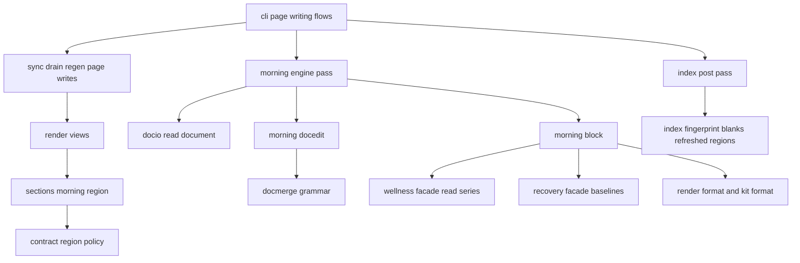
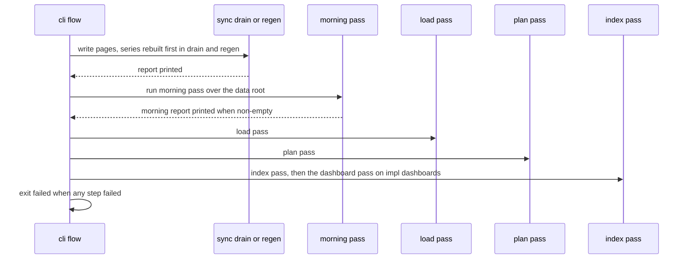
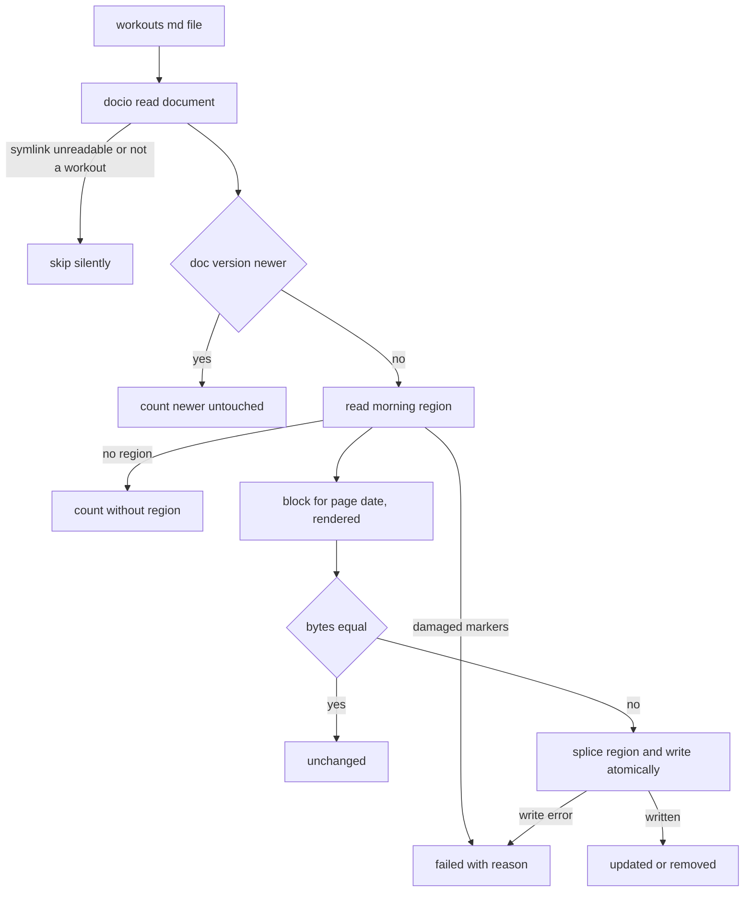

# Design Document — workout-wellness

## Overview

**Purpose**: workout-wellness puts the day around a workout onto the workout's
own page. Every workout page gains a fitdocs-owned `morning` region, placed
immediately before `## Training Load`. When the wellness series holds
something to show for the page's date, the region holds a `## Morning Of`
section: that morning's resting HR and HRV, each against its source's 7-day
mean and normal range, and the night that ended that morning, with its stages
where the same source recorded them. Every figure comes from `recovery`'s
baseline library and is formatted as the recovery page formats it, so the
block and the recovery page never disagree. The block describes; it never
judges.

**Users**: the athlete (reads the block on a workout page), the athlete's
agent (runs `fitdocs pull --sync` and reads the run report), and the wiki
under version control (sees a page change only when its block's printed
facts change).

**Impact**: a fresh render emits the empty `morning` region on every view; a
new pass, the **morning-of pass** (`fitdocs.morning.engine`), runs after the
page-writing step of `fitdocs sync`, the inbox drain, `fitdocs pull --sync`
and `fitdocs regen`, reads every workout page once and rewrites only the
region of pages whose block changed. No `.fit` file is read. The analytics
index treats a change confined to the region as a document-only change. The
contract gains one region class (`REFRESHED_REGIONS`), `DOC_VERSION` and
`CONTRACT_VERSION` each advance by main + 1 at landing. No new command,
setting, frontmatter key, owned location or index table.

### Goals
- A small, descriptive morning-of block on every workout page that has
  wellness for its date, computed only from the series and `recovery`'s
  baselines (1, 2, 3, 5).
- Pages change only when what their block prints changes (6, 7.2, 7.6).
- A wellness backfill touching every page costs one pass of region splices,
  no `.fit` decode, and no index recomputation (7.5, 10.1).

### Non-Goals
- Baselines, ranges, the shown-source rule, the series and the day rule
  (`recovery`, `wellness-store`).
- Charts in the block; any signal other than the baselined and sleep
  signals; wellness on history, block, planned or dashboard pages.
- A command, a setting, a frontmatter key, an index table.
- A readiness verdict, score, label or advice.

## Boundary Commitments

### This Spec Owns
- **The package `fitdocs.morning`**: the block model and its renderer
  (`block`), the region read and splice (`docedit`), and the morning-of pass,
  the only writer of the `morning` region's content (`engine`).
- **The `morning` region**: the contract constants `MORNING_REGION`,
  `REFRESHED_REGIONS`, `MORNING_PLACEHOLDER`; its placement in the three
  views (`render/sections.py`, `render/views.py`); its exact content format
  and stamp; the morning-of pass's report and exit rule in `cli.py`.
- **Version advances**: `DOC_VERSION` main + 1 and `CONTRACT_VERSION`
  main + 1 at landing, with their history paragraphs.
- **Garmin attribution inside the block.**
- **The analytics-index amendment** that blanks `REFRESHED_REGIONS` in the
  render fingerprint (`index/fingerprint.py`).
- **Published text**: the workouts declaration's re-derivability fragment,
  the ownership-contract sections on the region and the pass, the wellness
  documentation's workout-page section, the workouts skill paragraph, the
  CHANGELOG entries, the `structure.md` dependency sentence; the
  workout-docs, wiki-contract and analytics-index amendments.

### Out of Boundary
- Any computation of a mean, SD, range, position or shown source
  (`recovery`), and any reading of the recovery page.
- Parsing, archiving, merging, precedence, the day-boundary rule, the series
  files and their rebuild (`wellness-store`); the drain's wellness step and
  its report.
- The page's date: it is the `date` frontmatter value the renderer already
  writes (`render/frontmatter.py:125-128`) and `contract.document_date`
  already reads (`contract.py:1042`).
- `docmerge`'s grammar and merge, which stay generic and unchanged.
- The training-load region, the load pass, the plan pass, the index pass and
  dashboards' dashboard pass, which keep their behavior and their order.
- `fitdocs recovery`, which stays standalone (recovery Req 1.8).
- The wellness Garmin-attribution rule and its line text:
  `fitdocs.render.attribution.GARMIN_ORIGIN`, `WellnessAttribution`,
  `wellness_attribution` and `wellness_attribution_line`, which recovery
  adds (append-only) and both the recovery page and this block call
  (Phase 12 cross-spec review, round 1, I-1). This spec decides only which
  origins feed it.

### Allowed Dependencies
These lists are the final non-standard-library import sets. During staged
implementation through task 3.1, imports of each present module must be a
subset of its listed set. Task 3.2 closes the guard to exact equality,
together with the literal module-set and reverse-importer pins. No stage
permits an import outside these lists.

- `fitdocs.morning.block` imports only the standard library, the
  `fitdocs.wellness` facade, the `fitdocs.recovery` facade,
  `fitdocs.render.format` (`ABSENT`), `fitdocs.render.attribution`
  (`WellnessAttribution`, `wellness_attribution`,
  `wellness_attribution_line`, which recovery adds), the chart kit facade
  `fitdocs.render.charts.kit` (`Column`, `ValueKind`) and
  `fitdocs.render.charts.kit.format` (`format_value`, `escape_markdown`).
- `fitdocs.morning.docedit` imports only the standard library,
  `fitdocs.contract` and `fitdocs.docmerge`.
- `fitdocs.morning.engine` imports only the standard library,
  `fitdocs.contract`, `fitdocs.docio`, `fitdocs.docmerge`, `fitdocs.layout`,
  the `fitdocs.wellness` facade, `fitdocs.morning.block` and
  `fitdocs.morning.docedit`.
- `fitdocs/morning/__init__.py` is a docstring-only module.
- Module order: `block`, `docedit` (independent) → `engine`. Only
  `fitdocs.cli` imports `fitdocs.morning.engine`; no `fitdocs.render` module
  imports `fitdocs.morning`.
- Never: `fitdocs.sync`, `fitdocs.cli` (from inside the package),
  `fitdocs.index`, `fitdocs.query`, `fitdocs.load`, `fitdocs.history`,
  `fitdocs.ingest`, `fitdocs.connectors`, `fitdocs.tiles`, `duckdb`, any
  `fitdocs.wellness.*` or `fitdocs.recovery.*` submodule, a network module, a
  clock (`date.today`, `datetime.now`, `time.*`, `astimezone()`).

### Revalidation Triggers
- A change to the block's content rules or text: bump `MORNING_BLOCK_VERSION`
  and `DOC_VERSION` (the pass rewrites every block on the next run anyway).
- A change to `recovery`'s `BaselineDay` fields, `shown`/`on` semantics,
  `METHODS` windows or `BASELINES_VERSION`: the block's figures move; re-run
  the block tests; no code change needed unless fields change.
- A change to wellness-store's `WellnessSeries` API, `METRICS` labels or
  units, origin tokens or the day rule.
- A change to `render.attribution`'s `wellness_attribution` rule or
  `wellness_attribution_line` text (recovery owns them): the block's line
  and every block golden move.
- A change to `docmerge`'s marker grammar, to `PRESERVED_REGIONS`, or to the
  index's render-fingerprint rule.
- A new page-writing command: it must run the morning-of pass after its page
  writes (Requirement 7.1).

## Existing Spec Amendments Carried by This Spec

Each is appended by the task that makes the change, as
`## Amendment N (<date>): <title>, landed by workout-wellness`, with `N` the
next free number in the target spec at landing and a `spec.json` entry
naming the tests that pin each criterion. Criterion numbers below are the
next free ones on today's `main`; a Phase 12 peer that lands first may take
them, and the landing task re-derives them (append only, nothing
renumbered).

- **workout-docs — the morning region** (appended criteria; nothing
  renumbered or reworded):
  - 4.5: every document's `morning` region is re-derivable from the wellness
    series, which `fitdocs regen` rebuilds from the wellness archive first.
  - 6.13 (run/ride), 9.7 (strength), 12.3 (generic): the document carries a
    `morning` region immediately before the training-load section.
  - 10.6: the `morning` region is delimited by the same machine-recognizable
    markers, is empty in a freshly rendered document, holds only content
    fitdocs writes (the morning-of block, `workout-wellness`), and is not a
    user-editable region.
  - 13.5: an absent figure in the morning-of block is the in-table absence
    marker, never a zero.
  - The document-format version advance is owned by this spec (Req 9.1).
- **wiki-contract — a refreshed region and the morning-of pass** (appended
  criteria):
  - 1.7: the region-ownership policy names a third class, refreshed regions
    (`REFRESHED_REGIONS`), disjoint from the preserved set; their content is
    fitdocs's alone and is replaced, never preserved.
  - 2.17: the ownership contract names the `morning` region, states that
    fitdocs fills it from the wellness series and replaces its content
    whenever it differs, that hand edits there are replaced, and describes
    the morning-of pass among the overwriting operations.
  - 2.18: the ownership contract states that a workout document's
    generated content, its `morning` region included, is re-derivable from
    the wellness series (rebuilt from the archived wellness files and the
    `[wellness]` settings) as well as from the archived sources, the athlete
    profile, the configured timezone and the tile source.
  - `CONTRACT_VERSION` main + 1, its history paragraph and the "What changed"
    paragraph.
- **analytics-index — a block-only change is a document-only change**
  (appended criterion and a glossary note): 5.8: fitdocs shall not recompute
  a page's computed values for a change confined to its `morning` region;
  the glossary's "rendering" excludes the `morning` region. `SCHEMA_VERSION`
  does not move (no table, column or producer derivation changes; analytics-
  index Req 13.6 is not triggered).

## Architecture

### Existing Architecture Analysis
- **Views** (`src/fitdocs/render/views.py:196-311`): each view assembles
  blocks joined by a blank line; `## Training Load` with the `load` region is
  on every view (`:239`, `:272`, `:308`); the banner sits between frontmatter
  and H1 (`:192`). Region helpers live in `render/sections.py`
  (`load_section` `:628-637`, `notes_region` `:640`).
- **Region policy** (`src/fitdocs/contract.py:828-865`): `USER_REGIONS`,
  `TOOL_REGIONS`, `PRESERVED_REGIONS = USER_REGIONS + TOOL_REGIONS` (in
  document order), the fresh-region texts. `DOC_BANNER` (`:810-813`) is
  shared by workout, history (`history/page.py:693`), plan pages
  (`plans/page.py:228`) and, per its design, the recovery page.
  `DOC_VERSION = 9` (`:183`), `CONTRACT_VERSION = "9"` (`:328`).
- **Merge** (`src/fitdocs/docmerge.py:119-162`): carries every region the
  fresh render defines from the existing page, reads no policy; refuses an
  existing region the fresh render lacks. `_page_task` merges at
  `sync.py:2068` and writes with `_write_document` (`sync.py:2336-2339`).
- **The load pass precedent**: a whole-root scan every run
  (`load/engine.py:603-623`), a byte-local region splice
  (`load/docedit.py:208-243`), an atomic same-directory temp write
  (`load/engine.py:666-684`), per-document isolation and a report.
- **Shared read**: `docio.read_document` (`docio.py:103-117`) refuses
  symlinks and returns bytes, text and frontmatter.
- **CLI flows** (`src/fitdocs/cli.py`): explicit sync reports at `:717` then
  load `:719`, plan `:724`, index `:725`; `_run_drain_passes` reports at
  `:804` then load `:807`, plan `:810`, index `:811`, failure at `:816-820`;
  `regen` reports at `:902` then load `:905`, plan `:908`, index `:909`,
  `_finish` at `:911-913`. `impl/dashboards` (not on main) chains
  `_run_dashboard_pass` after the index pass in each of these flows and makes
  `_run_index_pass` return `IndexReport | None`. wellness-store adds the
  `regen` series rebuild before `regen(...)` and its summary after the regen
  table.
- **Index** (`src/fitdocs/index/fingerprint.py:40-58`): the render
  fingerprint blanks `PRESERVED_REGIONS`; a moved render fingerprint makes the
  refresh decode the page's `.fit` files again
  (`index/refresh.py:227-262`, `:297-311`).
- **Formatting**: `render/format.py:33` (`ABSENT`, en dash),
  `render/charts/kit/format.py:116` (`format_value`), `:202`
  (`escape_markdown`); the page-title Garmin line's prefixes at
  `render/attribution.py:19-20`; recovery appends the shared wellness
  attribution names to the same module before this spec lands.

### Architecture Pattern & Boundary Map



**Architecture Integration**:
- Selected pattern: a refreshed region plus a whole-root pass, the load-pass
  shape applied to content fitdocs owns outright (research.md, Option D).
- Domain boundaries: the renderer only reserves the region; the pass alone
  decides its content; `recovery` alone decides every number; wellness-store
  alone reads the series files.
- Existing patterns preserved: region grammar and damage detection;
  per-document isolation; atomic temp-then-replace writes; the symlink
  refusal at the shared read; byte-local splices; deterministic text; the
  shared banner unchanged.
- Steering compliance: absent is `None` and printed as the en dash; no
  network, no clock, no new dependency; documents never read the index.

### Technology Stack

| Layer | Choice / Version | Role in Feature | Notes |
|-------|------------------|-----------------|-------|
| CLI | typer + rich (existing) | the pass's report lines and exit rule | no new command |
| Rendering | stdlib `json`, `hashlib`, `re`; chart kit `format_value` | block text, stamp, fingerprint | no chart |
| Storage | stdlib `os.replace`, `tempfile` | atomic page splice | writes only existing `workouts/*.md` |
| Runtime | Python 3.11+, mypy --strict | — | — |

## File Structure Plan

### Directory Structure
```
src/fitdocs/morning/
├── __init__.py   # docstring only: what the package is, who may import what
├── block.py      # MORNING_BLOCK_VERSION, RowSource, SignalRow, SleepRow, Windows,
│                 #   MorningBlock (facts, fingerprint), MorningInputs (of, block), render_region,
│                 #   parse_stamp, STAMP_PATTERN, MORNING_HEADING (pure)
├── docedit.py    # MorningRegionMissing, read_morning, replace_morning (pure, byte-local)
└── engine.py     # PageOutcome, MorningPage, MorningReport, run_morning_pass (the only writer
                  #   of the morning region's content)

tests/morning/
├── __init__.py
├── builders.py        # synthetic SeriesValue sets (in memory) and synthetic workout pages
├── test_block.py      # rows, absence, sleep, attribution, windows, recovery agreement
├── test_render.py     # exact region text, stamp, fingerprint, forbidden phrases, goldens
├── test_docedit.py    # read and splice
├── test_engine.py     # the pass over staged data roots
├── test_cli_morning.py # report lines, exit rule, flows, ordering
├── test_e2e.py        # sync SOURCE with a staged series; drain with deliveries; regen; check
├── test_boundary.py   # imports, clock, network, reverse importers, render never imports morning
└── golden/            # block-content goldens (regenerated by `uv run python -m tests.morning.test_render`)
```

### Modified Files
- `src/fitdocs/contract.py` — `MORNING_REGION`, `REFRESHED_REGIONS`,
  `MORNING_PLACEHOLDER`, `__all__`, every docstring sentence the third class
  makes false (§ ContractRegion); `DOC_VERSION` and `CONTRACT_VERSION`
  advances with history paragraphs.
- `src/fitdocs/render/sections.py` — `morning_region()`.
- `src/fitdocs/render/views.py` — the region block before Training Load in
  the three views; module and view docstrings (order; the morning region
  holds its own heading).
- `src/fitdocs/index/fingerprint.py` — blank `REFRESHED_REGIONS` too
  (analytics-index amendment).
- `src/fitdocs/declaration.py` — `_REDERIVABILITY_DOCS`, `_NEVER_ADD_MARKER`
  and their CLAIM ANCHORs (both appear only in the workouts declaration).
- `src/fitdocs/cli.py` — `_run_morning_pass`, `_report_morning`, the three
  flows, their exit rules, the module docstring.
- `src/fitdocs/skills/fitdocs-workouts/SKILL.md` — one paragraph under
  "Reading the report".
- `docs/ownership-contract.md`, `docs/wellness.md` (created by
  wellness-store), `docs/upgrading.md`, `CHANGELOG.md`,
  `.kiro/steering/structure.md`.
- Spec amendments: `.kiro/specs/{workout-docs,wiki-contract,analytics-index}/
  {requirements.md,spec.json}`.
- Re-pinned tests (append or move with the change, grep decides the full
  set): `tests/test_contract.py` (region tuples, disjointness),
  `tests/test_public_api.py` (`_CONTRACT_SURFACE`),
  `tests/test_contract_consumers.py` (region-literal scan over
  `PRESERVED_REGIONS + REFRESHED_REGIONS`, and over `fitdocs/morning`;
  `CONVERTED_MODULES` and `CONTRACT_BINDINGS` gain `fitdocs.morning.docedit`
  and `fitdocs.morning.engine`, and the `fitdocs.render.sections` entry gains
  `MORNING_REGION` and `MORNING_PLACEHOLDER`), `tests/test_portability.py`
  (the HTML-comment allowlist gains the stamp),
  `tests/test_ownership_contract.py`, `tests/identity/test_contract_docs.py`
  (`:177-187` head paragraph, history), `tests/index/test_contract_docs.py`
  (`:140` contract, `:178` doc version), `tests/index/derived/test_preserved.py`
  (`:245` doc version, `:246` contract), every peer "What changed at this
  version" head-paragraph pin present at landing, `tests/render/test_frontmatter.py`
  (`:45`, `:106`),
  `tests/load/test_render.py` (`:188`), `tests/metrics/test_sources.py`
  (`CONSTANT_REGISTRY_ASOF_DOC_VERSION`, `:2270`), `tests/index/test_fingerprint.py`
  (`:209-220`, the region parameter list; `_replace_region`'s assertion at
  `:60` widened to `PRESERVED_REGIONS + REFRESHED_REGIONS`), every test asserting a page's
  exact region set or section order (`tests/render/test_views.py`,
  `tests/test_docmerge.py` and others the grep finds),
  `tests/test_declaration.py`, `tests/test_confinement.py`,
  `tests/test_agent_skill.py`, the render goldens
  `tests/render/golden_docs/*.md` (`uv run python -m tests.render.test_golden_docs`)
  and the declaration goldens `tests/declaration_golden/*.AGENTS.md`
  (`uv run python -m tests.test_declaration_goldens`).

## System Flows

### Where the pass runs



Key decisions: the pass runs after every page write of the run and after
wellness-store's series rebuild and summary, so it reads the series the same
run produced (12.2 of wellness-store) and sees every page the run wrote; it
runs before the index pass, so the same run's index refresh reads the
refreshed pages (7.1). It never depends on the index. Its position relative
to the load and plan passes is free (disjoint parts of the page); it is
placed first so a later pass's configuration exit (exit 2) cannot leave a
freshly written page without its block.

### One page



## Requirements Traceability

| Requirement | Summary | Components | Interfaces | Flows |
|-------------|---------|------------|------------|-------|
| 1.1 | One region before Training Load, every view | RegionPlacement, ContractRegion | `morning_region`, `MORNING_REGION` | — |
| 1.2, 1.3 | Block when something to show; nothing otherwise | MorningBlock, MorningPass | `MorningInputs.block`, `render_region` | One page |
| 1.4 | Day = page date | MorningPass | `document_date` | One page |
| 1.5 | One sentence: day and windows | MorningBlock | `render_region`, `Windows` | — |
| 1.6, 1.7 | Plain markdown, no chart; no frontmatter key | MorningBlock, MorningRegionEdit | region content format | — |
| 2.1, 2.2 | One row per baselined signal, four figures | MorningBlock | `SignalRow` | — |
| 2.3 | Same computation as the recovery page | MorningBlock | `Baselines.shown` | — |
| 2.4 | SDNN and rMSSD separate | MorningBlock | `BASELINED_METRICS` | — |
| 2.5 | Recovery's formatting | MorningBlock | `format_value` | — |
| 2.6, 2.7 | Absence marker; carried source | MorningBlock | `ABSENT` | — |
| 3.1-3.5 | Sleep table, stages from the shown source only | MorningBlock | `SleepRow`, `Baselines.on` | — |
| 4.1-4.6 | Sources, origins, Garmin line | MorningBlock | `RowSource`, `wellness_attribution`, `wellness_attribution_line` | — |
| 5.1-5.3 | Descriptive only | MorningBlock | fixed text; forbidden-phrase test | — |
| 6.1-6.3 | Fingerprint of printed facts | MorningBlock | `facts`, `fingerprint`, stamp | — |
| 6.4 | Change only when printed facts change | MorningBlock, MorningPass | byte comparison | One page |
| 7.1 | Pass after page writes, before index | CliMorning | `_run_morning_pass` | Where the pass runs |
| 7.2, 7.3 | Rewrite only differing pages, only the region | MorningPass, MorningRegionEdit | `replace_morning` | One page |
| 7.4 | Days X..X+60 bound | MorningBlock (recovery semantics) | — | — |
| 7.5 | One pass, each page read once, no `.fit` | MorningPass | `run_morning_pass` | One page |
| 7.6 | Nothing to write when nothing changed | MorningPass | byte comparison | One page |
| 7.7 | Atomic writes | MorningPass | `_atomic_write` | One page |
| 7.8 | Touches only the region | MorningRegionEdit | `replace_morning` | — |
| 7.9 | Not run by other commands; no command | CliMorning | three call sites | — |
| 8.1 | Unreadable series | MorningPass, CliMorning | `MorningReport.unavailable` | — |
| 8.2 | Newer page untouched | MorningPass | version gate | One page |
| 8.3 | Page without region counted | MorningPass, CliMorning | `without_region` | One page |
| 8.4, 8.5 | Damaged markers, write failure | MorningPass, CliMorning | `PageOutcome.FAILED` | One page |
| 8.6 | Symlinks and non-workouts skipped | MorningPass | `docio.read_document`, `is_workout_document` | One page |
| 8.7 | Report lines | CliMorning | `_report_morning` | — |
| 8.8 | A pass that raises: reported, later passes run, exit 1 | CliMorning | `_run_morning_pass` | Where the pass runs |
| 9.1 | Page-format version advance | ContractRegion | `DOC_VERSION` | — |
| 9.2 | Regen leaves current blocks | CliMorning, MorningPass | regen flow | Where the pass runs |
| 9.3, 9.4 | Re-derivable; deterministic | MorningBlock, MorningPass, Declarations | no clock | — |
| 9.5 | Region content replaced, never user-owned | ContractRegion, MorningPass | `REFRESHED_REGIONS` | — |
| 10.1 | Block-only change not recomputed | IndexFingerprint | `_blank_regions` | — |
| 10.2 | No index read; schema unchanged | MorningBoundaryGuard | — | — |
| 11.1-11.3 | Contract text and version | ContractRegion, Docs, Declarations | `CONTRACT_VERSION` | — |
| 11.4-11.6 | Wellness docs, skill, release notes | Docs | — | — |
| 12.1-12.4 | Offline, no clock, confined, synthetic | MorningBoundaryGuard, MorningPass | confinement entry | — |

## Components and Interfaces

### Summary

| Component | Domain/Layer | Intent | Req Coverage | Key Dependencies | Contracts |
|-----------|--------------|--------|--------------|------------------|-----------|
| MorningBlock | morning core | Block model, figures, attribution, fingerprint, region text | 1.2-1.7, 2, 3, 4, 5, 6, 7.4, 9.4 | wellness facade, recovery facade, kit format (P0) | Service |
| MorningRegionEdit | morning core | Read and splice the `morning` region | 7.3, 7.8 | contract, docmerge (P0) | Service |
| MorningPass | morning I/O | Whole-root pass, atomic writes, report | 1.3, 1.4, 6.4, 7.2-7.7, 8, 9.2, 12.3 | block, docedit, docio (P0) | Batch |
| ContractRegion | contract | Region constants, version advances | 1.1, 9.1, 9.5, 11.3 | — | State |
| RegionPlacement | render | Empty region before Training Load | 1.1 | contract (P0) | — |
| CliMorning | cli | Call sites, report, exit | 7.1, 7.9, 8.1, 8.3, 8.7, 8.8, 9.2 | engine (P0) | Service |
| IndexFingerprint | index | Blank refreshed regions | 10.1 | contract (P0) | — |
| Declarations | declaration | Re-derivability fragment | 9.3, 11.1 | contract, layout (P1) | — |
| Docs | docs, skill, changelog, steering | Published text | 11 | — | — |
| MorningBoundaryGuard | tests | Imports, clock, network, reverse | 10.2, 12.1, 12.2 | — | — |

### Morning Core

#### MorningBlock (`src/fitdocs/morning/block.py`)

| Field | Detail |
|-------|--------|
| Intent | What the block shows for one day, its printed facts, fingerprint and exact region text |
| Requirements | 1.2, 1.3, 1.4, 1.5, 1.6, 1.7, 2.1-2.7, 3.1-3.5, 4.1-4.6, 5.1-5.3, 6.1-6.3, 7.4, 9.4 |

**Responsibilities & Constraints**
- `MorningInputs.of(series)` builds `recovery.Baselines.of(series)` once and
  keeps the series for origin lookups; per `(metric, source)` it builds, on
  first use, a `{day: origin}` map from `series.by_source(metric, source)`.
  It reads no file, clock or timezone.
- `MorningInputs.of` derives `Windows(rolling_days, baseline_days)` from
  `recovery.METHODS` over `BASELINED_METRICS + SLEEP_METRICS` and raises
  `ValueError` when those methods do not share one pair (today 7 and 60): the
  block's sentence and column headers state one pair, and no literal 7 or 60
  appears in this package.
- **Rows (normative)**, for day `D`:
  1. For each `m` in `BASELINED_METRICS` order: `bd = baselines.shown(m, D)`;
     a row exists when `bd` is not `None` and any of `bd.value`,
     `bd.rolling_mean`, `bd.baseline_mean` is not `None` (2.1). Its figures:
     `day_value = fmt(bd.value)`, `rolling_mean = fmt(bd.rolling_mean)`,
     `normal_range = f"{fmt_bare(bd.range_low)} to {fmt(bd.range_high)}"`
     when both bounds are present, else `None`, `position = bd.position`
     (2.2, 2.6, 2.7).
  2. `bd = baselines.shown(SLEEP_S, D)`; when a row would exist by the same
     test, the sleep rows are the `SLEEP_S` row from `bd`, then, for each `m`
     in `SLEEP_METRICS[1:]` order, `on = baselines.on(m, bd.source, D)`
     with a row only when `on.value` is not `None` (recovery's SleepView
     rule, 3.1-3.4). Sleep rows print `night_value`, `rolling_mean`,
     `baseline_mean`; no range, no position (3.1).
  3. No signal row and no sleep row: `block(D)` returns `None` (1.3).
  4. `fmt(v)` is `format_value(v, Column(m.value, ValueKind.NUMBER,
     METRICS[m].unit, METRICS[m].label), with_unit=True)` for a present
     value and `None` for an absent one; `fmt_bare` is the same with
     `with_unit=False` (2.5, 3.5). The block never calls `format_value` with
     `None` (the kit's own absent text is an em dash).
- **Row sources (normative)**: a row's contributing days are `{D}` when its
  day value is present, `D-(r-1)…D` when its rolling mean is present, and
  `D-B…D-1` when its 60-day mean is present (`r`, `B` from `Windows`). Its
  `origins` are the sorted distinct recorded origins of the row source's
  values on those days; `unattributed` is true when any such value has no
  recorded origin (4.1, 4.6).
- **Attribution (normative)**: `block.attribution =
  render.attribution.wellness_attribution(origins)`, where `origins` is the
  union of every row's `origins` plus one `None` when any row is
  `unattributed`. The shared function (recovery's) gives `NONE` without
  `"garmin"`, `SOLE` when the recorded origins are exactly `{"garmin"}` and
  none is `None`, and `CONTRIBUTING` otherwise (4.2-4.5). This module holds
  no attribution enum, origin constant or line text of its own.
- **Facts and fingerprint**: `facts()` is
  `json.dumps(obj, sort_keys=True, separators=(",", ":"), ensure_ascii=False)`
  of `{"day": D.isoformat(), "windows": [r, B], "signals": [[metric, source,
  origins, day_value, rolling_mean, normal_range, position], …], "sleep":
  [[metric, source, origins, night_value, rolling_mean, baseline_mean], …],
  "attribution": attribution.value}` with `None` as JSON `null` and lists in row
  order; `fingerprint()` is the SHA-256 hex of its UTF-8 bytes (6.1-6.3).
  Only what the block prints is a fact: a row's `unattributed` flag is not
  printed (it reaches the page only through `attribution`), so it is not in
  the facts, and an origin turning from unrecorded to one already listed,
  with no change to the attribution line, leaves the region byte-identical
  (6.4).
- **Region text (normative)**: see [The Region Content](#the-region-content).
  `render_region(None)` returns the literal empty string `""`, with no
  final newline. This equals the contract's fresh-region placeholder value,
  but `block.py` does not import `fitdocs.contract`; region placement
  consumes `MORNING_PLACEHOLDER` in `render.sections`.
- Nothing in the module computes a mean, SD, range or position, or chooses a
  source; `shown`, `shown_source` (through `shown`) and `on` are `recovery`'s.

```python
MORNING_BLOCK_VERSION: Final[int] = 1
MORNING_HEADING: Final[str] = "Morning Of"
STAMP_PATTERN: Final[re.Pattern[str]]   # ^<!-- fitdocs-morning:v([1-9][0-9]*) ([0-9a-f]{64}) -->$
# WellnessAttribution, wellness_attribution, wellness_attribution_line come
# from fitdocs.render.attribution (recovery's addition); none is redefined here.

@dataclass(frozen=True)
class Windows:
    rolling_days: int
    baseline_days: int

@dataclass(frozen=True)
class RowSource:
    source: str
    origins: tuple[str, ...]        # sorted, distinct, recorded origins only
    unattributed: bool

@dataclass(frozen=True)
class SignalRow:
    metric: Metric
    day_value: str | None           # printed text, None = absent
    rolling_mean: str | None
    normal_range: str | None        # "<low> to <high> <symbol>"
    position: RangePosition | None
    source: RowSource

@dataclass(frozen=True)
class SleepRow:
    metric: Metric
    night_value: str | None
    rolling_mean: str | None
    baseline_mean: str | None
    source: RowSource

@dataclass(frozen=True)
class MorningBlock:
    day: date
    windows: Windows
    signals: tuple[SignalRow, ...]
    sleep: tuple[SleepRow, ...]
    attribution: WellnessAttribution
    def facts(self) -> str: ...
    def fingerprint(self) -> str: ...

class MorningInputs:
    @classmethod
    def of(cls, series: WellnessSeries) -> MorningInputs: ...
    def block(self, day: date) -> MorningBlock | None: ...

def render_region(block: MorningBlock | None) -> str: ...
def parse_stamp(content: str) -> tuple[int, str] | None: ...   # (version, fingerprint) of a region's first line
```

- Cost: `of` is linear in the series; `block(D)` makes at most nine
  `shown`/`on` calls of O(`LOOKBACK_DAYS`) each and at most nine origin scans
  of at most 61 days.

#### MorningRegionEdit (`src/fitdocs/morning/docedit.py`)

| Field | Detail |
|-------|--------|
| Intent | Read and replace the `morning` region's inner content, byte-preserving everything else |
| Requirements | 7.3, 7.8 |

- `read_morning(markdown)` returns `extract_regions(markdown).get(MORNING_REGION)`;
  `RegionError` from damaged markers propagates.
- `replace_morning(markdown, content)` validates through `extract_regions`,
  raises `MorningRegionMissing` when the region is absent, and replaces the
  text between the column-zero begin and end marker lines with `content` by
  the same anchored, non-greedy pattern `load/docedit.py:208-243` uses (a
  function replacement, so backslashes in `content` are literal). Invariant:
  `read_morning(replace_morning(md, c)) == c`, and the bytes before the begin
  marker and after the end marker are unchanged.

```python
class MorningRegionMissing(Exception): ...
def read_morning(markdown: str) -> str | None: ...
def replace_morning(markdown: str, content: str) -> str: ...
```

### Morning I/O

#### MorningPass (`src/fitdocs/morning/engine.py`)

| Field | Detail |
|-------|--------|
| Intent | Bring every workout page's `morning` region up to date with the current series, rewriting only pages whose block changed |
| Requirements | 1.3, 1.4, 6.4, 7.2-7.7, 8.1-8.7, 9.2, 12.3 |

**Contracts**: Batch [x]

##### Batch / Job Contract
- **Trigger**: `cli._run_morning_pass`, called by the three flows only (7.1,
  7.9).
- **Input**: `read_series(data_root)`. `SeriesReadError` → a report with
  `unavailable` set to its message and nothing read or written further (8.1).
  An empty series is a valid input: every block is empty, so a page whose
  region holds a block is cleared. Two optimizations are allowed and change
  no output: with an empty series `fresh` is `""` for every page without any
  block computation; and `render_region` may be memoized per date within one
  pass.
- **Per page** (`sorted((data_root / WORKOUTS_DIR).glob("*.md"))`, each read
  once with `docio.read_document`):
  1. `None` (symlink, unreadable, not UTF-8) or not
     `contract.is_workout_document(frontmatter)` → skipped silently (8.6).
  2. `version = document_version(frontmatter)`; `version is not None and
     version > DOC_VERSION` → `newer += 1`, untouched (8.2). A missing or
     unusable version (`None`, for example `doc_version: true`) is out of
     date, never newer (`contract.py:1021-1039`, the load pass's guard at
     `load/engine.py:354-355`): the page goes on to step 3 like any other.
  3. `read_morning(text)`: `RegionError` → `FAILED` with the error's message
     (8.4); `None` → `without_region += 1`, untouched (8.3).
  4. `day = document_date(frontmatter)`; `fresh =
     render_region(inputs.block(day) if day is not None else None)` (1.3,
     1.4).
  5. `fresh == current` → `unchanged += 1`, no write (6.4, 7.6).
  6. Otherwise `replace_morning(text, fresh)` written atomically: a temp file
     `.morning-*.tmp` in `workouts/`, `newline=""`, then `os.replace`; the
     temp file is removed on any failure, `KeyboardInterrupt` included, which
     then propagates (7.3, 7.7). Outcome `UPDATED` when `fresh` is non-empty,
     `REMOVED` when it is empty. An `OSError` → `FAILED` (8.5).
  7. Any other `Exception` for the page → `FAILED` with
     `"<ExceptionType>: <message>"`; the pass continues.
- **Output**: `MorningReport`; `pages` holds only `UPDATED`, `REMOVED` and
  `FAILED` entries, in scan order.
- **Idempotency & recovery**: a second pass over unchanged inputs writes
  nothing; an interrupted pass leaves every page whole (old or new bytes) and
  the next run completes it, because the pass visits every page (no "changed
  days" input).
- **Never**: reads a `.fit` file, the athlete profile, the settings, the
  index or the recovery page; writes frontmatter, assets or any path other
  than an existing `workouts/*.md` and its own temp file; creates, renames or
  deletes a page (7.5, 7.8, 12.3).

```python
class PageOutcome(StrEnum):
    UPDATED = "updated"
    REMOVED = "removed"
    FAILED = "failed"

@dataclass(frozen=True)
class MorningPage:
    doc: str                    # data-root-relative POSIX path
    outcome: PageOutcome
    detail: str | None          # the reason for FAILED

@dataclass(frozen=True)
class MorningReport:
    pages: tuple[MorningPage, ...]
    unchanged: int
    without_region: int
    newer: int
    series_has_values: bool
    unavailable: str | None
    @property
    def failed(self) -> bool: ...    # any FAILED page

def run_morning_pass(data_root: Path) -> MorningReport: ...
```

### Integration With Existing Modules

#### ContractRegion (`src/fitdocs/contract.py`)

| Field | Detail |
|-------|--------|
| Intent | The `morning` region in the one region policy; the two version advances |
| Requirements | 1.1, 9.1, 9.5, 11.3 |

```python
MORNING_REGION: Final[str] = "morning"
REFRESHED_REGIONS: Final[tuple[str, ...]] = (MORNING_REGION,)
MORNING_PLACEHOLDER: Final[str] = ""
```
- `REFRESHED_REGIONS` is disjoint from `PRESERVED_REGIONS`, which with
  `USER_REGIONS` and `TOOL_REGIONS` is unchanged. Docstring: fitdocs alone
  writes a refreshed region's content from data outside the page's files;
  the merge carries it like every region, and the pass that owns it replaces
  it after every page-writing run; it is never user-owned and never
  preserved for the user.
- Every docstring sentence the new class makes false is rewritten in the
  same change: the module docstring's "Policy versus mechanism" paragraph
  (`contract.py:18-19`, "the three region ids", "one algorithm, not
  three"), its "Region ownership" section (`:69`, "Three regions survive
  regeneration verbatim"; it gains the refreshed class) and its
  "Fresh-region content" section (the empty placeholder); the
  `TOOL_REGIONS` docstring (`:841`, "the regions fitdocs itself fills after
  the document is first written", which also describes `morning`: it
  becomes "the regions fitdocs fills and regeneration preserves"); and the
  `PRESERVED_REGIONS` docstring (`:844`, "every region carried over verbatim
  on regeneration": the merge also carries `morning`, which the pass then
  replaces; it becomes "every region whose content regeneration preserves
  for its owner").
- `DOC_VERSION` = main + 1, paragraph: "Raised from ``N`` to ``N+1`` by
  workout-wellness. Every page gains an empty ``morning`` region, immediately
  before its Training Load section, which the morning-of pass fills from the
  wellness series. A page stamped with a lower version has no such region,
  so the pass leaves it alone until ``fitdocs regen`` brings it current."
- `CONTRACT_VERSION` = main + 1, paragraph: "Raised from ``N`` to ``N+1`` by
  workout-wellness. Workout documents gain the ``morning`` region, a third
  region class whose content fitdocs alone writes from the wellness series
  and replaces whenever it differs; the morning-of pass that ``fitdocs
  sync``, ``fitdocs pull --sync`` and ``fitdocs regen`` run rewrites only
  that region; and a workout document's generated content is re-derivable
  from the wellness series as well as from the archived sources, the
  athlete profile, the configured timezone and the tile source."
- `DOC_BANNER` is unchanged: the region is outside the notes, workout and
  load regions, and its content is replaced, so the banner's sentence stays
  true; the history, block, planned and recovery pages do not change.

#### RegionPlacement (`src/fitdocs/render/sections.py`, `src/fitdocs/render/views.py`)

- `morning_region() -> str` returns `region_block(MORNING_REGION,
  MORNING_PLACEHOLDER)` (no literal region id, the contract-consumer scan).
  The literal-copy mutation is pinned by the region-literal scan; a separate
  runtime-constructed equal but nonidentical region string is pinned by the
  binding assertion. String identity alone does not prove import provenance
  because literals may be interned.
- Each view appends `morning_region().rstrip("\n")` as its own block
  immediately before the Training Load block: run/ride after Splits (or the
  last present section before it), strength after Recorded Sets (or
  Workout), generic after Telemetry (or Map, or Summary). A fresh page
  therefore reads:
  ```
  …previous section…

  <!-- fitdocs:begin:morning -->

  <!-- fitdocs:end:morning -->

  ## Training Load
  ```
- The views' docstrings: the order gains the region; "headings outside
  regions" gains its one exception (the `morning` region holds its own
  `## Morning Of` heading, because the section exists only when the block
  has something to show).
- The page task is unchanged: `merge_regions` carries the previous block, and
  the morning-of pass that follows replaces it when it differs.

#### CliMorning (`src/fitdocs/cli.py`)

| Field | Detail |
|-------|--------|
| Intent | Run the pass in the three flows, print its report, fold failures into the exit |
| Requirements | 7.1, 7.9, 8.1, 8.3, 8.7, 8.8, 9.2 |

- `_run_morning_pass(data_root: Path) -> bool` imports
  `fitdocs.morning.engine` lazily, runs it, calls `_report_morning`, and
  returns whether the pass failed (`report.failed`). It catches `Exception`
  around the whole pass (controller ruling R3): it prints
  `Morning of: not refreshed; <ExceptionType>: <message>.`, returns `True`
  (the run exits 1), and the flow goes on to the load, plan, index and
  dashboard passes. `KeyboardInterrupt` and other `BaseException`s
  propagate.
- Call sites (keep both sides on rebase; dashboards' `_run_dashboard_pass`
  stays after the index pass):
  - explicit `sync`: after `_report(report, command="sync")`, before the
    load pass; `_finish(failed=… or morning_failed)`.
  - `_run_drain_passes`: after `_report_drain(...)`, before the load pass;
    the returned failure includes `morning_failed` (so `fitdocs sync` and
    `fitdocs pull --sync` both carry it).
  - `regen`: after the regen report and wellness-store's series summary,
    before the load pass; `_finish(failed=… or morning_failed)`.
- `_report_morning` prints, on stdout, markup off, soft wrap, only these
  lines and only when they apply (8.7); `page(s)`, `block(s)` and
  `has/have` agree with the count (singular for one, plural otherwise):
  - `Morning of: not refreshed; the wellness series could not be read: <reason>.`
    when `unavailable` (8.1);
  - `Morning of: <n> page(s) updated, <m> block(s) removed.` when `n + m > 0`
    (each clause only when its count is non-zero);
  - `Morning of: could not update <doc>: <detail>` per failed page (8.4, 8.5);
  - `Morning of: <k> page(s) has/have no morning-of region (written by an older fitdocs, or the region markers were removed); run 'fitdocs regen' to add it.`
    when `without_region > 0` and `series_has_values` (8.3);
  - `Morning of: not refreshed; <ExceptionType>: <message>.` when the pass
    raised (R3).
- The module docstring's `sync` and `regen` paragraphs name the pass and its
  position. No command is added; the command count is unchanged.

#### IndexFingerprint (`src/fitdocs/index/fingerprint.py`) — analytics-index amendment

- `_blank_preserved_regions` blanks every region in
  `contract.PRESERVED_REGIONS + contract.REFRESHED_REGIONS`; a region outside
  both (a future id) keeps its content in the digest
  (`test_render_fingerprint_keeps_unmanaged_region_content` still holds).
  A page that changed only inside its `morning` region keeps its render
  fingerprint, so the refresh updates its document rows and does not decode
  its `.fit` files (10.1).

#### Declarations (`src/fitdocs/declaration.py`)

- `_REDERIVABILITY_DOCS` becomes (wording, avoiding the quantifier words
  `tests/test_declaration.py:232` guards): "The *generated* content of the
  documents in this directory is re-derivable: fitdocs rebuilds it by
  regeneration from the archived sources under `fit-archive/`, the wellness
  series under `wellness/`, the athlete profile, the configured timezone,
  and the tile source. The `morning` region is generated content too: fitdocs
  refills it from the wellness series. Content inside a document's other
  region markers is not re-derived by regeneration -- it is carried over from
  the document itself, so regenerating a deleted document brings back only
  the generated content, not what those regions held." The directory names
  are formatted from `layout`; the CLAIM ANCHOR names `morning.engine` and
  the three CLI call sites.
- `_NEVER_ADD_MARKER` (`declaration.py:264-268`) says an added marker "makes
  the next regeneration refuse to write that document", which is false for a
  `morning` marker added to a page that lacks it (the fresh render carries
  that region, so the merge accepts it). It becomes: "Never add a region
  marker to a document that does not already have one: a marker naming a
  region the regenerated document does not carry makes the next
  regeneration refuse to write that document until the added marker is
  removed by hand." Its CLAIM ANCHOR records why the qualifier is there.
- The workouts golden moves by both fragments and the version; the other
  declaration goldens move by the version only (only the workouts branch
  selects these two fragments, `declaration.py:448-452`). A
  `tests/test_declaration.py` pin holds the new qualifier.

#### Docs
- `docs/ownership-contract.md`: version line; the "What changed at this
  version" paragraph (the region, the pass, re-derivability, "run `fitdocs
  regen` once"); the head paragraph's list of enumerations held equal to
  code (`:25-28`, "owned paths, preserved regions, managed keys, and the
  contract version") gains "refreshed regions"; the newer-version paragraph
  of "Document-Format Versions and Migration" (`:1016-1020`, which names only
  the training-load pass) adds that the morning-of pass also leaves such a
  document untouched; a new section `## The Morning-Of Region` after "User-Owned
  and Tool-Filled Regions" holding one backticked list item `` `morning` ``
  and the rules (filled from the series, replaced when it differs, never
  user-owned, edits replaced, left as it was while the series cannot be
  read), with the regions section's prose pointing to it and its bullet list
  still equal to `PRESERVED_REGIONS`; "What Regeneration Replaces and
  Preserves" names it; "Overwrite Semantics": `sync`, `sync --force` and
  `regen` gain "then the morning-of pass", and a new **morning-of pass**
  bullet states what it touches (only the `morning` region of existing pages
  at the current or an older-but-region-bearing format), what it never
  touches and when it runs; "Commit Ordering and Re-Derivability": generated
  content is re-derivable from `fit-archive/`, `wellness/` (itself rebuilt
  from `wellness-archive/` and `[wellness]`), the athlete profile, the
  timezone and the tile source.
- `docs/wellness.md` (wellness-store's guide): a section "Wellness on workout
  pages": what the block shows, that it shows the wellness day equal to the
  page's date (with a link to the guide's own day-boundary section, never a
  restatement: wellness-store Req 7.6 pins that statement exactly once across
  `docs/`), the windows, sources and origins, the Garmin line, the absence
  marker, when pages are refreshed (every `sync`, `pull --sync`, `regen`),
  that edits are replaced, that it states no verdict, that it shares
  `fitdocs recovery`'s numbers.
- Workouts skill: after the drain table, a paragraph: `Morning of:` lines
  follow the drain report; "updated"/"removed" need nothing; "could not
  update" → read the reason and tell the user (damaged markers need a human);
  "has/have no morning-of region" → `fitdocs regen` only when `fitdocs check`
  or the release notes call for it (the routine never runs it); "not
  refreshed" → nothing to do, the next run retries.
- `docs/upgrading.md:83-87`: `regen` reads the archived `.fit` bytes, the
  athlete profile and the settings file, and now also the archived wellness
  files (through the wellness series it rebuilds first) for the morning-of
  block.
- `CHANGELOG.md` `[Unreleased]`: Added (the block, its refresh), Changed
  (`doc_version` N → N+1 with the action `fitdocs regen`, the ownership
  contract version, and that a change confined to the block does not make
  the analytics index recompute a page's computed values).
- `.kiro/steering/structure.md`: "`morning` (the morning-of block and its
  pass) imports the `wellness` and `recovery` facades, `contract`, `docmerge`,
  `docio`, `layout`, the render layer's absence marker and wellness
  attribution helpers and the chart kit's value formatter; only `cli` imports
  `morning.engine`; `render` never imports `morning`."

## Data Models

### The Region Content

A non-empty region's content is these parts joined by one blank line
(`"\n\n"`), followed by one final `"\n"`, so a blank line separates the last
table from the end marker (a GFM table otherwise swallows following
non-blank lines):

1. The stamp: `<!-- fitdocs-morning:v{MORNING_BLOCK_VERSION} {fingerprint} -->`.
2. `## Morning Of`.
3. Only when attribution is not `NONE`: the line
   `render.attribution.wellness_attribution_line(block.attribution)`
   returns, today `Data source: Garmin` (`SOLE`) or `Data sources: Garmin
   and other sources` (`CONTRIBUTING`).
4. The sentence: `Wellness for {D}, the day of this workout, against the
   athlete's own baseline for each source: {r}-day means cover {D-(r-1)} to
   {D}, and normal ranges and {B}-day means cover {D-B} to {D-1}.`
5. Only when signal rows exist:
   ```
   | Signal | {D} | {r}-day mean | Normal range | {r}-day mean vs range | Source |
   | --- | --- | --- | --- | --- | --- |
   | {label} | {day_value} | {rolling_mean} | {normal_range} | {position} | {source cell} |
   ```
6. Only when sleep rows exist:
   ```
   | Signal | Night ending {D} | {r}-day mean | {B}-day mean | Source |
   | --- | --- | --- | --- | --- |
   | {label} | {night_value} | {rolling_mean} | {baseline_mean} | {source cell} |
   ```

- A `None` cell prints `render.format.ABSENT` (en dash); `position` prints its
  value (`below`, `within`, `above`).
- `{label}` is `escape_markdown(METRICS[m].label)`; `{source cell}` is
  `escape_markdown(source)` followed, when `origins` is non-empty, by
  `" (" + ", ".join(escape_markdown(o) for o in origins) + ")"`.
- Dates are ISO `YYYY-MM-DD`.
- Example (synthetic):
  ```
  <!-- fitdocs-morning:v1 3f…(64 hex)… -->

  ## Morning Of

  Wellness for 2024-03-05, the day of this workout, against the athlete's own baseline for each source: 7-day means cover 2024-02-28 to 2024-03-05, and normal ranges and 60-day means cover 2024-01-05 to 2024-03-04.

  | Signal | 2024-03-05 | 7-day mean | Normal range | 7-day mean vs range | Source |
  | --- | --- | --- | --- | --- | --- |
  | HRV (SDNN) | 61 ms | 55 ms | 52 to 66 ms | within | intervals-icu (apple) |
  | Resting HR | – | 50 bpm | 47 to 53 bpm | within | intervals-icu (apple) |

  | Signal | Night ending 2024-03-05 | 7-day mean | 60-day mean | Source |
  | --- | --- | --- | --- | --- |
  | Sleep | 7:12:00 | 7:01:30 | 6:55:10 | intervals-icu (apple) |

  ```

## Error Handling

| Condition | Where | Outcome | Exit |
|-----------|-------|---------|------|
| Series unreadable (`SeriesReadError`) | pass | nothing read further or written; `not refreshed` line | unchanged |
| Series empty | pass | blocks emptied where present; nothing else | unchanged |
| Page is a symlink, unreadable, not UTF-8, not a workout | pass | skipped silently (sync and check report symlinks) | unchanged |
| Page records a newer `doc_version` | pass | untouched, counted | unchanged |
| Page records no or an unusable `doc_version` | pass | out of date, never newer: refreshed when it has the region, counted otherwise | unchanged |
| Page has no `morning` region | pass | untouched, counted; line when the series has values | unchanged |
| Damaged region markers | pass | `FAILED`, untouched | 1 |
| Write fails (`OSError`) | pass | `FAILED`, temp removed, page unchanged | 1 |
| Unexpected exception for one page | pass | `FAILED` with type and message; pass continues | 1 |
| `KeyboardInterrupt` during a write | pass | temp removed; interrupt propagates | — |
| Unexpected exception escaping the pass | `cli._run_morning_pass` | `not refreshed; <Type>: <message>.`; load, plan, index and dashboard passes still run (R3) | 1 |
| `METHODS` windows not one pair | `MorningInputs.of` | `ValueError` (a defect, caught by tests) | crash |

## Testing Strategy

Every new assertion names the production mutation it dies on
(`change-protocol.md` § Fixture Discrimination). Series are synthetic
`SeriesValue` sets built by `tests/morning/builders.py`, in memory as
`WellnessSeries(values=tuple(sorted(values)))` and on disk only through
wellness-store's `tests/wellness/builders_series.py::write_series`. A staged
series records no archive entries, so a drain or `regen` rebuilds it away:
end-to-end tests that drain or regenerate stage wellness through synthetic
inbox deliveries (`tests/wellness/builders_intervals.py` for HRV, resting HR
and sleep totals; `tests/wellness/builders_garmin.py` sleep files for stages
and the `garmin` origin), and tests that need a staged series use `fitdocs
sync SOURCE`, which neither archives wellness nor rebuilds the series.

### Unit Tests (pure)
- Rows: one row per baselined signal with a figure, in `BASELINED_METRICS`
  order (mutation: iterate `SLEEP_METRICS`); a signal with no figure has no
  row; SDNN and rMSSD rows with pairwise-distinct values (mutation: map
  rMSSD's row to `hrv_sdnn_ms`); a carried source prints the absence marker
  for the day value and names the carried source (mutation: skip rows whose
  `value` is `None`).
- Recovery agreement: for a fixture whose arithmetic and geometric means
  differ, each printed figure equals `format_value` of the matching
  `Baselines.shown(m, D)` field (mutation: compute the rolling mean locally
  with `statistics.mean`). Separately, a dependency test wraps the real
  `WellnessSeries.canonical` method and asserts no calls during
  `MorningInputs` construction and signal-block computation (mutation: use
  `series.canonical(m, D)` for the day value). That substitution is
  output-equivalent for signal day values on valid native series today;
  this test establishes architectural consumption of the shared baselines,
  not numerical divergence.
- Absence: a 2-of-7 rolling window and a 29-of-60 baseline print the en dash
  in those cells (mutation: print `0`; use the kit's em dash).
- Sleep: two sources, the canonical one with stages and the other with
  pairwise-distinct stages; only the shown source's stages appear (mutation:
  `shown(m, D)` per stage instead of `on(m, shown_source, D)`); a source
  without stages gives the total row alone (mutation: emit a row for an
  absent stage).
- Origins and attribution (the rule itself is recovery's and tested there;
  these tests pin which origins the block feeds it): Garmin origin only
  inside the 60-day window while the day value is `apple` → `CONTRIBUTING`
  (mutation: read only `BaselineDay.origin`); all values `garmin` → `SOLE`;
  one value with no origin among `garmin` values → `CONTRIBUTING` (mutation:
  drop the `None` added for an `unattributed` row); no `garmin` → no line;
  the printed line equals `wellness_attribution_line(block.attribution)`
  (mutation: a local line string); a `garmin` value exactly one day outside a
  window (D−(B+1) for the 60-day window, D−r for a rolling-only row) does not
  count (mutation: widen the window by one day).
- Windows: the sentence and headers read `METHODS` (a patched method table
  with `rolling_days=5` changes them; mutation: literal 7); mismatched
  windows raise `ValueError`.
- Empty: a day far from any value → `block` is `None` and `render_region`
  returns `""` (mutation: return a heading-only block).
- Fingerprint: two `MorningInputs` built from differently ordered value
  tuples give equal facts and equal fingerprints; the same case
  independently pins `facts()` to a hand-authored exact canonical JSON
  string, with keys ordered `attribution`, `day`, `signals`, `sleep`,
  `windows` (mutation: `sort_keys=False` reds this canonical-encoding
  assertion while the reordered-input facts/fingerprint equivalence
  companion stays green); a resting-HR change below the printed precision
  gives equal fingerprints and byte-identical full region text
  (independently runnable assertions; mutation: an isolated three-site
  mutant temporarily carries genuine displayed-row `BaselineDay`s from
  `MorningInputs` into `MorningBlock` and hashes their `repr`; no raw state
  ships); a change in a printed figure, a
  steps value on D (no change: the block shows no steps), a different origin
  each move or keep the fingerprint as stated; an origin turning from
  unrecorded to one already listed, with no Garmin anywhere, leaves the
  region byte-identical (mutation: `unattributed` in the facts).
- Region text: a byte golden per shape (signals only, sleep only, both,
  Garmin sole, Garmin contributing, carried source) under
  `tests/morning/golden/`; the stamp matches `STAMP_PATTERN` and
  `parse_stamp` returns the version and fingerprint; the content ends with
  `"\n"`; no rendered block matches recovery's `_FORBIDDEN_PHRASE_PATTERN`
  (positive control: the pattern matches a synthetic forbidden word).
- docedit: round trip, empty content, content with literal `\g<0>` and `$1`,
  bytes outside the region unchanged, missing region, damaged markers.
  A string-template replacement is discriminated by `\g<0>` expansion, not
  `$1`. Confinement is discriminated by a generic END token with greedy
  `.*` under DOTALL consuming through a later load END; a generic valid-ID
  endpoint alone is equivalent after validation. Assert exact
  output/outside bytes before re-extracting the mutated output.

### Integration Tests (`tests/morning/test_engine.py`)
- Staged data root (synthetic pages rendered through `render_document` with
  the empty region, series through `write_series`): the pass fills each page;
  a second pass writes nothing (mtimes unchanged, `unchanged` count equals
  the page count).
- Days bound (7.4): an origin changed on day X (it shows at X+60 through the
  60-day window's source cell and attribution line, where a value change
  could round away) rewrites the pages dated X and X+60, asserted changed
  first, and leaves pages dated `X-1` and `X+61` byte-identical (mutation:
  the pass ignores the page date and uses the series' last day). The pure
  block test of the same bound uses a value change large enough to move the
  printed normal range at X+60.
- Byte locality (7.3, 7.8): for every updated page, the bytes outside the
  region are identical before and after (mutation: re-render the page).
- Removal: an emptied series empties filled regions (`REMOVED`) (mutation:
  skip empty content).
- No date, older page without the region, newer `doc_version`, a missing
  `doc_version` and `doc_version: true` (refreshed when the region exists,
  `without_region` otherwise, never `newer`, never `FAILED`), damaged
  markers, symlinked page, a non-workout `.md`: each outcome and count
  (mutation per branch; for the unusable version, treat `None` as newer).
- Write failure: a read-only `workouts/` directory fails every page and
  leaves no temp file (skipped when running as root; the temp-then-replace
  write needs directory write permission, so a read-only page file would be
  replaced); per-page isolation: `os.replace` patched to raise `OSError` for
  one chosen page fails that page while the next page is updated; a patched
  `os.replace` raising `KeyboardInterrupt` leaves no temp file and the
  interrupt propagates.
- Unreadable series (a manifest naming a missing year file): every page
  byte-identical, `unavailable` set.
- Cost (7.5): `docio.read_document` called once per page (mutation: a
  discovery read before the processing read); no morning module imports a
  `.fit` reader (boundary guard).
- Measurement (controller ruling R4): 2,500 synthetic pages and a 3-year,
  two-source series through `run_morning_pass`, first pass and second
  (no-write) pass timed and recorded in Implementation Notes; above 10 s for
  either pass on the development machine is a stop-and-report.

### End-to-End Tests (`tests/morning/test_e2e.py`, `test_cli_morning.py`)
- `fitdocs sync SOURCE` over synthetic FIT files with a staged series: the
  new pages carry blocks in the same run; the report line; a second run
  prints no `Morning of:` line and writes nothing.
- Drain: an inbox holding a FIT file and an intervals.icu delivery whose
  records cover the workout's day: the page written in that drain carries
  the block; a second delivery revising one day rewrites only the affected
  page(s); a Garmin sleep file shows stages and the Garmin line.
- Ordering: the `Morning of:` line follows the drain report and precedes the
  load table; the index post-pass of the same run sees the refreshed page
  (its document row reflects the new bytes).
- Index (10.1): after a block-only change the refresh recomputes nothing
  (`derive.derive_page` patched to raise; refresh succeeds and the page's
  document fingerprint moves); `tests/index/test_fingerprint.py` gains
  `morning` in its region parameter list.
- Regen (9.1, 9.2): a page aged to the old `doc_version` without the region
  (the `_PRE_*_DOC_VERSION` precedent in the e2e module) → `fitdocs check`
  out of date → `fitdocs regen` → block present and current → `fitdocs check`
  clean.
- Exit status: a damaged-marker page makes `fitdocs sync` exit 1 and is named.
- Determinism (9.4): pages written once under a pinned `TZ`; their regions
  emptied in a copy of the root; a second `fitdocs sync SOURCE` (nothing new
  to archive, so only the pass writes) under `TZ=Pacific/Kiritimati` and a
  faked system date refills byte-identical blocks. Page dates themselves
  follow the activity's recorded local time, else the system zone on the
  activity's date (workout-docs Amendment 6); the pass reads none.
- Confinement: `tests/test_confinement.py` entry point `sync-morning`
  (`prepare`: a staged series and a source directory; `run`: `fitdocs sync
  SOURCE`; `non_vacuous`: a page's `morning` region is non-empty).
- Commands that must not run the pass: `fitdocs load`, `history`, `check`
  leave a stale block untouched.
- Pass-level failure (R3): an engine patched to raise `RuntimeError` makes
  `fitdocs sync SOURCE`, the drain and `fitdocs regen` each print the `not
  refreshed` line, still run the load pass and exit 1 (the exit fold is
  tested at all three call sites); patched to raise `KeyboardInterrupt`,
  `cli._run_morning_pass` called directly re-raises the same instance, and
  through `CliRunner`, which turns an interrupt into exit 130, the command
  exits 130 with no `not refreshed` line and no load table.
- Portability: `tests/test_portability.py`'s document invariants hold for a
  page with a filled block, its HTML-comment allowlist gaining
  `STAMP_PATTERN` (`:84-87`, `:142-145`).

### Boundary (`tests/morning/test_boundary.py`)
- Per-module import sets by equality in the completed feature (allowed lists
  above; subset checks during tasks 1.1–3.1, closed to equality in 3.2), the forbidden
  names, a clock scan, a network scan, the reverse half (only `fitdocs.cli`
  imports `fitdocs.morning.engine`; no `fitdocs/render` module imports
  `fitdocs.morning`), each with a positive control and a non-empty walk.

## Security Considerations
- The pass writes only existing `workouts/*.md` files found by the shared
  read, never through a symlink; temp files live in the same directory.
- Block text is built from series tokens and formatted numbers; labels,
  sources and origins pass through `escape_markdown`.
- Wellness is personal data: it stays in the data root; tests are synthetic.

## Performance & Scalability
- One read of every workout page per run (measured 0.45 ms per page for the
  scan alone, research.md; the reviewer estimates two to three times that
  with the block computation), one `Baselines.of` per run, at most nine
  baseline lookups and nine origin scans per page; no `.fit` decode, no full
  re-render, no index recomputation for block-only changes. A 2,500-page
  backfill is one pass and 2,500 region splices. The end-to-end figure is
  measured during implementation (R4, 10 s stop threshold).

## Versions
- `DOC_VERSION`: main + 1 at landing (this spec's bump).
- `CONTRACT_VERSION`: main + 1 at landing (a new region class, a new
  overwriting operation, a widened re-derivability statement).
- Index `SCHEMA_VERSION`: unchanged.
- `MORNING_BLOCK_VERSION`: 1 (new; in the stamp).
- Compatibility class: additive (docs/compatibility.md:36-44).

## Decisions Taken Without Asking
Taken in auto-approve mode, consistent with the roadmap's Phase 12 decisions
and the brief; each is revisable at review (research.md has the trade-offs).
1. **A refreshed region filled by a pass** (not a re-render, not a preserved
   tool region): no `.fit` decode, banner unchanged, index cost avoided.
2. **The fingerprint is of the printed facts**, and the pass compares bytes;
   wellness-store's `day_digest` and recovery's `baseline_key` were not
   used (both since dropped upstream), because both move for changes the
   block does not print. Controller
   ruling R1 (Step 3.5, round 1) accepted this, with the correction that a
   row's `unattributed` flag is not a fact (it is never printed).
3. **The pass visits every page**; `SeriesReport.days` is not an input. The
   X..X+60 bound is a test oracle. Self-healing after an interrupted run,
   correct after `sync SOURCE`, `regen` and upgrades. Accepted by R1; what
   this left unused upstream was dropped from wellness-store (`day_digest`,
   `SeriesReport.days`) and recovery (`baseline_key`) at the cross-spec
   review.
4. **Placement immediately before Training Load.**
5. **Signals**: the baselined signals and the sleep signals only; weight,
   SpO2, respiration, steps, stress, body battery and ratings stay on the
   recovery page.
6. **Sleep stages only from the shown source of total sleep**, recovery's
   SleepView rule.
7. **Garmin attribution** from the origins of every value a printed figure
   is computed from, decided and worded by recovery's shared
   `wellness_attribution` / `wellness_attribution_line` (cross-spec
   settlement), directly beneath the heading.
8. **Range text** `"<low> to <high> <symbol>"`, the recovery page's numbers
   and precision.
9. **An unreadable series is a notice, not a failure** (the pass is chained,
   not requested; the drain already reports a deferred rebuild).
10. **Pages without the region are counted and named in one line** only
    when the series has values, so athletes without wellness see nothing.
11. **The pass runs before the load pass** (after the page-writing report),
    so a later pass's configuration exit cannot leave a new page without its
    block.
12. **`CONTRACT_VERSION` advances** (see Versions).
13. **A pass that raises is reported, fails the run and does not stop the
    later passes** (controller ruling R3): `_run_morning_pass` catches
    `Exception`; interrupts propagate.
14. **Cost is measured end to end during implementation** (controller
    ruling R4): 2,500 pages, a 3-year two-source series, a 10 s stop
    threshold per pass.
